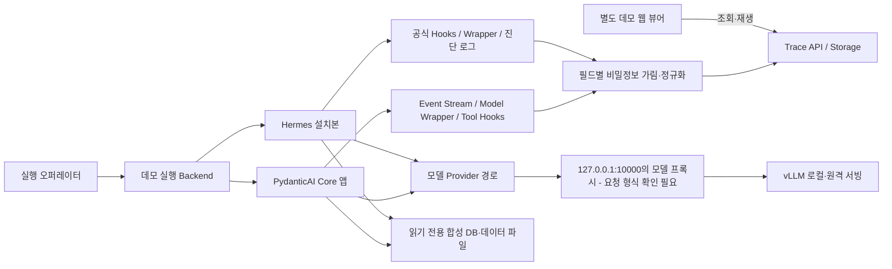

# Agent Framework 2차 세미나 — 최종 발표 블루프린트 및 실동작 데모 제작 명세

> **상태:** 발표 내용·화면 설계·데모 제작 명세 **완성** / 발표용 HTML·PPT, 실제 데모 코드 및 실행 Trace **미제작·미검증**  
> **작성 기준:** 2026-11-03 / 사용자가 업로드한 `agent_framework_seminar_2_planning_handoff.md`를 최우선 인계 자료로 사용. 현재 대화에 마운트된 7개 1차·2차 심층 연구 MD 및 종합 비교 MD를 보조 자료로 검토하고, 주요 공식 문서로 일부 사실을 교차 확인했다.  
> **중요:** 사용자 첨부 인계서가 인용하는 프로젝트 루트 `C:\Users\namws\OneDrive\Desktop\study_for_agent_framework`의 모든 원본 파일·1차 슬라이드 렌더링을 직접 열어 본 것은 아니다. 그 파일들에 대한 설명은 인계 문서의 기술을 따른다. 

---

## 0. 이 문서를 어떻게 사용할 것인가

### 0.1 즉시 사용할 수 있는 것과 아직 없는 것

이 문서는 다음 제작자가 **슬라이드 단위로 HTML/PPT를 구현하고, 두 개의 실제 Agent Trace 데모를 별도 웹페이지로 제작할 수 있는 설계 명세**다. ① 발표의 고정 스토리·슬라이드별 문구·도식·강조·발표자 노트, ② 공식 기술 근거 및 검증 유보, ③ Hermes/PydanticAI 데모 설계와 실행 관찰 범위, ④ 외부 API에서 `localhost:10000` 프록시 뒤 vLLM으로 옮기는 설정·검증 계획, ⑤ 다음 구현 에이전트의 인수 기준을 포함한다.

**지금 하지 않은 일:** 패키지 설치, 실제 Hermes/PydanticAI 실행, Trace 생성, 라이브 모델 검증, HTML/PPT 제작, 대상 PC 접속, API 키 사용. 화면에서 `실제 실행`이라고 표기할 수 있는 내용은 **후속 구현·검증 완료 후 수집된 Trace**에 한한다. 아래의 시퀀스·데이터·모형은 명시적으로 `[설명용]` 또는 `[기획]`이다.

### 0.2 인용 및 신뢰도 규칙

- `[LOCAL-H2]` 등은 인계 문서 §3.1의 프로젝트 파일 약칭. `LOCAL-CMP`는 7종 종합 비교. 이 약칭들은 실제 로컬 분석을 가리키지만, 후속 구현 환경을 검증한 증거는 아니다.
- `[OFFICIAL]`은 이 문서 말미 URL의 공식 문서. 갱신되는 `main/latest` 공식 문서는 **고정 릴리스와 항상 같지 않다.**
- `[DESIGN]`은 발표 구성·데모 설계 제안; `[PSEUDO]`는 원리를 설명하기 위한 의사코드; `[TEST]`는 구현 후 실행 검증이 필요한 주장.
- 버전·메서드·옵션을 주장할 때는 `제품 / Python 또는 CLI / 버전 / 정확한 출처 / 검증 상태`가 함께 있어야 한다. 확인 불가 항목을 빈 칸이 아닌 **미확인**으로 남긴다.

### 0.3 핵심 발표 메시지

> **“Agent의 기본 구성은 이미 배웠다. 2차에서는 누가 실행 루프를 소유하고, 프롬프트·Tool·정책·상태를 어떻게 통제하며, 그중 개발자가 어디까지 직접 책임져야 하는지를 실제 기술별로 분석한다.”**

청중이 발표 직후 설명할 수 있어야 하는 문장:

1. Hermes와 Claude Code는 실행환경(Harness)을 많이 제공하지만 통합·격리·관측·재현의 책임이 사라지지 않는다.
2. PydanticAI는 타입만 있는 도구가 아니라 내부 실행 Graph, Tool 관리, Output 정책·Hooks를 조합하는 Core이며, **별도 Harness와는 제품·패키지 경계를 가진다**.
3. OpenAI의 as-tool과 handoff, Google의 Event/Workflow, Microsoft의 Middleware/Superstep, Claude SDK의 CLI 제어는 **같은 “멀티에이전트”라는 말로 대체할 수 없는 제어 계약**이다.
4. 동일한 BIN 분석 요청이라도 최종 Provider 입력, 실행된 Tool, 정책 통과, 저장된 History/Memory, 복구 후 부작용 여부가 다르다.
5. 라이브러리 비교의 마지막 질문은 **어떤 제품이 최고인가**가 아니라 **누가 데이터를 보증하고 실행을 책임지는가**다.

### 0.4 범위·우선순위·슬라이드 분량

- **고정 순서:** Hermes → Claude Code → PydanticAI → OpenAI Agents SDK → Claude Agent SDK → Google ADK → Microsoft Agent Framework → 종합·운영.
- **집중:** Hermes, PydanticAI. 이 둘만 **각기 독립된 실제 런타임 데모**를 제작한다. Claude Code·나머지 SDK는 비교와 차별화된 작동 원리 중심이다.
- **제외:** Agent 입문 강의 재연, LangChain/LangGraph 또는 vLLM/SGLang의 엔진 내부 강의, 근거 없는 모델 성능 순위, 실제 제조 데이터·실설비 변경 시연.
- **권장 화면 설계:** 본편 S01–S46 **46개 슬라이드**. `B01–B24`의 재해석이지 이를 그대로 24장으로 복제한 것이 아니다. 부록 A01–A08은 발표 시간에 따라 사용. 발표 시간이 미정이므로 **필수·압축 후보**를 각 슬라이드에 표시한다. 장수는 청중의 기초 학습 완료를 전제로 적절한 심화 깊이를 확보한 기획값이며 실제 제한이 생기면 슬라이드끼리 합친다.
- **시연 타이밍:** S14 이후 Hermes Demo 1, S31 이후 PydanticAI Demo 2의 별도 브라우저 탭으로 이동. 슬라이드 HTML에 데모 코드를 내장하지 않는다.

### 0.5 시각적 공통 규칙

- 16:9, 다크 테마 후보 배경 `#0B1020`, 본문 `#EFF4FF`, 보조 `#9EACC8`; 모든 색은 충분한 대비를 확인한다.
- 역할 색: **모델=파랑 / 실행 Runtime=보라 / Tool·외부 실행=초록 / Prompt·History·State=주황 / 경고·차단=붉은 계열**. 동시 흐름=분리된 실선, 데이터 저장=점선, 선택 분기=라벨이 달린 마름모, 시간축=아래 방향. 색상만으로 상태를 구별하지 않는다.
- 각 기술에 **대표 전체 아키텍처 마스터 다이어그램 1개**를 만들고 세부 슬라이드마다 동일한 좌표의 해당 영역에 강조 표시한다. 각기 다른 기술을 하나의 범용 Agent Loop 그림으로 바꾸지 않는다.
- 도식의 `주체 / 입력 / 출력 / 저장소 / 오류 경계 / 정책 경계`를 모두 표시. 1차 기초 용어의 긴 정의는 본문에 넣지 않는다.
- 한 장 한 결론. 화면 문구는 2–5줄 이내를 우선하되 비교표는 최대 5–6행. 코드는 본문 4–10줄만, 나머지는 발표자 노트와 부록에 수록.
- 화살표는 반드시 의미를 갖는다. ① 호출, ② 이벤트, ③ 상태 기록, ④ 결과 반환, ⑤ 제어권 이전을 다른 라벨/스타일로 표시.
- 좌측 상단 기술명·현재 장, 하단 **버전과 간략 출처**. HTML 슬라이드는 화면·노트·발표자 내비게이션 분리. 화면 단축키는 정지된 화면에서도 설명이 가능해야 한다.
- 원본 다이어그램 SVG/Mermaid를 편집 가능하게 관리하되, 슬라이드에 내장할 때는 가독성을 검수한다. **텍스트를 이미지로 무작정 렌더링하지 않는다**.
- 발표 전 환기용 `실무 시사점`은 모든 슬라이드에 강제로 추가하지 않는다. 실질적인 설계 결정을 바꾸는 순간에만 추가한다.

### 0.6 재사용할 공통 BIN 분석 카드 — 데모 데이터 미확정 상태

발표 곳곳에서 사용할 동일한 질문 흐름:

1. **조회:** “지정된 Lot·기간의 BIN-X 오류율과 분모·기준값을 조회해줘.”
2. **근거 분석:** “변화의 이유는? 다른 측정값과 비교해 관찰 사실·가설·불확실성을 구분해줘.”
3. **예측:** “별도 기간의 데이터를 써서 미래/미관측 BIN 지표를 예측하고 방법·평가·한계를 알려줘.”

`BIN-X`, Lot ID, 수치, 표준값, 기간은 가상의 이름이다. 실제 데이터 사전 없이는 **오류율 분모, 예측 대상, 인과관계, 정확도**를 확정하지 않는다. 후속 데모는 재현 가능한 **익명화/합성 데이터만 사용**하고, 별도 테스트에 안전한 Mock 승인 도구를 준비한다. [LOCAL-CMP] / 인계 §7·R10.

---

## 1. 자료·버전·검증 지도

### 1.1 기존 연구 기준(동일 버전 추적을 위한 베이스라인)

| 기술 | 이 문서의 연구 베이스라인 | 공식 확인 및 경계 |
|---|---|---|
| Hermes | v0.22.5 (기존 2차 조사) | 공식 Developer Guide는 계속 변경된다. `stable/context/volatile`, Tool Registry, Gateway, Plugin을 **대상 태그 소스에서 재확인** [OFFICIAL-H]. |
| Claude Code | CLI v2.1.314 | 공식 Hooks/Memory/Subagent/Teams 설명 확인 가능. 전체 내부 엔진 소스 공개로 간주 금지 [OFFICIAL-C]. |
| PydanticAI | Python Core v2.61.0 | 공식 `run/run_sync/run_stream/run_stream_events/iter`, EndStrategy 및 Core/Harness 구분 확인; 고정 버전에서 정확한 import·옵션 확인 필수 [OFFICIAL-P]. |
| OpenAI Agents SDK | Python v0.24.0 | 공식 Runner/Handoff/Guardrail/승인 개념 확인. **새 공식 문서의 추가 기능을 고정판 API로 단정 금지** [OFFICIAL-O]. |
| Claude Agent SDK | Python v0.2.176 + CLI v2.1.316 | SDK와 Claude Code 런타임 경계 확인. 이 조합과 Claude Code 단독 v2.1.314 혼합 금지 [OFFICIAL-S]. |
| Google ADK | Python v2.13.0 | Runner/Event/Session, Template Workflow·Graph Workflow를 분리. 정확한 deprecated 범위는 태그 코드로 확인 [OFFICIAL-G]. |
| Microsoft Agent Framework | Python python-1.24.0 | Agents/Harness/Workflow/Middleware와 Superstep Checkpoint 원리 확인. 언어별 차이·실험 기능 확인 [OFFICIAL-M]. |

### 1.2 후속 구현에 앞서 감사해야 할 사실 — 부분 해결표

| 인계 작업 | 이번 문서에서 이미 확인한 것 | 반드시 남길 확인 / 영향 |
|---|---|---|
| R01 PydanticAI API | 공식 문서의 실행 API 5종 및 반환 성격, Output 전략 | 정확한 v2.61.0 타입/import, Streaming 예외, Capability 합성. S22–S29 및 Demo 2 구현 전 |
| R02 Hermes | 공식 구성도·Prompt 층·Registry/Plugin/Gateway | v0.22.5 파일·명령·기본값·Memory Tool 연산·관측 Hook 실제 존재. S04–S14 및 Demo 1 |
| R03 Pydantic Runtime | `run_stream_events()`와 `iter()` 관찰 범위 설명 | Provider 변환 후 실제 요청, History 저장, Deps·Hook 시점의 실코드 검증. Demo 2 |
| R04 출력·승인 | 공식 `graceful / early / exhaustive`의 기본 의미 | 출력/도구가 섞인 **통제된 재현용 응답**과 실 LLM 비교, Deferred 만료·중복 승인. S26–S30 |
| R05 Harness | 별도 Harness가 Memory·Skills·Compaction·Guardrails 등을 제공함을 확인 | Core/Harness 고정 버전 패키지 조합, 기본/선택/실험 기능. S21·S29 |
| R06 다른 SDK | OpenAI Runner·Guardrail; ADK Event; Microsoft Checkpoint의 공식 계약 일부 확인 | 각 고정 태그 구현과 최신 문서의 차이·부분 기능. S32–S42 |
| R07 Claude | 공식 Teams/Subagent/Hooks/SDK 문서 확인 | Teams 실험 설정, AGENTS fallback, SessionStore, 바이너리 내부 관찰 가능성. S15–S19·S35–S37 |
| R08 vLLM | 공식 서버의 tool parser·structured outputs 지원 경로 확인 | `localhost:10000`은 **프록시일 뿐 API 종류 미확정**; served model ID/인증/HTTP 라우트/파서/Chat template 확인. 두 데모 |
| R09 Trace | 프레임워크별 공개 관찰 가능 개념 조사 | **wire payload vs SDK request 객체**, 비간섭 검증·결측 기록. 두 데모 |
| R10 BIN | 공통 시나리오와 데이터 필드 설계 제안 | 분모·타깃·분할·정답·검증 데이터는 미확정. 수치·성과 주장 금지 |
| R11 운영 | 중앙형과 로컬형의 책임 분할 설계 | 사용자 수·권한·인증·GPU 용량·업데이트 배포는 환경 확인 및 측정 후 결정. S44–S46 |

**주의할 충돌:** 공식 Hermes Prompt Assembly의 설명에는 Skill의 Stable/Volatile 위치가 서로 달리 읽히는 문구가 있다. 현재 `main` 문서의 목차·표현만으로 `v0.22.5` 실제 조립 순서를 확정하지 않는다. 각 프롬프트 레이어의 **실제 문자열 조립 함수와 출력 값**을 태그 소스에서 확인하고, 필요 시 발표 문구를 수정한다. [OFFICIAL-H-PROMPT]

---

## 2. 슬라이드 제작 공통 스펙

아래 각 S번호는 **한 장의 슬라이드**를 기본으로 한다. `화면`은 그대로 복사하기 위한 핵심 문구, `시각`은 구현 에이전트가 그릴 그래픽과 위치, `전개`는 클릭/Space 단계, `노트`는 발표자가 반드시 설명할 내용, `근거/검증`은 인용과 미해결 조건, `연결`은 다음 장으로의 전환이다. `필수`는 기본 포함, `압축 가능`은 발표 시간 축소 시 인접 장으로 결합 가능을 뜻한다. 데모 화면은 별도 제작이므로 정적 그림만으로 실제 실행을 대체하지 않는다.

### 도식 공통 규칙: 전체 아키텍처 마스터의 위치

- 각 기술의 첫 슬라이드에서 `입력·개발자 코드 → 실행 코어 → 모델/Tool → 세션·메모리·관찰`의 상대 위치를 고정하되, 해당 기술에 존재하지 않는 컴포넌트를 채워 넣지 않는다.
- 세부 확대는 마스터 그림의 `ID` 예: `H-CORE`, `H-TOOLS`, `P-GRAPH`와 링크한다. 확대 슬라이드에서도 상단 15%에 축소 마스터와 하이라이트 박스 표시.
- 중앙 Agent Loop는 보라색, Provider는 파랑, Tool/Data는 초록, 상태·메모리는 주황. 보호/승인 경계는 붉은 점선 사각형.
- 기록/재생 브라우저는 **별도 응용 계층**이며 Framework 내장 컴포넌트로 그리지 않는다.

---

## 3. 본편 슬라이드: 도입과 Hermes (S01–S14)

### S01 [필수] 이번 질문은 'Agent란?'이 아니라 '누가 실행을 소유하나?'

- **화면:** `Agent Framework 2차 세미나` / `구현을 읽고, 책임을 비교하다` / `완성형 Harness ↔ 직접 조립하는 SDK/Framework`.
- **시각:** 가운데 두 기둥: 왼쪽 `Harness: 실행 루프·세션·도구 통합`, 오른쪽 `SDK: 런타임 제공 + 앱 정책/서빙은 개발자`. 모델 서버는 양쪽 아래 공통 기반으로 분리. 청중이 이미 아는 Agent 구성요소는 푸터에 작은 아이콘으로만.
- **전개:** ① 큰 질문만 → ② 두 선택지 → ③ 마지막 `통제권·운영 책임` 강조.
- **노트:** 이번 발표는 기초 강의 후속이다. 동일한 Tool과 Memory도 어느 코드에서 실행되고 어디에 저장되는지 다르다. 제품들을 기능 수로 순위 매기지 않는다. 마지막에는 어떤 실행 계약이 도메인 데이터에 적합한지 결정한다.
- **연결:** “일곱 기술을 같은 서열이 아닌 아키텍처 층위에 놓고 시작하자.”
- **근거:** [LOCAL-CMP] §§1–3. `[DESIGN]` 구성.

### S02 [필수] 일곱 기술의 자리와 고정 진행 순서

- **화면:** `Hermes → Claude Code | PydanticAI → OpenAI SDK → Claude SDK → Google ADK → Microsoft AF` / `두 축을 깊이 분석하고, 나머지는 차이만 본다`.
- **시각:** 위쪽 완성형 Harness 두 카드(Hermes, Claude Code), 아래쪽 Core/SDK/Framework 다섯 카드. **Claude Agent SDK는 Claude Code CLI에 연결된 브리지**로 그려 같은 레벨 독립 엔진으로 오해하지 않게. PydanticAI Core 바깥에 선택 Harness를 점선으로 그림.
- **전개:** ① 전체 지도 → ② Hermes/PydanticAI 강조 → ③ 데모 두 개 위치 표시.
- **노트:** SDK, Library, Framework, Harness는 배타적 인증 분류가 아니라 이번 발표에서 실행 책임을 설명하는 묶음이다. 같은 개발자가 둘 이상 결합해서 쓸 수도 있다.
- **연결:** “먼저 완성된 Harness를 열어 보자.”
- **근거:** [LOCAL-CMP] §§1–2, [OFFICIAL-H], [OFFICIAL-P-HARNESS], [OFFICIAL-S].

### S03 [압축 가능] 같은 질문을 일곱 기술에 적용할 비교 렌즈

- **화면:** `① Loop 소유자 ② 모델 입력 ③ Tool 실행 ④ 정책·승인 ⑤ 상태·복구 ⑥ 위임·운영`.
- **시각:** 타원형 루프 중심으로 6개 탐침만. 일반 Agent 흐름을 길게 재설명하지 않는다. 각각 앞으로의 구조 그림에서 동일 아이콘 사용.
- **전개:** 아이콘을 한 번에 켠 뒤 Hermes 사례로 줌.
- **노트:** “Guardrail이 있다” 대신 모델 호출 전에/도구 실행 직전에/결과 반환 후 중 어디에 적용되는지 묻고, “Memory가 있다” 대신 언제 읽고 언제 다시 Prompt에 반영되는지 묻는다.
- **연결:** “첫 번째로 Hermes의 전체 조직도를 보자.”
- **근거:** [LOCAL-CMP] §§4–22.

### S04 [필수] Hermes 전체 아키텍처 — 코어 외에도 실행 환경이 있다

- **화면:** `Hermes는 Tool 호출 래퍼가 아니라 자체 Agent Loop·저장소·채널을 갖춘 Harness`.
- **시각 (핵심 마스터 H):** 가로 3단, 세로 2층. 좌측 `CLI/TUI · Gateway · ACP · Cron`(H-ENTRY). 중앙 큰 `AIAgent / conversation loop`(H-CORE). 상단 `Provider Resolver → vLLM/외부 모델`(H-MODEL). 우측 `Tool Registry → 내장 Tool / Plugin / MCP`(H-TOOLS). 아래 `System Prompt Stable/Context/Volatile, Skills`(H-PROMPT), `Session SQLite/FTS5, MEMORY/USER.md`(H-STATE), `Policies/Approvals`(H-POLICY). **Gateway와 Cron은 코어 외부 진입·스케줄링 역할임을 분리**.
- **전개:** ① 입구 → ② 핵심 반복 → ③ 모델/Tool → ④ 저장·정책; 이후 Hermes 슬라이드에서 동일 H 다이어그램 재사용.
- **노트:** Channel마다 Agent가 다른 것이 아니라 같은 코어에 서로 다른 진입 방식과 세션 관리 정책을 붙인다. MCP와 Plugin은 Tool 등록의 동일한 이름이 아니라 다른 확장 경로다. 함수명은 노트에 `run_agent.py`, `agent/conversation_loop.py`, `tools/registry.py`, `hermes_state.py` 정도만 둔다.
- **연결:** “이 가운데 Loop 하나가 실제 Tool을 어떻게 실행할까?”
- **근거:** [LOCAL-H2] §§2–3; [OFFICIAL-H-ARCH], [OFFICIAL-H-TOOLS]. 버전 경로 검증 R02.

### S05 [필수] Hermes 한 번의 요청 — LLM 응답 뒤가 진짜 Runtime

- **화면:** `Model의 Tool 요청 ≠ Tool이 이미 실행됨` / `검증 → Intent 기록 → 정책 검사 → 실행 → 결과 기록 → 다음 Model`.
- **시각:** H-CORE 영역 확대, 세로 시퀀스 `user → agent → provider → model → agent → session-store → policy → tool → session-store → provider`. 저장과 실행 사이에 게이트를 두고 **저장 실패 시 Tool 실행 금지** 조건을 붉은 가지로 표시. 모델이 text/final을 반환하면 Tool 분기 밖의 종료 경로 표시.
- **전개:** ① 모델 요청 → ② Tool Call 파싱 → ③ Intent 내구성 → ④ 실행 결과 → ⑤ 재질의/종료 판정.
- **노트:** 실제 소스에 있는 Intent 저장 선행의 이유는 Tool을 실행했는데 대화 기록에 호출 사실이 없는 상태를 피하기 위해서다. 설명 예시는 조건을 구체화한다: Tool 결과가 반환되면 결과 메시지가 기록되어 다음 모델 입력에 추가되며, 유효한 Tool Call 없이 답변이 만들어지면 최종 응답 경로로 간다. 예산 초과, 모델 오류, 승인 필요는 별도 종료/중단 상태로 표시한다. 실패 시 모든 경우가 자동 재시도되는 것은 아니다.
- **연결:** “하지만 Tool 실행 전에 이미 모델은 어떤 입력을 보았을까?”
- **근거:** [LOCAL-H2] §§3–4, 11–12, 17. 실행 추적 DEMO-H-T1.

### S06 [필수] Hermes 모델 입력은 '저장한 것 전부'가 아니다

- **화면:** `System Prompt Snapshot + 현재 대화 History + Tool Schema + 이번 호출의 임시 레이어`.
- **시각:** H-PROMPT 확대. 위에서 아래로 세 레이어 `Stable / Context / Volatile` 옆에 `Session Frozen Snapshot`. 아래 `history/messages`와 `available tool schemas`; 오른쪽 별도의 `ephemeral call-time additions` → Provider payload 변환. **절대 Deps/Skill 파일 전체/과거 세션 전체가 무조건 전송되는 그림을 금지**.
- **전개:** ① Stable → ② 프로젝트 Context → ③ Memory/Skills 같은 Volatile → ④ History/Tool Schema → ⑤ Provider-side request. 각 요소가 실제 모델에 포함되는지 `capture origin` 표식.
- **노트:** 파일이 디스크에서 바뀐다고 기존 세션의 System Prompt Snapshot이 즉시 갱신되지는 않는다. 새로운 Tool 결과로 최신 파일을 읽으면 모델에게 별도 대화 메시지로 제공할 수 있다. `Volatile`은 매 호출마다 자동 변경된다는 뜻이 아니라 세션 간 재구성 가능성이 상대적으로 높은 영역이라는 뜻. **Skill 인덱스의 정확한 위치는 버전 고정 출력으로 검증**.
- **연결:** “왜 이런 안정성을 일부러 강제할까?”
- **근거:** [LOCAL-H2] §§5–6, 8; [OFFICIAL-H-PROMPT]. 실행 추적 DEMO-H-T2.

### S07 [필수] Prefix Cache와 Compaction은 완전히 다른 최적화

- **화면:** `Cache = 같은 Prefix의 연산 재사용` / `Compaction = 다음 요청에 보낼 History를 줄이기`.
- **시각:** 동일 10칸 토큰 바 비교 ① 앞 8칸 같음: Prefix KV 재사용 가능, ② 첫 칸 변경: 뒤가 같아도 Prefix 적중 불리. 아래 Tool 결과가 길어져 압축 전/후 History 바 표시. `Saved Token Count`가 아닌 `reused computation` 레이블. 숫자는 전부 **설명용**.
- **전개:** ① 입력 총 길이 동일 → ② KV Cache 적중 → ③ 뒤쪽 volatile 변화 → ④ 압축으로 사용되는 토큰 자체 감소, 단 캐시 Prefix 변경 가능.
- **노트:** 캐시는 Python 문자열 조립 시간을 줄이는 것이 아니라 모델 서빙의 Prefill 연산 재사용이다. 사용 중인 Provider·vLLM이 실제 APC를 지원·활성화하고 캐시가 살아 있어야 한다. Compaction 시 어떤 Tool Call/Result 쌍을 보존하는지는 안전성 검토의 대상이다. 빠르게 처리되었다고 과거 데이터가 최신이라는 뜻은 아니다.
- **연결:** “그렇다면 Memory는 실제 어디에 저장되고 언제 반영될까?”
- **근거:** [LOCAL-H2] §§6–8, [OFFICIAL-H-PROMPT]; R08, 캐시 실측 P2.

### S08 [필수] Hermes Memory / SQLite FTS5 / Skills는 같은 메모리가 아니다

- **화면:** `Memory = 선별된 지속 정보` / `Session+FTS5 = 대화 기록·검색` / `Skill = 재사용 절차`.
- **시각:** 세 수평 레인. `MEMORY.md / USER.md ↔ memory Tool`(파일 기록), `Session SQLite → FTS5 lexical search`(이력), `Skill index → 선택적 SKILL.md 본문 로딩`(절차). 레인마다 `저장한 사람 / 읽기 시점 / Prompt 재반영 시점 / 검색 수단` 작은 표. FTS5는 벡터 검색이 아니라 어휘 기반, 검색 내용을 생성에 제공하면 넓은 RAG 패턴 가능.
- **전개:** ① 대화 중 메모리 Tool로 저장 → ② System Prompt는 보통 frozen → ③ 새 세션/명시 갱신 시 새로운 Snapshot → ④ FTS 검색과 Skill 본문 읽기는 별도 동작.
- **노트:** Memory 파일의 최신 내용과 이미 구성된 Prompt Snapshot을 동일시하지 않는다. 도메인 지식의 정답원은 현재 SOP Revision·수집 시점이 확인된 조회 데이터여야 한다. Skill 자동 생성은 절차 파일을 작성하는 편의이지 품질 보증이 아니다.
- **연결:** “이 절차와 도구가 실행 엔진에 어떻게 들어올까?”
- **근거:** [LOCAL-H2] §§8–10, [OFFICIAL-H-ARCH]. R02.

### S09 [필수] Hermes Tool / MCP / Plugin — 확장 경계의 차이

- **화면:** `Tool = 실행 기능` / `MCP = 외부 도구 프로토콜` / `Plugin = Hermes 자체 확장 인터페이스`.
- **시각:** H-TOOLS 영역 3갈래. ① `Built-in/Registry Tool` ② `MCP Client → MCP Server Tool` ③ `Plugin manager → ctx.register_tool / hook / command / provider` → 모두 적절한 경로로 Tool 목록에 접속. `LLM에 노출되는 것은 Schema, Hook 코드는 Runtime에서 실행` 문구. Plugin이 Tool 등록 외 Memory/Context Provider도 다룰 수 있음을 작은 가지.
- **전개:** 각 경로에서 `모델에 보이는 이름·Schema → 모델 호출 → Hermes dispatch → 실행 위치` 색다른 화살표.
- **노트:** Custom Tool을 추가하는 경로가 Plugin 하나뿐인 것은 아니다. Registry에 직접 등록하거나 MCP 서버에서 Tool을 제공할 수도 있다. Hook은 등록된 Tool의 코드가 모델에 주입된다는 뜻이 아니다. 서비스 제약은 실행 백엔드 권한에서 다시 강제해야 한다.
- **연결:** “실행권한이 없다면 Hook에서 어디를 막아야 할까?”
- **근거:** [LOCAL-H2] §§11–12; [OFFICIAL-H-TOOLS], [OFFICIAL-H-HOOKS]. R02.

### S10 [필수] Hermes Guardrail은 하나의 '검사 함수'가 아니다

- **화면:** `지침 → Tool 노출 → 인자/정책 검사 → 사용자 승인 → 실제 실행 환경 제한`.
- **시각:** 도구 호출 전 4개의 Checkpoint를 배치하고 `pre_tool_call` 같은 Plugin Hook이 위치할 수 있는 곳, terminal approval, OS 파일/네트워크 권한을 각각 다른 위치에 표기. 실패 유형별 `Block` vs `Ask` vs `Error` 경로.
- **전개:** ① Prompt 상의 금지 지시만으로 막을 수 없음 → ② Runtime 정책 → ③ 승인된 최종 인자 → ④ OS/DB 계층이 최종 강제. Hook 예외가 항상 Fail-closed인지 별도 검증 표시.
- **노트:** 프롬프트는 모델의 선택을 유도할 뿐 Tool 실행 자체를 막는 권한 시스템이 아니다. 관찰 Hook과 차단 Hook을 구분한다. 관리자 승인도 승인 후 실제 실행 인자가 달라지면 무의미해질 수 있으므로 최종 인자·사용자·데이터 버전 바인딩을 권장한다.
- **연결:** “여러 Tool이나 여러 Agent를 동시에 실행하면 이 정책은 어떻게 적용될까?”
- **근거:** [LOCAL-H2] §§12–14; [OFFICIAL-H-HOOKS]. R02·R09.

### S11 [필수] 병렬 Tool과 병렬 Subagent는 '동시에 실행'의 다른 의미

- **화면:** `병렬 Tool: 한 Loop 안에서 함수 여러 개` / `병렬 Subagent: 독립 Loop·History를 여러 개`.
- **시각:** 좌측 Main Agent 한 개 → ThreadPool Worker 3개 Tool → 결과 합치기; 우측 Main Agent → 3개의 `AIAgent` 인스턴스와 각각 Loop·Tool 호출 → 부모로 최종 결과. 아래 `스레드·프로세스·Agent 인스턴스`를 구분하는 3행 레전드.
- **전개:** ① 모델이 3개 Tool Call을 제안 → ② 실제 Pool에 분배 → ③ 충돌·상호작용 도구는 장벽/순차 처리 → ④ Subagent는 각자 모델 재호출 가능 → ⑤ OS 프로세스 격리는 별도 문제.
- **노트:** Tool 병렬이라고 모든 도구가 무조건 스레드에서 동시에 도는 것은 아니다. 경로 충돌·interactive 도구는 다른 정책을 따른다. 여러 Subagent를 생성해도 반드시 여러 Python 프로세스는 아니다. 별도 컨텍스트와 실제 파일/DB/네트워크 격리는 다른 문제다. Subagent 비용은 여러 모델 Loop 사용으로 증가할 수 있다.
- **연결:** “동시에 접속하는 사용자가 많아지면 누가 세션을 소유할까?”
- **근거:** [LOCAL-H2] §§13–15. 재현 로그 DEMO-H-T6.

### S12 [필수] Hermes Gateway·Cron·Session 소유권

- **화면:** `사용자 수 ≠ Agent 프로세스 수 ≠ LLM 요청 수` / `Cron은 현재 Loop 반복이 아니라 새 작업 트리거`.
- **시각:** `Client A/B/C → Gateway session router → AIAgent runs → remote/localhost model` + 아래 `Cron scheduler → new task/run → delivery`. 한 사용자 세션의 write serialization, 다른 세션의 동시성, Tool Worker, LLM 서버 GPU 병목을 다른 박스로 표현.
- **전개:** ① 동기 응답 → ② 스트리밍 → ③ background job → ④ Cron → ⑤ 재시작/중복 작업 지점 표시.
- **노트:** Hermes의 Gateway가 여러 채널·세션을 관리한다고 해서 외부 Tool/DB 변경이 exactly-once로 보장되는 것은 아니다. Cron 작업 결과를 어떤 채널로 전달하는지, Job의 상태·재시도·중복 방지 경로를 살펴야 한다. `hermes` slash/CLI 명령은 해당 버전의 실제 지원여부 확인 후 예시로 제시한다.
- **연결:** “지금까지의 부품이 한 BIN 분석 실행에서는 어떻게 보일까?”
- **근거:** [LOCAL-H2] §§15–16; [OFFICIAL-H-ARCH].

### S13 [필수] Hermes 대표 실행 — 세 가지 질문을 하나의 Trace로

- **화면:** `BIN 오류율 조회 → 근거 분석 → 예측` / `매 단계: 실제 요청·Tool·History·종료 판단을 확인`.
- **시각:** 고정된 H 마스터 위에 3개의 턴 스티커: `T1 조회`, `T2 근거`, `T3 예측`. 아래 *실제 기록에서만* 채워질 `run ID`, `model ID`, `tool_calls`, `context chars/tokens`, `result` 빈 슬롯. **아직 값 없음** 표시.
- **전개:** ① 모델 입력 보이기 → ② 실행된 Tool → ③ 추가 모델 호출 → ④ State/Memory 변화 → ⑤ 분기와 종료. 외부 화면 진입 위치 설명.
- **노트:** 데모는 실제 Hermes 소스/패키지를 설치하고 최소 침습 관측한다. 데모 브라우저에서 Space는 **이미 기록된 이벤트**를 순서대로 읽는 기능이지 모델을 강제로 단일 스텝 실행시키는 기능이 아니다. 캐시·압축·Subagent가 실제 발생하지 않으면 미발생으로 표시한다.
- **연결:** “별도 Demo 1 탭으로 이동한다.”
- **근거:** 인계 §7.2. 시연 경로 DEMO-H-T1–T7.

### S14 [필수] Demo 1 복귀 — Hermes에서 개발자가 얻는 것과 남는 책임

- **화면:** `이미 갖춘 것: Harness·Tool·Memory·Sessions·Gateway` / `남는 것: 도메인 데이터의 정확성·권한·신선도·운영 검증`.
- **시각:** S04 마스터의 실제 Demo에서 관측된 영역만 채색; 미발생/미관측 구역은 회색 점선. 가운데 `Tool schema가 존재한다 ≠ 권한이 보장된다`.
- **전개:** ① 확인된 경로 → ② 확인 불가 영역 → ③ 개발자 책임.
- **노트:** 실제 실행 전이라면 관측 사실이 아닌 발표 목표로만 기재. BIN 결과의 참값은 DB·평가 자료가, 안전성은 애플리케이션과 실행 계층이 책임진다. Hermes가 잘하는 것은 통합 실행 Harness를 빠르게 활용할 수 있다는 것.
- **연결:** “같은 Harness 성격의 Claude Code는 무엇을 다르게 선택했을까?”
- **근거:** [LOCAL-H2], [LOCAL-CMP] §§23, 32.

---

## 4. Claude Code — 다른 Harness의 설계 선택 (S15–S19)

### S15 [필수] Claude Code 전체 아키텍처 — CLI Harness와 코딩 작업 환경

- **화면:** `Claude Code = 파일·Shell·프로젝트 지침·세션·권한을 통합한 코딩 Agent Harness`.
- **시각 (마스터 C):** `Terminal/IDE/Desktop`(C-ENTRY) → `Claude Code runtime (internal implementation not fully public)`(C-RUNTIME) ↔ `Claude model`(C-MODEL). 아래 `Tools: Read/Edit/Bash/MCP`, `Instructions: CLAUDE.md, rules`, `Memory/Skills/Session`, `Hooks/Permissions/Sandbox`, 오른쪽 `Subagents/Teams`. SDK로 접근하는 얇은 통로는 나중에 S35에서만 확대.
- **전개:** ① 입력 채널 → ② Harness와 모델 경계 → ③ 작업 도구·정책 → ④ 세션·협업.
- **노트:** Hermes와 같은 큰 범주의 완성형 Agent를 비교하되, Claude Code 내부 바이너리의 소스 함수 경로를 임의로 만들지 않는다. 공개된 것은 사용 계약·CLI·Hook·SDK 등이며 핵심 내부 Loop 모두가 공개 소스인 것은 아니다.
- **연결:** “프로젝트 지침과 기억은 Hermes와 동일하게 고정될까?”
- **근거:** [LOCAL-C2], [OFFICIAL-C-MEMORY], [OFFICIAL-S].

### S16 [필수] Claude Code의 Instruction·Memory·Skill과 실제 명령

- **화면:** `프로젝트 지침 / 자동 메모리 / 필요한 시점의 Skill` / `관찰·압축·재개 명령을 '작동 원리'와 연결`.
- **시각:** C-RUNTIME 확대, 지침 파일 읽기 → 세션 프롬프트, Auto Memory 파일 → 필요 시 조회, Skills 메타데이터 → 선택적 본문 로딩. 오른쪽 명령 후보: `/context`(컨텍스트 보기), `/compact`(압축), `/resume`(세션 선택), `claude -c`(최근 대화 이어가기), 버전 검증 마크. `CLAUDE.md / AGENTS.md`는 fallback/import 조건을 두 갈래로 표현하고 둘 다 항상 자동 로딩된다고 그리지 않는다.
- **전개:** ① 세션 시작 → ② 추가 파일 참조 → ③ 압축 → ④ 재개. 명령의 효과를 이벤트와 연결.
- **노트:** `/context`가 모든 실제 Provider wire payload를 보여 준다는 뜻이 아니다. Memory와 프로젝트 파일은 용도가 다르며 재개는 로컬 파일 변경을 자동 복원해 준다는 뜻이 아니다. 명령 구문은 해당 릴리스에서 공식 문서/CLI `--help`로 확인 후 출력한다.
- **연결:** “이 Harness는 Tool 권한을 어디에서 강제할까?”
- **근거:** [LOCAL-C2], [OFFICIAL-C-MEMORY], [OFFICIAL-C-HOOKS]. R07.

### S17 [필수] Claude Code Permission·Hook·Sandbox: 모델에게 지시하는 것과 강제하는 것

- **화면:** `Tool 선택은 모델, 실행 허가는 Runtime, 실제 접근은 OS/서버`.
- **시각:** `모델의 Bash/Edit/MCP call` → `permission rules + PreToolUse hooks` → `sandbox / filesystem / credentials` → Tool. **보호 주체를 3개**로 분리하고 `Read Hook만 보호`처럼 특정 경로에만 적용된 정책이 다른 읽기 경로까지 통제하지 못하는 예시 표시.
- **전개:** ① 모델이 실행 시도 → ② 승인/Hook → ③ OS 경계 → ④ PostToolUse/결과 흐름. Hooks 실패가 항상 차단인지 이벤트별로 다르므로 `설정/이벤트에 따라 다름` 주석.
- **노트:** `allowed_tools`나 Permission Mode는 하나의 모든 실행을 강제하는 만능 Whitelist가 아니다. 더 안전한 Agent는 실제 DB·파일 권한을 Runtime 외부에서 중복 검사해야 한다.
- **연결:** “부모·자식만 있으면 모든 Multi-Agent를 설명할 수 있을까?”
- **근거:** [OFFICIAL-C-HOOKS], [LOCAL-C2].

### S18 [필수] Claude Code Subagent vs Agent Teams — 협업 구조 자체가 다르다

- **화면:** `Subagent = 부모가 맡기고 결과를 받음` / `Teams = 독립 세션들이 메시지·업무를 공유`.
- **시각:** 왼쪽 `Lead → Child A/B → Lead` 단방향 결과 반환; 오른쪽 `Lead + teammate A/B/C` 각각 자기 세션에서 직접 메시지, 공유 작업 상태(작업 단위). 오른쪽에 `experimental / enablement conditional` 각주. `서로 다른 세션`과 `별도 OS 보안 경계`를 동일시하지 말 것.
- **전개:** ① 부모 위임 → ② 결과만 부모 전달 → ③ 팀 간 메시지 → ④ 상태·토큰·충돌 부담.
- **노트:** 독립적인 참가자가 여러 결과를 서로 검증해야 한다면 Teams의 장점이 있을 수 있지만, 공유 파일 충돌·정책 일관성·비용이 증가한다. 실제 Agent Teams 활성화 방식·제약은 배포 버전에 따라 확인한다. 성능 우위를 수치 없이 주장하지 않는다.
- **연결:** “같은 Harness라도 선택한 제어권이 다르다.”
- **근거:** [OFFICIAL-C-TEAMS], [OFFICIAL-C-SUBAGENTS].

### S19 [필수] Hermes ↔ Claude Code — 비교의 결론

- **화면:** `같은 Harness 계층, 다른 확장·관찰·권한 계약`.
- **시각:** 비교 열 `코어 공개성`, `메모리/지침`, `Tool 등록`, `Hooks/권한`, `Subagent/Teams`, `Gateway/배포`. 단정적 우열 표기 금지. 예: Hermes의 공개 Python Agent Loop와 SQLite/FTS5, Claude Code의 공개 CLI/SDK/Hook 계약과 비공개 코어 경계.
- **전개:** Hermes에서 봤던 구조 그림 왼쪽과 Claude 오른쪽, 항목별 단 한 줄 차이.
- **노트:** Hermes를 소스 수준으로 수정·관찰하는 연구는 상대적으로 직접적이다. Claude Code는 통합 코딩 경험을 재사용할 수 있지만 내부 세밀한 알고리즘 변경은 공개 API 경계에 제한된다. 선택은 통제·운영·모델 경로에 따라 달라진다.
- **연결:** “이제 완성된 Harness에서 직접 Agent 애플리케이션을 개발하는 Core로 이동한다.”
- **근거:** [LOCAL-H2], [LOCAL-C2], [LOCAL-CMP] §§23,28.

---

## 5. PydanticAI — '직접 만드는 Agent'의 실행 계약 (S20–S31)

### S20 [필수] Pydantic → PydanticAI Core → 별도 Harness, 무엇이 달라지는가

- **화면:** `Pydantic = 데이터 검증 기반` / `PydanticAI Core = Agent 실행·도구·출력 계약` / `Harness = 여러 Capability를 묶은 선택적 Agent Stack`.
- **시각:** 3개의 크기가 다른 레이어가 아닌 **상호 의존 지도**. 아래 `Pydantic: BaseModel/validation`, 중앙 `PydanticAI: Agent/Graph/Toolsets/Model/Output`, 오른쪽에 붙는 `pydantic-ai-harness (별도 패키지): Memory/Skills/Compaction/Guardrails/...`, 바깥 `Logfire / Evals / 외부 DB·API`. `pydantic_graph`는 별도 Graph 라이브러리, Core 내부 실행 Graph와 연결되지만 동일한 사용 API로 오인 금지.
- **전개:** ① Pydantic 기본 역할 10초 → ② AI Core → ③ Harness는 추가/선택 → ④ 애플리케이션 책임 표시.
- **노트:** 프레임워크의 핵심 가치는 Pydantic으로 JSON만 검사한다는 것이 아니다. 모델 호출·도구 검증·Graph 노드 전이·재시도/출력 완료 정책을 제공한다. 하지만 DB 권한, 데이터 신선도, 승인자 정보, 상태 저장소는 설계 대상이다. Harness의 지원 항목·버전은 Core v2.61.0과 각각 따로 고정한다.
- **연결:** “실제로 개발자는 코드 어느 부분을 쓰고 Core는 어디부터 실행할까?”
- **근거:** [LOCAL-P2] §§2,4,15–20; [OFFICIAL-P-HARNESS]. R01/R05.

### S21 [필수] PydanticAI 전체 아키텍처 — 개발자 정의와 Runtime 경계

- **화면:** `개발자가 계약을 선언하면, Core가 이를 실행 Graph로 해석한다`.
- **시각 (마스터 P):** 좌측 `App: Agent config / model / instructions / tools / deps / output_type / history`(P-APP). 중앙 `Agent Run → UserPromptNode → ModelRequestNode ↔ CallToolsNode → End`(P-GRAPH). 위 `Model+Provider`(P-MODEL), 우측 `ToolManager / Toolsets / OutputValidator`(P-TOOLS), 아래 `RunContext / Messages / Deferred`(P-STATE). 외부 점선 `Harness/Logfire/Evals`, `Session storage`, `App policy`.
- **전개:** ① App 코드 작성 → ② 실행 Graph 진입 → ③ 모델·도구 ↔ 반복 → ④ 검증 완료/대기 → ⑤ 애플리케이션 저장·응답.
- **노트:** 그래프는 사용자가 LangGraph를 붙여야 동작한다는 뜻이 아니다. `pydantic_graph`를 사용한 사용자 정의 워크플로와 내부 Graph는 구분한다. Deps는 Python 실행 자원, History는 LLM 메시지, Output Type은 결과 계약이다.
- **연결:** “같은 Agent를 돌려도 API에 따라 관찰하는 수명은 다르다.”
- **근거:** [LOCAL-P2] §§4–6; [OFFICIAL-P-AGENT].

### S22 [필수] 다섯 실행 API — 사용자 코드에서 보이는 실행 수명의 차이

- **화면:** `run_sync / run / run_stream / run_stream_events / iter는 동일한 출력 포맷의 변형이 아니다`.
- **시각:** 행 5개 표: `run_sync` 동기 완료 `RunResult`; `run` 비동기 완료 `RunResult`; `run_stream` 출력 중심 스트림과 수명 관리; `run_stream_events` 전체 Event 스트림과 최종 결과 Event; `iter` Graph 노드 단계 탐색. 오른쪽 세로 3색 `완료값 / 이벤트 / 노드 제어`. 문서상 세부 반환 객체·ContextManager 구현은 고정판 검증 표시.
- **전개:** ① 쉬운 완결 실행 → ② 스트리밍의 차이 → ③ 관찰 데모에는 `run_stream_events`/`iter` 검토.
- **노트:** `run_stream()`은 사용자가 예상한 최종 출력이 먼저 나타나면 추가 Tool과의 관계가 비스트리밍 `run()`과 달라질 수 있다. 일부 Tool이 끝나기 전 화면에 문자가 나왔다고 애플리케이션 전체 작업이 완료된 것은 아니다. 데모는 Graph 수명 관찰이 목적이므로 전체 이벤트 스트림 우선 설계.
- **연결:** “그 이벤트가 내부 어떤 Node에서 만들어지는지 보자.”
- **근거:** [OFFICIAL-P-AGENT] 실행 API 설명; [LOCAL-P2] §5. R01/R03.

### S23 [필수] PydanticAI Graph의 핵심: 모델 응답을 받아 어떤 Node로 이동하는가

- **화면:** `UserPromptNode → ModelRequestNode → CallToolsNode ↔ ModelRequestNode → End`.
- **시각:** 중앙 State Machine에 3개 Node와 `End`, `Deferred` 분기. `ModelRequestNode`에서 모델 응답을 받아 `Function Tool / Output Candidate / Retry Needed`로 나눔. RunContext와 History는 Node 옆의 공유 상태로 표현.
- **전개:** ① 입력 메시지 생성 → ② Provider 요청 → ③ Tool Call 이벤트 → ④ 인자 검증·출력 검증 → ⑤ 재모델/종료/Deferred. 실패 유형별 분기를 다른 라벨로.
- **노트:** “언제 종료하나?”의 답은 요청이 끝났기 때문이 아니라 **유효한 최종 출력 후보를 채택했고 해당 EndStrategy/Run 계약상 남은 실행이 더 이상 필요하지 않을 때**다. 도구 실패·Schema 실패는 여러 Retry 경로 중 어디로 반영되는지 구분한다.
- **연결:** “모델에는 Python에 있는 정보를 전부 보내는가?”
- **근거:** [LOCAL-P2] §§4–7,10–13; [OFFICIAL-P-AGENT], [OFFICIAL-P-OUTPUT].

### S24 [필수] Instructions·Deps·History·Tool Schema: 모델에 '보이는 것'의 경계

- **화면:** `Deps는 App 실행 문맥; Instructions·History·Tool Schema는 모델 요청 재료`.
- **시각:** 좌측 App Layer에 `RunContext.deps` 안의 DB connection·권한 식별자(마스킹), 우측 Provider payload에 `system/instructions, messages, tools, output mode` 패널. 가운데 `runtime only` vs `serialized to model` 열 비교. Deps 속 데이터를 Tool가 결과로 반환하면 모델에 보일 수 있다는 조건부 화살표.
- **전개:** ① 요청 입력 → ② dynamic instructions 평가 → ③ History와 Tool Schema 준비 → ④ Provider adapter → ⑤ 실제 요청 직전 관찰 시점.
- **노트:** 사용자별 허용 Lot을 프롬프트에 명시하는 것과 DB Tool이 실제 사용자를 인증해 해당 Lot만 읽도록 강제하는 것은 다르다. 완성 화면에는 Provider 변환 전 내부 객체를 `실제 HTTP payload`라고 라벨링하지 않는다.
- **연결:** “그 Tool의 Python 함수는 정확히 어떻게 호출될까?”
- **근거:** [LOCAL-P2] §§7–10,14. R03/R09.

### S25 [필수] ToolManager: Schema를 전달한 뒤에도 검증·실행이 남는다

- **화면:** `Function Tool = Schema 생성 → 모델 선택 → 인자 검증 → 정책/Hook → Handler 실행 → 결과 메시지`.
- **시각:** P-TOOLS 확대. 왼쪽 간략 예시 **[PSEUDO]** `@agent.tool; def query_bin(ctx, lot_id, start, end): ...` 4줄; 우측 실제 경로: `ToolDefinition → Model ToolCall(JSON) → ToolManager / Pydantic validation → function → ToolReturn`. 실패 시 `Validation error → retry feedback` 루프.
- **전개:** ① 등록 → ② 모델에서 인자를 생성 → ③ 타입 검증 → ④ 권한 검증 → ⑤ 실제 조회 → ⑥ 실패 피드백.
- **노트:** Tool의 입력 타입이 맞아도 `lot_id`의 접근 가능 여부, 데이터 일치 여부는 자동 보장되지 않는다. `@agent.tool`과 context가 없는 plain tool의 차이는 실제 데모 소스와 함께 보여준다. Toolset 필터는 노출 가능한 목록을 제한하지만 DB 인가 대체는 아니다.
- **연결:** “모델이 Tool 3개를 동시에 요청하면 모두 실행할까?”
- **근거:** [LOCAL-P2] §§9–11; [OFFICIAL-P-TOOLS].

### S26 [필수] 병렬 Tool과 `sequential` 장벽 — 동시에 실행하는 것과 안전한 순서

- **화면:** `모델의 동시 호출 요청 ≠ 모든 Tool이 무조건 병렬 실행`.
- **시각:** `Tool A read`, `Tool B read`는 두 parallel lane; `Tool C side-effect`는 `sequential=True` 장벽 뒤 별도 레인. Event 타임라인에서 시작 순서/완료 순서/모델에 재투입한 결과 순서를 다르게 표현.
- **전개:** ① Tool Calls 리스트 수신 → ② Barrier로 구간 분할 → ③ 비동기 Task/필요한 경우 동기 함수 실행 방식 구분 → ④ 결과·오류 수집 → ⑤ 모델 재질의.
- **노트:** `asyncio` 기반 병렬 실행은 반드시 OS 스레드가 여러 개라는 뜻이 아니다. `sequential=True`도 DB 트랜잭션·모든 사용자 사이의 동시성을 자동 통제하지 않는다. 외부 부작용 호출은 승인·멱등성·읽기/쓰기 권한 분리가 더 중요하다.
- **연결:** “도구와 최종 Output이 같은 모델 응답에 섞이면?”
- **근거:** [LOCAL-P2] §11; [OFFICIAL-P-TOOLS]. R03.

### S27 [필수] PydanticAI 출력은 단순 JSON 포맷의 문제가 아니다

- **화면:** `Output Type = 최종 Run의 결과 계약` / `Validated Schema ≠ 사실적으로 맞는 분석`.
- **시각:** 4개 열 `ToolOutput / NativeOutput / PromptedOutput / TextOutput`을 각각 `최종값을 얻는 경로`, `Provider 지원 의존성`, `검증·실패 피드백`의 축으로 정리. 오른쪽 `BIN 오류율 Schema 통과` vs `실제 분모·기간 틀림` 빨간 대비.
- **전개:** ① `output_type` 선언 → ② 출력 생성 경로 → ③ Pydantic Validation → ④ 실패 시 Retry/Feedback → ⑤ 도메인 정합성 검사는 앱에서 추가.
- **노트:** ToolOutput은 `최종 출력용 도구` 경로이지 일반 텍스트를 자동으로 Tool로 바꾸는 기능이 아니다. Native/Prompted는 모델·Provider 지원 및 파싱 경계가 다르다. 정확한 API import는 고정 릴리스 확인 후 코드 블록을 완성한다.
- **연결:** “출력이 유효한 상태에서 다른 Tool도 호출되었다면?”
- **근거:** [LOCAL-P2] §§12–13; [OFFICIAL-P-OUTPUT]. R01.

### S28 [필수] EndStrategy — 같은 모델 응답에도 실제 실행한 Tool이 달라질 수 있다

- **화면:** `early: 유효 출력 우선 종료` / `graceful(기본): 함께 요청한 Function Tool 실행` / `exhaustive: 추가 Output Tool까지 실행`.
- **시각:** **대표 사례 [설명용/통제 시험 계획]**: 하나의 모델 응답에 `valid output tool A + function tool B + another output tool C`. 세 전략을 가로로 비교하는 세 개의 흐름 레인. 각 `실행 여부 / 버려진 결과 / 부작용 위험`을 표시. **Streaming은 결과 확정 규칙이 다를 수 있음을 별도 주석**.
- **전개:** ① 유효 출력 도착 → ② `early`는 B/C를 건너뛸 수 있음 → ③ `graceful`은 B 실행, 나중 Output Tool 생략 → ④ `exhaustive`는 모든 Output Tool도 실행할 수 있음 → ⑤ Output 실패 시 다시 Tool·Retry 경로 검토.
- **노트:** 공식 docs 기준으로 설명하되 `str` 등 Plain Text Output과 함수 도구 동시 호출, Provider Native/Prompted, streaming에서 예외 동작이 있어 모든 경우에 동일 규칙으로 일반화하면 안 된다. 데모는 **실제 모델 자연 응답 / MockModel로 통제한 단위 시험**을 반드시 분리한다.
- **연결:** “출력과 실행이 끝난 뒤 무엇을 다음 요청까지 보존할까?”
- **근거:** [OFFICIAL-P-OUTPUT]의 EndStrategy 표; [LOCAL-P2] §12; R04.

### S29 [필수] Hook·Capability·History·Memory와 별도 Harness의 책임 구분

- **화면:** `Core는 실행·개입 지점을 제공하고, 상태 지속·Skill/Memory 정책은 구성에 따라 달라진다`.
- **시각:** 마스터 P에 3개 레이어 오버레이: `Core: Hooks / Toolset / Deferred / Context`, `Harness(별도): Memory, Skills, Compaction, Guardrails, Planning 등`, `App: persistence, authorization, data freshness, approval UI`. 아래 `History on next run` 화살표를 App storage에서 Run input으로.
- **전개:** ① Core Hooks와 Capabilities → ② History 전달 또는 저장 → ③ Harness 패키지의 선택 항목 → ④ App 정책/저장소.
- **노트:** `message_history`를 직접 전달하는 방식과 어떤 Session API가 자동 지속하는지는 실제 버전·사용 방식별로 구분한다. Hook/Capability는 LLM Prompt 앞뒤에 어떤 정보를 추가하거나 Tool 실행을 감싸는 확장 지점이며, 모든 정책을 강제할 마법 같은 하나의 Gate가 아니다. `Memory/Skills가 전부 없다`와 `Core가 기본으로 다 갖고 있다` 모두 과장이다.
- **연결:** “승인이 필요하거나 분석을 다른 Agent에 위임하면?”
- **근거:** [LOCAL-P2] §§14–20; [OFFICIAL-P-HARNESS]. R03/R05.

### S30 [필수] Deferred 승인과 Orchestration — 제어권이 어디로 돌아오는가

- **화면:** `Approval: 요청 기록 → 사람이 최종 인자 승인 → 같은 작업 맥락 재개` / `위임: 부모 복귀 vs 라우팅 vs 명시적 Graph`.
- **시각:** 상단 `[DeferredToolRequests → App review → DeferredToolResults → resume]` 승인 상태도. 하단 세 가지 작은 흐름: `Parent → Tool(inner Agent) → Parent`, `Program Router → Specialist`, `Graph Node A → Node B`. 모두 `Context·상태 공유·사용자 최종 응답 주체` 라벨.
- **전개:** ① 승인 필요 Tool → ② Request ID/args snapshot → ③ 승인/거절 → ④ Resume; 이후 위임 모드 3개 비교.
- **노트:** 승인 요청 대기는 Python 작업이 멈춰 있거나 서버 자원이 무제한 점유된다는 뜻이 아니다. 앱이 요청과 상태를 저장하고 재개할 계약이 필요하다. `Tool로 Agent를 감싸기`와 OpenAI native Handoff는 이름이 비슷해도 제어권이 다를 수 있다. `출력 타입 검증`과 `실제 승인`도 별개다.
- **연결:** “이 모든 것을 실제 개발자가 만든 PydanticAI Run에서 살펴보자.”
- **근거:** [LOCAL-P2] §§16,20,21; [OFFICIAL-P-AGENT], [OFFICIAL-P-HARNESS]. R04.

### S31 [필수] Demo 2 진입·복귀: Core가 처리한 부분과 개발자가 구현한 부분

- **화면:** `Python 개발 코드 → PydanticAI Graph/ToolManager → 모델·도구 → Validated Output` / `같은 BIN 시나리오, 다른 실행 계약`.
- **시각:** 좌측 개발자가 작성한 설정·Tool/Deps 코드 화면(4–8줄 축약), 우측 P 아키텍처 주요 노드, 아래 별도 Demo 2 브라우저 링크 아이콘. 시연 후 같은 화면으로 돌아와 **모델 입력·Tool 검증·출력 채택·History**가 어느 층에서 생겼는지 체크.
- **전개:** ① 코드 → ② 입력 계약 → ③ Run Event → ④ 세 전략/승인 테스트 → ⑤ 저장·복구 책임. 실제 로그가 없으면 카운터·성능 수치를 넣지 않는다.
- **노트:** 먼저 Core 최소 실행, 그다음 필요한 범위에서 Harness를 붙인다. EndStrategy·Retry·승인 등 모든 기능을 한 자연 모델 응답에 억지로 발생시키지 않는다. 이번 핵심은 “개발자가 무엇을 구현했는가”를 명확히 보여주는 것.
- **연결:** “다른 SDK들은 같은 책임을 어떻게 나누었는가?”
- **근거:** 인계 §7.3; [LOCAL-P2].

---

## 6. 나머지 Framework·SDK의 결정적인 차이 (S32–S42)

### S32 [필수] OpenAI Agents SDK 전체 구조 — 명시적 Runner가 다음 실행을 결정

- **화면:** `Agent 정의 → Runner → Model 응답 처리 → NextStep`.
- **시각 (마스터 O):** `App: Agent(instructions, tools, handoffs, model)` → `Runner + Turn resolution` ↔ `Model`; 오른쪽 `function tools / agent as tool / handoff target`; 아래 `Sessions / RunState / Tracing / Guardrails`. `NextStep: Final | RunAgain | Handoff | Interruption`을 Runner의 실행 결과 분기로 표시.
- **전개:** ① Agent 설정 → ② Runner 반복 → ③ 모델 응답 분류 → ④ 각 다음 단계 이동 → ⑤ 앱에 결과 반환.
- **노트:** PydanticAI처럼 내부 Graph Node를 명시하는 방식과 달리 Runner의 Turn 분기와 다음 단계 객체가 주요 분석 포인트다. `turn_resolution.py`, `run.py` 같은 실제 파일 경로는 노트에만. Tool의 특정 사용 결과로 즉시 종료하는 설정 같은 SDK별 정책을 예시로 설명한다.
- **연결:** “전문 Agent에게 일을 맡길 때 결과를 되돌려받느냐, 답변 책임을 넘기느냐?”
- **근거:** [LOCAL-O2] §§6–9,15,22–25; [OFFICIAL-O-RUN].

### S33 [필수] Agent-as-Tool vs Handoff — 제어권이 돌아오는 위치가 다르다

- **화면:** `As-tool: Manager가 마지막 답변 책임` / `Handoff: 활성 Agent가 Specialist로 전환`.
- **시각:** 좌측 `User → Manager → Specialist-as-tool → Manager → User`; 우측 `User → Agent A --handoff--> Agent B → User`. **왼쪽의 specialist는 Tool 결과 반환, 오른쪽은 실행 주체 변경** 표시. `shared conversation / filtered history`는 조건부.
- **전개:** ① 전문성 위임 공통점 → ② 결과 반환 경로 → ③ Guardrail·최종 출력 소유자 차이 → ④ 도메인 예시 ‘데이터만 조회 vs 이후 질문 담당’.
- **노트:** 실제 사용법은 `Agent.as_tool()`과 `handoffs=[...]` 형태지만, 동일 구현이라고 오해하지 않는다. 이력 전달·필터링 및 권한 승인 상태도 선택에 따라 달라질 수 있다. PydanticAI의 내포 Agent 호출을 OpenAI Handoff와 무조건 동일하게 표기하지 않는다.
- **연결:** “그렇다면 Guardrail은 위임 체인 전체를 포괄할까?”
- **근거:** [LOCAL-O2] §§22–25; [OFFICIAL-O-RUN], [OFFICIAL-O-GUARD].

### S34 [필수] OpenAI Guardrail·RunState와 실제 재개 경계

- **화면:** `Input Guardrail / Tool Guardrail / Output Guardrail은 적용 위치가 다르다` / `RunState ≠ Session History`.
- **시각:** 상단 Run 타임라인, 입력 Guardrail에 `parallel or blocking` 라벨; Tool 실행 바로 전 Tool Guardrail; 최종 응답 전에 Output Guardrail. 아래 `approval interruption → state snapshot → approve/reject → resume same run`, 옆 `Session = 대화 지속`.
- **전개:** ① 빠른 병렬 검사 시 Tool 부작용이 선행될 위험 → ② 차단형 검사 선택 → ③ 승인 중단 → ④ RunState 복원 → ⑤ 외부 Tool 중복 실행 책임.
- **노트:** 공식 문서에서 Input Guardrail은 첫 Agent, Output Guardrail은 최종 응답 Agent, Tool Guardrail은 연결된 Function Tool에 적용된다고 설명한다. 따라서 체인 전체·모든 도구가 동일한 전역 필터를 통과한다고 말하면 잘못이다. 저장된 RunState로 재개해도 DB 변경의 Exactly-once는 앱 별도 보장이다.
- **연결:** “이제 Agent 루프가 Python 밖에 있는 SDK를 보자.”
- **근거:** [OFFICIAL-O-GUARD]; [LOCAL-O2] §§17–24,26–28.

### S35 [필수] Claude Agent SDK 전체 구조 — SDK는 CLI Harness를 제어

- **화면:** `Python SDK ≠ 독립 Agent Loop 엔진` / `query/client → Transport → Claude Code CLI → Model/Tools`.
- **시각 (마스터 S):** 좌측 `Host Python App: query() / ClaudeSDKClient / options`(S-APP) → `InternalClient / transport / control protocol`(S-TRANSPORT) → **프로세스 경계** → `Claude Code CLI Runtime`(S-RUNTIME) ↔ Claude model & built-in tools. 별도 `SDK MCP Server (Python-side)` 경로는 Runtime에서 Host App으로 왕복 화살표. 공개 Python/비공개 CLI 내부를 실선 경계와 음영으로 표시.
- **전개:** ① Python 설정 → ② CLI 프로세스 구동 → ③ 메시지 스트림 → ④ Tool/권한 callback → ⑤ Host에 결과.
- **노트:** OpenAI Agents SDK와 비교할 때 핵심은 실행 엔진의 소유자가 다르다는 점. Python에서 Agent API를 사용해도 내부 Tool 루프를 모두 Python 코드로 수정할 수 있는 것은 아니다. `query()`와 `ClaudeSDKClient`의 연결 수명과 주고받는 메시지 형태를 구분한다.
- **연결:** “이 프로세스 경계 때문에 Permission과 상태는 어디에 남을까?”
- **근거:** [LOCAL-S2], [OFFICIAL-S].

### S36 [필수] Claude SDK: MCP 왕복, Permission·Session·Checkpoint의 경계

- **화면:** `SDK-hosted MCP Tool = CLI가 Python 함수를 호출하는 역방향 통로` / `Session 저장 ≠ Workspace 복원`.
- **시각:** 상단 시퀀스 `CLI → transport control → Python SDK MCP handler → result → CLI`. 아래 4개 저장 객체 `CLI transcript / external session mirror / workspace files / tool side effects`를 분리. Permission 검사에 Hook/Rules/Mode/Callback을 **서로 다른 조건부 게이트**로 표시.
- **전개:** ① Tool이 Python으로 왕복 → ② 승인 경로의 Callback이 항상 유일한 Gate가 아님 → ③ 세션 복원 → ④ 파일/환경 복원 별도.
- **노트:** `allowed_tools`는 단독 인가 시스템이라고 주장하지 않는다. SDK SessionStore를 쓴다고 CI 파일·임시 분석 결과·도구 실행 상태가 자동으로 이동하지 않는다. 플랫폼별 실행 방식과 버전의 한계를 공식 문서로 확인 후 노트에 쓴다.
- **연결:** “다음은 실행 결과를 Event로 다루는 ADK.”
- **근거:** [LOCAL-S2] §§권한·세션·MCP; [OFFICIAL-S]. R07.

### S37 [필수] Google ADK 전체 아키텍처 — Event가 실행과 저장을 잇는다

- **화면:** `Runner는 Agent 실행에서 나온 Event를 Session/State로 연결한다`.
- **시각 (마스터 G):** `Caller → Runner`(G-RUNNER) → `LlmAgent → BaseLlmFlow`(G-AGENT) ↔ `Model`(G-MODEL), 우측 `Tools / callbacks`(G-TOOL), 하단 `SessionService / State / MemoryService / ArtifactService`(G-STATE), 외곽 `Graph Workflow / Scheduler`(G-WORKFLOW). Tool 결과와 Event 저장을 다른 화살표로 분리.
- **전개:** ① Runner 시작 → ② Flow 모델 호출 루프 → ③ Event 생성 → ④ State Delta 적용 → ⑤ 최종 Event/Workflow completion 구분.
- **노트:** 기존 일반 Agent Loop를 다시 가르치지 않고 이 Event/Session 결합이 어떻게 책임을 분리하는지 설명한다. Runtime Event가 final이라는 사실을 전체 분석 파이프라인 완료로 해석하지 않는다. `temp:` 값이 어떤 범위까지 저장되는지는 Python 버전 고정 검증을 수반한다.
- **연결:** “이 Event들을 여러 Agent/Workflow에 배분할 때?”
- **근거:** [LOCAL-G2] §§4–8,15–17; [OFFICIAL-G].

### S38 [필수] ADK: Tool 병렬 ≠ 병렬 Agent ≠ Graph Workflow

- **화면:** `세 동시성은 작업 단위가 다르다: 도구 / 독립 Agent / 그래프 노드`.
- **시각:** ① `ToolCalls → batch executor` ② `ParallelAgent(기존 Template) → concurrent child event streams` ③ `Graph Workflow → Node/Edge/Scheduler`. 각 그림 아래 `입력·결과 순서`, `상태`, `실패/취소 경계` 3개 아이콘.
- **전개:** ① 모델이 여러 도구 요청 → ② 실행기 병렬 처리 → ③ 독립 Agent Event 합치기 → ④ Graph 스케줄러에서 Fan-out/Fan-in.
- **노트:** 이전 Template Agent의 유지/Deprecated 여부를 고정 릴리스별로 확인하고, Graph Workflow로의 이동을 무조건 자동 마이그레이션이라 설명하지 않는다. Graph Join은 어떤 결과가 어느 Node의 어느 데이터 버전인지 연결 키가 필요하다.
- **연결:** “Checkpoint는 정확히 무엇을 복원할까?”
- **근거:** [LOCAL-G2] §§13–14,22–26; [OFFICIAL-G]. R06.

### S39 [필수] ADK의 Event·Checkpoint·HITL — 'final'의 적용 범위

- **화면:** `Agent final Event ≠ 전체 Workflow 완료` / `Resume는 재실행·부작용 문제를 남긴다`.
- **시각:** 이벤트 타임라인 `Node A Final → Node B waiting → Human approval → Node C → workflow completed`, 아래 `Session/Artifact/Checkpoint` 분리. 취소/복원 지점은 중단된 노드를 어떻게 다시 스케줄하는지 물음표로 표현.
- **전개:** ① 한 Agent 결과를 Event로 append → ② 나머지 Workflow 진행 → ③ 승인 → ④ Event Replay/Checkpoint → ⑤ 중복 부작용 점검.
- **노트:** 정적 분석에 복구 TODO/제약이 있다면 “Graph를 쓰면 완전한 내구 실행”이라 말하지 않는다. 정확한 재개 보장은 설치 버전으로 확인. 공정 자료는 보고서 Artifact ID/스냅샷 버전으로 연결해야 추적 가능하다.
- **연결:** “Microsoft는 이 정책과 Workflow를 다른 계층으로 배치한다.”
- **근거:** [LOCAL-G2] §§15–17,24–27; R06.

### S40 [필수] Microsoft Agent Framework 전체 아키텍처 — 실행 Pipeline과 Workflow의 분리

- **화면:** `Agent/ChatClient/Function Tool Pipeline` + `별도 Harness` + `Graph/Functional Workflow`.
- **시각 (마스터 M):** 가운데 `App → Agent → ContextProvider/History → ChatClient + Function Invocation → Model/Tools`(M-PIPE). 세 개의 Middleware 영역 `agent / chat / function`을 수직 띠. 오른쪽 별도 `Agent Harness(계획·Memory·Skills)`(M-HARNESS); 아래 `Workflow Executors ↔ Edges ↔ Supersteps ↔ Checkpoints`(M-WORKFLOW). **Tool Loop, Harness 재실행 Loop, Workflow 실행을 구별하는 선**.
- **전개:** ① 기본 Agent → ② Tool 호출 처리 → ③ Middleware 삽입 → ④ Harness의 상위 반복 → ⑤ Workflow.
- **노트:** 모든 Agent 실행이 Workflow Superstep에 자동 포장된다는 뜻이 아니다. Python/Core 버전에 따라 API 구성이 달라질 수 있으므로 정확한 클래스명은 소스 검증 후. FIDES 등 실험 경로는 본문에 만능 방어로 소개하지 않는다.
- **연결:** “정책은 어떤 함수 계층에서 실제 도구 실행을 막는가?”
- **근거:** [LOCAL-M2] §§Agent Pipeline·Middleware·Harness·Workflow; [OFFICIAL-M-OVERVIEW].

### S41 [필수] Microsoft Middleware: 정상 Tool Error와 강제 정책 중단

- **화면:** `일반 Tool 실패 → Tool Result로 모델이 처리 가능` / `보안 Middleware 실패 → Run 중단 의도`.
- **시각:** 최상위 Agent → Chat → Function의 3겹 Policy Layer. `arguments transformed` 후에도 `final arguments + identity + data revision` 다시 검증. 두 개의 실패 경로: `ToolError result`와 `MiddlewareFailure`를 빨강/주황으로 분기.
- **전개:** ① Tool Call 생성 → ② 인자 변형/검증 → ③ 중간 Middleware 실행 → ④ Tool Error vs Policy Failure → ⑤ Resume/종료 정책.
- **노트:** 검증 전에 승인받은 인자와 실제 실행된 인자가 다르면 감사가 어려워진다. 모든 에러를 동일하게 모델에게 “다시 시도해”라고 돌려보내면 금지 행동도 재시도될 수 있어 정책 위반은 별도 중단 경계가 적절하다.
- **연결:** “Workflow 쪽에서는 여러 Executor 상태를 언제 확정하나?”
- **근거:** [LOCAL-M2] §§Middleware·Guardrail·Tool Approval; [OFFICIAL-M-WORKFLOW].

### S42 [필수] Microsoft Workflow의 Superstep과 Checkpoint

- **화면:** `같은 단계에 실행할 Executor 처리 → State Commit → 다음 단계 메시지 → Checkpoint`.
- **시각:** Superstep 1 `A/B parallel` → Commit → pending messages → Superstep 2 `Join C` → Commit/Checkpoint. 아래 실패 도식 `DB write done / checkpoint not written → resume → write again?`. `정확히 한 번` 보장은 붉은 X로.
- **전개:** ① Fan-out → ② 각 Executor 처리 → ③ 내부 상태 적용 → ④ Checkpoint → ⑤ 복원 가능 상태와 외부 DB 결과는 분리.
- **노트:** 공식 Microsoft Workflow Checkpoint는 Superstep 경계에서 저장을 지원하며 Python에는 in-memory/file/외부 저장 옵션 등이 있다. Superstep 내부 Commit은 외부 DB의 원자적 트랜잭션과 다르다. 서로 다른 Source의 메시지 순서는 앱이 의미 있는 Join 키로 처리해야 한다. Functional Workflow의 단계별 캐싱과 Graph Superstep Checkpoint도 구분한다.
- **연결:** “일곱 개를 같은 하나의 의사결정 표에 놓으면?”
- **근거:** [OFFICIAL-M-CHECKPOINT], [OFFICIAL-M-WORKFLOW]; [LOCAL-M2] §§17–20.

---

## 7. 기술 종합 및 다음 단계의 의사결정 (S43–S46)

### S43 [필수] Agent Orchestration 4종을 한 번에 구분

- **화면:** `Tool 병렬 / Agent-as-Tool / Handoff / 명시적 Workflow — 제어권이 다르다`.
- **시각:** 2×2 그리드. 위 왼쪽 Main → Tool A/B; 위 오른쪽 Parent → Child Agent → Parent; 아래 왼쪽 Agent A --control transfer--> Agent B; 아래 오른쪽 Program workflow `A→(B||C)→D`. 각 그림 하단 세 개의 질문 `누가 최종 답변? / 컨텍스트 얼마나 전달? / 누가 다음 단계 결정?`.
- **전개:** ① Tool 병렬은 LLM Loop 하나 → ② Agent-as-Tool은 부모 복귀 → ③ Handoff는 활성 Agent 전환 → ④ Workflow는 개발자 제어 → ⑤ Subagent는 같은 프로세스/스레드인지와 OS 격리를 혼동하지 않음.
- **노트:** 모든 프레임워크가 정확히 동일한 4개 API를 제공한다는 뜻이 아니라 **비교를 위한 설계 패턴**이다. PydanticAI의 코드 위임을 native Handoff와 일대일 대응하지 않는다. Multi-Agent를 쓴다고 정확도나 안전성이 자동 증가하지 않는다.
- **연결:** “실제 도메인 Agent를 구현한다면 제공 범위와 남는 책임은?”
- **근거:** [LOCAL-CMP] §§7–9, 25–29.

### S44 [필수] 무엇이 제공되는가보다 누가 책임지는가

- **화면:** `Framework 제공: Loop·Schema·Event·Hook` / `개발자 책임: 데이터 인가·근거·평가·멱등성·운영`.
- **시각:** 7개 기술을 행, 비교 축 `Loop 소유`, `Tool 실행 경계`, `Memory/State`, `승인·복구`, `개발자 구현 범위` 5열로만 둔 압축 책임 매트릭스. 초록/붉은 승패 점수 금지. 동작 방식이 다르면 `Harness-owned`, `App-owned`, `Core + App`, `CLI-owned`로 표기.
- **전개:** Hermes → Claude → Pydantic → 나머지의 소유권 열만 차례로 강조. 오른쪽 BIN 시나리오에서 `허용 Lot`, `as-of time`, `SOP revision`, `Tool call ID`, `prediction version` 예시 필드.
- **노트:** 타입 검사로 분석의 사실성을 보장하지 못하며, Guardrail이 있다 해서 모든 Tool 경로를 차단한다고 단정할 수 없다. Checkpoint만으로 외부 변경의 exactly-once도 안 된다. 이 표는 요구사항 수집의 시작점이다.
- **연결:** “그렇다면 운영하는 위치는 어디로 정할까?”
- **근거:** [LOCAL-CMP] §§16–22,30–36.

### S45 [필수] 중앙 Agent 서버 vs 사용자 PC Agent + 중앙 LLM

- **화면:** `Agent Runtime 위치와 LLM Server 위치는 독립적으로 결정 가능`.
- **시각:** 나란히 3안 중 우선 두 안 강조. **A** `Browser → API/Auth → Agent Workers/Queue/State → Tool/DB → LLM Gateway/vLLM`. **B** `Desktop Agent(사용자 로컬 실행·파일 접근) → 중앙 LLM Gateway/vLLM`, 중앙은 정책·인증·업데이트/Telemetry 별도 관리. **C** 혼합형을 점선으로만. 오른쪽 `세션/자격증명/파일/Tool/배포/Trace/취소` 책임표.
- **전개:** ① 중앙형 장점·한계 → ② 로컬형 장점·한계 → ③ 혼합의 필요 조건 → ④ 동시 사용자와 GPU 요청은 별도 제한.
- **노트:** 중앙형에서는 사용자 격리, 큐와 워커, Secret 관리, Tool Sandbox, SSE/비동기 Job, 취소·로그가 필요하다. 로컬형에서는 설치 서명, 자동 업데이트/롤백, OS 호환, 로컬 권한·파일 접근, 중앙 인증 및 모델 API 사용량 한도가 필요하다. 로컬 Agent라도 LLM을 중앙에서 서빙할 수 있다. 데이터 외부 전송 규정이 모델 요청/Trace 설계에 영향을 준다.
- **연결:** “다음 단계에서 우리가 우선 검증해야 하는 것은?”
- **근거:** 인계 §4.7 B24 / R11, [LOCAL-CMP] §§19–22.

### S46 [필수] 최종 결론 — 제품 선택보다 실행 계약 검증

- **화면:** `① 어떤 상태가 모델로 전달되는가?` `② 어떤 행동을 Runtime이 실제로 수행하는가?` `③ 누가 안전성과 재현성을 보장하는가?` / `다음 단계: 최소 도메인 Agent 구현·검증`.
- **시각:** 7개 작은 아키텍처 카드와 가운데 공통 '실행 계약' 다이어그램. 다음 세미나의 과제 `data snapshot → tool auth → trace → evaluation → deployment` 한 줄. `실제 성능 수치 없음 / 데모 Trace 검증 후 완성` 풋노트.
- **전개:** ① 실코드로 본 경계 → ② Hermes/PydanticAI에서 직접 관찰 → ③ 요구조건 중심 선정 → ④ Q&A.
- **노트:** 오늘의 성과는 일곱 제품이 똑같은 기능을 제공한다는 표가 아니라, 실제로 어디에서 Loop·정책·복구·위임이 결정되는지 비교할 수 있다는 것이다. 데모 결과가 미검증인 경우 수치·완료율·개선 효과를 발표하지 않는다.
- **연결:** Q&A 및 부록.
- **근거:** [LOCAL-CMP], 인계 §1·§9.

### 7.1 발표 시간에 따른 조정 — 시간 미확정 상태의 권장안

| 상황 | 조정 방식 | 절대 빼지 않을 것 |
|---|---|---|
| 충분한 시간 | S01–S46 전체 + 두 데모 + Q&A | Hermes/PydanticAI 상세 실행 경계 |
| 중간 길이 | S03·S12·S16·S36·S39를 관련 장에 통합, 세부 내용은 노트 | 두 전체 아키텍처와 실동작 Demo 연결 |
| 짧은 세션 | Hermes S04–S11, Claude S15·S18, Pydantic S20–S30의 핵심, 나머지 기술별 전체도+차별점 한 장씩, S43–S46 압축 | **기술별 전체도 선행 규칙**, Tool vs Handoff, 데모 결과의 진위 표기 |

슬라이드의 수와 발표 시간을 단순 비례로 추정하지 않는다. 제작 후 **대본 낭독+데모 재생**으로 실제 시간을 재고 이 표를 최종 확정한다.

---
## 8. 실동작 데모의 공통 기술 명세 — 두 별도 웹페이지, 한 시나리오

> **상태:** `[DESIGN]` 제작 명세이며 현재 실행된 시스템·검증된 명령이 아니다. **실제 Hermes·PydanticAI를 실행해서 관찰한 데이터**만 최종 발표용 `REAL` Trace로 표시할 수 있다.

### 8.1 데모 전체 아키텍처



- 위 모델 프록시는 **대상 환경의 가정**이다. 현재 PC에서는 외부 API Provider를 우선 사용하고 모델 연결을 Adapter로 교체한다. `127.0.0.1:10000`이 이미 `/v1/chat/completions` 등 특정 경로를 제공한다고 가정하지 않는다. 실제 라우트를 사전 조사한다.
- Backend는 `run`, `replay`, `load_trace`, `cancel`, `get_manifest` 역할을 가진다. Viewer는 **모델을 대신 실행하거나 가짜 상태를 만들어 내지 않는다**. Browser가 Agent 내부를 직접 제어할 필요도 없다.
- 컨텍스트 패널의 원본은 적절한 수집 지점의 구조화 기록으로만 제공한다. 실사용 Prompt를 서버가 임의 재조립해 “실제 전송값”이라고 부르는 일을 금지한다.

### 8.2 하나의 공통 Scenario Contract (고정 데이터는 제작 시 확정)

**시나리오 카드 [기획안]:**

| 구간 | 입력 요구 | 실제 Tool 후보 | 확인해야 할 Output |
|---|---|---|---|
| T1 조회 | Lot·기간·BIN-X 정의와 오류율·기준 조회 | `get_bin_rates` 또는 실제 설치한 도구명 | `data_snapshot_id`, 분모·분자, 기간, source ref |
| T2 이유 분석 | 동일 Lot의 별도 측정 데이터와 비교, 가설·반례 생성 | `get_measurements`, `compare_segments`, 선택적 `read_sop` | 근거 ID·상관/가설 구분·SOP revision |
| T3 예측 | 과거 훈련 구간과 별도 평가 구간으로 BIN 지표 예측 | `fit_baseline`, `predict_bins`, `evaluate_model` | target, split, prediction, metric, uncertainty |
| T4 별도 승인 시험 | 파일 발행·보고서 Publish 등 안전한 Mock 변경 | `mock_publish_report` | 정확한 인자, reviewer, request_id, approve/reject/resume |

T1~T3은 **읽기 전용**으로 완결 가능해야 한다. T4는 실제 공정 설비나 운영 DB에 변경을 가하지 않는 안전한 **분리된 통제 시험**으로만 운영한다. 실제 측정·예측 수치는 본 문서에서 만들지 않는다. `Lot`, `BIN`, `오류율`의 정확한 사업 정의는 발표자가 제공한다.

**최소 합성 데이터 명세(예시 Schema, 실제 값 미정):**

```text
lots(lot_id, wafer_id, observed_at, bin_code, count, total, source_snapshot_id)
measurements(lot_id, wafer_id, observed_at, metric_name, value, unit, equipment_id, revision)
sop(sop_id, revision, effective_from, effective_to, document_ref)
reference_rates(bin_code, period_start, period_end, numerator, denominator, snapshot_id)
```

데모 구현기는 `bin_rate = numerator / denominator` 계산 전에 **분모가 무엇인지**, 시간대/집계단위/중복 기록 처리, 학습 데이터 누수, Lot 간 집계 위험을 확정해야 한다. `observed_at`이 예측 시점 이후인 변수를 Feature로 쓰지 못하도록 분리한다. 정답이 없는 원인 분석은 **상관 관찰과 가설**로만 표현한다.

### 8.3 UI는 '실행을 조작'보다 '실제 기록을 단계별로 읽기'를 우선

**두 데모 공통 화면 레이아웃(16:9 기준):**

```text
┌────────────────────────────────────────────────────────────────┐
│ 기술/버전 | REAL / REPLAY / CONTROLLED TEST | run_id | 모델/시간 │
├─────────────┬──────────────────────┬───────────────────────────┤
│ 현재 마스터 │  타임라인 / Loop       │ 요청 또는 결과 상세        │
│ 아키텍처    │  model→tool→model     │ messages / tools / args    │
│ 강조 위치   │  상태 변경/재시도      │ provider request / output │
│             │  이벤트 선택          │ redaction / source level  │
├─────────────┴──────────────────────┴───────────────────────────┤
│  Prev  ▶ Play/Pause  Next  Space next  raw/redacted  reset      │
└────────────────────────────────────────────────────────────────┘
```

- `Space`는 **Trace Cursor를 다음 이벤트로 이동**한다. Live 모드에서 실행 중인 Agent를 임의 pause·resume하는 제어처럼 보이면 안 된다.
- `REAL`은 실제 실행 수집 기록. `REPLAY`는 과거 실제 실행의 재생. `CONTROLLED_TEST`는 MockModel/고정 응답 등으로 특정 분기를 통제한 단위 시험. `ILLUSTRATIVE`는 **절대 실제 로그로 렌더링하지 않는 설명용 객체**.
- 빨간 표시: 정책 차단·실패·미완료. 노란 표시: 아직 확인되지 않은 Provider 변환 영역·마스킹. 회색 표시: 이번 실행에서 발생하지 않은 Memory 수정/Compaction/Subagent.
- 시간순 정렬 외에 `thread/parent_id` 기준 트리 보기 제공. 병렬 이벤트는 **실제 시작/종료 시간이 다르며** “순차 단계”로 보정하지 않는다.
- 긴 Context는 `system/instructions`, `history`, `tools`, `output constraints`, `temporary additions`로 나눠 접고 펼칠 수 있게 한다. 원문 텍스트와 교육용 요약을 별도 탭으로 표시.

### 8.4 Trace Event 스키마 — 제품 내부 타입과 구분되는 관찰 포맷

**이 JSON은 데모 Viewer에서 사용할 제안 포맷이지, 일곱 프레임워크가 기본으로 반환하는 이벤트 스키마가 아니다.**

```json
{
  "schema_version": "trace-v1",
  "run_id": "RUN_REDACTED",
  "session_id": "SESSION_REDACTED",
  "parent_run_id": null,
  "event_id": "evt_0001",
  "sequence": 1,
  "timestamp_utc": "<runtime-generated-ISO8601>",
  "framework": "hermes_or_pydantic_ai",
  "framework_version": "<installed-version>",
  "mode": "REAL_OR_REPLAY_OR_CONTROLLED_TEST",
  "kind": "model_request_or_tool_start_or_other",
  "node": "<observed-layer-name>",
  "model_call_id": null,
  "tool_call_id": null,
  "parent_span_id": null,
  "capture_layer": "SDK_OBJECT_OR_PROVIDER_REQUEST_OR_WIRE_PAYLOAD",
  "verification": "OBSERVED_OR_DOCUMENTED_OR_UNOBSERVED",
  "payload_redacted": {},
  "source_ref": "<trace-source-path-or-span>",
  "duration_ms": null,
  "error": null
}
```

이벤트 `kind` 최소 권장 집합: `run_start`, `system_prompt_snapshot`, `model_request_prepared`, `provider_request_sent`, `model_response`, `tool_call_requested`, `tool_arguments_validated`, `policy_approval_pending`, `policy_approved`, `policy_denied`, `tool_start`, `tool_end`, `tool_error`, `history_appended`, `memory_written`, `context_compacted`, `agent_delegate_start`, `agent_delegate_end`, `output_validated`, `run_interrupted`, `run_completed`, `run_failed`, `run_cancelled`.

**관찰 계층의 의미:**

| `capture_layer` | 의미 | 무엇을 주장해도 되는가 |
|---|---|---|
| `SDK_OBJECT` | SDK 내부의 `ModelRequest`·메시지 객체 등 | 내부 객체의 내용. 직렬화된 요청과 동일하다고 단정 금지 |
| `PROVIDER_REQUEST` | Provider Adapter가 구성한 요청 인수·직렬화 직전 | Adapter까지의 구조. 네트워크 프록시의 추가 변환은 별도 |
| `WIRE_PAYLOAD` | 실제 HTTP Client/프록시 관측 위치에서 포착한 가림된 요청 | 포착 지점의 전송 payload. **TLS 복호화·키 로깅 등 보안 위험 있는 방식 금지** |
| `FRAMEWORK_EVENT` | Runtime이 외부로 노출한 이벤트 | 해당 이벤트가 의미하는 것까지만. 모델에게 보낸 원문 보장 X |
| `VIEW_DERIVED` | Viewer에서 집계·요약한 상태 | **뷰어 계산값** 명시, 실제 Runtime의 기본 상태로 오인 금지 |

- 시간·순서는 수집 시점을 표시하고, 비동기 Event 간 일관된 전역 순서를 억지로 만들지 않는다. `sequence`는 Viewer 적재 순서, `timestamp`는 관측 시각, `parent_span_id`는 인과 관계. 세 가지를 구분한다.
- **비밀정보 보호:** 키·Token·쿠키·내부 도메인·민감 제조 데이터·개인정보는 Logger에서 영구 저장하기 전에 필드 기반으로 삭제/마스킹. 원문 입력을 저장하지 않고도 상태를 재현 가능한지 설계. 비공개 Chain-of-thought를 관찰·재생 대상으로 삼지 않는다.
- 원본의 무결성을 위해 `run_manifest.json`에 SHA-256, Recorder/Framework 버전, 수집 위치·허용 필드를 기록하고 Demo Viewer는 해시가 다른 파일을 경고한다.

### 8.5 공통 수집·기록기 구현 원칙

1. **가장 덜 침습적인 경로부터**: 공식 Callback/Event/Tracing → Provider Wrapper/HTTP 클라이언트의 명시적 instrumentation → 제거 가능한 Monkey Patch/소스 diff는 마지막 수단.
2. **관측이 정책을 바꾸지 않는다**: Hook 안에서 Tool 실행 순서를 바꾸거나 Retry·예외를 삼키지 않는다. 동시성 특성에 영향을 줄 만큼 I/O를 Block하지 않도록 버퍼·비동기 로그 큐를 검토.
3. **정확한 경계 라벨링**: `System Prompt`와 `최종 HTTP 요청`을 구분; Tool 인자(LLM 출력)와 실행 함수의 최종 인자(검증·변형 후)를 구분.
4. **기록이 없는 현상을 꾸미지 않는다**: Compaction·Subagent·Skill 자동 생성이 이번 실행에서 없으면 `not observed`로 남긴다. 일부 기능은 **자연 실행과 별도의 통제 시험**에서 관찰.
5. **관찰 전후 동등성 검사**: 같은 통제된 모델 응답/테스트 입력으로 호출 순서, Tool 개수, 결과·예외, 저장 여부, 정지 조건이 동일한지 비교. 비결정적인 라이브 모델 실행끼리 출력 문자열 일치를 요구하지 않는다.
6. **실패·취소의 수명 기록**: HTTP 연결이 끊기면 Agent가 정말 중단되었는지, Tool 백그라운드가 남았는지, 상태가 저장됐는지를 별도 이벤트로 기록한다.

### 8.6 두 데모 공유 화면의 최소 필수 뷰 8개

| 탭 | 보여줄 실제 정보 | 설명할 슬라이드 |
|---|---|---|
| Overview | 설치 버전·모델·run type·마스터 아키텍처 | S04 / S21 |
| Request | 지침·History·Tools/Output Schema 분해와 capture layer | S06 / S24 |
| Loop | 모델 호출 횟수·응답 분기·최종/대기/재실행 | S05 / S23 |
| Tools | Tool Schema → 인자 → validation → policy → runtime → result | S09–S11 / S25–S26 |
| Context & State | Snapshot·History 변경·Compaction(실제 발생 시만) | S07–S08 / S29 |
| Orchestration | 부모/자식 호출·반환 위치, 공유/격리 범위 | S11 / S30 |
| Safety | 승인 전 최종 인자·차단·복구 계약(통제 시험 가능) | S10 / S30 |
| Result & Provenance | 데이터 스냅샷, 근거 ID, Output 검증·Run 종료 | S13–S14 / S27–S31 |


## 9. Demo 1 — Hermes 실제 Harness 관찰 상세 제작 계획

### 9.1 데모의 명확한 범위

- **목적:** Hermes의 기본 Harness를 최대한 그대로 사용해 Prompt/Tool/Memory/History/정책/Subagent/Gateway에서 **실제 어떤 데이터가 언제 이동하는지** 보여준다.
- **정상 성공 조건:** 실제 설치된 Hermes가 BIN T1–T3 중 선택된 읽기 전용 흐름을 수행하고, Provider 직전·Tool 요청/결과·Loop 반복·Session 저장을 최소 1회씩 기록. Viewer가 이를 **수집 출처와 함께** 표시한다.
- **선택 확장:** Memory 파일의 변경과 Snapshot 고정, Skill 본문 로딩, Plugin 또는 MCP Custom Tool, 병렬 Tool·Subagent, Prompt Refresh, Compaction 등은 **실제 지원·재현 가능 시에만** 별도 트랙으로 추가한다.
- **금지:** 기존 개인 Hermes Profile/Memory/SQLite DB 덮어쓰기, Core 구조를 데모 편의를 위해 다른 Agent로 대체하기, 로그를 만들어 모델이 한 행동인 것처럼 보여 주기.

### 9.2 설치 경계와 보존

**사전 점검 순서:**

1. 실행 환경 OS·CPU 아키텍처·Python/uv/기타 의존성, Hermes CLI `--help`, 설치 경로·버전·Git 태그 또는 소스 ZIP 해시, `HERMES_HOME`/Profile 분리를 확인한다. 명령이 존재한다고 예상만 하지 않고 설치본의 `--help`에서 캡처한다.
2. 대상 PC에 이미 있는 Hermes ZIP 설치는 **읽기 전용으로 확인**한 뒤, 가능하면 별도 데모용 Profile/작업 루트를 만든다. 원본 config·memory·sessions DB·skills를 백업하고 되돌리는 법을 기록한다. 모르는 파일을 이동/삭제하지 않는다.
3. 모델 연결 설정을 기존 사용자 Profile과 별도 파일·환경 변수로 분리한다. API 키는 Env/Secret Store로만 전달하고 Trace에 노출하지 않는다.
4. 데모 데이터·Tool·선택 Skill을 읽기 전용 또는 별도 샌드박스 디렉터리에서 실행한다. 파일 쓰기가 필요한 연습은 전부 `demo_workspace/` 내에서만.
5. Hermes 실행이 필요한 진입 모드를 결정한다: 가장 관찰하기 쉬운 **CLI/비대화형 API/Gateway 중 하나**를 선택하고, 그 모드가 실제로 지원하는 기능을 기록한다. 채널이 다르면 똑같은 상태 정책이라고 추정하지 않는다.

### 9.3 관찰 우선순위 — 함수별 지점 지정은 태그 소스 확인 후

| 우선 | 지점 | 관찰할 데이터 | 방법 후보 / 한계 |
|---|---|---|---|
| H1 | Run 시작·Session ID 할당 | run/session/config/model/profiles | 공식 Callback 또는 CLI 이벤트 우선 |
| H2 | 세션 System Prompt 조립·재사용 | stable/context/volatile 구분, Snapshot hash | Prompt Builder 감시; 원본 일부는 민감하므로 해시+부분 가림 |
| H3 | Provider 변환 직전 | messages/tools/tool_choice/model/options | Provider Wrapper 우선, 실제 직렬화 차이 표시 |
| H4 | 모델 응답에서 Tool Call 추출 | tool_name, arguments, call_id | 공개 Tool dispatch 이벤트·진단 로그 |
| H5 | Tool Intent 저장·Policy·실행 | 선행 저장 성공/실패, Hook 결과, 최종 인자, 실행 시작/종료 | 저장 이벤트와 Tool Handler를 다른 Span으로 |
| H6 | LLM 재호출·종료 | Tool 결과 재주입, 다음 Prompt, 중단·Budget 이유 | Loop 이벤트. 내부 코드 변경은 최후 수단 |
| H7 | Memory / Session History | 파일 전후 hash, History append, Snapshot 유지 | 파일+DB 읽기 전용 확인, Tool 실행과 구분 |
| H8 | Subagent/Compaction/Skills | Parent/Child Run, context, summarization, Skill read | 실제 발생한 경우만. 없으면 `not observed` |

**접근 방법 선택 규칙:** 외부 API를 관찰할 때도 SSL MITM이나 무분별한 원문 로그를 기본값으로 선택하지 않는다. Provider Adapter 직전 또는 **로컬 데모 프록시에서 수신한 요청**을 스키마 중심으로 가림 처리한다. 중요한 것은 요청이 실제로 어떤 형식으로 모델 서버에 전달되는지 **어느 계층에서 본 것인지 밝히는 것**이다.

### 9.4 Hermes용 Custom Tool·Skill·MCP·Plugin은 무엇을 만들까?

공통 BIN 시나리오의 Tool은 가능하면 Hermes 자체를 수정하지 않고 `Plugin` 또는 `MCP`로 제공한다. 실제 지원 버전/확장 가용성을 확인한 뒤 **가장 단순하고 제거 가능한 경로**를 선택한다.

- 필수 Tool: `get_bin_rates(lot_id, period_start, period_end)` / `get_measurements(lot_id, metric_names, period)` / `predict_bins(input_snapshot_id, method)` 같은 읽기 전용 Handler. 이름·스키마는 실제로 등록한 것을 기준으로 문서화.
- **선택 Skill:** `BIN 오류율 분석 시 반드시 분모·기간·Snapshot ID를 확인하고 가설/확정 원인을 분리할 것` 같은 **절차 텍스트**를 실제 `SKILL.md`로 만들어 설치. Skill 인덱스/본문 로딩 시점을 관측한다. Skill의 지침을 Tool처럼 실행하는 그림은 금지.
- **선택 MCP:** 동일 Tool 기능을 다른 SDK에서도 공유해야 하는 경우, MCP 서버를 따로 두고 Hermes에서 Tool을 가져오는 흐름을 보여줄 수 있다. MCP 도구를 허용하는 범위·모델 스키마 노출·네트워크 인증은 별도.
- **선택 Plugin Hook:** 실행 전/후 관측을 위해 `register_hook` 기반 **로깅만** 사용할 수 있는지 탐색. Hook이 차단·변환을 할 수 있다면 실제 작동 조건을 조사하고, 관측용 Hook은 정책을 바꾸지 않게 한다.
- **절대 한 번에 전부 강제하지 말 것:** 기본 데모는 필수 도구만으로 완성한다. Plugin+MCP+Skill+Subagent를 모두 같은 ToolCall에 억지로 섞으면 오히려 실제 실행 메커니즘이 불명확해진다.

### 9.5 데모 시퀀스 — 상세 화면별 키 동작

| 시점 | 실행/Viewer 액션 | 관객에게 전달할 정확한 질문 |
|---|---|---|
| H-T0 | 로딩: 실제 버전, Provider, 데이터 Snapshot, 가림 정책 표시 | “이 실행이 어떤 실제 설치 환경에서 수집됐는가?” |
| H-T1 | T1 Query → request 내부 객체/전송 직전 계층 열기 | “System Prompt·History·Tools 중 무엇을 실제 요청에 넣었는가?” |
| H-T2 | 모델이 선택한 `get_bin_rates` Tool Call 클릭 | “모델은 함수 *이름과 인자*를 제안했지 실제 DB에 접근했나?” |
| H-T3 | Intent 기록 → Policy/승인 → Tool 실제 실행 → result 확인 | “어떤 조건에서 실행을 허용/중단했는가?” |
| H-T4 | Tool Result 재주입 → Model 최종 답변 → History append | “Tool 결과만으로 끝났나, 다시 모델을 불렀나?” |
| H-T5 | T2 연속 질문에서 이전 History·Memory Snapshot 비교 | “저장 파일과 모델에 재주입한 정보는 같은가?” |
| H-T6 | 실제 발생한 별도 Tool 병렬/Child Delegate는 Timeline Tree로 관찰 | “하나의 Loop 병렬 Tool인가, 독립 LLM Loop인가?” |
| H-T7 | T3 예측 Tool 선택 → 결과·데이터 출처 → 최종 응답 | “모델이 말한 예측을 어떤 계산·데이터가 뒷받침했는가?” |
| H-T8 | Session/Memory/Compaction 발생 여부 총괄 | “다음 세션에 남는 것은 무엇인가?” |

**관찰 기능의 우선순위:** H-T0~T4 필수, H-T5/T7 주요, H-T6/T8 확장. `Subagent 없음`, `Compaction 미발생`, `Skill 미선택`의 상태 자체가 유효한 결과이며 이를 실패한 데모로 간주하지 않는다.

### 9.6 Hermes에서 알려진 불확실성·실패 대안

| 위험 | 대처 원칙 |
|---|---|
| Hermes Python 소스 설치가 아니고 ZIP 배포만 있음 | 설치본 보호 → 소스 위치·버전 확인 → 공개 Callback/Plugin/API/외부 요청 Adapter로 먼저 수집; Core 변경이 불가피하면 별도 복제본에 한정 |
| 모델이 Tool을 선택하지 않음 | Tool Schema·Provider parser·instruction 검증. 모델 선택을 강제한 통제 시험은 REAL 자연 호출과 분리 |
| vLLM Tool Parser가 call을 잘못 파싱 | 모델 ID·chat template·parser·tool_choice를 확인하고 사전 호환 매트릭스에서 실패로 기록 |
| 강제로 Compaction·Subagent를 재현하기 어렵다 | 기본 T1–T3을 먼저 검증, 통제 시험 또는 상세 설명 슬라이드로 이동 |
| 관측 Hook이 실행 흐름을 바꿈 | 해당 Hook 제거 → 공식 Event/Provider wrapper 사용 → 설치본과 diff·행동 검증 |
| 원래 메모리/세션 자료 노출 위험 | 별도 Profile/Workspace와 익명 합성 데이터. Trace 저장 전에 필드별 마스킹 |

---

## 10. Demo 2 — PydanticAI의 개발자 코드 vs 내부 Core 실행 관찰

### 10.1 데모 관측 목표

PydanticAI는 Hermes처럼 사전에 완성된 사용 환경을 보기보다 **개발자가 직접 선언한 설정·Tool·Dependencies·Output 계약이 Core에서 어떻게 실행되는지** 이해시키는 것이 목표다. 필수 데모의 **최소 성공 조건은 Core만으로** T1–T3을 수행하고, Graph/Event/Tool validation/최종 출력과 History 전달을 실제 기록하는 것. 별도 Harness 기능은 두 번째 확장 단계로.

### 10.2 정확한 설치·패키지 전략

1. **Core의 고정 버전을 먼저 설치**. `pydantic-ai`와 Python 요구사항을 확인한 뒤 독립 venv/uv 환경에서 최소 공식 예제를 실행한다. 정확한 패키지 버전·Lockfile은 구현 후 생성.
2. 모델 Provider는 외부 API용과 `localhost:10000`용 두 Adapter 설정을 **동일 내부 Agent 코드**에서 선택할 수 있게 만든다. URI/API 방식이 다르면 Provider 변환 코드를 따로 유지하고 기본 LLM 기능 동등성을 보장한다고 단정하지 않는다.
3. 작은 읽기 전용 DB와 Python Tool 두세 개를 먼저 구현한다. `model`과 Tool이 연결되기 전, Python 자체에서 단위 테스트로 계산·권한·자료 검증.
4. `run()`으로 정상 완결 → `run_stream_events()`/`iter()`로 관찰 확대. **추적을 위해 API를 바꿨을 때 종료/Tool 실행 의미가 달라질 수 있는지** 검증하고 스크린샷/추론 결과를 섞지 않는다.
5. Harness는 필요에 따라 별도 패키지·실제 버전에서 선택. Memory/Skills/Compaction/Guardrails 가운데 관찰 가치가 있는 **하나 또는 두 개**만 추가한다. Core 결과와 Harness 결과가 비교 가능하도록 설정 diff 기록.

### 10.3 Core 예제는 실행 가능한 코드와 학습용 개념도를 분리

**[PSEUDO — 필드명·import 미확정. 실제 설치판 검증 후 실행 코드로 교체]**

```python
class BinRateResult(BaseModel):
    lot_id: str
    numerator: int
    denominator: int
    rate: float
    snapshot_id: str

# app-owned: deps DB handle + permission context
# sdk-owned: tool schema, call argument validation, graph, output validation
agent = Agent(model=SELECTED_MODEL, output_type=BinRateResult, deps_type=DemoDeps)

@agent.tool
async def get_bin_rates(ctx, lot_id: str, start: str, end: str):
    return await ctx.deps.readonly_store.query_authorized(lot_id, start, end)
```

- **목적:** `Deps`의 DB 연결과 사용자 권한은 Python 안에 있고 모델이 임의로 DB Handle을 직접 읽는 구조가 아니라는 것을 보여주기.
- **주의:** 사용자가 T2/T3에서 자유로운 분석을 요청할 수 있으므로 **모든 턴을 `BinRateResult`로 강제하는 것이 좋은 범용 설계는 아니다**. 시나리오 단계별 Agent/Output 계약 또는 명확히 정의된 Tagged Union을 검토한다.
- **데모 성패:** 올바른 Schema 반환만으로 예측 정확성까지 보장하지 않는다. 검증 데이터와 실제 지표 비교 별도.

### 10.4 PydanticAI 관찰 단계

| 단계 | 실제 실행에서 수집할 항목 | 기술적 설명 |
|---|---|---|
| P-T0 | 앱의 Agent 설정과 모델·Provider·버전 | **App-Owned** 입력을 먼저 공개 |
| P-T1 | Node: UserPromptNode/ModelRequestNode 진입 | 내부 Graph가 어느 상태에서 시작하는지 |
| P-T2 | Provider용 instructions/messages/tools/output settings | Deps와 모델에 직렬화된 데이터의 분리 |
| P-T3 | 모델 Tool Call 및 ToolManager 인자 검증 | JSON/Pydantic Type 검증·오류 피드백 |
| P-T4 | Tool Handler 실행과 결과 메시지 | 실행 구간 병렬·순차, 정책 적용 위치 |
| P-T5 | Output Validator와 최종 Run 결과 | Schema와 실제 도메인 정합성 구분 |
| P-T6 | T2/T3의 재실행 시 History 전달 | 대화 누적·Compaction·Session 저장 책임 |
| P-T7 | 통제 시험: EndStrategy / Retry | **CONTROLLED_TEST** 분기 차이, 실제 모델 자유 선택과 분리 |
| P-T8 | 승인/Deferred 또는 위임 선택 | safe mock, Request ID/최종 인자 바인딩 |
| P-T9 | Optional Harness 추가 전후 | Core vs Harness 제공 범위 확인 |

### 10.5 EndStrategy 시험은 '두 종류의 참'을 보인다

**A. 실제 모델 자유 실행**: 동일 질문·동일 Tool 목록으로 model response를 수집. 결과가 도구와 최종 출력을 동시에 생성하지 않으면 **그 사실만 표시**한다.

**B. 통제된 Framework 단위 시험**: 테스트 모델/미리 구성된 응답이 `valid final output + function tool + additional output candidate`를 반환하는 조건으로 구성하여, `early/graceful/exhaustive`가 실제 코드에서 어떤 Tool을 실행하는지 Trace로 검증. 이 시험은 모델이 자율적으로 선택한 도구 실행 사례로 포장하지 않는다.

| 검사 | 관찰할 차이 | 실패·보류 조건 |
|---|---|---|
| `early` | 유효 최종 결과 이후 함께 온 Function Tool 생략 여부 | Output 형태·Streaming이 달라지면 조건 맞춰 재설계 |
| `graceful` | 나머지 Function Tool 실행·출력 후보의 우선순위 | 이미 시작된 Tool의 Side effect·결과 기록 확인 |
| `exhaustive` | 추가 Output Tool까지 실행·검증되는 범위 | Mock side effect만 허용, 외부 DB/파일 변경 금지 |
| 모든 Output 실패 | 다음 모델 요청과 Retry 피드백·Function Tool 경로 | Retry 상한과 오류 종류를 기록 |

**[OFFICIAL-P-OUTPUT]**의 표를 기준으로 하되 실제 대상 Core `v2.61.0`에서 재현한다. 스트리밍 `run_stream()`의 출력 확정 동작은 `run()`과 혼용하지 않는다.

### 10.6 Validation과 Guardrail을 별도 시연

- **형식 오류 시험 [CONTROLLED_TEST]:** 모델이 Tool 인자를 잘못 주었을 때 `ToolManager`의 검증 오류와 모델 피드백·Retry를 관찰. **Validation 실패를 보안 차단과 동일시하지 않는다.**
- **권한 오류 시험 [CONTROLLED_TEST]:** 권한 없는 Lot ID 요청을 Tool 내부 인가에서 차단한 결과 기록. 모델이 맞는 타입의 ID를 보냈더라도 읽을 수 없어야 한다.
- **출력 의미 검증 [REAL/TEST]:** `rate`가 numerator/denominator와 일치하고 기간·snapshot ID와 부합하는지 별도 검사. Pydantic 타입 성공과 실제 분석 품질 성공을 분리.
- **승인 시험 [CONTROLLED_TEST]:** 안전한 `mock_publish_report` 호출이 Pending으로 나타나고 reviewer 승인/거부 후 올바른 Run 상태에서 재개되는지 기록. 정확한 Deferred Tool API는 설치 버전에서 확인.

### 10.7 Deps/History/Memory/Compaction/Skills는 무엇을 모델에 보여주는가

- `Deps`: DB handle·사용자 정보는 Python 실행 쪽, Tool Output으로 보낸 데이터만 모델에 노출. 이 경계를 실제 Provider 요청 캡처로 검증.
- `History`: 이전 Run에서 확보한 메시지를 이후 Run에 어떻게 전달/저장하는지 **두 번째 질문에서** 비교. `RunResult`가 있다고 앱 DB에 영구 저장되었다고 표시하지 않는다.
- `Compaction`: Core/Harness의 실제 경로가 활성화될 때만 전후 Provider 메시지 비교; 저장 History 원본을 어떻게 다루는지 별도 설명.
- `Skills`: 선택적으로 Harness가 SKILL.md 등을 필요 시 노출/로딩하는 실제 API를 확인. 반드시 도입할 필요 없음.
- `MCP`: PydanticAI의 Toolset 경유 MCP가 실제 필요한 경우만 붙이고, 핵심 데모에 무조건 포함시키지 않는다.

### 10.8 관찰기의 불확실성과 대안

| 문제 | 방법 |
|---|---|
| `run_stream_events()`와 `iter()`의 실제 세부 이벤트가 다름 | 둘의 인터페이스 표를 고정 버전 테스트로 먼저 확정, 기본 관찰 API 하나를 선택 |
| 실제 Provider wire payload를 캡처하기 어려움 | `SDK_OBJECT`·`PROVIDER_REQUEST`까지 확인했다는 라벨만 표시; 허위 wire 주장 금지 |
| Core가 거부한 Tool 인자를 모델이 자동 수정하지 않음 | 정상 동작으로 기록, 통제 모델 시험에서 재시도 설명 |
| Harness와 Core 사이 API 버전 불일치 | Core 데모를 독립 완료하고 Harness 확장은 중지; 설치 호환 매트릭스 제출 |
| 승인/Deferred 복원이 복잡 | 별도 작은 Mock 경로에서만 구현, 본 시나리오 T1–T3 읽기 전용 수행 유지 |
| 로컬 vLLM에서 특정 Output Mode 미지원 | `Text/Tool/Native/Prompted`의 지원 범위를 확인하고 지원 가능한 최소 공통 출력 모드로 낮추되, 실제 변경 사항 설명 |


## 11. `localhost:10000` 프록시 → vLLM 연결·이관 계획

> **확정된 것은 포트 10000으로 접근 가능한 프록시가 있다는 대상 환경 가정뿐이다.** 프록시가 어느 머신의 127.0.0.1에 있는지, OpenAI 호환 Chat API인지, 인증/모델명을 어떻게 받는지는 아직 확인되지 않았다. 따라서 아래 명령·환경변수는 **검증 절차·프로젝트 설계값**이며 기존 프록시의 실제 API를 단정하지 않는다.

### 11.1 두 PC와 세 가지 실행 장소를 혼동하지 않기

```text
현재 개발 PC                대상 PC/대상 네트워크
  Demo Viewer/Backend          Demo Viewer/Backend
  Hermes + PydanticAI          Hermes + PydanticAI
           │                             │
     외부 API Adapter                localhost:10000 Proxy
                                         │
                                      vLLM server
```

- 현재 PC에서 테스트할 때는 공식 외부 API로 최소 Run을 우선. 개발 PC에도 `localhost:10000`의 호환 프록시를 띄워 **같은 경로로 미리 연습할 수 있지만 실제 프록시 기능이 동일하다고 간주하지 않는다**.
- 대상 PC의 프록시가 host namespace의 `127.0.0.1:10000`에 있다면 Container 내부의 localhost와 다르다. Desktop/WSL/Docker/SSH 각각 라우팅·포트 포워딩을 사전에 확인한다.
- 외부 모델에서 성공했다고 내부 vLLM의 Tool Calling, Output Mode, Streaming, Token usage가 보장되지는 않는다.

### 11.2 먼저 수집할 환경 정보 — 키 값은 절대 요청/기록하지 않음

| 범주 | 실제로 알아야 할 값 | 표현 방식 |
|---|---|---|
| Host | Windows/WSL/Linux, Python version, Architecture, GPU 정책 | 설치 보고서 |
| Hermes | 설치 타입(Zip/Pip/Git), 경로, CLI 버전, Profile/HERMES_HOME, 수정 여부 | 해시·경로/가림 처리 |
| PydanticAI | Python/Core/Harness/Graph 버전, venv, Lockfile | 버전 파일 |
| Proxy | URL scheme, bind address, port, path prefix, supported APIs, TLS, 인증 방식 | 호스트 일부 가림 |
| vLLM | 버전, served model ID, max model len, tool parser/chat template, structured output 모드 | 기능 매트릭스 |
| Model | 정확한 checkpoint ID·tokenizer/template, context limit, tool use 지원 | 모델 목록 검사 |
| Network | 10000 bind, 방화벽, 인증 프록시, WSL/Docker 경계, timeout/stream | 연결 테스트 |
| Data | 외부 API 전송 허용 여부, 합성 데이터, 로그 수집 허용 필드 | 승인된 정책 문서 |

`Qwen 3.8 수준`은 원문 구상으로 유지하지만 **정확한 공식 모델 식별자로 확정하지 않는다**. 구현에 사용할 실제 모델 ID를 설치 환경에서 조회한 값으로 정한다.

### 11.3 지원 여부를 단계별로 확인 — Base URL만 바꾸지 않는다

**사전 프로브 순서:**

1. `GET /health` 또는 운영 프록시에서 제공하는 **공식 Health Endpoint** 조사. `/health`를 무조건 지원한다고 가정하지 않는다.
2. 프록시가 OpenAI 호환 형식을 제공하는 경우에만 `GET /v1/models` 후보를 호출해 **반환된 실제 served model ID**를 확인한다. 라우트가 없으면 프록시 운영 문서를 따르고 존재하지 않는 Endpoint를 새로 상상하지 않는다.
3. 일반 Chat Completion(도구 없이 짧은 답변) → `tool_choice`로 특정 Tool Schema(지원 시) → 자동 Tool 선택 → 다중 Tool Calls → Streaming → Structured Output → Usage Metadata 순으로 범위를 늘린다.
4. `tool_choice="auto"`는 vLLM 및 모델의 Tool Parser·Chat Template·지원 옵션에 따라 동작이 달라진다. **Model이 JSON 비슷한 텍스트를 쓰는 것**과 **API가 정식 `tool_calls`를 반환하는 것**을 구분한다.
5. 각 기능을 `supported / unsupported / conditionally supported / untested`로 표시하고, 불가능한 기능은 데모의 그 경로만 축소한다. Hermes/PydanticAI Core 최소 Tool 기능을 먼저 확보한다.

**[예시 전용: OpenAI 호환 라우트가 실제 확인된 뒤에만 사용]**

```bash
# BASE_URL과 MODEL_ID는 운영 프록시 응답 확인 후 채운다.
BASE_URL="http://127.0.0.1:10000/v1"
MODEL_ID="<served_model_id_from_proxy>"

# 키 요구 여부는 운영 프록시 계약에 따름; 키 값은 사용자의 secret store에만.
curl -fsS "${BASE_URL}/models"  # 이 라우트가 지원될 때만
```

`.env.example`에 넣을 **프로젝트 자체 환경변수 이름 후보** (프레임워크가 자동 인식하는 내장 이름이라고 주장하지 않음):

```dotenv
DEMO_MODEL_BACKEND=external-or-proxy
DEMO_PROXY_BASE_URL=http://127.0.0.1:10000/v1
DEMO_SERVED_MODEL_ID=<replace_after_probe>
DEMO_PROXY_API_KEY=<read_from_secret_store_not_commit>
DEMO_TRACE_REDACTION=on
DEMO_DATA_MODE=synthetic
```

실제 Hermes 설정 키와 PydanticAI Provider 생성자·model profile·사용량 집계 방식은 **고정 버전의 공식 문서·작동 시험으로 확인하고 별도 `config_adapter.py`/설정 문서에 기록**한다. 네이티브 Hermes config 키를 위 임의 `DEMO_*` 변수와 혼동하지 말아야 한다.

### 11.4 기능 호환 매트릭스 — 구현이 채워 넣을 표

| 기능 | 현재 외부 API | 대상 vLLM 프록시 | 깨질 때 대안 |
|---|---|---|---|
| 일반 Chat | 미검증 | 미검증 | 가장 작은 Text 결과부터 구성 |
| Tool Call (named/auto) | 미검증 | 미검증 | 지원되는 Parser/Chat Template 설정; 최종 불가 시 Tool 데모 중단 |
| 다중 Tool Calls | 미검증 | 미검증 | 개별 Tool 순차 경로로 축소, 병렬성은 별도 통제 시험 |
| JSON Schema/Structured Output | 미검증 | 미검증 | 지원 Output Mode 우선 사용, App-side Pydantic 검증 유지 |
| Streaming | 미검증 | 미검증 | 완료형 `run`으로 fallback 후 Trace replay |
| Stop/Cancel | 미검증 | 미검증 | 앱 레벨 취소·Tool 타임아웃 명시, 외부 부작용은 별도 점검 |
| Usage/Token counts | 미검증 | 미검증 | 실제 계측 가능한 값만 화면 표시, 없으면 null |
| Prefix Cache metrics | 미검증 | 미검증 | 선택 기능으로만, 보여줄 수 없다면 비활성 |
| Model Provider Auth | 미검증 | 미검증 | 인증 프록시 운영 정책과 환경변수 분리 |

vLLM 공식 Tool Calling 문서는 자동 Tool Choice를 사용하는 경우 모델별 parser와 chat template 설정을 요구한다. 실제 프록시가 해당 기능을 노출하는지에 따라 Adapter가 달라진다. [OFFICIAL-V-TOOLS]

### 11.5 이관 시 무엇을 바꾸고 무엇을 유지하나

**유지:** 질문 시나리오, 읽기 전용 데이터셋·데이터 사전, Tool 인터페이스와 비즈니스 검증, Trace Schema, Viewer, 테스트/평가 로직, UI의 설명 순서.

**환경에 따라 바꿈:** Model Provider 설정, URL/인증/served model ID, `model profile`, 출력 모드/Tool Parser 호환, 요청 타임아웃과 context window/usage 처리, 플랫폼별 파일 경로와 Sandbox, Mermaid/UI 빌드 실행 방법.

**절대 단순 치환하지 말 것:** 외부 API의 모델명만 Qwen/GLM/DeepSeek로 바꾸고 그 Provider가 지원하는 출력·Tool Calling·context/stream 설정을 그대로 둔 채 성공했다고 선언하는 것.

### 11.6 대상 PC 이관의 세밀한 적용 순서(소규모 모델용 명시적 지시)

| 순서 | 작업 | 성공 신호 | 실패 시 |
|---|---|---|---|
| M01 | 원본 설치·Profile·세션·DB·Skills 백업 및 해시 기록 | 원본 백업 목록과 복원 경로 | 변경 작업 중단 |
| M02 | OS/Python/가상환경 및 소스·의존 버전 확인 | lock과 실제 버전 일치 | 재설치 대신 격리 env 준비 |
| M03 | 프록시의 공식 API 경로/인증/served ID 조사 | health와 간단 Chat 응답 | 네트워크/인증 담당자 확인 |
| M04 | 외부 API Adapter와 동일 Model Interface로 프록시 Adapter 추가 | 텍스트 요청만 성공 | Provider 선택·HTTP 라우트 점검 |
| M05 | Tool Calling 1건 테스트, JSON 인자 검증 | 실제 `tool_calls` 수신 및 실행 | parser/template/스키마 지원 확인 |
| M06 | T1–T3 단계별 읽기 전용 Run | 각 실제 결과·출처·상태 기록 | 해당 단계만 격리 조사 |
| M07 | `run_stream_events` / Hermes Hook trace 확인 | 저장된 Span과 Run ID 연결 | SDK_OBJECT라도 계층 명시; 허위 wire 금지 |
| M08 | Viewer 데이터와 실제 trace hash 일치 확인 | 이벤트 순서·마스킹·재생 검증 | 저장/복원 부정합 조사 |
| M09 | 권한 없는 Lot/잘못된 Tool 인자 차단 테스트 | 정책·DB에서 거부 | 보안 검증 실패 시 서비스 공개 금지 |
| M10 | 사용자 취소·중복 실행·복원·모델 장애 시험 | 상태 불일치 및 외부 부작용 없음 확인 | 해당 실패 경로를 미지원 표기 |
| M11 | 현재 PC→대상 PC 차이표 작성 | 파일별 변경 위치/값/원복 명시 | 임의 패치 금지 |
| M12 | 데모 발표 재생/라이브 순서를 리허설 | 실제 기록과 화면 출처 일치 | 검증된 REPLAY 경로로 발표 |

**실제 이관 가이드는 M01–M12 수행 후** 명령·정확한 경로·로그를 넣어 완성한다. 지금 여기 적은 것은 절차 계약이지 다른 PC에서 이미 통과한 결과가 아니다.

---

## 12. 실패·안전성·품질의 검증 매트릭스

### 12.1 네 단계의 검증을 분리

| 단계 | 목적 | 기대 증거 | 무엇을 보장하지 않는가 |
|---|---|---|---|
| 정적 검증 | Source·문서·패키지 API의 사실 확인 | 고정 태그/소스 링크·파일 해시 | 실제 모델의 성공 |
| Runtime 검증 | Tool/Graph/Loop/승인/복구가 실행되는지 | 테스트 Event·Trace·예외 기록 | 도메인 분석 정확성 |
| 보안/상태 검증 | 사용자·데이터·정책·중복 실행 안전성 | 인가 실패, 최종 인자 감사, 멱등성 키 | LLM 답변의 인과적 타당성 |
| 업무 품질 검증 | 계산·근거·예측의 의미와 성능 | known-answer 데이터, holdout, baseline·metric | 다른 실제 생산환경에서의 성능 |

### 12.2 두 데모 공통 필수 테스트 목록

- **기본:** 설치 버전·모델·Tool Schema의 일치, T1 실제 호출, Tool 결과 재주입, T2 History 반영, T3 별도 예측 구간 검증.
- **인자:** 필수 필드 누락·타입 오류·허용되지 않은 Lot ID·초과 기간·분모 0·소수점/단위 오류.
- **Tool 동시성:** 시작/완료 순서 다름, 하나 실패, Timeout, 취소 후 Backend Job 잔존, 동일 파일·DB 자원 충돌.
- **모델:** Tool 미호출, 잘못된 Tool 명칭, Malformed Arguments, 모델 무응답, 응답은 왔지만 ModelRequest 증가, Usage 정보 누락.
- **상태:** History 저장 전 프로세스 종료, Memory 파일 변화와 frozen Snapshot 차이, 승인 후 입력 인자 변화, Checkpoint 직전 외부 Mock 변경 성공, 재개 후 중복 방지.
- **Viewer:** 레벨별 capture origin 표시, 보안 가림 누락 0건, run/session 연결, `REAL`/`REPLAY`/`CONTROLLED_TEST` 오표시 없음, Space 재생/역방향 탐색·정지 상태 일관.
- **모델 전환:** 동일 도메인 데이터·Tool Interface로 외부 API와 프록시 vLLM 최소 요청을 각각 실행하고 차이를 문서화한다. `supported`는 실행 증거가 있을 때만.

### 12.3 보안·품질 가드레일의 범위

1. 실제 공정/기업 기밀 데이터를 외부 API에 보내지 않는다. 합성·익명 승인 데이터만 사용.
2. 데모의 모든 Tool은 기본적으로 읽기 전용, Mock 변경은 별도 sandbox/승인 경로에서만.
3. 애플리케이션 사용자·테넌트 인가는 Tool Handler/DB에서 강제. **LLM에게 권한 지침을 제공하는 것은 통제가 아니다.**
4. 승인한 최종 인자·사용자·자료 버전·ID/nonce를 저장하고, 재개 시 교차 검증. 외부 side effect 중복 실행에는 앱 멱등성 기록 필요.
5. 로그는 영구 저장 이전에 Secret Filtering을 적용. 프로젝트·실행 사용자 정보·내부 파일 경로도 안전하게 가림.
6. Q&A에서 “이걸 도입하면 안전한가?”라는 질문에는 **정책·도구·OS·DB·운영 레이어의 계약과 미검증 항목**을 각각 설명.
7. 답변의 `근거 정확도`와 런타임 `성공/종료`를 분리. Bin 예측에는 시간 누수와 데이터 분할을 포함한 평가가 필요하다.

---

## 13. 제작 파일·실행 가이드의 최종 전달 규격

### 13.1 구현 프로젝트의 권장 구조 — **제안 파일 트리**

```text
seminar2-deliverables/
├── blueprint/
│   ├── seminar2_final_blueprint.md       # 본 문서 사본
│   ├── source-audit.md                    # 버전·근거·수정사항 표
│   └── slide-map.json                     # S번호↔마스터 다이어그램↔데모 연결
├── slides/
│   ├── index.html                         # 발표자료(후속 제작)
│   ├── assets/diagrams/                   # 편집 가능한 SVG/Mermaid
│   ├── presenter-notes/                   # 발표자 노트 및 출처
│   └── QA.md
├── demo-hermes/
│   ├── README.md
│   ├── src/                                # Hermes 본체 별도 설치·연동
│   ├── observers/                          # 공식 Hook/Wrapper 우선
│   ├── tools/                               # 선택 Plugin/MCP/Tool
│   ├── config/                              # 원본 Profile과 분리
│   └── tests/
├── demo-pydanticai/
│   ├── README.md
│   ├── app/agent/                          # Agent 선언, Tools, Deps, Outputs
│   ├── adapters/                           # External API / Proxy vLLM
│   ├── observers/                          # Events/Provider wrapper
│   ├── config/
│   └── tests/
├── demo-viewer/
│   ├── frontend/                           # 별도 웹 페이지
│   ├── backend/                            # run/replay/trace API
│   └── tests/
├── data/
│   ├── synthetic/                          # 익명/합성 데이터
│   ├── schema.md                           # BIN 정의·데이터 사전
│   └── evaluation/                         # 알려진 정답·holdout
├── traces/
│   ├── REAL/                               # 실제 검증 완료 기록만
│   ├── CONTROLLED_TEST/
│   ├── REPLAY_MANIFESTS/
│   └── schema.json
├── environments/
│   ├── external-api.env.example
│   ├── vllm-proxy.env.example
│   ├── versions.lock                       # 실제 생성 후 확정
│   └── compatibility-matrix.md
└── handoff/
    ├── install-current-pc.md
    ├── run-demonstration.md
    ├── migrate-to-target-pc.md
    ├── rollback.md
    ├── verification-report.md
    └── known-limitations.md
```

정확한 파일명과 디렉터리는 제작 단계에서 변경 가능하나, **발표자료/각 데모/Viewer/데이터/환경/검증/이관**의 책임 구분은 유지한다. 현재 사용자 프로젝트의 HTML 학습 자료 디렉터리를 덮어쓰지 않는다.

### 13.2 다음 구현 에이전트의 수행 순서 — 실행 가능한 작은 단위

**Phase 0: 증거·환경 동결**

- 입력: 본 문서·로컬 연구 MD·인계 MD. 완료: 소스/버전/검증 상태 표, OS/설치/데이터·모델 정보, 미확정 사항 확정 또는 축소.
- 실패 시: 설치나 원본 수정 시작 금지. `미확인·대체 계획`으로 명시.

**Phase 1: 발표 자료 본편**

- S01–S46을 해당 콘텐츠·순서대로 제작. 모든 기술 전체 아키텍처를 첫 화면에 배치. Hermes/PydanticAI Master ID와 각 Zoom Slide 연결. PPT라면 발표자 노트, HTML이면 프레젠터 패널.
- 정적 QA: 텍스트 겹침·출처·가독성·키보드 조작·브라우저 뷰포트. 실물 렌더 캡처의 `S번호` 인덱스 보관.

**Phase 2: Hermes 기본 데모 먼저**

- 환경/프로필 보호 → 읽기 전용 BIN Tool → T1 실제 조회 → Prompt/Tool/History 관찰 → T2/T3 확장 → Viewer → 검증. Subagent·Skill·Compaction은 선택 분기.
- Hermes 소스 변경이 필요하면 원본을 건드리지 않고 diff·왜 필요한지·해제 명령을 `patch-notes.md`에 추가. 실행 결과와 버전 해시 보고.

**Phase 3: PydanticAI Core 최소 데모**

- Core 고정 설치 → 순수 Python Tool 단위 테스트 → App-owned Deps/Outputs → `run()` 정상 종료 → Event/Graph 관찰 → T2/T3 → Controlled EndStrategy/Retry/Deferred → 선택 Harness.
- 최초 Core 성공 전에는 확장 Harness 전체 설치·다중 Agent 도입을 하지 않는다.

**Phase 4: Viewer와 실제 Trace 동기화**

- REAL 수집 → 가림·정규화 → Trace manifest → 별도 Viewer → step-by-step 재생. 연결 실패 대비 실제 REPLAY 입력 보관, `LIVE` 오표시 방지.

**Phase 5: vLLM 프록시 이관 및 차이 검증**

- `localhost:10000` 계약 확인 → 일반 Chat → Tool Calling → Output Mode → Stream/Cancel → 두 데모 재실행 → 외부 API 버전과 설정 diff → 호환 매트릭스. 불가한 옵션은 명시적으로 축소하고 슬라이드 설명 조정.

**Phase 6: 발표자·작업 인계 문서 완성**

- **실제로 실행한 명령만** `install`, `run`, `migrate` 가이드에 확정. 각 명령에 정확한 `cwd`, 환경변수 이름, 성공 화면/로그, 실패 원인·원복 명령, 사용된 소스 Hash/버전 포함.
- 발표자의 클릭·Space·탭 전환·복귀·데이터 초기화 방법 포함. 작은 모델/낮은 숙련도의 구현 에이전트가 따라도 모호하지 않도록 단계별 변경 위치·기대 diff를 적는다.

### 13.3 모든 슬라이드·데모의 완료 체크리스트

| 산출물 | 완료 조건 |
|---|---|
| 본편 | 46개 S번호, 고정 순서, 각 기술 전체도 → 확대, 대표 설명·노트·근거·제어 동작 존재 |
| 도식 | 모든 화살표가 데이터·이벤트·제어권·저장 중 무엇인지 표시, Hermes/PydanticAI 마스터 일관 |
| Demo 1 | Hermes 기본 코드/실행 유지, 실제 모델·Tool·History Trace, 관찰 계층 라벨, 원본 Profile 보존 |
| Demo 2 | PydanticAI Core 실행·검증·Graph/Event 기록, Core vs Harness 분리, 통제 시험 명시 |
| viewer | 실제 기록 재생, Space 단계탐색, 부모/자식 Tree, 긴 payload 분리·가림, 이벤트 결측 표시 |
| 데이터 | 합성/익명 승인, BIN 정의·분모·분할·Snapshot ID·근거, 인과 관계 과장 없음 |
| vLLM | proxy route·served model ID·parser/structured mode 검증, 실패·축소 기록, API Key 미노출 |
| 이관 | 정확한 파일·명령·설치·버전·정상/실패 판단·원복, 대상 PC 미접근 시 명시 |
| QA | 렌더링·기능·보안·리플레이·발표 리허설 증거, 미검증 조건 및 실제 결과 구분 |

---

## 14. 발표자 노트의 문장과 Q&A 대비

### 14.1 의도된 어조와 깊이

- “Agent의 구성요소는 Tool과 Memory입니다” 대신 **“Hermes는 이 시점에 Tool Intent를 기록한 뒤 실행하고, PydanticAI는 이 Node에서 Output 후보를 검증한다”**처럼 실제 차이를 먼저 말한다.
- 함수·파일명은 최대한 공식 명칭을 유지하되 발표 화면에는 소수만. 발표자의 상세 코드는 노트/부록에서 교차 검증한다.
- 특정 기능이 구현된 사실과 **현재 설치 버전에서 실행해 본 사실**을 구분한다.
- 실제 BIN 데이터 예시에는 분모·기간·출처·SOP Revision을 일관되게 표시한다. 검증되지 않은 공정 효율 개선·정확도 숫자는 제거.

### 14.2 예상 Q&A에서 중요한 답변 축

| 질문 | 답변해야 할 내용 |
|---|---|
| Hermes Context가 세션 동안 frozen이면 3계층이 필요한가? | 세션 간/명시 재구성 시 Stable Prefix 재사용과 변경 범위 분리. 같은 세션에서 세 층 모두 고정돼도 논리적 가치가 있다. |
| Memory 파일을 Tool이 수정하면 즉시 LLM Prompt가 바뀌나? | 디스크 파일·세션 Snapshot·대화 Tool Result를 구분. 해당 버전 Refresh·재구성 정책 확인. |
| Tool 병렬과 Subagent 병렬의 OS 프로세스는? | Agent 인스턴스·스레드·프로세스는 다른 차원. 독립 Context는 OS 권한 격리 보장이 아니다. |
| Plugin을 써야만 Custom Tool을 등록할 수 있나? | Core Registry·Plugin·MCP 경로를 구별. Plugin은 Tool 이외 Hook/Provider 확장도 가능. |
| PydanticAI가 JSON을 잘 만들면 결과가 정확한가? | Type 검증과 분모/시점/인과 판단·검증 데이터는 별도. |
| EndStrategy가 왜 중요? | 하나의 응답에서 Output과 Function Tool이 섞일 때 실제 Side effect 실행 범위가 달라질 수 있다. |
| Agent-as-Tool과 Handoff의 차이? | 부모에게 결과 반환 vs 활성 Agent 제어권 이전. |
| Guardrail을 모든 Agent에 한 번만 붙이면 되나? | 적용 위치/범위 확인; App/Tool/DB/OS의 최종 인가 분리. |
| Checkpoint를 쓰면 외부 DB 작업이 딱 한 번 실행? | 아님. Side effect 멱등성·트랜잭션·감사가 앱 책임. |
| 로컬 vLLM이면 외부 API와 같은가? | 모델·Parser·Profile·Structured Output·Tool Calling·Streaming 호환 검증 필요. |
| 중앙 서버형이 무조건 안전한가? | 중앙 권한 관리가 유리할 수 있으나 사용자 격리·Queue·Session·Tool Sandbox 책임도 커진다. |

---

## 15. 기술별 공식 출처 인덱스와 소스 감사 방법

> 2026-11-03에 확인한 **공식 웹 문서 URL**이다. 링크의 내용은 업데이트될 수 있어, **실제 발표 코드/API를 제작할 때는 해당 고정 릴리스 소스와 다시 대조한다**. `[LOCAL-*]` 근거는 현재 세션에서 마운트되어 검토한 기존 2차 심층 자료와 첨부 인계의 경로 약칭이며, 프로젝트 전체 원본을 새로 검증한 것과 동일하지 않다.

### 15.1 Hermes

- **[OFFICIAL-H] [OFFICIAL-H-ARCH]** Nous Research, Developer Guide — Architecture: https://hermes-agent.nousresearch.com/docs/developer-guide/architecture
- **[OFFICIAL-H-PROMPT]** Prompt Assembly: https://hermes-agent.nousresearch.com/docs/developer-guide/prompt-assembly
- **[OFFICIAL-H-TOOLS]** Tools Runtime: https://hermes-agent.nousresearch.com/docs/developer-guide/tools-runtime
- **[OFFICIAL-H-HOOKS]** Event Hooks: https://hermes-agent.nousresearch.com/docs/user-guide/features/hooks
- **[OFFICIAL-H-SRC]** 공식 저장소: https://github.com/NousResearch/hermes-agent ; 고정 소스는 `tree/v0.22.5`, `blob/v0.22.5/<path>`가 실제 존재하는지 검증하여 링크 생성. 기본 분석 경로: `run_agent.py`, `agent/conversation_loop.py`, `agent/turn_*.py`, `agent/prompt_builder.py`, `agent/system_prompt.py`, `tools/registry.py`, `model_tools.py`, `hermes_state.py`, `cron/`.
- **검증 우선:** 고정 Prompt 순서·Skill 인덱스, frozen Snapshot 갱신 조건, Memory Tool 연산 명칭, Tool/Hook·Approval의 순서, ZIP 설치 환경 경로, `refresh-prompts` 명령, Gateway/Slash 구문. 특히 prompt assembly 문서의 Skill 위치 표현 충돌에 유의.

### 15.2 Claude Code

- **[OFFICIAL-C] [OFFICIAL-C-MEMORY]** Memory/Instruction: https://code.claude.com/docs/en/memory
- **[OFFICIAL-C-HOOKS]** Hooks: https://code.claude.com/docs/en/hooks
- **[OFFICIAL-C-SUBAGENTS]** Custom Subagents: https://code.claude.com/docs/en/sub-agents
- **[OFFICIAL-C-TEAMS]** Agent Teams: https://code.claude.com/docs/en/agent-teams
- **검증 우선:** CLI `v2.1.314`가 제공하는 명령과 AGENTS fallback, Teams 실험 설정·활성/비활성 조건, Hook return semantics. 소스 코드가 공개되어 있지 않은 내부 스케줄러·Loop 함수는 발명하지 않는다.

### 15.3 PydanticAI

- **[OFFICIAL-P] [OFFICIAL-P-AGENT]** Agent와 5종 실행 API: https://pydantic.dev/docs/ai/core-concepts/agent/
- **[OFFICIAL-P-OUTPUT]** Output 및 `graceful/early/exhaustive`: https://pydantic.dev/docs/ai/core-concepts/output/
- **[OFFICIAL-P-TOOLS]** Advanced Tools: https://github.com/pydantic/pydantic-ai/blob/main/docs/tools-advanced.md
- **[OFFICIAL-P-HARNESS]** Capabilities/Core vs Harness: https://pydantic.dev/docs/ai/capabilities/overview/
- **[OFFICIAL-P-SRC]** 공식 저장소: https://github.com/pydantic/pydantic-ai ; 고정 버전 `v2.61.0`의 tag, 파일 위치·패키지 조합 확인 후 코드 소스 링크를 생성. 분석 경로는 기존 [LOCAL-P2]의 `_agent_graph.py`, `tool_manager.py`, `_tool_execution.py` 등에서 출발하되 태그 디렉터리 배치 확인.
- **검증 우선:** `run_stream_events`의 정확한 타입·ContextManager, Output Mode의 import/지원 범위, streaming 특수 규칙, `sequential=True`, Deps/Hook·Capability API, 별도 Harness 패키지 버전.

### 15.4 OpenAI Agents SDK

- **[OFFICIAL-O] [OFFICIAL-O-RUN]** Running Agents: https://developers.openai.com/api/docs/guides/agents/running-agents
- **[OFFICIAL-O-GUARD]** Guardrails/Human review: https://developers.openai.com/api/docs/guides/agents/guardrails-approvals
- **[OFFICIAL-O-OVERVIEW]** SDK 개요: https://developers.openai.com/api/docs/guides/agents/sdk
- **[OFFICIAL-O-SRC]** https://github.com/openai/openai-agents-python ; 기존 [LOCAL-O2]가 분석한 Python v0.24.0 기준 `src/agents/run.py` 및 `run_internal/` 위치를 태그에서 확인.
- **검증 우선:** Input Guardrail의 병렬/차단 조건, Tool Guardrails 범위, `Agent.as_tool`·Handoff·Nested Approval·`RunState` 경계, Streaming의 중단 규칙.

### 15.5 Claude Agent SDK

- **[OFFICIAL-S]** SDK Overview 및 하위 공식 문서 링크: https://code.claude.com/docs/en/agent-sdk/overview
- **[OFFICIAL-S-PY]** Python SDK: https://github.com/anthropics/claude-agent-sdk-python
- **검증 우선:** `v0.2.176`과 번들 CLI `v2.1.316`의 조합, CLI 프로세스 관리·메시지 통신, SDK MCP 도구 역방향 통신, permission 콜백이 호출되지 않는 조건, SessionStore와 File Checkpoint의 제한. SDK 공개 코드로 CLI 내부 Loop까지 확인할 수 있다고 주장하지 않는다.

### 15.6 Google ADK

- **[OFFICIAL-G]** ADK Runtime: https://adk.dev/runtime/
- **[OFFICIAL-G-TEMPLATE]** Template Agent Workflows: https://adk.dev/agents/workflow-agents/
- **[OFFICIAL-G-SRC]** https://github.com/google/adk-python ; Python v2.13.0 릴리스 경로를 검증하고 `runners.py`, `agents/llm_agent.py`, `flows/llm_flows/`, `workflows/`의 실제 배치 확인.
- **검증 우선:** Llm Flow Loop, Event Final과 전체 Workflow 완료, State Delta/temp, Tool batch parallel, 구형 ParallelAgent의 상태·새 Graph Workflow, Resume 제한.

### 15.7 Microsoft Agent Framework

- **[OFFICIAL-M-OVERVIEW]** Overview: https://learn.microsoft.com/en-us/agent-framework/overview/
- **[OFFICIAL-M-WORKFLOW]** Workflow concepts: https://learn.microsoft.com/en-us/agent-framework/concepts/workflows/
- **[OFFICIAL-M-CHECKPOINT]** Checkpoints: https://learn.microsoft.com/en-us/agent-framework/workflows/checkpoints
- **[OFFICIAL-M-SRC]** https://github.com/microsoft/agent-framework ; Python `python-1.24.0` 기준 코드 배치·기능 범위 확인.
- **검증 우선:** FunctionInvocation 반복과 Harness Loop 분리, Agent/Chat/Function Middleware 순서, 일반 Tool 오류 vs MiddlewareFailure, Superstep/Checkpoint 경계, Functional Workflow의 실험 상태.

### 15.8 vLLM — 모델 연결·호환 경계로만 사용

- **[OFFICIAL-V-TOOLS]** Tool Calling: https://docs.vllm.ai/en/latest/features/tool_calling/
- **[OFFICIAL-V-SERVE]** vLLM serve CLI 옵션: https://docs.vllm.ai/en/latest/cli/serve/
- **[OFFICIAL-V-STRUCTURED]** Structured Outputs: https://github.com/vllm-project/vllm/blob/main/docs/features/structured_outputs.md
- 이 발표에서는 GPU 스케줄러·KV Cache 구현을 강의하지 않는다. 데모가 실제 요청을 보낼 수 있는지 판단하는 **호환 조건**으로만 언급한다.

### 15.9 출처·코드 링크의 QA 규칙

1. 실제 URL을 클릭해 열리는지 확인하고 **브랜치 최신/main → 고정 release tag** 차이를 검토한다.
2. 코드 발췌는 소스의 라이선스·저작권을 존중하며 짧고 필요한 부분만. 교육용 의사코드라면 `[PSEUDO]` 표기.
3. 현재 문서의 `v0.22.5`, `v2.61.0`, `v0.24.0` 등은 **기존 로컬 연구 기준**이지 2026-11-03 최신판이라고 주장하지 않는다.
4. 각 슬라이드의 한 문장 주장 옆에 최소 **공식 문서 또는 고정판 소스 링크 1개**, 기능 경계에서 해당 버전 검증 조건이 있으면 추가.
5. 공식 문서·코드·실행 기록의 증거를 분리. UI에서 기술 사실의 검증 상태를 필요 시 노트/출처 패널에 표기.

---

## 16. 선택적 부록 슬라이드 A01–A08

**A01 — 7개 기술의 제품 경계 비교:** SDK/Framework/Harness/Platform 용어·예외, Claude SDK가 호출하는 CLI Engine의 경계.

**A02 — Agent Loop 코드 경로 지도:** Hermes `conversation_loop` ↔ PydanticAI 내부 Graph ↔ OpenAI `Runner/NextStep` ↔ Google Event Flow ↔ Microsoft Function Invocation. 함수/파일은 고정 소스 링크와 일치시키기.

**A03 — 4가지 재시도 구분:** Model 재질의, Tool 인자 validation retry, HTTP transport retry, Workflow/Job retry. 같은 `Retry`라도 부작용 중복 위험이 다름.

**A04 — 실제 Prefix Caching과 압축:** KV 재사용과 Prompt Snapshot, Streaming, Context Window 점유, 모델 서버 지표의 측정 방법. 캐시 성능 측정은 선택.

**A05 — 승인/재개 비교:** Pydantic Deferred ↔ OpenAI RunState ↔ Microsoft Workflow/HITL ↔ Claude Permission. 승인자·최종 인자·요청 ID·실행 재개를 따로 그리기.

**A06 — 상태 저장소 다이어그램:** Session transcript, Memory file, Artifact, Checkpoint, Runtime in-memory state, DB side effect의 저장 주체와 복구 범위.

**A07 — 24가지 실패 사례에서 대표 6개:** 잘못된 Tool arg, Guardrail 뒤 부작용 발생, Tool cancellation 불완전, 승인 인자 변경, Replay 시 외부 중복 변경, 최신 SOP와 낡은 Memory 충돌.

**A08 — 제품 선택 기준 및 실험 계획:** 중앙형/로컬형 배포 선택, Model 호환성, 실제 실행 성능 측정 필요성, 운영·평가 우선순위.

---

## 17. 최종 결론과 후속 제작 시작 체크포인트

### 17.1 이 블루프린트의 채택 기준

- 1차 개념 반복 최소화: **기능 이름**이 아니라 **실제 실행 시점·코드 소유권·상태 계약**이 중심.
- 일곱 주제 모두 **전체 아키텍처를 먼저** 보여 주고, Hermes·PydanticAI는 각 부품을 깊게 확대, 다른 기술은 차별화 지점 위주.
- 두 데모를 **실제 프레임워크 실행 관찰**로만 구성하고 슬라이드 HTML과 분리. 모든 수집 이벤트는 `실제/과거 재생/통제 시험/설명용`을 구분.
- 별도 `localhost:10000` vLLM 프록시를 가정하되 실제 API/Parser/Model ID를 확인해야만 대상 PC 호환으로 판정.
- 완성된 구현 후에만 실제 명령·경로·출력·원복 절차를 추출하여 **대상 PC 이관용 최종 실행 가이드**를 만든다.

### 17.2 구현을 시작하기 전에 반드시 확인할 결정값

1. 발표 전체 길이·청중 Python 숙련도·두 데모의 시연 분량.
2. BIN 오류율의 실제 의미(분자/분모/집계 단위)·T3 예측 타깃·합성 데이터 사전·평가 방법.
3. Hermes 기존 설치본, 안전한 별도 Profile, 대상 PC OS·권한·실제 실행 버전.
4. PydanticAI Core와 별도 Harness 버전 조합·최종 필요한 Optional 기능.
5. `localhost:10000` 프록시의 **실제** API 경로, 인증, served model ID, supported tool calling/streaming/output mode.
6. 데모는 **기본 REAL Run + 실제 기록 REPLAY** 우선; 통제된 시험 경로는 별도 탭. 라이브 모델의 불안정한 결과를 성공 필수 조건으로 삼지 않는다.
7. 현재 PC 외부 API로 사용할 합성 데이터의 외부 전송 허용 여부.

**문서를 받은 구현 에이전트는 위 정보가 없더라도 발표 본편은 제작할 수 있다.** 반면 데모의 실제 연결·안전성·인자·수치에 영향을 주는 값은 **질문지/사전 점검 결과가 나올 때까지 미확정**으로 유지하고, 확인 가능한 최소 단계만 수행한다. 임의 기본값으로 제품·환경 동작을 꾸며내지 않는다.

---

*문서 끝 — 발표용 최종 Markdown 블루프린트 및 두 데모 제작 명세. 실제 발표자료와 실행물은 다음 단계에서 제작·검증한다.*

## 18. 제작 에이전트용 시각·인터랙션 상세 규격 (추가 설계)

### 18.1 화면 레이아웃 템플릿 — 픽셀 고정이 아닌 16:9 기준 비율

| 템플릿 | 사용 슬라이드 | 권장 배치 |
|---|---|---|
| T-ARCH 전체도 | S04, S15, S21, S32, S35, S37, S40 | 상단 12% 제목·한줄 주장, 중앙 70% 아키텍처, 하단 18% 범례·출처·키워드 |
| T-ZOOM 컴포넌트 확대 | S05–S12, S16–S18, S22–S30, S33–S34, S36, S38–S39, S41–S42 | 좌상단 15% 마스터 미니맵, 좌측 55% 확대 흐름, 우측 30% 상태·분기 비교, 하단 노트 대신 한줄 시사점 |
| T-SEQ 실행 타임라인 | S05, S11, S23, S28, S30, S34, S39, S42 | 가로 참여자 레인과 세로 시간, 비동기 병렬 구간을 동일 프레임에 보임. 파괴적인 Side effect는 빨간 테두리 |
| T-COMP 두 구조 비교 | S18, S19, S26, S33, S36, S38, S43, S45 | 좌우 48:48 도식과 중앙 비교 기준. 각 구조의 동일/상이한 데이터·상태 경계 수평 정렬 |
| T-DECISION 의사결정 | S02, S03, S14, S31, S44, S46 | 한 문장의 결론과 3~5개 조건 카드, 그림으로 보여줄 것은 소유권·책임·검증 범위 |
| T-DEMO 시연 복귀 | S13–S14, S31 | 본편 마스터의 현재 영역 40%, 실행 관찰 체크 40%, 별도 웹페이지 링크·복귀 20% |

### 18.2 슬라이드 제작 시 단계 강조 규칙

- 한 슬라이드에서 Space/Arrow 단계가 두 종류(도식 내부 step + 슬라이드 넘김)를 혼동하지 않게 한다. **Space는 발표 본편에서 다음 reveal 또는 페이지, 데모 페이지에서는 기록 커서 이동**이며 사용자가 데모 탭임을 명확히 인식하도록 상단 UI를 다르게 표시한다.
- 단계 강조 시 이전 내용은 삭제하지 않고 30–50% 투명도로 낮춰 전체 흐름을 유지한다. 현재 단계는 두꺼운 테두리+라벨, 다음 단계는 실선이 아닌 점선 미리보기.
- `Runtime`과 `Application`의 소유권 차이는 색상뿐 아니라 테두리 스타일(실선/점선)과 라벨(`Framework-owned`, `App-owned`)로 함께 표시.
- Demo 진입은 새로운 Tab/창만 열고 기존 S번호를 유지한다. Viewer가 닫혀도 슬라이드 상태를 복구할 수 있도록 발표자 링크에 S14/S31 복귀 타깃을 제공한다.
- 네트워크·모델 요청을 시각적으로 재생할 때 실제 요청 시각/Tool 시작·종료 시간을 변경하지 않는다. 시각 효과는 애니메이션이며 **실행 지연시간/속도 측정 데이터가 아니다**.

### 18.3 최소 발표자 노트 템플릿

각 S번호의 노트는 후속 제작 단계에서 다음 필드를 빠짐없이 저장한다.

```yaml
slide_id: S00
one_sentence: "그 페이지의 단 하나의 결론"
setup: "이 페이지를 보기 전에 청중이 알아야 하는 상황 1~2문장"
stepwise_explanation:
  - step: 1
    what_changes: "강조할 요소/화살표/State"
    what_to_say: "기술이 실제 수행한 동작, 왜 의미 있는지"
  - step: 2
    what_changes: "다음 분기/저장/오류 경계"
    what_to_say: "설계 Trade-off 및 구현 책임"
contrast: "직전 기술 또는 비교 대상과 다른 한 가지"
example: "공통 BIN 시나리오와 연결될 때만"
limitations: "실험적/비공개/버전 의존/실행 미검증 사항"
references: ["공식 문서 URL", "고정 릴리스 소스 URL"]
next_slide: S01
```

위 YAML은 **발표자료 제작용 데이터 구조 제안**이며 어떤 Agent SDK의 공식 데이터 타입도 아니다.

### 18.4 출처와 실제 Trace의 페이지 매핑 규칙

- 모든 슬라이드에는 `sourceId` 배열을 별도로 두고 footer에는 대표 1개만 짧게 표시, 전체 URL과 고정 릴리스/주장 범위는 발표자 노트로 확장.
- Demo 1 `H-Tx` Event는 S04–S14 각각의 마스터 컴포넌트 `H-...`로, Demo 2 `P-Tx` Event는 S20–S31의 `P-...`로 연결. 매핑 실패 시 이벤트를 미확인으로 남겨도 원본 Trace에는 유지한다.
- 출처 링크를 누르면 공개 문서가 열리고, 데이터 Trace 링크를 누르면 **실제로 해당 Run ID와 Event ID가 있는 기록**만 열린다. 가상의 URL/이벤트에 버튼을 연결하지 않는다.

---

*최종 상태: 46장 본편 + 8장 선택 부록의 발표 블루프린트, Hermes/PydanticAI 실동작 관찰 데모 명세, 모델 프록시·vLLM 이관 계획, 공식 출처·검증·제작 인수 기준 수록. 발표자료/데모의 실제 코드·검증 결과는 후속 제작 범위이다.*
