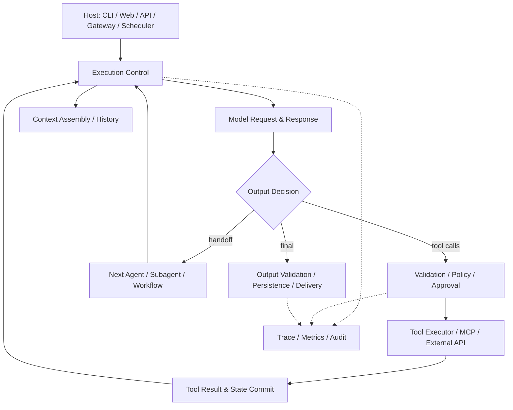
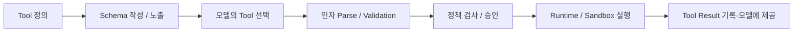
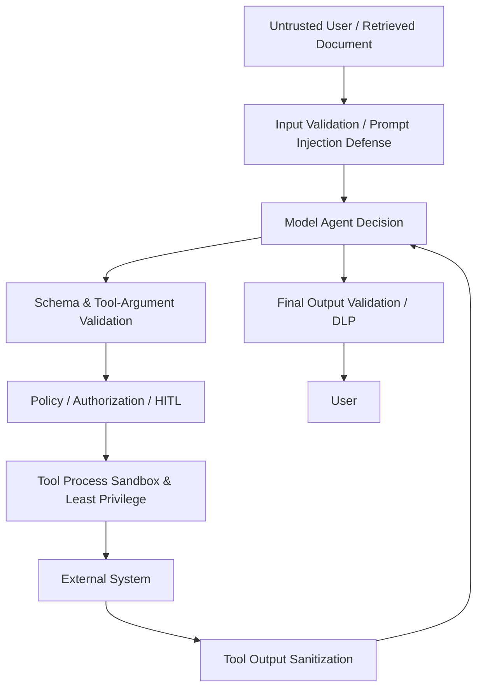
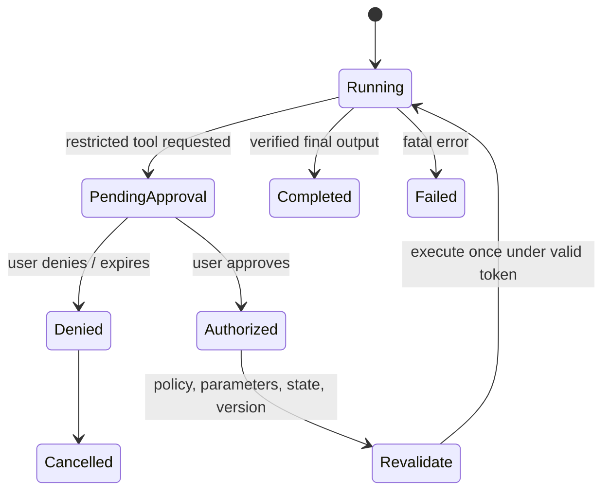
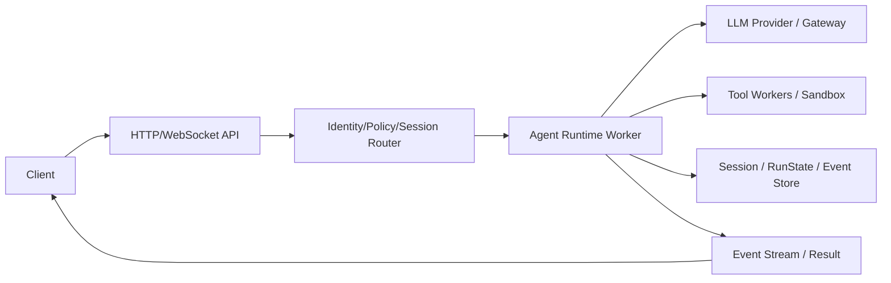
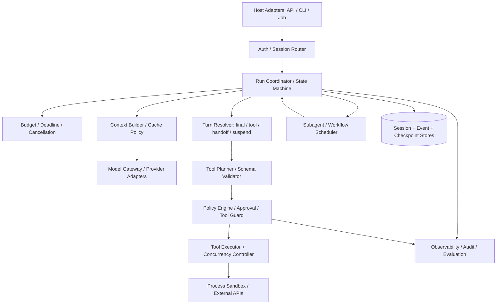

# Agent Framework·Harness 7종 최종 종합 비교 분석

> **대상**: Hermes Agent · PydanticAI · OpenAI Agents SDK · Google ADK · Microsoft Agent Framework · Claude Code · Claude Agent SDK  
> **작성 기준일**: 2026-10-31 · **언어/코드 기준**: Python 우선, Claude Code는 CLI/Harness  
> **목적**: 7개 기술의 기능을 나열하는 대신 **Agent 시스템이 실제로 어떻게 구성·실행·검증·저장·복구되는지**, 그리고 직접 Agent Framework를 설계할 때 무엇을 선택할지를 이해한다.  
> **제외**: 반도체 데모 구현, 실행 실험, 모델 정확도·속도 벤치마크. 특정 산업용 Agent 선정 결과를 확정하지 않는다.  
> **근거**: 본 프로젝트의 **1차 7개 + 2차 7개 학습 MD**, 각 제품 공식 기술 문서, 고정 릴리스의 소스 파일. 공식 문서는 계속 변하기 때문에 **현재 공식 문서의 설명이 반드시 아래 고정 버전과 일치하는 것은 아니다.**

---

## 독자 안내 — 이 문서에서 무엇을 얻을 수 있는가?

최종 결론은 특정 프레임워크 하나가 무조건 우월하다는 것이 아니다. **어떤 문제를 런타임에 맡기고, 어떤 문제를 애플리케이션·Workflow·도구 실행기·외부 인프라가 맡는지를 분명하게 설계해야 한다**는 것이다.

이 문서의 5대 질문:

1. **누가 다음 행동을 결정하는가?** 모델, Runner, Graph, 외부 Workflow, CLI Harness 중 무엇인가?
2. **실행 상태는 어디에 있는가?** 프로세스 메모리, Message History, 세션 DB, Event Log, Checkpoint, 외부 서비스 중 무엇인가?
3. **부작용을 누가 허가하는가?** 모델 Instruction, Runtime Tool Policy, HITL, OS/DB 권한 중 어디까지 강제하는가?
4. **작업이 실패하면 무엇을 다시 실행하는가?** LLM 요청, Tool 하나, Agent Turn, Workflow Node, 전체 Session 중 어디인가?
5. **코드로 입증할 수 있는가?** 공개 소스가 구현을 노출하는가, 공식 동작 계약만 확인 가능한가?

**증거 등급**

- **[SRC]** 특정 릴리스 태그의 공개 소스에서 확인 가능한 호출·분기·자료형·정책.
- **[DOC]** 공식 문서가 보장·설명하는 동작. 내부 코드가 확인되었다는 의미는 아님.
- **[INF]** 공개 구조를 바탕으로 한 합리적인 설계 해석·권고. 제품 사실과 구분.
- **[UNV]** 해당 고정 버전에서 정적 소스 추적 또는 실측이 더 필요한 주장.
- **[PSEUDO]** 학습용 의사코드. 실제 SDK API 시그니처나 제품 내부 코드가 아님.

**표 해석 주의**: `기본` = 해당 기본 구성의 주된 접근법, `확장` = SDK/공식 통합 또는 별도 구성, `직접` = 사용자가 접착 코드를 작성, `미확인` = 확인 가능한 근거 부족. `확장`은 곧 사용이 어렵다는 뜻이 아니고, `기본`은 모든 배포 환경에서 안전하거나 완벽하다는 뜻이 아니다.

---

# Part I. 가장 먼저 알아야 할 비교의 결론

## 1. 일곱 기술은 같은 층위의 경쟁 제품이 아니다

| 기술 | 일차적 성격 | 핵심 엔진/제어 주체 | 기본 철학 | 가장 의미 있는 분석 관점 |
|---|---|---|---|---|
| **Hermes Agent** | 완성형 자율 Agent Harness·실행 플랫폼 | 자체 `AIAgent` Loop + Gateway | 작업 실행, 도구·기억·Skill·채널·예약을 통합 | **오픈소스 완성형 Harness의 실제 구현** |
| **PydanticAI** | 타입·검증 중심 Python Agent Framework | 내부 Agent Graph 및 ToolManager | 구조화된 계약·의존성·Tool 검증에 중점 | **Typed Agent Runtime·검증·재시도** |
| **OpenAI Agents SDK** | 경량 Agent Orchestration SDK | `Runner`와 `NextStep` | Agent·Tool·Handoff·Guardrail의 조합 | **이해하기 쉬운 명시적 Run Loop** |
| **Google ADK** | Event/Session 기반 Agent Framework | `Runner` + `LlmAgent`/`BaseLlmFlow`; 별도 Workflow | Event-driven 상태와 다양한 Agent 구성 | **Event·State·Agent/Workflow 분리** |
| **Microsoft Agent Framework** | 계층형 Agent + Workflow + Harness 제품군 | Agent Pipeline·ChatClient Tool Loop·Workflow Scheduler | Policy·Context·Tool·Workflow의 명확한 계층화 | **플랫폼용 합성 Pipeline과 내구성 있는 Workflow** |
| **Claude Code** | 완성형 코딩·작업 실행 Harness | Claude Code CLI 내부 엔진 | 통합된 작업 공간·도구·권한·Skill 기반 자율 실행 | **제품의 Harness 설계·운영 계약** |
| **Claude Agent SDK** | Claude Code를 애플리케이션에서 제어하는 SDK | Python/TS SDK → Claude Code CLI | 기존 Harness를 API로 노출 | **SDK–CLI 프로세스·제어 프로토콜 경계** |

> **핵심 구분**: Claude Code와 Claude Agent SDK를 완전히 다른 Agent 엔진으로 2회 집계하면 비교가 왜곡된다. Claude Agent SDK는 **Claude Code 런타임을 호출·제어하는 인터페이스**다. 반대로 Hermes와 Claude Code는 완성형 Harness끼리 비교하는 것이 정확하다. [DOC] [Claude Agent SDK](https://code.claude.com/docs/en/agent-sdk/overview) · [Hermes Architecture](https://hermes-agent.nousresearch.com/docs/developer-guide/architecture) · [MAF Overview](https://learn.microsoft.com/en-us/agent-framework/overview/).

### 1.1 SDK·Library·Framework·Harness·Platform 구별

- **Library**: 특정 기능을 호출 가능한 코드로 제공. 상태 전이와 작업 순서를 대체로 애플리케이션이 결정.
- **SDK**: 제품이나 API 기능에 접근하는 클라이언트·헬퍼와 개발 인터페이스. 범위가 좁을 수도, 실행 엔진을 포함할 수도 있음.
- **Framework**: 개발자가 지정한 Agent·Tool·Policy를 중심으로 **프레임워크가 실행 흐름의 일부/전체를 호출**하는 구조.
- **Harness**: 모델이 반복적으로 도구를 사용하도록 만드는 실제 실행 환경(Loop, 도구, 파일, 권한, 컨텍스트, 운영 제어 등)의 묶음.
- **Platform**: Gateway, Hosting, 운영 UI, 스케줄러, 계정·보안·관측 기능까지 포함하는 전달·운영 계층.

단어 자체는 엄격한 국제 표준 분류가 아니다. 예컨대 OpenAI Agents **SDK**에는 Runner라는 실행 프레임워크 기능이 있고, MAF **Framework**에는 완성된 Harness 구성도 있다. 비교에서는 **제품명보다 실질적 소유권**을 기준으로 해야 한다.

## 2. 한 장으로 보는 아키텍처 지도



위 그림은 **7개 전체의 논리적 공통 모델**이지 어느 제품의 실제 구현도 아니다. 차이는 `CONTROL`, `DECISION`, `POLICY`, `LOG`, `SUB`를 누가 구현·소유하느냐에서 나타난다.

| 질문 | Hermes | PydanticAI | OpenAI SDK | Google ADK | Microsoft AF | Claude Code | Claude Agent SDK |
|---|---|---|---|---|---|---|---|
| Loop 소유자 | `AIAgent` | 내부 Graph | Runner | LLM Flow | ChatClient / Harness / Workflow | CLI Runtime | **CLI Runtime** |
| 중심 실행 단위 | Turn/Tool Round | Graph Node | Run/Turn/NextStep | Invocation/Event | Agent Run / Superstep | CLI Session/Turn | SDK Query/Client + CLI Session |
| 내구 상태 중심 | SQLite Session | History+외부 저장 | Session+RunState | Session/Event, Workflow State | Session+Checkpoint | CLI Transcript/Memory | CLI Session+SDK Store 연동 |
| 제어권 이전 | Delegate/Subagent | Agent Tool/외부 Graph | Handoff/Agent-as-Tool | AgentTool/Delegation/Workflow | Handoff/Workflow | Subagent/Teams | CLI Subagent 설정/응답 제어 |
| 코드 검증 깊이 | Harness 대다수 공개 | Core 공개 | Runner 공개 | Runtime/Workflow 공개 | Pipeline/Workflow 공개 | 핵심 엔진 비공개 | **SDK 경계 공개**, CLI 핵심 비공개 |

## 3. 코드 분석으로 얻은 가장 중요한 일곱 가지 결론

1. **Loop가 하나라는 가정은 틀리다.** 한 프레임워크 안에 모델–Tool Loop와 별도 Agent 재실행 루프, Workflow 반복이 동시에 존재할 수 있다(MAF가 대표적).
2. **모델이 Tool을 요청했다는 사실과 Tool을 실행해도 된다는 결론은 다르다.** 인자 검증·권한·승인·Sandbox·DB 접근 권한은 서로 다른 계층이다.
3. **동시 Tool Call과 병렬 Agent는 서로 다르다.** LLM이 여러 Tool을 내놓는 것, Python에서 여러 Tool을 동시 실행하는 것, 독립 Session의 Subagent를 띄우는 것은 각각 별도 설계 문제다.
4. **Message History·Session·Memory·Checkpoint는 서로 대체 불가능하다.** 메시지 저장은 외부 API의 중복 실행 방지까지 제공하지 않는다.
5. **Prefix Caching은 입력 전송 생략이 아니라 동일 Prefix의 모델 계산 재사용**이다. 효과는 제공자·모델·캐시 정책에 종속된다.
6. **Guardrail·HITL이 있다고 해서 보안 경계가 자동으로 완성되지 않는다.** 특히 모델에 설명하는 Instruction과 하위 실행 권한을 강제하는 정책은 구별해야 한다.
7. **오픈소스 여부보다 무엇이 공개되었는지가 중요하다.** Claude SDK의 Python 래퍼 코드를 읽을 수 있다는 사실이 Claude Code 내부 Loop를 소스 검증했다는 뜻은 아니다.

---

# Part II. Agent 실행 구조와 종료 조건

## 4. 각 제품의 실행 경로를 함수 단위로 비교

### 4.1 Hermes — 자체 Harness 소유 Loop

```text
run_conversation (agent/conversation_loop.py)
  → turn preflight / request assembly
  → provider API call
  → response intake / tool-call validation
  → persist call intent → tool round / dispatcher
  → tool result append → next iteration
  → final response / finish or stop gates
```

- [SRC] `agent/conversation_loop.py`와 `agent/turn_*.py`에 Turn 단계 분리.
- [SRC] 도구 요청의 선저장·실행 후 결과 삽입 등 **세션 영속성과 외부 실행의 연결**이 핵심 구현 포인트.
- [INF] 단일 Harness에서 Tool·Gateway·Memory를 통합하기 쉽지만, 하나의 Runtime이 부담하는 정책·상태 책임이 무거워진다.

원본: [conversation_loop.py](https://github.com/NousResearch/hermes-agent/blob/v0.22.5/agent/conversation_loop.py) · [turn_tool_round.py](https://github.com/NousResearch/hermes-agent/blob/v0.22.5/agent/turn_tool_round.py).

### 4.2 PydanticAI — 내부 Graph Node 전이

```text
Agent.run / Agent.iter
  → UserPromptNode
  → ModelRequestNode  ── LLM 호출
  → CallToolsNode ── 함수/출력 선택 및 검증
  ├─ ModelRequestNode (Tool result 또는 재시도)
  └─ End (최종 결과/종료)
```

- [SRC] `Graph Node`가 모델 요청과 Tool 처리 사이의 경계를 명시한다.
- [SRC] 출력 방식과 `EndStrategy`의 `early`, `graceful`, `exhaustive`가 Tool 및 Output 처리 정책에 영향을 준다.
- [INF] 타입·검증과 내부 Graph가 긴밀하게 결합되어 있어 **실행 경로를 코드로 추적**하기 좋다. 단, 이 **내부 Graph**를 사용자가 만드는 별도 `pydantic-graph` 오케스트레이션과 동일시하면 안 된다.

원본: [_agent_graph.py](https://github.com/pydantic/pydantic-ai/blob/v2.61.0/pydantic_ai_slim/pydantic_ai/_agent_graph.py) · [_tool_execution.py](https://github.com/pydantic/pydantic-ai/blob/v2.61.0/pydantic_ai_slim/pydantic_ai/_tool_execution.py).

### 4.3 OpenAI Agents SDK — 명시적인 NextStep

```text
Runner.run / AgentRunner._run_impl
  → single turn / model call
  → process_model_response
  → ProcessedResponse
  → execute_tools_and_side_effects
  → NextStepFinalOutput | NextStepRunAgain | NextStepHandoff | ...
  → return / rerun / switch Agent / interrupt
```

- [SRC] `run.py`의 상위 루프와 `run_internal/turn_resolution.py`, `run_steps.py`의 처리 구분이 핵심.
- [DOC] Handoff는 후속 Agent로 제어권을 넘기며, `Agent.as_tool()`은 상위 Agent가 계속 제어권을 갖는 구성.
- [INF] 경량 Runtime·상태 머신을 학습하기에 가장 명료한 기준점 중 하나다.

원본: [run.py](https://github.com/openai/openai-agents-python/blob/v0.24.0/src/agents/run.py) · [run_steps.py](https://github.com/openai/openai-agents-python/blob/v0.24.0/src/agents/run_internal/run_steps.py) · [turn_resolution.py](https://github.com/openai/openai-agents-python/blob/v0.24.0/src/agents/run_internal/turn_resolution.py).

### 4.4 Google ADK — Runner / LlmAgent / LLM Flow / Event

```text
Runner.run_async
  → load/create Session & InvocationContext
  → LlmAgent.run_async
  → BaseLlmFlow.run_async
     → request processors → model call → response processors
     → execute Tool(s) → yield Events → continue or finalize
  → Runner handles Event persistence / session changes
```

- [SRC] LLM 반복은 Flow 계층, 외부 실행의 이벤트·세션 관리 책임은 Runner 계층에 분리된다.
- [SRC] Event의 `is_final_response()`는 개별 Agent 발화의 최종성이지 **전체 다중 Agent Workflow의 완전 종료**와 항상 동일하지 않다.
- [INF] Event가 실행·관측·상태 갱신의 공통 인터페이스이므로 확장성이 높지만, Event 유효성·순서·중복 처리 부담이 따른다.

원본: [runners.py](https://github.com/google/adk-python/blob/v2.13.0/src/google/adk/runners.py) · [base_llm_flow.py](https://github.com/google/adk-python/blob/v2.13.0/src/google/adk/flows/llm_flows/base_llm_flow.py) · [event.py](https://github.com/google/adk-python/blob/v2.13.0/src/google/adk/events/event.py).

### 4.5 Microsoft Agent Framework — 겹쳐 있는 세 가지 반복

```text
Agent.run
  → Agent Middleware / Telemetry
  → RawAgent / Context Providers
  → ChatClient.FunctionInvocation
     └─ model → FunctionTool → model ... [Tool Loop]

Harness의 AgentLoopMiddleware → Agent를 반복 재호출 [Outer Loop]
Graph Workflow → Executor·Edge·Superstep 반복 [Workflow Loop]
```

- [SRC/DOC] 세 Loop는 **위치·의미·종료 기준이 서로 다르다**. MAF를 '하나의 Agent Loop'로 비교하면 실제 구조를 놓친다.
- [DOC] Python은 Agent, Context Provider, ChatClient의 계층형 파이프라인을 사용한다.
- [INF] 기업용 Agent에서 여러 책임을 명확히 나누지만, Middleware 중첩과 오류 전파를 이해해야 한다.

참고: [Agent Pipeline](https://learn.microsoft.com/en-us/agent-framework/agents/agent-pipeline) · [_agents.py](https://github.com/microsoft/agent-framework/blob/python-1.24.0/python/packages/core/agent_framework/_agents.py) · [_harness/_loop.py](https://github.com/microsoft/agent-framework/blob/python-1.24.0/python/packages/core/agent_framework/_harness/_loop.py).

### 4.6 Claude Code — 공개 동작 계약 중심

```text
User/Host → Claude Code CLI Harness
  → Prompt/Context preparation
  → LLM → tool / subagent / final (repeated)
  → permission / hook / sandbox policies
  → session & memory / result delivery
```

- [DOC] CLI가 파일·터미널·MCP·Skills·Subagents를 실행하며, 세션 및 Context를 관리한다.
- **[UNV]** CLI 내부 `while` Loop의 실제 함수·스레딩·예외 순서가 완전 공개된 소스에서 확인되는 것은 아니다.
- [INF] 완성된 Harness를 사용할 수 있으나, 저수준 Loop 정책을 직접 바꾸려는 개발에는 가시성과 수정 범위의 제약이 있다.

참고: [Claude Code 공식 문서](https://code.claude.com/docs/en/overview) · [Claude Code 공개 저장소](https://github.com/anthropics/claude-code).

### 4.7 Claude Agent SDK — SDK와 실행 엔진의 경계

```text
SDK query() / ClaudeSDKClient
  → InternalClient
  → SubprocessCLITransport
  → Claude Code CLI process
  ↔ control protocol (callbacks, hooks, permissions, MCP)
  ← message parser / typed stream / ResultMessage
```

- [SRC] Python 래퍼가 subprocess 실행과 통신, 메시지 파싱과 콜백을 담당한다.
- **[UNV]** CLI 내부의 LLM Loop·멀티에이전트 스케줄러가 Python SDK 내부에서 구현된 것은 아니다.
- [INF] Harness를 재활용하기 좋은 선택이지만 독립 Runtime 소유권은 제한적이다.

원본: [query.py](https://github.com/anthropics/claude-agent-sdk-python/blob/v0.2.176/src/claude_agent_sdk/query.py) · [subprocess_cli.py](https://github.com/anthropics/claude-agent-sdk-python/blob/v0.2.176/src/claude_agent_sdk/_internal/transport/subprocess_cli.py) · [_internal/query.py](https://github.com/anthropics/claude-agent-sdk-python/blob/v0.2.176/src/claude_agent_sdk/_internal/query.py).

## 5. 종료·재시도·중단의 기술적 차이

| 실행 종료 원인 | 실제 의미 | 개발자가 별도로 확인할 점 |
|---|---|---|
| 모델 최종 응답 | Model이 더 이상 호출할 Tool 없이 final 출력 | Output Validator·Postprocess·Session Commit까지 끝났는가? |
| Tool 결과 종료 | SDK가 Tool 결과를 최종 출력으로 채택 | Tool 결과를 모델에 재전달하지 않을 때 품질/정책 위험 |
| Handoff | 기존 Agent Run의 제어권을 다음 Agent로 이전 | 새로운 Agent가 별도의 종료 조건·Context를 갖는가? |
| Max Turns / Steps | 반복 호출 한도에 도달 | 추가 Tool이 이미 실행되었는가? 상태 보관과 사용자 알림 |
| Token/Time Budget | Context 또는 Run 예산 초과 | 압축·Grace Call·취소·복구 정책 |
| Guardrail Tripwire | 정책상 더 이상 진행 불가 | 이미 수행된 외부 부작용·저장된 결과가 있는가? |
| Human Approval | 실패가 아니라 명시적 대기 상태 | 승인 요청 ID, 세션·인자 재검증, 재개 가능 상태 |
| User Cancellation | Host가 중단 요청 | Python Task 취소와 실제 OS 프로세스/API 중단의 차이 |
| Workflow Convergence | 더 이상 실행할 Node/Message가 없음 | 미완료 외부 작업과 큐에 남은 이벤트가 없는가? |

### 5.1 네 가지 'Retry'는 서로 다르다

1. **Transport Retry**: 네트워크 429/5xx 등에 대한 동일 모델 요청 재전송. 비용 중복 가능.
2. **Validation Retry**: 잘못된 Tool 인자/출력 구조를 모델에 알려 다시 생성하게 함. 새로운 LLM 요청 발생.
3. **Tool Retry**: Tool 함수 자체 재호출. 외부 상태 변경이 있는 Tool에는 멱등성 필요.
4. **Workflow/Node Retry**: 더 큰 작업 단위 재실행. 이미 성공한 하위 Tool의 중복 실행 위험.

사용자에게 '재시도 지원'이라고 말하려면 네 중 어떤 것인지 명시해야 한다. 예컨대 PydanticAI의 출력 검증 재시도와 Microsoft Workflow 체크포인트 복원은 같은 기제가 아니다.

### 5.2 종료 시 검증해야 할 불변식 — 설계 관점 [INF]

```python
# [PSEUDO] 제품에 존재하는 실제 함수가 아님
assert not runnable_child_without_owner
assert session_commit_or_explicit_uncommitted_state
assert final_output_passes_app_policy
assert tool_effects_have_audit_ids
assert pending_approvals_are_not_silently_executed
```

---

# Part III. Tool·병렬성·Multi-Agent 내부 구현 비교

## 6. Tool 사용 수명주기의 정확한 7단계

모든 제품을 비교할 때 **Tool을 정의하는 것**과 **Tool을 실행하는 것**을 분리한다.



- **모델 이전**: 개발자는 `name/description/schema`를 정의한다. 런타임이 Python 시그니처로 자동 스키마를 만들 수도 있다.
- **모델 이후**: LLM은 `tool_name + arguments`를 **제안**할 뿐이다. 도구가 실제 실행될 수 있는지, 누가 접근할 수 있는지는 Runtime과 실행 인프라가 결정해야 한다.
- **검증**: JSON 파싱 성공, 타입 검증 성공, 비즈니스 규칙 통과, 사용자 승인 통과는 각각 다른 성공 조건이다.
- **실행 후**: Model Context에 들어갈 Tool Result와 감사 기록에 남길 Tool Outcome도 나누는 것이 좋다.

### 6.1 주요 Tool 구현 비교

| 기술 | 정의/Schema | Dispatch/실행 | 특징·주의점 |
|---|---|---|---|
| Hermes | Tool Registry 및 Toolset의 등록 스키마 | `tool_executor` → 중앙 Handler/환경 | import 시 Tool 등록, Runtime의 다양한 실행 백엔드; Inline Tool 경로도 별도 |
| PydanticAI | Python 타입/Pydantic 기반 Tool | `ToolManager` + `_tool_execution.py` | **인자·결과 형식 검증**과 Retry가 설계 중심 |
| OpenAI SDK | `function_tool` 스키마 및 FunctionTool | `tool_planning` → `tool_execution` | 실행/승인/가드레일/취소를 Turn Resolution에서 조율 |
| Google ADK | `FunctionTool` 등 Tool 추상화 | `_caller.py` + `_batch_executor.py` | Tool 선택·Callback·실행·Event 생성을 분리 |
| Microsoft AF | `FunctionTool` 및 Provider Tool | `ChatClient.FunctionInvocation` + Function Middleware | Agent Middleware와 실제 함수 호출 정책이 다른 계층 |
| Claude Code | 내장 도구·MCP Tool·Plugin | **비공개 CLI Harness** | 내장 도구의 실제 코드 흐름보다 공식 Permission/Hook 계약을 검증 |
| Claude Agent SDK | CLI 설정 및 SDK-hosted MCP | Python↔CLI Control Protocol / MCP 콜백 | SDK가 모든 내장 Tool을 직접 실행하는 것은 아님 |

**코드 추적 제안**: 같은 도구 `lookup(record_id)`가 JSON이 아닌 문자열 인자를 반환하는 경우, 각 프레임워크가 **모델 재질문 / Tool 실패 / TypeError / Tripwire** 중 무엇을 선택하는지 아래 원본을 따라가며 비교한다.

- Hermes: [tools/registry.py](https://github.com/NousResearch/hermes-agent/blob/v0.22.5/tools/registry.py) · [agent/tool_executor.py](https://github.com/NousResearch/hermes-agent/blob/v0.22.5/agent/tool_executor.py)
- PydanticAI: [_tool_manager.py](https://github.com/pydantic/pydantic-ai/blob/v2.61.0/pydantic_ai_slim/pydantic_ai/tool_manager.py) · [_tool_execution.py](https://github.com/pydantic/pydantic-ai/blob/v2.61.0/pydantic_ai_slim/pydantic_ai/_tool_execution.py)
- OpenAI SDK: [tool_execution.py](https://github.com/openai/openai-agents-python/blob/v0.24.0/src/agents/run_internal/tool_execution.py)
- Google ADK: [_caller.py](https://github.com/google/adk-python/blob/v2.13.0/src/google/adk/flows/llm_flows/tools/_caller.py)
- Microsoft AF: [_tools.py](https://github.com/microsoft/agent-framework/blob/python-1.24.0/python/packages/core/agent_framework/_tools.py)

### 6.2 Tool 실패는 4가지로 분류

| 실패 | 예 | 기본 반응을 선택할 때의 판단 기준 |
|---|---|---|
| 형식 오류 | 누락 인자, 잘못된 JSON | 검증 후 모델에 수정 요청해도 무방한가? |
| 실행 실패 | FileNotFound, DB Timeout | 도구 오류를 Context에 돌려주고 계속해도 되는가? |
| 정책 위반 | 권한 없는 경로, 비인가 Tool | **모델의 자율 재시도보다 강제 중단·승인 거부**가 필요한가? |
| 부분 부작용 | DB는 기록됐지만 Tool Response 유실 | 다시 실행하면 중복되는가? 멱등 키·조회 후 재개가 있는가? |

이 구분이 없으면 '에러를 모델에게 알려 다시 시도'하는 일반 Agent 패턴이 **권한 거절까지 모델이 우회·재시도하게 만드는** 잘못된 설계로 이어질 수 있다.

## 7. 병렬성은 최소 다섯 가지 서로 다른 현상이다

| 용어 | 병렬성의 단위 | LLM 호출 횟수 | 상태 공유·충돌 위험 |
|---|---|---|---|
| **Multiple Tool Calls** | 모델 응답에 다수 Tool 요청 | 일단 한 번의 모델 응답 | 아직 병렬 실행 보장은 아님 |
| **Parallel Tool Execution** | 동일 Turn의 여러 Tool 함수 | Tool 실행 자체는 LLM 호출 아님 | 외부 파일·DB·API에 충돌 가능 |
| **Subagent Parallelism** | 독립 Agent Loop 여러 개 | 각 Subagent가 별도 모델 요청 | Context·비용·권한·결과 합병 |
| **Workflow Fan-out/Fan-in** | 분기된 노드·Executor 작업 | 노드에 LLM이 있을 수도 없을 수도 | 메시지·공유 State·동기화 장벽 |
| **Server Request Concurrency** | 다른 사용자/세션 요청 | 세션별 다름 | DB Lock·Rate Limit·Worker 자원 |

### 7.1 런타임 비교: 실제 병렬 구현의 핵심

| 기술 | 확인된/문서화된 방식 | 설계적 의미 |
|---|---|---|
| Hermes | `ThreadPoolExecutor`와 순차/병렬 세그먼트, 충돌 방지 배리어 | 동기적 Agent Loop이면서 IO 중심 Tool에 스레드 동시성 사용 |
| PydanticAI | `asyncio` 기반 Task, `sequential=True` 도구 실행 장벽 | Tool별 순서 제약을 정책으로 표현 |
| OpenAI SDK | Python async Function Tool Task, Run 설정으로 동시성 상한 | **Provider의 다중 Tool 요청 허용**과 **런타임 동시 실행 상한**을 별도로 이해해야 함 |
| Google ADK | `_batch_executor.py`의 Tool 배치, `ParallelAgent`는 별도 `TaskGroup`/Event Queue | 병렬 Tool과 병렬 Agent가 별도 엔진 |
| Microsoft AF | ChatClient Function Invocation / Workflow Executor Superstep | Function 동시성·Graph Fan-out은 다른 레이어 |
| Claude Code | Tool·Background·Subagent·Team의 동시 수행을 문서화 | 내장 CLI의 정확한 Python 스레딩 모델로 해석하면 안 됨 |
| Claude Agent SDK | SDK가 Tool 결과 이벤트를 수신, CLI에서 실제 Tool/Agent 스케줄 | SDK 이벤트 수집이 병렬 실행 구현의 증거는 아님 |

공식 참고: [Hermes Agent Loop](https://hermes-agent.nousresearch.com/docs/developer-guide/agent-loop) · [OpenAI RunConfig tool execution](https://openai.github.io/openai-agents-python/running_agents/) · [Google ADK Parallel Agent](https://google.github.io/adk-docs/agents/workflow-agents/parallel-agents/).

### 7.2 '병렬 호출'에서 실제로 발생할 수 있는 문제

**문제 A — 같은 파일 수정**: Tool A와 Tool B가 `config.yaml`을 동시에 덮어쓴다면, 결과 순서가 고정돼도 실제 파일 결과는 비결정적이다. Tool 결과를 호출 순서대로 다시 배열하는 것만으로 해결되지 않는다.

**문제 B — 다른 속도의 API**: 동시에 10개 DB 쿼리를 요청하면 오히려 DB Connection Pool을 포화시킨다. 최대 동시성, Rate Limit, Circuit Breaker, Timeout을 따로 설계한다.

**문제 C — 실패 후 Cancel**: Python Task가 취소돼도 HTTP 서버에서 이미 시작한 Transaction은 계속될 수 있다. 취소 후 재시도에는 멱등 키가 필수적이다.

**문제 D — Agent 위임 시 Context 복제**: Parent의 전체 History를 5개 Subagent에 그대로 전달하면 토큰·비용이 급격히 증가하고 권한 없는 데이터까지 복제할 수 있다.

### 7.3 병렬화 선택의 의사결정 원칙 [INF]

```python
# [PSEUDO] 일반 목적의 구조 예시
calls = model_response.tool_calls
for batch in partition_by_dependencies_and_conflicts(calls):
    validated = [validate_schema_and_policy(c) for c in batch]
    results = await gather_with_timeout_and_limit(validated, max_concurrency=4)
    commit_results_in_stable_order(results)
```

핵심은 `gather()`가 아니라 `partition_by_dependencies_and_conflicts`, `policy`, `commit_results`다. Hermes의 병렬 Tool 실행 코드와 PydanticAI의 `sequential` 장벽, Google ADK의 Batch Executor를 함께 비교하면 좋다.

## 8. Multi-Agent / Handoff / Agent-as-Tool 비교

### 8.1 결정적 질문: 제어권은 누구에게 있는가?

```text
[Manager 중심 / Agent-as-Tool]
Main Agent ──Tool Call──> Specialist Agent ──Result──> Main Agent ──Final

[Handoff]
Agent A ──Transfer Control──> Agent B ──Final / Next Handoff

[Workflow 중심]
Scheduler ──> Executor A + Executor B ──> Join Node ──> Next Node
```

| 기술 | 대표적 협업 모델 | Context와 최종 결과의 소유권 |
|---|---|---|
| Hermes | Delegate Subagent·Background Work/협업 | Parent가 위임 요청 및 결과 통합, Child의 격리된 실행 상태 |
| PydanticAI | Agent를 Tool로 호출, 별도 Pydantic Graph | 호출자 또는 외부 Graph가 전체 흐름 관리 |
| OpenAI SDK | Handoff vs `Agent.as_tool()` | Handoff는 실행 주체 변경, `as_tool`은 Manager 통제 |
| Google ADK | AgentTool, Agent 간 Transfer, Workflow | Runner/Agent Tree/Event에 따라 분기, 별도 Graph Workflow도 있음 |
| Microsoft AF | Sequential·Concurrent·Handoff·GroupChat·Magentic/Workflow | 명시적 오케스트레이터·Workflow State가 제어 가능 |
| Claude Code | Subagent·Agent Teams | Parent 중심 위임 또는 독립된 팀 구성; CLI 실행 계약 기준 |
| Claude Agent SDK | Claude Code Subagent 설정 및 결과 수신 | SDK가 직접 모든 Child Loop를 소유하지 않음 |

### 8.2 Subagent는 단순 함수 호출이 아니다

Subagent가 별도 Agent Loop를 갖는 경우 다음 요소가 추가로 필요하다.

- 고유 **Task ID·Child Session ID**와 Parent Link.
- 고유 Context·Tool 권한·예산·종료 조건.
- Delegate 요청의 인자/목적과 반환 결과의 계약.
- 실패·타임아웃·취소 전파 정책.
- Parent가 Child 결과를 채택·재검증하는 정책.
- Parent 종료 시 Child의 `detach`, `cancel`, `continue background` 중 어떤 행동을 할지.

**개발할 때 반드시 묻기**: 3개의 Subagent가 동시에 메모리를 수정했다면 누구의 값이 최종 진실인가? 결과 병합은 단순 문자열 연결이 아니라 **버전 충돌·우선순위·근거 충돌 해결** 문제다.

## 9. Workflow: 모델이 정하는 경로와 개발자가 정하는 경로

| 기준 | 자유형 Agent Loop | 명시적 Workflow | 하이브리드 |
|---|---|---|---|
| 실행 경로 | LLM 선택에 상대적으로 의존 | Code/Graph Edge에 명시 | Workflow 단계 내에서 Agent 호출 |
| 복잡한 예외 처리 | 모델/Runner에 의존 가능 | Node별 실패·재시도 명시 | 단계별 통제와 유연성 결합 |
| 정확한 상태 전이 | 외부 상태 머신 필요할 수 있음 | Node/Edge/Checkpoint 모델 | 양쪽 계약 동기화 필요 |
| 변경 용이성 | Tool/Instruction 수정에 유연 | Node 그래프 변경·마이그레이션 필요 | 중간 |
| 디버깅 | 비결정적 경로 복원 필요 | 실행 기록으로 경로 확인 용이 | Agent 내부는 여전히 비결정적 |

- **PydanticAI의 내부 Graph**는 Agent Loop 구현에 쓰이는 내부 구조이며, **Google ADK / Microsoft의 사용자가 설계하는 Workflow Graph와 목적이 다르다**.
- Google ADK는 전통적 `SequentialAgent/LoopAgent/ParallelAgent`와 별도의 새로운 Graph Workflow를 구별해야 한다.
- Microsoft AF는 Graph와 Functional Workflow를 구분한다. Functional은 자연스러운 Python 제어 흐름, Graph는 Executor/Edge와 Superstep 기반 실행에 강점이 있다. [DOC] [Microsoft Workflows](https://learn.microsoft.com/en-us/agent-framework/concepts/workflows/).

---

# Part IV. Context·Cache·Memory·Skills 비교

## 10. 최종 LLM 요청을 계층별로 이해하기

최종 입력을 `system prompt + user question` 두 개로 단순화하면 실제 Runtime의 중요한 문제를 놓친다.

```text
A. Identity/Model/System Contract
B. Project Instructions/Policies
C. Tool Schema(s) and Execution Constraints
D. Relevant Skills (index, selected body, references)
E. User/Workspace/Environmental Context
F. Recent Message History (+ Tool Results)
G. Retrieved History / RAG / Memory
H. Summarized Older Context / Compaction
I. Latest User Message
```

**주의**: 위는 분석 관점의 논리적 분해이며 실제 API에는 `messages`, `tools`, `system`, `developer` 필드 등이 provider별로 달리 표현된다. 각 요소가 모두 매 호출마다 모델에 전송되거나 동일 순서로 삽입된다는 의미는 아니다. 일부 Skill이나 Tool 결과는 **필요 시 로딩**된다.

### 10.1 Framework별 Context의 중심 구조

| 기술 | Context를 소유·구성하는 주요 층 | 특징적 설계 |
|---|---|---|
| Hermes | Prompt Builder, `stable → context → volatile`, Session Context Engine | Stable Prefix 유지, Context 압축 및 Session Lineage |
| PydanticAI | Agent Instruction/System Prompt, Graph State, Message History Processor | 개발자 정의의 History 변환·Dependencies·Validator |
| OpenAI SDK | Agent/Runner, RunContext, Session, Model Input Filter | Run 중 전달할 메시지/Tool과 세션 저장의 역할 분리 |
| Google ADK | Request Processors, InvocationContext, Session State, Memory/Artifact Services | 요청 시점에 다양한 State/Memory/Artifact를 조합 |
| Microsoft AF | Context Providers, AgentSession, ChatClient, Harness Compaction | Context 계층을 인터페이스로 분리·교체 |
| Claude Code | System/Project/Conversation, CLAUDE.md, Auto Memory, Skills | Harness 내부 로딩·압축, 문서화된 우선순위 |
| Claude Agent SDK | Claude Code Runtime의 Context + SDK 옵션 | SDK 자체가 모든 Prompt 토큰을 조립하는 것은 아님 |

## 11. Prefix Caching — 입력을 매번 보내는데 왜 이득인가?

**핵심 답**: 서버에 동일한 Prefix를 다시 전달하더라도, 지원되는 모델/제공자는 이전 Prefix의 계산된 표현(KV Cache 등)을 재사용할 수 있다. 따라서 **전송하는 요청 길이와 실제 새로운 Prefill 계산량이 같지 않을 수 있다.** 제공자별 Cache 정책·TTL·가격·토큰 집계는 서로 다르다.

**개념 예시(실측값 아님)**:

```text
Turn 1:
[10k stable prefix][2k turn-specific] → prefill 12k

Turn 2 (prefix unchanged and provider hit):
[10k stable prefix][3k turn-specific] → 10k reuse + 3k new prefill

Turn 3 (stable prefix 1 token 변경):
[10k changed prefix][4k turn-specific] → 해당 변경 지점 이후 캐시 재사용 약화
```

### 11.1 캐시 무효화/효율 저하 조건

- Prefix 앞부분의 Tool Schema가 매번 다른 순서로 노출됨.
- System Instruction·Context File·Memory가 중간에 바뀜.
- Timestamp, 세션별 값, 순서가 바뀌는 목록을 Stable Prefix에 삽입.
- 모델·Provider·Project·Cache TTL·Cache 방식이 변함.
- Compaction이 기존 메시지 앞부분을 교체함.

**설계 선택**: 일부 Dynamic Data는 stable prompt 뒤쪽에 두어 캐시 재사용성을 높이는 대신 **오래된 정책이나 변경된 Skill을 늦게 반영하는 문제**를 막아야 한다. Hermes는 system prompt 스냅샷 및 tool list pinning 전략을 공식 아키텍처에 설명한다. [DOC] [Hermes Architecture](https://hermes-agent.nousresearch.com/docs/developer-guide/architecture) · [Prompt Caching](https://hermes-agent.nousresearch.com/docs/developer-guide/prompt-caching).

### 11.2 Framework가 'Prompt Caching 지원'이라고 할 때의 네 경우

1. Provider API가 실제 Cache Read/Write 기능을 제공.
2. Framework가 Cache Breakpoint나 Cache Control Parameter를 지정.
3. Framework가 Prompt/Tool 순서를 안정화하여 Provider Cache Hit를 도움.
4. Framework가 결과/도구 호출을 **별도로 애플리케이션 캐싱**함(이것은 Prompt Cache와 다름).

비교표에는 위 네 가지를 혼동해서 모두 '지원'으로 적으면 안 된다. 특히 **PydanticAI/OpenAI/Google/Microsoft에서 자체적인 강제 Prefix 캐시가 항상 제공된다고 단정할 수 없다**. 모델 Provider 및 Adapter와 실제 요청 형식으로 확인할 것.

## 12. Memory는 적어도 여섯 가지

| 종류 | 저장되는 것 | 지속성 | 읽기/쓰기 주체 |
|---|---|---|---|
| Working Context | 현재 모델 입력과 Tool 응답 | 현재 Run/Turn | Runtime/Agent |
| Message History | 이전 User/Assistant/Tool 메시지 | 세션별 | SessionStore/HistoryProvider |
| Semantic/Fact Memory | 선별된 지속 사실·선호 | 장기 | 모델 Tool·사용자·Memory Provider |
| Procedural Memory / Skills | '어떤 작업을 어떻게 하는가' 지침 | 장기 | Skill 작성 도구/사용자/배포 시스템 |
| Retrieval Index | FTS5/Vector/Search Index | 장기 | DB/검색 서비스 |
| Durable State / Checkpoint | 실행 중인 Node, Pending Approval, Queue 상태 | Run 재개 | Workflow Runtime/State Store |

**세션을 저장한다고 장기 메모리가 자동 추출되는 것이 아니며, 검색 인덱스가 있다고 모델이 자동으로 적절한 내용을 읽는 것도 아니다.**

### 12.1 Memory 구현 방식 비교

| 기술 | 대화 저장 | 별도 Memory/Retrieval | 개념적으로 중요한 경계 |
|---|---|---|---|
| Hermes | SQLite Session + FTS5 | `MEMORY.md`, `USER.md`, Skills, 별도 Memory Provider | 명시적 Memory Tool과 과거 대화 검색을 분리 |
| PydanticAI | Message History / 외부 Persistence | 별도 Memory/Context Processor/Toolset/Harness 연동 | Typed State와 장기 DB 저장은 다른 기능 |
| OpenAI SDK | 다양한 Session 구현 + RunState | 외부 Retrieval·Memory Tool 등 구성 가능 | RunState(대기·승인) ≠ Conversation Session |
| Google ADK | SessionService와 Events | MemoryService, ArtifactService | 사용자 상태의 Delta와 장기 검색 기록을 분리 |
| Microsoft AF | AgentSession / HistoryProvider | ContextProvider/RAG/Memory 구성 | Workflow Checkpoint와 AgentSession은 별도 |
| Claude Code | CLI Transcript / Auto Memory | `CLAUDE.md`, Auto Memory, Skill Files, MCP 검색 | Instruction File과 모델 자율 메모리의 구분 |
| Claude Agent SDK | CLI Session + SDK SessionStore 연동 | CLI Runtime Memory / 외부 저장 연동 | SDK Message Store와 CLI 내부 Transcript 중복 가능 |

## 13. Hermes SQLite·FTS5 vs 벡터 검색/RAG

질문: **왜 Hermes는 SQLite/FTS5를 사용하는가? RAG는 안 하는가?**

- **SQLite**: 로컬 영속화 DB. 세션 메타데이터·메시지·모델 설정·사용량 등을 트랜잭션 단위로 저장.
- **FTS5**: SQLite 내장 Full-Text Search. 키워드/구문/Boolean/접두어 매칭 및 순위·Snippet을 제공. **문장 의미를 임베딩하는 Vector Search는 아님**.
- **RAG**: '검색된 외부 정보를 LLM 생성에 근거로 제공'하는 **아키텍처 패턴**. 검색 도구는 FTS5·BM25·Vector·Hybrid 중 무엇이든 가능. 따라서 'FTS5를 쓰므로 RAG가 아니다'는 잘못된 설명.
- **Vector Search**: 의미가 유사한 내용을 Embedding으로 찾는 접근. 다른 표현/동의어 회상에 유리할 수 있지만 임베딩 비용·인덱스·권한·신선도 관리가 추가됨.

| 비교 | FTS5 | Vector Retrieval | Hybrid |
|---|---|---|---|
| 일치 기준 | 용어·구문 중심 | 임베딩 유사도 | 둘 모두 |
| 장점 | 빠른 로컬 검색, 설명 용이, 배포 단순 | Paraphrase/동의 개념 검색에 도움 | Recall과 Precision 보완 |
| 한계 | 다른 용어로 쓴 문서 놓칠 수 있음 | 유사하지만 사실상 무관한 문서 회수 가능 | 운영 복잡도·랭킹 튜닝 증가 |
| 재현성 | DB·쿼리·Tokenizer 고정 시 비교적 높음 | 모델·임베딩·인덱스 버전 관리 필요 | 두 체계 모두 버전 관리 필요 |

Hermes의 FTS5 검색과 Memory 파일은 **개인·작업 세션의 회상** 목적에 유용하지만, 대규모 전문 문서 Corpus의 근거 검색 요구까지 자동으로 해결하지는 않는다. 다른 제품도 RAG는 대부분 Tool·Provider·외부 검색 인프라와의 협력으로 구현한다. [DOC] [Hermes Session Storage](https://hermes-agent.nousresearch.com/docs/developer-guide/session-storage).

### 13.1 기억 저장 결정의 평가 질문

- 사용자 지시 없이 Memory를 새로 쓸 수 있는가? 어떤 Tool 권한 하에서 가능한가?
- 모델이 저장할 사실을 잘못 판단할 때 Review/롤백/TTL이 있는가?
- Session 압축이 원문을 삭제하는가, Active Context만 바꾸는가?
- 검색 결과가 원 세션과 연결되는가? 근거 URL 또는 Message ID를 추적할 수 있는가?
- Memory와 동일한 정보를 여러 곳에 저장할 때 누가 Source of Truth인가?
- 민감 정보 삭제 요청 시 Prompt 요약·Session·FTS·Vector·Backup 모두 동기 삭제되는가?

## 14. Context Compression: 기록 삭제와는 다르다

Context Compression의 실질적 선택지는 다음과 같다.

| 기법 | 동작 | 장점 | 위험 |
|---|---|---|---|
| Sliding Window | 오래된 Turn을 모델 입력에서 제외 | 단순·예측 가능 | 오래된 필수 조건 손실 |
| Tool Output Pruning | 큰 Tool 결과를 축약/파일 포인터로 대체 | 원본 데이터 중복 토큰 감소 | 결과 재검증에 원문 필요 |
| Summarization | 오래된 대화를 요약 메시지로 대체 | 맥락 유지와 토큰 절약 절충 | 요약 환각/누락/정책 손실 |
| Structured State | 핵심 목표·제약·결정만 typed state로 유지 | 복구·검증 용이 | 스키마 설계·갱신 비용 |
| Retrieve-on-demand | 필요 시 Memory/파일/도구 검색 | 입력 절약 | 검색 품질·지연 의존 |

Hermes는 Context Engine / Compressor와 세션 압축 기록, Claude Code는 CLI Compaction, Google ADK는 Event·Session Context 계층, MAF는 Compaction Strategy 및 Context Provider 등을 제공한다. **'문맥이 압축되었다'와 '이전 기록을 영구 삭제했다'를 혼동해서는 안 된다.**

### 14.1 압축의 검증 불변식 [INF]

- 정책·승인·작업 목적이 요약 과정에서 사라지지 않는가?
- Tool Call / Tool Result 쌍이 중간에 잘려 Provider의 메시지 형식을 위반하지 않는가?
- 과거 분석의 단위·조건·수정 사항이 왜곡되지 않는가?
- 요약한 내용을 사실로 단정하지 않고 원문 ID를 재조회할 수 있는가?
- Cache Hit를 높이기 위한 Prompt 고정이 Context 최신성과 충돌하지 않는가?

## 15. Skills·Tool·MCP·Plugin: 한 번에 비교

| 개념 | 질문에 대한 답 | 일반적 구체물 | 무엇과 다르나? |
|---|---|---|---|
| **Instruction** | Agent가 어떤 규칙과 역할을 따라야 하는가? | `CLAUDE.md`, Project Rules, System Prompt | 실행 권한을 직접 강제하지 않음 |
| **Skill** | 반복되는 유형의 작업을 어떤 절차로 수행하는가? | SKILL.md, Script/Reference, Loading Rules | Skill 자체가 Tool API는 아님 |
| **Tool** | 구체적으로 어떤 행위를 실행할 수 있는가? | Python Function, Shell, DB Tool, Browser | 모델이 호출하는 실행 경계 |
| **MCP** | 외부 Tool/Resource/Prompt를 공통 프로토콜로 어떻게 노출하는가? | MCP Server↔MCP Client | 자체 Runtime/워크플로 전체를 정의하지 않음 |
| **Plugin** | 제품 기능·Tool·Hook·UI·Backend를 어떻게 확장·배포하는가? | Hermes/Claude 제품별 Plugin Manifest | 표준화된 MCP와 달리 호스트 제품의 확장 규약 |
| **Subagent** | 별도의 Agent 실행을 누구에게 어떻게 위임하는가? | Delegated Agent/Task | 단일 Tool 호출 이상의 독립 Loop 가능 |

### 15.1 Skill 자동 생성은 어떻게 유용해지나?

모델이 '유용할 것 같다'고 Skill을 생성하는 것만으로 충분하지 않다. 적어도 다음 품질 파이프라인이 필요하다.

```text
Candidate 발견 → 반복되는 작업 패턴 식별 → Skill 초안 생성
→ 스키마·파일 경로·권한 검증 → 샘플 입력으로 Dry-run/평가
→ 검토/승인 → 버전·서명과 함께 등록 → 점진적 로딩
→ 사용 로그/오류 회수 → 수정 또는 폐기
```

- **Hermes**: Agent-curated Memory 및 Skill 관리 루프가 완성형 Harness의 차별점. 다만 스스로 만든 Skill이 검증을 자동 통과한다는 뜻은 아니다.
- **Claude Code**: 파일 기반 Skills와 모델의 선택·로딩, 배포 가능한 Plugin을 결합. 핵심 생성 판단의 소스 함수는 비공개.
- **PydanticAI/OpenAI/Google/Microsoft**: 개발자가 Tool·Instruction·Workflows 등을 조합할 수 있으나, **모든 프레임워크가 동일한 자율 Skill 생성/자기개선 루프를 기본 탑재했다는 주장은 금물**.

### 15.2 MCP Server와 Plugin의 차이

- MCP Server는 **모델/Agent Client가 사용할 기능을 프로토콜로 노출**한다. 외부 데이터 접근 권한·Transport Security·Tool 정책은 별도 확인해야 한다.
- 제품 Plugin은 해당 호스트 **내부의 등록·배포·Hook·시스템 정책**을 다룰 수 있다. Hermes의 Plugin은 Tool Registry와 Hook에 개입할 수 있다.
- 같은 Tool이 MCP와 Plugin 양쪽 경로로 등록되면 이름 충돌·권한 중복·서로 다른 감사 로그가 발생할 수 있다.
- MCP를 사용한다는 사실만으로 외부 Server가 안전하거나 JSON Schema 검증이 완전하다는 보장은 없다.

---

# Part V. Guardrails·HITL·Persistence·Serving·운영 비교

## 16. Guardrail은 하나의 Hook이 아니라 보안 계층이다

가장 위험한 오해는 `You must not access X`라는 Instruction을 실제 접근 차단과 동일하게 취급하는 것이다.



**[PSEUDO] 논리적 계층도**. 구현마다 Hook의 배치와 횟수는 다르며, 예컨대 *Input Guardrail*이 모델 호출과 병렬 실행된다면 그것만으로 외부 부작용을 사전 차단하지 못한다.

### 16.1 정책 강제 위치 비교

| 기술 | 정책 개입 위치 | 특히 주의할 점 |
|---|---|---|
| Hermes | Tool Registry/Approval, Gateway Authorization, Sandbox/Backend, Plugin Hook | 모델의 승인 요청과 OS 명령 수행 권한은 별개. 세션/플랫폼 사용자 인가 필요 |
| PydanticAI | Tool Schema Validator, Output Validator, Capabilities/Hooks, Deferred Approval | Pydantic Schema는 데이터 형식 검사이지 사용자 권한 인가가 아님 |
| OpenAI SDK | Input/Output Guardrail, Function Tool Input/Output Guardrail, HITL | **Guardrail 종류에 따라 위치·적용 대상이 달라** 사전 부작용 차단 수준이 달라짐 |
| Google ADK | Callbacks, Plugins, Tool Execution Hook, Auth/Confirmation | Callback을 등록한 것과 실행 Backend의 진짜 권한 통제가 다름 |
| Microsoft AF | Agent/Chat/Function Middleware, Approval, FIDES(실험적) | 일반 Tool Error와 정책 차단 `MiddlewareFailure`의 전파가 다름 |
| Claude Code | Permission Rules, PreToolUse Hooks, Sandbox, CLI Security | 모델·Hook·실제 Tool Backend의 제어권을 구분해야 함 |
| Claude Agent SDK | CLI Permission Mode, Hook/`can_use_tool` Callback, SDK MCP Handler | `allowed_tools`만으로 모든 Tool 실행에 대한 완전한 보안 화이트리스트가 되는 것은 아님 |

### 16.2 '가드레일이 실행됨'을 입증하려면

1. **입력에 해당하는가?** User Prompt, Tool Arguments, Retrieved Document, Tool Result 중 무엇을 검사하는가?
2. **실행 전인가 후인가?** 비동기 Guardrail이 외부 Tool보다 먼저 끝나는가?
3. **종료 방식은?** 오류를 모델에 보내 Retry 시키는가, 직접 Tripwire/Exception으로 Run을 중단하는가?
4. **정책 신뢰 근거는?** 모델 점검, LLM Judge, 정규식, Schema, Role/Permission Service 중 무엇인가?
5. **권한의 최후 경계는?** DB User, OS Process, Network ACL, Container/Sandbox, API Token은 어디까지 제한되어 있는가?
6. **실패시 기본은?** 검사 서비스 장애 시 Fail Open인가 Fail Closed인가?
7. **기록은?** 요청자·Tool·정책 버전·승인자·실행 결과를 연결하는 Audit Trail이 있는가?

### 16.3 OpenAI Agents SDK: Guardrail의 범위를 세밀하게 구별

- Input Guardrail의 `run_in_parallel` 여부는 **차단 확정 이전에 작업이 진행될 수 있는지**와 관계된다.
- Output Guardrail은 후보 최종 응답을 검증하는 위치이며, 그 전에 실행된 Tool의 외부 부작용을 되돌리는 기능이 아니다.
- Function Tool Guardrail은 모든 Hosted Tool·Computer/Shell Tool·Handoff에 자동 적용되는 단일 Pipeline이 아니다. 실제 도구 종류와 SDK 버전에 따라 적용 대상을 확인한다.
- `ToolExecutionConfig.pre_approval_tool_input_guardrails`처럼 승인 직전/직후 검사 시점을 선택할 수 있는 구성은 승인 요청을 띄우기 전에 불필요하거나 위험한 요청을 걸러내는 데 쓰인다.

출처: [OpenAI SDK Guardrails](https://openai.github.io/openai-agents-python/guardrails/) · [SDK Running Agents](https://openai.github.io/openai-agents-python/running_agents/) · [v0.24.0 guardrails.py](https://github.com/openai/openai-agents-python/blob/v0.24.0/src/agents/run_internal/guardrails.py).

### 16.4 Microsoft AF: 일반 Tool Error와 MiddlewareFailure

```text
[Tool validation/runtime failure]
    → Function result or exception policy → may be shown to model

[Security/Policy middleware failure]
    → MiddlewareFailure propagation → stop/reject
```

[INF] 보안 거절을 '모델이 스스로 다시 생각하면 풀 수 있는 예외'로 취급하는 것은 위험하다. MAF는 일반 Tool Exception과 정책 미들웨어 오류에 다른 전파 방식을 둘 수 있다는 점이 큰 설계 학습 포인트다. [SRC] [_middleware.py](https://github.com/microsoft/agent-framework/blob/python-1.24.0/python/packages/core/agent_framework/_middleware.py).

## 17. Human-in-the-loop는 '승인 UI' 이상의 문제

승인 기능이 올바르려면 `pause` 이전과 `resume` 이후에 같은 요청임을 검증할 수 있어야 한다.



| 구성요소 | 왜 필요한가? |
|---|---|
| Approval Request ID | 승인 대상 요청을 정확히 식별 |
| User/Role/Scope | 누가 어떤 권한으로 승인했는지 식별 |
| Hash(Arguments, Tool Version) | 승인한 작업과 실행할 작업의 동일성 검증 |
| Expiry | 오래된 승인을 재사용하지 않음 |
| Pending State | Process Restart 이후 승인 요청을 다시 표시할 수 있음 |
| Tool-Side Idempotency | 승인 이후 Network Retry로 동일 부작용이 두 번 발생하지 않도록 제한 |
| Revalidation | 승인 시점 이후 권한·데이터가 변경된 경우 재검사 |

### 17.1 각 프레임워크에서의 승인·중단 재개

| 기술 | 대표 수단 | 비교 포인트 |
|---|---|---|
| Hermes | Approval Callback / Tool Policy, Gateway | 승인 이후 세션 저장과 Tool 실행의 원자성·중복 위험 |
| PydanticAI | `DeferredToolRequests/DeferredToolResults` | 모델 재호출과 외부 승인/실행 결과 주입 경계 |
| OpenAI SDK | `RunState`와 Tool Approval | 직렬화·재개와 기존 승인 결정의 범위 |
| Google ADK | Event/Tool Confirmation/Workflow Request | 승인 요청이 Event/Session/Workflow 재개에 어떻게 반영되는가 |
| Microsoft AF | Approval Middleware, HITL RequestPort, Workflow Checkpoint | Tool 승인과 Workflow Node의 외부 입력 대기가 다름 |
| Claude Code | CLI Permission Prompt, Hooks | CLI 세션에서 승인 결정의 Scope가 무엇인가 |
| Claude Agent SDK | `can_use_tool`, Permission Mode와 CLI callback | Python 콜백이 호출되는 실제 정책 경로, Callback 부재 시 기본 동작 |

**중요**: 위 표는 수단 비교이며 7개 모두가 동일한 내구성 수준·승인 저장 형식을 제공한다는 뜻은 아니다.

## 18. Session·RunState·Checkpoint·Event Log의 차이

| 저장물 | 핵심 질문 | 대표 기술 |
|---|---|---|
| **Session Transcript** | 이전에 무엇을 대화했나? | Hermes SQLite, Claude Code Transcript, OpenAI Sessions |
| **RunState** | 진행 중인 Agent가 지금 어디서 멈췄나? | OpenAI SDK `RunState`, PydanticAI Deferred 처리 |
| **Event Log** | 어떤 실행 이벤트가 어떤 순서로 발생했나? | Google ADK Session Events, Workflow Replay |
| **Workflow Checkpoint** | 어떤 Node/State/Queue부터 다시 시작할 수 있나? | Microsoft AF Graph Workflow, Google ADK Graph Workflow |
| **Long-term Memory** | 다음 주/다음 세션에도 기억해야 할 정보는? | Hermes MEMORY.md, Claude Auto Memory, 기타 연동 |
| **External Side-effect Journal** | 외부 DB/API에 어떤 변경이 실제 반영됐나? | 대체로 **애플리케이션/Tool 실행기의 책임** |

### 18.1 Checkpoint가 있어도 '정확히 한 번'이 안 되는 이유

다음 실행을 상상하자.

```text
1. Workflow Node: transfer_money(id=123) 요청
2. 외부 서비스에서 성공 처리
3. Tool Response가 도착하기 전에 Worker Crash
4. 마지막 Checkpoint에서 Node 재시도
5. 이체가 두 번 발생할 수 있음
```

**Checkpoint는 Runtime의 상태 저장**이지 외부 서비스의 Transaction과 원자적으로 묶인 이체 기록이 아니다. 멱등성 키, Outbox/Inbox, 이미 완료된 작업 조회, 보상 트랜잭션이 필요하다. 이 문제는 Agent Framework 종류를 바꿔도 사라지지 않는다.

### 18.2 Event Replay의 주의점

- Event 순서·중복 처리 정책과 Consumer의 멱등성이 필요.
- State Delta를 반복 적용해도 안전한지 확인.
- 모델 응답을 Replay할 것인가, 이전 Event를 재생할 것인가? **새 모델 호출은 같은 결과를 보장하지 않는다.**
- Approval Event를 Replay한 뒤 외부 Tool까지 다시 실행하면 안 된다.
- 같은 Executor의 순서가 보장되는 경우와 **서로 다른 병렬 분기 간 도착 순서**는 구분한다.

[DOC] [Microsoft Checkpoints](https://learn.microsoft.com/en-us/agent-framework/workflows/checkpoints) · [MAF Workflows](https://learn.microsoft.com/en-us/agent-framework/concepts/workflows/).

### 18.3 핵심 Code Paths

- Google ADK: [sessions/base_session_service.py](https://github.com/google/adk-python/blob/v2.13.0/src/google/adk/sessions/base_session_service.py) · [workflows modules](https://github.com/google/adk-python/tree/v2.13.0/src/google/adk/workflows)
- Microsoft: [_workflows/_runner.py](https://github.com/microsoft/agent-framework/blob/python-1.24.0/python/packages/core/agent_framework/_workflows/_runner.py) · [_checkpoint.py](https://github.com/microsoft/agent-framework/blob/python-1.24.0/python/packages/core/agent_framework/_workflows/_checkpoint.py)
- OpenAI: [run_state.py](https://github.com/openai/openai-agents-python/blob/v0.24.0/src/agents/run_state.py) · [session_persistence.py](https://github.com/openai/openai-agents-python/blob/v0.24.0/src/agents/run_internal/session_persistence.py)

## 19. Cron·Background Task·Queue: 미래에 실행한다는 것은 무슨 의미인가?

| 기능 | 의미 | 자동화/내구성 문제 |
|---|---|---|
| Cron | 시각/주기 규칙에 따라 Job Trigger | 시간대, DST, 중복 실행, 누락 실행, Catch-up 정책 |
| Background Agent | 현재 요청과 분리된 장기 Task | Parent 종료, 로그·취소·결과 전달 |
| Message Queue | 이벤트·작업을 Worker에 전달 | At-least-once, Consumer Retry, DLQ, Idempotency |
| Workflow Resume | 저장된 상태에서 경로를 이어 수행 | Version/Schema 호환성, 외부 부작용 확인 |
| User Session | 대화 연속성 | Session Timeout·재접속·동시 편집 |

**Hermes**는 Cron을 완성형 플랫폼 구성요소로 제공해 Job Store, Scheduling, Agent Prompt 실행, 결과 전달을 통합한다. [DOC] [Hermes Architecture](https://hermes-agent.nousresearch.com/docs/developer-guide/architecture).

**다른 SDK에 'Cron이 없다'는 말은 예약 실행이 불가능하다는 뜻이 아니다.** Python APScheduler, Kubernetes CronJob, Celery, 외부 Queue, Cloud Scheduler 등을 붙여 Agent Run을 실행할 수 있다. 다만 그 경우 **Scheduler가 Agent Runtime 바깥**에 있으며 Job 소유권·재시도·복구는 개발자가 설계해야 한다.

### 19.1 예약 실행에서 매번 확인할 불변식 [INF]

- `(job_id, scheduled_for)` 조합의 동일 작업이 중복 실행되지 않는가?
- 이전 Run이 끝나지 않았을 때 다음 스케줄을 Skip/Queue/Overlap 중 어떻게 처리하는가?
- 장시간 작업의 실행 상태·부분 결과를 어디에 저장하는가?
- 실패를 알리지 못한 경우 재전달·Dead Letter Queue가 있는가?
- 스케줄 실행 시 사용자 Interactive Approval이 없을 때 Tool Policy는 어떻게 달라지는가?

## 20. Serving: Agent는 서버에서 어떻게 응답을 반환하는가?

사용자가 CLI에서 Agent를 대화형으로 사용하는 것과, 다수 사용자가 HTTP API를 통해 Agent를 호출하는 것은 서로 다른 운영 문제다.



### 20.1 실행 모델의 세 가지 선택

| 모델 | 설명 | 장점 | 단점 |
|---|---|---|---|
| 동기 HTTP | 요청 중 Agent 종료까지 기다림 | 단순 | Timeout·긴 요청·연결 단절 |
| Streaming API | SSE/WebSocket으로 Token·Tool Event 전송 | 인터랙티브 UX | 연결 중단과 실행 중단의 분리 필요 |
| Job API | 작업 시작 시 Job ID 반환, 후속 Poll/Push | 장기 실행·복구·큐 적합 | 영속 상태/Worker/상태 머신 필요 |

### 20.2 Framework별 제공 방식과 Host의 책임

| 기술 | 서비스 형태 비교 | 추가 개발 항목 |
|---|---|---|
| Hermes | CLI/Gateway/API/ACP를 제공하는 플랫폼형 | 기존 Gateway 인가·프로파일·세션 정책 확인 |
| PydanticAI | 애플리케이션에 Embed하는 Python Framework | FastAPI, Queue, Auth, Session, Observability 등을 설계 |
| OpenAI SDK | Python Runtime을 API 서버에 Embed | Request-Scoped RunState, Streaming/Cancellation, Hosting |
| Google ADK | Runner 및 배포/호스팅 통합 경로 | SessionService/ArtifactService의 내구성·접속·확장 |
| Microsoft AF | Agent/Workflow 및 Hosting 통합 | Host Extension, Durable Adapter, Worker·Checkpoint Store 선택 |
| Claude Code | CLI 프로세스/원격 실행 환경에 기반 | 외부로 노출할 API Auth/세션 라우팅·프로세스 정책 |
| Claude Agent SDK | SDK에서 CLI 프로세스 실행 및 Stream 수신 | 동시 CLI Process 자원·비용·취소·Session isolation |

### 20.3 '응답을 보낸다'는 말의 네 가지 의미

1. 모델의 **부분 Token**이 출력되기 시작했다.
2. 모든 Tool Call과 모델 판단이 끝나 **Agent Final**이 생성됐다.
3. Final에 대한 정책 검사·Session Commit이 완료됐다.
4. **클라이언트가 실제 수신**하고 ACK했다.

이 네 시점이 다를 수 있다. SSE 연결이 끊겼더라도 Server의 Tool 호출이 진행 중일 수 있고, Final을 Stream한 뒤 Session 저장이 실패할 수도 있다. 따라서 **실행 상태와 전송 상태를 별도로 기록**하는 설계가 필요하다.

### 20.4 멀티 테넌트 운영에 공통으로 필요한 것

- 인증 주체·Tenant·Session의 명시적 관계.
- Tool Credential이 다른 사용자에게 누출되지 않도록 격리.
- LLM Rate Limit / Token Budget / Worker Pool·Concurrency Limit.
- 프로세스 재시작에 대비한 Session/RunState Persistence.
- 외부 Tool 작업의 Deadline·Timeout·Cancellation Semantics.
- 요청·모델 호출·Tool·Subagent를 연결하는 `trace_id / run_id / tool_call_id`.
- 사용자 입력과 Tool 결과·긴 로그의 저장 기간/마스킹 정책.

## 21. 모델 교체·사내 Gateway·로컬 모델과 Framework의 관계

**어떤 Provider의 이름을 단 SDK라고 해서 반드시 그 Provider의 모델만 사용할 수 있는 것은 아니다.** 반대로 'OpenAI-compatible' 엔드포인트가 있다는 사실만으로 API 기능이 완전히 호환되는 것은 아니다.

| 기술 | 모델/Provider 연결을 평가할 핵심 조건 |
|---|---|
| Hermes | Provider Resolver, API Mode, Tool Calling/Reasoning 지원, Credential 경로 |
| PydanticAI | Model/Provider Adapter, Model Profile, Structured Output·Tool Schema 호환성 |
| OpenAI SDK | Model Provider/Client 설정, Responses/Chat Completions 기능 호환성 |
| Google ADK | Model Adapter와 LlmAgent의 Tool/Streaming/Events 호환성 |
| Microsoft AF | ChatClient/Provider Integration, Function Calling 및 Middleware 동작 |
| Claude Code | 공식 지원되는 인증·모델·Gateway Routing 옵션의 경계 |
| Claude Agent SDK | Claude Code CLI가 지원하는 Provider/Model Routing과 동일한 제약 |

**비교용 체크리스트**: `tool_calls` 인자 형식, Streaming Chunk, JSON Schema/Structured Output, Reasoning Content, Cancellation, Token Accounting, Provider-specific Cache, Error Retry, Parallel Tool Calls. 특히 로컬 vLLM/SGLang 서버가 어떤 OpenAI 호환 API를 제공하는지는 **별도 모델 서빙 검증 항목**이며 이번 7개 Runtime의 핵심 구현 비교와 혼동하지 않는다.

## 22. Observability·Evaluation·Reproducibility

| 관측 단위 | 반드시 남길 기록 | 비교 연구에서 얻는 것 |
|---|---|---|
| Model Request | 모델·버전·Prompt 구성 버전·Tool Schema Hash·Token/Latency | 어떤 요청 때문에 모델이 다른 행동을 했는가 |
| Tool Call | Call ID·Tool 이름/버전·검증 결과·시작/끝·부작용 ID | 어느 도구가 어떤 이유로 실패했나 |
| Agent Turn | Turn/Step 상태·중단/종료 원인·다음 Agent | Loop 제어 구현 검증 |
| Context | History Size·Retrieval IDs·Compaction Count·Cache Hit | 왜 비용과 품질이 변했는가 |
| Policy | Rule Version·승인 결과·Sandbox Decision | 실제 보안 경계가 통과됐나 |
| Workflow | Node/Edge/Event/Checkpoint ID·Retry Attempt | 복구 후 중복 실행·누락 여부 |
| Host | HTTP Request/Job/Worker/Session ID | 요청 단절과 Agent 실행 상태 차이 |

### 22.1 평가의 네 층위

1. **Contract Test**: Tool Schema, Validator, Typed Output, Session Serializer.
2. **Deterministic Runtime Test**: 모형 모델의 Scripted Response로 Loop/Handoff/Retry/Approval 경로를 재현.
3. **Integration Test**: 실제 Provider, MCP, DB, Sandbox, Gateway, Checkpoint Store.
4. **Task Evaluation**: 정확성, 근거 충실도, 결과 재현성, 비용, Latency, 정책 위반률.

같은 프레임워크라 해도 1단계와 4단계의 성적은 다르다. 특히 **LLM-as-a-Judge 평가만으로 보안이나 코드 경로의 정확성이 입증되지는 않는다**. [DOC] [OpenAI SDK Testing](https://openai.github.io/openai-agents-python/testing/).

---

# Part VI. 7개 제품별 설계 철학·강점·한계 비교

## 23. Hermes Agent — 완성형 자율 Harness의 구현 참고서

**설계적 본질**: 라이브러리 기반의 추상적인 Agent 클래스를 제공하는 것보다, 사용자가 매일 실행하는 Agent가 **실제로 작업을 끝내기 위해 필요한 여러 기능**을 하나의 런타임/플랫폼에 결합한다.

**두드러진 아키텍처 선택**

- `conversation_loop.py`와 `turn_*.py`로 나뉜 상위 반복 제어와 후처리.
- `stable → context → volatile` Prompt 계층 및 캐시 안정성을 고려한 저장/구성.
- SQLite Session + FTS5, Memory Files, Skills, Gateway, Cron의 통합.
- 병렬 Tool Round의 충돌·대화형 요청 배리어.
- Tool Registry와 다양한 실행 Backend의 교체 지점.

**이렇게 설계했을 때 유리한 점 [INF]**: 도구 사용, 기억, 배포 채널, 예약 실행을 빠르게 연결할 수 있고 실제 운영 요소의 설계 선택을 코드에서 추적할 수 있다. *자체 Harness의 구성품이 무엇인지* 배우는 데 특히 좋다.

**반대급부 [INF]**: 모든 기능이 통합되어 있는 만큼 전체 코드·설정·데이터 영속성·플랫폼 운영의 이해 부담이 높다. 개발자가 최소한의 Runner만 원하는 경우엔 불필요한 구성도 많을 수 있다. Skill 자가 수정은 편리하지만 품질·버전·권한 검증을 별도로 고민해야 한다.

**독립 학습 과제**: `run_conversation()`에서 Tool Call Intent 저장→Handler 실행→Tool Result 저장→압축→재개 경로를 실제 소스 함수 이름과 연결한다. **새 Model Call이 발생하지 않고도** 어떤 상태가 바뀌는지 목록화한다.

## 24. PydanticAI — 강한 계약으로 비결정성을 둘러싸는 방식

**설계적 본질**: LLM의 자유로운 출력·도구 요청을 Python 타입 시스템과 출력 검증·재시도 규칙으로 통제하며, Agent Loop를 Graph Node로 나누어 구현한다.

**두드러진 아키텍처 선택**

- `Agent` 진입점과 내부 `UserPromptNode → ModelRequestNode → CallToolsNode` 전이.
- Pydantic 기반 Tool Schema·Output Validator·Dependencies.
- `EndStrategy`를 통해 Final과 Function Tool이 공존하는 응답의 처리 차등화.
- Tool 실행의 `sequential` 장벽과 재시도 정책.
- Core/Capabilities/Harness를 혼동하지 않는 제품 계층 구분.

**유리한 점 [INF]**: 구조화 데이터·정형 검증이 중요한 앱에 잘 맞고 Tool·Output 관련 오류를 코드로 설명하기 쉽다. Dependency Injection으로 테스트 대체가 편리한 편이다.

**한계 [INF]**: 타입을 검증해도 모델이 잘못 계산한 수치 자체가 옳아지는 것은 아니다. 내부 Graph가 있다고 자동으로 내구성 있는 분산 Workflow가 되는 것도 아니다. 외부 권한·서빙·장기 메모리 아키텍처는 애플리케이션 설계가 중요하다.

**독립 학습 과제**: Output Validator가 실패했을 때 Tool을 이미 실행했는가? `early/graceful/exhaustive` 모드마다 **부작용이 발생할 수 있는 분기**를 도식화한다.

## 25. OpenAI Agents SDK — 최소한의 실행 중심 추상화

**설계적 본질**: `Agent + Runner + Tools + Handoff + Guardrails + Sessions`를 조합해 Agent 실행 로직을 비교적 작고 명시적으로 구성한다.

**두드러진 아키텍처 선택**

- `_run_impl`의 Run Loop와 `ProcessedResponse/NextStep`의 실행 분기.
- Handoff와 `Agent.as_tool()`이라는 다른 오케스트레이션 선택.
- `run_internal`로 Tool Planning·Execution·Session Persistence가 나뉨.
- `RunState`가 승인 대기와 재개를 담당할 수 있음.
- `Tracing` 및 Testing 도구가 Runtime 경로 분석을 도움.

**유리한 점 [INF]**: 내부 Flow를 배우거나 커스텀 에이전트 앱에 필요한 최소한의 Execution Runtime을 선택하기 좋다. Runner의 종료 상태와 Handoff의 의미가 비교적 선명하다.

**한계 [INF]**: 별도 서버/인프라 없이 완성형 Gateway, Scheduler, 강제 Sandbox, 대규모 Workflow까지 자동 제공하는 제품은 아니다. Guardrail 종류·도구 종류에 따른 정책 적용 범위를 정확하게 이해해야 한다.

**독립 학습 과제**: 최초 Input Guardrail이 병렬로 돌아가는 동안 Function Tool이 실행될 수 있는지 테스트 관점에서 추적한다. 위험한 Tool이라면 **Runtime/Tool Backend에서 어떤 보완책**을 둬야 하는지 제안한다.

## 26. Google ADK — Event를 공통 실행 언어로 삼는 구조

**설계적 본질**: Agent가 내놓은 결과를 Event로 만들고 Session/State 변화와 실행 진행을 연결한다. 기존 Agent Tree/Workflow와 별도 Graph Workflow를 제공한다.

**두드러진 아키텍처 선택**

- `Runner.run_async`와 `BaseLlmFlow.run_async`의 책임 분리.
- Request/Response Processor의 단계별 실행.
- FunctionTool의 준비·Callback·Batch Executor.
- `Event`, `State Delta`, `SessionService`, `MemoryService`, `ArtifactService`의 별도 계약.
- ParallelAgent·Graph Workflow에 각각 다른 동시성·복구 모델.

**유리한 점 [INF]**: 상태 변화와 실행 기록을 이벤트로 관찰하기 좋고, Agent 구성과 명시적 Workflow를 모두 비교할 수 있다.

**한계 [INF]**: 상태 Delta, Branch, Event Ordering, Resume의 의미를 정확히 이해해야 한다. 여러 Agent의 최종 응답과 전체 Workflow 완료 이벤트를 혼동할 수 있다.

**독립 학습 과제**: 같은 Event가 2번 저장/재생될 때 State Delta가 중복 적용되는지, `temp:` State와 영구 저장 경계가 어떻게 달라지는지 함수 단위로 확인한다.

## 27. Microsoft Agent Framework — 런타임 계층과 오케스트레이션을 분리

**설계적 본질**: Agent, ChatClient, Function Tool, Middleware, Context Provider, Harness, Workflow를 인터페이스로 합성하고 단계별 실행 정책을 배치한다.

**두드러진 아키텍처 선택**

- `Agent → RawAgent → ContextProvider → ChatClient` Pipeline.
- ChatClient의 Function Invocation Tool Loop.
- Agent/Chat/Function Middleware의 분리된 적용 위치.
- Harness `AgentLoopMiddleware`의 상위 반복.
- Workflow의 Executor·Edge·Superstep·Checkpoint.

**유리한 점 [INF]**: 보안·상태·도구·모델 통신과 Workflow를 독립적인 계층으로 설계할 때 좋은 참고가 된다. 팀 개발에서 관심사 분리와 기업용 유지관리 구조를 설명하기 좋다.

**한계 [INF]**: 계층이 많아 실제 호출 순서를 이해하기 쉽지 않고, 동일 Tool이 여러 Middleware를 통과할 때 순서·중복 검사·예외 전파가 복잡해질 수 있다. Checkpoint와 외부 API Transaction 사이의 원자성 문제는 별도다.

**독립 학습 과제**: `AgentMiddleware`, `ChatMiddleware`, `FunctionMiddleware`에서 각각 Exception을 발생시켜 어느 단계가 저장/출력/재시도를 중단하는지 호출 경로를 작성한다.

## 28. Claude Code — 완성형 Agent Harness의 제품 계약

**설계적 본질**: 사용자가 코드 작업 등 장기간의 실제 작업을 수행할 때 필요한 File·Shell·MCP·Skills·Instructions·Memory·Subagents·Permissions을 통합한 Harness.

**두드러진 아키텍처 선택**

- Project Instructions (`CLAUDE.md`, 설정에 따른 `AGENTS.md` 지원)와 Auto Memory, Skills 로딩을 구별.
- Permission Rules / Hooks / Sandbox를 겹치는 제어 경계로 사용.
- Subagents와 Agent Teams의 서로 다른 협업 패턴.
- Context Compaction과 Prefix Cache를 고려한 Prompt 구조.
- CLI의 대화형·비대화형 실행/Session 수명주기.

**유리한 점 [INF]**: 완성된 Harness의 사용 경험과 확장 지점에서 설계의 완결성을 관찰할 수 있다. Tool/Skill/Project Instructions를 잘 분리한 아키텍처의 실제 사례다.

**한계 [INF]**: 핵심 Loop·Policy 내부 함수의 원본 구현이 전부 공개된 것이 아니므로 소스 역설계에 한계가 있다. 문서상 공식 동작 계약과 내부 추정 모델을 구분해야 한다.

**독립 학습 과제**: 같은 도구를 `PreToolUse` Hook, Permission Rule, Sandbox 중 어디에서 막아야 실제로 실행되지 않는지 **강제 경계와 관찰 경계**를 나눠 설명한다.

## 29. Claude Agent SDK — CLI Harness를 재사용하는 Client Library

**설계적 본질**: Python/TypeScript 호출자가 Claude Code CLI 실행을 제어하고 메시지·권한·Tool Callback을 받도록 하여, 완성된 Agent Runtime을 앱에 통합한다.

**두드러진 아키텍처 선택**

- `query` vs 연결을 지속하는 `ClaudeSDKClient`.
- `SubprocessCLITransport`의 프로세스 및 스트림 소유권.
- `_internal/query.py`의 Control Protocol과 Callback Routing.
- Python-hosted MCP Tool과 CLI 내장 Tool의 구분.
- SDK SessionStore와 CLI Session Transcript/Resume 경계.

**유리한 점 [INF]**: Harness를 다시 구현할 필요 없이 Python 애플리케이션에 Agent 능력을 포함하기 좋다. 공개 SDK는 프로세스·메시지·콜백 수명주기의 실용적인 코드 참고가 된다.

**한계 [INF]**: 내부 Agent Loop·일부 내장 Tool/스케줄러 동작을 Python 수준에서 완전히 재구성하거나 수정하기 어려울 수 있다. 동시 CLI 프로세스의 리소스·인증·격리·취소 정책을 Host가 관리해야 한다.

**독립 학습 과제**: `query()`와 `ClaudeSDKClient`의 차이를 **실행 횟수, subprocess 수명, Session ID, Stream 수신·종료, 종료 예외** 측면에서 시퀀스 다이어그램으로 설명한다.

## 30. 무엇이 '우수'한가가 아니라 무엇을 학습할 때 좋은가

| 연구 질문 | 가장 비교 가치가 큰 쌍/집합 | 배우게 되는 기술 선택 |
|---|---|---|
| 완성형 Harness에는 무엇이 필요한가? | Hermes ↔ Claude Code | Loop·Memory·Skills·Permissions·Gateway의 결합 방식 |
| 간단한 Agent Runner를 만든다면? | OpenAI SDK ↔ PydanticAI | 명시적 상태 머신 vs 내부 Typed Graph |
| 정형 데이터 검증과 Tool Retry는? | PydanticAI ↔ OpenAI SDK | Type/Output Contract와 실행 정책 분리 |
| Tool/Agent 병렬성의 구현은? | Hermes ↔ Google ADK ↔ Microsoft | Threads, Async Tasks, Event Queue, Superstep |
| Event Sourcing/Workflow는? | Google ADK ↔ Microsoft AF | Event·State Delta vs Executor·Checkpoint |
| 정책·Guardrail을 어디에 둘까? | OpenAI SDK ↔ Microsoft ↔ Claude Code | Tripwire, Middleware Failure, Permission+Sandbox |
| CLI를 SDK로 감싼 구조는? | Claude Agent SDK ↔ Claude Code | 호출자와 실행 엔진의 프로세스 경계 |
| 자율 Skill/Memory는? | Hermes ↔ Claude Code | 파일 기반 장기지식, Skill 로딩/자율 수정 |
| 사용자 승인·재개는? | PydanticAI ↔ OpenAI SDK ↔ Microsoft | Deferred, RunState, Checkpoint/HITL |
| 생산 서비스 Host가 중요하다면? | Hermes ↔ Microsoft ↔ Google ADK | 플랫폼 내장 Gateway와 개별 Hosting/Service 추상화 |

---

# Part VII. 실패·경계 사례로 검증하는 비교 학습

## 31. 실무 설계에서 반드시 물어야 할 24개 반례

아래는 **프레임워크가 취약하다는 단정이 아니라**, 해당 프레임워크의 코드와 문서를 읽으며 확인해야 할 *테스트 질문*이다. 실제 테스트 실행 결과가 아니다.

| 번호 | 상황 | 필요한 기술적 판단 |
|---|---|---|
| F01 | 모델이 존재하지 않는 Tool을 호출 | Unknown Tool을 오류로 되돌리나 중단하나? |
| F02 | JSON Schema에는 맞지만 비인가 DB ID 지정 | Tool 실행 전 비즈니스 인가를 어디서 강제? |
| F03 | Tool 중 하나가 2초, 하나가 5분 | Timeout과 Partial Result의 처리 방식? |
| F04 | Tool A와 B가 같은 파일에 동시에 쓰기 | 충돌 감지와 순차 장벽이 존재하는가? |
| F05 | 모델이 Final과 Tool Call을 동시에 요청 | Output 우선/Tool 우선/전부 실행 중 어떤 정책? |
| F06 | Output Validator가 3회 연속 실패 | Retry Limit, 예외, Token Cost의 총합? |
| F07 | Input Guardrail이 늦게 Tripwire | 이미 실행된 Tool Side-effect가 있는가? |
| F08 | Approval 화면에서 작업 인자 변경 | 기존 승인 무효화와 재검증? |
| F09 | 승인 뒤 Worker Crash | Request Replay와 Tool 멱등성 보장? |
| F10 | 동일 Event 두 번 저장 | State Delta 중복 반영 여부? |
| F11 | Checkpoint 생성 직전 외부 Tool 성공 | 중복 실행 방지 수단? |
| F12 | 오래된 Session 복원 중 Tool Schema 변경 | 마이그레이션/호환성 처리? |
| F13 | Prompt 앞부분의 Timestamp 변경 | Cache Break/비용 차이? |
| F14 | Memory.md를 여러 Agent가 동시 수정 | 잠금, 버전, Merge 정책? |
| F15 | FTS5에 정확한 단어가 없는 동의어 질문 | Recall 부족을 어떤 검색 계층으로 보완? |
| F16 | Compaction 요약에서 사용자 제약 탈락 | 보존 필드, 원문 재조회, 검증? |
| F17 | Skill이 악의적 명령을 포함 | Skill 신뢰 등급과 Tool 실행 권한 분리? |
| F18 | MCP Tool Server가 악의적 응답 반환 | Prompt Injection/Output Sanitization 어디서? |
| F19 | Subagent 하나가 부모 취소 후 지속 | Background Job 소유권과 비용 제어? |
| F20 | 병렬 Agent가 서로 다른 사실 제시 | Aggregator의 근거 대조·Conflict Policy? |
| F21 | Stream 연결 끊김 | 실제 Agent 종료와 HTTP 연결 종료를 분리? |
| F22 | Cron Scheduler가 일시 정지 후 재시작 | 누락 Job Catch-up, 중복 Job 처리? |
| F23 | 모델 제공자 중간 변경 | Tool Schema/Context/Cache/Session 호환? |
| F24 | Guardrail 서비스 자체 장애 | Fail Closed/Fail Open 정책과 사용자 오류? |

### 31.1 다섯 가지 사례를 같은 형식으로 분석하는 법

**A. 입장**: 어떤 입력·권한·상태에서 시작했나?  
**B. 코드**: 어떤 Class/Method가 처음 검사하나?  
**C. 분기**: 검증 실패, 승인 대기, Retry, Tool 실행 중 어느 상태로 가나?  
**D. 영속성**: 어떤 이벤트/메시지/체크포인트가 저장됐나?  
**E. 복구**: Crash 후 같은 요청을 다시 보내면 무엇이 중복되는가?  
**F. 설계 선택**: 내 Runtime을 만든다면 어떤 경계에서 차단할 것인가?

### 31.2 세 가지 대표 비교 시퀀스

**시퀀스 1 — 위험 Tool 차단**

```text
User → Model → Tool Selection → Argument Validation
                    → Permission/HITL → Sandbox/Backend
                    → Result → Session Commit → Final Output
```

OpenAI SDK에서는 어떤 Guardrail이 병렬인지, PydanticAI에서는 Deferred 승인 결과가 어떻게 전달되는지, Microsoft에서는 MiddlewareFailure가 어디까지 전파되는지, Claude Code에서는 Permission Hook과 Sandbox가 각각 어떤 역할인지 비교한다.

**시퀀스 2 — 병렬 작업 하나 실패**

```text
Model emits [A, B, C]
 Runtime schedules A/B/C
 A: success, B: timeout, C: running
 => cancellation / partial result / retry / session state decision
```

Hermes의 순차/병렬 구간, PydanticAI의 `sequential` 배리어, Google ADK의 `_batch_executor.py`, OpenAI SDK의 Tool Execution Task를 비교한다.

**시퀀스 3 — Resume 중 외부 부작용**

```text
Persist pending operation → Execute external tool → Crash
→ Restore last state → Decide if rerun, reconcile or compensate
```

OpenAI RunState, Google Event Replay, Microsoft Checkpoint, Hermes Session 복원을 비교하되, 모두 외부 시스템의 멱등성 계약과 분리해 평가한다.

---

# Part VIII. 직접 Agent Framework를 만든다면: 참조 아키텍처와 설계 선택

## 32. 제품을 복제하지 말고 '책임 인터페이스'를 설계하자

7개 기술이 제공하는 가장 중요한 시사점은 **모델 호출 코드보다 주변 계약이 더 중요해진다**는 것이다. 직접 구현할 경우 아래처럼 관심사를 분리하는 것이 좋다. 이는 [INF] **저자의 참조 설계 제안**이며 어느 한 프레임워크의 실제 설계도가 아니다.



### 32.1 권장 추상 인터페이스 [PSEUDO]

```python
from typing import Protocol

class ModelGateway(Protocol):
    async def generate(self, request, *, deadline, trace_ctx): ...

class ContextBuilder(Protocol):
    async def assemble(self, run_state, *, token_budget): ...

class ToolCatalog(Protocol):
    def get_schema(self, agent_id, permissions): ...
    def lookup(self, tool_name): ...

class PolicyEngine(Protocol):
    async def authorize_tool(self, principal, tool_call, context): ...

class ToolExecutor(Protocol):
    async def execute(self, tool_call, *, idempotency_key, timeout): ...

class StateStore(Protocol):
    async def load(self, run_id): ...
    async def commit_transition(self, run_id, expected_version, transition): ...

class RunCoordinator(Protocol):
    async def run(self, input, *, session_id, principal): ...
    async def resume(self, run_id, decision): ...
    async def cancel(self, run_id): ...
```

**여기서 핵심적인 것은 `commit_transition(expected_version)` 같은 Optimistic Concurrency Control**, `idempotency_key`, `principal`, `deadline`이다. 프레임워크가 Tool을 호출하는 기능만으로는 상태 충돌·중복 실행·권한 문제를 해결할 수 없다.

## 33. 최소 Agent Runtime의 논리적 의사코드

```python
# [PSEUDO] 일반 Agent Runtime 설계 예시. 실 SDK 코드가 아님.
async def run_agent(session, user_input, policy, store, model, catalog, tools):
    run = await store.start_run(session, user_input)
    for step in range(run.limits.max_steps):
        await ensure_not_cancelled_or_expired(run)
        ctx = await build_model_context(run, store)
        request = build_model_request(ctx, catalog.schemas_for(run.principal))
        response = await model.generate(request, deadline=run.deadline)
        action = classify_response(response)

        if action.kind == "final":
            candidate = await validate_final(response, policy)
            await store.commit_transition(run.id, run.version,
                                          {"state": "completed", "final": candidate})
            return candidate

        if action.kind == "handoff":
            child = await authorize_and_delegate(run, action.agent)
            run = await store.commit_handoff(run, child)
            continue

        if action.kind == "tool_calls":
            calls = validate_schema_and_arguments(action.calls, catalog)
            decisions = await policy.preflight(run.principal, calls)
            if decisions.has_pending_approval:
                await store.commit_transition(run.id, run.version,
                    {"state": "waiting_approval", "request": decisions.request})
                return {"status": "pending", "run_id": run.id}

            ordered_batches = partition_by_dependencies_and_conflicts(calls)
            for batch in ordered_batches:
                # persist call intent before external execution
                receipts = await store.record_tool_intents(run.id, batch)
                results = await execute_with_limits_and_idempotency(
                    tools, batch, receipts, deadline=run.deadline)
                await store.record_tool_results(run.id, results)
            continue

        if action.kind == "refusal_or_error":
            await store.record_stop(run.id, action.reason)
            raise AgentStopped(action.reason)

    await store.record_stop(run.id, "max_steps")
    raise MaxStepsExceeded()
```

**검토 시점별 의도**

- `build_model_context` = Hermes의 Prompt Builder·PydanticAI의 Message Processor·Google ADK Request Processor·MAF Context Providers의 설계 영감.
- `classify_response` = OpenAI SDK `NextStep` 상태 머신 및 PydanticAI의 Output/Tool 결정.
- `policy.preflight` = Runtime Tool Guardrail/Middleware/Permission 강제 경계.
- `record_tool_intents` = Hermes의 실행 전 저장 원칙에서 배울 수 있는 부분.
- `execute_with_limits` = Hermes의 병렬 Tool, OpenAI SDK async Tool 실행, ADK Batch Executor의 비교.
- `commit_transition` = Google Event/State, Microsoft Workflow Checkpoint의 설계 교훈.
- **주의**: 실제 분산 시스템에서는 위 `record_tool_intents`와 외부 작업의 원자적 처리가 여전히 별도 문제. Outbox/Idempotency/Reconciliation을 추가해야 한다.

## 34. 설계 선택 가이드 — 성능이 아니라 요구조건에 근거

| 요구사항 | 우선 검토할 설계 | 검토할 기술/코드 |
|---|---|---|
| Loop 구현을 학습·커스터마이즈 | 명시적 Run State Machine | OpenAI Runner, PydanticAI 내부 Graph |
| 타입 검증·정형 결과 | Typed Tool/Output Contracts + Validator | PydanticAI `ToolManager`, Output Validator |
| 단기 작업·빠른 개발 | 경량 Agent SDK + 최소 Tool | OpenAI Agents SDK |
| Tool·Memory·Skills를 통합한 완성형 Runtime | Harness 제품/오픈소스 | Hermes, Claude Code |
| 모델 앞뒤로 다양한 Context Injection | Context Provider / Processor Chain | Google ADK, Microsoft AF |
| 상태 변화와 관측을 이벤트로 기록 | Event-oriented Model | Google ADK Session/Event |
| 분기·병렬·재개가 명시적인 장기 작업 | Workflow Graph + Checkpoint | Microsoft AF, Google ADK Graph Workflow |
| 감사·정책 강제 경로의 분리 | Function Middleware + Independent Authorization | Microsoft AF 및 기타 Tool Backend |
| CLI Harness를 Python 서비스에 Embed | Subprocess/Control-Protocol Adapter | Claude Agent SDK |
| 주기적 작업을 제품 내부에서 수행 | Scheduler가 포함된 Platform | Hermes Cron/Default Gateway |

### 34.1 대안 간 필수 Trade-off

**Runner vs Graph**: Graph가 상태를 명시적으로 분해하지만, 간단한 Agent에는 과도할 수 있다. Runner는 이해와 시작이 쉬운 반면 복잡한 Branch·Checkpoint에 별도 조합이 필요할 수 있다.

**완성형 Harness vs 조립식 SDK**: 전자는 많은 기능이 즉시 동작하지만 런타임 정책 자체를 바꿀 때 제약·복잡성이 있을 수 있다. 후자는 통제권이 높지만 Scheduler·권한·서빙·기억을 직접 구성한다.

**Event Log vs Snapshot/Checkpoint**: Event Replay는 이력 추적에 강하지만 이벤트 스키마·중복·순서가 문제. Snapshot은 빠른 복원을 돕지만 상태의 발생 원인을 재생하기 어려울 수 있다. 둘을 결합하기도 한다.

**Memory 자율 작성 vs 승인된 문서 기반 지식**: 전자는 편리하지만 부정확한 Memory/Skill의 누적 위험이 있다. 후자는 검증·버전·원본 추적이 강한 대신 유지 비용이 든다.

**LLM Tool 선택 vs Workflow Routing**: 전자는 미리 모르는 작업에 유연하나 예측 가능성이 낮다. 후자는 통제와 감사가 쉽지만 분기 설계와 변경 관리가 요구된다.

## 35. 의사결정 매트릭스 — 어떤 특성이 특히 강한가?

> **주의**: 아래는 객관적인 '성능 점수'가 아닌 문서·아키텍처 기반 **연구 적합성**이다. `◎` = 비교 연구의 대표 사례, `○` = 중요한 기능/코드가 존재, `△` = 보완/별도 계층의 고려가 큼, `—` = 이 분석 주제의 직접 연구 기준으로는 제한적. `—`는 미지원 의미가 아니다.

| 학습/설계 영역 | Hermes | PydanticAI | OpenAI SDK | Google ADK | Microsoft AF | Claude Code | Claude Agent SDK |
|---|:---:|:---:|:---:|:---:|:---:|:---:|:---:|
| 공개된 자체 Agent Loop 역분석 | ◎ | ◎ | ◎ | ◎ | ◎ | △ | △ |
| 완성형 Harness 구성 연구 | ◎ | ○ | ○ | ○ | ◎ | ◎ | ○ |
| Typed Validator/Retry 연구 | ○ | ◎ | ○ | ○ | ○ | △ | △ |
| Event·Session State 분석 | ◎ | ○ | ◎ | ◎ | ◎ | ○ | ○ |
| 명시적 Graph Workflow | △ | ○* | △ | ◎ | ◎ | △ | △ |
| 다양한 Tool 병렬 구현 연구 | ◎ | ◎ | ◎ | ◎ | ◎ | △ | △ |
| Tool 권한/승인 경계 비교 | ◎ | ◎ | ◎ | ◎ | ◎ | ◎ | ◎ |
| 파일 기반 Memory/Skill 통합 | ◎ | ○** | ○** | ○** | ◎ | ◎ | ○ |
| CLI Harness의 SDK 통신 구조 | — | — | — | — | — | ○ | ◎ |
| Scheduler/Gateway 통합 연구 | ◎ | △ | △ | ○ | ○ | ○ | △ |

`*` PydanticAI의 **내부 Agent Graph**와 사용자가 직접 만드는 **Pydantic Graph**를 구분해야 한다.  
`**` 별도 Tool/Harness/애플리케이션 구성을 포함한다. 해당 기술의 기본 단일 Agent에 Hermes와 동일한 자율 Memory·Skill 루프가 자동 내장됐다는 뜻이 아니다.

## 36. 선택 결과를 확정하기 전에 필요한 검증 항목

**이번 문서에서는 선정 자체를 확정하지 않는다.** 아래 항목은 후속 설계 검토/실험 단계의 조건이다.

- 프로젝트가 필요한 것이 **완성형 Harness**인지 **Agent SDK/Framework**인지 명확한가?
- 표준적인 Tool Calling만 필요한지, 별도의 Workflow Engine이 필요한가?
- 모델/Provider/사내 LLM Gateway의 API 호환성은 검증 가능한가?
- 정책이 정형 Output 검증인지 실제 Tool Execution Authorization인지 구분했는가?
- Checkpoint/HITL/Long-running Task가 실제 필수인가?
- 같은 워크플로를 1명·10명·100명이 동시에 실행하는 운영 모델이 필요한가?
- 직접 수정해야 하는 내부 코드는 해당 기술에서 공개/확장 가능한가?
- 공식 릴리스 정책·호환성·테스트 품질·유지관리 수준을 비교했는가?
- 전체 Tool·Memory·Prompt·Trace의 데이터 보존/접근 정책을 설계했는가?

---

# Part IX. 발표로 전달할 핵심 메시지

## 37. 권장 발표 구조 — 18장

| 슬라이드 | 제목 | 전달할 주장 | 추천 시각자료 |
|---|---|---|---|
| 01 | 왜 Agent Framework를 비교하는가 | SDK 사용법보다 실행 엔진 설계 선택이 중요 | 문제→설계 선택→영향 그림 |
| 02 | Agent의 공통 구조 | Model·Loop·Tool·Memory·Policy·Host 분리 | Part I 공통 아키텍처 |
| 03 | 7개 기술의 위치 | 7개는 동일 카테고리가 아니다 | 2축: Harness 완성도 × 제어권/추상화 |
| 04 | 한 사용자 요청은 어떻게 흐르는가 | User Request ≠ Model Call ≠ Tool Call | 공통 Sequence Diagram |
| 05 | 7개 Agent Loop | Runner/Graph/Flow/CLI/Pipeline이 다르다 | 제품별 Flow 비교 |
| 06 | 종료 조건과 재시도 | Final·Approval·Guardrail·Step Limit이 다르다 | 분기 상태도 |
| 07 | Tool 실행 경계 | Model 선택 ≠ 실행 승인 | Tool Lifecycle 7단계 |
| 08 | 병렬 Tool의 실제 구현 | Thread/Task/Barrier/Executor | Concurrency 비교 |
| 09 | Multi-Agent vs Workflow | Handoff/AsTool/Subagent/Graph의 Control Plane 비교 | 3가지 제어권 그림 |
| 10 | Context Assembly | 모델 입력은 고정 Prompt가 아니다 | Prompt 계층 다이어그램 |
| 11 | Prompt Cache & Compaction | Cache 재사용과 Context 보존은 다른 문제 | Prefix 예시 + Compression |
| 12 | Memory·RAG·Skills | 기억 저장, 검색, 절차적 지식 구분 | Storage & Retrieval Map |
| 13 | Guardrails & Permissions | 정책은 Runtime/Tool/OS에서 강제 | 보안 계층 스택 |
| 14 | HITL & Checkpoint | 중단·승인·복원은 부작용 정확히 한 번 보장이 아님 | State Machine |
| 15 | Serving & Cron | Agent 엔진과 운영 플랫폼은 다르다 | Host/Worker/Store 구조 |
| 16 | 7개 제품 설계 철학 | 각 기술의 핵심 의사결정 한 가지씩 | 비교 카드 7개 |
| 17 | 직접 만들 Framework 설계 | 최소 Runtime Interface와 책임 분리 | Part VIII 참조 아키텍처 |
| 18 | 최종 결론·선택 원칙 | 요구조건이 선택을 결정한다 | Decision Tree / Trade-off |

### 37.1 발표자의 코드 설명 원칙

- 7개 기술의 모든 함수명을 본문 슬라이드에 노출하지 않는다. **상위 Loop 1개, Tool Executor 1개, 상태/복구 1개** 정도를 대표 코드로 선정.
- 기능 소개→실제 구현→실패 사례→다른 설계 대안의 순서로 설명.
- '소스에서 확인'과 '문서만으로 확인'의 라벨을 반드시 따로 표시.
- `asyncio`를 쓴다는 이유만으로 안전한 병렬 실행이라고 주장하지 않는다.
- '비동기/스레드/프로세스' 병렬 방식은 무엇이 실제 공유 State인지 함께 설명.
- 벤치마크를 수행하지 않았으므로 '가장 빠른 프레임워크'·'정확도 1위' 같은 순위를 사용하지 않는다.

## 38. 연구자용 복습 질문 — 30개

1. SDK와 Framework의 경계는 제품명으로 판단할 수 있는가?
2. Hermes에서 Tool Intent를 실행 전에 저장하는 이유는 무엇인가?
3. PydanticAI의 내부 Graph는 사용자가 작성하는 Workflow Graph와 어떻게 다른가?
4. OpenAI SDK `NextStep`은 왜 단순 Boolean보다 유용한가?
5. Google ADK에서 Runner와 BaseLlmFlow 중 어느 쪽이 Event를 영속화하는가?
6. Microsoft AF에서 Function Tool Loop와 Harness Loop를 왜 분리하는가?
7. Claude Agent SDK의 Python 코드에서 어느 지점부터 CLI 내부 구현이 보이지 않는가?
8. Multiple Tool Calls가 곧 병렬 실행이라는 뜻인가?
9. Provider `parallel_tool_calls`와 Runtime Concurrency Limit는 어떻게 다른가?
10. Hermes의 Thread Pool과 ADK의 TaskGroup은 같은 계층인가?
11. PydanticAI EndStrategy가 외부 Tool 부작용과 왜 연결되는가?
12. OpenAI Handoff와 Agent-as-Tool의 제어권 차이는?
13. Google Event의 Final과 Workflow Done이 항상 같은가?
14. MAF Workflow의 Superstep는 어떤 단위인가?
15. Prompt Prefix Caching이 입력 전송량을 반드시 줄이는가?
16. Memory File과 Session Transcript의 차이는?
17. FTS5 검색과 벡터 RAG를 대립 관계로 보면 왜 틀리는가?
18. Skill 생성과 Skill 품질 검증은 어떤 별도 단계인가?
19. MCP와 Plugin은 서로 대체 가능한가?
20. Guardrail 결과가 늦게 도착하면 어떤 부작용이 이미 발생할 수 있는가?
21. Pydantic Schema 검증과 Tool 사용 권한 인가는 같은가?
22. 승인 요청 이후 Arguments가 변경되면 무엇을 다시 검증해야 하는가?
23. Session과 RunState와 Checkpoint는 어떤 다른 질문에 답하는가?
24. Checkpoint를 통해 재개해도 중복 결제가 발생할 수 있는 이유는?
25. Tool 작업의 Task가 취소되면 외부 API Transaction도 취소되는가?
26. Server Stream 종료와 Agent 실행 종료는 같은가?
27. Scheduler가 있는 Runtime과 외부 CronJob에서 실행하는 SDK의 차이는?
28. 사내 LLM Gateway가 OpenAI API와 일부 호환될 때 무엇을 검증해야 하는가?
29. 핵심 Loop가 비공개인 제품의 코드 분석은 어디서 멈춰야 하는가?
30. 새 Agent Runtime을 만들 때 가장 먼저 정의할 인터페이스 다섯 개는?

## 39. 최종 요약 — 반드시 기억할 열 가지

1. **Loop 소유권**이 전체 아키텍처의 시작점이다.
2. SDK와 Framework는 상호 배타적인 용어가 아니다.
3. **모델의 제안 ≠ 도구 실행 권한**이다.
4. 병렬 Tool·Subagent·Workflow·서버 동시성은 다른 문제다.
5. Memory·Session·Context·Checkpoint는 서로 다른 저장물이다.
6. Prefix Cache는 같은 입력 재전송 상황에서도 모델 계산 재사용을 가능하게 한다.
7. 'Guardrails 지원'만으로 보안 수준을 비교할 수 없다.
8. Resume는 외부 부작용 Exactly-once를 보장하지 않는다.
9. 공개 SDK 소스와 비공개 CLI 내부 엔진을 혼동하지 않는다.
10. 최종 선택은 **단일 우승 제품**이 아니라 제어권·안전성·개발 범위·운영 조건의 조합에 달렸다.

---

# Appendix A. 버전·공식 출처·고정 소스코드 인덱스

## A1. 분석 기준 릴리스 (혼합 버전 금지)

| 기술 | 분석에 사용한 기준 | 공식 릴리스/소스 진입점 | 확인 범위 |
|---|---|---|---|
| Hermes Agent | `v0.22.5` | [v0.22.5 Tree](https://github.com/NousResearch/hermes-agent/tree/v0.22.5) | Agent Core·Gateway/Tools/Session |
| PydanticAI | Core `v2.61.0` | [v2.61.0 Release](https://github.com/pydantic/pydantic-ai/releases/tag/v2.61.0) | Python Core, Harness는 **별도 제품·버전** |
| OpenAI Agents SDK | Python `v0.24.0` | [v0.24.0 Release](https://github.com/openai/openai-agents-python/releases/tag/v0.24.0) | Python Runner/Tools/RunState |
| Google ADK | Python `v2.13.0` | [v2.13.0 Release](https://github.com/google/adk-python/releases/tag/v2.13.0) | Python Agent/LLM Flow/Workflow |
| Microsoft Agent Framework | Python `python-1.24.0` | [python-1.24.0 Release](https://github.com/microsoft/agent-framework/releases/tag/python-1.24.0) | Python Core/Workflow/Harness |
| Claude Code | CLI `v2.1.314` | [v2.1.314 Release](https://github.com/anthropics/claude-code/releases/tag/v2.1.314) | 공식 제품 동작; 핵심 내부 루프 비공개 |
| Claude Agent SDK | Python `v0.2.176` / Bundled CLI `v2.1.316` | [v0.2.176 Release](https://github.com/anthropics/claude-agent-sdk-python/releases/tag/v0.2.176) | 공개 SDK/CLI 통신만 소스 검증 |

**버전 경계**: Claude Code 단독 학습의 CLI `v2.1.314`와 Claude Agent SDK에 번들된 CLI `v2.1.316`은 같지 않다. 해당 차이로 변경된 동작은 직접 비교하기 전에 별도 확인한다. Google ADK·Microsoft·Hermes는 공식 최신 문서가 기준 태그 이후 업데이트될 수 있으므로 소스 기준 주장은 태그 고정 링크로 재검증한다.

## A2. Hermes — 소스코드 지도

| 핵심 모듈 | 핵심 역할 |
|---|---|
| [agent/conversation_loop.py](https://github.com/NousResearch/hermes-agent/blob/v0.22.5/agent/conversation_loop.py) | `run_conversation`, 상위 Loop 상태·종료 |
| [agent/turn_tool_round.py](https://github.com/NousResearch/hermes-agent/blob/v0.22.5/agent/turn_tool_round.py) | Tool Intent·Dispatch·결과 처리 |
| [agent/turn_tool_validation.py](https://github.com/NousResearch/hermes-agent/blob/v0.22.5/agent/turn_tool_validation.py) | Tool Request 검증 |
| [agent/tool_executor.py](https://github.com/NousResearch/hermes-agent/blob/v0.22.5/agent/tool_executor.py) | Agent-level Tool Interception |
| [agent/prompt_builder.py](https://github.com/NousResearch/hermes-agent/blob/v0.22.5/agent/prompt_builder.py) | Prompt·Memory·Skills 구성 |
| [agent/prompt_caching.py](https://github.com/NousResearch/hermes-agent/blob/v0.22.5/agent/prompt_caching.py) | Prompt Cache 전략 |
| [agent/context_compressor.py](https://github.com/NousResearch/hermes-agent/blob/v0.22.5/agent/context_compressor.py) | Context 압축·요약 |
| [tools/registry.py](https://github.com/NousResearch/hermes-agent/blob/v0.22.5/tools/registry.py) | Tool Registration/Dispatch |
| [hermes_state.py](https://github.com/NousResearch/hermes-agent/blob/v0.22.5/hermes_state.py) | SQLite 상태 저장 Facade |

공식: [Architecture](https://hermes-agent.nousresearch.com/docs/developer-guide/architecture) · [Agent Loop](https://hermes-agent.nousresearch.com/docs/developer-guide/agent-loop) · [Session Storage](https://hermes-agent.nousresearch.com/docs/developer-guide/session-storage).

## A3. PydanticAI — 소스코드 지도

| 핵심 모듈 | 핵심 역할 |
|---|---|
| [agent/abstract.py 등 API 구조](https://github.com/pydantic/pydantic-ai/tree/v2.61.0/pydantic_ai_slim/pydantic_ai/agent) | `Agent.run`, `Agent.iter` 공개 실행 API |
| [_agent_graph.py](https://github.com/pydantic/pydantic-ai/blob/v2.61.0/pydantic_ai_slim/pydantic_ai/_agent_graph.py) | Graph Node 및 상태 전이 |
| [tool_manager.py](https://github.com/pydantic/pydantic-ai/blob/v2.61.0/pydantic_ai_slim/pydantic_ai/tool_manager.py) | Tool 정의·인자 검증·Retry |
| [_tool_execution.py](https://github.com/pydantic/pydantic-ai/blob/v2.61.0/pydantic_ai_slim/pydantic_ai/_tool_execution.py) | Tool 병렬·순차·Barrier 실행 |
| [_output.py](https://github.com/pydantic/pydantic-ai/blob/v2.61.0/pydantic_ai_slim/pydantic_ai/_output.py) | Structured Output 및 검증 |
| [tools.py](https://github.com/pydantic/pydantic-ai/blob/v2.61.0/pydantic_ai_slim/pydantic_ai/tools.py) | Tool 관련 타입과 Run Context |

공식: [PydanticAI Docs](https://ai.pydantic.dev/) · [Tools](https://ai.pydantic.dev/tools/) · [Output](https://ai.pydantic.dev/output/). 별도 Harness는 공식 문서와 배포 패키지의 버전을 별도로 확인해야 한다.

## A4. OpenAI Agents SDK — 소스코드 지도

| 핵심 모듈 | 핵심 역할 |
|---|---|
| [src/agents/run.py](https://github.com/openai/openai-agents-python/blob/v0.24.0/src/agents/run.py) | Agent Runner 상위 실행 |
| [run_internal/run_loop.py](https://github.com/openai/openai-agents-python/blob/v0.24.0/src/agents/run_internal/run_loop.py) | 단일 Turn·Streaming 조율 |
| [run_internal/run_steps.py](https://github.com/openai/openai-agents-python/blob/v0.24.0/src/agents/run_internal/run_steps.py) | NextStep 자료형 |
| [run_internal/turn_resolution.py](https://github.com/openai/openai-agents-python/blob/v0.24.0/src/agents/run_internal/turn_resolution.py) | Response → Final/Tool/Handoff 분기 |
| [run_internal/tool_execution.py](https://github.com/openai/openai-agents-python/blob/v0.24.0/src/agents/run_internal/tool_execution.py) | Function Tool 실행·병렬·취소 |
| [run_internal/guardrails.py](https://github.com/openai/openai-agents-python/blob/v0.24.0/src/agents/run_internal/guardrails.py) | Guardrail 실행 조율 |
| [src/agents/run_state.py](https://github.com/openai/openai-agents-python/blob/v0.24.0/src/agents/run_state.py) | RunState, 승인, 직렬화·재개 |
| [run_internal/session_persistence.py](https://github.com/openai/openai-agents-python/blob/v0.24.0/src/agents/run_internal/session_persistence.py) | Session History 저장 |

공식: [Overview](https://openai.github.io/openai-agents-python/) · [Running Agents](https://openai.github.io/openai-agents-python/running_agents/) · [Guardrails](https://openai.github.io/openai-agents-python/guardrails/) · [Handoffs](https://openai.github.io/openai-agents-python/handoffs/).

## A5. Google ADK — 소스코드 지도

| 핵심 모듈 | 핵심 역할 |
|---|---|
| [runners.py](https://github.com/google/adk-python/blob/v2.13.0/src/google/adk/runners.py) | Runner/Session/Event 처리 |
| [agents/llm_agent.py](https://github.com/google/adk-python/blob/v2.13.0/src/google/adk/agents/llm_agent.py) | LlmAgent 실행 진입 |
| [flows/llm_flows/base_llm_flow.py](https://github.com/google/adk-python/blob/v2.13.0/src/google/adk/flows/llm_flows/base_llm_flow.py) | LLM 반복·응답 처리 |
| [flows/llm_flows/tools/_caller.py](https://github.com/google/adk-python/blob/v2.13.0/src/google/adk/flows/llm_flows/tools/_caller.py) | Tool 호출·Callback |
| [flows/llm_flows/tools/_batch_executor.py](https://github.com/google/adk-python/blob/v2.13.0/src/google/adk/flows/llm_flows/tools/_batch_executor.py) | Tool 병렬 실행 |
| [events/event.py](https://github.com/google/adk-python/blob/v2.13.0/src/google/adk/events/event.py) | Event·최종 응답 판정 |
| [sessions/base_session_service.py](https://github.com/google/adk-python/blob/v2.13.0/src/google/adk/sessions/base_session_service.py) | Event Append·State Delta 저장 |
| [agents/parallel_agent.py](https://github.com/google/adk-python/blob/v2.13.0/src/google/adk/agents/parallel_agent.py) | Agent 병렬성 |
| [Graph Workflow Package](https://github.com/google/adk-python/tree/v2.13.0/src/google/adk/workflows) | Node·Edge·Scheduler·Checkpoint 탐색 |

공식: [Google ADK](https://adk.dev/) · [ADK GitHub](https://github.com/google/adk-python) · [Release](https://github.com/google/adk-python/releases/tag/v2.13.0).

## A6. Microsoft Agent Framework — 소스코드 지도

| 핵심 모듈 | 핵심 역할 |
|---|---|
| [_agents.py](https://github.com/microsoft/agent-framework/blob/python-1.24.0/python/packages/core/agent_framework/_agents.py) | Agent·RawAgent·Middleware 합성 |
| [_clients.py](https://github.com/microsoft/agent-framework/blob/python-1.24.0/python/packages/core/agent_framework/_clients.py) | ChatClient, Model Request |
| [_tools.py](https://github.com/microsoft/agent-framework/blob/python-1.24.0/python/packages/core/agent_framework/_tools.py) | FunctionTool / Schema |
| [_middleware.py](https://github.com/microsoft/agent-framework/blob/python-1.24.0/python/packages/core/agent_framework/_middleware.py) | Agent/Chat/Function Middleware |
| [_sessions.py](https://github.com/microsoft/agent-framework/blob/python-1.24.0/python/packages/core/agent_framework/_sessions.py) | AgentSession / History |
| [_harness/_loop.py](https://github.com/microsoft/agent-framework/blob/python-1.24.0/python/packages/core/agent_framework/_harness/_loop.py) | Harness 상위 반복 |
| [_workflows/_workflow.py](https://github.com/microsoft/agent-framework/blob/python-1.24.0/python/packages/core/agent_framework/_workflows/_workflow.py) | Graph Workflow 실행 |
| [_workflows/_runner.py](https://github.com/microsoft/agent-framework/blob/python-1.24.0/python/packages/core/agent_framework/_workflows/_runner.py) | Superstep/Commit/Convergence |
| [_workflows/_checkpoint.py](https://github.com/microsoft/agent-framework/blob/python-1.24.0/python/packages/core/agent_framework/_workflows/_checkpoint.py) | Durable Checkpoint |

공식: [MAF Overview](https://learn.microsoft.com/en-us/agent-framework/overview/) · [Agent Pipeline](https://learn.microsoft.com/en-us/agent-framework/agents/agent-pipeline) · [Workflows](https://learn.microsoft.com/en-us/agent-framework/concepts/workflows/) · [Checkpoints](https://learn.microsoft.com/en-us/agent-framework/workflows/checkpoints).

## A7. Claude Code — 공개 자료와 공개 경계

| 공식 자료 | 분석 범위 |
|---|---|
| [Claude Code Overview](https://code.claude.com/docs/en/overview) | CLI Harness/사용자 경험 |
| [Claude Code GitHub](https://github.com/anthropics/claude-code) | 공개 코드/설정/릴리스/이슈 |
| [Memory](https://code.claude.com/docs/en/memory) | Project Instructions·Auto Memory |
| [Skills](https://code.claude.com/docs/en/skills) | Skill 발견·로딩·사용 |
| [Permissions](https://code.claude.com/docs/en/permissions) | Permission Rules와 승인 |
| [Hooks](https://code.claude.com/docs/en/hooks) | Hook Event와 정책 개입 지점 |
| [Subagents](https://code.claude.com/docs/en/sub-agents) | Subagent 실행 계약 |
| [Agent SDK Overview](https://code.claude.com/docs/en/agent-sdk/overview) | CLI 런타임을 SDK에서 호출하는 구조 |

**비공개 경계**: Claude Code 내부의 모든 Agent Loop 함수·Scheduler·Tool 실행기의 구현 전체는 이 공개 자료만으로 확인할 수 없다. 해당 구현을 Hermes/OpenAI SDK처럼 함수 단위 `[SRC]`로 비교하지 않는다.

## A8. Claude Agent SDK — 공개 Python 코드 지도

| 핵심 모듈 | 핵심 역할 |
|---|---|
| [src/claude_agent_sdk/query.py](https://github.com/anthropics/claude-agent-sdk-python/blob/v0.2.176/src/claude_agent_sdk/query.py) | `query()` API |
| [src/claude_agent_sdk/client.py](https://github.com/anthropics/claude-agent-sdk-python/blob/v0.2.176/src/claude_agent_sdk/client.py) | `ClaudeSDKClient` 연결 수명 |
| [_internal/client.py](https://github.com/anthropics/claude-agent-sdk-python/blob/v0.2.176/src/claude_agent_sdk/_internal/client.py) | InternalClient, Query와 Transport 구성 |
| [transport/subprocess_cli.py](https://github.com/anthropics/claude-agent-sdk-python/blob/v0.2.176/src/claude_agent_sdk/_internal/transport/subprocess_cli.py) | CLI Process 실행/Stream/중단 |
| [_internal/query.py](https://github.com/anthropics/claude-agent-sdk-python/blob/v0.2.176/src/claude_agent_sdk/_internal/query.py) | Control Protocol, Hooks, SDK MCP |
| [_internal/message_parser.py](https://github.com/anthropics/claude-agent-sdk-python/blob/v0.2.176/src/claude_agent_sdk/_internal/message_parser.py) | CLI 메시지 파싱 |
| [types.py](https://github.com/anthropics/claude-agent-sdk-python/blob/v0.2.176/src/claude_agent_sdk/types.py) | Options·Hooks·Permissions 자료형 |
| [_internal/session_resume.py](https://github.com/anthropics/claude-agent-sdk-python/blob/v0.2.176/src/claude_agent_sdk/_internal/session_resume.py) | 세션 복원/외부 저장 처리 |

공식: [Agent SDK Documentation](https://code.claude.com/docs/en/agent-sdk/overview) · [Python SDK Releases](https://github.com/anthropics/claude-agent-sdk-python/releases/tag/v0.2.176).

---

# Appendix B. 본 프로젝트의 이전 학습 자료와 읽는 순서

기존 대화에서 생성한 파일을 프로젝트의 **일차 연구 노트**로 사용했다. 이 문서는 해당 내용을 다시 정리해 기술 간 공통 기준으로 비교한 결과이며, 본문에서 다루지 않은 함수/브랜치 상세는 각 2차 문서의 코드 추적 워크북을 참고한다.

| 기술 | 1차 기초·구조 분석 | 2차 소스코드 심층 분석 |
|---|---|---|
| Hermes | `Hermes_Agent_심층_학습_분석.md` | `Hermes_Agent_2차_심층_학습_분석.md` |
| PydanticAI | `PydanticAI_심층_학습_분석.md` | `PydanticAI_2차_심층_학습_분석.md` |
| OpenAI Agents SDK | `OpenAI_Agents_SDK_심층_학습_분석.md` | `OpenAI_Agents_SDK_2차_심층_학습_분석.md` |
| Google ADK | `Google_ADK_심층_학습_분석.md` | `Google_ADK_2차_심층_학습_분석.md` |
| Microsoft Agent Framework | `Microsoft_Agent_Framework_심층_학습_분석.md` | `Microsoft_Agent_Framework_2차_심층_학습_분석.md` |
| Claude Code | `Claude_Code_심층_학습_분석.md` | `Claude_Code_2차_심층_학습_분석.md` |
| Claude Agent SDK | `Claude_Agent_SDK_심층_학습_분석.md` | `Claude_Agent_SDK_2차_심층_학습_분석.md` |

**추천 학습 순서**

```text
OpenAI Agents SDK (명시적 Runner)
  → PydanticAI (검증·내부 Graph)
  → Hermes (완성형 공개 Harness)
  → Google ADK (Event + Session + Workflow)
  → Microsoft AF (계층형 Pipeline + Superstep)
  → Claude Code (공식 Harness 계약)
  → Claude Agent SDK (CLI 통신/제어 경계)
  → 7종 종합 비교 및 자체 참조 아키텍처
```

이 순서는 기술 우수성 순위가 아니라 **구조를 이해하기 위한 학습 순서**다.

## B1. 직접 검증한 것과 검증하지 않은 것

| 항목 | 이번 보고서의 주장 가능 범위 |
|---|---|
| 공식 문서·버전 공개 | 공식 문서 및 릴리스 자료로 출처 확인 |
| 공개 소스 함수·파일 위치 | 1차/2차 문서의 고정 버전 정적 분석을 재사용 |
| 실행 시간·토큰 사용·정확도 | **실측하지 않음**. 비교 순위 주장 금지 |
| 네트워크/Provider 실제 호환 | **통합 테스트 미수행**. 기능 검증 필요 |
| 정책/Approval 동적 동작 | 공개 소스·문서 기준 비교. 실제 배포 환경 검증 필요 |
| Claude Code 내부 구현 | 공개 전체 소스 부족. 문서상의 동작과 SDK 통신만 분석 |
| 성숙도·보안 완전성 | 구현 코드가 존재한다는 사실만으로 안전성이 증명되지는 않음 |

---

**최종 메시지**: Agent Framework를 비교한다는 것은 기능 체크박스를 나열하는 일이 아니다. **누가 Loop를 소유하고, 무엇이 상태로 남으며, 누가 실행 권한을 강제하고, 어디서 실패·재시도·복구하는지를 코드와 운영 계약으로 비교하는 일**이다. 이 네 질문에 답할 수 있다면 새로운 프레임워크를 만나더라도 기술의 구조와 적합성을 상당 부분 독립적으로 평가할 수 있다.
