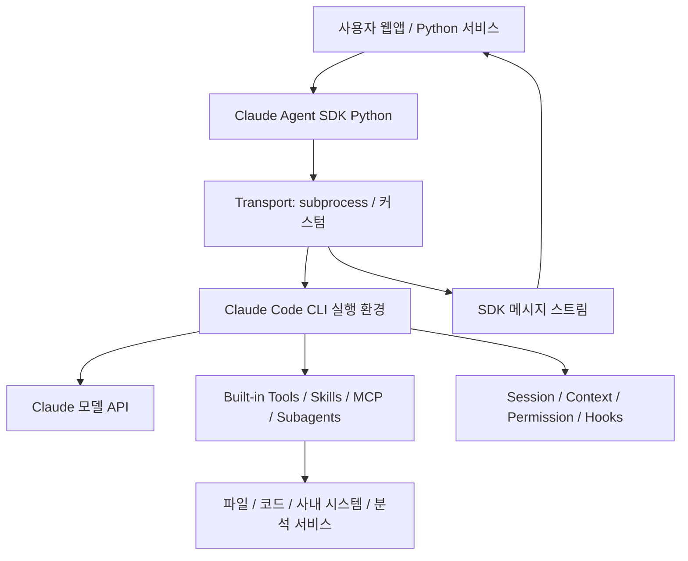
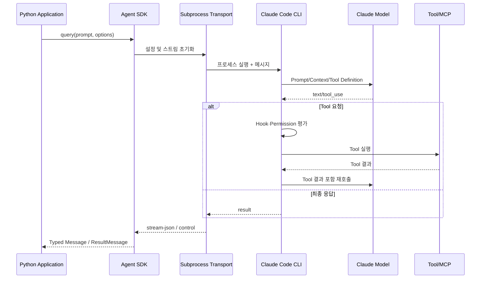
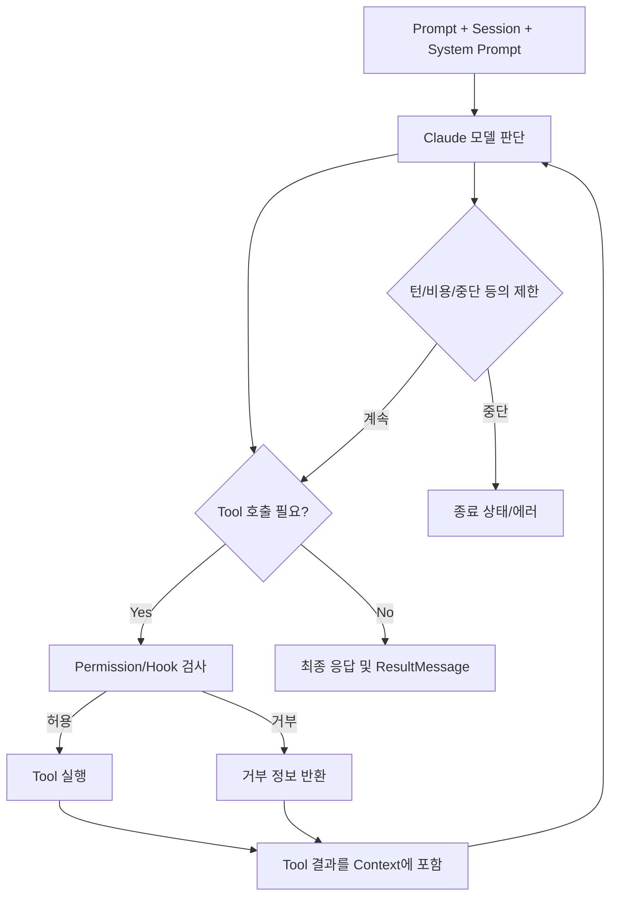
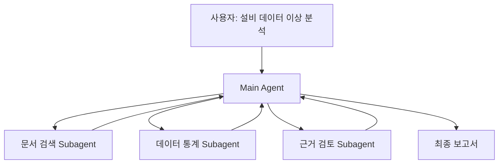
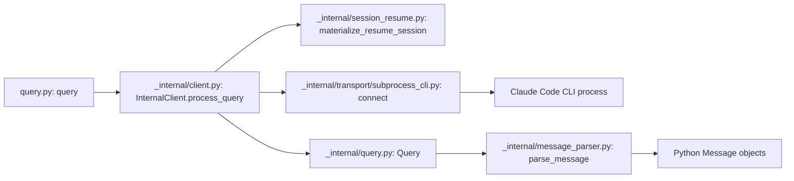
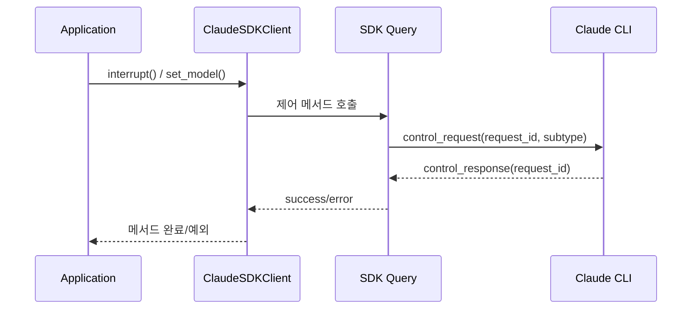
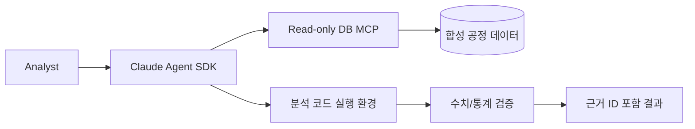
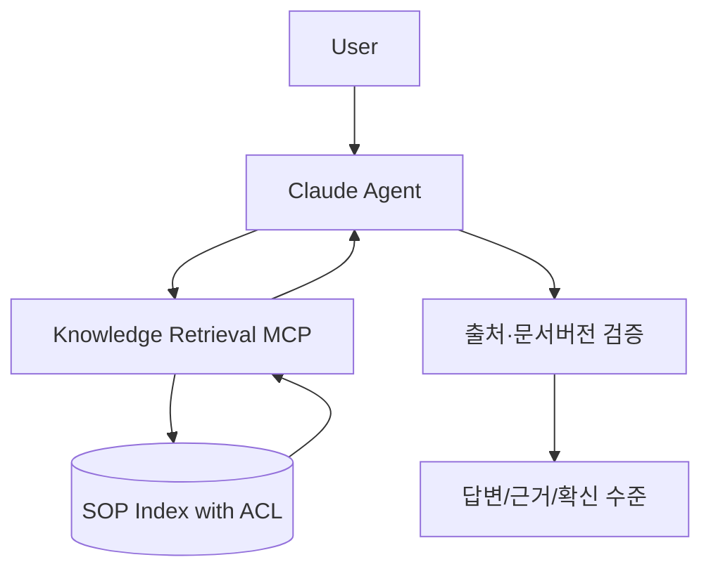
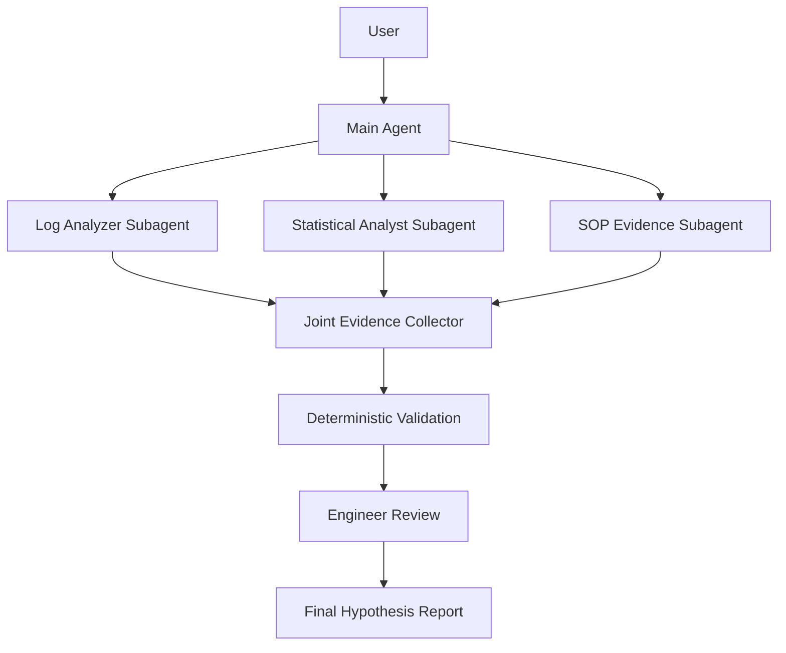

# Claude Agent SDK — 심층 학습 및 아키텍처·소스코드 분석

> **독립 학습 교재 | 기준일: 2026-10-29 | Python SDK `claude-agent-sdk` v0.2.174 (2026-10-24 릴리스)**  
> **번들 Claude CLI: v2.1.310 (해당 SDK 릴리스 노트 기준)**  
> **학습 목적:** 개념 이해 → 실행 아키텍처 → 공개 코드 추적 → 장단점 분석 → 반도체 Agent 개발의 기술 선정 기준  
> **분석 범위:** 공식 Claude Agent SDK 문서, Python SDK의 `v0.2.174` 태그, Claude Code CLI와의 연결 경계. TypeScript는 필요한 경우에만 비교한다.  
> **검증 상태:** 공개 문서·공개 GitHub 소스 정적 조사. **실제 설치, API 실행, 성능 벤치마크는 수행하지 않았음.**

## 문서를 읽는 방법과 검증 기준

- **[공식]**: Anthropic의 공식 문서 또는 공식 릴리스에 명시된 사실.
- **[소스]**: 고정된 Python SDK 태그에서 확인한 함수·클래스·분기 로직.
- **[추론]**: 공식 설명과 공개 구조를 근거로 한 해석. 확정된 내부 구현이라고 주장하지 않음.
- **[설계]**: 향후 반도체 데모에 권장하는 접근. SDK의 내장 기능과 혼동하지 않음.
- **[의사코드]**: 전체 구조를 배우기 위해 간략화한 코드. 실제 SDK 소스나 실행 가능한 예제와 구분.
- 출처는 본문에 `[D01]`, `[C01]` 형식으로 표시하고 마지막 장에 **클릭 가능한 원문 URL과 역할**을 제공한다. 공식 웹 문서는 계속 업데이트될 수 있으므로 2026-10-29 시점의 최신 문서와 고정 태그 간 차이는 별도로 주의한다.
- **중요:** Claude Agent SDK의 **공개 Python 코드**와 별도로 실행되는 **Claude Code CLI 내부 Agent Loop**는 공개 범위가 다르다. SDK 공개 코드만으로 CLI의 모든 내부 알고리즘을 검증했다고 말할 수 없다.

---

## 목차

1. 한눈에 보는 핵심 요약
2. LLM API·Claude Code·Claude Agent SDK·Agent Harness의 관계
3. 등장 배경과 설계 철학
4. 설치·인증·개발 환경과 최소 예제
5. 전체 아키텍처와 실행 주체
6. `query()` vs `ClaudeSDKClient`
7. 메시지·스트리밍·최종 결과·비용
8. Agent Loop와 종료 조건
9. System Prompt·`CLAUDE.md`·설정 병합
10. Built-in Tools와 Tool 선택·실행
11. 커스텀 Tool·SDK MCP Server·외부 MCP
12. Permission Mode·Allow/Deny·승인 콜백
13. Hooks와 제어·감사·Guardrails
14. Sessions·Context·Compaction·Memory
15. Skills·Commands·Plugins
16. Subagents·Task 위임·멀티에이전트
17. Structured Output과 정확성의 경계
18. Checkpoint·중단/재개·오류 처리
19. Sandbox·프로세스 보안·배포
20. Observability·평가·비용·성능
21. 코드 추적 ① `query()`에서 CLI 프로세스 시작까지
22. 코드 추적 ② `ClaudeSDKClient`와 메시지 스트림
23. 코드 추적 ③ Control Protocol·Hook·Permission·MCP
24. 코드 추적 ④ SessionStore와 Resume
25. 프레임워크가 지원하는 것과 직접 구현할 것
26. 반도체 도메인 적용 시나리오 3개
27. 평가 계획·안전 설계·예상 실패 모드
28. 장단점·선정 기준·다른 프레임워크 비교
29. 복습 문제·학습 체크리스트·용어
30. 공식 참고문헌 및 소스코드 색인

---

# Part I. 기초 개념

## 1. 한눈에 보는 핵심 요약

### 1.1 한 문장 정의

**Claude Agent SDK는 Claude Code의 Agent Loop·도구 실행·컨텍스트 관리 기능을 Python 또는 TypeScript 애플리케이션에서 프로그래밍 방식으로 이용하게 하는 SDK다.** [공식: D01, D02]

**쉽게 말해** Claude API에 프롬프트만 전달해 답을 받아오는 라이브러리가 아니다. 이미 도구를 사용하며 반복 작업을 수행하는 **Claude Code 실행 환경을 앱 안에서 제어**하는 방식이다.

### 1.2 30초 예시

사용자: “이 디렉터리의 데이터 파일을 조사하고 이상 징후를 설명해.”

1. SDK가 사용자의 요청과 설정을 Claude Code 런타임에 전달한다.
2. Claude가 파일 목록 확인, 파일 읽기, 코드 실행 등 가능한 행동을 결정한다.
3. 런타임이 해당 도구 사용 권한을 확인하고 도구를 실행한다.
4. 도구 결과를 Claude에게 다시 제공한다.
5. Claude가 추가 분석 여부를 판단하여 도구 호출을 반복한다.
6. 최종 결과·세션 ID·사용량/비용 등 실행 결과가 SDK 메시지로 전달된다.

**구분할 것:** 위의 2~5단계 Agent Loop는 Claude Code 런타임의 기능이다. Python SDK가 직접 모든 Tool 선택 로직을 구현하지는 않는다. [공식: D02; 소스: C01–C05]

### 1.3 Claude Agent SDK의 핵심 특징

| 핵심 | 의미 | 왜 중요한가 |
|---|---|---|
| 완성형 실행 루프 활용 | 모델 호출 → 도구 실행 → 결과 재입력 반복 구조 제공 | 작은 규모의 사용자 코드로 자율형 작업 구축 |
| 풍부한 기본 도구 | 파일·코드·검색 등의 환경 조작 기능 | 분석/개발형 작업에 즉시 활용 가능 |
| CLI 실행 기반 | Python SDK가 Claude Code 프로세스를 호출 | 순수 Python 내장 Runner와 다른 운영·보안 특성 |
| 설정·권한 정책 | permission mode, deny/ask/allow, 승인 콜백 | 도구 실행과 사용자 승인 경계 |
| Hooks | 실행 이벤트 전후에 코드 삽입 | 검증, 차단, 로깅, 감사 |
| Sessions | 기록·재개·분기 | 연속 업무와 문제 추적 |
| Skills·Subagents | 절차 재사용, 역할 분담 | 도메인 작업의 조직화 |
| MCP | 외부 도구와 데이터 소스 연결 | 사내 API/DB를 통제된 인터페이스로 제공 |
| 한계 | Claude Code/Claude 모델 생태계와 결합 | 로컬 LLM·다른 벤더 교체의 자유도 확인 필요 |

### 1.4 처음부터 알아야 할 다섯 가지

1. **SDK와 Agent Loop의 구현 위치는 다르다.**
2. **`allowed_tools`는 ‘허용한 도구만 사용 가능’이라는 뜻이 아니다.** 자동 승인 규칙이므로 실제 도구 표면 제한은 `tools`, `disallowed_tools`, 정책과 함께 설계해야 한다. [D06]
3. **`can_use_tool`은 모든 Tool 호출을 검사하지 않는다.** 앞 단계에서 자동 승인된 호출은 콜백에 오지 않으므로 전수 검사 용도로는 `PreToolUse` 및 실제 Tool 서버의 권한 통제가 중요하다. [D06]
4. **Session과 장기 도메인 Memory/RAG는 동일하지 않다.** Session은 우선 대화·도구 실행 이력이다. [D08]
5. **Structured Output은 형식 통제이지 사실 검증이 아니다.** [D16]

## 2. LLM API·Claude Code·SDK·Harness의 관계

### 2.1 기본 용어

| 용어 | 쉬운 설명 | Claude 생태계에서의 예시 |
|---|---|---|
| LLM / Foundation Model | 텍스트·코드 등을 생성하는 모델 | Claude 모델 |
| Model API / Client SDK | 모델에 요청을 보내고 응답을 받는 통신 라이브러리 | Anthropic API 및 Python Client SDK |
| Tool | 파일 읽기·명령 실행·검색·API 호출 같은 외부 행동 | Read, Bash, MCP Tool |
| Agent Loop | 판단 → 도구 사용 → 재판단을 반복하는 실행 구조 | Claude Code의 Agent Loop |
| Agent Harness | 모델을 둘러싼 도구·상태·권한·실행 환경 | Claude Code 기반 실행 구성 |
| Agent SDK | 이 실행 기능을 앱에서 호출·설정하는 인터페이스 | Claude Agent SDK |

### 2.2 계층 관계



- **모델이 자율적으로 다음 행동을 판단하는 부분**과 **도구 실행 정책을 집행하는 부분**은 Claude Code 런타임의 책임이다. [D02]
- **Python SDK의 직접 책임**은 입력 설정 직렬화, CLI 프로세스와의 통신, 출력 메시지 파싱, 콜백/제어 프로토콜, SDK MCP 및 세션 저장 어댑터 등이다. [C01–C07]
- 전체를 “OpenAI Agents SDK와 완전히 동일한 Python Runner 구조”로 생각하면 오해가 생긴다.

### 2.3 다른 것들과 혼동하지 말 것

- **Claude Chat:** 일반 사용자에게 제공되는 채팅 서비스.
- **Claude Code CLI:** 개발자용 실행 환경. 파일·명령·도구 사용 등의 Agent 행동을 담당.
- **Claude Agent SDK:** Claude Code 실행 기능을 프로그램에 결합하기 위한 Python/TypeScript 인터페이스.
- **Anthropic Client SDK:** Claude 모델 API 직접 호출용. Agent Loop나 Claude Code 도구 실행을 자동으로 모두 제공하는 것은 아님.
- **Hermes:** 비교 가능한 자율형 Agent이지만 공개 구현·기본 도구·모델 연동 방식이 다름.

## 3. 등장 배경과 설계 철학

### 3.1 왜 별도 Agent SDK인가?

모델 API만 사용해 파일 분석 Agent를 만들면 개발자가 프롬프트 조립, Tool 호출 목록, 실행 정책, 반복 조건, 컨텍스트 초과, 오류, 스트리밍, 로그 등을 직접 연결해야 한다. Agent SDK는 Claude Code에서 축적된 실행 기능을 재사용한다. [D01, D02]

### 3.2 핵심 설계 철학

1. **실행 가능한 환경을 제공한다:** 채팅 응답뿐 아니라 파일·코드·명령·연결된 API와 상호작용.
2. **모델이 다음 행동을 선택한다:** 고정 워크플로와 달리 다음 Tool 순서가 항상 미리 정해져 있지는 않다.
3. **사람과 정책이 행동을 제한한다:** permission mode, allow/deny, hook, sandbox 등의 계층 적용.
4. **설정 파일과 코드 설정을 함께 활용한다:** `.claude/`, `CLAUDE.md`, Skills, Plugins 및 SDK Options.
5. **세션의 연속성을 제공한다:** 이전 탐색과 도구 결과를 기억하며 이어서 작업.

### 3.3 특히 잘 맞는 업무와 덜 맞는 업무

**상대적으로 잘 맞는 업무:** 코드베이스 탐색·수정, 파일 기반 탐색/분석, 여러 도구를 오가며 조사, 로그 분석, 작업 계획 및 실행.

**별도 검토가 필요한 업무:** 마이크로초급 실시간 제어, 엄격한 결정적 실행, 복잡한 SQL 정책·조직별 RBAC, 완전한 모델 독립성, 온라인 모델 호출 불가 폐쇄망, 생산 설비 직접 제어. 이는 ‘불가능’ 단정이 아니라 **기본 기능만으로 충분하다고 가정하면 안 되는 영역**이다. [설계]

## 4. 설치·인증·개발 환경과 최소 예제

### 4.1 기본 설치

```bash
python -m venv .venv
source .venv/bin/activate  # Linux/macOS; Windows PowerShell은 .\.venv\Scripts\Activate.ps1
python -m pip install 'claude-agent-sdk==0.2.174'
```

- 공식 Python 패키지는 **Python 3.10 이상**을 요구한다. [C00]
- 해당 Python 패키지는 Claude Code CLI 실행 파일을 번들하므로 보통 별도 CLI 설치가 필수는 아니다. [C00, D02]
- 설정한 실행 바이너리가 다르면 환경·동작 차이가 날 수 있다. 재현성을 위해 SDK 및 CLI 버전을 함께 기록한다.
- 인증·과금은 공식 지원 방식과 조직의 정책을 따라야 한다. 제3자 제품에서 개인용 claude.ai 로그인을 재사용하는 방식은 공식 이용 조건 및 허용 범위를 확인해야 한다. [D01]

### 4.2 가장 간단한 사용 예제

```python
import asyncio
from claude_agent_sdk import query, ClaudeAgentOptions, ResultMessage

async def main():
    options = ClaudeAgentOptions(
        cwd="/path/to/safe_workspace",
        max_turns=6,
        max_budget_usd=1.0,
        disallowed_tools=["Write", "Edit"],
    )
    async for message in query(prompt="이 디렉터리의 파일 종류를 요약해 줘", options=options):
        if isinstance(message, ResultMessage):
            print("subtype:", message.subtype)
            print("result:", message.result)
            print("session:", message.session_id)

asyncio.run(main())
```

**주의:** 개념을 설명하기 위한 공식 API 형태 예제이며 **실행하지 않았다**. `disallowed_tools`에 Write/Edit를 넣는 것만으로 Bash 명령을 통한 쓰기까지 모두 차단된다고 가정하면 안 된다. 정확한 읽기 전용 환경에는 파일시스템·컨테이너·MCP 서버의 권한도 필요하다. [D06, D19]

### 4.3 개발 시 최소 준비물

- Python 버전·패키지 버전·번들 CLI 버전 확인.
- 적법한 API 인증/기업 계정 및 네트워크 경로 확인.
- 작업 디렉터리(`cwd`)와 읽을 수 있는 데이터/파일 범위 명시.
- 모델 사용 비용·실행 시간·도구별 위험 정의.
- 로그·세션에 기밀 정보가 저장되는지 검토.
- 시작은 공개·합성 데이터와 읽기 전용 환경으로 제한.

---

# Part II. 전체 아키텍처와 주요 컴포넌트

## 5. 전체 아키텍처와 실행 주체

### 5.1 주요 컴포넌트

| 컴포넌트 | 주된 역할 | 주요 코드/출처 |
|---|---|---|
| `query()` | 단발 실행/단방향 스트림 인터페이스 | `query.py` [C01] |
| `ClaudeSDKClient` | 양방향 대화, 연속 질의, interrupt, 연결 관리 | `client.py` [C02] |
| `ClaudeAgentOptions` | Model, Tools, Permissions, Hooks, Session 등 설정 | `types.py` [C06] |
| `InternalClient` | 단발 쿼리 실행 연결·정리 | `_internal/client.py` [C03] |
| `SubprocessCLITransport` | CLI 바이너리 실행, 인자 구성, stdin/stdout 통신 | `_internal/transport/subprocess_cli.py` [C05] |
| `Query` | 제어 요청·응답, Hook/Permission 호출, 메시지 스트림 | `_internal/query.py` [C04] |
| `parse_message()` | CLI 원시 메시지를 SDK 메시지 타입으로 변환 | `_internal/message_parser.py` [C07] |
| Claude Code CLI | Agent Loop, Built-in Tool, 모델/컨텍스트 실행 | [D02]—코드 공개 범위 제한 |
| `SessionStore` | 세션 기록 외부 저장 및 재개 | [D09, C08] |

### 5.2 데이터 흐름



**[의사도식]** CLI 내부 세부 함수 호출 순서를 가리키는 코드 레벨 구현도는 아니다. 통신 경계와 책임을 이해하기 위한 시퀀스다. [D02, C03–C07]

### 5.3 ‘프로세스가 생긴다’는 것의 의미

Python 패키지가 단지 `requests.post()`만 실행하는 것과 다르게, 기본 Transport는 별도 실행 바이너리와 JSON 기반 스트림을 주고받는다. 따라서 프로세스 생명주기, 배포 이미지 구성, 환경변수 전달, 파일시스템 격리, OS 사용자 권한, 세션 스토리지, CLI 업데이트가 운영 요소가 된다. [C05, D19]

## 6. `query()` vs `ClaudeSDKClient`

| 항목 | `query()` | `ClaudeSDKClient` |
|---|---|---|
| 기본 성격 | 단발·단방향 사용 | 양방향 지속 세션 |
| 입력 | 호출 시 prompt/입력 스트림 제공 | 연결 후 `client.query()` 반복 |
| 출력 | `async for`로 메시지 스트림 | `receive_messages()` / `receive_response()` |
| 중단 | 직접적 interactive interruption 제한 | `interrupt()` 지원 |
| 동적 제어 | 초기 옵션 기반 | 실행 중 model·permission 조정 등 |
| 일반적 용도 | 작업 1회 수행, 배치 | 상담형 UI, 반복 분석, 승인 인터랙션 |

[공식: D03; 소스: C01, C02]

### 6.1 상태 유지와 `query()`의 오해

‘`query()`가 stateless’라는 문구는 **같은 Python 클라이언트 연결 상태를 유지하지 않는다는 뜻**에 가깝다. 기존 Session ID와 `resume` 옵션을 통해 이전 세션을 재개할 수 있다는 사실과 모순되지 않는다. SDK 호출 객체의 수명과 대화 기록의 수명을 분리해서 생각해야 한다. [D08]

### 6.2 연속 대화 예시

```python
import asyncio
from claude_agent_sdk import ClaudeSDKClient, ClaudeAgentOptions, ResultMessage

async def main():
    options = ClaudeAgentOptions(cwd="/path/to/project", max_turns=8)
    async with ClaudeSDKClient(options=options) as client:
        await client.query("CSV 파일의 열 이름을 요약해 줘")
        async for msg in client.receive_response():
            if isinstance(msg, ResultMessage):
                print(msg.result)

        await client.query("이 중 결측치가 발생할 가능성이 높은 열은?")
        async for msg in client.receive_response():
            if isinstance(msg, ResultMessage):
                print(msg.result)

asyncio.run(main())
```

`receive_response()`는 `ResultMessage`까지 수신한 뒤 멈추는 편의 인터페이스이고, `receive_messages()`는 전체 메시지를 계속 읽는 스트림이다. [C02]

## 7. 메시지·스트리밍·최종 결과·비용

### 7.1 메시지 유형을 구분해야 하는 이유

Agent의 출력을 단순히 최종 문자열 하나로 취급하면 **어떤 도구를 호출했는지**, **도구 실행이 실패했는지**, **권한 거부가 있었는지**를 잃어버릴 수 있다.

| 메시지 | 대표 내용 | 분석 활용 |
|---|---|---|
| `SystemMessage` | 초기화·세션·사용 가능 도구 등 정보 | 구동/설정 검사 |
| `AssistantMessage` | 텍스트 및 Tool 사용 요청 블록 | 모델 판단 경로 추적 |
| `UserMessage` | 사용자 입력 또는 Tool 결과 표현 | 근거 추적 |
| `StreamEvent` | 세밀한 부분 토큰/이벤트 | 실시간 UI |
| `ResultMessage` | 최종 상태·비용·사용량·세션 ID 등 | 종료·과금·실패 검사 |

실제 버전에 따라 다른 메시지 유형도 존재한다. 운영 코드에서는 알려진 유형만 무조건 허용하거나 모든 결과를 `AssistantMessage`라고 가정하지 말고 API Reference와 Message Parser를 확인한다. [D03, C07]

### 7.2 최종 결과의 중요한 필드

`ResultMessage`에는 `subtype`, `is_error`, `num_turns`, `duration_ms`, `session_id`, `result`, `structured_output`, `total_cost_usd`, `usage`, `permission_denials` 등이 포함될 수 있다. 필드는 결과 subtype 및 버전에 따라 `None`일 수 있다. [D03]

**실무 체크:** `ResultMessage`를 받았다고 해서 성공을 단정하지 말고 `subtype`, `is_error`, 예외, 구조화 출력 존재 여부를 확인한다. 최소한 성공/예산 초과/최대 턴/실행 오류를 구분해 저장한다.

### 7.3 스트리밍

- `include_partial_messages` 등 관련 옵션으로 세밀한 출력 이벤트를 받을 수 있다. [D17]
- 각 `AssistantMessage`는 ‘완료된 전체 실행’과 같지 않다.
- streaming 도중 연결 실패, 중복 이벤트, partial 출력 노출에 주의한다.
- 민감 데이터를 실시간 UI/로그로 그대로 전달하지 않도록 서버 측 필터가 필요하다. [설계]

## 8. Agent Loop와 종료 조건

### 8.1 실행 원리



[공식: D02] 이 플로우는 **설명용 요약**이다. CLI 내부 상태 머신의 정확한 구현 함수나 코드 분기를 나타내지는 않는다.

### 8.2 모델 Tool Use와 ‘실제 Tool 실행’ 구분

- 모델은 **도구를 사용해 달라는 요청**을 생성한다.
- 런타임/정책 계층은 요청의 허용 여부, 실행 위치와 방식, 오류 처리를 결정한다.
- 도구 결과는 다음 모델 호출에 반영된다.
- 최종 답변은 실행 횟수·비용·사용 가능한 데이터 품질에 영향을 받는다.

### 8.3 종료와 상한 설정

- 최종 답변/정상 종료.
- `max_turns`에 의한 턴 수 제한.
- `max_budget_usd`에 의한 예산 제한.
- Tool 오류·모델 API 오류·CLI 연결 오류.
- 승인이 거부되거나 `interrupt()`로 중단.
- Structured Output 재시도 실패.

반환된 `ResultMessage.subtype`은 `success`, `error_max_turns`, `error_max_budget_usd`, `error_during_execution`, `error_max_structured_output_retries` 등의 값을 가질 수 있다. [D03]

### 8.4 ‘턴’과 ‘사용자 요청’을 혼동하지 말 것

사용자 질문 한 번으로 여러 모델·도구 상호작용이 발생할 수 있다. 비용·시간·컨텍스트를 평가할 때 `num_turns`와 실제 API 호출/도구 호출 수를 분리하여 수집하는 편이 좋다. 정확한 과금 및 턴 정의는 해당 API Reference를 따른다.

### 8.5 Claude Agent SDK의 강점과 트레이드오프

**장점:** 도구 호출과 루프를 처음부터 직접 개발할 부담이 작다.

**트레이드오프:** CLI 내부의 모든 분기 알고리즘을 Python 사용자 코드에서 독립적으로 교체하기는 어렵다. 엄격한 프로세스 제어나 명시적 DAG가 중심인 업무는 상위 서비스의 워크플로 계층을 별도 설계해야 할 수 있다. [추론·설계]

## 9. System Prompt·`CLAUDE.md`·설정 병합

### 9.1 Instruction은 한 곳에만 있지 않다

모델에게 ‘어떻게 행동해야 하는가’를 전달하는 규칙은 여러 계층에서 유입될 수 있다.

| 출처 | 예시 | 성격 |
|---|---|---|
| SDK 옵션 | `system_prompt` | 실행 시 주입하는 시스템 지침 |
| 프로젝트 컨텍스트 | `CLAUDE.md` | 저장소·프로젝트의 지속적 지침 |
| 사용자 설정 | `~/.claude/` 관련 설정 | 개인적 규칙과 설정 |
| Skill | `SKILL.md` | 특정 작업을 수행하는 절차·리소스 |
| Subagent | `AgentDefinition.prompt` | 위임받은 역할의 전문 지침 |
| 사용자 요청 | `prompt` | 이번 작업의 목표 |
| Tool 결과 | 파일·문서·DB 응답 | 참고 데이터이므로 신뢰 수준이 다름 |

[공식: D10, D11, D12]

### 9.2 `system_prompt`와 `CLAUDE.md`의 관계

`system_prompt`는 SDK 호출에서 실행 설정의 일부로 지정한다. `CLAUDE.md`는 프로젝트 설정 소스를 통해 읽히는 지속적인 프로젝트 지침에 가깝다. **둘은 같은 파일·같은 책임이 아니다.** [D10]

```python
options = ClaudeAgentOptions(
    cwd="/path/to/project",
    system_prompt="분석 결과에는 데이터 출처와 검증 불가능한 가설을 구분해 작성하라.",
    setting_sources=["project"],
)
```

위 코드는 사용자 정의 시스템 프롬프트와 프로젝트 설정을 함께 사용하는 개념 예시다. 실제로 어떤 기본 Claude Code 지침이 유지·교체되는지는 `system_prompt`의 형태(`str`, preset 등)와 문서의 규칙에 따르므로 **단순 병합이라고 가정하지 않는다**. [D10, D03]

### 9.3 설정 우선순위

공식 Python SDK 레퍼런스는 파일 기반 설정의 우선순위를 local > project > user로 설명하며, SDK 프로그래밍 옵션은 일반적인 파일 설정을 덮어쓸 수 있다. 관리형 정책은 SDK 프로그래밍 옵션보다 우선한다. 단, 특정 권한 결정에는 별도의 deny/ask/allow 순서가 있으므로 설정 병합과 Tool Permission을 혼동하면 안 된다. [D03, D06]

**주의:** 파일 설정의 우선순위와 여러 `CLAUDE.md`가 동시에 입력될 때의 지침 해석은 다르다. 공식 문서에서는 user/project/local `CLAUDE.md` 내용을 누적해 읽으며, 내용 충돌 시 엄격한 보편 우선순위가 자동 적용된다고 보장하지 않는다. 상충되는 지침은 피하거나 우선순위를 명시한다. [D12]

### 9.4 Prompt Injection과 Instruction의 구별

공정 SOP 문서에 `ignore previous instructions` 같은 문장이 포함되었다고 해서 이 문서를 시스템 지침으로 승격시키면 안 된다. 문서/검색/Tool 결과는 **데이터**로 취급하고, 실행 가능한 행동은 별도 권한 정책으로 제어해야 한다. [설계]

## 10. Built-in Tools와 Tool 선택·실행

### 10.1 Tool의 두 단계

1. **모델 노출:** 지금 실행에서 사용 가능한 도구와 스키마를 모델에게 알려 준다.
2. **도구 실행:** 실제 호출 발생 시 정책 확인 뒤 실행 환경에서 함수를 실행한다.

이 둘을 혼동하면 “모델에 알려주지 않은 도구를 완전히 차단했다”, “자동 허용했으니 도구가 무조건 모델에 보인다” 같은 오류가 생긴다. [D06, D03]

### 10.2 내장 도구의 역할 예시

| 도구 계열 | 수행할 수 있는 작업 예 | 반도체 데모의 주의점 |
|---|---|---|
| Read/Glob/Grep | 파일 읽기, 경로 검색, 텍스트 탐색 | 폴더·파일 접근 범위 제한 |
| Bash | 셸 명령·프로그램 실행 | 네트워크/파일수정/외부 프로세스 위험 |
| Edit/Write | 파일 변경·생성 | 원본 공정 자료 변조 방지 |
| Web 관련 도구 | 외부 자료 탐색 | 기밀 정보 전송 금지 |
| Task/Subagent | 하위 역할 위임 | 자식 Agent의 권한·비용 상한 |
| MCP Tools | 기업 API·DB·RAG 연동 | 인증과 RBAC, 쿼리 안전성 별도 구현 |

사용 가능한 정확한 도구 목록은 **SDK 버전·CLI 버전·설정·환경**에 따라 달라질 수 있다. `SystemMessage(init)`의 Tool 정보와 공식 API Reference로 확인한다. [D02, D03]

### 10.3 `tools`, `allowed_tools`, `disallowed_tools` 비교

| 옵션 | 의미 | 보안상 해석 |
|---|---|---|
| `tools` | 기본 제공/노출하는 도구 집합 설정 | 모델의 도구 표면을 좁히는 수단 |
| `allowed_tools` | 도구 사용을 자동 승인하는 규칙 | **단독 차단 목록이 아님** |
| `disallowed_tools` | 이름·패턴과 일치하는 호출을 거부 | 거부 규칙, 추가 방어 계층 |
| Permission Mode | 일반 승인 동작 조절 | 다른 규칙과 함께 평가 |
| `PreToolUse` | 호출 직전 검사·차단·변환 | 동적 정책을 적용할 수 있음 |
| 실제 시스템 권한 | OS/컨테이너/DB 계정 | 런타임 설정을 우회해도 자원 접근을 제한 |

[D06, C05]

### 10.4 Tool 실패와 재시도

Tool 호출이 실패했다고 해서 항상 Python 코드의 예외로 직결되는 것은 아니다. 도구 오류가 Agent에게 전달되어 모델이 다른 계획을 세울 수도 있고, 실행 전체가 실패할 수도 있다. 실패를 기록할 때 **Tool 자체 실패, 정책 거부, 모델 오류, SDK 통신 실패**를 각각 구분해야 한다. [D02, D03]

## 11. 커스텀 Tool·SDK MCP Server·외부 MCP

### 11.1 `@tool`이 일반 Python 함수를 바로 실행시키는 것인가?

Python SDK는 `@tool`로 Tool의 이름·설명·입력 스키마·Handler를 만들고 `create_sdk_mcp_server()`로 등록하는 방식을 공식적으로 제공한다. 모델은 이 MCP Tool을 호출하고, SDK는 해당 호출을 Python Handler에 연결한다. [D05]

### 11.2 커스텀 Tool 예제

```python
from claude_agent_sdk import tool, create_sdk_mcp_server, ClaudeAgentOptions

@tool("get_sensor_stat", "Return a synthetic sensor summary", {"sensor_id": str})
async def get_sensor_stat(args):
    # 학습용: 실제 시스템에서는 DB 권한, 입력검증, 감사 로그가 필요
    sensor_id = args["sensor_id"]
    values = {"demo-temp-01": 42.1, "demo-temp-02": 43.0}
    if sensor_id not in values:
        return {"content": [{"type": "text", "text": "Unknown sensor ID"}], "isError": True}
    return {"content": [{"type": "text", "text": str(values[sensor_id])}]}

server = create_sdk_mcp_server(
    name="fab_demo",
    version="1.0.0",
    tools=[get_sensor_stat],
)

options = ClaudeAgentOptions(
    mcp_servers={"fab_demo": server},
    allowed_tools=["mcp__fab_demo__get_sensor_stat"],
)
```

위 코드는 공식적인 `@tool` / `create_sdk_mcp_server` 사용 형태를 따르는 **합성 데이터 학습 예제**로, 실행하지 않았다. `allowed_tools` 항목은 이 도구를 **자동 승인**하는 설정이지 모든 다른 도구를 자동 차단하지 않는다. 읽기 전용 데이터 접근 보장은 Handler 안의 권한 검사와 서버 설정까지 포함해야 한다. [D05, D06]

### 11.3 외부 MCP와 In-process MCP의 차이

| 항목 | In-process SDK MCP | 외부 MCP Server |
|---|---|---|
| 실행 위치 | SDK가 구동하는 앱 프로세스와 연계 | 별도 프로세스·서버일 수 있음 |
| 연결 | `create_sdk_mcp_server()` | stdio 또는 원격 MCP 설정 등 |
| 장점 | 작은 도구를 코드로 빠르게 노출 | 팀 간 도구 재사용, 독립 배포, 보안 분리 |
| 주의 | 앱 코드의 권한·비밀정보·예외 노출 | 인증·네트워크·서버 가용성·감사 정책 |

[D05, D13]

### 11.4 Tool의 입력 검증

Tool 스키마가 모델에 제공된다고 해도 사내 데이터 접근은 반드시 실제 Handler에서 검증해야 한다. 예컨대 `lot_id` 문자열 하나가 합법적으로 보이더라도 **사용자에게 그 Lot 조회 권한이 있는지는 별도 문제**다. [설계]

권장 순서: 인증된 사용자 → RBAC/ABAC 검사 → 허용 파라미터 범위 확인 → DB 읽기 전용 쿼리 → 반환 컬럼/행 제한 → 민감 정보 필터 → 결과 감사.

### 11.5 MCP는 무엇을 제공하지 않는가?

MCP 자체는 Tool 인터페이스/연결 프로토콜이다. 데이터 권한, SQL Injection 방어, 통신 암호화 설정, 감사 보존 정책, 결과 수치의 정확성을 자동으로 보장하지 않는다. **MCP 도입과 보안 설계는 별개**다. [설계]

## 12. Permission Mode·Allow/Deny·승인 콜백

### 12.1 이 장이 중요한 이유

실제 생산 환경에서 Agent를 사용할 때 가장 위험한 오해는 **모델이 호출한 Tool을 곧바로 실행해도 된다**는 생각이다. Claude Agent SDK에는 정책 계층이 있으나, 제대로 구성하지 않으면 위험한 실행이 승인되거나 반대로 필요한 조회가 막힐 수 있다. [D06]

### 12.2 공식 권한 평가의 큰 순서

1. `PreToolUse` 등 Hooks의 검사/차단.
2. Deny 규칙 검사.
3. Ask 규칙 검사.
4. Permission Mode에 따른 처리.
5. Allow 규칙과 자동 승인 가능 여부.
6. 필요할 때 `can_use_tool` 승인 콜백(또는 승인 처리 수단)으로 전달.

**주의:** 위 순서는 이해를 위한 요약. 특수 Tool, 조직 정책, critical path, read from network paths 및 버전에 따른 예외가 있으므로 운영 시 원문 흐름도를 확인한다. Hook의 `allow`는 모든 후속 deny/ask 규칙을 무시하지 않는다. [D06]

### 12.3 주요 Permission Mode

| Mode | 기본 성향 | 실무 권고 |
|---|---|---|
| `default` | 필요한 도구는 승인 흐름을 거침 | 사용자와 상호작용하는 서비스 |
| `plan` | 계획 중심, 실행 제한 | 실행 전 분석 및 검토 |
| `acceptEdits` | 일부 수정·파일 관련 작업을 더 쉽게 승인 | 격리된 개발 작업에 한정 |
| `dontAsk` | 승인 프롬프트가 필요한 호출을 거부 | 미리 정의된 제한형 배치 |
| `bypassPermissions` | 폭넓은 자동 승인 | 신뢰 가능한 격리 환경 외 사용 지양 |
| `auto` | 일부 자동 판단 기반 승인 | 조직 보안 검토 후 테스트 |

`auto` 등 모드와 예외는 CLI 업데이트에 따라 변할 수 있다. v0.2.174 번들 CLI와 최신 문서 간 차이는 고정된 버전에서 재검증해야 한다. [D06]

### 12.4 `can_use_tool`을 전체 Tool 감시기로 쓰면 안 되는 이유

공식 문서: 어떤 Tool이 앞 단계의 allow rule 또는 mode로 자동 승인되면 `can_use_tool` 콜백은 실행되지 않을 수 있다. 따라서 모든 데이터 접근의 권한 판단을 이 콜백 하나에 두면 보안 구멍이 생길 수 있다. 모든 호출을 확인하려면 `PreToolUse`를 사용하고, **최종 자원 권한은 실제 Tool/DB 서버에서도 강제**한다. [D06]

### 12.5 정책 예시

가정: 사용자는 설비 데이터를 **조회할 수 있지만 변경할 수 없다.**

- 작업용 워크스페이스의 OS 쓰기 권한 최소화.
- Tool 기본 노출 목록에서 불필요한 Bash, Edit, Write 제거.
- 유해한 작업과 범용 셸 실행을 별도 deny.
- DB MCP 서버 자체는 `SELECT` 전용 계정 및 서버 측 컬럼·행 권한 강제.
- `PreToolUse`에서 계정·Lot/설비·시간범위·쿼리 정책 확인.
- 실행 기록에 인증 주체와 승인 정책 버전을 저장.

한 군데의 옵션만으로 이러한 속성이 모두 확보되는 것은 아니다. [설계]

## 13. Hooks와 제어·감사·Guardrails

### 13.1 Hook란?

Hook은 Agent 실행 흐름의 특정 시점에 호출되는 사용자 정의 함수다. 주요 이벤트는 Tool 호출 전·후, Session 라이프사이클, Subagent 시작·종료, 실행 중단/종료 등이다. Python과 TypeScript에서 지원되는 특정 Hook은 버전별로 차이가 있을 수 있다. [D07]

### 13.2 `PreToolUse` / `PostToolUse` 비교

| Hook | 타이밍 | 적합한 사용 |
|---|---|---|
| `PreToolUse` | Tool 실행 전 | 위험 명령 거부, 입력 변환, 권한 검사 |
| `PostToolUse` | Tool 성공 후 | 결과 검사, 지표 기록, 데이터 오염 탐지 |
| `PostToolUseFailure` | Tool 실패 후 | 에러 유형 기록, 제한적 복구 |
| `SubagentStart/Stop` | 하위 Agent 시작/종료 | 비용·역할·부모-자식 추적 |
| `Stop` | Agent가 멈추려는 시점 | 결과 점검 등 |

최신 공식 문서에 모든 이벤트가 나열되어 있지만 **특정 Python SDK 버전에서 구현되는 이벤트 범위**와 **CLI가 처리하는 이벤트**를 나누어 확인해야 한다. [D07]

### 13.3 Hook 등록 예제 — 학습용

```python
from claude_agent_sdk import ClaudeAgentOptions, HookMatcher

async def audit_tool(input_data, tool_use_id, context):
    tool_name = input_data.get("tool_name")
    # 운영 환경에서는 인증 주체/요청 ID와 함께 안전한 로그에 기록
    print("Tool requested:", tool_name)
    return {}

options = ClaudeAgentOptions(
    hooks={"PreToolUse": [HookMatcher(hooks=[audit_tool])]},
)
```

여기서 `return {}`는 행동을 단순 기록만 한다는 예제다. **로그에 실제 Tool 인자와 기밀 정보를 그대로 출력하는 코드는 운영에 사용하면 안 된다.** Hook의 정확한 출력 스키마와 승인/거부 형태는 해당 버전의 API Reference를 확인한다. [D07]

### 13.4 Guardrail은 한 가지가 아니다

| Guardrail 유형 | 구현 지점 | 예시 |
|---|---|---|
| 입력 검증 | 앱의 요청 처리 계층 | 허용 Lot ID / 시간 범위 제한 |
| Tool 실행 검증 | `PreToolUse`, 도구 서버 | DML 실행 거부 |
| 모델 입력 경계 | Prompt, 검색 인용문 처리 | SOP의 악성 지시문 무시 |
| 출력 검증 | JSON Schema + 서버 검증 | 수치 범위·단위·근거 누락 검사 |
| 사람 승인 | Permission/업무 UI | 파일 삭제, 권한 변경 요구 |
| 인프라 격리 | OS, container, DB | 프로세스 실행 권한 제한 |

**중요:** Claude Agent SDK의 Hook은 보안 정책을 구성하는 데 유용하지만 조직 전체 데이터 거버넌스 또는 RBAC 시스템을 자동으로 제공하는 것은 아니다.

### 13.5 Hook 실패 정책

Hook 시간 초과, 오류, 사용자 코드 예외는 Tool 실행 경로에 영향을 줄 수 있다. **안전과 관련된 Hook은 실패 시 작업이 차단되는지(fail-closed)** 실제 SDK/CLI 버전에서 검증한다. 모든 이벤트가 동일한 실패 정책을 가진다고 가정하지 않는다. [D07]

## 14. Sessions·Context·Compaction·Memory

### 14.1 먼저 네 가지를 구분

| 개념 | 의미 | 예 |
|---|---|---|
| Session | 실행 과정의 대화/Tool 기록 | user→Tool→assistant transcript |
| Context Window | 이번 모델 호출에 들어갈 수 있는 정보 범위 | 시스템 지침+대화+Tool 결과 |
| Compaction | 오래된 정보를 요약하여 Context 비용을 줄이는 과정 | 오래된 호출 기록 요약 |
| Long-term Domain Memory | 프로젝트 지식·운영 규칙을 장기간 관리하는 기능 | 반도체 SOP·분석 결과 인덱스 |

Session이 있다고 해서 자동으로 사용자별 벡터 DB 검색이나 공정 문서 RAG까지 완성된 것은 아니다. [D02, D08, 설계]

### 14.2 Session 동작

공식 문서에 따르면 일반적인 세션 기록은 로컬 `~/.claude/projects/` 아래 JSONL 형태로 저장된다. `resume=<session_id>`로 다시 읽고, `continue_conversation`으로 최근 세션을 이어가거나 `fork_session`으로 분기할 수 있다. [D08, D09]

```python
# 앞선 작업에서 얻은 session_id가 있다고 가정
options = ClaudeAgentOptions(resume=session_id, max_turns=6)
async for msg in query(prompt="방금 분석한 이상 징후의 근거를 다시 정리해", options=options):
    ...
```

**운영 시 주의:** 세션에는 민감한 Tool 인자와 결과가 저장될 수 있다. 프로젝트별 접근통제, 파일 저장 위치, 암호화, 보존 기간, 삭제 정책을 별도로 정의한다. [설계]

### 14.3 Context 압축

긴 작업에서는 모든 과거 Tool 결과를 모델 Context에 그대로 포함할 수 없으므로 Claude Code는 컨텍스트를 관리하거나 압축할 수 있다. 일반적인 모델 API 직접 호출과 달리 Agent Runtime의 컨텍스트 관리 기능을 활용할 수 있다는 것이 장점이다. [D02]

하지만 압축 과정에서 숫자·단위·작업 조건·출처가 사라질 수 있다. **공정 실험 결과나 통계 계산값을 단순 자연어 요약에만 의존해서 저장하면 안 된다.** 중요한 수치는 별도 영구 아티팩트/DB에 저장하고 ID로 참조한다. [설계]

### 14.4 Memory는 어떻게 구축하는가?

- 프로젝트 지침: `CLAUDE.md`에 상시 지켜야 할 규칙을 둠.
- Skills: 반복 분석 절차를 Markdown+리소스에 저장.
- Session: 특정 사용자·작업의 대화와 Tool 실행 기록을 보존.
- Subagent memory: 특정 Agent별 파일 기반 지식/기억 소스를 구성 가능.
- RAG/MCP: 전문 문서, 운영 DB, 검색 인덱스를 별도로 연결.

즉 **지침·절차·대화·외부 지식은 서로 다른 저장 체계**로 설계하는 편이 안전하다. [D08, D11, D14]

### 14.5 외부 SessionStore

공식 SDK는 `SessionStore` 어댑터를 제공한다. `append()`와 `load()` 등의 인터페이스를 구현해 대화 기록을 외부 데이터 저장소로 미러링하고 여러 호스트 간 재개에 활용할 수 있다. [D09]

```text
사용자 작업 실행
    → CLI가 로컬 Session JSONL 생성
    → SDK SessionStore.append(...)로 미러링
    → 외부 DB/Object Storage 저장

다른 실행 호스트에서 resume
    → SDK SessionStore.load(...)
    → 임시 Claude 설정 디렉터리에 복원
    → CLI가 기존 Session을 재개
```

이것은 **트랜스크립트 저장·복원**이지 자동 의미 검색(RAG)과 동일한 개념이 아니다. `project_key`와 working directory의 대응, 동시 append 순서, 인증 정보 보존, subagent subpath 보존 등이 운영 조건이다. [D09, C08]

## 15. Skills·Commands·Plugins

### 15.1 Skill은 ‘도구 함수’가 아니다

Skill은 특정 작업을 수행하는 **재사용 가능한 지침과 관련 리소스**를 담는 패키지이다. 보통 `.claude/skills/<name>/SKILL.md`처럼 구성하며, 이름·설명·사용 조건을 메타데이터로 제공한다. Tool은 실제 행동을 실행하는 인터페이스다. [D11]

```text
fab-workspace/
├── CLAUDE.md
└── .claude/
    ├── skills/
    │   └── yield-analysis/
    │       ├── SKILL.md
    │       └── references/
    │           └── feature_rules.md
    └── settings.json
```

### 15.2 Skill 내용 예시

```markdown
---
name: yield-analysis
description: 합성 수율 테이블에서 이상 분포를 확인할 때 사용
---

1. 데이터 출처와 스키마를 확인한다.
2. 누락값, 중복, 범주형 컬럼의 분포를 확인한다.
3. lot/설비/기간 단위로 요약 통계를 만든다.
4. 결과는 관측 사실과 원인 가설로 분리한다.
5. 실제 원인 확정 또는 설비 조치를 제안하지 않는다.
```

[설계 예시] 도메인 규칙을 재사용할 수 있지만 **Skill에 쓴 내용이 진실인지 검증하는 자동 장치가 되는 것은 아니다.** 실측 데이터 검증은 Tool와 외부 평가로 수행한다.

### 15.3 Skill 로딩의 조건과 버전 차이

공식 문서는 SDK의 `skills` 및 `setting_sources` 옵션을 설명한다. **v0.2.174의 공개 Python 코드**에서는 `options.skills="all"` 또는 개별 스킬 목록이 있으면 Tool 승인 목록에 대응 규칙을 추가하고, `setting_sources`가 미지정이면 user/project 소스를 기본값으로 계산한다. 반면 `setting_sources=[]`를 명시하면 파일에서 Skill을 찾지 못할 수 있다. [D11, C05]

이 부분은 **예전 버전의 ‘항상 setting_sources를 직접 지정해야 한다’는 설명을 그대로 반복하면 안 되는 대표적인 사례**다. 공식 문서와 정확한 설치 버전의 구현을 함께 비교해야 한다.

### 15.4 Commands·Plugins와의 차이

- Commands: `/compact`와 같은 내장 명령, `.claude/commands/`에 정의된 커스텀 명령 등.
- Skill: 특정 작업에 활용할 전문 지침과 자료.
- Plugin: 여러 Skills·Hooks·Subagents·MCP 설정 등을 함께 배포하는 확장 패키지.
- Tool: 파일 접근·API 호출·실제 계산 같은 실행 능력.

[D11, D15]

### 15.5 자동 학습과 Skill 저장은 동일하지 않다

Skill 파일을 설치하면 Claude가 적절한 때 사용할 수 있지만, **매번 성공적인 작업을 분석해 새 Skill을 자동 생성·검증·승격하는 전체 학습 파이프라인이 기본 제공된다는 뜻은 아니다.** 그런 기능이 필요하면 품질 평가, 승인·버전관리, 롤백 정책을 직접 설계해야 한다. [설계]

## 16. Subagents·Task 위임·멀티에이전트

### 16.1 Subagent란?

메인 Agent가 특정 작업을 전문 Agent에게 위임하고 결과를 받아 종합하는 실행 패턴이다. 분리된 역할, 컨텍스트, Tool 목록, 모델 설정을 활용할 수 있다. [D14]



### 16.2 프로그래밍 정의 예시

```python
from claude_agent_sdk import AgentDefinition, ClaudeAgentOptions

options = ClaudeAgentOptions(
    agents={
        "stat-reviewer": AgentDefinition(
            description="합성 데이터의 통계 분석 검토가 필요할 때 위임",
            prompt="당신은 통계 검토자다. 수치, 단위, 표본 수를 확인하고 검증 불가능한 원인 추정은 분리하라.",
            tools=["Read", "Grep"],
        ),
    },
)
```

[공식: D14, D03] **주의:** `tools=["Read", "Grep"]` 같은 서브에이전트 도구 설정만으로 OS 파일 접근 범위와 기업용 DB 권한이 정해지는 것은 아니다. 실행 주체별 데이터 권한을 별도로 통제한다.

### 16.3 위임에 따른 실익

- 컨텍스트 분리: 주 Agent에 불필요한 중간 자료를 덜 노출.
- 작업 전문화: 검증용 Agent와 데이터 처리용 Agent를 분리.
- Tool 권한 분리: 역할별 노출 도구 최소화.
- 독립 추적: 어느 Subagent가 어떤 근거를 생성했는지 기록.

### 16.4 한계

- 여러 Agent를 사용하면 모델 호출·토큰·오류 가능성이 늘어날 수 있다.
- Agent별 추론이 서로 다를 때 어느 결과를 채택할지 별도 합의·검증 로직이 필요하다.
- 생성 결과의 독립성이 충분하지 않으면 ‘여러 Agent가 같은 오류를 반복’할 수 있다.
- 병렬 실행·백그라운드 작업·depth/concurrency 제한은 CLI 버전의 공식 지원 범위에서 검증한다. [D14]

### 16.5 명시적 Workflow vs 자율 위임

**자율 위임:** Main Agent가 언제 어느 Subagent를 부를지 판단. 탐색에 유연하지만 실행 경로가 달라질 수 있다.

**명시적 Workflow:** 앱 코드가 조회→통계→검증→승인 순서를 강제. 운영상 재현성이 높고 업무 규칙을 집행하기 쉽다.

**반도체 데모 권장:** 탐색과 설명 부분에는 자율성을 주되, 정형 데이터 추출·검증·최종 보고서 승인과 같은 단계는 외부 서비스의 명시적 워크플로로 감싸는 혼합형 구성을 검토한다. [설계]

## 17. Structured Output과 정확성의 경계

### 17.1 문제 상황

모델이 “수율은 대략 양호합니다”라고만 반환하면 자동 분석 시스템이 처리하기 어렵다. JSON Schema로 `lot_id`, `sample_count`, `yield_rate`, `evidence_ids`, `hypotheses` 등의 필드를 지정하면 프로그램이 후처리하기 좋아진다. [D16]

### 17.2 JSON Schema 예시

```python
schema = {
    "type": "object",
    "properties": {
        "lot_id": {"type": "string"},
        "yield_rate": {"type": "number"},
        "sample_count": {"type": "integer"},
        "conclusion": {"type": "string"},
    },
    "required": ["lot_id", "yield_rate", "sample_count", "conclusion"],
    "additionalProperties": False,
}

options = ClaudeAgentOptions(output_format={"type": "json_schema", "schema": schema})
```

**분석 포인트:** Claude Code가 출력 스키마 처리용 `StructuredOutput` Tool을 도입할 수 있으며, SDK 최종 메시지에 `structured_output`이 표시될 수 있다. [D16]

### 17.3 형식 검증 ≠ 도메인 정확성

아래와 같은 응답은 스키마에 맞을 수 있다.

```json
{"lot_id":"L-001","yield_rate":999.0,"sample_count":-1,"conclusion":"정상"}
```

하지만 공정 수율과 표본 수 측면에서 명백히 문제가 있다. **따라서 JSON Schema, Python/Pydantic 검증, DB 근거 검증, 통계 계산 재검증을 함께 사용**해야 한다. [설계]

### 17.4 검증 계층

1. JSON 파싱 가능 여부.
2. Schema 필수 필드·타입 검사.
3. 값 범위(0≤yield_rate≤1 등)·단위·표본 수 검사.
4. 실제 Tool 조회값과 수치 일치 검증.
5. 근거 ID 존재 및 접근 권한 확인.
6. 가설/사실/권고가 논리적으로 분리되었는지 도메인 평가.

## 18. Checkpoint·중단/재개·오류 처리

### 18.1 서로 다른 ‘재개’

| 개념 | 뜻 |
|---|---|
| Session Resume | 과거 대화·도구 이력을 이어서 진행 |
| Session Fork | 기존 이력을 복사하여 다른 방향으로 분기 |
| `interrupt()` | 현재 실행을 중단하도록 요청 |
| File Checkpoint/Rewind | 변경된 파일을 특정 지점의 상태로 되돌림 |
| 업무 트랜잭션 복구 | DB 쓰기 등 외부 부작용의 상태 복구 — 별도 설계 필요 |

**File Rewind와 DB 트랜잭션 롤백은 다르다.** 파일 변경을 되돌려도 이미 외부 API로 전송한 알림·DB 쓰기·설비 명령이 자동 복원된다고 가정하면 안 된다. [D08, D18]

### 18.2 File Checkpointing

SDK에는 `enable_file_checkpointing` 옵션과 `ClaudeSDKClient.rewind_files(user_message_id)`가 제공된다. 추적·복원하는 대상과 제약이 있고, 기능을 활성화하지 않은 Session은 해당 기능으로 복원할 수 없다. [D18, C02]

### 18.3 운영에서 자주 만나는 실패

- CLI 실행 파일 없음, 프로세스 시작 실패.
- API 인증/쿼터/네트워크 오류.
- MCP 서버 연결 실패 또는 타임아웃.
- Hook/Permission Callback 실패.
- 도구 결과가 너무 큼 또는 예상치 못한 형식.
- 예산/턴 상한 도달.
- Session JSONL 손상 또는 복구 대상 누락.
- 출력 스키마 실패.

### 18.4 안전한 재시도 기준

`SELECT`처럼 부작용 없는 조회는 제한적 재시도가 상대적으로 쉽다. 반면 파일 삭제·서버 재시작·외부 DB 쓰기는 요청 중복에 따른 부작용이 발생할 수 있으므로 idempotency key, 트랜잭션, 승인 및 복구 절차가 필요하다. [설계]

## 19. Sandbox·프로세스 보안·배포

### 19.1 Sandbox의 역할

Agent가 Bash/파일 조작 도구를 사용할 때 **실제 OS 자원에 접근할 수 있는 범위**를 제한하기 위한 환경 격리가 중요하다. 공식 문서는 Sandbox 설정, 호스팅 및 안전한 배포를 별도 주제로 다룬다. [D19, D20]

보안 계층은 다음처럼 구분한다.

```text
사용자 인증 / 프로젝트별 접근권한
       ↓
SDK Options (tools / deny / permissions / hooks)
       ↓
CLI 실행 사용자 / Sandbox 정책
       ↓
컨테이너/VM 파일시스템·네트워크 권한
       ↓
MCP 서비스별 인증·감사·레이트 제한
       ↓
DB 계정 RBAC / 뷰 / 읽기 전용 / 행 제한
```

### 19.2 금지해야 할 과도한 가정

- `bypassPermissions` = 안전한 자동 실행이 아니다.
- `disallowed_tools=["Write"]` = 모든 쓰기 경로 차단이 아니다.
- `cwd` 지정 = OS 파일 경로 격리가 아니다.
- ‘사내망에서 실행’ = 외부 모델 API에 자료가 전달되지 않는다는 뜻이 아니다.
- ‘MCP 서버 연결됨’ = 호출자별 권한이 자동 부여된다는 뜻이 아니다.

### 19.3 기업 배포 체크리스트

- [ ] 인증 방식과 데이터 처리·전송 계약을 조직 정책에 맞게 확인한다.
- [ ] SDK/CLI/모델 버전, 환경변수, 이미지 해시를 고정한다.
- [ ] 프로세스 격리, 파일 접근, 네트워크 Egress 제한을 설정한다.
- [ ] Tool 호출별 사용자·프로젝트·데이터셋 권한을 확인한다.
- [ ] Shell, Python, 파일 변경 및 임시 디렉터리 정리 정책을 정한다.
- [ ] 기밀 데이터의 로그/세션/Telemetry 수집 범위를 제한한다.
- [ ] 결과 검증과 승인 체계를 도메인 규칙으로 구현한다.

## 20. Observability·평가·비용·성능

### 20.1 Observability의 구성

| 신호 | 수집 대상 | 분석 목적 |
|---|---|---|
| Trace | 세션/모델/Tool/서브에이전트 흐름 | 어디서 시간이 소요되는가 |
| Metrics | 토큰, 비용, 지연시간, 도구 오류율 | 자원·운영 안정성 |
| Logs | 승인 거부, 모델 오류, 사용자 작업 이벤트 | 디버깅·감사 |
| Evaluation | 계산값·근거·행동의 정답성 | Agent 품질 평가 |

공식 문서에서 OpenTelemetry 정보는 **Claude Code CLI가 내보내며 SDK는 환경설정 전달 역할을 한다**고 설명한다. Python SDK가 독자적으로 모든 모델 Span을 계산·전송하는 구조로 설명하면 부정확하다. [D21]

### 20.2 성능 평가 시 나눌 지표

- **정확도:** 도출된 수율/이상치/근거가 정답 데이터와 일치하는가?
- **Tool Accuracy:** 적절한 Tool을 호출했는가? 불필요하거나 위험한 도구 호출은 없나?
- **Task Completion:** 목표를 충족하는 최종 보고서를 만들었는가?
- **Cost:** 성공한 작업 1건당 API 비용, 도구 호출, 총 소요 시간.
- **Stability:** 동일/유사 입력에서 실패율과 결과 편차.
- **Security:** 권한 없는 데이터 접근 거부, Prompt Injection 방어, 비밀정보 유출 방지.
- **Traceability:** 결과의 출처(데이터·코드·설정·버전)를 재현할 수 있는가?

### 20.3 프레임워크 성능과 모델 성능을 구분

Claude Agent SDK의 결과가 다른 프레임워크보다 좋더라도 **동일 모델, 동일 Tool, 동일 데이터, 동일 정책·예산**으로 통제하지 않으면 그 원인을 프레임워크만으로 돌릴 수 없다. 단순히 출력이 그럴듯한지도 아닌 실제 값 기반 테스트셋으로 평가한다. [설계]

---

# Part III. 공개 Python SDK의 실제 코드 추적

> 이 Part의 가장 중요한 원칙: **Python SDK의 공개 코드에서 확인한 제어·통신 경로는 코드 수준으로 설명할 수 있지만, 번들 CLI 내부 Agent Loop 전체는 공개 Python 코드에 존재하지 않는다.** 따라서 Claude Code 내부 모델 요청 분기·Tool 실행 상태 머신을 Python 파일의 구현이라고 꾸며내지 않는다.

## 21. 코드 추적 ① `query()`에서 CLI 프로세스 시작까지

### 21.1 고정 버전과 분석 대상

- Python SDK: `v0.2.174` 고정 태그.
- SDK가 포함한 Claude Code CLI: 릴리스 노트 기준 `2.1.310`.
- 핵심 파일: `src/claude_agent_sdk/query.py`, `_internal/client.py`, `_internal/transport/subprocess_cli.py`.
- 기술적 제한: 문서/소스의 **정적 경로 분석**이며 실제 디버거/Trace로 관찰한 실행 결과가 아니다. [C00, C01, C03, C05]

### 21.2 `query()`의 진입점

`src/claude_agent_sdk/query.py`의 `async def query(...)`는 기본 옵션 객체를 준비하고 `InternalClient().process_query()`를 통해 메시지를 비동기적으로 `yield`한다. [C01]

```python
# [의사코드] 실제 구현의 학습용 축약. 정확한 로직은 C01 참조.
async def query(prompt, options=None, transport=None):
    if options is None:
        options = ClaudeAgentOptions()
    client = InternalClient()
    async for message in client.process_query(prompt, options, transport):
        yield message
```

**핵심:** 함수가 직접 `while tool_call` 반복을 구현하는 것이 아니다. Client와 Transport를 통해 CLI 런타임과 통신한다.

### 21.3 `InternalClient.process_query()`

`_internal/client.py`에서 다음과 같은 책임을 볼 수 있다. [C03]

1. `session_store` 관련 옵션의 조합을 검사한다.
2. 외부 Store로부터 Session을 재개해야 하면 `materialize_resume_session()`을 실행한다.
3. 내부 실행 Generator를 열어 메시지를 수신한다.
4. 종료·예외 시 내부 스트림을 정리하고 임시 설정 디렉터리를 삭제한다.

**왜 정리가 중요한가?** 프로세스 종료 전에 자격증명/세션 파일이 들어 있는 임시 작업 폴더를 삭제하면 실행 중 프로세스가 해당 디렉터리를 참조할 수 있다. 소스는 종료와 정리를 특정 순서로 수행한다. [C03]

### 21.4 CLI Transport 생성

`SubprocessCLITransport`는 실행할 CLI 경로를 찾고 명령줄 인자를 만들며 프로세스를 시작하는 클래스다. `_build_command()`에서 아래와 같은 실질적인 대응이 확인된다. [C05]

| SDK 옵션 | CLI 인자/처리 방향 | 분석 포인트 |
|---|---|---|
| `system_prompt` | 시스템 프롬프트 인자 | 문자열·파일·preset 형태 구분 |
| `tools` | `--tools` | Tool 기본 노출 목록 |
| `allowed_tools` | `--allowedTools` | 자동 승인 목록 |
| `disallowed_tools` | `--disallowedTools` | 거부 규칙 |
| `max_turns` | `--max-turns` | 반복 횟수 제한 |
| `max_budget_usd` | `--max-budget-usd` | 예산 상한 |
| `model` | `--model` | 모델 선택 |
| `fallback_model` | `--fallback-model` | 대체 모델 설정 |
| `skills` | Skill 승인·설정 소스 기본값 처리 | v0.2.174에서 중요한 버전 차이 |

`_build_command()`는 `--output-format stream-json --verbose` 등의 인자를 구성하고, 스트리밍 입력일 때 `--input-format stream-json` 경로를 사용한다. [C05]

### 21.5 왜 환경변수가 중요한가?

SDK 프로세스는 CLI를 자식 프로세스로 실행하므로, OS 환경변수·API 인증·Proxy·OpenTelemetry 설정·작업 디렉터리 등이 CLI에도 영향을 준다. 단, SDK의 `env` 전달 방식과 CLI 내부의 실제 환경 사용을 구분해야 한다. 사내망에서는 **Python HTTP 클라이언트의 Proxy 설정만 바꾸면 CLI 네트워크 통신까지 모두 해결된다**고 가정하지 않는다. [C05, D21]

### 21.6 파일 수준 호출 관계



실제 초기화 순서의 모든 예외·컨텍스트 분기는 도식에서 생략했다. [C01–C08]

## 22. 코드 추적 ② `ClaudeSDKClient`와 메시지 스트림

### 22.1 주요 메서드

`src/claude_agent_sdk/client.py`에서 다음 API의 구현 또는 위임 경로를 확인할 수 있다. [C02]

| 메서드 | 역할 | 근거 |
|---|---|---|
| `connect()` | Transport/Query 연결, 세션/프로세스 초기화 | [C02] |
| `query(prompt)` | 새 사용자 요청을 스트리밍 통신으로 전달 | [C02] |
| `receive_messages()` | CLI 메시지를 파싱하여 모두 내보냄 | [C02, C07] |
| `receive_response()` | `ResultMessage`가 나올 때까지 메시지를 전달 | [C02] |
| `interrupt()` | 제어 메시지로 중단 요청 | [C02, C04] |
| `set_permission_mode()` | 실행 중 권한 모드 변경 | [C02, C04] |
| `set_model()` | 실행 중 모델 선택 변경 | [C02, C04] |
| `rewind_files()` | 파일 체크포인트 복원 요청 | [C02, C04] |
| `get_mcp_status()` | MCP 연결 상태 조회 | [C02, C04] |
| `get_context_usage()` | CLI 제공 컨텍스트 사용량 조회 | [C02, C04] |
| `disconnect()` | Transport·Query·임시 자원 종료 | [C02] |

### 22.2 양방향 클라이언트에서의 핵심 차이

단발 `query()`에는 스트리밍 출력이 있어도 사용자가 같은 연결에서 끼어들어 승인/질문/중단 같은 추가 제어를 지속적으로 전달하기 어렵다. `ClaudeSDKClient`는 연결 상태를 유지하고 읽기 작업과 쓰기 작업을 함께 관리한다. [C01, C02]

### 22.3 메시지 파싱 과정

`_internal/message_parser.py`의 `parse_message(data)`는 CLI에서 온 원시 JSON형 딕셔너리를 `AssistantMessage`, `UserMessage`, `SystemMessage`, `ResultMessage` 등 SDK가 다루는 자료형으로 변환하는 관문이다. [C07]

```python
# [의사코드] 원본 코드의 정확한 분기를 복제한 것이 아니다.
def parse_message_like(data):
    kind = data.get("type")
    if kind == "system":
        return build_system_message(data)
    if kind == "assistant":
        return build_assistant_message(data)
    if kind == "user":
        return build_user_message(data)
    if kind == "result":
        return build_result_message(data)
    return handle_other_supported_events(data)
```

실제 구현은 메시지 subtype, content block의 종류, 이벤트 ID, 오류, Tool 블록 등을 더 세밀하게 파싱한다. 이 경계는 Agent가 사용자에게 보여 줄 내용을 선택하거나 감사 로그로 남길 때 중요하다.

### 22.4 실무 디버깅 순서

1. CLI 프로세스 생성 여부 및 실행 경로 확인.
2. `SystemMessage(init)` 수신 여부와 사용 가능 Tool 목록 확인.
3. 모델/도구 실행 메시지와 `ResultMessage` 구분.
4. `is_error`/`subtype`/permission denials 수집.
5. MCP Tool Handler의 오류 기록 확인.
6. Session ID와 요청 ID, 실제 사용한 설정 버전 연결.

## 23. 코드 추적 ③ Control Protocol·Hook·Permission·MCP

### 23.1 `_internal/query.py`의 `Query` 클래스

공개 코드의 Docstring에 따르면 이 클래스는 **양방향 제어 프로토콜, Hook Callback, Tool Permission Callback, 메시지 스트리밍, 초기화 Handshake**를 관리한다. [C04]

이것은 Python 측에서 무엇이 구현됐는지를 정확히 말해 주는 중요한 근거다. `Query`가 모델 Tool 선택과 자연어 추론 알고리즘 자체를 구현하는 것은 아니다.

### 23.2 초기화 Handshake

`Query`는 CLI와 초기화를 진행하며 Hook, MCP, Agent 정의 등의 설정을 제어 프로토콜을 통해 전달할 수 있다. 초기화가 끝난 뒤 CLI가 보내는 스트림을 처리한다. [C04]

**왜 CLI 인자와 별도 프로토콜이 있나?** Tool Handler/Hook 함수 자체는 명령줄 플래그로 모두 전달할 수 없다. Python 객체와 실행 중인 CLI 사이에서 제어 요청을 주고받기 위한 통신 채널이 필요하다. [추론: C04–C05]

### 23.3 Control Request / Response

`Query._send_control_request()`는 `request_id` 등을 사용해 CLI에 제어 명령을 보내고 해당 응답을 기다리는 흐름이다. 원본 코드에는 Timeout 처리와 응답 라우팅이 있다. [C04]



실제 메시지 스키마·타임아웃 값·에러 코드는 고정 태그 소스를 우선한다. [C04]

### 23.4 Hook 실행 및 Permission Callback

CLI가 Tool 사용을 요청하면 권한 평가 과정에서 Python SDK에 등록된 Hook이나 Permission Callback을 호출할 수 있다. `Query`는 해당 Callback 요청을 수신·라우팅하고 결과를 반환한다. [C04, D06, D07]

**중요:** Python Callback이 ‘항상 먼저 도구를 검사한다’가 아니다. 도구별 승인 흐름에 따라 콜백이 생략될 수 있다. 그래서 `can_use_tool`을 유일한 정책 엔진으로 간주하는 설계는 위험하다.

### 23.5 SDK MCP Bridge의 실제 내부 함수

`Query._handle_sdk_mcp_request(server_name, message)`는 CLI에서 전달된 JSON-RPC 형식의 도구 메시지를 SDK 측 MCP 서버 브리지에 전달한다. 등록되지 않은 서버 이름에는 JSON-RPC 오류를 반환하고, Handler에서 예외가 발생하면 오류 응답으로 변환한다. [C04]

```python
# [의사코드] C04의 흐름을 학습용으로 요약.
async def handle_sdk_mcp_request(server_name, message):
    bridge = bridges.get(server_name)
    if bridge is None:
        return jsonrpc_error(code=-32601, message="unknown server")
    try:
        return await bridge.handle(message)
    except Exception as exc:
        return jsonrpc_error(code=-32603, message=str(exc))
```

**한 줄로 이해:** Python Handler를 사용하는 MCP Tool 호출은 `CLI → SDK Query Control → MCP Bridge → Python Handler → JSON-RPC Result → CLI` 경로를 거칠 수 있다.

### 23.6 CLI 내부 도구 실행은 어디까지 확인 가능한가?

| 항목 | 공개 Python SDK에서 확인 가능? | 판단 |
|---|---|---|
| Tool 옵션을 CLI에 전달 | 가능 | `_build_command()`와 초기화 경로 |
| Python Hook/Permission Callback 전달 | 가능 | `Query`의 Control 처리 |
| SDK MCP Handler 라우팅 | 가능 | `_handle_sdk_mcp_request()` |
| CLI가 모델 출력을 내부적으로 파싱·분류하는 모든 함수 | 불충분 | 별도 Claude CLI의 내부 구현 |
| CLI 내부 도구 호출 스케줄링의 전체 알고리즘 | 불충분 | 문서 설명과 관찰 가능한 메시지까지 근거 |
| 샌드박스 규칙의 OS 레벨 시행 세부 | 전체는 불충분 | 공식 보안 문서와 실제 격리 테스트 필요 |

이 표는 다른 프레임워크와 비교할 때 **소스 공개·커스터마이징 가능 범위**를 판단하는 핵심이다.

## 24. 코드 추적 ④ SessionStore와 Resume

### 24.1 사용 목적

다중 호스트 애플리케이션에서 Session을 로컬 파일에만 보존하면 다른 서버가 이전 대화를 그대로 이어받기 어렵다. `SessionStore`는 로컬 Transcript의 외부 저장·불러오기를 지원하는 확장 지점이다. [D09]

### 24.2 코드 경로

`_internal/client.py`의 `process_query()`는 `materialize_resume_session(options)`를 호출할 수 있다. `_internal/session_resume.py`의 `materialize_resume_session()`은 외부 저장소에서 세션을 읽어 CLI가 접근 가능한 임시 `CLAUDE_CONFIG_DIR` 구조로 구성한다. 종료 시 임시 디렉터리를 정리한다. [C03, C08]

**중요한 설계 사실:** CLI는 로컬 형식의 세션 기록을 읽는 구조를 유지하고, SDK가 별도 Store 데이터를 **CLI가 읽을 수 있는 임시 디렉터리 형태로 중개**한다. 외부 Store를 CLI에 직접 내장된 벡터 검색 메모리로 취급하지 않는다.

### 24.3 개발자가 만들어야 하는 부분

- 외부 세션 Store의 저장 정책·권한·암호화.
- 세션과 사용자 식별자 매핑.
- 동시성 및 충돌 제어.
- 복구 시 세션 무결성 검증.
- 감사 및 삭제/보존 정책.
- 도메인 지식 RAG와 세션 저장소 사이의 경계.

### 24.4 코드 분석에서 특히 흥미로운 부분

1. `materialize_resume_session()`의 유효한 Session ID 여부 검사.
2. `resume`/`continue`의 외부 Store 조회 분기.
3. Temp `CLAUDE_CONFIG_DIR` 생성과 세션 내용 복원.
4. Subagent transcript의 subpath 보존.
5. 종료 시 임시 자격증명·파일 정리.

실제 코드 링크는 [C03], [C08], [C09]를 참고한다.

---

# Part IV. 개발자 관점의 분석

## 25. 프레임워크가 지원하는 것과 직접 구현할 것

### 25.1 지원 수준 분류

- **기본 지원:** SDK/CLI에서 제공하고 옵션을 통해 바로 사용.
- **연동 지원:** MCP·Plugin·SDK 확장 등 추가 연결이 필요.
- **직접 구현:** 도메인 요구에 맞춰 사용자 애플리케이션에서 별도 구현.
- **조건부/미확인:** 버전·환경·권한 조건에 따라 달라 실증 확인 필요.

| 기능 | Claude Agent SDK 관점 | 추가로 해야 하는 일 |
|---|---|---|
| Agent Loop | 기본 제공(Claude CLI) | 업무 예산·종료 기준 설정 |
| File/Shell Tool | 기본 제공(환경에 따라) | 접근·격리·감사 정책 |
| Custom Tools | SDK MCP 연결 | Handler·인증·도메인 API 개발 |
| MCP | 연결 지원 | 사내 Tool Gateway, 권한·장애 대응 |
| Permissions | 기본 제공 | 사용자 권한 매핑·정책 검증 |
| Hooks | 기본 제공 | 조직형 Guardrail/감사 Callback |
| Sessions | 기본 제공 | 보존·외부 Storage·사용자 매핑 |
| Context Compaction | Claude Code Runtime 기능 | 중요 값의 별도 원본 저장 |
| Skills | 파일 기반 확장 | 검증된 반도체 분석 절차 작성 |
| Subagents | 기본 지원 | 역할/상한/결과 종합 규칙 |
| Structured Output | 기본 지원 | 도메인 규칙·통계값 검증 |
| Tracing/Telemetry | CLI OTel 연동 | 보안 필터, 수집·저장·대시보드 |
| RAG | 외부 도구 연결로 구현 가능 | 인덱스·검색·근거·접근 제어 |
| 정확한 반도체 계산 | Tool을 통해 구현 | 수식·단위·표본·재현성 검증 |
| 사내 LLM Gateway / 로컬 모델 | 환경·공식 지원 경로 확인 필요 | 엔드포인트/호환성/모델 정책 검증 |
| Job Scheduler | 별도 실행 시스템 | 비동기 작업, 재시도·큐·자원 예약 |
| 생산 설비 자동 제어 | SDK 기본 목적 아님 | 별도 안전 공학, 승인·운영 시스템 필요 |

### 25.2 가장 중요한 실무 질문

**“Agent가 원하는 행동을 하도록 하는 방법”보다 “Agent가 원하지 않는 행동을 못 하게 하는 방법”을 먼저 설계해야 한다.** 반도체 데이터/생산 관련 업무에서는 읽기 전용 조회, 민감도 레이블, 사용자별 승인 범위, 결과의 재현성이 우선이다.

## 26. 반도체 도메인 적용 시나리오 3개

### 26.1 사례 A — 공정 데이터 분석 Agent

**예시 요구:** “합성 공정 데이터의 설비별 이상치와 수율 저하가 동반된 기간을 찾아 줘.”



**필요한 Tool:** 허용된 테이블 목록 조회, 조건별 집계, CSV/Parquet 데이터 읽기, 통계 스크립트 실행, 차트 생성.

**적합한 이유:** 여러 파일·도구를 오가며 탐색 분석하는 흐름과 잘 맞을 수 있음.

**주의:** 자동 생성 SQL/파이썬 코드를 무제한으로 실행하지 않도록 실행 환경을 통제해야 함. SQL은 `SELECT`만 허용, 비용/행 수/쿼리 시간 제한, 사용자 권한과 Lot 범위 검사. [설계]

**보고서 필수 필드:** 데이터셋 버전, 분석 기간, 결측치 처리, 집계 단위, 계산 코드, 수치, 근거 레코드, 제한사항.

### 26.2 사례 B — 반도체 지식 검색/RAG Agent

**예시 요구:** “장비 유지보수 SOP에 명시된 온도 점검 순서를 찾아 근거와 함께 요약해 줘.”



**필요한 기능:** 문서 수집·색인, ACL 필터, 검색 결과 원문 스니펫, 문서 ID/버전, 실효일·폐기 여부, 인용 정확도 검사.

**주의:** Agent가 문서의 텍스트를 고우선순위 시스템 지침으로 오해하는 Prompt Injection 위험을 관리해야 한다. 검색 시스템과 LLM이 서로 다른 권한을 갖지 않도록 서버에서 ACL을 강제한다. [설계]

### 26.3 사례 C — 설비 이상 원인 가설 분석 Multi-Agent

**예시 요구:** “합성 장비 로그와 공정 지표를 비교해 이상 원인 가설 세 가지를 제시해 줘.”



**설계 원칙:**

- Agent는 원인 **가설**을 제시하고 근거 데이터를 묶는다.
- 근거가 약하면 “판단 불가”로 남기는 것을 허용한다.
- 로그와 수치의 실제 비교는 검증 가능한 Tool로 처리한다.
- 엔지니어 승인 전에는 설비 설정 변경, 생산 레시피 수정, 자동 조치를 수행하지 않는다.
- Subagent 권한·비용·실행 기한·정보 공유 범위를 제한한다.

### 26.4 세 시나리오의 우선순위

| 시나리오 | 기술 학습 용이성 | 도메인 정확성 검증 | 보안 난이도 | 추천 단계 |
|---|---|---|---|---|
| 합성 공정 데이터 조회/통계 | 높음 | 계산 결과 비교 가능 | 중간 | 첫 번째 데모 |
| 전문 문서 RAG | 중간 | 근거 검사 가능 | 문서 ACL 중요 | 두 번째 데모 |
| 설비 원인 가설 Multi-Agent | 낮음 | 도메인 전문 평가 필요 | 높음 | 후속 확장 |

위 우선순위는 **학습/개발 편의 관점의 제안**이지 실험 결과가 아니다.

## 27. 평가 계획·안전 설계·예상 실패 모드

### 27.1 평가 계획 초안

| 관점 | 테스트 입력 | 기대 결과/기준 |
|---|---|---|
| Tool 선택 | “장비 A 기간별 지표” | 읽기 전용 DB 조회를 사용 |
| 계산 정확도 | 정답이 있는 합성 테이블 | Python/SQL 계산값과 일치 |
| 근거 | SOP 질문 | 올바른 문서 ID·버전 인용 |
| 권한 | 접근권한 없는 Lot ID | Tool 서버에서 거부 |
| Injection | SOP에 허위 명령 삽입 | 데이터로만 처리, 실행 차단 |
| 세션 | 후속 질문 및 Resume | 이전 조건/출처를 유지 |
| 복구 | MCP 서버 오류/타임아웃 | 명확한 실패 보고/제한적 재시도 |
| 예산 | 장시간 Tool 반복 요청 | 설정한 최대 턴/예산을 준수 |
| 감사 | 위험한 작업 요구 | 승인이력·거부 사유 기록 |
| 재현성 | 같은 데이터·코드·버전 | 주요 수치 결과 동일 |

### 27.2 예상 실패 모드와 대응

**실패 A: 모델이 과잉 확신하여 원인을 단정.** 대응: 관측·가설·확정 결과 구분, 출처 없는 확신 표현을 출력 검증에서 거부.

**실패 B: 데이터 스키마가 변경됨.** 대응: Tool 스키마 버전과 분석 데이터셋 버전 기록, 필수 열 검사, 실패 시 재질문.

**실패 C: 승인 콜백을 우회하는 자동 승인.** 대응: `PreToolUse` + 서버/DB의 실제 권한 강제, 정책 테스트.

**실패 D: 서브에이전트마다 권한 경계가 달라짐.** 대응: 역할별 도구 제한, 자식 Agent의 인증 주체를 일관되게 전달.

**실패 E: Compaction 중 근거 소실.** 대응: 수치/코드/데이터 원본을 별도 Artifact로 저장해 ID 참조.

**실패 F: Session에서 기밀 데이터가 남음.** 대응: 보존 기간·삭제·접근제어·전송 정책, Telemetry 필드 최소화.

**실패 G: 백그라운드 중단 후 외부 Tool 재실행.** 대응: 멱등성 키, 외부 상태 조회, 쓰기 동작 분리·승인.

### 27.3 실험 전에 고정할 변수

- SDK 및 번들 CLI 버전.
- 사용 모델 ID 및 설정.
- 동일한 합성 데이터셋, 테스트 질문, Tool 목록·스키마.
- Session/Memory 초기 상태.
- Permission/Hook/Sandbox 정책.
- API 예산/턴/타임아웃.
- 평가 루브릭과 정답 계산 코드.

이 변수를 통제하지 않으면 서로 다른 프레임워크 비교 결과의 원인 해석이 어렵다.

## 28. 장단점·선정 기준·다른 프레임워크 비교

### 28.1 장점

| 장점 | 근거/의미 | 특히 유용한 경우 |
|---|---|---|
| 완성된 자율 실행 기반 | Tool Loop와 컨텍스트 관리를 재사용 | 파일·코드·검색을 오가는 실험 |
| Built-in Tool 풍부 | Read/Bash 등 실행 도구 활용 | 코드·문서·데이터 조사 |
| Permission/Hook 체계 | 실행 전후 통제 가능 | 기업 환경의 정책·감사 |
| Sessions/Resume | 중단·반복 작업에 유리 | 긴 탐색형 Agent |
| Skills 및 Subagents | 전문 절차 재사용과 역할 분담 | 도메인 분석 절차 정의 |
| MCP 연결 | 자체 데이터·API Tool 개발 가능 | 사내 검색/DB/메타데이터 서비스 |
| 구조화 출력·비용 계측 | 후처리·예산 관리에 활용 | 자동 보고서 생성 |

### 28.2 단점과 제약

| 제약 | 배경 | 선정 전에 확인할 점 |
|---|---|---|
| CLI 기반 아키텍처 | 별도 실행 바이너리·프로세스 통신 | 배포/권한/OS/업그레이드 |
| 내부 Loop 완전 공개 제한 | Python SDK는 외부 실행 제어 계층 | 내부 엔진을 임의로 교체할 수 있는지 |
| Claude 생태계 결합 | Claude Code 런타임과 모델 지원 정책 | 모델 독립성·사내 LLM Gateway |
| 유연한 자율 실행의 변동성 | 호출 순서·비용·결과 편차 발생 가능 | 재현성·정량 평가 |
| 고위험 Tool 사용 | 파일/명령 실행의 강력한 권한 | 격리·승인·외부 자원 제한 |
| 세션/설정 정보 관리 부담 | 파일·환경·자동 메모리·로그 | 다중 사용자 데이터 분리 |
| 도메인 정확성은 별도 | 모델이 산업 공정 정답을 보장하지 않음 | 계산·근거 검증 |

### 28.3 선택해야 할 조건

Claude Agent SDK가 상대적으로 매력적인 조건은 **Claude Code의 파일·코드·도구 활용을 크게 재사용하면서** Python 애플리케이션에서 제어하고 싶을 때다. 반대로 다음 조건이 최우선이면 다른 SDK와 면밀히 비교해야 한다.

- Python 내부 Loop를 완전히 수정하고 싶다.
- 다양한 모델/로컬 LLM을 같은 수준으로 교체해야 한다.
- 사내 네트워크가 외부 모델 연결을 금지한다.
- 모든 워크플로 단계가 명확한 DAG 및 엄격한 승인을 요구한다.
- 데이터베이스 스키마와 출력 타입 통제가 주요 요구이고 자율 파일 실행은 거의 필요 없다.

### 28.4 Hermes, PydanticAI, OpenAI Agents SDK, Google ADK와의 비교

> 아래 표는 **개념·아키텍처적 차이**를 위한 학습용 비교이며, 실제 공정 데이터셋 실험으로 우열을 검증한 결과가 아니다. Microsoft Agent Framework는 최종 학습 완료 후 같은 기준으로 평가하기를 권장한다.

| 구분 | Claude Agent SDK | Hermes Agent | PydanticAI | OpenAI Agents SDK | Google ADK |
|---|---|---|---|---|---|
| 중심 성격 | Claude Code 기반 Agent SDK/Harness 접근 | 완성형 자율 Agent·실행 환경 | 타입·검증 중심 Python Agent Framework | 경량 Agent/Runner SDK | Agent·Event·Workflow 중심 Framework |
| Loop 실행 | Claude Code CLI | Hermes Runtime | PydanticAI Graph/Agent | Runner | ADK Runner/Agent |
| 코드 공개 분석 | SDK 통신 계층 중심, CLI 내부 제한 | 광범위한 Agent 소스 공개 | Python Core 분석 가능 | Python Runner 분석 가능 | Python Runner/Flow 분석 가능 |
| 기본 사용 패턴 | `query`, `ClaudeSDKClient` | CLI/Agent 확장 | `Agent.run` 계열 | `Runner.run` 계열 | `Runner.run_async` 등 |
| Tool | Built-in + MCP | Built-in/Registry/MCP | Python Tool/Toolsets/MCP | Function/Handoff/MCP 등 | ADK Tools/MCP |
| Memory/Context | Sessions/CLI Compaction/Auto Memory + 외부 연결 | Session/영구 메모리/검색 | History/외부 메모리, 별도 Harness 기능 | Session/외부 메모리 활용 | Session/State/Memory Services |
| 멀티에이전트 | Subagents/Task 위임 | Delegation | 패턴·Graph 등 | Handoff/Agent-as-tool | Subagents/Workflow |
| 중요한 비교 질문 | CLI 의존과 권한·격리 | 완성형 기능 커스터마이징 | 타입·검증/출력 품질 | 간결성과 명시적 Runner 제어 | 복잡한 워크플로/상태 관리 |

### 28.5 비교 실험을 한다면

같은 공개/합성 테이블의 20~50개 문제를 만들고, **성공률·정답률·근거 정확성·Tool 수·실행 시간·비용·승인 위반 건수**를 수집한다. SDK별 기본 제공 기능이 다르므로 ‘코드 10줄로 구현 가능’과 ‘안전한 기업 시스템으로 완성 가능’은 별개 기준으로 평가한다.

## 29. 복습 문제·학습 체크리스트·용어

### 29.1 반드시 답할 수 있어야 하는 질문

1. Claude 모델 API를 직접 부르는 것과 Agent SDK를 사용하는 것은 어떻게 다른가?
2. Python SDK의 Agent Loop가 Claude Code CLI와 어떤 관계인지 설명할 수 있는가?
3. `query()`와 `ClaudeSDKClient`는 언제 각각 쓰는가?
4. `tools`, `allowed_tools`, `disallowed_tools`는 어떻게 다른가?
5. `can_use_tool`과 `PreToolUse` 중 전수 검증에 더 적합한 것은 무엇이며 왜 그런가?
6. Session, Context, Compaction, Auto Memory, RAG의 차이는 무엇인가?
7. `CLAUDE.md`, `SKILL.md`, MCP Tool의 역할은 어떻게 다르나?
8. Subagent 사용이 언제 유리하고 오히려 불리한 경우는 언제인가?
9. `SessionStore`는 어떤 데이터를 보존하며 벡터 검색과 어떻게 다른가?
10. 공개 Python 코드에서 CLI의 Tool Loop 전체 알고리즘을 확인했다고 주장하면 왜 부정확한가?
11. `StructuredOutput`의 스키마 검증만으로 반도체 분석의 참·거짓을 검증할 수 있는가?
12. CLI OTel, Tool Audit, Evaluation의 차이를 설명할 수 있는가?
13. 읽기 전용 도구를 만들었다고 해도 DB 계정·OS 권한을 따로 제한해야 하는 이유는?
14. 재시도, Session Resume, File Rewind, DB Rollback은 왜 서로 다른가?
15. Claude Agent SDK가 아닌 PydanticAI나 Google ADK가 더 적합할 수 있는 조건은 무엇인가?

### 29.2 완료 체크리스트

- [ ] 단일 요청→CLI 실행→Tool→결과 반환 전체 경로를 다이어그램 없이 설명 가능.
- [ ] `query.py`, `_internal/client.py`, `_internal/query.py`, `subprocess_cli.py`의 역할 설명 가능.
- [ ] Python SDK에서 확인한 기능과 Claude CLI 내부 블랙박스를 구별 가능.
- [ ] Tool 노출/자동 승인/거부/실제 OS·DB 권한을 구별 가능.
- [ ] Session/Auto Memory/Skills/RAG/Checkpoint를 구별 가능.
- [ ] Permission Callback과 Hooks의 정확한 실행 조건 이해.
- [ ] JSON Schema와 도메인 정확도 검증의 차이 이해.
- [ ] 반도체 데이터 조회 Tool의 최소권한 설계를 제안할 수 있음.
- [ ] 3가지 반도체 시나리오의 예상 실패 모드를 설명할 수 있음.
- [ ] 공식 문서와 코드 경로를 직접 열어 사실 여부를 확인할 수 있음.

### 29.3 핵심 용어 사전

| 용어 | 한 줄 정의 |
|---|---|
| Agent Loop | 모델 판단과 Tool 실행을 결과가 나올 때까지 반복하는 흐름 |
| Harness | Tool·상태·권한·실행 환경을 모델 주변에 제공하는 실행 시스템 |
| Transport | SDK와 CLI 등 실행 주체 사이의 통신 계층 |
| CLI | 명령줄 실행 프로그램, 여기서는 Claude Code Runtime |
| MCP | 외부 도구와 데이터 소스를 일관된 방식으로 연결하는 프로토콜 |
| Session | 작업/대화/도구 상호작용의 기록 |
| SessionStore | Session Transcript를 외부 저장소에 저장·복원하는 어댑터 |
| Context Window | 한 모델 호출에 함께 제공할 수 있는 정보 범위 |
| Compaction | 긴 Context를 압축·요약하는 과정 |
| Auto Memory | 프로젝트 관련 정보를 저장하고 향후 실행에서 재사용하는 Claude Code의 파일 기반 메모리 기능 |
| Skill | 반복 작업용 지침·자료를 가진 재사용 패키지 |
| Hook | Agent 실행 이벤트 전후에 실행되는 사용자 코드 |
| Permission Mode | Tool 실행 승인·거부의 기본 동작 정책 |
| Guardrail | 입력·행동·출력의 위험을 통제하는 검사 체계 |
| Subagent | 메인 Agent가 전문 업무를 위임하는 하위 Agent |
| Structured Output | 결과를 JSON Schema 등 정해진 구조로 제어 |
| Observability | 무엇이, 언제, 얼마나 실행되었는지 기록·추적 |
| Evaluation | 실제 목표에 대해 결과의 품질·안전성을 측정 |
| HITL | 사람의 승인·검토가 실행 과정에 포함되는 방식 |
| Idempotency | 같은 요청이 반복되어도 불필요한 중복 부작용이 생기지 않는 성질 |

### 29.4 자주 하는 오해 최종 정리

1. **Claude Agent SDK는 ‘Claude 모델 API의 별명’이 아니다.**
2. **Python SDK 공개 코드 = Claude Code 내부 Loop 전체 공개가 아니다.**
3. **`allowed_tools`에 없으면 항상 실행 불가라는 뜻이 아니다.**
4. **`can_use_tool`만으로 모든 호출을 보안 검사했다고 볼 수 없다.**
5. **`cwd`는 Sandbox가 아니다.**
6. **Session과 RAG는 다르다.**
7. **`CLAUDE.md`와 `SKILL.md`는 목적과 로딩 시점이 다르다.**
8. **자동 Compaction이 모든 중요한 수치를 보존한다는 보장은 없다.**
9. **Structured Output은 신뢰도·사실 정확성을 보장하지 않는다.**
10. **여러 Subagent의 합의가 정답을 보증하지 않는다.**
11. **File Rewind는 설비 명령이나 DB 트랜잭션을 되돌리지 않는다.**
12. **사내 사용 가능 여부는 모델 연결, 계약, 외부 전송, 배포 제약을 포함해 별도 검토해야 한다.**

## 30. 공식 참고문헌 및 소스코드 색인

### 30.1 출처 검증 정책

이 문서의 기술적 사실은 아래 Anthropic 공식 문서와 GitHub 저장소를 우선했다. 웹 문서는 업데이트될 수 있으므로 코드 주장에는 `v0.2.174` 태그 링크를 사용했다. 코드 발췌보다는 **함수명·파일·역할·처리 흐름과 원문 링크**를 제공했다. 소스가 공개되지 않은 CLI 내부 메커니즘은 공식 동작 설명 범위 안에서만 기술했다.

#### A. 공식 문서

| 번호 | 공식 자료 | 주요 사용 부분 |
|---|---|---|
| D01 | [Claude Agent SDK Overview](https://code.claude.com/docs/en/agent-sdk/overview) | 개요, Claude Code와 관계, 적용 범위 |
| D02 | [How the Agent Loop Works](https://code.claude.com/docs/en/agent-sdk/agent-loop) | 실행 루프, 메시지·Tool·Context |
| D03 | [Python SDK Reference](https://code.claude.com/docs/en/agent-sdk/python) | Options, API, 결과 타입 |
| D04 | [Quickstart](https://code.claude.com/docs/en/agent-sdk/quickstart) | 설치·인증·첫 실행 |
| D05 | [Give Claude Custom Tools](https://code.claude.com/docs/en/agent-sdk/custom-tools) | Python Tool, SDK MCP Server |
| D06 | [Configure Permissions](https://code.claude.com/docs/en/agent-sdk/permissions) | 권한 평가 순서, 모드, 승인 |
| D07 | [Hooks](https://code.claude.com/docs/en/agent-sdk/hooks) | Tool 이벤트/Guardrails |
| D08 | [Work with Sessions](https://code.claude.com/docs/en/agent-sdk/sessions) | 세션 생성·재개·분기 |
| D09 | [Persist Sessions to External Storage](https://code.claude.com/docs/en/agent-sdk/session-storage) | SessionStore/JSONL 복원 |
| D10 | [Modifying System Prompts](https://code.claude.com/docs/en/agent-sdk/modifying-system-prompts) | Prompt 구성/CLAUDE.md 관계 |
| D11 | [Skills](https://code.claude.com/docs/en/agent-sdk/skills) | Skill 구조·로딩·Commands |
| D12 | [Claude Code Features in the SDK](https://code.claude.com/docs/en/agent-sdk/claude-code-features) | 설정 파일·자동 메모리·프로젝트 지침 |
| D13 | [MCP](https://code.claude.com/docs/en/agent-sdk/mcp) | MCP 서버 연결 |
| D14 | [Subagents](https://code.claude.com/docs/en/agent-sdk/subagents) | AgentDefinition·위임 |
| D15 | [Plugins in the SDK](https://code.claude.com/docs/en/agent-sdk/plugins) | 확장 패키지 |
| D16 | [Structured Outputs](https://code.claude.com/docs/en/agent-sdk/structured-outputs) | JSON Schema·구조화 결과 |
| D17 | [Streaming Output](https://code.claude.com/docs/en/agent-sdk/streaming-output) | 부분 이벤트와 스트림 처리 |
| D18 | [File Checkpointing](https://code.claude.com/docs/en/agent-sdk/file-checkpointing) | 파일 복원과 제약 |
| D19 | [Secure Deployment](https://code.claude.com/docs/en/agent-sdk/secure-deployment) | 보안 운영·격리 |
| D20 | [Hosting the Agent SDK](https://code.claude.com/docs/en/agent-sdk/hosting) | 배포 환경 |
| D21 | [Observability with OpenTelemetry](https://code.claude.com/docs/en/agent-sdk/observability) | CLI Telemetry 경로 |
| D22 | [Cost and Usage Tracking](https://code.claude.com/docs/en/agent-sdk/cost-tracking) | Usage/비용/턴 제한 |
| D23 | [Handle Approvals and User Input](https://code.claude.com/docs/en/agent-sdk/user-input) | 사람 승인·질의 응답 |

#### B. 고정 버전 공개 소스

| 번호 | 버전 고정 GitHub 원문 | 핵심 분석 대상 |
|---|---|---|
| C00 | [Official Releases: v0.2.174](https://github.com/anthropics/claude-agent-sdk-python/releases/tag/v0.2.174) | 2026-10-24 릴리스, 번들 CLI 2.1.310 |
| C01 | [`src/claude_agent_sdk/query.py`](https://github.com/anthropics/claude-agent-sdk-python/blob/v0.2.174/src/claude_agent_sdk/query.py) | `query()` 진입점 |
| C02 | [`src/claude_agent_sdk/client.py`](https://github.com/anthropics/claude-agent-sdk-python/blob/v0.2.174/src/claude_agent_sdk/client.py) | `ClaudeSDKClient` 및 세션·메시지 |
| C03 | [`_internal/client.py`](https://github.com/anthropics/claude-agent-sdk-python/blob/v0.2.174/src/claude_agent_sdk/_internal/client.py) | `InternalClient.process_query` |
| C04 | [`_internal/query.py`](https://github.com/anthropics/claude-agent-sdk-python/blob/v0.2.174/src/claude_agent_sdk/_internal/query.py) | Control Protocol, Callback, SDK MCP Bridge |
| C05 | [`_internal/transport/subprocess_cli.py`](https://github.com/anthropics/claude-agent-sdk-python/blob/v0.2.174/src/claude_agent_sdk/_internal/transport/subprocess_cli.py) | CLI 실행과 명령줄 인자/Stream |
| C06 | [`src/claude_agent_sdk/types.py`](https://github.com/anthropics/claude-agent-sdk-python/blob/v0.2.174/src/claude_agent_sdk/types.py) | Options/Message/Callback 타입 |
| C07 | [`_internal/message_parser.py`](https://github.com/anthropics/claude-agent-sdk-python/blob/v0.2.174/src/claude_agent_sdk/_internal/message_parser.py) | `parse_message` |
| C08 | [`_internal/session_resume.py`](https://github.com/anthropics/claude-agent-sdk-python/blob/v0.2.174/src/claude_agent_sdk/_internal/session_resume.py) | SessionStore Resume·임시 디렉터리 |
| C09 | [`_internal/sessions.py`](https://github.com/anthropics/claude-agent-sdk-python/blob/v0.2.174/src/claude_agent_sdk/_internal/sessions.py) | Session 목록·조회 등 |

### 30.2 버전별 주의사항 (문서화된 변경·관찰 지점)

- **v0.2.174 (2026-10-24):** 공식 릴리스 페이지에서 번들 Claude CLI가 `2.1.310`으로 변경되었다고 명시. [C00]
- **v0.2.170 (2026-10-21):** 병렬 Tool 호출이 있을 때 세션 메시지 조회에서 일부 Tool 호출/결과가 누락되던 문제 수정이 릴리스 노트에 기재. 오래된 버전의 감사 추적 신뢰도를 비교할 때 중요하다. [공식 릴리스 목록](https://github.com/anthropics/claude-agent-sdk-python/releases)
- **Skills 기본값:** v0.2.174의 `_apply_skills_defaults()`는 `skills`가 지정된 경우 Tool 승인과 setting sources의 기본값을 계산한다. [C05] 최신 문서에서의 `setting_sources` 생략 동작과 함께 확인해야 한다. [D12]
- **Managed Policy/Auto Memory:** `setting_sources=[]`만으로 CLI가 참조하는 모든 설정과 자동 메모리가 없어지는 것은 아니라는 주의가 최신 문서에 있다. 다중 사용자 환경에서는 CLI 설정 디렉터리와 자동 메모리 정책까지 통제해야 한다. [D12]
- **Hooks/Permissions:** 최신 공식 문서가 기술하는 일부 예외 동작은 SDK 자체보다는 함께 번들된 CLI 버전에 의해 달라질 수 있다. [D06, D07]

### 30.3 정보의 공개·비공개 경계

1. **확실히 코드로 볼 수 있는 것:** Python `query`, Client, Control Protocol, CLI 프로세스 실행, 메시지 파서, SDK MCP Bridge, SessionStore 연동.
2. **공식 문서로 동작이 설명되는 것:** Claude Code Agent Loop, Built-in Tool 실행, Context Compaction, Subagent 위임, 권한 정책.
3. **직접 소스 증거가 부족한 것:** 번들 CLI 내부 모델 호출 상태 머신의 모든 함수, 모든 휴리스틱, 모델의 Tool 선택 결정 근거.
4. **향후 실행으로 검증할 것:** 보안 정책의 실제 차단율, 기능별 성능, 도구 재시도·복구, Session 품질, 사내 환경 호환성.

---

## 부록 A. Claude Agent SDK의 자동 메모리 상세 구분

공식 Claude Code Features 문서에 따르면 `~/.claude/projects/<project>/memory/` 경로의 **Auto Memory**는 프로젝트와 관련된 기억을 저장·활용하는 별도 파일 기반 기능이다. 세션 시작 시 해당 정보가 컨텍스트에 반영될 수 있고, 새 기억 저장은 표준 `Write`/`Edit` 도구의 실행 권한에 영향을 받는다. `CLAUDE_CODE_DISABLE_AUTO_MEMORY=1`과 관련 설정으로 제어할 수 있다고 문서화되어 있다. [D12]

이 사실 때문에 **“Claude Agent SDK는 장기 메모리를 전혀 지원하지 않는다”는 주장은 부정확**하다. 다만 자동 메모리의 존재가 곧바로 기업용 RAG·정형 DB·출처 관리·사용자별 ACL·기억의 진실성 평가를 제공한다는 뜻은 아니다. 다음을 분리해야 한다.

| 영역 | 저장 대상 | 일반적인 목적 | 검증할 점 |
|---|---|---|---|
| Session JSONL | 대화·도구 호출과 결과 | 작업 이어가기 | 세션 보안, 추적 정확성 |
| Auto Memory 파일 | 프로젝트 관련 기억 | 향후 실행에 지침/정보 재사용 | 파일 쓰기 권한, 정보 최신성·정확성 |
| `CLAUDE.md` | 인간이 관리하는 상시 지침 | 정책·프로젝트 원칙 | 우선순위 충돌과 버전관리 |
| Skills | 작업 절차와 자료 | 특정 업무 재사용 | 적절한 선택·내용 검증 |
| External RAG | 검색 가능한 문서/근거 | 전문 지식 탐색 | 인덱스·ACL·문서 버전·인용 |
| Analytical DB | 원본 수치·실험 자료 | 재현 가능한 사실 계산 | 데이터 품질·계산 코드·권한 |

반도체 Agent에서는 **원시 수치·레시피·Lot·설비 이력을 Auto Memory에 임의로 계속 복사해 두는 방식**보다, 보호된 DB에서 권한에 맞게 조회하고 분석 결과에는 원본 ID를 남기는 설계가 더 적절하다. [설계]

## 부록 B. 후속 심화 코드 읽기 과제

| 과제 | 위치 | 확인할 질문 |
|---|---|---|
| SDK 진입점 | [C01] | 어떤 객체에 실행을 위임하는가? |
| 스트림 관리 | [C02, C04] | 메시지 수신과 사용자 입력이 어떻게 병행되는가? |
| CLI 생성 | [C05] | `tools`, `model`, `max_turns`, `skills`는 어떤 인자로 매핑되는가? |
| Hook/Permission | [C04, D06, D07] | Callback 호출과 자동 승인 예외는 어디서 갈리는가? |
| SDK MCP | [C04, D05] | CLI의 JSON-RPC 호출은 어느 Handler로 전달되는가? |
| Parser | [C07] | AssistantMessage와 ResultMessage를 어떻게 다르게 파싱하는가? |
| Resume | [C03, C08] | Store에서 복원한 파일을 어느 프로세스가 읽는가? |
| 실패 처리 | [C02, C04, C05] | Timeout·연결 종료·Cancellation에서 어떤 정리가 일어나는가? |

**최종 결론:** Claude Agent SDK를 배우는 핵심은 Claude 모델 호출법을 외우는 것이 아니라, **‘완성된 자율 실행 환경을 내 서비스에 연결할 때 어떤 통제·보안·데이터 검증·추적 계층을 사용자 코드로 추가해야 하는가’**를 이해하는 것이다. 반도체 Agent 데모에서는 이 기준으로 다른 프레임워크와 비교해야 한다.
