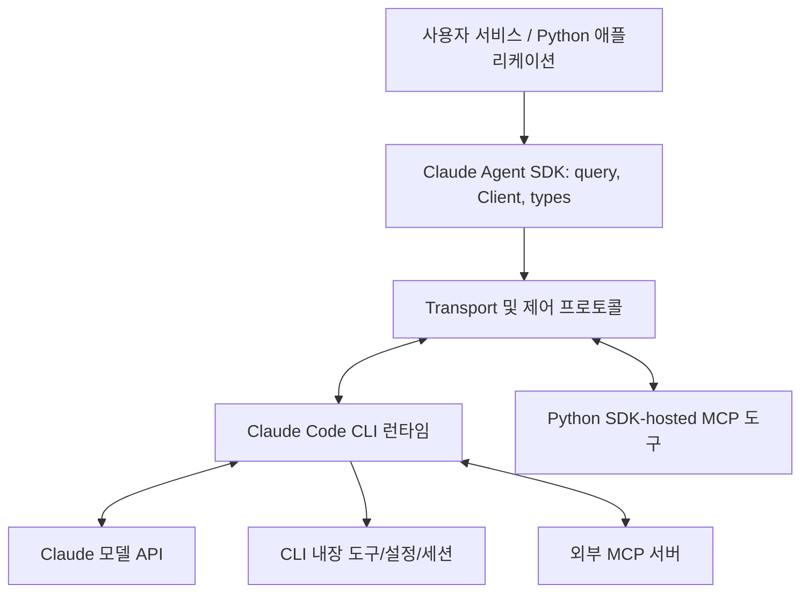
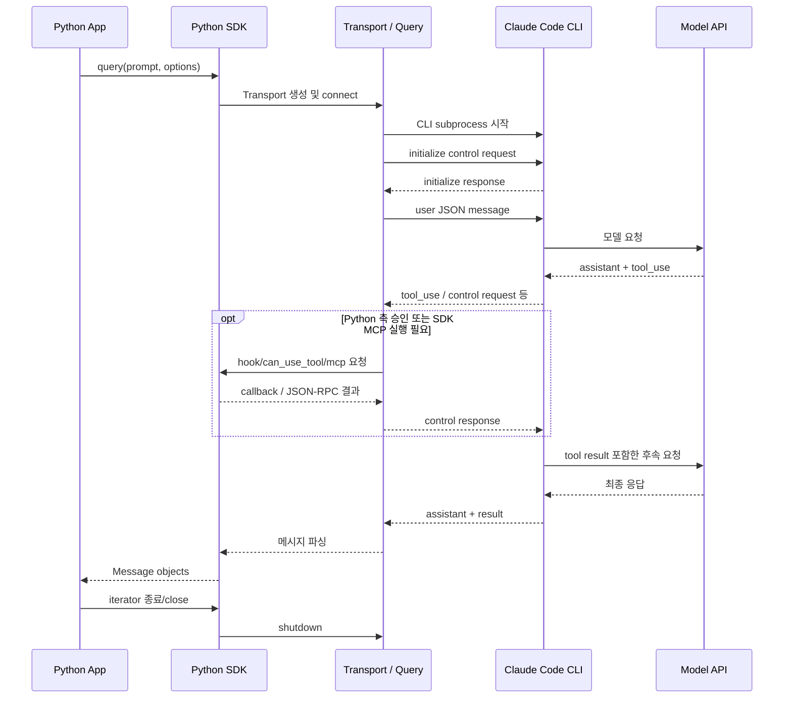
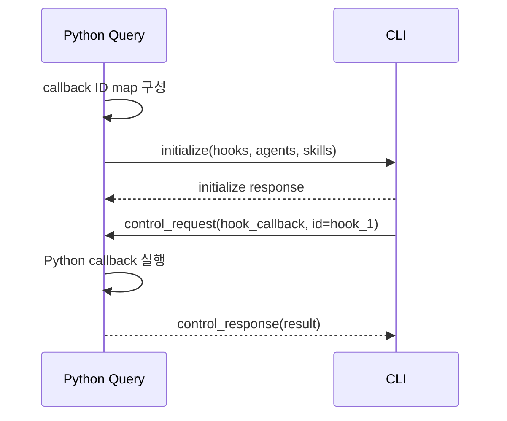
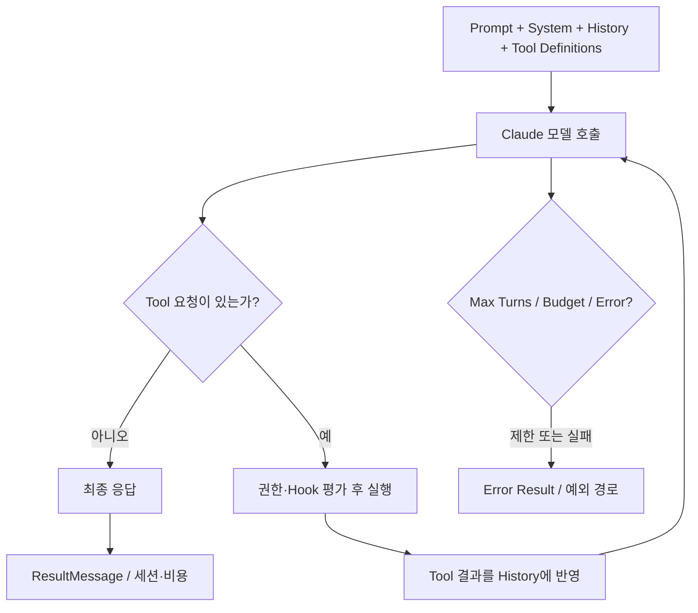
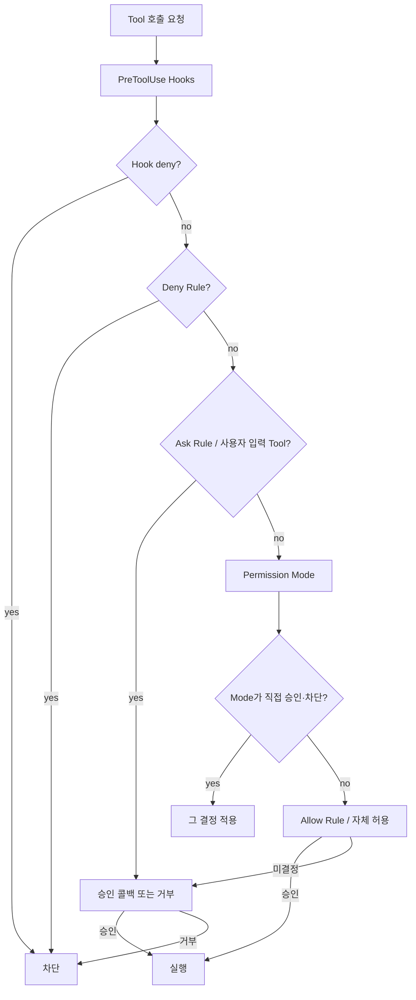
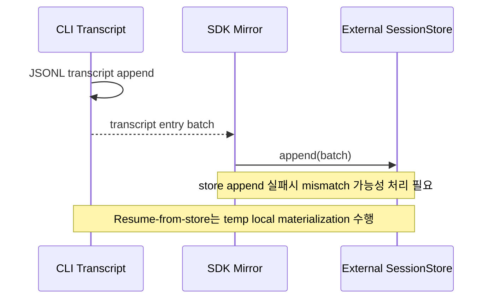
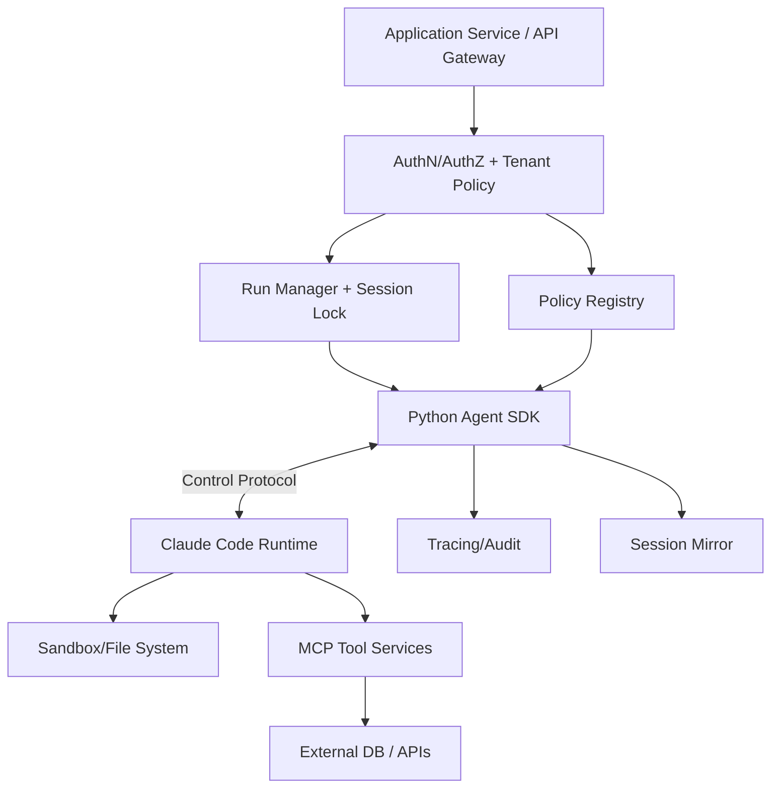

# Claude Agent SDK — 2차 심층 학습 및 소스코드·런타임 경계 분석

> **학습서 / 기술 역설계 보고서** · 조사일: **2026-10-31** · 주 대상: **Python `claude-agent-sdk` v0.2.176** · 번들 CLI: **Claude Code v2.1.316** (해당 SDK 릴리스 노트 기준)  
> **목적:** SDK를 사용하는 법을 넘어, SDK–CLI 경계에서 *실제로 어떤 함수가 어떤 메시지를 전달하고 어떤 자원·상태를 책임지는가*를 이해한다. 이후 Hermes / OpenAI Agents SDK / PydanticAI / Google ADK / Microsoft Agent Framework / Claude Code와 설계 철학 및 구조를 비교한다.  
> **제외:** 반도체 데모 구현, 성능 벤치마크, 실제 API 호출 실험. 구체적인 도메인 데모 대신 범용 Agent 개발 관점의 설계 판단에 집중한다.  
> **검증 방식:** 공식 문서와 태그로 고정한 공개 Python SDK 소스의 정적 조사. CLI 내부 Agent Loop는 완전 공개된 Python 소스가 아니므로 **코드 검증 대상 아님**.

## 읽기 전 반드시 구분할 네 가지 증거 등급

- **[SRC]** `v0.2.176` 태그의 공개 Python 소스에서 함수·분기·자료형을 직접 확인할 수 있는 사실.
- **[DOC]** Anthropic 공식 문서 또는 공식 릴리스에서 설명하는 동작. 공개 CLI 내부 함수까지 확인된 뜻은 아니다.
- **[INF]** 공개 구조를 근거로 도출하는 설계 해석·트레이드오프. 검증된 내부 구현으로 주장하지 않는다.
- **[UNV]** 문서·공개 소스로 정확한 타이밍, 알고리즘, 강제 수준을 검증할 수 없는 부분.
- **[PSEUDO]** 설명을 위한 의사코드. 원본을 그대로 복사한 함수가 아니며, 실행 가능성을 보장하지 않는다.

**중요한 범주 오해 방지:** Claude Agent SDK ≠ Claude API Client SDK의 Tool Runner ≠ Claude Code CLI ≠ 서버형 Managed Agents. 본 문서에서는 **자체 프로세스에서 Claude Code 런타임을 구동하는 Agent SDK**만 다룬다. [DOC: D01]

---

## 빠른 탐색 지도

| 학습 질문 | 핵심 장 | 발표 핵심 |
|---|---|---|
| Python이 Agent Loop를 직접 돌리는가? | 1–4, 7 | SDK와 CLI의 책임 분리 |
| `query()`와 `ClaudeSDKClient`는 왜 다른가? | 5–6, 10 | 단발 호출과 양방향 스트림 |
| 프로세스·메시지 제어는 어떻게 구현했나? | 8–12, 26–32 | JSON Lines 및 control protocol |
| Tool과 MCP 호출은 어디에서 실행되나? | 13–14, 31 | CLI Tool과 Python SDK MCP의 경계 |
| Guardrail은 어떤 순서로 실행되나? | 15–17 | Hook, deny, ask, mode, allow, callback |
| 컨텍스트·세션·장기 기억은 어디에 있나? | 18–21 | Conversation과 파일/외부 저장 분리 |
| Subagent·병렬 Tool·Background는 어떻게 다른가? | 22–23 | 실행 수명주기·독립 컨텍스트·취소 |
| CLI가 중단되면 어떻게 복구하나? | 24–25 | Session resume와 Tool side-effect의 차이 |
| 직접 프레임워크를 설계한다면? | 33–38 | 보안 경계, 운영, Trade-off, 비교 |

# Part I. 시스템 경계와 실행 책임

## 1. Claude Agent SDK를 정확히 정의하기

Claude Agent SDK는 Python/TypeScript 앱 안에서 **Claude Code가 제공하는 Agent 실행 루프, 기본 도구, 컨텍스트 관리와 권한 모델을 프로그래밍 방식으로 사용하게 하는 SDK**다. `claude-agent-sdk` Python 패키지는 기본적으로 Claude Code 실행 바이너리를 포함하며, 패키지 설치 후 사용자 앱이 별도로 모든 도구 호출 루프를 구현할 필요가 없다. [DOC: D01, D02, R01]

**한 문장으로:** *외부 프로세스로 실행되는 Agent Harness를 SDK와 프로토콜로 제어하는 방식*이다.

### 1.1 네 계층



위 그림에서 B와 C는 Python 공개 코드로 추적 가능하다. D의 세부 Agent Loop는 공식 문서의 동작 설명으로 이해한다. CLI가 직접 실행하는 Tool과 Python에서 실행되는 SDK MCP Tool은 **같은 이름의 Tool처럼 보일 수 있어도 운영·프로세스·권한 경계가 다르다.**

### 1.2 SDK는 라이브러리인가, 프레임워크인가?

- **배포 형태:** Python 패키지로 설치해 `import`하는 **SDK/라이브러리**.
- **제공하는 추상화:** Agent의 실행 루프, Tool 사용, 권한 설정과 세션을 포함하는 **프레임워크적 기능**.
- **설계 철학:** 외부에서 이미 구현된 CLI Harness에 고수준 접근을 제공하는 **runtime-backed SDK**.
- 따라서 '라이브러리라서 프레임워크가 아니다'와 '완성형 Agent Framework이므로 Python 코드가 Loop를 구현한다' 모두 과도한 단순화다.

### 1.3 Python SDK의 강점과 대가

| 얻는 것 | 동시에 발생하는 비용·제약 |
|---|---|
| 적은 사용자 코드로 에이전트 작업 실행 | 실행 바이너리와 프로세스 수명 관리 |
| 내장 파일·쉘 Tool, Skills, Subagent 등 | 권한·파일·네트워크·비밀정보 경계 관리 필요 |
| 스트리밍 메시지 및 양방향 제어 | 비동기 프로토콜·연결 실패·취소 상태 처리 |
| Transcript·Resume 지원 | 워커 수명·디스크·저장소 일관성 고려 |
| CLI가 진화하면 기능을 재사용 | 내부 엔진 구현의 가시성·수정 가능성 제한 |

## 2. Claude API Tool Runner와의 차이

Claude API의 Python SDK `anthropic`에서 모델을 호출하거나 별도 Tool Runner를 사용하는 경우, **도구 루프의 운영·실행 방식은 API SDK의 계약을 따른다**. Claude Agent SDK는 Claude Code 실행 환경을 별도 프로세스로 운영한다. 동작 결과가 비슷해 보여도 실행 주체, 기본 Tool, 권한 규칙, 세션 파일, 디버깅 경계가 다르다. [DOC: D01]

**비교 질문:** Tool 호출의 최종 실행 주체가 앱 코드인가? 별도 CLI인가? 플랫폼 서비스인가? 이 질문으로 Agent SDK·OpenAI Agents SDK·PydanticAI·Managed Agents를 구분할 수 있다.

## 3. 요청 한 건의 전체 실행 시퀀스



**정확성 주의:** 모델과 CLI 간 API 요청의 세부 함수명, 프롬프트 생성/압축/권한의 전체 내부 구현은 Python 코드로 검증할 수 없다. 다이어그램의 해당 연결은 [DOC] 수준이다.

## 4. 어디까지 소스 분석이 가능한가?

| 분석 대상 | 증거 수준 | 이유 |
|---|---|---|
| `query()` → `InternalClient` → `Query` | [SRC] | 소스 공개 |
| 명령행 플래그 구성과 subprocess 실행 | [SRC] | `subprocess_cli.py` 공개 |
| line-delimited JSON 전송·메시지 파싱 | [SRC] | `transport`, `message_parser.py` 공개 |
| SDK MCP JSON-RPC 라우팅 | [SRC] | `Query._handle_sdk_mcp_request` 공개 |
| Hook/Permission 콜백 ID 매핑 및 응답 | [SRC] | `Query.initialize`, `_handle_control_request` 공개 |
| CLI 내부 모델→Tool 스케줄러 구현 | [DOC]/[UNV] | 실행 바이너리 전체 알고리즘 공개 아님 |
| Prompt 압축 내용 선정 알고리즘 | [DOC]/[UNV] | 기능은 문서화, 세부 함수는 비공개 |
| Background Subagent 내부 스케줄러 | [DOC]/[UNV] | API 동작은 문서화, 전체 엔진 비공개 |

이 경계를 지키지 않으면 '코드 레벨 분석'이라고 말하면서 사실상 공식 문서를 설명한 것에 불과하게 된다.

# Part II. 진입 API와 연결 수명주기

## 5. `query()`와 `ClaudeSDKClient`는 프로토콜 관점에서 다르다

| 관점 | `query()` | `ClaudeSDKClient` |
|---|---|---|
| 주된 사용 | 독립 실행 한 건·단방향 입력 | 상호작용·지속 세션 |
| 입력 | 문자열 또는 입력 스트림 | `connect()` 후 `query()` 반복 |
| 연결 유지 | 호출 수명에 주로 종속 | `async with` 범위에서 유지 |
| 인터럽트 | `query()` 공개 API에는 인터럽트 메서드 없음 | `interrupt()` 제공 |
| 상태 | 기본적으로 매 호출 독립 | 연결에서 대화 맥락 유지 가능 |
| 재개 | `options.resume` 등 설정 가능 | `resume`, 외부 store와 함께 사용 가능 |
| 구현 진입점 | `query.py`→`InternalClient.process_query()` | `client.py`→`connect()`→`_connect_inner()` |

`query()`는 항상 기존 세션을 못 읽는다는 뜻이 아니다. `resume`을 명시하면 과거 대화를 이어갈 수 있다. **'Stateless'는 기본 호출 형태**의 성격을 말한다. [SRC: C01, C02, C03; DOC: D04]

### 5.1 실제 공개 코드: 함수 체인

```text
claude_agent_sdk/query.py
  async def query(...)
    client = InternalClient()
    async for msg in client.process_query(...): yield msg

claude_agent_sdk/_internal/client.py
  InternalClient.process_query(...)
    validate_session_store_options(...)
    materialize_resume_session(...) [필요한 경우]
    SubprocessCLITransport(...)
    Query(...)
    transport.connect()
    query.start() / query.initialize()
    입력 송신 및 receive loop
    finally: close/cleanup
```

[**C01**], [**C03**]의 실제 함수·호출 관계를 확인하고, 이어지는 세부 예외 분기는 버전 고정 파일을 참조한다. 아래 전체 코드 재현은 하지 않는다.

### 5.2 가장 중요한 운영 질문

- `query()` 호출만 끝나면 CLI가 정상 종료되었는가? `.close()`가 실제로 어떤 작업을 하는가?
- SDK로부터 `ResultMessage`가 왔다고 모든 백그라운드 작업·외부 side effect가 종료되었는가?
- 같은 세션을 두 개의 Python Worker가 동시에 resume하면 누가 쓰기 권한을 가지는가?
- 연결이 끊겼을 때 서버의 request 취소와 자식 프로세스 종료가 함께 이루어지는가?

## 6. `ClaudeSDKClient`의 연결 단계 분석

`client.py`의 `connect()`는 옵션 유효성 확인과 세션 복원을 먼저 수행한다. 외부 `session_store`에서 resume해야 한다면 임시 `CLAUDE_CONFIG_DIR`로 세션을 materialize한 뒤 CLI를 구동한다. 연결 실패가 발생하면 `disconnect()`를 이용해 자식 프로세스와 임시 자원을 정리한다. [SRC: C02, C09]

`_connect_inner()`의 핵심 책임:

1. `ClaudeAgentOptions`에서 `can_use_tool`·Hooks·Skills·Subagent 정의를 준비한다.
2. 기본 transport 또는 사용자 제공 transport를 선택한다.
3. `transport.connect()`로 연결을 시작한다.
4. `Query` 객체에 callbacks·SDK MCP 서버·control protocol 설정을 전달한다.
5. `Query.start()`로 출력 읽기 태스크를 시작하고 `Query.initialize()`로 CLI를 초기화한다.
6. 초기 프롬프트를 작성해 `transport.write()`하거나 비동기 입력 스트림을 처리한다.
7. 이후 `receive_messages()`가 파서에서 JSON 메시지를 Python `Message` 객체로 변환한다.

**중요:** 커스텀 transport를 공급하면 일반 `SubprocessCLITransport`가 CLI flag로 전환하는 `model`, `cwd`, 일부 permission 값 등이 자동으로 해당 transport에 적용되지 않는다. 커스텀 전송을 만들었다고 동일한 CLI 환경이 재현된다고 가정하면 안 된다. [SRC: C01, C02]

## 7. 실행 환경: subprocess의 의미

[참조 C04] `SubprocessCLITransport._build_command()`가 CLI 옵션을 구성하고 `connect()`가 CLI 경로·버전·실행 가능 상태를 검사한다. 기본 경로는 번들 CLI이지만 `cli_path` 등으로 바꿀 수 있다. `CLAUDE_CODE_ENTRYPOINT`·SDK 버전 환경변수 등도 자식 프로세스에 전달된다.

**서빙 관점:** SDK를 FastAPI 등에 붙여도 Claude Code가 곧바로 웹 서버가 되는 것은 아니다. *웹 서버(사용자 요청/인증) → SDK 호출 → CLI subprocess → 모델/도구 → 응답 스트리밍* 구조를 직접 운영해야 한다.

권장 설계 경계 [INF]: 요청 ID, 사용자/세션 ID, subprocess PID, 트레이스 ID를 매핑한다. 동시 사용자 요청에서 하나의 CLI 세션을 동시에 수정하지 않도록 세션당 단일 작성자 또는 명확한 serialization 규칙을 둔다.

## 8. `SubprocessCLITransport`의 공개 내부 흐름

**입력:** 문자열 또는 `AsyncIterable`에서 JSON Lines (개행 단위 JSON) 기반 요청을 전송한다.  
**출력:** CLI가 stdout으로 출력한 이벤트를 읽고, transport는 상위 `Query`에 전달한다.  
**제어:** CLI가 보낸 control request에 대해 Python에서 JSON 응답을 작성해야 한다.  
**종료:** 프로세스 및 파이프를 정리하고 이미 발생한 오류와 clean shutdown을 구분한다.

```python
# [PSEUDO] 개념 학습용. 실제 파일의 코드 복사 아님.
async def transport_lifecycle(options):
    argv = build_cli_command(options)
    child = await spawn_cli(argv, env=sanitized_env(options))
    async with child:
        await write_jsonl({"type": "control_request", "request": {"subtype": "initialize"}})
        async for line in child.stdout:
            await route_message(json.loads(line))
    await close_streams_and_process(child)
```

**왜 JSON Lines인가?** 이벤트 한 건을 수신할 때마다 파싱·전달이 가능하고, 모델 응답·Tool 이벤트·Control 요청을 순차적으로 전송하기 편리하다. 다만 대용량 메시지·쓰기 백프레셔·중간 끊김·에러 복구는 별도 설계가 필요하다.

## 9. `Query`는 모델의 Query가 아니라 '프로토콜 중재자'다

이름이 같은 단어라 혼동하기 쉽다. Python SDK `_internal/query.py`의 `Query` 객체는 **Claude에게 사고를 지시하는 모델 객체가 아니라, CLI와의 메시지/제어 채널을 조율하는 객체**다.

주요 책임 [SRC: C05]:

- `initialize()`에 Hooks 콜백 ID·Subagent·Skills 등 런타임 설정 전송.
- `start()`로 수신 루프 시작, `_read_messages()`로 데이터 수신 및 분류.
- CLI 발신 `can_use_tool`, `hook_callback`, `mcp_message`를 Python 함수에 라우팅.
- Python 발신 `interrupt`, `set_permission_mode`, `set_model`, `rewind_files` 등을 control request로 전송.
- 요청 ID→응답 이벤트 매핑, timeout 및 예외 처리.
- 작업 종료와 cleanup 때 백그라운드 제어 태스크 정리.

### 9.1 두 방향의 control request

| 방향 | 예시 | 실제 처리 주체 |
|---|---|---|
| Python → CLI | `interrupt`, `set_model`, `get_context_usage` | CLI가 처리, Python이 응답 대기 |
| CLI → Python | `can_use_tool`, `hook_callback`, `mcp_message` | Python 콜백/SDK MCP가 처리, CLI가 응답 대기 |

이 양방향성이 'SDK가 단순한 `subprocess.run()` 래퍼'라는 설명이 부정확한 이유다.

## 10. `Query.initialize()`의 제어 프로토콜

`_internal/query.py`의 `initialize()`는 설정을 일회성 초기화 제어 메시지로 전달한다. 예를 들면:

- Hooks는 Python 함수를 JSON으로 보낼 수 없으므로 `hook_1` 같은 **callback ID**를 등록한다.
- 요청 메시지는 Hook Matcher와 Callback ID의 관계를 CLI에 알려준다.
- Subagent 정의를 직렬화하여 CLI에 전달한다.
- `skills` allowlist, `forwardSubagentText`, 일부 System Prompt 옵션도 해당 버전의 초기화 페이로드에 포함될 수 있다.
- 이후 CLI가 콜백 실행을 요청하면 Python `Query`가 ID로 실제 함수를 찾는다. [SRC: C05]



**설계 평가:** 함수 객체를 프로세스 경계 밖으로 보내지 않고 식별자와 JSON 메시지로 분리했다. 다만 콜백 지연이 CLI의 Tool 실행 지연이 될 수 있으므로 타임아웃·실패 정책이 중요하다.

## 11. 메시지 파싱과 `ResultMessage`의 의미

`message_parser.py`는 JSON 데이터를 `SystemMessage`, `AssistantMessage`, `UserMessage`, `ResultMessage`, 각종 Observability/Task 이벤트 등 Python 객체로 변환한다. 모델의 일부 텍스트 델타를 받으려면 partial messages 관련 옵션이 필요하다. [SRC: C06; DOC: D02]

**`ResultMessage`는 무조건 성공이 아니다.** `subtype`이 `success`, `error_max_turns`, `error_max_budget_usd` 등 무엇인지 평가해야 한다. 통상 한 요청 루프의 종료 신호이고 세션·비용·사용량을 전달하지만, 원시 수신 스트림에는 뒤따르는 System 이벤트가 올 수 있다. 따라서 'Result를 봤으니 모든 이벤트 스트림이 완전히 닫혔다'고 일반화하면 안 된다. [DOC: D02]

`ClaudeSDKClient.receive_response()`는 편의를 위해 `ResultMessage`에서 iteration을 끝내지만, `receive_messages()`는 원시 연결 메시지를 계속 수신할 수 있다. [SRC: C02]

## 12. Agent Loop의 정확한 소유권과 종료 경계

CLI가 관장하는 논리 흐름 [DOC: D02]:



**핵심 용어 구별:**

- **LLM Turn:** 모델이 한 번 응답하고 Tool을 포함할 수도 있는 반복 단위.
- **Tool Call:** 하나의 Turn에서 복수 발생 가능. Turn 수 = Tool 호출 수가 아니다.
- **Run/Response:** 사용자가 요청한 한 번의 작업 완료 또는 제한 종료.
- **Session:** 여러 Run/Response에 걸친 누적 대화 기록.
- **Subagent task:** 별도 실행 컨텍스트를 갖는 하위 작업이며 주 Agent의 종료·비용과 연결.

`max_turns`는 Turn 수를 제한하지만 완전한 시스템 kill switch가 아니다. `max_budget_usd`도 사후 모델 사용량으로 집계되는 비용 제한이므로 초과 비용이 절대 0이라는 보장은 없다. [DOC: D02]


# Part III. 도구·MCP·권한·가드레일을 실제 실행 경계로 이해하기

## 13. Tool 호출은 모델 결정과 실행 결정을 분리해야 한다

모델이 `tool_use`를 생성하는 순간과 실제 Tool의 부작용이 발생하는 순간은 다르다. Claude Code는 기본 도구 실행을 담당하고, 외부 MCP 서버는 별도 서비스에서 기능을 수행하며, Python SDK-hosted MCP는 Python 프로세스의 함수 핸들러를 이용한다. [DOC: D02, D07]

| 단계 | 담당 | 데이터 | 신뢰 경계 |
|---|---|---|---|
| Tool 선택 | Claude 모델 | Tool 이름·인수 후보 | 모델 출력을 신뢰하면 안 됨 |
| Tool 노출/검색 | CLI의 Tool catalog | 스키마·설명 | Tool registry 변경·context 비용 |
| 인수 확인 | CLI/실행 대상 | JSON Schema·관례 | 타입 검증만으로 의미·권한 보장 불가 |
| 정책·승인 | Permission Rules·Hooks·콜백 | 사용자/역할/경로/명령 | 하드 차단이 필요한 위치 |
| 실행 | 내장 Tool / 외부 MCP / Python SDK MCP | 파일·쉘·네트워크 접근 | OS·서버 IAM 권한이 최종 경계 |
| 결과 반환 | Tool host → CLI | Tool 결과·오류 | 결과 자체가 prompt injection 입구 |
| 후속 판단 | Claude 모델 | 증거·도구 출력 | 모델의 최종 답변도 검증 필요 |

### 13.1 실제 병렬 Tool 호출 규칙 [DOC]

공식 Agent Loop 문서에서는 여러 Tool 요청 시 **읽기 중심 Tool은 동시에 실행 가능하고, 상태를 수정하는 Tool은 충돌을 줄이기 위해 순차 처리**할 수 있다고 설명한다. SDK MCP 커스텀 Tool은 기본적으로 순차 실행이며 `readOnlyHint` annotation으로 병렬 실행 허용을 나타낼 수 있다. 이 annotation은 **Tool 제작자의 선언**이므로 실제 부작용이 없는지 검증해야 한다. [D02]

**운영 실패 예시:** 실제로 파일을 쓰는 MCP Tool이 `readOnlyHint=True`로 설정되면, 동시에 여러 호출이 실행될 수 있어 데이터 경합이 발생한다. annotation만을 안전한 트랜잭션 보장으로 생각하면 안 된다.

### 13.2 단순한 Tool error와 권한 거부

- **Tool 실행 오류:** 실행을 시도했지만 인수·네트워크·권한·프로세스 오류가 발생. 모델이 실패 결과를 보고 다른 경로를 선택할 수 있다.
- **Permission deny:** 실행 이전에 정책으로 차단. 보통 거부 사실이 Tool 결과로 모델에 전달된다.
- **CLI 프로세스 오류:** Tool 단위가 아니라 Agent 전체 실행 채널에 영향. `ProcessError`, `CLIConnectionError` 등을 구분해야 한다.
- **SDK MCP callback 오류:** Python에서 예외가 발생하고 control protocol로 오류를 전달할 수 있다. 콜백 처리 도중 연결이 끊기면 결과 전달 자체도 실패할 수 있다.

## 14. SDK MCP의 JSON-RPC 통과 경로

### 14.1 외부 MCP와 SDK-hosted MCP

| 구분 | 외부 MCP 서버 | Python SDK-hosted MCP |
|---|---|---|
| Tool 구현 위치 | 독립 서버/별도 프로세스 | SDK를 사용하는 Python 프로세스 |
| 연결 | 표준 MCP transport | CLI ↔ SDK control protocol ↔ Python MCP handler |
| 자격증명 관리 | MCP 서버에 보관 가능 | SDK 프로세스 환경과 격리 설계 필요 |
| 장애 격리 | 별도 서비스 경계 | Python 앱 프로세스의 안정성에 영향 |
| 확장 | 원격 서버 독립 scale 가능 | 앱 worker와 함께 확장·수명 관리 |

**구체적인 실행 경로 [SRC: C05]:**

```text
CLI가 MCP 도구 호출
   ↓
SDK 쪽으로 control_request(subtype='mcp_message', server_name, message)
   ↓
Query._handle_control_request(...)
   ↓
Query._handle_sdk_mcp_request(server_name, message)
   ↓
해당 Python MCP server의 JSON-RPC 핸들러 호출
   ↓
JSON-RPC response 또는 notification(no response)
   ↓
CLI로 control_response
   ↓
CLI가 Tool 결과를 모델에게 전달
```

`_handle_sdk_mcp_request`가 JSON-RPC notification과 request의 응답 여부를 구분한다. JSON-RPC request에는 id가 있지만 notification에는 응답하지 않아야 한다. 응답 누락과 handler crash를 구분하는 것이 중요하다.

### 14.2 왜 SDK MCP를 직접 Function Tool이라고 부르면 안 되는가?

다른 프레임워크의 `@tool` 함수는 Runner가 직접 Python callable을 호출할 수 있다. 반면 Claude Agent SDK에서는 CLI가 MCP Tool로 발견하고, **control protocol을 거쳐 Python 코드가 수행**된다. 결과적으로 Python 함수가 실행되는 것은 같아도 *Tool dispatch 주체와 직렬화, 권한 검사, 프로세스 경계*가 다르다.

### 14.3 Tool Handler의 장애 모델

1. Python MCP handler가 HTTP 또는 DB 응답을 기다리며 블록된다.
2. CLI는 대응하는 control response를 기다린다.
3. 앱이 `interrupt()` 또는 `disconnect()`를 시도한다.
4. 취소 협조가 되는 async callback은 중단될 수 있으나, 이미 OS thread 또는 외부 서비스에서 시작된 작업은 계속될 수 있다.
5. 따라서 취소/timeout만으로 외부 DB transaction을 안전하게 rollback했다고 주장할 수 없다.

이것은 **'정확히 한 번 실행(exactly-once)'을 SDK가 자동 보장하지 않는다**는 핵심 설계적 결론이다. [SRC: C02; INF]

## 15. Permissions의 정확한 평가 순서

공식 문서의 평가 단계는 단순히 `allowed_tools`에서 결정하지 않는다. 2026-10 기준 설명은 다음의 큰 순서다. [DOC: D03]



실제 순서:

1. **Hook:** `PreToolUse`가 차단 또는 수정·허용을 결정할 수 있다. 허용 결과라도 후속 Deny/Ask 평가를 건너뛰지 않는다.
2. **Deny rules:** `disallowed_tools` 및 정책 파일의 Deny. 매칭되면 `can_use_tool`은 호출되지 않는다.
3. **Ask rules:** 설정 파일의 Ask, `AskUserQuestion` 같은 사용자 입력 Tool, 특정 MCP 상호작용 요구 등은 승인 경로로 연결된다.
4. **Permission mode:** `bypassPermissions`, `acceptEdits`, `plan`, `dontAsk`, `auto` 등 모드에 따라 직접 결정할 수 있다.
5. **Allow rules / 자체 허용:** `allowed_tools`와 설정 Allow, 기본 읽기 작업의 허용 조건 등을 처리한다.
6. **`can_use_tool` callback:** 앞 단계에서 결정되지 않은 호출을 앱에 질문한다. 어떤 모드에서는 호출되지 않는다.

정책 파일·플러그인 Mod의 영향과 critical path 예외가 존재한다. 위 흐름은 사용자 발표용 핵심 경로를 설명한 것이므로 **모든 edge case를 단순화한 완전한 보안 상태 기계라고 해석하면 안 된다.** [D03]

### 15.1 `allowed_tools`가 whitelist가 아닌 이유

`allowed_tools=['Read']`는 기본적으로 Read를 자동 승인하도록 하는 규칙이지 다른 모든 Tool을 환경에서 제거하는 조치가 아니다. 미등록 Tool이 여전히 모델에 노출될 수 있으며, 다른 Permission mode나 callback의 허용 경로를 통해 실행될 수 있다. 노출·실행 제한을 다루는 옵션은 `tools`, `disallowed_tools`, Subagent별 Tool scope, Sandbox, OS 권한 등과 구분해야 한다. [DOC: D03, D02]

### 15.2 `can_use_tool`이 모든 호출에 적용되지 않는 이유

`allowed_tools`, Permission mode 등이 앞에서 승인했다면 `can_use_tool`은 실행되지 않을 수 있다. 이는 콜백이 '전역 보안 필터'가 아니기 때문이다. **필수 차단 규칙은 Deny, 실행 전 Hook, Tool implementation 또는 외부 권한 경계**에 두어야 한다. `bypassPermissions`나 `dontAsk`에서 callback 호출 범위가 더욱 달라질 수 있다. [D03]

### 15.3 `bypassPermissions`도 OS 권한을 무효화하지 않는다

이 모드는 CLI의 사용자 승인 규칙을 크게 완화하지만 파일 시스템 권한, 컨테이너 격리, 네트워크 정책, MCP 서버 IAM의 실제 enforcement를 제거하지 않는다. '승인 없음'과 '무제한 OS 권한'은 같은 말이 아니다. 또한 공식 문서에는 일부 critical-path 관련 예외가 남아 있다. [D03]

## 16. Hooks는 '확장 지점'이자 실행 이전 정책 경계다

`HookMatcher`에서 Tool 이름 등 이벤트 조건을 정하고 `PreToolUse`, `PostToolUse`, `Stop`, `PreCompact`, Subagent 이벤트 등 등록한다. [DOC: D05]

**실제 등록 코드 경로 [SRC: C05]:**

1. Python `ClaudeAgentOptions.hooks`에 callback 함수를 보관한다.
2. `_hooks_to_internal_format()`이 Hook 정의를 직렬화 가능한 형태로 바꾼다.
3. `Query.initialize()`가 callback마다 ID를 만들어 내부 `hook_callbacks`에 등록한다.
4. CLI에 전송한 initialize 메시지에는 `hookCallbackIds`가 들어간다.
5. CLI가 훅 발생 시 제어 요청을 보내면 `Query._handle_control_request()`가 ID를 기준으로 실제 Python 함수를 찾아 실행한다.
6. 결과를 JSON으로 CLI에 돌려주고, CLI가 후속 정책 평가 또는 실행을 결정한다.

### 16.1 Hook 결과 유형을 구별

- **deny:** 사전에 실행을 거부하는 정책 목적.
- **allow:** 후속 평가에서 Deny/Ask를 우회하는 만능 허가증이 아님.
- **input modification:** 변경한 인수가 실제 Tool에 어떻게 전달되는지 확인할 것.
- **context injection:** 모델의 판단 정보를 바꾸는 것이지 서버 권한 자체를 바꾸는 것이 아님.
- **post-event logging:** 이미 실행된 부작용을 취소하지 않음.

### 16.2 Guardrail의 보장 수준

| 형태 | 강제 위치 | 일반적인 한계 |
|---|---|---|
| System Prompt 지침 | 모델 입력 | 확률적 준수, 강제 차단 아님 |
| Python SDK Hook | CLI가 callback 실행 요청한 지점 | callback 지연·오류·등록 누락에 주의 |
| Permission Deny | CLI 정책 엔진 | Tool 경유 아닌 다른 경로를 별도 제한해야 함 |
| OS Sandbox | 프로세스/컨테이너 | 설정·마운트·네트워크 권한 정확성 필요 |
| MCP Backend IAM | Tool 서버 | 실제 데이터 접근 권한의 마지막 방어선 |

**추천 발표 슬라이드 제목:** “모델이 하지 말라는 말을 듣는 것과, 실행 경로를 차단하는 것은 다르다.”

## 17. 권한 승인과 Human-in-the-loop

`can_use_tool`은 앞서 결정되지 않은 도구 권한 문제를 앱으로 넘기는 **인터랙티브 승인 지점**이다. 앱은 사용자의 허가를 얻거나 정책에 따라 거부할 수 있다. [DOC: D03]

**중요한 구분:**

- Tool 실행 전 권한 승인 = **특정 행위의 허가 판단**.
- 에이전트가 사용자에게 질문하는 `AskUserQuestion` = **정보 수집**.
- 작업 전체를 pause한 뒤 나중에 resume하는 durable workflow = **지속형 상태 관리**.

이 셋은 구현 방식이 달라야 한다. 특히 사용자 화면에서 “승인”을 누르기 전 서버가 오래 대기하는 경우, HTTP 요청을 계속 열어 둘지, 별도 승인 ID와 durable queue로 전환할지 판단해야 한다.

### 17.1 정확한 승인 기록을 위한 데이터

```json
{
  "run_id": "example-run",
  "tool_use_id": "example-tool",
  "tool_name": "Bash",
  "arguments_sha256": "illustrative-hash",
  "principal_id": "example-user",
  "decision": "deny",
  "reason": "operation_not_approved",
  "policy_version": "policy-2026-10"
}
```

위 JSON은 **[설계 제안] 감사 이벤트 스키마**일 뿐 실제 SDK에서 동일한 필드를 모두 자동 출력하는 것이 아니다. 인수가 바뀌면 기존 승인이 동일한 의미를 유지하는지 재평가해야 한다.

# Part IV. Prompt·Context·Memory·Session의 실질적 구현 경계

## 18. 최종 LLM Context에는 무엇이 들어가는가?

공식 문서는 시스템 프롬프트, Tool 정의, 대화 기록, Tool 출력, `CLAUDE.md`, Skill 설명 등을 주요 구성요소로 설명한다. 핵심 내장 Tool은 매 모델 요청에 정의가 포함될 수 있으며, MCP Tool 및 일부 Tool은 Tool Search에 따라 점진적으로 노출된다. [DOC: D02]

```text
[System: Claude Code의 기본 Instructions와 SDK 설정]
[Project: 사용 설정에 따라 로드된 CLAUDE.md 등]
[Tool definitions: 내장 Tool / 발견된 MCP Tool]
[Skill descriptions: 관련 기능 메타데이터]
[Conversation: 사용자 입력 + assistant 턴 + tool result]
[Optional: compaction summary, subagent 결과 등]
```

이 블록은 **개념적 구조**이며 비공개 CLI가 정확히 어떤 문자열을 어떤 순서로 배치했는지에 대한 구현 증명은 아니다.

### 18.1 Prefix Cache의 핵심

LLM 입력이 매 턴 동일하게 다시 전송되는 것과, 모델의 *그 동일 Prefix에 대한 내부 계산이 매번 새로 발생하는지*는 다르다. Prompt cache는 앞부분의 동일 콘텐츠를 재사용하여 비용·지연을 줄일 수 있다. 문서에 따르면 System Prompt·도구 정의·`CLAUDE.md` 등 안정적인 내용이 재사용 대상이다. [DOC: D02]

**설계 질문:** 동적으로 변경되는 사용자/시간/도구 목록을 Stable Prefix보다 앞에 삽입하면 캐시 적중이 낮아지는가? 모델·Provider·캐시 정책에 따라 달라진다. CLI의 실제 cache key 알고리즘을 Python SDK 내부에서 직접 검증할 수는 없다.

## 19. Context Compaction과 Session Memory는 다르다

Claude Code는 컨텍스트 창이 한계에 가까워지면 오래된 대화를 요약·압축할 수 있고, SDK 스트림에는 `compact_boundary` 메시지가 등장할 수 있다. Compaction 뒤에는 과거 메시지의 일부 구체적 사실이 사라질 수 있다. 프로젝트 Instructions나 구조화된 저장소에 남겨야 할 중요한 정보를 대화 기록 요약에만 의존해서는 안 된다. [DOC: D02]

| 개념 | 수명 | 목적 | 주의 |
|---|---|---|---|
| 현재 모델 Context | 한 모델 호출의 입력 | 지금 판단하는 근거 제공 | Token 상한 존재 |
| Session Transcript | 여러 Turn·Run | 대화/Tool 이력 유지 | 파일 저장과 버전 일관성 |
| Compaction Summary | 압축 후 세션 입력 | 오래된 맥락을 짧게 보존 | 정보 손실 가능 |
| CLAUDE.md/Instructions | 프로젝트/설정 파일 | 정책·업무 규칙 반복 주입 | 로딩 설정에 좌우 |
| Skills | 필요할 때 읽는 재사용 지침 | 업무 절차 지식 | 선택·로딩과 Tool 권한 별개 |
| RAG/외부 DB | 별도 검색 저장소 | 사실 검색 | SDK 자체가 모든 검색 품질을 보장하지 않음 |

**의사코드 [PSEUDO]:**

```python
if context_usage > trigger_threshold:
    archived_history = history.before_recent_turns()
    summary = summarize(archived_history)
    history = [summary] + recent_turns
    emit('compact_boundary')
```

이 코드는 **설명용**이다. 실제 임계값과 선택 로직을 구현 소스로 확인했다는 의미가 아니다.

## 20. Session은 대화의 기록이며 파일 시스템 스냅샷이 아니다

공식 세션 문서에 따르면 Session에는 사용자 입력과 Tool 호출·결과·Assistant 응답 등이 저장되며, 기본적으로 로컬 디스크 Transcript를 기반으로 resume가 가능하다. 그러나 파일 시스템을 과거 상태로 돌려놓는 것은 별도 **File Checkpointing** 기능이다. [DOC: D04]

### 20.1 Resume, Continue, Fork의 의미

| 기능 | 의미 | 판단 질문 |
|---|---|---|
| `resume` | 특정 Session ID의 기록으로 재개 | 이전 History가 필요한가? |
| continue | 현재 프로젝트의 관련 대화를 이어감 | 대상 선택의 모호성은 없는가? |
| fork | 기존 세션을 분기 | 원본과 실험이 분리되는가? |
| rewind_files | 특정 시점의 추적 파일 변경을 되돌림 | 파일만 되돌릴 뿐 외부 부작용도 롤백되는가? → 아니오 |

**중요:** Tool 실행은 이미 이루어진 부작용일 수 있다. Session을 복원해도 외부 DB 쓰기, 이메일 발송, API 변경이 자동으로 원복되지는 않는다.

## 21. 외부 `session_store`: 이중 쓰기(Dual-write) 아키텍처

공식 문서는 `session_store`에 대한 핵심을 분명히 설명한다. **Claude Code subprocess는 먼저 로컬 디스크에 Transcript를 쓰고, SDK가 같은 배치를 외부 store로 `append()`하는 구조**다. 외부 DB가 CLI 파일 기록을 완전히 대체하는 구조가 아니다. [DOC: D06]



### 21.1 실제 코드 추적

- `_internal/session_resume.py`: `materialize_resume_session`, `apply_materialized_options`, `build_mirror_batcher` 등. [SRC: C09]
- `client.py`: connect 이전의 `validate_session_store_options`, store 기반 resume materialization, mirror batcher 초기화. [SRC: C02]
- `_internal/client.py`: 단발 `query()` 경로에서의 동일 개념 구성. [SRC: C03]
- `session_store_validation.py`: 양립할 수 없는 옵션 사전 검증. [SRC: C10]

### 21.2 정상 종료·오류 종료에 따른 차이

| 경우 | 예상 주된 상태 | 위험 |
|---|---|---|
| 신규 Session + store | 로컬 Transcript + 외부 mirror | 이중 보관, 보안·삭제 정책 |
| store에서 복원 후 실행 | 임시 로컬 Transcript + store | mirror 실패 시 유실 가능성 평가 |
| store append 실패 | 로컬 최신, 원격 오래됨 | 외부 호스트 resume시 stale state |
| 프로세스 비정상 종료 | 마지막 batch 기록 여부 불확실 | 부분 JSONL, 재시도, 운영 복구 정책 |
| 외부 store 지연 | 기록 반영 지연 | 연결 종료 및 flush 정책 판단 |

위 표는 장애 설계용 **[INF]**이며 구체적인 내결함성·재시도 횟수는 실제 배포 설정과 구현을 추가 확인해야 한다.

### 21.3 File Checkpointing과 외부 SessionStore의 충돌

공식 문서상 `enable_file_checkpointing`과 외부 `session_store`는 함께 사용하도록 지원되지 않는다. 파일 백업 정보가 외부 store에 복제되지 않기 때문이다. **대화 상태 저장과 파일 상태 저장은 서로 다른 일관성 도메인**이라는 것을 보여주는 대표적인 사례다. [DOC: D06]


# Part V. Skills·Subagents·병렬성·실행 종료

## 22. Skills는 도구인가, Prompt인가, Agent인가?

Skills는 주로 재사용 가능한 작업 지침과 관련 리소스의 묶음이다. 실제 파일 조작·코드 실행을 수행하는 권한은 다른 Tool과 Permission에서 관리한다. SDK를 통해 Skills를 활용하려면 **Skill 발견 경로, 로딩 조건, 허용 범위, 어떤 Tool이 실제로 실행되는지**를 별도로 확인해야 한다. [DOC: D09]

### 22.1 `skills` 옵션과 CLI 초기화의 관계

[**C04**, **C05**]의 v0.2.176 소스에서는 `skills` 옵션을 CLI 시작 명령의 허용 Tool 및 setting sources 처리와, `Query.initialize()`의 Skill 필터 전달에 사용한다. 필터가 명시적 리스트라면 초기화 요청에 전달하며, `"all"`과 미설정은 wire-level에서 같은 의미로 처리될 수 있다. 단, 사용 가능한 Skill의 실제 발견·본문 읽기·실행은 CLI의 런타임 책임이다.

**Skill 생명주기 질문:**

1. 어떤 디렉터리의 Skill을 발견하는가?
2. 목록의 설명이 언제 모델 Context에 노출되는가?
3. Skill의 본문은 항상 초기 Context에 들어가는가? 일반적으로 아니다.
4. 모델이 `Skill` Tool을 호출하는 기준은 결정적인 rule인가? 모델 판단을 포함한다.
5. Skill이 포함한 스크립트를 실행하려면 어떤 OS/Tool 권한이 필요한가?
6. Skill 내용을 바꾸면 캐시와 기존 세션에 어떤 차이가 나는가?

### 22.2 Skill이 자체적으로 '똑똑해지는' 것은 아니다

설명 문서가 존재한다고 자동 학습·자동 수정 기능이 생기지는 않는다. 모델이 파일을 수정할 수 있는 환경과 허용된 Tool, 명시적 워크플로가 있어야 Skill 작성 또는 수정이 이루어진다. Skill 성능을 평가·승인하는 구조는 별도로 설계해야 한다. 외부 파일이나 MCP에서 주입된 설명이 지침처럼 작동할 수 있으므로 공급망 보안을 고려한다.

### 22.3 Skill과 Subagent의 상호작용

Subagent 정의에는 별도 Skills 목록을 설정할 수 있고, 일부 스킬을 시작 시 pre-load할 수 있다. 이는 Skill을 새로운 모델 인스턴스로 만든다는 뜻이 아니라 **다른 실행 컨텍스트의 지침 로딩 정책을 지정**한다는 뜻이다. [DOC: D08]

## 23. Subagents와 병렬 Tool은 다른 동시성 계층

| 실행 형태 | 무엇이 동시에 실행되나? | Context / 소유자 | 결과 수집 |
|---|---|---|---|
| 한 Turn의 여러 Tool | 독립 Tool 호출 | 동일 주 Agent Turn | Tool 결과 여러 개 |
| Subagent | 별도 Agent 실행 작업 | 별도 컨텍스트·작업 지침 | 요약 또는 Result Report |
| Background Task | 비동기 수행 중인 작업 | 작업 ID·수명 상태 | Task Update/Notification |
| 여러 사용자 `query()` | 서로 다른 Python 호출·CLI 프로세스 | 사용자 앱이 격리해야 함 | 요청별 스트림·세션 |

Claude Code의 Subagent 기능은 별도 역할·도구 scope·모델·Skills·일부 메모리 소스 등을 설정할 수 있다. Python SDK에서 `AgentDefinition`을 전달하면 `initialize` 과정에서 CLI에 전달되며, 실제 하위 Agent 생성과 실행은 CLI가 책임진다. [SRC: C02,C05; DOC: D08]

### 23.1 SDK 수준에서 명확히 확인되는 부분

```python
# [DOC 예제 성격] 직접 실행한 코드는 아니며, 구조 학습용으로 최소화.
from claude_agent_sdk import ClaudeAgentOptions, AgentDefinition

options = ClaudeAgentOptions(
    agents={
        "reviewer": AgentDefinition(
            description="Review only; no edits",
            prompt="Review evidence and provide concise findings.",
            tools=["Read", "Grep", "Glob"],
        )
    }
)
```

SDK는 `AgentDefinition`을 직렬화해 전달하고, CLI는 Agent Tool 등을 통해 실행할 수 있다. **하위 Agent의 정확한 스케줄링 알고리즘은 공개 Python 코드에서 구현되지 않는다.**

### 23.2 비동기 기본 동작을 혼동하지 말 것

공식 Subagent 문서는 백그라운드 실행 및 다음 턴에서의 결과 수신, 필요 시 동기 대기 등의 선택을 설명한다. `background=True` 같은 설정과 Agent Tool의 상태(`async_launched`, `completed`)는 실제 API 버전과 설정에 따라 검토해야 한다. 모든 Agent가 `asyncio.gather` 안에서 단순 병렬 호출되는 것으로 설명해서는 안 된다. [DOC: D08]

### 23.3 Context 격리의 이점과 비용

- 이점: Subagent가 많은 파일을 읽거나 실험하더라도 주 Agent Context에는 최종 결과 중심으로 전달할 수 있다.
- 비용: 별도 모델 사용량·비용·대기시간, 다른 Agent의 Tool 권한 관리, 결과 신뢰도·중복 작업 문제가 생긴다.
- 병렬성의 한계: 동시에 실행되더라도 동일 파일에 쓰면 충돌할 수 있고, 후속 작업이 의존하면 결국 기다려야 한다.

**설계 평가:** 하위 Agent에 작업을 위임했다고 사실 검증이 강화되는 것이 아니다. 별도 검증 기준이나 서로 독립적인 확인 절차가 있어야 효과가 있다.

## 24. 중단(Interrupt), 취소(Cancel), 종료(Close)는 서로 다른 상태

`ClaudeSDKClient.interrupt()`는 Python에서 CLI에 `interrupt` control request를 전송한다. `disconnect()`는 `Query.close()`와 transport cleanup을 수행한다. SDK가 내부 작업의 종료를 요청한다고, 외부 서비스에 이미 전달한 모든 부작용을 철회하는 것은 아니다. [SRC: C02, C05]

### 24.1 상태 모델 [INF]

```text
CONNECTED / IDLE
  ├── query() → RUNNING
  │      ├── TOOL_WAIT / HOOK_WAIT
  │      ├── RESULT_SUCCESS → IDLE
  │      ├── RESULT_ERROR → IDLE or CLOSE
  │      └── interrupt() → INTERRUPTING → IDLE / ERROR
  └── disconnect() → CLOSING → CLOSED
```

실제 SDK의 내부 enum을 그대로 옮긴 상태 기계가 아니다. 사용자 앱 관점에서 **여러 종류의 완료 신호를 구별하기 위한 논리 모델**이다.

### 24.2 취소 협조가 핵심

- Model API 요청 취소: 요청 중단에 따라 네트워크 리소스가 회수되는가?
- Python MCP Task 취소: async await에서 적절히 취소되는가?
- 스레드에서 실행 중인 함수: cancel을 받아도 진행 중인 외부 작업을 취소하지 못할 수 있다.
- OS Subprocess: 자식 프로세스/프로세스 그룹 전체를 정리하는가?
- External API: 이미 전송한 POST/DB Commit은 별도 보상/취소 처리 필요.

### 24.3 `receive_response()`와 `receive_messages()`

`receive_response()`는 하나의 `ResultMessage`까지 읽고 종료하는 편의 메서드다. `receive_messages()`는 연결 전체의 메시지 스트림이다. Stream completion을 작업의 모든 외부 side effect 완료와 동일시하면 안 된다. [SRC: C02]

## 25. 재개(Resume)와 복구(Recovery)를 혼동하지 말 것

| 복구 대상 | SDK/CLI 기능 | 개발자가 해야 할 일 |
|---|---|---|
| 대화 맥락 | `resume`, `continue_conversation`, session store | ID 저장, 사용자 격리, 충돌 방지 |
| 파일 변경 | File checkpointing + rewind | 해당 기능 활성화, 스냅샷 범위 이해 |
| 외부 DB 변경 | 자동 롤백 아님 | 트랜잭션, 보상 로직, idempotency key |
| 외부 API 호출 | 자동 중복 방지 아님 | 요청 ID 저장, 상태 조회, 재시도 정책 |
| 백그라운드 작업 | CLI task ID 및 상태 이벤트 | orphan task 정리, 취소·재연결 설계 |
| 비용/사용량 | Result 및 사용량 이벤트 | 실패 종료 포함한 추적·집계 |

**실패 예시:** 모델이 외부 MCP Tool로 파일을 업로드한 직후 CLI가 비정상 종료되었다. Resume 시 해당 Tool 호출이 다시 필요하다고 판단될 수도 있다. API 쪽이 idempotency를 제공하지 않으면 같은 업로드가 중복될 수 있다. 이 문제는 Session의 지속성만으로 해결되지 않는다.

# Part VI. 핵심 코드 추적 워크북 (고정 태그 기준)

> 목표: 저장소를 열고 **함수 호출, 인수 변환, 반환·실패 조건**을 따라 설명할 수 있는 수준. `Cxx`는 말미의 버전 고정 소스 링크다. 원본 코드 인용을 대량 복사하지 않고, 구조와 검증 질문을 적었다.

## 26. [WB-01] `query()`의 진입점과 리소스 책임

**소스:** C01 `src/claude_agent_sdk/query.py`; C03 `_internal/client.py`

**호출 경로:** `query(prompt, options, transport)` → `InternalClient()` → `process_query()` → AsyncIterator Messages.

**추적 절차:**

1. `options is None`일 때 어떤 기본 설정이 만들어지는지 확인.
2. 문자열과 AsyncIterable 입력의 처리 차이를 확인.
3. 기본 transport와 커스텀 transport 분기를 추적.
4. 이 함수가 모델을 직접 호출하는 코드가 있는지 검색. **없음**.
5. 리소스 cleanup이 어떤 실행 경로에서 책임지는지 아래 내부 Client로 이동.

**설계 질문:** 독립 요청마다 CLI를 새로 띄우는 방식과 지속 Client를 유지하는 방식의 latency·격리·메모리 trade-off는?

## 27. [WB-02] `InternalClient.process_query()`의 초기화·정리

**소스:** C03 `_internal/client.py`

**관찰:** 세션 Store 옵션 검증, store에서 materialize, transport 생성, Query 구성, 프로세스 연결, 입력 송신, 응답 수신, 최종 cleanup.

**핵심 분기:** 문자열 Prompt/Streaming Prompt, CLI와 custom transport, store resume 유무, 예외 발생 시 프로세스 종료와 임시 디렉터리 정리 순서.

**체크:** CLI 실행 전에 실패하는 검증은 무엇인가? CLI 실행 중 initialize가 실패하면 누가 close 하는가? 생성한 임시 정보가 어떤 조건에서 정리되는가?

## 28. [WB-03] `_build_command()`와 운영 환경의 결합

**소스:** C04 `_internal/transport/subprocess_cli.py`

**추적:** CLI path → CLI version probe → command arguments → environment filtering/override → subprocess spawn → stdin/stdout 연결.

**학습 포인트:** 모델 선택/작업 디렉터리/권한/Tool 설정을 **Python 내부 함수 호출 대신 CLI 옵션·환경변수·Initialize 메시지**로 나눠 전달하는 이유.

**실패 경계:** PATH 해석 오류, 잘못된 `cli_path`, 필요한 CLI 버전과 불일치, 인증 실패, 환경변수 누출 위험, stdout protocol 오염.

## 29. [WB-04] `Query.initialize()`의 Callback-ID 생성

**소스:** C05 `_internal/query.py`의 `initialize()`.

**추적:** Hook event/matcher를 순회 → Python Callback에 ID 할당 → ID→callable map 유지 → JSON 페이로드에 callback ID 등록 → `initialize` 전송 → 응답 대기.

**검증 질문:** Python callable은 왜 직접 JSON으로 보낼 수 없는가? 하나의 Hook에 여러 Callback이 있으면 어떤 데이터 구조가 생기는가? CLI가 모르는 ID로 호출하면 무슨 오류가 발생하는가?

## 30. [WB-05] `_send_control_request()`와 Request/Response 상관관계

**소스:** C05 `_internal/query.py`

**추적:** request_id 생성 → `pending_control_responses` 등의 대기 상태 저장 → Transport write → 응답 ID 매칭 → Event 설정 → Timeout/Error 분기 → pending map 제거.

**실패 경계:** CLI가 닫힌 직후 회신이 도착하지 않으면 대기 제어 요청이 시간 제한까지 묶일 수 있다. 구현상 종료·예외 경로가 이 대기 상태를 어떻게 깨우는지 코드로 확인할 것.

**설계 비교:** RPC request correlation을 직접 구현하는 방식과 gRPC/HTTP 기반 제어 채널의 차이.

## 31. [WB-06] CLI가 Python에 보낸 `can_use_tool` 처리

**소스:** C05 `_handle_control_request`; C07 `types.py`; 공식 권한 문서 D03.

**추적:** CLI control request subtype 검사 → Tool name/input/context 추출 → `can_use_tool` Python 콜백 호출 → permission result 직렬화 → CLI에 control response.

**반드시 구분:** Python callback 실행 경로는 [SRC]. CLI 내부에서 어떤 rule을 먼저 적용하는지는 [DOC]이며 Python 코드만으로 모든 분기를 확인할 수 없다.

**토론:** 필수 보안 검사는 callback에서 처리하면 안 되는 경우가 있는가? → 자동 승인된 호출은 callback을 건너뛸 수 있으므로 Yes.

## 32. [WB-07] CLI에서 Hook Callback을 역호출하는 과정

**소스:** C05 `initialize`, `_handle_control_request`; D05 Hooks.

**추적:** Callback ID 등록 → CLI가 Hook event 전송 → Python Callable 호출 → 반환값 검사 → Control Response 작성.

**실패 경계:** Callback가 예상 JSON 형식을 반환하지 않거나, 작업 시간이 길거나, Python 프로세스가 종료될 수 있다. 각 이벤트 타입에서 timeout 시 차단/계속 진행 정책이 같지 않다. 훅을 보안 장치로 쓰려면 대상 이벤트별 실패 동작을 각각 조사한다.

## 33. [WB-08] `_handle_sdk_mcp_request()`의 JSON-RPC 처리

**소스:** C05 `_internal/query.py`; C08 `create_sdk_mcp_server` 관련 모듈 또는 `__init__.py` export.

**추적:** 서버 이름 확인 → JSON-RPC 메시지 전달 → 응답 또는 notification 구분 → CLI에 전달 → 예외 serialization.

**설계 질문:** MCP 서버가 Python 내장이라면 권한과 실행 격리가 자동으로 강화되는가? → 아니다. 오히려 앱 프로세스 내 DB 키·자격증명 접근 범위가 넓어질 수 있다.

## 34. [WB-09] `message_parser.parse_message()`의 타입 변환

**소스:** C06 `_internal/message_parser.py`; C07 `types.py`.

**추적:** raw `type`/`subtype` 분기 → content block 변환 → Result/Task/Stream Event로 typed data 생성 → 미지원 종류·형식 오류 처리.

**설계 질문:** 모델의 `tool_use` 블록과 CLI의 `tool_result` 이벤트는 어떤 객체로 노출되는가? 언제 합쳐야 하고, 어떤 상태를 잃으면 안 되는가?

## 35. [WB-10] 지속 Client와 Async Context의 수명

**소스:** C02 `client.py`.

**추적:** `__aenter__ → connect → Query.start` 이후 복수 `client.query` → `receive_response` → `disconnect` → `__aexit__`.

**중요:** `ClaudeSDKClient`에는 AnyIO task group과 같은 async runtime context 종속성이 존재한다. 다른 event loop/thread/context로 장시간 연결을 공유하는 설계에는 주의가 필요하다. [SRC: C02]

## 36. [WB-11] `session_store` materialize와 mirror

**소스:** C09 `_internal/session_resume.py`; C10 `session_store_validation.py`; D06.

**추적:** `store.load` → 임시 config dir → transcript 재구성 → CLI에서 resume → 실행 중 local append → mirror batch append → cleanup.

**핵심 질문:** 같은 Session ID로 여러 호스트가 동시에 업데이트하면 어떻게 되는가? SDK가 optimistic version check, lock, atomic append를 모든 store에 보장하는가? → 보편적 보장이라 단정하지 말고 저장소 어댑터의 계약과 운영 락을 별도로 분석.

## 37. [WB-12] Subagent 정의가 CLI에 전달되는 지점

**소스:** C02 `ClaudeSDKClient._connect_inner()`; C05 `Query.initialize()`.

**추적:** `ClaudeAgentOptions.agents` → dataclass 직렬화 → `Query(agents=...)` → initialize `agents` 필드 → CLI.

**논점:** Python SDK 코드에는 Subagent의 실제 LLM 작업 스케줄링 루프가 없다. 이는 SDK가 자동으로 Subagent를 구현한 것이 아니라 **Runtime에 정의를 전달하는 것**이다.

## 38. [WB-13] `interrupt()`와 `stop_task()`의 차이

**소스:** C02 및 C05.

**추적:** client method → Query control subtype (`interrupt` / `stop_task`) → CLI response → TaskUpdated 또는 Result 이벤트.

**논점:** 하나의 Agent Run을 중단하는 것과 특정 background task ID를 중단하는 것은 다른 제어 범위다. 사용자 UI 'Stop' 버튼이 둘 중 어떤 제어를 수행해야 하는지 앱에서 설계해야 한다.

## 39. [WB-14] 원시 메시지 스트림과 표시용 응답 스트림

**소스:** C02 `receive_messages`, `receive_response`; C06 `parse_message`; D02.

**추적:** Query raw stream → parser → `ResultMessage` 포함 전체 이벤트 → 편의 iterator 종료 시점.

**논점:** Result 후에 따라올 수 있는 System/Observability 이벤트를 수집할 것인가? 앱이 UI 출력과 감사 로그를 다른 스트림 구독 방식으로 분리해야 할 수도 있다.

## 40. [WB-15] 사용자 정의 Transport를 사용할 때 깨지는 전제

**소스:** C01, C02, C04.

**추적:** 기본 subprocess transport에서 CLI flags로 적용되는 옵션을 나열 → custom transport가 받는 입력/초기화 설정과 비교 → 적용되지 않는 설정을 확인.

**논점:** custom transport는 'CLI 프로세스의 물리적 위치'를 바꾸는 자유를 제공할 수 있지만, 버전 검사·인증·전송 프로토콜·권한의 구현 책임도 일부 개발자에게 넘어간다.


# Part VII. 실제 Framework 개발 관점의 설계 평가

## 41. 직접 Agent Framework를 만든다면 필요한 컴포넌트

Claude Agent SDK를 분석할 때 가장 중요한 교훈은 '에이전트가 있다'는 기능적 설명보다 **별도 프로세스·Protocol·Execution·Policy·Persistence의 경계를 어디에 두었는가**이다.



### 41.1 여덟 가지 설계 책임

| 책임 | Claude Agent SDK에서 확인되는 분리 | 자체 개발 시 질문 |
|---|---|---|
| Agent Loop | CLI 내부 [DOC] | 자체 Runner와 상태 기계를 만들 것인가? |
| Transport | Python subprocess transport [SRC] | IPC, HTTP, message queue 중 무엇인가? |
| Tool Registry | CLI + MCP catalog | Tool 동적 발견과 스키마 캐시는? |
| Permission | Rules + Hooks + callback | fail-open/closed와 직접 강제 지점은? |
| Session | 로컬 transcript + store mirror | 누가 저장의 원본인가? 동시 쓰기는? |
| Memory/Context | CLI compaction + files | 컨텍스트 안정성·정보 손실 관리는? |
| Subagents | CLI orchestration | 작업 큐, 동시성, 결과 집계, 예산은? |
| Serving | Python 앱이 SDK 실행 | 사용자 격리, timeout, scaling, 관측은? |

### 41.2 'SDK를 쓴다'와 '내 Agent를 완전히 제어한다'의 차이

CLI에 의존하는 구조는 개발자가 Tool, Hook, 모델 옵션, Subagent 정책 등을 설정할 수 있다는 뜻이지, 내부 Token packing, 모델 재시도 알고리즘, Scheduling을 직접 바꿀 수 있다는 뜻이 아니다. 커스터마이징 가능 범위를 **(A) 안정된 공개 API, (B) Hook/MCP 확장, (C) CLI 내부 변경 불가** 세 그룹으로 나눠 평가한다.

## 42. 서버 Serving·동시 요청·세션 소유권

### 42.1 API Server는 SDK가 대신 만들어주지 않는다

Python 서비스는 클라이언트 인증·상태 코드·대기열·WebSocket/SSE·Timeout·권한 승인 UI 등을 직접 만든다. SDK는 Runtime 호출과 메시지 흐름을 제공한다. [DOC: D11]

```text
HTTP POST /runs
  → Request validation / tenant auth
  → Run ID 생성 / quota check
  → Worker에 Run 전달
  → Worker: ClaudeSDKClient 연결 / CLI spawn
  → SDK StreamEvent/AssistantMessage/ResultMessage 수신
  → SSE 또는 job log로 변환
  → 세션·감사·최종 상태 저장
```

### 42.2 여러 사용자가 호출할 때 결정할 것

- 워커별 CLI 프로세스 수의 상한은?
- 하나의 세션을 여러 요청이 동시에 resume할 수 있는가?
- 파일 시스템 작업 디렉터리를 사용자별·실행별로 격리하는가?
- 하나의 MCP Server가 다른 사용자 자격증명으로 오염되지 않는가?
- 대기열에 들어간 Job과 이미 시작된 CLI의 취소 방법은 같은가?
- 연결 종료가 정상 Result인지, 인프라 장애인지 어떻게 구분하는가?

**권장:** 한 세션의 상태 업데이트는 기본적으로 한 작성자에게 직렬화하고, 병렬 처리하려면 fork나 명시적인 공유 데이터 모델을 사용한다. [INF]

## 43. 가드레일 위협 모델 — Prompt Injection과 실행 권한

### 43.1 공격 표면

1. 사용자 입력: 사용자 자신이 권한을 갖는지 확인 필요.
2. Tool Output: 외부 검색·README·로그·MCP 응답에 악의적인 지침이 섞일 수 있음.
3. Skill Files: 재사용 지침처럼 보이는 공급망 공격.
4. MCP Tool: 서버가 지나치게 넓은 DB·네트워크 권한을 가질 수 있음.
5. CLI 실행 환경: 워킹 디렉터리 외 민감 파일과 네트워크 접근.
6. Session Store: 민감 대화 기록·Tool 결과의 장기 저장 및 오남용.

### 43.2 적절한 최소 권한 구조

- 모델 Instruction: 원하는 행동과 금지된 행동을 설명.
- Tool 노출 정책: 필요 없는 Tool은 제거/제한.
- Permission Deny·Hook: 위험한 Tool 인수와 작업을 실행 전에 차단.
- Sandbox: 쓰기 가능한 경로·네트워크 아웃바운드 최소화.
- MCP IAM: 데이터별 사용자 인가 및 감사.
- 외부 실행 Wrapper: SQL read-only, API idempotency, 명령 검증.
- 별도 Reviewer: 결과의 근거·정확성 확인.

위의 각 계층은 서로 대체 불가능하다. `allowed_tools=['Read']`만으로 '안전한 읽기 전용 Agent'라고 단정하지 않는다. [DOC: D03, D12]

## 44. 성능·비용·컨텍스트의 실제 Trade-off

| 선택 | 유리한 점 | 손실·위험 |
|---|---|---|
| Persistent `ClaudeSDKClient` | 프로세스 재기동·세션 재초기화 부담 감소 | 누수·수명·동시성·오래된 자격증명 관리 |
| 매 요청 `query()` | 격리·운영 로직 단순 | 시작 비용·서버 리소스 증가 |
| Tool Search | 전체 MCP 스키마의 초기 Context 부담 완화 | 검색 자체 지연 및 누락 가능성 |
| 짧은 Skills 설명 | 필요한 지식만 늦게 로딩 | 잘못된 Skill 선택/미선택 위험 |
| Subagent | 큰 작업 Context 분리, 분업 | 별도 비용·동기화·중복 실행 |
| `max_turns` | 상한을 통한 폭주 억제 | 충분하지 않은 Turn에서 미완성 종료 |
| `max_budget_usd` | 비용 상한 의도 표현 | 모델 응답 이후 집계로 초과 가능 |
| Compact | 오래된 Context 비용 절감 | 요약으로 인한 정보 손실 |

**측정 없이 주장하지 않을 것:** 특정 구조의 Token 절감률, 동시성 처리량, 평균 latency, 비용 감소 비율. 이번 문서는 정적 설계 분석이며 실측 자료가 아니다.

## 45. 다른 여섯 기술과의 내부 설계 비교

이 비교는 서로 다른 프로젝트를 단일 '성능 순위'로 환산하지 않고, **누가 Loop를 소유하고 어느 계층에 제어권이 있는가**를 중심으로 한다.

| 기술 | Agent Loop 소유 | 핵심 실행 구조 | 개발자가 제어하는 대표 경계 | 강점·한계 |
|---|---|---|---|---|
| Claude Agent SDK | 별도 Claude Code CLI | Python Wrapper + Control Protocol | SDK options, Hooks, MCP, SessionStore | 완성형 Harness 활용, 내부 엔진 비가시성 |
| Claude Code | CLI Harness | 내장 도구·세션·Skills·Subagents | 설정·Hooks·Plugins·MCP | 완성형 UX, 프로그램 연동은 SDK 경유 |
| Hermes Agent | 공개 Python Agent Runtime | 직접 Agent Loop·Tool Registry | 소스·Tool·Memory·Scheduler | 내부 수정 자유도, 운영 책임 증가 |
| OpenAI Agents SDK | Python Runner | Model/Tool/Handoff 루프 | 코드·Guardrails·RunState | 경량 Runner, 별도 환경·권한 설계 필요 |
| PydanticAI | Python 내부 Graph | Typed dependencies·Tool·Output validation | Node/Tool/Validator/Harness | 타입·검증 중심, 환경 운영은 직접 설계 |
| Google ADK | Runner / LLM Flow / Workflow | Event·Session·State 기반 | Agent·Plugin·Workflow | 명시적 이벤트/상태 모델, 복잡성 증가 |
| Microsoft Agent Framework | Agent Pipeline + Workflow | Middleware / FunctionInvocation / Superstep | Pipeline·Executor·Checkpoint | 기업 워크플로 제어, 학습 표면 넓음 |

이 표는 각 프레임워크의 **핵심 아키텍처를 비교하기 위한 요약**이다. 제품 버전·언어별 지원 범위를 완전히 동일하게 맞춘 기능 지원표가 아니므로 'Memory 지원: O/X'처럼 단순 비교하지 않는다.

### 45.1 구체적인 설계 논쟁 다섯 가지

**논쟁 A — Agent Loop를 SDK 앱에 둬야 하는가, 별도 CLI에 둬야 하는가?**

- 별도 CLI: 기존 Harness 기능 재사용, SDK 업데이트와 Runtime 버전 불일치/프로토콜 비용.
- 내장 Python: 코드 수정·단위 테스트 쉬움, Runtime 개발·유지보수 직접 부담.

**논쟁 B — Human Approval은 어디서 받아야 하는가?**

- SDK callback: UI와 연결하기 쉽지만 자동 승인 호출을 모두 가로채지 못함.
- 외부 Tool 서버: 강한 데이터 권한 통제 가능, 사용자 UX에 별도 연결 필요.
- 둘을 결합: Tool 실행 전 식별자·인가 확인 + SDK UI 승인.

**논쟁 C — SessionStore와 Checkpoint는 같은가?**

- Claude SDK: Transcript mirror와 File Checkpointing은 별도이고 일부 조합 제약.
- 명시적 Workflow 프레임워크: Node state checkpoint 지원하지만 외부 부작용 보장은 별도.

**논쟁 D — Multi-Agent의 병렬화는 누구의 책임인가?**

- Claude SDK: Subagent 정의는 전달, 실제 스케줄러는 CLI Runtime.
- PydanticAI/ADK/MS Framework: 사용자 코드 또는 Framework 공개 계층에서 동시 실행 흐름을 더 직접적으로 제어할 수 있음.

**논쟁 E — Tool 보안은 어디서 enforce할까?**

- Hook: 빠른 커스터마이징·감사.
- Sandbox/IAM: 모델과 Hook 오류에 무관한 하드 제약.
- 정확한 요구: 둘 다 필요.

## 46. Claude Code와 Claude Agent SDK의 심화 학습을 분리하는 이유

| 질문 | Claude Code 자체 연구 | Claude Agent SDK 연구 |
|---|---|---|
| Tool·Memory·Skill이 언제 사용되나? | 런타임 동작 중심 | 해당 동작을 어떤 설정으로 켜고 이벤트를 수신하나? |
| Context Compaction 내부 전략은? | 공식 동작과 관찰 경계 | `compact_boundary` 메시지 수신과 보존 |
| Permissions는? | CLI 정책 엔진 | Python callback/Hook ID와 제어 프로토콜 |
| Subagents의 행동은? | Claude Code 스케줄링 | 정의 직렬화·이벤트 전달·취소 요청 |
| Sessions은? | CLI Transcript 저장 | `resume`, 외부 Store, materialize, mirror |
| 배포는? | Claude Code 실행 환경 | Python 서비스↔CLI 프로세스 운영 |

**핵심:** Claude Agent SDK를 깊이 공부한다고 Claude Code 비공개 내부 알고리즘이 자동으로 소스 수준에서 공개되는 것은 아니다. 오히려 **공개된 인터페이스로 보장하는 범위**를 정확히 판별하는 능력이 더 중요하다.

# Part VIII. 실패·경계 조건 분석

## 47. 학습자가 반드시 생각해 봐야 할 24개 장애 사례

| # | 상황 | 실제 문제 | 조사/설계 포인트 |
|---|---|---|---|
| 1 | `cli_path`가 잘못됨 | subprocess 미시작 | `connect` 예외, 재시도 상한 |
| 2 | 번들 CLI와 SDK 호환성 불일치 | initialize 실패 | 버전 검사, 롤백 |
| 3 | 모델 인증 토큰 만료 | 초기화 또는 모델 호출 오류 | 자격증명 수명·경계 |
| 4 | Transport stdout이 잘못된 JSON 출력 | 메시지 파싱 실패 | 프로토콜 무결성 |
| 5 | CLI 종료 중 control request 송신 | 대기/Timeout | pending request 정리 |
| 6 | Hook callback가 무한 대기 | Tool 실행 중단 | Hook Timeout, fail policy |
| 7 | PreToolUse가 allow, Deny Rule도 있음 | 허용 오판 | Deny 우선 조건 |
| 8 | `allowed_tools`만 설정 | 미등록 Tool도 승인 경로 존재 | 권한과 노출 구별 |
| 9 | `can_use_tool`로 모든 동작 감사 시도 | 일부 호출 누락 | Hook 또는 backend logging |
| 10 | Python SDK MCP handler의 blocking I/O | CLI 응답 지연 | Async cancellation / worker isolation |
| 11 | MCP 응답 직전 Python 앱 종료 | CLI가 결과를 못 받음 | Tool 중복 호출 위험 |
| 12 | MCP Tool에 잘못된 `readOnlyHint` | 상태 경합 | 실제 idempotence 확인 |
| 13 | 2개 Subagent가 같은 파일 수정 | 수정 충돌 | 파일 영역·작업 분리 |
| 14 | Background Agent가 Main Run 종료 뒤 진행 | 잔여 프로세스/비용 | Task lifetime, cleanup |
| 15 | Prompt Cache가 갑자기 줄어듦 | 지연·비용 증가 | 프롬프트 안정성/모델 전환 |
| 16 | Context Compaction이 핵심 값을 누락 | 다음 Turn 판단 오류 | 영구 Instructions/구조화 상태 |
| 17 | `max_turns`가 너무 작음 | 마지막 답변 전에 error result | Turn 예산 |
| 18 | 비용 제한 직전에 긴 모델 응답 | 비용 제한 초과 | 예산 헤드룸 |
| 19 | 외부 SessionStore append 실패 | 원격/로컬 불일치 | Mirror retry·복구 |
| 20 | 동일 Session 동시 Resume | 기록 경합 | Single writer/lock |
| 21 | File Checkpoint를 DB rollback으로 오해 | 외부 부작용 잔존 | 보상 트랜잭션 |
| 22 | `disconnect()` 뒤 도구의 스레드 계속 실행 | 실제 작업 잔존 | Tool execution cooperative cancel |
| 23 | 사용자 A 자격증명이 B 세션에 재사용 | 데이터 노출 | Tenant isolation |
| 24 | Result만 저장하고 중간 Tool 이벤트를 버림 | 감사·재현성 상실 | Event journal/trace |

### 47.1 발표용 실패 사례 1 — 허용 목록의 함정

**상황:** `allowed_tools=['Read']`로 운영자를 '읽기 전용 Agent'라고 설명했다.  
**실제 위험:** `allowed_tools`는 자동 승인 규칙이므로 다른 Tool이 여전히 모델에 보이고 다른 경로에서 승인될 가능성이 있다.  
**올바른 분석:** Tool catalog, Deny Rule, Sandbox, Backend IAM을 독립적으로 설명해야 한다.  
**설계 결론:** *선택적 자동 승인과 강제적 권한 제거는 다르다.*

### 47.2 발표용 실패 사례 2 — 저장했다고 실행이 한 번만 되는가?

**상황:** DB 쓰기 Tool 실행 직후 CLI가 강제 종료되었고 세션을 Resume했다.  
**위험:** 대화 기록이 살아 있어도 외부 DB Commit이 발생했는지는 별도 사실이다.  
**설계 결론:** *Session/Checkpoint는 비즈니스 트랜잭션의 exactly-once 실행이 아니다.*

### 47.3 발표용 실패 사례 3 — Hook이 실행을 차단했다고 확신할 수 있나?

**상황:** 감사 목적으로 `can_use_tool`만 등록.  
**실제 문제:** Allow Rules나 모드에서 먼저 처리한 호출은 이 콜백으로 전달되지 않을 수 있다.  
**설계 결론:** 필수 보안 검증은 CLI/Tool 서버의 실제 실행 경계에서 중복 방어해야 한다.

## 48. 보안·운영을 위한 설계 체크리스트

- [ ] Tool 호출별 principal과 tenant ID를 실제 MCP 서버까지 전달·검증한다.
- [ ] 민감한 Tool은 default deny 또는 승인 정책을 명시한다.
- [ ] SDK의 Tool 자동 승인과 OS 실제 파일/네트워크 권한을 구분한다.
- [ ] `bypassPermissions`의 사용 범위가 격리된 실행 환경으로 제한된다.
- [ ] `can_use_tool` 외에 강제 정책 위치가 정해져 있다.
- [ ] Subagent의 Tool scope와 예산·중단 경계를 정의한다.
- [ ] 외부 API 호출은 재시도 가능한 idempotency 키를 사용한다.
- [ ] SessionStore·File Checkpoint·외부 DB 트랜잭션을 구분한다.
- [ ] Local/Remote Transcript 보관 및 삭제 정책을 정의한다.
- [ ] 로그에 API 키, 토큰, 민감 Tool 출력이 그대로 남지 않는다.
- [ ] CLI 프로세스 시작·종료·취소·타임아웃이 관측 가능하다.
- [ ] Runtime/SDK 버전이 함께 기록되고 호환성 정책이 있다.


# Part IX. 학습 정리와 발표 구성

## 49. 15장 발표 권장 구성

| 슬라이드 | 핵심 주장 | 보여 줄 구조/코드 | 발표자가 답해야 할 질문 |
|---|---|---|---|
| 1. 문제 정의 | SDK 기능 목록만으로 실제 Framework를 이해할 수 없다 | 7개 기술 분류 | 무엇을 비교하는가? |
| 2. 제품 경계 | Agent SDK는 Claude Code CLI를 실행·제어한다 | 4계층 다이어그램 | 모델·SDK·CLI·Tool의 책임은? |
| 3. 한 요청의 수명 | Python → CLI → Model/Tool → Python | Sequence Diagram | 실제 Loop는 어디에 있나? |
| 4. `query` vs Client | 단방향·양방향 API는 연결 수명이 다르다 | 진입 함수 두 개 | 무엇이 stateful인가? |
| 5. Subprocess | 별도 프로세스를 운영하는 SDK | `_build_command`, `connect` | 이를 서버에서 운영하면? |
| 6. Control Protocol | Python 콜백은 CLI의 메시지 요청으로 호출된다 | `Query.initialize`·callback ID | Python 함수를 어떻게 CLI에서 호출하나? |
| 7. Tool/MCP | 내장 Tool과 SDK MCP의 실행 경계가 다르다 | MCP JSON-RPC flow | Python에서 누가 Tool을 실행하나? |
| 8. Permissions | `allowed_tools`는 곧 whitelist가 아니다 | 6단계 평가도 | Guardrail은 어디에 강제되나? |
| 9. Hooks | 확장 지점이 모든 행동의 절대적 차단 계층은 아니다 | Callback ID, PreToolUse | Fail mode는? |
| 10. Context | Stable Prefix와 Tool 결과는 다른 Context 특성을 갖는다 | Context 구성도 | Prefix caching이 왜 중요한가? |
| 11. SessionStore | 로컬 기록이 먼저, 원격은 mirror | Dual-write sequence | store가 source of truth인가? |
| 12. Multi-Agent | Subagent와 병렬 Tool은 다른 동시성 | 비교 표 | 컨텍스트·종료·비용은 어떻게 다르나? |
| 13. Recovery | Resume/Checkpoint/exactly-once는 다르다 | 장애 시나리오 | 외부 부작용은 누가 관리하나? |
| 14. 7개 설계 비교 | Loop 소유권과 확장·변경 자유도 차이 | 비교 Matrix | 언제 CLI runtime-backed SDK가 적합한가? |
| 15. 결론 | 구조·강제 권한·복구가 Agent Framework 설계의 핵심 | 최종 5가지 교훈 | 직접 설계한다면 어떤 경계를 선택하나? |

**코드 발표 원칙:** 슬라이드당 공개 소스에서 5–15줄 내외의 *함수 시그니처·분기*만 보여주고, 복잡한 세부 코드는 부록에서 설명한다. `Query.initialize()`와 `_handle_control_request()` 두 곳을 대표 코드로 선정하면 Python과 CLI의 책임 분리가 명확해진다.

## 50. 개념 확인 35문항

### 기초·계층 (1–8)

1. Claude Agent SDK와 Claude API Client SDK의 Tool Runner는 무엇이 다른가?
2. Python 패키지 안에 CLI 바이너리가 포함된다는 것의 기술적 의미는?
3. Python SDK가 내부 Agent Loop를 직접 구현한다고 말하면 왜 부정확한가?
4. `query()`의 단발성은 `resume`을 사용할 수 없다는 의미인가?
5. `ClaudeSDKClient`를 유지하면 어떤 자원이 오래 살아 있는가?
6. Custom Transport를 넣으면 기존 CLI flags가 자동으로 적용되는가?
7. `Query`라는 Python 클래스가 모델 추론을 직접 수행하는가?
8. 사용자가 보는 Model API 응답과 Python SDK 메시지 스트림은 같은가?

### Tool·보안 (9–17)

9. Tool 호출 요청과 Tool의 실제 부작용이 다른 시점인 이유는?
10. SDK-hosted MCP와 외부 MCP의 운영·권한 차이는?
11. JSON-RPC Notification이 호출되어도 응답이 없을 수 있는 이유는?
12. `allowed_tools=['Read']`가 절대적 whitelist가 아닌 이유는?
13. `PreToolUse` Hook이 allow를 반환해도 Deny Rule이 실행되는가?
14. `can_use_tool`이 호출되지 않는 상황을 두 가지 설명하라.
15. `bypassPermissions`와 OS 파일 권한의 관계는?
16. Hook 실패 정책이 이벤트마다 다를 때 어떤 보안 문제가 생기는가?
17. SDK MCP Tool의 `readOnlyHint`를 잘못 선언하면 무엇이 위험한가?

### Context·Session (18–24)

18. 모델에 같은 Prefix를 매번 전송해도 캐시가 이로운 이유는?
19. Tool Search가 Context 비용에 미치는 영향은?
20. Compaction과 Session 저장의 관계는?
21. 대화 기록 Resume가 파일 시스템 복구를 의미하지 않는 이유는?
22. SessionStore가 CLI Local Transcript를 완전히 대체하는가?
23. store 기반 Resume에서 materialization이 필요한 이유는?
24. `enable_file_checkpointing`과 `session_store`의 조합 제약은 왜 생기는가?

### Multi-Agent·운영 (25–30)

25. 같은 Turn의 병렬 Tool과 Subagent가 다른 이유는?
26. Subagent 정의는 Python 공개 코드의 어디에서 CLI에 전달되는가?
27. `ResultMessage`와 `receive_response()` 종료의 차이는?
28. `interrupt()`는 외부 DB 업데이트도 되돌리는가?
29. 서버에서 여러 사용자가 한 Session ID를 동시에 쓰면 무엇이 문제인가?
30. SDK의 Timeout과 외부 Tool의 협조적 취소는 왜 다르게 설계해야 하는가?

### 구조·판단 (31–35)

31. Claude Agent SDK가 PydanticAI보다 코드 변경 자유도가 낮을 수 있는 이유는?
32. CLI 기반 Harness를 재사용할 때 얻는 가장 큰 이점 두 가지는?
33. Guardrail 설계를 모델 Instructions에만 맡기면 위험한 이유는?
34. Agent Loop를 직접 만들지 않을 때 개발자가 여전히 책임질 세 가지는?
35. Claude Agent SDK와 Claude Code를 별개의 학습 주제로 분리해야 하는 이유는?

### 간략 해설 키워드

1–4: Process boundary, Client Tool Runner, CLI loop, resumable session.  
5–8: Lifecycle, async task groups, runtime flags, stream messages.  
9–13: Dispatch·authorization, JSON-RPC, deny/ask/mode/allow, Hook semantics.  
14–17: auto-approved calls, OS enforcement, fail-open/closed, annotation correctness.  
18–24: cached computation, schema tokens, lossy summary, local transcript mirror, materialized resume.  
25–30: separate run context, initialize, Result subtype, side-effect persistence, session writer lock, cooperative cancellation.  
31–35: source visibility vs harness reuse, policy and isolation, operations, interface/runtime boundary.

## 51. 최종 핵심 개념 12개 — 암기보다 구분하기

| 용어 | 한 문장 설명 | 혼동 금지 |
|---|---|---|
| Agent Harness | 모델·Tool·Context·제어 루프를 작동시키는 실행 환경 | SDK Wrapper와 동일하지 않다 |
| SDK | 프로그래밍 언어에서 접근하는 공개 API 및 연동 패키지 | 코어 실행 엔진이 그 언어로 구현됐다는 뜻 아님 |
| Transport | 프로세스·서비스 사이 메시지를 전달하는 통로 | Agent 의사결정 엔진 아님 |
| Control Protocol | 초기화·승인·중단·MCP 같은 제어 메시지 교환 | 일반 사용자 텍스트 메시지와 별개 |
| Agent Loop | 모델 호출→Tool 실행→후속 판단의 반복 | Python SDK의 `Query` 객체와 별개 |
| Hook | 실행 특정 지점에서 사용자 로직 호출 | 모든 도구에 대한 절대적 인증 경계 아님 |
| Permission Mode | 자동 승인/거부/사용자 승인 경로를 선택하는 실행 정책 | 파일 시스템 IAM과 별개 |
| MCP | Tool 서버 연결을 위한 표준 인터페이스 | Skill 또는 Plugin과 동일하지 않다 |
| Session | 대화 및 Tool 이력의 논리적 수명 | 외부 시스템의 Transaction 아님 |
| Compaction | 오래된 Context를 요약해 입력 창을 확보 | 영구 Memory DB에 쓰는 것 아님 |
| Subagent | 별도 작업 지침·Context를 가진 Agent 실행 | 단일 Tool 호출과 별개 |
| Checkpoint | 일부 상태의 특정 시점 보관·복원 | 모든 부작용을 되돌리는 기능 아님 |

# Part X. 공식 출처 및 고정 릴리스 소스 인덱스

## 52. 공식 문서(동작 계약 근거)

| ID | 문서 | 이 자료에서 확인한 항목 |
|---|---|---|
| **D01** | [Agent SDK Overview](https://code.claude.com/docs/en/agent-sdk/overview) | SDK·CLI·Client SDK·Managed Agents 구분 |
| **D02** | [How the agent loop works](https://code.claude.com/docs/en/agent-sdk/agent-loop) | Tool loop, Turn, 병렬 Tool, Result, Compaction, Limits |
| **D03** | [Configure permissions](https://code.claude.com/docs/en/agent-sdk/permissions) | 평가 순서·Modes·allow/deny/canUseTool |
| **D04** | [Work with sessions](https://code.claude.com/docs/en/agent-sdk/sessions) | Session·Resume·Fork·Transcript |
| **D05** | [Hooks](https://code.claude.com/docs/en/agent-sdk/hooks) | callback 이벤트·Matcher·결과·시간 초과 |
| **D06** | [Persist sessions to external storage](https://code.claude.com/docs/en/agent-sdk/session-storage) | Store adapter, dual-write, materialization, 제약 |
| **D07** | [Custom tools](https://code.claude.com/docs/en/agent-sdk/custom-tools) | SDK-hosted MCP Tool 구성 |
| **D08** | [Subagents](https://code.claude.com/docs/en/agent-sdk/subagents) | AgentDefinition, 역할·모델·Tool scope·background |
| **D09** | [Skills](https://code.claude.com/docs/en/agent-sdk/skills) | Skills 검색·로딩·설정과 Tool의 경계 |
| **D10** | [Python SDK Reference](https://code.claude.com/docs/en/agent-sdk/python) | API·Options·Messages·Types |
| **D11** | [Hosting](https://code.claude.com/docs/en/agent-sdk/hosting) | 서비스·배포·프로세스 운영 |
| **D12** | [Secure deployment](https://code.claude.com/docs/en/agent-sdk/secure-deployment) | 격리·권한·운영 위험 |
| **D13** | [Streaming output](https://code.claude.com/docs/en/agent-sdk/streaming-output) | partial messages, stream events |
| **D14** | [Cost tracking](https://code.claude.com/docs/en/agent-sdk/cost-tracking) | Cost/Usage와 한계 |
| **D15** | [Observability](https://code.claude.com/docs/en/agent-sdk/observability) | tracing·운영 관측 |
| **R01** | [Python SDK Releases](https://github.com/anthropics/claude-agent-sdk-python/releases/tag/v0.2.176) | v0.2.176, bundled CLI v2.1.316 |
| **R02** | [Python SDK v0.2.170](https://github.com/anthropics/claude-agent-sdk-python/releases/tag/v0.2.170) | 병렬 Tool Transcript 조회의 이전 버그 수정 기록 |

**주의:** 공식 문서 URL은 업데이트될 수 있으므로 2026-10-31 이후 문서의 API 예제와 고정 태그의 구현이 일부 달라질 수 있다. 특정 함수 분석은 아래 C-series의 **v0.2.176 링크를 우선**한다.

## 53. Python SDK 소스 인덱스 (`v0.2.176` 고정)

| ID | 고정 경로 | 핵심 확인 대상 |
|---|---|---|
| **C01** | [`src/claude_agent_sdk/query.py`](https://github.com/anthropics/claude-agent-sdk-python/blob/v0.2.176/src/claude_agent_sdk/query.py) | `query`, `InternalClient` 위임 |
| **C02** | [`src/claude_agent_sdk/client.py`](https://github.com/anthropics/claude-agent-sdk-python/blob/v0.2.176/src/claude_agent_sdk/client.py) | `ClaudeSDKClient`, 연결, interrupt, receive, cleanup |
| **C03** | [`src/claude_agent_sdk/_internal/client.py`](https://github.com/anthropics/claude-agent-sdk-python/blob/v0.2.176/src/claude_agent_sdk/_internal/client.py) | 단발 호출의 프로세스·Query 구성 |
| **C04** | [`src/claude_agent_sdk/_internal/transport/subprocess_cli.py`](https://github.com/anthropics/claude-agent-sdk-python/blob/v0.2.176/src/claude_agent_sdk/_internal/transport/subprocess_cli.py) | 명령행 빌드, CLI subprocess, stream |
| **C05** | [`src/claude_agent_sdk/_internal/query.py`](https://github.com/anthropics/claude-agent-sdk-python/blob/v0.2.176/src/claude_agent_sdk/_internal/query.py) | initialize, control request, SDK MCP, callback routing |
| **C06** | [`src/claude_agent_sdk/_internal/message_parser.py`](https://github.com/anthropics/claude-agent-sdk-python/blob/v0.2.176/src/claude_agent_sdk/_internal/message_parser.py) | JSON→Typed Message |
| **C07** | [`src/claude_agent_sdk/types.py`](https://github.com/anthropics/claude-agent-sdk-python/blob/v0.2.176/src/claude_agent_sdk/types.py) | Options, AgentDefinition, Hook/Permission Types |
| **C08** | [`src/claude_agent_sdk/__init__.py`](https://github.com/anthropics/claude-agent-sdk-python/blob/v0.2.176/src/claude_agent_sdk/__init__.py) | 공개 심볼 export, SDK MCP helper 진입점 확인 |
| **C09** | [`src/claude_agent_sdk/_internal/session_resume.py`](https://github.com/anthropics/claude-agent-sdk-python/blob/v0.2.176/src/claude_agent_sdk/_internal/session_resume.py) | MaterializedResume, Store mirror |
| **C10** | [`src/claude_agent_sdk/_internal/session_store_validation.py`](https://github.com/anthropics/claude-agent-sdk-python/blob/v0.2.176/src/claude_agent_sdk/_internal/session_store_validation.py) | Store와 충돌하는 옵션 검사 |
| **C11** | [`src/claude_agent_sdk/_internal/sessions.py`](https://github.com/anthropics/claude-agent-sdk-python/blob/v0.2.176/src/claude_agent_sdk/_internal/sessions.py) | Session 목록·이력 조회 |
| **C12** | [`src/claude_agent_sdk/_internal/session_store.py`](https://github.com/anthropics/claude-agent-sdk-python/blob/v0.2.176/src/claude_agent_sdk/_internal/session_store.py) | SessionStore 인터페이스·기본 구현 |

### 소스코드를 읽을 때 권장하는 실제 순서

`C01 → C03 → C04 → C05 → C06 → C02 → C07 → C09 → C10 → C11/C12`

1. 진입 함수를 따라 실제 subprocess가 어디에서 생성되는지 확인한다.
2. Python `Query`가 어떤 메시지를 보낼 수 있고 어떤 메시지에 응답하는지 확인한다.
3. `Query.initialize`와 CLI-to-Python callback 호출의 연결을 추적한다.
4. SessionStore에서 실제 로컬 기록과 외부 mirror가 각각 어느 시점에 존재하는지 확인한다.
5. 확인되지 않은 CLI 내부 Agent Loop 동작은 무리하게 Python 함수에 대응시키지 않는다.

---

## 최종 요약 — 반드시 기억할 다섯 가지

1. **Claude Agent SDK는 외부 Claude Code Runtime을 구동·제어하는 SDK다.** Python 공개 코드에서 모델의 전체 Agent Loop가 보이지 않는 것은 결함이 아니라 아키텍처의 경계 때문이다.
2. **가장 흥미로운 내부 구조는 Control Protocol이다.** Hook, 권한 승인, MCP, Interrupt, 세션 상태가 단순 Function 호출이 아니라 비동기 메시지로 연결된다.
3. **Tool 선택과 실제 실행·권한 강제는 서로 다르다.** `allowed_tools`, `can_use_tool`, Hooks, Sandbox, Backend IAM을 하나의 Guardrail로 뭉뚱그려서는 안 된다.
4. **Session·Compaction·Checkpoint·Resume·외부 DB 트랜잭션은 모두 다른 문제다.** 하나의 저장 기능이 전체 장애 복구나 정확히 한 번 실행을 보장하지 않는다.
5. **프레임워크 선정은 기능 숫자보다 제어권을 기준으로 해야 한다.** 완성형 Harness의 생산성과 내부 실행기를 직접 변경할 자유도 사이에 명확한 Trade-off가 있다.

> **본 문서의 검증 경계:** 공식 공개 소스와 공식 기술 문서에 대한 정적 조사. `v0.2.176` 실제 환경에서의 설치·실행·스트리밍 타이밍·Hook 실패 주입·MCP 서버 벤치마크는 수행하지 않았다. 정적 분석에서의 추론과 실제 운영 보장은 구분한다.
