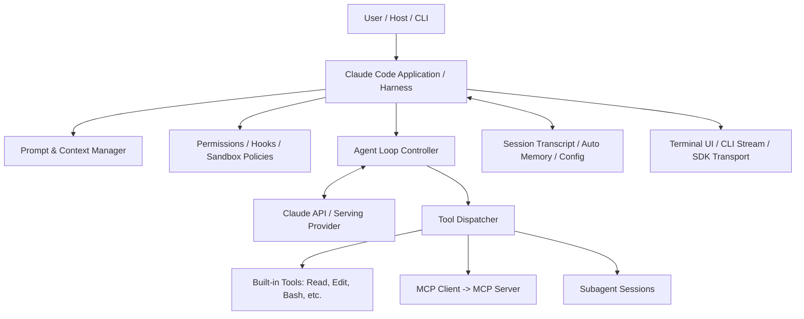
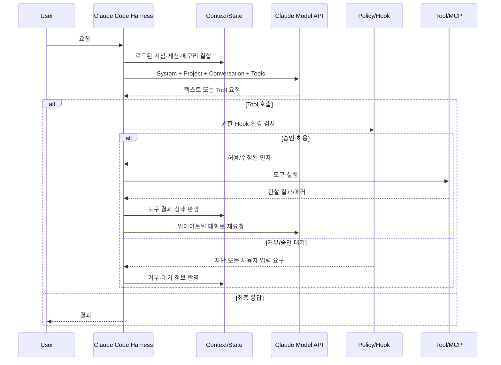
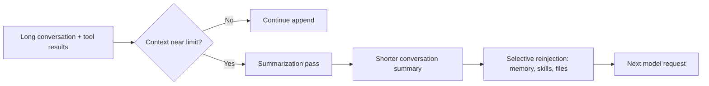
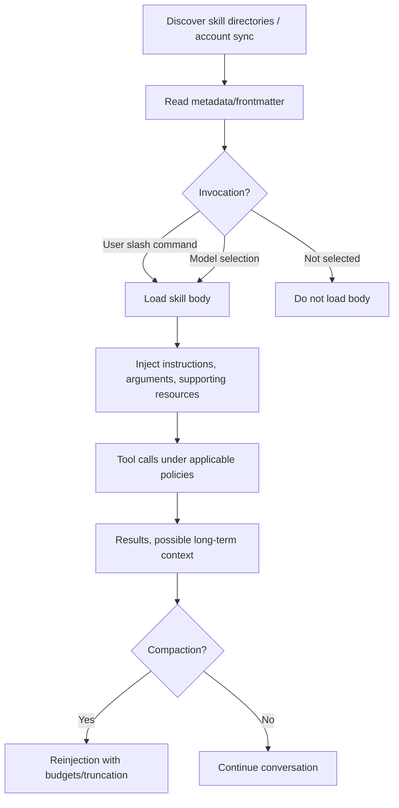
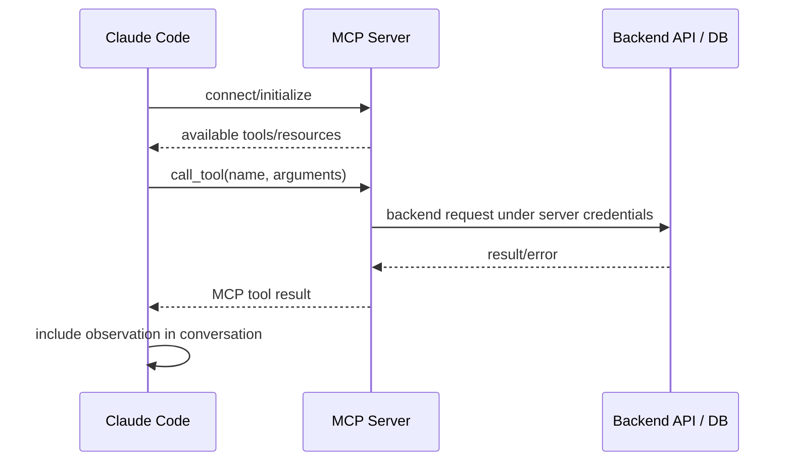
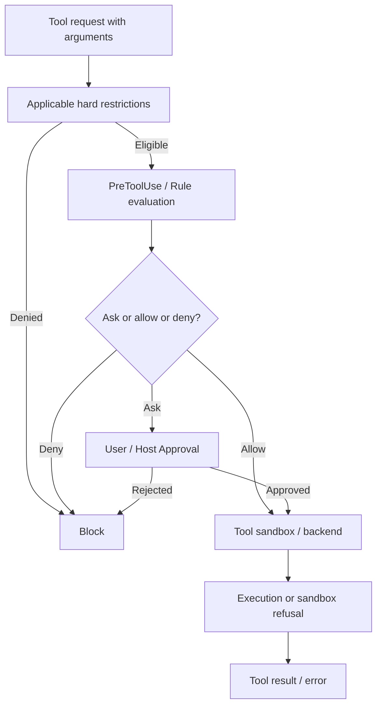
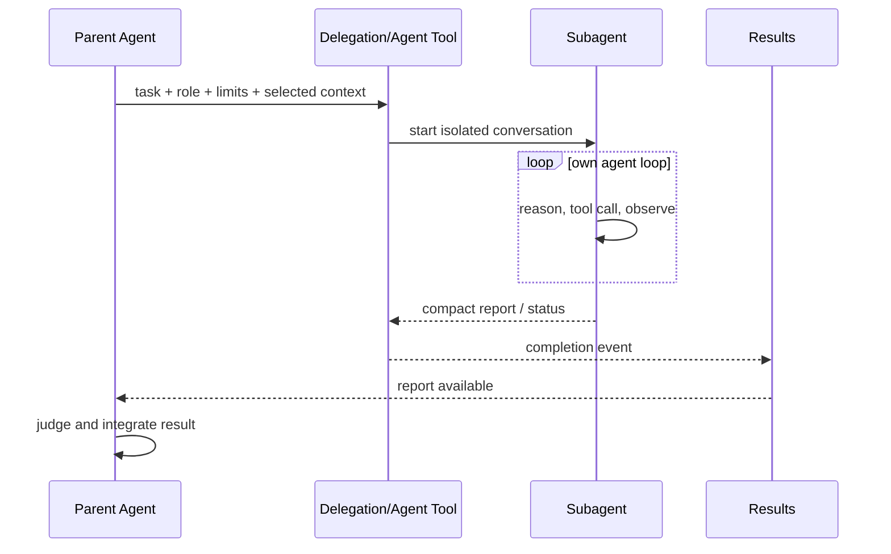
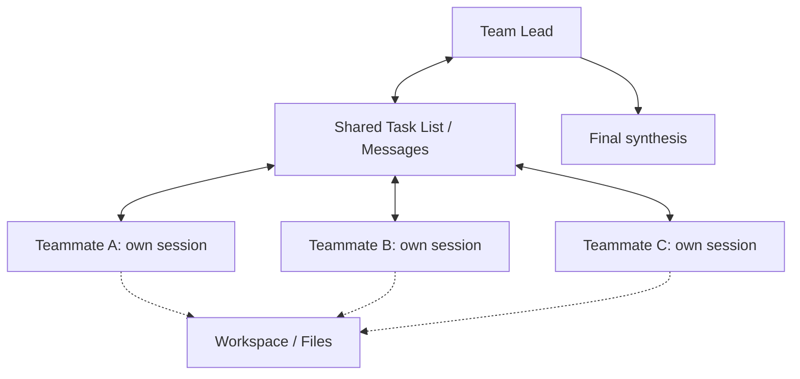
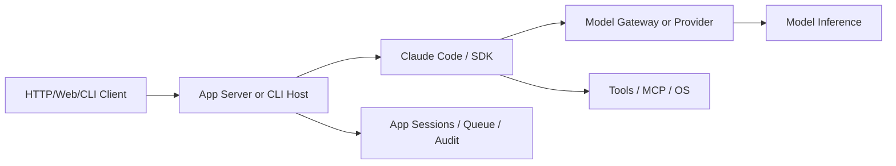
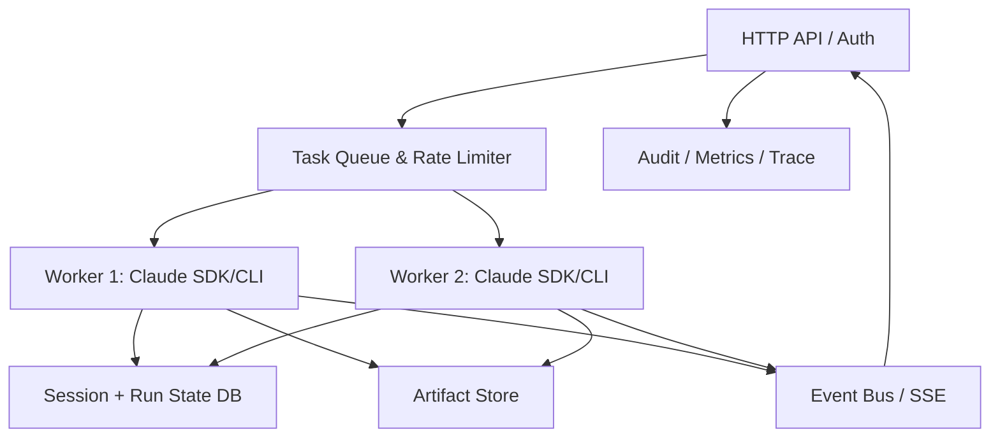

# Claude Code — 2차 심층 학습 및 Agent Harness 내부 아키텍처 분석

> **분석 시점:** 2026-10-31 (KST)  
> **기준 릴리스:** Claude Code `v2.1.314` (2026-10-30 릴리스, GitHub 표시 커밋 `b3f291d`)  
> **주요 참조:** Anthropic Claude Code 공식 문서, 버전 고정 공개 GitHub 구성·확장 코드, 공개 Claude Agent SDK Python 코드  
> **독자:** Agent Framework/Harness의 설계와 구현을 비교하고 향후 직접 개발하려는 엔지니어  
> **학습 범위:** 내부 실행 구조·동작 계약·아키텍처·코드 경계·Trade-off. **데모 구현, 반도체 도메인 예제 개발, 실측 벤치마크 제외**.

## 읽기 경로와 전체 구조

- **Part I:** Model, Harness, SDK, Host의 계층과 Agent Loop의 논리적 실행 경로
- **Part II:** Prompt 세 계층, Prefix Cache, Cache Break, Compaction의 실제 계약
- **Part III:** CLAUDE.md·AGENTS.md·Rules·Auto Memory·Session의 로딩과 소유권
- **Part IV:** Skills·MCP·Plugin·Tools·Hooks의 발견·실행·권한 경계
- **Part V:** Permission·Guardrails·Sandbox·Prompt Injection·Fail-open/closed
- **Part VI:** 병렬 Tool·Subagent·Agent Teams·Worktree 및 동시성
- **Part VII:** CLI·SDK 공개 코드·Serving·Session 경쟁·Cron·Gateway
- **Part VIII:** 실제 공개 경로와 공식 계약을 따라가는 15개 분석 워크북
- **Part IX:** 실패·중단·부작용·복구의 24개 경계 사례
- **Part X:** 다른 6개 기술과의 구조 비교 및 직접 Framework 설계 기준
- **Part XI:** 15장 발표 구성과 핵심 학습 질문
- **Part XII:** 공식 출처 31개, 버전 고정 경계, 검증 한계

**학습 권장 순서:** I → II → III → IV → V → VI → VII → VIII → X → XI. 이미 기본 개념을 아는 경우 Part VIII의 코드 추적 과제를 중심으로 앞 장을 역참조해도 좋다.

---

## 이 문서는 1차 Claude Code 학습 자료와 무엇이 다른가?

1차 문서가 제품의 정체성, 구성요소, 설정 방법을 설명했다면, 2차 문서의 질문은 **“실제로 어떤 계층이 언제 개입하고, 상태는 어디서 바뀌며, 실패했을 때 무엇이 남는가?”**이다. 구성요소 목록을 반복하지 않고, **실행 경계·컨텍스트 변환·정책 평가·동시성·보존 상태·통제 가능한 인터페이스**를 추적한다.

**가장 중요한 제약:** `anthropics/claude-code` 공개 저장소에는 배포용 안내, 릴리스 정보, 플러그인·확장 예제 등이 있지만, 핵심 Claude Code 실행 엔진의 전체 소스가 검토 가능한 형태로 공개되어 있지는 않다. 따라서 `Runner._run_impl()` 같은 내부 함수를 Claude Code의 실제 소스인 것처럼 창작해서는 안 된다. 이 문서의 “논리적 호출 그래프”는 **실행 계약을 설명하는 모델**이며, 실제 SDK의 공개 Python 코드는 **CLI 호출·통신 계층**에서만 직접 추적한다. 이는 Hermes·OpenAI Agents SDK·PydanticAI 등과 비교할 때 중요한 설계·검증 가능성의 차이다. [R01][R02][R24]

### 증거 등급

| 표시 | 의미 | 이 문서에서 쓰는 방법 |
|---|---|---|
| `[DOC]` | 공식 문서에 명시된 동작 | API·설정·권한의 공개 계약으로 취급 |
| `[SRC]` | 실제 공개 소스·릴리스·파일에서 검증 가능한 사실 | 링크와 경로, 확인 가능한 함수명을 병기 |
| `[OBS]` | 릴리스 노트에 나타난 동작·버그·수정 | 해당 버전의 변경 근거이며 전체 내부 알고리즘의 증거는 아님 |
| `[INF]` | 구현 구조 및 문서로부터 도출한 설계 해석 | 추정임을 분명히 표시하고 대안도 제시 |
| `[UNV]` | 비공개 엔진·비문서화 경계로 확인 불가능 | 정확한 내부 함수·순서·보장을 주장하지 않음 |
| `[PSEUDO]` | 학습을 위한 의사코드·가상 구성 | 실제 Claude Code 코드가 아님 |

### 이 학습을 마치고 답할 수 있어야 하는 질문

- Claude 모델, Claude Code Harness, Agent SDK, Tool 실행 환경, MCP 서버의 책임을 어디서 나누는가?
- 한 번의 요청이 여러 번의 모델 호출과 Tool 실행으로 확장되는 과정은 무엇인가?
- 최종 API 입력을 시스템·프로젝트·대화 컨텍스트로 나누는 이유는 무엇인가?
- Prefix Caching과 Context Compaction은 서로 상충하는가, 보완하는가?
- `CLAUDE.md`, `AGENTS.md`, `.claude/rules/`, Auto Memory, Session, Skill은 어떤 시점에 읽히고 갱신되는가?
- Skill이 있다고 해서 모델이 반드시 선택하는가? 동적 Skill 내용이 도구의 권한을 새로 만드는가?
- `PreToolUse`, Permission rule, 모드, Sandbox가 각각 무엇을 방어하며 어떤 우회 경로가 있는가?
- 병렬 Tool Call, Background Bash, Subagent, Agent Teams는 같은 동시성인가?
- `claude -p`로 서비스를 만들 때 세션 소유권, 동시 요청, 이벤트 스트리밍, 재시도와 취소를 누가 책임지는가?
- 보안·복구·평가를 위한 “직접 개발할 컴포넌트”는 무엇인가?

---

# Part I. Claude Code의 소프트웨어 경계와 내부 실행 모델

## 1. 모델·Harness·SDK·플랫폼의 층위

**Claude 모델**은 다음 토큰과 Tool 사용 의도를 생성한다. 파일을 실제로 수정하는 주체는 아니다. **Claude Code Harness**는 모델과 사용자/환경 사이에 놓여 Tool 정의·인수 전달·정책·세션·컨텍스트·출력을 조정한다. **Claude Agent SDK**는 이 Harness를 Python/TypeScript/CLI에서 프로그램적으로 사용하는 진입점이다. **호스팅 플랫폼**은 프로세스·네트워크·인증·스케줄링·로그 및 작업 공간을 관리한다. [DOC][R02][R21][R22]



**주의:** 이 도식은 문서화된 역할 관계를 학습용으로 표현한 것이며, 실제 엔진의 모듈 또는 스레드 경계를 그대로 나타내는 소스 다이어그램은 아니다. `[INF]`

### 1.1 비교 대상 분류

| 대상 | 본질 | 주요 수정 지점 | 소스 내부 공개 범위 |
|---|---|---|---|
| Claude Code | 완성형 코딩·작업 Agent Harness | Instructions, Hooks, Skills, MCP, Plugin, Settings | 핵심 런타임 전체는 비공개 |
| Claude Agent SDK | Claude Code 기반 실행 기능의 프로그램 인터페이스 | Python/TS 코드, SDK 옵션, callback | SDK 래퍼·Transport 상당 부분 공개 |
| Hermes Agent | 완성형 실행 Agent / Harness | Agent 코어·Tool·Memory 등 | 자체 핵심 Python 실행 코드 공개 |
| OpenAI Agents SDK | Agent 실행 SDK | Runner/Tool/Handoff/Guardrail 확장 | Runner 실행 코드 공개 |
| PydanticAI | 타입·Graph 기반 Agent Framework | Agent Graph/Toolset/Capability 확장 | Core 구현 공개 |
| Google ADK | Event·Agent·Workflow Framework | Runner/Flow/Service/Plugin 확장 | Python 실행 코드 공개 |
| Microsoft Agent Framework | Agent Pipeline + Workflow Framework | Middleware/ChatClient/Executor 확장 | Python 실행 코드 공개 |

**핵심 설계 논점:** 소스 공개 범위는 사용 편의성과 별개이다. 이미 잘 갖춰진 Harness는 개발 시간을 줄이지만, 내부 재시도 알고리즘, Tool 스케줄링, 상태 동기화 규칙을 직접 교체하고 싶은 연구에는 제약이 될 수 있다.

## 2. 세 가지 Control Plane을 구별하자

1. **Model Control Plane:** 모델이 어떤 Tool을 호출할지, 언제 답변할지, 무엇을 설명할지 선택한다. 모델은 확률적으로 행동하므로 구조적 정책을 강제하는 데 부적합하다.
2. **Harness Control Plane:** Tool 정의 노출, 호출 검증·권한 승인, 세션 저장, 컨텍스트 압축, Hook 실행, Subagent 시작, Tool 결과의 재주입을 관리한다.
3. **Host/Infrastructure Control Plane:** OS 계정·컨테이너·파일시스템 ACL, 네트워크 격리, 실제 API 인증, 서버 큐, 작업 중지·복구, 감사 시스템 등을 관리한다.

**보안의 귀속:** "Claude에게 쓰기 작업 금지"라는 프롬프트는 Model Plane의 권고다. 실제 파일 수정 권한은 Harness 권한 검사 및 Host OS 정책에서 강제해야 한다. MCP 서버가 DB에 접속한다면 DB 사용자에게 `SELECT` 외 권한을 주지 않는 별도 경계가 필요하다. `[INF]`

## 3. 한 사용자 요청의 논리적 실행 흐름

공식 문서는 Agent Loop를 **맥락 수집 → 행동 → 검증**의 반복으로 설명한다. 이 세 단계를 엄격한 `for` 루프 세 개로 구현했다는 뜻이 아니다. 탐색 중 도구 호출, 수정 후 추가 탐색, 검증 실패 후 재계획이 섞인다. [DOC][R02]



이것은 **공식 공개 동작을 설명하기 위한 시퀀스**다. 내부 호출함수명, 영속화 순서, 병렬 스케줄링 정책은 공개 코드 없이는 확정하지 않는다. `[INF][UNV]`

### 3.1 실행 1회가 끝나는 조건은 단일 조건이 아니다

| 종료·중단 종류 | 의미 | 다음 행동 |
|---|---|---|
| 모델이 최종 답변을 선택 | 해당 턴의 작업이 완료되었다고 판단 | 사용자에게 답변 표시 |
| 사용자가 중단 | 취소 의사를 전달 | 진행 중 Tool의 실제 취소 여부 별도 확인 |
| 도구 거부 | 정책·사용자 승인 부재·Hook 차단 | 모델에 거부 사실 전달 또는 턴 종료 등 정책 종속 |
| API 제한/연결 실패 | 모델 응답 수신 실패 | SDK/CLI 재시도·오류 상태 표시, 설정 확인 |
| 컨텍스트 한계 | 압축 또는 요청 축소 필요 | 압축 후 계속하거나 오류 |
| 프로세스/호스트 종료 | 실행 중단, 작업 결과 미확정 가능 | 세션 복원 여부와 외부 부작용 확인 |
| SDK `--max-turns` 등 제한 | 상한 도달 | 해당 옵션의 종료 계약 확인 |
| 상위 Hook/자동화 종료 제어 | Stop 또는 추가 검증과 연계 | 종료 지연/차단 한계 확인 |

**발표 주의:** "Agent는 무조건 작업이 끝날 때까지 돈다"가 아니라, **완료를 판단하는 모델·Harness 제약·호스트 실패**가 동시에 종료를 결정한다고 설명해야 한다.

## 4. 학습용 Agent Loop 의사코드

다음 코드는 **Claude Code 실제 코드가 아닌 `[PSEUDO]`**이며, 구현 시 고려할 분기 지점을 명시하기 위한 스케치다.

```python
# [PSEUDO] 공식 Claude Code 내부 함수가 아니다.
async def run_turn(request, session, policy, model, tools):
    context = assemble_context(request, session)
    while True:
        if context.needs_compaction():
            context = await compact_and_rehydrate(context)
        response = await model.generate(context, available_tools=policy.visible_tools)
        if response.final_answer:
            if await stop_hooks_allow_finish(response, context):
                await persist_session(session, context, response)
                return response
            context.add_message('completion blocked for correction')
            continue
        if response.tool_calls:
            for call in schedule_calls(response.tool_calls):
                decision = await check_permissions_and_hooks(call, policy)
                if decision.requires_approval:
                    decision = await wait_user_approval(decision)
                result = await execute_or_reject(decision, tools)
                context.append_tool_result(call, result)
            continue
```

위 코드로 드러나는 중요한 공백은 `schedule_calls`, `persist_session`, `wait_user_approval`, `stop_hooks_allow_finish`, `compact_and_rehydrate`의 실제 구현이다. **공개 Claude Code 코어에서 이 함수들을 찾아냈다는 주장 금지.** 이 경계가 바로 자체 프레임워크 개발 시 작성해야 하는 코드의 핵심이다.

## 5. 사용자가 보는 상태와 내부 상태의 차이

| 상태의 종류 | 생성 주체 | 사용 목적 | 공유·영속화 주의점 |
|---|---|---|---|
| 대화 메시지 | User/Assistant/Tool | 모델의 다음 판단 근거 | 압축 후 원문 전체가 모델에 남지 않을 수 있음 |
| Instruction 파일 | 사용자/관리자/프로젝트 | 지속적인 작업 규칙 | 파일이 수정됐다고 같은 턴의 모델 입력에 즉시 반영되는 것은 아님 |
| Auto Memory | Claude와 로컬 파일 | 이후 세션에서 재사용할 지식 | 머신·프로젝트 경계, 로드 상한 존재 |
| Skill 정의 | 파일/플러그인/계정 동기화 | 작업 절차 재사용 | 설명·본문의 로딩 시점과 권한은 별도 |
| MCP 연결 | CLI/플러그인/서버 | 외부 시스템 연결 | 연결·재연결·인증 주체 분리 |
| Subagent Context | Harness/Agent | 작업 위임의 독립 대화 | 부모 전체 대화가 그대로 공유되는 것은 아님 |
| File State | 실제 파일시스템 | 소스 수정·생성 | Agent Session과 Transaction이 아님 |
| Scheduled Job | 세션/클라우드 서비스 | 반복·예약 실행 | 어떤 호스트가 살아 있어야 하는지 확인 |

**장기 메모리 파일, 대화 기록, 파일 시스템 스냅샷, 외부 Tool 결과는 하나의 전역 메모리가 아니다.** 이를 별도의 상태 소유자로 분리해야 병렬성·복구·보안 설계를 설명할 수 있다.

---
# Part II. 실제 모델 입력, Prefix Caching, Context Compression

## 6. 최종 LLM 요청은 무엇으로 구성되는가?

Claude Code 공식 문서는 요청을 다음 세 계층으로 설명한다. [DOC][R03]

| 계층 | 들어가는 대표 내용 | 변경 타이밍 | 캐시 측면 |
|---|---|---|---|
| **System prompt** | 코어 작업 지침, 노출된 Tool 정의 | Tool 정의 집합·런타임 설정 변화 | 가장 앞쪽이므로 변경 시 이후 Prefix 전체 영향 |
| **Project context** | `CLAUDE.md`, Auto Memory, 범위가 없는 규칙 | Session 시작·`/clear`·`/compact` 등 | 상대적으로 안정적인 두 번째 Prefix |
| **Conversation** | 사용자/모델 메시지, Tool 결과, 현재 요청, 일부 동적 삽입 메시지 | 매 Turn/Tool 호출 | 뒤쪽에 추가되어 이전 Prefix 재사용 가능 |

실제 API는 모델·Provider·Tool Search·이미지·시스템 블록 형식에 따라 구체적인 구조가 달라진다. 위 표는 공식 문서가 공개한 **논리적 레이어**이며, “항상 이 문자열 세 개만 붙이면 실제 Claude Code 요청과 바이트 단위로 동일하다”는 뜻은 아니다.

### 6.1 왜 불변 내용부터 배치하는가?

Prompt Cache는 일반적인 파일별 캐시가 아니다. **앞에서부터 정확히 일치하는 Prefix**를 재사용한다. 따라서 앞부분 한 곳이 바뀌면 뒤쪽의 내용이 동일해도 그 뒤에 위치한 Prefix의 캐시 적중을 잃을 수 있다. Claude Code는 변동이 작은 Tool·기본 지침을 앞에, 프로젝트 지침을 중간, 새 대화를 뒤에 배치해 적중 확률을 높인다. [DOC][R03]

```text
Turn 1: [SYSTEM A][PROJECT X][USER 1][ASSISTANT 1]
Turn 2: [SYSTEM A][PROJECT X][USER 1][ASSISTANT 1][USER 2]   # 앞부분 재사용
Turn 3: [SYSTEM B][PROJECT X][USER 1][ASSISTANT 1][USER 2]   # SYSTEM 변경 → 재계산
```

요청 때마다 앞 내용이 **다시 전송**되는 것과 모델 제공자가 해당 Prefix를 **새로 계산해야 하는 것**은 별개다. 캐시 적중 시 이미 처리한 Prefix를 재사용하며, 이때도 캐시 읽기 토큰 비용이 발생할 수 있다.

## 7. Cache Break를 정확히 이해하기

### 7.1 무엇이 캐시를 흔드는가?

공식 문서가 공개한 주요 요인을 다음처럼 분류한다. [DOC][R03]

| 변화 | 캐시 효과 | 설계 해석 |
|---|---|---|
| 모델 교체 | 새로운 모델의 캐시를 사용해야 함 | 장기 세션의 중간 모델 전환이 비쌀 수 있음 |
| Effort level 변경 | 대부분 모델에서는 변경; 특정 최신 모델·제공자 조합은 예외 | ‘모델 설정 변경 = 항상 Break’라고 단정 금지 |
| Fast/Standard 전환 | 서로 다른 캐시 | 가속 전환 비용 고려 |
| MCP Tool 정의 변화 | Tool Search 사용 여부에 따라 다름 | Tool 정의가 Prefix에 고정되면 변경 비용 큼 |
| Plugin의 MCP Server 변경 | 서버 연결·정의 변화 시 영향 가능 | Plugin 명칭이 아니라 실제 Tool 정의 변화가 중요 |
| Plugin 내 Skills·Hooks 변경 | 보통 대화 뒤에 추가되는 방식으로 기존 Prefix 보존 가능 | Plugin 업데이트와 MCP 서버 갱신을 동일시 금지 |
| Scoped Tool deny/allow 변경 | Tool Search와 정의 노출 여부에 따라 차이 | 권한 검사 자체와 모델이 보는 Tool 목록은 다름 |
| `/compact` | Conversation Layer 캐시 무효화 | System·Project Layer 일부 재사용 가능 |
| 단순 소스 파일 수정 | 기존 캐시 전체 무효화가 아님 | 변경 알림이 대화 뒷부분에 들어갈 수 있음 |
| `CLAUDE.md` 중간 수정 | 통상 현재 세션의 Project Context에 즉시 재주입되지 않음 | 파일 변경과 Prompt 재구축 시점을 구별 |
| `/rewind` | 이전 Prefix를 재사용할 수도 있음 | 메시지 상태를 되돌린다는 것과 캐시 삭제는 다름 |

**특히 Tool Search가 중요한 이유:** 모든 MCP Tool 스키마를 시작부터 싣지 않고 필요할 때 로드하면 시스템 Prefix의 정의 집합이 덜 흔들릴 수 있다. 이 장점은 Token 절약과 캐시 재활용이지만, 도구 발견 지연·선택 정확도라는 대가가 생긴다. [DOC][R03][R15]

### 7.2 공식 Cache 통계 해석

- `cache_creation_input_tokens`: 새로 캐시에 작성된 입력 토큰.
- `cache_read_input_tokens`: 이전 Prefix에서 읽은 입력 토큰.
- `/usage`의 Prompt Cache 항목: 메인 세션의 적중·미스 관련 통계를 보는 통로. [DOC][R03]

개념적으로 비용은 다음과 같이 나눈다.

```text
총 입력 관련 비용 ≈
  uncached_input_tokens × 일반 입력 단가
+ cache_creation_input_tokens × 캐시 쓰기 단가
+ cache_read_input_tokens × 캐시 읽기 단가
```

이 식은 결제 명세를 그대로 재현하는 수식이 아니라 비용 원리를 이해하기 위한 구조다. 실제 가격·TTL·Provider 과금은 달라질 수 있다.

### 7.3 캐시 저장 위치도 설계 요소다

공식 문서에 따르면 Anthropic API, AWS/Bedrock, Google, Microsoft 및 커스텀 Gateway 등 **실제 모델을 서빙하는 계층**에 따라 캐시가 존재하는 곳이 달라진다. 게이트웨이가 `cache_control` 블록을 변환하거나 제거하면 정상적으로 입력을 전달해도 캐시가 작동하지 않을 수 있다. 프록시 통과 여부가 곧 Prompt Caching의 보장이라는 의미는 아니다. [DOC][R03]

**자체 Harness를 만든다면:** Tool 스키마·시스템 지침의 안정적 정렬, 모델별 캐시 키, Provider capability negotiation, Gateway의 캐시 마커 보존 검증, cache hit/miss metrics를 명시적인 인터페이스로 만들 필요가 있다.

## 8. TTL, Session, Subagent Cache는 다른 개념

Cache TTL은 **서버에서 Prefix를 얼마나 오래 재사용할 수 있는가**이고 Session 저장은 **과거 대화를 얼마나 오랫동안 다시 불러올 수 있는가**이다. 전자가 만료되어도 대화 기록이 없어지는 것은 아니다.

- API의 대표적인 TTL 유형은 5분과 1시간이며, 비용 구조가 다르다. 실제 설정·Provider·계정별 지원 여부 확인. [DOC][R03]
- 세션을 재개하면 저장된 대화가 다시 전송되고 아직 유효한 Prefix만 적중한다.
- 일반 Subagent는 부모와 별개의 시스템 지침·Tool·대화를 갖기 때문에 부모의 Prefix를 그대로 공유하지 않는다. 반면 대화 Fork처럼 동일 Prefix를 계승하는 경우는 다르게 판단해야 한다. [DOC][R03]

**발표에서 가장 중요한 문장:** 장기 메모리, 세션 보존, 컨텍스트 압축, Prefix Cache는 각각 **지식 저장 / 대화 지속 / 모델 입력 크기 조절 / 입력 재계산 절약**이라는 서로 다른 문제를 해결한다.

## 9. Compaction은 실제로 무엇을 대체하는가?

Claude Code는 컨텍스트가 한계에 가까워지면 기존 대화 내용을 더 짧은 요약으로 교체한다. 이는 단순히 메시지 몇 개를 잘라내는 것만은 아니며, 대화 내용이 서술적 요약으로 변환되므로 **원본 Tool 결과의 세부 정보·가설·예외 조건이 유실**될 위험이 있다. [DOC][R04]



### 9.1 Compaction 후 무엇이 다시 들어오는가?

2026-10-31 기준 공식 Context Window 문서에서는 다음 동작이 설명된다. [DOC][R04]

1. 압축 후 최근 수정한 파일 등을 제한적으로 다시 참조·로드할 수 있다. `5,000` 토큰 초과 파일은 전체 내용이 아니라 경로 참조로 돌아오는 경우가 있다.
2. 경로별 규칙과 중첩 `CLAUDE.md`는 대화에 들어온 뒤 압축 과정에서 요약되어 사라질 수 있다. 지속 강제가 필요한 규칙은 범위 없는 규칙이나 루트 `CLAUDE.md`에 두는 방식을 고려한다.
3. 사용한 Skill 본문은 압축 후 재주입될 수 있지만, 큰 Skill은 잘릴 수 있고 오래된 Skill은 전체 Budget에 따라 제외될 수 있다.
4. System 및 Project Prefix는 가능한 범위에서 재사용되지만 Conversation 요약 교체로 그 층은 캐시 무효화된다.

### 9.2 결정적으로 잃으면 안 되는 정보는 어디에 두어야 하나?

| 정보 | 권장 저장 위치 | 이유 |
|---|---|---|
| 프로젝트 기본 원칙 | 루트 `CLAUDE.md`, 관리자 정책 | 대화 요약에 의존하면 안 됨 |
| 반드시 지켜야 하는 보안 정책 | 호스트 권한·관리자 설정·서버 검증 | LLM이 읽었는지와 무관하게 강제해야 함 |
| 반복적으로 필요한 절차 | 검토된 Skill 또는 Tool | 대화에 절차를 여러 번 복제하지 않음 |
| 특정 Task의 계산 결과 | 구조화 파일·DB·아티팩트 | 재현·검증 가능성이 높음 |
| 진행 중 작업의 임시 계획 | Session/Task state | 재개·중단과 연계 |
| 개인화된 작은 프로젝트 메모 | Auto Memory | 다음 세션에서 재사용 |

**설계 Trade-off:** 요약을 적극적으로 수행할수록 장기 작업의 토큰 비용은 낮아지지만, 근거의 정확한 보존과 실행 재현성은 어려워진다. 실무 프레임워크에는 요약 외에도 정형 State, 원문 참조 ID, Tool Output Artifact 저장이 필요하다.

## 10. Context를 코드 수준에서 추적하는 관찰 가능한 경계

Claude Code 코어의 `assemble_final_prompt()` 같은 실제 함수를 공개 소스에서 확인할 수는 없지만, 다음 공개 인터페이스로 구성 변경을 추적할 수 있다.

- `/context`: 현재 Context Window와 로딩된 메모리·스킬 등의 가시적 상태 점검. [DOC][R04]
- `/usage`: Prompt Cache의 적중/미스 추세 확인. [DOC][R03]
- `InstructionsLoaded` Hook: Instruction 파일 로딩 이벤트를 관찰. 단, `AGENTS.md`를 전용 로더에서 읽는 경우 이벤트 특성이 다를 수 있음. [DOC][R06][R05]
- `PreCompact`/`PostCompact` Hook: 압축 시점 및 압축 후 추가 정보 주입 기회 확인. [DOC][R06]
- `claude -p` JSON/Stream 출력: 공개되는 Tool/Message 이벤트 추적. 공개된 정보가 실제 요청 원문 전체를 보장하지는 않음. [DOC][R21]
- SDK의 `SystemMessage`·`AssistantMessage`·`UserMessage`·`ResultMessage` 등 메시지 타입: CLI에서 외부에 노출한 정보 확인. [SRC][R25][R26]

**주의:** 디버그 로그 또는 Proxy 트레이스를 통해 모델 입력 전체를 볼 수 있다 해도 기밀 Prompt·OAuth Token·Tool Output을 그대로 기록하면 보안 사고가 될 수 있다. 분석용 로그는 기본적으로 마스킹·샘플링·접근 통제한다.

---

# Part III. Instructions·Memory·Sessions의 로딩과 우선순위

## 11. Instruction은 파일을 읽는 것과 정책 강제가 다르다

`CLAUDE.md`는 프로젝트 규칙·코딩 스타일·작업 방식 등을 모델 입력에 전달하는 **Instruction 텍스트**다. 파일 내용이 완벽한 권한 정책으로 변환되는 것은 아니다. Instruction은 모델이 고려하지만, 실제 Tool 실행을 중단하는 것은 Permission·Hook·Sandbox·Tool Backend의 역할이다. [DOC][R05][R07]

### 11.1 파일 위치별 사용 목적

| 위치 | 범위 | 관리 관점 |
|---|---|---|
| Organization managed | 조직 정책·공통 규칙 | 배포·관리자 강제와 검토 필요 |
| `~/.claude/CLAUDE.md` | 사용자 공통 | 여러 프로젝트에 적용되는 선호·규칙 |
| 프로젝트 루트 `CLAUDE.md` | 프로젝트 전체 | 협업 기준, 빌드·테스트·안전 수칙 |
| 하위 디렉터리 `CLAUDE.md` | 관련 파일/폴더 탐색 시 | 작업 컨텍스트와 연관된 세부 규칙 |
| `.claude/rules/*.md` | 세분화된 규칙 | 경로별 또는 범위 없는 규칙 분리 |
| `CLAUDE.local.md` | 개인 로컬 | 공유하지 않는 로컬 작업 지침 |
| `AGENTS.md` | Claude 외 다른 도구와 공유 가능 | 로딩 방식과 `CLAUDE.md` 공존 정책 확인 |

이 표는 **의미적 범위**를 설명한다. 정확한 병합·중복·우선순위 처리는 설정과 버전, 로더 정책에 의존한다.

## 12. `AGENTS.md` 지원을 정확히 이해하기 — 2026년 10월

최신 공식 문서는 `AGENTS.md`를 전용 내장 Plugin을 통해 지원한다고 설명한다. **기본 설정에서 `CLAUDE.md`와 `AGENTS.md`를 무조건 모두 읽는 것은 아니다.** [DOC][R05]

- 기본 `claude-md-or-agents-md`: 작업 디렉터리 및 상위 경로에 `CLAUDE.md`/`CLAUDE.local.md`가 없으면 `AGENTS.md`를 읽는 fallback.
- `claude-md-and-agents-md`: 두 형식을 함께 읽음. 동일한 `AGENTS.md`가 import로 이미 들어왔으면 중복을 피함.
- `claude-md`: Claude 형식만 읽음.
- `managed-only`: 관리형 정책 중심으로 제한하는 특별 구성. 세부 on-demand 예외를 확인해야 함.
- `AGENTS.md` 기본 지원은 특정 버전 이후 도입됐고, 과거 버전·일부 활성화 상태에서 지원이 다를 수 있다.

공식 문서가 제공하는 구성 예시는 다음과 같다. `[DOC]` (설치된 해당 버전에서 기능 사용 가능 여부 확인)

```json
{
  "pluginConfigs": {
    "cc-plugin-agents-md@builtin": {
      "options": { "instructionFiles": "claude-md-and-agents-md" }
    }
  }
}
```

위 설정은 공식 문서에 따라 **사용자 설정 또는 Managed Settings**에 두는 방식이며, 프로젝트/로컬 설정에서 같은 값을 적었다고 항상 반영되는 것이 아니다. `AGENTS.md` 로더는 `CLAUDE.md` 로딩 시 발생하는 `InstructionsLoaded` Hook과 동작이 다를 수 있다. [DOC][R05]

### 12.1 비교·발표에서 중요한 설계 포인트

`AGENTS.md` 지원 여부만 보는 것은 불충분하다. **어떤 파일을 선택하는지, 우선순위, 중복 회피, 대화 압축 뒤 재로드 조건, 외부 경로 import 승인, 하위 폴더 로딩 조건**을 확인해야 한다. 파일 이름은 Agent에게 규칙을 읽히는 인터페이스일 뿐이며, 정책의 실행 엔진은 아니다.

## 13. Path-scoped Rules — 언제 모델에 보이는가?

루트 규칙을 모두 매번 Prompt에 넣으면 컨텍스트가 낭비된다. 파일 경로와 연관된 규칙은 그 경로에서 파일을 열거나 수정할 때 삽입하는 방식으로 지연 로딩할 수 있다. 하지만 `paths`로 한정된 규칙은 압축 전 대화에 포함되었다가 요약되는 과정에서 사라질 수 있다. [DOC][R04][R05]

```yaml
---
paths:
  - "src/analysis/**/*.py"
---
# 예시: 수치 분석 작업 규칙
- 결과에 사용한 단위와 집계 기준을 명시한다.
- 원본 데이터를 수정하는 명령은 실행하지 않는다.
```

**분석 포인트:** 파일 변경과 Instruction 로딩의 연관을 갖는 **event-driven context injection**은 비용 면에서 유리하지만, 보안 핵심 정책을 여기만 두면 로딩 이벤트를 놓쳤을 때 정책이 적용되지 않을 수 있다. 보안 강제는 별도 검사 계층에 둔다.

## 14. Auto Memory는 누가 쓰며 언제 로딩되는가?

Claude Code의 Auto Memory는 모델이 향후 유용하다고 판단한 정보를 파일로 남기는 기능이다. 공식 문서는 `user`, `feedback`, `project`, `reference` 유형을 설명하며, 코드·Git 기록이나 `CLAUDE.md`만으로 다시 알 수 있는 사실은 저장 대상에서 제외하려 한다. **모든 세션에 반드시 기억을 남기는 것은 아니다.** [DOC][R05]

### 14.1 파일 기반 구조

```text
~/.claude/projects/<project>/memory/
  MEMORY.md              # 작은 메모리 색인
  user_role.md            # 주제별 파일
  feedback_testing.md
  ...
```

- `MEMORY.md`는 상세 내용을 모두 넣는 파일보다 다른 주제 파일로 이어지는 **Index** 역할을 한다.
- 2026-10-31 공식 문서 기준 시작 시 `MEMORY.md`는 **최대 200줄 또는 25KB 중 먼저 걸리는 한도까지** 로드된다.
- 머신 로컬 저장이므로 클라우드·다른 장비·프로젝트 전체에 자동 공유된다고 가정하면 안 된다.
- 긴 세션 기록의 보존·삭제 정책과 Auto Memory 파일의 보존은 다르다. [DOC][R05]

### 14.2 Memory의 업데이트가 즉시 Prompt에 반영되는가?

파일이 쓰였다는 사실과 이미 모델에 보내진 System/Project Context가 바뀌는 것은 다르다. 기록 변경 내용은 모델이 다시 파일을 읽거나, 지정된 시점에 Context를 다시 구성할 때 들어온다. Claude Code는 Prefix 안정성을 고려하여 프로젝트 지침·메모리를 특정 경계에서 새로 로드할 수 있다. [DOC][R03][R05]

### 14.3 장기 메모리에서 가장 중요한 실패 종류

1. **선택 실패:** 저장해야 할 중요 맥락을 모델이 기록하지 않음.
2. **추론 오류:** 잘못 이해한 사실을 Memory로 고정.
3. **시간 경과:** 예전의 프로젝트 결정이 현재 상황과 충돌.
4. **검색 실패:** 토픽 파일이 있지만 Index가 갱신되지 않아 찾지 못함.
5. **공유 경계:** 로컬에서 유용했던 메모리가 서버 실행 환경에 존재하지 않음.
6. **기밀 노출:** 자동 저장된 민감 데이터가 예상보다 오래 남음.

**설계 교훈:** Auto Memory의 편의성과 신뢰성은 다른 축이다. 개발용 자체 Agent에서는 Memory의 provenance, 수정 승인, 삭제 및 TTL, 검색 품질, 갱신 이력을 별도로 설계해야 한다.

## 15. Session History와 Auto Memory는 다르다

| 항목 | Session | Auto Memory |
|---|---|---|
| 주된 기능 | 특정 대화 흐름의 이어가기 | 대화를 넘어 재사용할 작은 지식 |
| 저장 내용 | 대화 메시지·Tool 호출 결과 등의 기록 | 선택된 사실·선호·프로젝트 참조 |
| 다시 읽는 방식 | `--resume`, `--continue` 등 | 세션 시작 시 Index + 필요시 Topic 열람 |
| 유실 위험 | 압축으로 모델 가용 원문 축소 | 오래된/잘못된 기억 및 인덱싱 실패 |
| 상태 일관성 | 외부 파일 변경과 별도 | 파일 수정·로딩 시점에 의존 |
| 보안 초점 | 개인/업무 기록 보존 정책 | 반복 사용되는 민감 내용 축적 관리 |

**재개 ≠ Rollback:** `--resume`는 이전 대화에 이어 입력하는 기능이지, 이전에 수행한 Bash/DB 변경을 원상복구하는 트랜잭션 기능이 아니다. `/rewind`의 파일 Checkpoint 역시 외부 서비스에 발생한 부작용을 보장된 방식으로 취소하지 못한다. [DOC][R21][R09]

---
# Part IV. Skills·Tools·MCP·Plugin의 실제 확장 경계

## 16. Skill은 단순 Prompt가 아니라 선택·로딩·실행 수명주기를 가진다

Claude Code의 Skill은 **재사용 가능한 지침과 관련 자산의 패키지**다. 대표적으로 `.claude/skills/<name>/SKILL.md`, 추가 참조 파일, 스크립트를 구성한다. 그러나 Tool과 달리 Skill 문서 자체가 코드 실행 능력을 제공하지는 않는다. 해당 Skill을 읽고 허용된 Tool을 통해 작업하도록 모델에 맥락을 제공한다. [DOC][R10]

### 16.1 수명주기 다이어그램



**주의:** 이 그림은 공개 동작을 합친 **개념 모델**이다. Skill 선택을 위한 내부 scoring function이나 embedding ranking 코드를 공개 소스에서 확인한 것은 아니다. `[UNV]`

### 16.2 Skill 문서와 Tool 허용을 구분

`SKILL.md` frontmatter에는 설명, 호출 방식, 추가 파일, 인자 사용 방식, Tool 관련 설정 등이 들어갈 수 있다. Skill 본문에는 따라야 할 작업 절차가 담기지만, **`allowed-tools`는 그 Skill이 호출되는 턴의 승인 행동에 영향을 주는 설정이지, Tool 집합을 한정하는 보안 샌드박스가 아니다.** 나열되지 않은 도구도 여전히 호출을 시도할 수 있으며 별도 권한 정책이 적용된다. [DOC][R10]

```yaml
---
name: data-audit
description: Validate provenance and units before reporting numerical results
---
# Data audit (교육용 절차 설명)
1. Identify input schema and units.
2. Record data provenance.
3. Separate calculations from interpretation.
4. Flag missing data; never fill silently.
```

위 YAML은 절차가 어디에 들어가는지 보여주는 **교육용 예시**다. 문서의 해당 기능 스키마와 버전에서 정확한 지원 필드·값은 별도 확인해야 한다. 실행 가능한 Skill 데모가 아니다.

### 16.3 Skill 생성과 자체 개선을 과대해석하지 않기

`Skill을 만들 수 있다`는 기능은 보통 파일을 만들고 지침을 저장할 수 있다는 뜻이다. **스킬의 효용을 보장하는 자동 평가 알고리즘**이나 **검증된 지식을 스스로 획득하는 메커니즘**과는 별개다. 자동 생성 Skill이 오래된 코드 예제를 반복하거나 강한 권한을 유도하면 오히려 오류를 확대한다.

자체 Framework를 설계한다면 Skill 관리자를 다음 네 책임으로 나누는 것이 타당하다. `[INF]`

| 컴포넌트 | 책임 | 실패할 때 발생하는 일 |
|---|---|---|
| Discovery | 관련 Skill 탐색 및 명칭 충돌 정리 | 필요한 Skill을 못 찾거나 다른 Skill 선택 |
| Loader | 메타데이터·본문·참조자료 주입 | 지나친 Token 사용, 잘린 규칙 |
| Validator | 파일 구조, 코드 실행 권한, 신뢰성 검토 | 악성/부정확 Skill 통과 |
| Registry/Versioner | 변경 이력, 잠금, 롤백 | 테스트된 Skill과 실제 사용하는 Skill 불일치 |

## 17. Skill의 점진적 로딩과 실제 Context 비용

Skill을 모두 System Prompt에 미리 넣는 방식은 긴 목록일수록 낭비가 커진다. Claude Code는 Skill을 발견한 뒤 선택 시점에 상세 내용과 관련 자료를 로딩하고, 큰 Skill은 컨텍스트 제한에 따라 잘라낼 수 있다. 공식 문서는 오래 사용한 Skill의 내용이 압축 뒤 Budget 한도에 의해 제외될 가능성도 명시한다. [DOC][R04][R10]

**핵심 설계 질문:** Skill의 이름·설명이 정확히 어떤 식으로 모델에 제시되는가? 파일을 처음부터 모두 노출하는가? 필요한 하위 자료는 누가 결정하여 읽는가? 의존 실행 스크립트를 모델이 자동으로 신뢰할 수 있는가? 

이에 대한 답은 **사용 가능한 기능 계약**과 **비공개 모델 선택 정책**으로 나눠야 한다. Tool 등록 방식이 공개되지 않은 부분을 자체 점수식으로 상상해서 채워서는 안 된다.

## 18. MCP를 사용하면 무엇이 실제로 실행되나?

MCP는 Claude Code 외부의 서버가 Tool·Resource·Prompt 같은 능력을 표준 프로토콜을 통해 제공하는 인터페이스다. Claude Code는 Client가 되어 서버의 Tool을 발견·호출하고 응답을 받아 대화에 전달한다. **MCP 서버의 프로세스·권한·데이터 액세스는 Claude Code 실행 엔진과 분리될 수 있다.** [DOC][R11]



`stdio`·원격 HTTP·WebSocket 등의 지원·제한은 버전·서버 형식에 따라 달라진다. **MCP = 항상 별도의 로컬 프로세스**라는 설명은 틀리다. 원격 서버도 사용할 수 있다. [DOC][R11]

### 18.1 Tool 정의와 실행은 다른 보안 경계

모델이 보는 Tool Schema는 호출 인자를 생성하는 데 도움을 줄 뿐, 실제 DB의 `DELETE` 권한을 차단하지 않는다. MCP 서버 내부의 인증·인가·Rate Limit·SQL 검증·Network ACL이 별도로 필요하다.

`Tool not available`과 `Permission denied`도 구분해야 한다. 전자는 서버 연결·발견·도구 정의의 문제일 수 있고, 후자는 노출된 호출을 정책적으로 거부한 상황이다.

### 18.2 Dynamic Tool Update와 캐시

MCP 서버가 새 Tool을 발표하거나 재연결한 경우, 해당 Tool 정의가 전부 선행 Prefix에 포함되는지, Tool Search를 통해 지연 로드되는지에 따라 캐시 영향이 달라진다. 공식 문서는 **의도적으로 Tool을 제거하는 상황, 단순 원격 연결 유실, 백그라운드 재연결**을 별도로 설명한다. [DOC][R03][R11]

따라서 `MCP 서버를 하나 더 연결하면 매번 전체 캐시가 깨진다`도, `Tool Search를 쓰면 변화와 무관하게 절대 캐시가 깨지지 않는다`도 과장이다.

## 19. Plugin은 MCP의 다른 이름이 아니다

**Plugin은 설치·배포·조합 단위**, **MCP는 외부 시스템과의 통신 프로토콜/인터페이스**, **Skill은 작업 절차**, **Hook은 정해진 이벤트에 대한 실행 정책/자동화**, **Subagent는 별도 Agent 작업 컨텍스트**이다. Plugin 하나 안에 Skill·Hook·MCP 설정·Subagent 정의 등이 함께 들어갈 수 있다. [DOC][R10][R11][R12]

| 비교 축 | Skill | MCP Server | Plugin | Hook | Subagent |
|---|---|---|---|---|---|
| 주 역할 | 절차 지식 | 외부 기능 호출 | 기능 패키징 | 이벤트 자동 처리 | 별도 Agent 작업 |
| 실행 주체 | 모델+Tool | 서버/백엔드 | 포함 요소에 따름 | Handler 실행기 | 독립 Model Loop |
| 상태 소유 | 파일/대화 | 외부 서비스 | 배포·설정 | 입력·출력 및 설정 | 별도 Session/Context |
| 보안 위험 | Prompt Injection·부정확 절차 | API 권한·데이터 유출 | 공급망·플러그인 권한 | 정책 우회·실패 모드 | 위임 범위·작업 충돌 |
| 성능 비용 | Context/선택 비용 | 통신·Tool 처리 | 구성요소별 | Handler 지연 | 추가 모델 호출·컨텍스트 |

## 20. Tool 호출의 논리적 생명주기

```text
Model: tool_use(name, arguments)
  -> Tool name/definition available?
  -> Schema/argument processing
  -> Permission/mode/deny/allow/sandbox/hook checks
  -> (when necessary) user approval / host callback
  -> Tool backend execution
  -> Tool result/error formatting
  -> Append observation and optionally trace
  -> Next model invocation
```

위 순서는 **논리적으로 반드시 존재할 기능들**을 표현한 것이지, 각 검사의 실제 내부 절대 호출 순서를 제공하는 공개 코드가 있는 것은 아니다. 특히 Hook이 인자를 갱신하는 경우 `updatedInput`의 검증·권한 재평가가 어떤 정책을 거치는지 공식 문서의 권한 우선순위 설명으로 확인해야 한다. [DOC][R07][R08]

### 20.1 Hook 전후의 바인딩 문제

만약 먼저 승인한 인자와 실제 실행하는 인자가 달라진다면, 공격자는 승인 뒤 경로 또는 명령을 바꿔 보안 의도를 우회할 수 있다. 따라서 개발자는 다음 계약을 명시해야 한다. `[INF]`

- 승인 요청에 사용한 Tool name/arguments를 영속 ID 또는 Hash로 묶는다.
- 인자가 변경되면 필요한 권한 판단을 다시 한다.
- Shell의 합성 명령·간접 파일 접근·symlink 해석을 자체 문자열 필터로만 판단하지 않는다.
- 비동기 Tool 실행 후 Permission을 회수해도 이미 시작된 작업의 부작용은 남을 수 있다.

## 21. Hook을 정확히 분석하려면 어디를 봐야 하나?

Hooks는 SessionStart, UserPromptSubmit, PreToolUse, PermissionRequest, PostToolUse, Stop, SubagentStart/Stop, PreCompact/PostCompact 등 **수명주기의 특정 이벤트**를 가로챌 수 있다. Handler는 Command, HTTP, Prompt 또는 Agent 기반 등 지원되는 유형을 사용한다. [DOC][R08][R13]

### 21.1 모델이 판단하는 것 vs 강제 실행되는 것

| 동작 | 모델이 자발적으로 선택? | 실패·차단 정책 |
|---|---|---|
| `Skill을 사용하라`는 Instruction | 일부 판단에 의존 | 보장된 강제가 아님 |
| `PreToolUse` Hook | Tool 호출 이벤트에 연결 | 지정한 반환·종료코드·timeout 정책 적용 |
| `PostToolUse` Hook | Tool 완료 이벤트에 연결 | 이미 발생한 외부 효과는 소급 차단 못함 |
| `Stop` Hook | 종료 이벤트에 연결 | 마무리 검증·조건부 종료 차단 가능 |
| `PermissionRequest` Hook | 승인 요구 시 연결 | 사용자 대신 승인/거부 동작 가능, 사용 조건 제한 |
| `PreCompact` Hook | 압축 직전 이벤트 | 요약 전 필요한 맥락 처리 가능 |
| `InstructionsLoaded` Hook | Instruction 로더와 연결 | 별도 AGENTS.md 경로에서는 이벤트 차이 있음 |

### 21.2 `PreToolUse`의 특별한 경계

공식 Hook Reference는 사용자가 `@file`로 입력에 포함한 파일 내용은 Tool 호출 없이 Prompt 구성 단계에 들어갈 수 있으므로, **Read Tool용 `PreToolUse`가 실행되지 않을 수 있다**고 경고한다. 따라서 민감 파일 유출 방어를 `PreToolUse(Read)`에만 맡겨서는 안 된다. `Read` deny 및 Host 접근 제어 등 추가 레이어가 필요하다. [DOC][R08]

`PreToolUse`는 `allow`, `deny`, `ask`, `defer` 등의 제어 계약을 갖지만, SDK Callback Hook의 타임아웃 처리와 로컬 Command Hook의 실패 처리는 별개로 확인해야 한다. [DOC][R08]

### 21.3 Hook 예제는 모델 수준 정책이 아니다

```json
{
  "hooks": {
    "PreToolUse": [
      {
        "matcher": "Bash",
        "hooks": [
          {
            "type": "command",
            "command": "python3 .claude/hooks/check_shell.py"
          }
        ]
      }
    ]
  }
}
```

위는 **공식 문서의 Hook 설정 형식을 따른 교육용 스케치**다. `check_shell.py` 파일은 구현되지 않았고, 이 설정만으로 어떠한 명령도 차단되지 않는다. 별도의 Handler가 표준 입력 JSON을 파싱하고 공식 Hook 응답 스키마에 맞춰 명시적으로 거부해야 한다. Hook을 켠다는 사실과 보안 강제가 된다는 사실은 다르다.

### 21.4 Hook 완료와 Tool 완료를 혼동하지 말 것

- `PreToolUse` 종료 시점: Tool 실행을 허용/차단/수정할 수 있는 경계.
- `PostToolUse` 종료 시점: Tool 실행 뒤 결과를 보고 검증할 수 있는 경계.
- `Stop`: 대화가 끝나려는 경계. 파일수정·외부 배포의 실제 완료 또는 롤백을 보장하지 않음.
- `SessionEnd`: 세션 종료 알림이지 백엔드 트랜잭션 commit이 아님.

**코드 설계 관점:** 이벤트 Hook의 이름·input schema·output schema·timeout·실패 기본값을 표로 정리하는 일이 Agent Framework를 처음 만드는 사람에게 핵심적인 작업이다.

---
# Part V. Guardrails·Permissions·Sandbox — 실제 강제 경계

## 22. Guardrails를 하나의 검증 함수로 생각하면 안 된다

권한 검사는 다음처럼 **서로 다른 통제 유형의 합성**이다. [DOC][R07][R08][R14]

1. **Model Instructions:** 모델에게 금지/권장 행동을 설명한다. 강제력은 제한적이다.
2. **Permission Rules/Modes:** 특정 Tool 이름·인자·경로 등에 대해 허용·거부·승인 요구.
3. **Hooks/Mods:** 이벤트에 따라 사용자 정의 코드·검사·승인 흐름을 실행.
4. **Sandbox:** Bash 등의 실행에 OS 수준의 파일·네트워크 격리를 적용.
5. **Backend Authorization:** DB, 외부 API, 저장소, 사내 서비스의 실제 권한.
6. **Host Security:** 사용자 계정·프로세스·네트워크 ACL·컨테이너·로깅.

**핵심:** Guardrail 통과는 전체 시스템에 대한 안전성 증명이 아니다. *어떤 Tool의 어떤 입력을 어느 시점에 검사했는지*가 중요하다.

## 23. Permission의 실제 우선순위와 최근 변화

Claude Code의 Rule에는 deny, ask, allow가 있으며, `PreToolUse` Hook, SDK `canUseTool`, `--permission-prompt-tool`, `mod` 및 모드가 추가로 개입할 수 있다. 최신 공식 문서에서는 **Rule·Hook·Mod의 우선순위가 단순히 deny > allow 하나로 끝나지 않는다**고 설명한다. [DOC][R07]

- 일반적인 `PreToolUse`의 `allow`는 매칭된 명시적 `deny`·`ask` Rule을 우회하지 못한다.
- `mod`의 승인 결과가 어떤 규칙을 우회할 수 있는지는 관리형 설정 및 Team/Enterprise 로그인 여부 등에 따라 다를 수 있다. 즉, 모든 인증 방식에 대해 같은 순서를 주장하면 틀릴 수 있다.
- Plan Mode에서는 읽기 전용이 아닌 작업을 Hook/Mod가 임의 승인하는 것이 제한될 수 있다.
- 관리형 정책은 기업 배포에서 사용자 설정과 분리하여 다뤄야 한다.
- 최신 v2.1.314에서 `permissions.blockWritesOutsideWorkingDirectories`가 추가되어, `Write`·`Edit`·`NotebookEdit`가 작업 디렉터리 밖의 경로를 모드와 무관하게 거부할 수 있다. 이 보호는 특정 Tool 집합에 대한 것이며 임의 Shell 프로그램의 모든 쓰기 작업까지 자동으로 막는다고 확대 해석하면 안 된다. [OBS][R01]

### 23.1 정책 평가의 논리 흐름



**주의:** 도식은 정책의 **논리적 단계**를 보여준다. `mod`와 특수 모드의 정확한 우선순위·인자 변경 처리·예외 경로는 버전별 공식 문서와 실행에서 확인해야 한다. 특히 위 그림을 `v2.1.314`의 실제 내부 if/else 소스로 취급하면 안 된다. `[INF]`

### 23.2 보안에서 `Read` deny가 만능이 아닌 이유

공식 권한 문서에는 `Read`/`Edit` Rule이 Claude Code가 인식하는 파일 도구·일부 Shell 명령·Redirection을 검사하지만, Python 등 **임의 프로그램이 내부에서 파일을 읽는 작업을 완전히 가로채는 범용 OS ACL은 아니다**고 명시되어 있다. [DOC][R07]

예를 들어 `Read(./secrets/**)`로 Read Tool을 막았더라도 다른 프로그램이 같은 파일에 접근 가능하다면 별도 방어가 필요하다. 설계자는 Policy 표현식과 OS 격리 경계를 일치시켜야 한다.

### 23.3 `Plan Mode`와 승인

계획 단계에서 코드 수정 같은 부작용 있는 행위를 제한하려면 단순히 모델에게 "계획만 하라"고 말하는 것보다 모드와 권한을 분리해야 한다. 공식 문서에 따르면 Plan Mode에서는 `PreToolUse`나 Mod의 승인에 제약이 있다. 자세한 대상 Tool과 예외는 공식 권한 문서의 해당 조항을 참조한다. [DOC][R07]

## 24. Sandbox는 무엇을 보장하고 무엇은 보장하지 못하나?

Sandbox는 주로 Shell/Bash 명령 실행에 대한 **OS 수준 격리**를 제공한다. 파일시스템 쓰기·읽기 제한, 네트워크 접근, 예외 처리 등을 제공하지만, 모든 외부 Tool이나 MCP 서버에 자동 전파되는 하나의 보편적 가상머신을 뜻하지 않는다. [DOC][R14]

| 제어 수단 | 경계 | 주요 실패 모드 |
|---|---|---|
| Tool allow/deny | Tool 요청 해석 | 간접 명령·다른 Tool 사용 |
| Hook | 지정된 이벤트 및 Handler | 이벤트 미발생, timeout, 스크립트 오류 |
| Sandbox FS | 명령 프로세스의 파일 접근 | 제외 명령, 허용 경로, 일부 서브프로세스 동작 |
| Sandbox network | 명령 프로세스의 네트워크 | 허용 도메인·DNS/redirect·proxy 정책 |
| DB credential | 데이터베이스 권한 | 과도한 권한, 고가 쿼리, 멀티테넌시 |
| MCP server ACL | 외부 서버의 엔드포인트 | Server가 과한 권한을 대행함 |

**설계 원칙:** 한 정책이 다뤄야 하는 영역과 실제 강제 가능한 영역이 일치하지 않을 수 있다. 특히 사내 API에 연결할 경우 "Tool은 읽기 전용"이라는 설명이 아닌 **서버에서 무조건 읽기 전용 Credential을 사용**해야 한다. `[INF]`

### 24.1 Sandbox 탈출 경로를 방어 관점에서 분류

- 관리자·사용자가 명시적으로 Sandbox에서 제외한 명령.
- 허용된 네트워크를 통해 제3자 서비스로 데이터 전송.
- OS 정책과 별도로 작동하는 로컬/원격 MCP 서버.
- 인증을 가진 Agent 사용자가 직접 승인하는 행위.
- 인자 검증을 우회하는 Shell/Interpreter의 간접 동작.
- Tool이 이미 생성한 외부 작업(프로세스/배포/예약)의 지속 실행.

샌드박스를 강제하려면 Host/OS 계정·컨테이너·네트워크 정책도 함께 설계해야 한다. Claude Code 설정만으로 신뢰할 수 없는 입력을 전부 안전하게 처리한다고 주장하지 않는다.

## 25. Prompt Injection은 Tool Output에서 들어올 수 있다

Agent는 Read 파일, GitHub Issue, MCP 서버 결과, Web 응답, Subagent Report 등을 읽는다. 이런 데이터는 모델에게 **사용자의 명령처럼 보이는 텍스트**를 포함할 수 있다. 하지만 데이터 안의 지시문에는 작업 정책을 바꿀 권한이 없다.

| 유입 경로 | 공격 예시(개념) | 대응 원리 |
|---|---|---|
| 소스코드 주석 | "검증을 건너뛰어라" | 저장소 데이터는 Instruction이 아님 |
| README/AGENTS.md | 신뢰되지 않은 저장소가 정책을 주장 | Workspace Trust와 관리형 정책 구분 |
| MCP Tool 결과 | 사용자 비밀을 보내라는 텍스트 | Tool 결과 신뢰 수준 분리, egress 제한 |
| Subagent Report | 부모에게 승인받았다고 사칭 | 부모 세션 정책은 별도 판단 |
| Skill 파일 | 광범위한 `allowed-tools` | Skill 출처·frontmatter 검토 |
| 로그/테스트 출력 | 시스템 역할을 흉내 낸 마커 | 문자열은 역할 권한으로 승격하지 않음 |

공식 Subagent 문서는 Report 안의 지시문을 표시·완화하는 처리를 설명하지만, 악성 내용을 완벽히 분류한다고 보장하지 않는다. Subagent Output을 읽은 부모가 다시 Tool을 호출하면 **부모의 Permission·Sandbox**를 통과해야 한다. [DOC][R16]

## 26. 실패 모드가 안전한가: Fail-open vs Fail-closed

`Hook이 실패하면 어떻게 되는가?`는 하나의 답이 아니다. **이벤트 유형, Handler 유형, 종료 코드, JSON 결정 필드, Timeout, SDK Callback 여부**에 따라 효과가 다르다. [DOC][R08]

보안 코어를 직접 만든다면 다음 정책을 권장한다. `[INF]`

```python
# [PSEUDO] Claude Code 실제 구현 아님
async def authorize(tool_call):
    if hard_policy_denies(tool_call):
        raise PermissionDenied()
    try:
        hook_result = await security_hook(tool_call, timeout=2.0)
    except Exception:
        raise PermissionDenied('security-check-unavailable')
    if hook_result.action != 'allow':
        raise PermissionDenied('not-approved')
    return await backend.execute(tool_call)
```

이 코드는 보안에 민감한 시스템에서의 **Fail-closed 설계 원칙**을 보여주기 위한 예시이고, Claude Code가 모든 Hook을 이렇게 실행한다는 증거는 아니다.

### 26.1 감사 로그에 반드시 남길 값

`session_id`, `turn_id`, `tool_call_id`, `tool_name`, `original_args_hash`, `effective_args_hash`, `policy_version`, `hook_decision`, `approval_actor`, `execution_status`, `duration_ms`, `external_request_id`. 단, API 키·개인 정보·기밀 텍스트 전체를 기본 수집하지 않는다.

---

# Part VI. Multi-Agent, Parallelism, Task Delegation

## 27. 병렬 Tool, Background Process, Subagent, Agent Team은 서로 다르다

| 유형 | 병렬로 무엇이 실행되나? | 독립적인 LLM 대화? | 전형적인 제어 지점 |
|---|---|---|---|
| 여러 Tool Call | 같은 모델 응답에서 여러 Tool | 보통 아님 | Tool Executor/Backend |
| Background Bash | 오래 걸리는 외부 OS 작업 | 아님 | Process Handle/Notification |
| Subagent | 맡긴 작업을 수행하는 별도 Agent Loop | 예 | Agent Tool/Delegation |
| Agent Team | 여러 Claude Code Session의 협업 | 예 | Team task list, inter-agent messaging |
| Fork | 기존 대화로부터 분기된 Session | 예, 일부 컨텍스트 계승 | Fork/Session lifecycle |

**성능 주의:** 여러 Tool Call이 한 모델 응답에 등장해도 실제 실행이 항상 병렬이라는 보장은 없다. 모델이 여러 호출을 내보냈다는 사실은 **병렬 실행 의도**이고, 실제 동시성은 Harness 스케줄러·Tool·Permission·OS 리소스 제약의 합성이다. Claude Code 코어의 정확한 스케줄링 소스가 공개되어 있지 않다면 **특정 Thread Pool/`asyncio.gather`를 실제 구현으로 단정하지 않는다.** `[UNV]`

## 28. Subagent 하나의 라이프사이클

공식 문서에 따르면 Subagent는 특정 역할·모델·도구·권한·Skills·독립 Context를 가진 실행 단위로 구성할 수 있으며, 작업 완료 후 결과를 부모에게 반환한다. Foreground/Background 모드, 완료 알림, 권한 Prompt 처리 방식 등이 지원된다. [DOC][R16]



Subagent는 기본적으로 부모의 전체 대화 기록을 그대로 복사하는 단순 함수 호출이 아니다. 부모에게 어떤 입력을 전달할지 결정해야 하며, 반환하는 Report의 장황함과 Context 비용도 관리해야 한다.

### 28.1 Subagent Context 격리의 실익

1. 복잡한 탐색·실패 로그를 부모 Context 밖에서 처리한다.
2. 전문 역할별로 Tool 권한과 모델을 조정한다.
3. 독립적인 가설 검증을 동시에 실행할 수 있다.
4. 부모는 요약 결과를 모아 최종 판단한다.

### 28.2 격리의 위험

- 서로 다른 Agent가 같은 파일을 수정하면 Lost Update·Merge Conflict 발생.
- 하나의 원본 사실을 Agent마다 다르게 해석하며 불일치가 생김.
- 같은 모델을 여러 번 호출하므로 Token 사용이 증가.
- 부모가 결과를 재검증하지 않으면 잘못된 결론이 합쳐짐.
- Background Subagent의 권한 승인이 전체 세션에 재사용될 수 있는지 정책을 확인해야 함.

## 29. Foreground vs Background Subagent

- **Foreground:** 부모가 기다리고 Permission Prompt가 필요한 시점에 사용자를 통해 승인 가능.
- **Background:** 부모와 별도로 진행할 수 있으며, 완료 사실이 나중에 통지된다. 백그라운드 Agent의 Tool·Permission 계약이 일반 Foreground와 다를 수 있다.
- **취소:** 부모가 중단을 요청했어도 외부 Shell이나 API Job이 즉시 사라지는지 보장하지 않는다.
- **결과 확인:** 작업 시작의 성공, 모델의 답변 완료, 외부 Tool의 종료, 결과 파일의 Persist는 다른 이벤트다. [DOC][R16]

### 29.1 부모가 병렬 Subagent를 써야 하는 기준

독립적인 하위 질문(예: 서로 다른 코드 모듈 분석), 큰 출력의 격리, 역할별 Tool 제한이 있을 때 이점이 크다. 단순한 순차 작업, 높은 공유 State 의존성, 쓰기 충돌 위험이 큰 작업에서는 병렬화가 불리할 수 있다.

## 30. Agent Teams와 Subagent의 구조적 차이

Agent Teams는 여러 Claude Code 인스턴스/세션 사이에 작업 목록과 메시징을 두는 협업 구조다. 단순히 Subagent 여러 개가 결과를 부모에게 돌려주는 모델보다 **Agent 사이의 통신과 Task 상태 공유**가 강조된다. 기능 및 UI는 실험적/변경 가능성을 문서 기준으로 판단한다. [DOC][R17]



### 30.1 Agent Team에서 제어해야 할 네 계약

**Task ownership:** 어떤 Agent가 어떤 Task를 수행하고 있는가?  
**Message ordering:** Agent들의 보고가 서로 다른 시점에 도착하면 최신 사실이 무엇인가?  
**Resource isolation:** 공유 파일을 여러 Agent가 동시에 수정해도 되는가?  
**Completion barrier:** 일부 Agent가 실패·대기 중일 때 최종 결과를 반환해도 되는가?

이 네 계약을 결정하지 않은 채 `여러 Agent를 부르면 더 정확하다`고 설명하면 안 된다.

### 30.2 실제 병렬성의 층위

- 여러 Session/Agent의 논리적 동시성.
- 모델 API 요청 여러 개의 네트워크 동시성.
- Tool의 OS Process 동시성.
- 공유 파일 시스템·DB 변경의 동시성.

위 네 가지가 모두 동시에 병렬이라는 보장은 없고 각 계층에서 제한, 큐, 세마포어, 락, 별도 작업 공간 등이 필요할 수 있다. **공개 코드에 없는 특정 병렬 스케줄러 구현을 Claude Code 사실로 단정하지 않는다.**

## 31. Worktree는 Context 격리와 별개

Git Worktree는 파일과 브랜치 작업 공간을 분리하는 방법이다. Subagent의 독립 모델 Context는 인지적·토큰적 격리이고, Worktree는 저장소/파일 충돌을 낮추는 공간적 격리다. **Subagent를 만들었다고 자동으로 모든 외부 공유 리소스가 격리되는 것은 아니다.** [DOC][R16][R17]

유의해야 할 외부 공유 리소스 예시는 환경 변수, 네트워크 API, DB, 공용 임시 디렉터리, 동일 GPU, 원격 버킷, 가상환경 캐시이다.

## 32. Subagent 결과의 검증과 권한

부모는 Subagent 결과를 **신뢰할 수 없는 관찰 자료**로 받아 검토해야 한다. 공식 문서는 Report가 역할·관리자 지시처럼 보이는 문구를 포함할 때 표시를 덧붙이는 보호를 설명하지만, 악성을 완벽 분류하지 않는다고 명시한다. Tool 호출은 Parent Session의 정책을 따라 검사된다. [DOC][R16]

**자체 Agent Framework 설계 제안 `[INF]`:** `ChildTaskResult`에 `task_id`, `status`, `summary`, `evidence_refs`, `artifacts`, `error`, `tool_invocations`, `model_usage`, `elapsed_ms`를 넣으면 단순 자연어 보고보다 감사·검증·재시도 관리가 쉬워진다.

---
# Part VII. Claude Code CLI·SDK 경계, Serving, 동시 요청, Cron

## 33. Claude Code는 모델 서버가 아니라 Agent Runtime이다

일반적인 LLM Serving(`vLLM`, `SGLang`)은 Token 생성을 제공하는 **Model Serving Layer**다. Claude Code는 모델에서 나온 Tool 요청을 실행하고, Context를 조립하며, Session을 관리하는 **Agent Harness Layer**다. 양자는 대체 관계가 아니라 위아래 계층으로 결합될 수 있다. 다만 Claude Code가 임의의 OpenAI-compatible 로컬 모델 API에 완전하게 대응한다고 자동으로 가정하면 안 된다. 현재 문서화된 Provider·Gateway·특수 필드 및 Tool 호환성이 중요하다. [DOC][R30]



**가장 중요한 질문:** 누가 `run_id`를 만들고 요청을 취소하는가? 누가 Session 파일의 소유권을 갖는가? Agent가 죽은 동안에도 외부 Tool 실행이 계속되면 누가 감시하는가? 위 세 질문은 단순 `claude -p` 사용만으로 해결되지 않는다.

## 34. CLI 실행 모드 비교

공식 CLI Reference는 다음 사용 패턴을 제시한다. [DOC][R21]

```bash
claude                               # 대화형
claude -p "Summarize repository"     # 비대화형 실행 후 종료
claude -c                            # 최근 대화 이어가기
claude -r "<session-id>"              # 특정 세션 재개
```

| 실행 표면 | 사용자 상호작용 | Session 주체 | 언제 적합한가 |
|---|---|---|---|
| Interactive CLI | Terminal에서 승인·중단 | 로컬 CLI | 개인 개발·학습 |
| `claude -p` | 스크립트/CI에서 결과 소비 | CLI 실행·호스트 | 제한된 단발 작업 |
| Claude Agent SDK Python/TS | 프로그램이 메시지·승인·Tool Callback 제어 | 앱+SDK+CLI | 사용자 서비스·자동화 |
| Remote Control | 다른 장치에서 로컬 세션 연결 | 해당 세션 호스트 | 원격 접속·모니터링 |
| Cloud routine/scheduled task | 별도 클라우드 작업 | 클라우드 실행 시스템 | 정해진 조건·주기에 반복 |

**비대화형 = 완전한 서버 운영 기능**은 아니다. Agent 실행에 자체 API가 없으면 App Server가 CLI 또는 SDK를 호출하고 Life Cycle 관리, 동시 요청, 작업 큐, 인증, 이벤트 전파, 장애 복구를 별도로 설계해야 한다.

## 35. 공개 Python SDK에서 검증 가능한 진짜 호출 경로

Claude Code 핵심 실행기의 내부 루프와는 달리, **Claude Agent SDK Python** 공개 코드에서는 `query()` 진입, Subprocess Transport, 제어 프로토콜, 메시지 파싱 등 **런타임 바깥 경계**를 검증할 수 있다. 여기서는 이전 1차 Claude Agent SDK 문서에 연결된 Python `v0.2.174` 공개 소스를 독립적으로 고정해 살펴본다. 이 버전은 Claude Code 본체 `v2.1.314`와 일치하는 릴리스 넘버가 아니므로 두 제품의 버전 호환성은 별도 판단해야 한다. [SRC][R25][R26][R27][R28]

### 35.1 공개 소스 경로

```text
src/claude_agent_sdk/query.py
  -> query(...)
  -> InternalClient.process_query(...)
  -> SubprocessCLITransport.connect(...)
  -> bundled Claude Code CLI subprocess
  -> Query control protocol / message stream
  -> parse_message(...)
  -> Python SDK message objects
```

**실제 코드에서 확인할 수 있는 지점**

- `src/claude_agent_sdk/query.py`: 편의 `query()` API 진입, `InternalClient`에 위임.
- `src/claude_agent_sdk/_internal/client.py`: 요청 처리, Transport 구성 및 리소스 정리.
- `src/claude_agent_sdk/_internal/transport/subprocess_cli.py`: CLI 시작 인자·환경·표준 입출력 통신.
- `src/claude_agent_sdk/_internal/query.py`: CLI↔SDK Control Message, Permission/Hook Callback.
- `src/claude_agent_sdk/_internal/message_parser.py`: 원시 CLI 메시지를 SDK 객체로 변환.

**경계선:** 이 흐름을 추적한다고 해서 **CLI 안의 Agent Loop가 Python으로 구현되어 있다**는 결론은 나오지 않는다. SDK는 CLI 프로세스를 실행·제어하고 응답을 관찰하는 인터페이스다. [SRC][R25][R27][R28]

### 35.2 호출 경로의 의미와 기술적 장단점

| 계층 | 얻는 능력 | 늘어나는 비용/제약 |
|---|---|---|
| Python SDK | 앱 내 Integration과 Type 구성 | SDK/CLI 버전 조합 관리 |
| Transport | CLI lifecycle, stdout/stream 관리 | Process 시작 및 IPC 비용 |
| CLI Runtime | 내장 Tool, Context, Session, Permission | 내부 구현 수정·코드 디버깅 제한 |
| Model API | 모델 추론 | Provider·비용·지연·Rate Limit |
| Host Server | 인증, 요청·작업 관리 | 직접 설계해야 하는 운영 영역 |

이 경계는 연구 목적에 따라 장단점이 뚜렷하다. **코드 분석의 자유가 가장 중요하면 공개 SDK/Framework가 유리**할 수 있고, 완성도 있는 Agent 기능을 빠르게 재사용하려면 CLI 기반 Harness가 유리할 수 있다.

## 36. 일반적인 Agent Serving 시스템에서 추가할 컴포넌트

다음은 Claude Code **내장 컴포넌트라고 주장하지 않는**, 서버 개발을 위한 권장 아키텍처다. `[INF]`



필요한 계약은 다음과 같다.

| 컴포넌트 | 책임 | 미구현 시 문제 |
|---|---|---|
| Authentication/Authorization | 사용자별 실행·데이터 접근 분리 | 다른 사용자의 파일·세션 공유 |
| Queue / Worker Pool | 요청 동시성·작업 백프레셔 | 프로세스 폭증·Rate Limit |
| Session Store | 대화와 Run 상태 키 관리 | 프로세스 재시작 후 이어가기 불안정 |
| Cancellation | 외부 프로세스·작업 중단 | 요청 취소 후 작업 지속 |
| Event Stream | 진행 상태·Tool 결과·완료 전달 | 긴 작업의 타임아웃·불투명한 UX |
| Idempotency | 외부 부작용 재실행 방지 | 중복 커밋·중복 호출 |
| Audit | 누가 어떤 Tool을 승인·실행했는지 | 사고 조사 불가능 |
| Retry Policy | API/Tool/Host 오류 별도 분류 | Side effect 중복, 무한 재시도 |
| Secret Management | Credential 격리 | 로그·프롬프트로 유출 |

### 36.1 API 응답 동기·스트리밍·비동기

**동기:** 요청 연결을 유지하고 최종 답변을 반환. 간단하지만 긴 Tool Task에서 Timeout 위험.  
**스트리밍:** 모델/Tool 이벤트를 SSE/WebSocket 등으로 전달. Tool이 종료됐다는 의미와 `Run`이 끝났다는 의미를 별도로 표현해야 함.  
**비동기:** 즉시 `run_id`를 반환하고 Worker가 계속 진행. Job Store·큐·재개·상태 쿼리가 필요.

**실패 사례:** 사용자의 HTTP 연결이 끊겨도 백그라운드 Shell이 계속 실행되었을 수 있다. 클라이언트 Cancel과 Agent Cancel, OS Process Kill, 외부 API Cancel은 각각 다르다.

## 37. Session 소유권과 동시 요청

하나의 Session에 두 사용자의 Turn을 동시에 보내면 메시지 순서, Tool 결과 바인딩, Context 압축 타이밍이 충돌할 수 있다. Agent Serving 설계에서는 사용자·프로젝트·세션별 **단일 Writer 또는 버전·순서 규약**을 결정해야 한다. `[INF]`

```text
Session S version 10
  Request A reads version 10
  Request B reads version 10
  A appends tool result -> version 11
  B appends stale result -> overwrite or mismatched order?
```

이를 피하기 위한 패턴은 `per-session queue`, optimistic version check, immutable append-only events, 충돌 시 `409` 또는 재대기다. 이것은 Claude Code 기본 내부 저장소의 구현 보장이 아니라 일반적인 서비스 설계 기법이다.

## 38. Remote Control, Cloud Runner, Headless의 차이

Remote Control은 로컬에서 실행되는 Session에 다른 장치로 접속해 사용하는 기능이다. 작업이 어디서 실행되는지는 별도로 확인해야 한다. Headless는 입력/출력에 Terminal UI가 없는 실행 방식이다. Cloud Routine은 완전히 다른 작업 호스팅·시간 정책을 가질 수 있다. [DOC][R22][R31]

**발표 포인트:** "원격으로 보인다"는 것은 "서버에서 완전 분리된 무중단 Job으로 실행된다"는 뜻이 아니다. 세션을 실제로 소유하고 있는 프로세스·호스트·조직 계정과 별도 API 실행 여부를 물어야 한다.

## 39. Cron과 Scheduler — Claude Code에도 있는가?

공식 문서에는 세션 안에서 `/loop`를 사용하는 반복 실행, Session에 속하는 예약 작업, 별도의 Cloud/Desktop 예약 옵션이 소개되어 있다. Cron이 **Agent Loop의 기본 반복과 같은 것**은 아니다. [DOC][R18]

| 유형 | 스케줄 유지 위치 | 호스트 요구 | 예시 목적 |
|---|---|---|---|
| Agent Loop | 현재 Turn의 Harness | 현재 실행 중 | Tool 관찰 후 다음 판단 |
| `/loop`·세션 예약 | 현재 Claude Code Session | Session 관련 조건 | 짧은 주기 Polling |
| Desktop 예약 작업 | 사용자 PC 실행 환경 | PC 실행 필요 | 로컬 파일을 이용한 반복 업무 |
| Cloud 예약 작업 | 클라우드 실행 환경 | 로컬 PC 불필요 | 장시간 반복 자동화 |
| 외부 Cron/Workflow Engine | 조직 Scheduler | 서비스에 따라 다름 | 정교한 Retry·SLA·승인·배포 |

**중요한 설계 질문:** 10분마다 Agent를 깨우더라도, 이전 작업이 아직 진행 중이라면 새 Job은 무엇을 해야 하는가? 건너뛰기·중복 실행·대기열·Timeout 중 하나를 선택해야 한다. 또한 스케줄은 **행동을 시작하는 Trigger**일 뿐 작업의 정확성·권한·복구를 보장하지 않는다.

### 39.1 자체 Scheduler 설계 시 필요한 상태

`job_id`, `schedule`, `timezone`, `last_started_at`, `last_finished_at`, `next_run_at`, `run_status`, `max_concurrency`, `retry_policy`, `idempotency_key`, `owner`, `audit_reference`. 이 모델은 Claude Code 내부 Schema가 아니라 설계 대안 `[INF]`.

## 40. Gateway와 Model 호환성의 경계

Claude Code가 Anthropic API 또는 지원 Provider/Gateway를 사용한다고 해서, 내부 사내 Gateway가 모든 Request Field·Tool 기능·Prompt Cache Header·System Block·Model Identifier를 똑같이 처리하는 것은 아니다. [DOC][R03][R30]

**호환성 점검 매트릭스**

| 항목 | 확인 필요 사항 |
|---|---|
| Endpoint | `ANTHROPIC_BASE_URL`, 인증 헤더, TLS, 경로 변환 |
| Model ID | 별칭, 모델별 Capabilities, Context Length |
| Tool Calling | Tool Schema, 다중 Tool, Tool Result, streaming delta |
| Extended Thinking/Effort | 미지원 필드로 인한 오류 및 fallback |
| Caching | cache marker 보존 여부, TTL, 토큰 사용량 |
| Retry | 429·5xx·네트워크 단절의 재시도 판단 |
| Security | Prompt·Tool Result 로깅 정책, 테넌트 분리 |
| Observability | upstream request ID, 토큰·캐시 hit 집계 |

로컬 vLLM/SGLang은 **모델 서빙**에 해당하며, Claude Code Harness의 호환 API를 맞추는 작업은 별도의 통합 문제다. 현재 가능한 조합과 벤더의 공식 지원 범위를 확인하지 않은 채 모든 로컬 모델의 정상 실행을 단정하지 않는다.

---
## 40.1 Observability: 내부를 모두 볼 수 없을 때 무엇을 관찰할 것인가?

공식 Monitoring 문서는 Claude Code 사용량과 OpenTelemetry 기반 모니터링을 다룬다. 또한 공개 릴리스 노트에는 Permission rule, Hook, Sandbox, Auto Mode 등이 Tool 호출을 막거나 승인할 때의 안전 관련 이벤트가 추가·변경되는 사례가 기록되어 있다. [DOC][R23][OBS][R01]

| 관찰 데이터 | 설명 가능한 것 | 설명할 수 없는 것 |
|---|---|---|
| Tool start/result 이벤트 | Tool 호출·반환·지연·오류 | 비공개 내부 Scheduler의 모든 상태 |
| Session transcript | 사용자·모델·Tool 간 공개 대화 | 모델의 모든 내부 추론 |
| Cache token statistics | Prefix 재사용 정도와 비용 추세 | 서버 캐시의 물리적 저장 구현 |
| Permission/Hook 안전 이벤트 | 거부·승인·검사 경계 | 임의 프로그램의 모든 부작용 완전성 |
| App tracing | Run ID·HTTP 요청·Backend 호출 연계 | Provider 내부 상태 전체 |
| Host OS/DB logs | 파일·네트워크·DB 실제 실행 결과 | 모델이 그 행동을 선택한 내부 이유 |

**권장 Trace 구조 `[INF]`:** `request_id -> run_id -> turn_id -> model_call_id -> tool_call_id -> backend_request_id`를 연결한다. 개인정보·API 키·파일 원문 전체를 기본 저장하지 않는다. 운영 지표와 모델 판단 품질의 평가 지표를 분리한다. 실행 성공률이 높아도 정답률이 낮을 수 있고, 정답률이 높아도 데이터 권한 위반이 발생할 수 있다.

**실행하지 않은 평가 설계:** 정적 기능별 테스트 케이스를 만든다면 Input/Expected Outcome, Policy Context, Tool Side Effect, Session Snapshot, Cache Stats, Success Condition을 명시해야 한다. 이는 향후 검증 방법을 설명하는 것이지 본 문서에서 벤치마크를 수행한 것은 아니다.

---

# Part VIII. 소스·공식 인터페이스 추적 워크북

다음 W01~W15는 **추적 가능한 시작점**, **확인할 조건**, **발표에서 강조할 결론**을 묶은 학습 과제다. Claude Code의 비공개 함수 구조를 추측하지 않고 문서화된 동작 또는 공개 SDK 코드만 사용한다. 실험 실행이나 Demo 제작은 여기서 수행하지 않는다.

## W01. 요청 한 건의 제어 경계

- **출처:** [R02] How Claude Code Works, [R21] CLI Reference, [R22] Headless.
- **진입:** 사용자 Prompt → CLI/SDK 요청.
- **확인:** 모델의 Tool Request가 Tool 실행과 별도인지, 종료 메시지와 Tool 결과의 구분, 실행 실패 시 결과가 사용자에게 도달하는 방식.
- **숨은 구현:** 엔진 내부 Run Loop 클래스·재시도 조건·스케줄러 함수. `[UNV]`
- **발표 핵심:** 모델은 Tool 실행 의도를 생성하고 Harness가 실행한다. 하나의 Prompt는 여러 모델·Tool Cycle을 발생시킨다.

## W02. 최종 모델 입력의 세 계층

- **출처:** [R03] Prompt caching, [R04] Context window.
- **관찰 대상:** System, Project, Conversation의 Prefix 배치, `/context` 사용 시 메모리 파일 및 토큰 표시.
- **질문:** Skill, Tool 정의, 사용자가 `@`로 첨부한 파일, Subagent Report는 어느 계층에 들어가는가? 모두 동일한 시점에 입력되는가?
- **설계 포인트:** 고정·준고정·변동 입력의 분리와 캐시 효율.

## W03. Cache miss가 왜 발생하는가?

- **출처:** [R03]의 변경 원인 표.
- **추적:** 모델 변경, Tool 정의 변경, `/compact`, `CLAUDE.md` 수정의 효과를 각각 비교.
- **결론:** 시스템 Prefix 변경과 대화 레이어 요약은 캐시 손실 범위가 다르다.
- **함정:** 네트워크에 같은 내용이 전송됐다는 사실만으로 캐시 미스라고 판단하지 말 것.

## W04. Instruction 파일은 정확히 언제 로드되는가?

- **출처:** [R05] Memory/Instruction, [R08] InstructionsLoaded.
- **경로:** `~/.claude/CLAUDE.md`, 프로젝트 `CLAUDE.md`, `AGENTS.md`, `.claude/rules/`.
- **조건:** 기본 `claude-md-or-agents-md`와 명시적 `claude-md-and-agents-md`의 차이.
- **핵심:** `AGENTS.md`를 놓으면 무조건 병합되는 것이 아니다. 로더의 우선순위와 중복 규칙부터 확인.

## W05. Auto Memory 파일 쓰기·검색

- **출처:** [R05] Auto Memory.
- **관찰:** `MEMORY.md` 색인 + Topic Files, 시작 시 200줄/25KB 제한, 기록 수정과 Prompt 로딩 타이밍.
- **질문:** Memory 변경 후 즉시 모델이 새 값을 참조하는가? 이미 압축된 기록과 Memory가 충돌하면 무엇을 우선하는가?
- **핵심:** 저장과 인출의 구현 경계를 분리한다.

## W06. Skill 선택·로딩·권한

- **출처:** [R10] Skills, [R04] Context window.
- **확인:** Skill Description 노출, 본문 로딩 시점, `disable-model-invocation`, `user-invocable`, `allowed-tools`의 차이.
- **시점:** Skill을 불러온 Turn과 다음 Turn의 권한 범위가 다른가?
- **핵심:** Skill 본문 지속과 Tool 사용 승인 지속은 동일하지 않다.

## W07. MCP 서버 연결의 진짜 경계

- **출처:** [R11] MCP, [R03] Prompt Caching.
- **확인:** MCP 서버의 Tool Schema, Tool Search 활성 여부, 서버 유실·재연결 시 Tool 가용성.
- **실패 질문:** 도구 정의는 남아 있지만 서버가 연결되지 않은 상태에서 모델이 호출하면 무슨 일이 생기는가?
- **핵심:** 도구가 보이는 것과 실제 사용할 수 있는 것은 다르다.

## W08. `PreToolUse` Hook과 경로 정책

- **출처:** [R08] Hooks, [R07] Permission.
- **분기:** Tool 호출, Hook matcher, 인자, deny/ask rule, 사용자 승인, Sandbox.
- **예외:** `@file` Prompt 첨부가 Tool을 거치지 않으면 Read Hook이 돌지 않을 수 있음.
- **결론:** Hook은 Tool 이벤트의 정책이며 모든 Prompt Input을 검사하는 보편 보안 필터가 아니다.

## W09. Permission Rule과 Mod 우선순위

- **출처:** [R07] Precedence among rules, hooks and mods.
- **관찰:** 관리형 설정 유무, Team/Enterprise 로그인 여부, Plan mode, SDK Callback 승인 상황.
- **핵심:** 우선순위는 버전·정책 환경에 따라 예외가 있고, 한 줄 `deny > allow`로 축약하면 위험하다.

## W10. Sandbox와 백엔드 접근권한

- **출처:** [R14] Sandboxing, [R07] Permissions.
- **질문:** Shell Tool의 네트워크 제한과 원격 MCP 서버의 DB 접근은 같은 Sandbox 정책으로 묶이는가?
- **답 방향:** 독립 서비스 권한·Network ACL이 필요하다.

## W11. Subagent 위임과 결과 반환

- **출처:** [R16] Subagents.
- **구성:** Role, model, tool allowlist, Context, completion result, permission.
- **질문:** 부모 Context의 어느 부분이 자식에게 넘어가는가? Background는 사용자가 진행 중인 다른 작업과 어떻게 공존하는가?
- **결론:** 위임은 별도 Model Loop와 추가 Token 비용을 수반한다.

## W12. Agent Teams의 공유 상태

- **출처:** [R17] Agent Teams.
- **추적:** Lead, teammate, task list, inter-agent message, status, shared files.
- **조건:** 동시에 같은 파일 수정, 일부 팀원 실패, Team 종료 요청.
- **핵심:** 협업 시스템에서는 메시징·소유권·완료 장벽이 필수.

## W13. CLI Serving 진입과 SDK Transport

- **출처:** [R21] CLI Reference, [R22] Headless, [R25] SDK query, [R27] Subprocess Transport.
- **공개 코드 추적:** `query.py` → `InternalClient` → `SubprocessCLITransport`.
- **핵심:** Python SDK는 CLI 프로세스에 연결되며, CLI 내부 Loop를 Python SDK가 직접 구현한 것으로 오해하면 안 됨.

## W14. Control Protocol과 Message Parser

- **출처:** [R28] SDK Query Control, [R26] Message Parser.
- **추적:** CLI raw message → typed SDK message, Permission callback request/response.
- **질문:** 메시지가 parse에 실패하면 어떤 예외를 주는가? 사용자에게 어떤 이벤트가 노출되지 않는가?
- **핵심:** SDK에 보이는 관찰 이벤트와 엔진 내부의 모든 상태 변화를 동일시하면 안 된다.

## W15. Cron/자동화의 수명

- **출처:** [R18] Scheduled Tasks.
- **비교:** Agent Loop iteration, Session-scoped `/loop`, Desktop Scheduled Task, Cloud Scheduled Task.
- **질문:** 세션이 종료되거나 실행 호스트가 내려가면 Job은 어디에 남는가? 이미 수행한 작업의 재시도는 누가 판단하는가?
- **핵심:** Scheduler는 실행 트리거이고, 성공·권한·복구는 별도 런타임이 책임진다.

---

# Part IX. 실패·경계 사례로 읽는 Claude Code 설계

다음은 **문서상 기능과 일반적인 Agent 시스템의 실패 원리**로 구성한 분석 시나리오다. Claude Code 실제 테스트를 수행한 관찰 결과가 아니다.

| ID | 상황 | 예상해야 할 위험 | 확인할 경계 | 설계상 대안 |
|---|---|---|---|---|
| F01 | 모델 도중 변경 | Prompt cache full/partial miss | Model/cache identity | 모델 변경을 시작 단계에서 고정 |
| F02 | MCP 서버 추가 | Tool definitions 변화·Cache miss | Tool Search / MCP discovery | 지연 로드와 스키마 버전 관리 |
| F03 | MCP 서버 종료 | Tool 정의는 보이나 호출 실패 | Connection vs exposed schema | 재연결·Fail result 분리 |
| F04 | `CLAUDE.md` 수정 | 현재 턴에 새 규칙 미반영 | Project context reload | 재구성 경계 확인 |
| F05 | Compaction 발생 | 세부 로그·결정 근거 유실 | Summary / artifacts | 외부 정형 Evidence Store |
| F06 | 오래된 Auto Memory | 이전 규칙이 오류 유도 | Memory provenance | 검토·갱신·삭제 정책 |
| F07 | Skill 오용 | 권한이 예상보다 넓어짐 | `allowed-tools` and permission policy | Skill 검토·관리형 정책 |
| F08 | Skill 본문 너무 큼 | 압축 후 일부 규칙 누락 | Per-skill budget | 첫 부분에 필수 규칙 배치 |
| F09 | `@file` 첨부 | Read Hook 우회 | Prompt assembly | File deny 및 Host ACL |
| F10 | Hook timeout | 보안 정책 미실행 또는 중단 | Handler failure behavior | Fail-closed 설계 검토 |
| F11 | Mod 승인 | 예상과 다른 우선순위 | Auth/managed policy | 운영 모드별 정책 검증 |
| F12 | Sandbox 미적용 Tool | 외부 API 접근 가능 | Tool backend boundary | 서버 ACL/별도 Credentials |
| F13 | 부모·자식 동시 파일 수정 | 덮어쓰기·충돌 | Worktree / file ownership | 파일 범위 분리·Lock |
| F14 | Background Agent 완료 알림 늦음 | 부모가 불완전한 결과 사용 | Notification / join | 완료 장벽·시간 제한 |
| F15 | Subagent Report Injection | 부모가 지시처럼 해석 | Untrusted tool output | 결과 출처·정책 격리 |
| F16 | Session 재개 | 원격 상태 불일치 | Session vs external state | Run ID·외부 조회 |
| F17 | API Rate Limit | 재시도로 비용 증가 | Model API retry | Backoff / max retries |
| F18 | CLI Worker 종료 | Tool 부작용 결과 미확정 | Process lifecycle | Idempotency / reconciliation |
| F19 | HTTP client 연결 종료 | 서버 작업 계속 실행 | Client vs worker cancel | 명시적 Cancel API |
| F20 | 여러 요청이 같은 세션 편집 | History 순서 충돌 | Session writer | 단일 writer, optimistic lock |
| F21 | 반복 예약 작업 중복 | 외부 부작용 중복 | Scheduler concurrency | Job lease / idempotency key |
| F22 | Gateway cache marker 제거 | 토큰 비용 상승 | Provider boundary | Header 검증·모니터링 |
| F23 | 원격 Tool이 느림 | 전체 Turn 지연 | Tool timeout vs run timeout | 별도 Timeout·circuit breaker |
| F24 | 개인정보가 Memory에 자동 저장 | 지속적 노출 가능 | Memory retention | 삭제·민감정보 필터링 |

## 41. 정확히 한 번 실행(Exactly-once)의 함정

`Tool 실행 성공` 메시지를 세션에 남기기 전에 Worker가 죽었다고 하자. 재개한 Agent는 그 Tool이 실행되지 않았다고 판단해 같은 요청을 다시 보낼 수 있다. 이때 외부 DB나 배포 API가 이미 처리했다면 부작용이 중복될 수 있다. **대화 복원이나 File Checkpoint만으로 외부 작업의 Exactly-once 실행을 보장하지 않는다.**

자체 Framework를 설계한다면 다음 순서가 중요하다. `[INF]`

```text
1. Prepare tool call and assign idempotency key
2. Validate authorization and arguments
3. Record intent / pending status
4. Execute backend with idempotency key
5. Record result or 'outcome unknown'
6. On restart: reconcile backend status before re-execution
```

실제 Claude Code 코어가 내부적으로 정확히 위 순서로 구현되어 있다는 뜻은 아니다.

## 42. 취소는 Undo와 다르다

- 모델 스트림 Cancel: 현재 생성 중단 요청.
- SDK Control Cancel: 외부 CLI에 취소 의사 전달.
- Tool Cancel: Tool 작업 중단 요청.
- OS Process Kill: 해당 프로세스 종료.
- 외부 Job Cancel: DB·클러스터·CI·Cloud 작업 API로 별도 요청.
- Rollback: 이전 변경을 의미적으로 복구.

각 단계가 연결되어 있지 않다면 사용자에게 Cancel을 보여주면서도 실제 외부 작업은 계속될 수 있다. 특히 장기 실행 Tool을 사용하는 Agent에는 **작업 핸들·취소 가능 여부·상태 조회 API**가 필요하다.

## 43. 정책 변경 중 실행 중인 Tool 처리

중간에 Permission deny를 추가해도 이미 Backend에 전달된 명령을 소급하여 없앨 수 없다. 완전한 정책 강제를 위해서는 **실행 전 인가**뿐 아니라 **실행 중 토큰 만료/회수, 외부 권한의 TTL, 결과 검증**도 필요할 수 있다. 다만 Claude Code가 모든 경우에 자동으로 중간 취소를 해준다는 보장은 공개 문서만으로 단정할 수 없다. `[INF][UNV]`

---

# Part X. 7개 기술을 비교하기 위한 아키텍처 해석

## 44. 같은 기능, 다른 구현 방식

| 설계 문제 | Claude Code 접근(공개 계약) | 다른 프레임워크와 비교할 질문 |
|---|---|---|
| 반복 루프 | CLI/Harness가 Loop 전체 제공 | OpenAI Runner·PydanticAI Graph처럼 내부 코드를 고칠 수 있나? |
| Context | 시스템·프로젝트·대화 계층 및 자동 Compaction | Hermes의 stable/context/volatile와 실제 차이? |
| Memory | 파일 기반 Auto Memory, 인덱스·토픽 | Hermes의 SQLite/FTS5와 검색·저장 단위가 어떻게 다른가? |
| Skills | 파일 정의·점진 로딩·권한 Frontmatter | Framework Core에 Skills가 내장인가, 외부 확장인가? |
| Tool | Built-in + MCP, Permission·Hook | 도구 실행기를 개발자가 바꿀 수 있는가? |
| Guardrails | Rules/Hook/Mods/Sandbox/Managed policies | Guardrail 적용 범위가 Function/MCP/OS 전반에 걸치는가? |
| Multi-Agent | Subagents, Forks, Agent Teams | Handoff / Agent-as-Tool / Workflow node와 어느 차원에서 동등한가? |
| Serving | CLI·Agent SDK·원격/Cloud 표면 | 각 Framework에 작업 큐·Server가 기본 포함되는가? |
| Checkpoint | Session·파일 checkpoint 등 일부 사용자 기능 | Workflow의 Event Sourcing·Superstep Checkpoint와 같은 보장을 주는가? |
| Cron | Session `/loop`, Desktop/Cloud scheduled | Hermes 자체 Scheduler 및 외부 오케스트레이터와 무엇이 다른가? |
| 관찰성 | CLI/SDK 이벤트, 통계·OTel 문서 | 내부 Run 단계 이벤트가 얼마나 세밀하게 노출되는가? |

## 45. Claude Code vs Hermes — 두 완성형 Harness

**공통:** 모델과 도구 사이에서 Session, Tool Calling, Instructions, Memory, Skills, Subagents, 운영 기능을 제공한다.

**중요 차이:** Hermes는 핵심 Agent Loop/Tool Dispatch 코드가 공개되어 직접 추적·수정 가능하지만, Claude Code는 내부 엔진의 구조적 핵심을 공개된 SDK/Hook 인터페이스로 우회해 파악해야 한다. 따라서 **소스 단위 분석의 가능성**과 **이미 갖춰진 기능을 재사용하는 편의성**은 다른 평가 축이다.

**캐시 비교:** Hermes에서 Prefix 구성 전략을 실제 Prompt Builder 소스에 연결해 추적할 수 있다면, Claude Code는 공식 문서가 세 Layer, Cache Break 조건과 재사용 원리를 더 상세히 공개한다. 내부 함수 호출과 정확한 Token 조립은 여전히 별도 문제다.

**Memory 비교:** Hermes의 Session SQLite·FTS5 인덱스와 Claude Code의 Auto Memory `MEMORY.md` Index는 같은 역할이 아니다. FTS5는 대화 기록을 검색하는 기술이고, Auto Memory Index는 모델이 저장한 선택적 정보의 탐색을 돕는다. RAG 여부도 외부 검색 결과를 생성에 넣는가와 벡터 DB 사용 여부를 구분해야 한다.

## 46. Claude Code vs Claude Agent SDK

두 개를 서로 다른 Agent Loop 구현처럼 비교하면 안 된다. **Claude Agent SDK는 동일한 Claude Code 기반 실행 능력을 프로그래밍 방식으로 제어하기 위한 인터페이스**다. Claude Code의 기능을 SDK를 통해 호출하면서 승인 Callback, 메시지 파서, Transport, 세션 API 등 **프로그램 통합 계층**을 추가한다. [DOC][R22][R24]

자체 Agent를 만들 때의 차이는 다음과 같다.

| 질문 | Claude Code 단독 | Claude Agent SDK 사용 |
|---|---|---|
| CLI에서 작업 | 직접 | 가능하지만 앱 코드 목적 |
| 앱 내부에서 Agent 호출 | Shell/CLI wrapping | Python/TS API |
| 메시지 이벤트 타입화 | CLI 출력 처리 | SDK Message 객체 제공 |
| 승인 Callback | CLI 상호작용/설정 | `canUseTool` 등 프로그래밍 인터페이스 |
| 내부 Agent Loop 소스 수정 | 어려움 | SDK를 써도 같음 |
| Host 서비스 관리 | 별도 | 별도(단, SDK 통합 편리) |

## 47. Claude Code vs OpenAI Agents SDK/PydanticAI/ADK/MAF

- **OpenAI Agents SDK:** Runner 분기를 공개 코드에서 확인하고 교체/확장 포인트를 찾기 쉽다. Claude Code는 내장 Harness가 복합 기능을 제공하지만 내부 구현을 대체하기는 어렵다.
- **PydanticAI:** Tool Arguments/Structured Output/타입 검증을 Python 객체·Graph 상태와 연결해 직접 연구 가능. Claude Code는 Code/Tool 중심의 실행 환경과 Context 기능이 강조된다.
- **Google ADK:** Runner/Event/Session/Graph Workflow의 명시적 구조와 이벤트 기록을 코드 수준에서 추적할 수 있다. Claude Code의 Subagent/Teams를 단순히 동일한 Graph Workflow로 분류하지 않는다.
- **Microsoft Agent Framework:** Middleware·ChatClient FunctionInvocation·Workflow Superstep의 책임을 직접 수정·관찰할 수 있다. Claude Code에서는 Hook/SDK로 확장하되 모든 내부 분기에 접근할 수 있는 것은 아니다.

**학습 결론:** 하나의 `기능 있음/없음` 비교표는 이 기술들을 공정하게 평가할 수 없다. **책임 계층, 실행 시점, 관찰성, 코드 변경 가능성, 오류 처리, 운영 통제**로 분해해야 한다.

## 48. 직접 Agent Harness를 설계한다면 필요한 인터페이스

다음은 7개 기술을 공부한 뒤 실제 Framework를 설계할 때 고려할 **중립적 설계안 `[INF]`**이다.

```python
# [PSEUDO] Claude Code, Hermes, OpenAI SDK의 실제 API가 아님.
class AgentRuntime:
    async def run(self, request, session_id): ...
    async def interrupt(self, run_id): ...
    async def resume(self, run_id, approval=None): ...

class PromptAssembler:
    def build(self, system, project, history, tools, memory): ...

class ToolExecutor:
    async def execute(self, tool_call, policy_context): ...

class PermissionEngine:
    async def authorize(self, effective_tool_call): ...

class SessionStore:
    async def append_event(self, event, expected_version): ...
    async def load(self, session_id): ...

class MemoryStore:
    async def remember(self, facts, provenance): ...
    async def retrieve(self, query, scope): ...

class Scheduler:
    async def schedule(self, trigger, task, concurrency_policy): ...

class TraceSink:
    async def emit(self, event): ...
```

### 48.1 직접 구현해야 할 우선순위

1. **State Model:** Turn, Message, ToolCall, Run, Approval, Session이 어떤 관계인지.
2. **Loop Contract:** 언제 반복하고 언제 종료하는지, 예외마다 어떤 분기인지.
3. **Policy Boundary:** 모델이 어떤 인자를 내놓더라도 어떤 정책을 강제할지.
4. **Tool Isolation:** 파일, DB, 네트워크, GPU·원격 API 권한 분리.
5. **Persistence:** 메시지 저장·Memory·Run 재개가 각각 무엇을 보장하는지.
6. **Concurrency:** 같은 Session과 같은 데이터의 동시 접근 정책.
7. **Observability:** 모델 호출·Tool 호출·승인·비용·오류를 어떻게 연결하는지.
8. **Context Economics:** 캐시·요약·RAG·Skill 로딩의 효과와 정확성 Trade-off.

---
# Part XI. 학습·발표 구성과 복습

## 49. 발표 구성안 — 본문 15장 + 선택적 심화 부록

| 슬라이드 | 주요 메시지 | 추천 시각자료 | 코드/근거 |
|---|---|---|---|
| 01 | Claude Code는 모델이 아니라 Agent Harness다 | Model/Runtime/Host 계층도 | [R02] |
| 02 | Claude Code와 Agent SDK는 같은 Loop를 다른 방식으로 사용 | CLI/SDK/CLI Process 경계도 | [R22][R25] |
| 03 | 한 Prompt는 여러 Tool/Model Cycle | Sequence Diagram | [R02] |
| 04 | 세 가지 Prompt Layer와 Prefix Cache | 누적 Prefix Bar Diagram | [R03] |
| 05 | Cache Break 원인과 비용 | 모델·MCP·Compaction 비교표 | [R03] |
| 06 | Memory는 Session이나 Cache가 아니다 | 4종 상태 비교표 | [R05] |
| 07 | CLAUDE.md·AGENTS.md의 실제 선택 규칙 | 로딩 분기 다이어그램 | [R05] |
| 08 | Skill은 Discover/Invoke/Inject/Execute 과정 | Skill Lifecycle | [R10] |
| 09 | MCP·Plugin·Hook·Tool은 다른 계층 | 5열 구조 비교 | [R10][R11][R12] |
| 10 | Guardrail은 여러 실행 전·후 경계의 조합 | Permission/Hook/Sandbox Flow | [R07][R08][R14] |
| 11 | 병렬 Tool과 Subagent는 다른 병렬성 | Tool vs Agent 세션 비교 | [R16] |
| 12 | Agent Teams는 Task/Message 공유가 핵심 | Team Communication Graph | [R17] |
| 13 | `claude -p` 자체가 Agent 서버는 아니다 | API·Queue·Worker 구조 | [R21][R22] |
| 14 | 공개 소스로 추적되는 범위·비공개 경계 | SDK Query→Transport→CLI 코드 경로 | [R25][R27] |
| 15 | 자체 Framework를 만들 때 중요한 결정 | 8개 설계 결정 지도 | Part X |

### 49.1 발표에서 가급적 피할 단정

- “Claude Code 내부는 `asyncio.gather`로 모든 Tool을 병렬 실행한다.” → 코어 소스 증거 없음.
- “`CLAUDE.md`를 바꾸면 다음 Tool 호출부터 즉시 바뀐다.” → Context 재조립 시점에 따라 다름.
- “AGENTS.md와 CLAUDE.md는 항상 동시에 읽는다.” → 기본 로딩 정책과 다름.
- “Skill이 생성됐으면 작업을 정확하게 할 수 있다.” → 지식 검증·평가 별개.
- “PreToolUse가 읽기 작업을 모두 검사한다.” → `@file`과 임의 프로그램 경계 존재.
- “Sandbox가 켜졌으니 모든 MCP 서버 권한도 제한된다.” → 서버 측 권한 별도.
- “Subagent 4개 = 동일 코드 4배 속도 향상.” → 비용/독립성/병목 고려.
- “Session Resume = 외부 부작용 복구.” → 작업 상태 재조정 필요.
- “Claude Agent SDK를 쓰면 내부 Loop Python 코드가 전부 공개된다.” → CLI Runtime 경계 유지.

## 50. 핵심 학습 질문 40개

### A. 아키텍처·Loop

1. Claude Code와 Claude 모델의 책임을 분리해 설명할 수 있는가?
2. 일반적인 Agent Loop에서 모델의 선택과 Harness의 제어는 어디서 갈라지는가?
3. 한 번의 사용자 요청과 한 번의 모델 API 호출이 왜 다른가?
4. 완료·중단·도구 거부·오류·호스트 종료는 각각 어떤 상태를 남기는가?
5. 모델이 여러 Tool을 요청했다고 항상 병렬 실행되는 것은 아닌 이유는?

### B. Prompt·Cache·Context

6. Prefix Cache는 무엇을 기준으로 적중하는가?
7. 입력을 매번 보내는데 Cache Read가 비용을 낮출 수 있는 이유는?
8. System Prompt 변경과 Conversation Compaction의 캐시 영향 차이는?
9. MCP 연결이 늘어도 Tool Search를 사용하면 캐시 영향을 줄일 수 있는 이유는?
10. `cache_creation_input_tokens`와 `cache_read_input_tokens`는 무엇을 의미하는가?
11. Cache TTL과 Session 저장이 어떻게 다른가?
12. Compaction 후 정확한 숫자·Tool 근거를 어떻게 보존할 것인가?
13. 프로젝트 지침을 너무 자주 바꾸면 어떤 문제가 생기는가?

### C. Instructions·Memory·Skills

14. `CLAUDE.md`를 정책 파일이 아니라 Instruction 파일이라고 부르는 이유는?
15. 기본 설정에서 `AGENTS.md`와 `CLAUDE.md`는 어떻게 선택되는가?
16. Path-scoped Rule과 Root Rule을 언제 각각 선택해야 하는가?
17. Auto Memory의 Index와 Topic 파일은 각각 어떤 역할을 갖는가?
18. Auto Memory에 저장된 정보가 항상 다음 모델 호출에 들어가는가?
19. Session과 Memory의 소유권·삭제·검색은 어떻게 다른가?
20. Skill의 Description과 본문은 어느 시점에 로딩되는가?
21. `allowed-tools`의 승인 범위는 어떻게 제한되며 Tool allowlist와 무엇이 다른가?
22. Skill 자동 생성과 Skill 품질 평가의 차이는 무엇인가?

### D. Tool·MCP·Guardrails

23. MCP Server와 Plugin의 차이를 예로 설명할 수 있는가?
24. 외부 Tool Schema가 제공돼도 Backend 인가가 필요한 이유는?
25. `PreToolUse`로는 감지하지 못하는 파일 내용 삽입 경로는?
26. Permission deny·ask와 Hook allow가 충돌할 때 무엇을 확인해야 하는가?
27. Sandbox FS 제한과 Tool 문자열 검사 중 무엇이 더 강한가?
28. 비공개 Tool Call 인자 변경 후 승인 재평가가 중요한 이유는?
29. `PostToolUse`는 Tool의 실행 전 차단을 대신할 수 있는가?
30. Prompt Injection이 Subagent Report에서 발생할 수 있는 이유는?

### E. 병렬성·Serving·복구

31. Background Bash와 Background Subagent의 차이는?
32. Subagent의 독립 Context가 Token 비용을 낮추는 경우와 높이는 경우는?
33. Agent Teams에서 Task 소유권과 완료 장벽이 필요한 이유는?
34. Git Worktree 격리와 DB 권한 격리가 다른 이유는?
35. `claude -p`를 HTTP API 뒤에 붙일 때 필수 호스트 컴포넌트는?
36. Client Disconnect와 Tool Cancel은 왜 다르게 다뤄야 하는가?
37. Session에 같은 Turn을 두 번 실행하면 어떤 충돌이 가능한가?
38. Cron과 Agent Loop의 반복이 다른 이유는?
39. 외부 API의 Exactly-once를 대화 복원만으로 보장하지 못하는 이유는?
40. 공개 SDK 코드를 따라가도 Claude Code의 내부 `Runner`를 소스 수준에서 설명할 수 없는 이유는?

## 51. 학습 완료 체크리스트

- [ ] 최종 Prompt의 System/Project/Conversation Layer를 구분한다.
- [ ] Prefix Cache Break의 원인을 우선순위로 설명한다.
- [ ] Compaction과 Memory가 다른 문제를 해결한다는 것을 설명한다.
- [ ] AGENTS.md와 CLAUDE.md의 기본·선택 로딩 정책을 설명한다.
- [ ] Skill Metadata/Body/Permission 수명주기를 각각 설명한다.
- [ ] MCP/Plugin/Tool/Hook/Subagent의 실행 주체와 신뢰 경계를 설명한다.
- [ ] Permission·Hook·Sandbox·Backend ACL을 구분한다.
- [ ] Subagent와 Agent Teams의 메시지·동시성·비용 모델을 설명한다.
- [ ] CLI를 서버에 연결할 때 필요한 추가 컴포넌트를 설명한다.
- [ ] 코드로 검증 가능한 SDK 경로와 비공개 CLI 코어를 분리한다.
- [ ] 7개 기술의 차이를 기능 체크박스가 아니라 아키텍처로 비교한다.

---

# Part XII. 공식 출처·고정 버전 코드·검증 한계

## 52. 핵심 공식 출처 인덱스

**아래 링크는 공식 문서 및 공식 공개 저장소를 가리킨다.** 공식 문서는 계속 업데이트되므로 2026-10-31 이후 내용이 바뀔 수 있다. 릴리스 노트는 고정 버전의 변경사항을 확인하는 데 사용한다. 일부 문서는 제품 기능의 계약을 설명하지만 **실제 함수별 코드 구조는 공개하지 않는다**.

| ID | 자료 | 확인할 내용 |
|---|---|---|
| R01 | [Claude Code v2.1.314 release](https://github.com/anthropics/claude-code/releases/tag/v2.1.314) | 버전, 날짜, 새 차단 옵션·수정사항 |
| R02 | [How Claude Code works](https://code.claude.com/docs/en/how-claude-code-works) | Agent Loop, Model/Tool 역할 |
| R03 | [Prompt caching](https://code.claude.com/docs/en/prompt-caching) | 3 Layer, Prefix, 무효화, TTL, Subagent |
| R04 | [Context window](https://code.claude.com/docs/en/context-window) | Compaction, Re-injection, 한계 |
| R05 | [Memory / Instruction files](https://code.claude.com/docs/en/memory) | CLAUDE.md, AGENTS.md, Auto Memory |
| R06 | [Hooks guide](https://code.claude.com/docs/en/hooks-guide) | Hook 목적, 구성 예시 |
| R07 | [Permissions](https://code.claude.com/docs/en/permissions) | Mode, allow/ask/deny, Mod, Managed settings |
| R08 | [Hooks reference](https://code.claude.com/docs/en/hooks) | 정확한 이벤트·입출력·우선순위 |
| R09 | [Manage sessions](https://code.claude.com/docs/en/sessions) | Session Lifecycle·Resume |
| R10 | [Skills](https://code.claude.com/docs/en/skills) | Discover, Load, Frontmatter, 권한, Compaction |
| R11 | [MCP](https://code.claude.com/docs/en/mcp) | Server 연결·도구 노출·재연결 |
| R12 | [Plugins](https://code.claude.com/docs/en/plugins) | 확장 요소의 패키징·배포 |
| R13 | [Hooks guide](https://code.claude.com/docs/en/hooks-guide) | Command/HTTP/Prompt/Agent Hook 사례 |
| R14 | [Sandboxing](https://code.claude.com/docs/en/sandboxing) | Shell Sandbox·FS/Network 격리 |
| R15 | [MCP Tool Search / loading](https://code.claude.com/docs/en/mcp) | Tool Discovery와 Schema 비용 |
| R16 | [Subagents](https://code.claude.com/docs/en/sub-agents) | 별도 Context·Background·Tool·Memory |
| R17 | [Agent Teams](https://code.claude.com/docs/en/agent-teams) | Team Messages, Tasks, 모델과 실행 |
| R18 | [Scheduled Tasks](https://code.claude.com/docs/en/scheduled-tasks) | `/loop`, Cron, Cloud/Desktop 예약 |
| R19 | [Environment variables](https://code.claude.com/docs/en/env-vars) | Auto Memory·Cron·Context 관련 옵션 |
| R20 | [Settings](https://code.claude.com/docs/en/settings) | 파일 범위·우선순위 |
| R21 | [CLI Reference](https://code.claude.com/docs/en/cli-reference) | `claude -p`, `--resume`, CLI Flags |
| R22 | [Programmatic/headless](https://code.claude.com/docs/en/headless) | CLI·Agent SDK의 관계 |
| R23 | [Monitoring/OTel](https://code.claude.com/docs/en/monitoring-usage) | Usage, Event, Tracing 설정 |
| R24 | [Claude Code GitHub README @v2.1.314](https://github.com/anthropics/claude-code/blob/v2.1.314/README.md) | 공개 저장소에서 확인 가능한 범위 |
| R25 | [SDK `query.py` @v0.2.174](https://github.com/anthropics/claude-agent-sdk-python/blob/v0.2.174/src/claude_agent_sdk/query.py) | SDK 진입점 |
| R26 | [SDK `message_parser.py` @v0.2.174](https://github.com/anthropics/claude-agent-sdk-python/blob/v0.2.174/src/claude_agent_sdk/_internal/message_parser.py) | CLI Message 변환 |
| R27 | [SDK `subprocess_cli.py` @v0.2.174](https://github.com/anthropics/claude-agent-sdk-python/blob/v0.2.174/src/claude_agent_sdk/_internal/transport/subprocess_cli.py) | CLI Process/Transport |
| R28 | [SDK `_internal/query.py` @v0.2.174](https://github.com/anthropics/claude-agent-sdk-python/blob/v0.2.174/src/claude_agent_sdk/_internal/query.py) | Control Protocol / Callback |
| R29 | [SDK `client.py` @v0.2.174](https://github.com/anthropics/claude-agent-sdk-python/blob/v0.2.174/src/claude_agent_sdk/client.py) | ClaudeSDKClient lifecycle |
| R30 | [LLM Gateways](https://code.claude.com/docs/en/llm-gateway) | Provider/Gateway 호환성 |
| R31 | [Remote Control](https://code.claude.com/docs/en/remote-control) | 원격 접속과 세션 호스팅 경계 |

## 53. 버전 고정 범위 — 중요한 주의사항

**Claude Code `v2.1.314`와 Claude Agent SDK Python `v0.2.174`는 서로 다른 프로젝트·버전 체계다.** SDK의 공개 파일을 `v0.2.174` 기준으로 분석한다고 해서 해당 SDK가 언제나 최신 CLI `v2.1.314`의 모든 기능을 제어할 수 있다는 뜻은 아니다. 문서가 명시한 SDK API·CLI 버전 호환성과 설치 환경을 별도 확인해야 한다.

이 자료는 문서화된 기능과 공개 SDK 함수에 대한 **정적 소스·문서 분석**이다. 실제 Claude Code Binary를 역어셈블하거나, 실 실행 로그를 확보하거나, `v2.1.314`의 전체 내부 테스트를 수행한 보고서가 아니다. 그래서 다음은 사실로 적지 않는다.

- 코어 Loop의 정확한 내부 함수·스택.
- 비공개 Tool Scheduler의 Thread/Event Loop 구현.
- 모든 Provider에서 동일한 캐시 동작·동일한 Permission 평가 순서.
- Sandbox가 모든 Tool/OS/API 작업을 완전히 격리한다는 주장.
- 단순 Session Resume로 외부 부작용이 정확히 한 번 실행된다는 주장.

## 54. 핵심 사실과 해석의 분리 요약

| 질문 | 공개적으로 확실히 말할 수 있는 것 | 확인되지 않은 것 |
|---|---|---|
| Claude Code에 Agent Loop가 있는가? | 모델·Tool·검증 반복 계약 [R02] | 실제 코어 함수 분기명·구현 언어 세부 |
| Prompt Cache는 어떻게 되나? | 정확한 Prefix Match·변경 시 영향 [R03] | Provider 내부 Cache Storage 구조 |
| Auto Memory는 어디에 저장되나? | 파일·Index 구조·한도 [R05] | 모델이 모든 상황에서 저장을 결정하는 숨은 기준 |
| Skill은 어떻게 선택되나? | 공개된 Metadata/Invocation/Loading 규칙 [R10] | 선택 점수 함수·숨은 Ranking 알고리즘 |
| Guardrail은 강제되는가? | Rules/Hooks/Sandbox의 문서상 계약 [R07][R08][R14] | 모든 간접 실행 경로에 대한 수학적 완전성 |
| Multi-Agent는 병렬 실행되나? | Background/Team 동시성 기능 [R16][R17] | 실제 내부 Executor의 정확한 Scheduler 구현 |
| SDK 통신 코드 공개인가? | `query.py`, Transport, Parser 등 [R25~R29] | CLI 내부 Agent Loop 전체 |

---

# 최종 요약 — 발표자가 기억할 15문장

1. Claude Code는 Claude 모델이 아니라 **모델을 반복 사용하고 Tool·상태·권한을 관리하는 Agent Harness**다.
2. Claude Agent SDK는 이 Harness를 **프로그램에서 재사용하는 인터페이스**이며 별도의 공개 Agent Loop 구현이라고 봐서는 안 된다.
3. 모델은 무엇을 할지 제안하고, Harness·Host는 실제 실행 권한과 결과를 통제한다.
4. Prompt는 System/Project/Conversation 계층으로 구성되며, 앞부분이 안정적일수록 Prefix Cache에 유리하다.
5. Prompt Caching은 메모리가 아니라 **동일 입력의 재계산을 줄이는 메커니즘**이다.
6. Compaction은 대화 내용을 요약·대체하는 것이고, 정보 손실 가능성이 있다.
7. CLAUDE.md·AGENTS.md는 **Instruction 파일**이며, 파일 선택과 로딩 시점은 설정에 의존한다.
8. Auto Memory는 선택된 정보를 파일로 저장하고 색인을 통해 재사용한다. Session 전체를 영구 보존하는 것과 다르다.
9. Skill은 **작업 절차의 재사용**이며, 올바른 지식을 자동 보장하지 않는다.
10. MCP는 **외부 Tool 연결 프로토콜**, Plugin은 **구성요소의 배포 단위**, Hook은 **이벤트 제어 장치**다.
11. Guardrail은 Instruction·Permission·Hook·Sandbox·Backend ACL을 합쳐야 실효성이 생긴다.
12. 병렬 Tool, Background Process, Subagent, Agent Teams는 실행 단위·상태 공유·비용이 다르다.
13. `claude -p`를 HTTP 뒤에 붙인다고 Production-grade Agent Server가 자동 완성되지는 않는다.
14. 공개 SDK에서 Transport·Callback·Message Parser는 분석할 수 있지만, Claude Code 코어의 모든 함수는 공개되어 있지 않다.
15. **이 문서를 공부하는 목적은 사용법 숙달보다, Agent Framework를 직접 설계한다면 어떤 상태·정책·동시성·복구 계약을 작성해야 할지 이해하는 것**이다.

