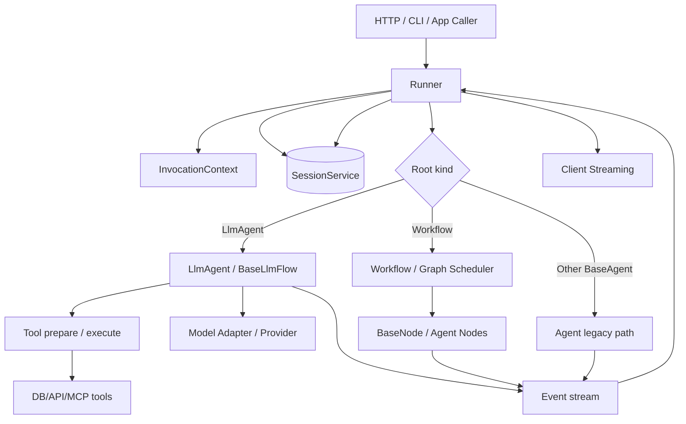
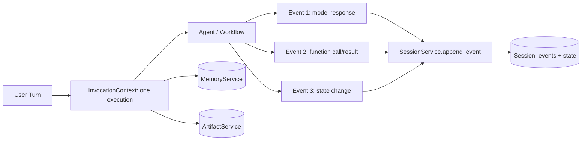
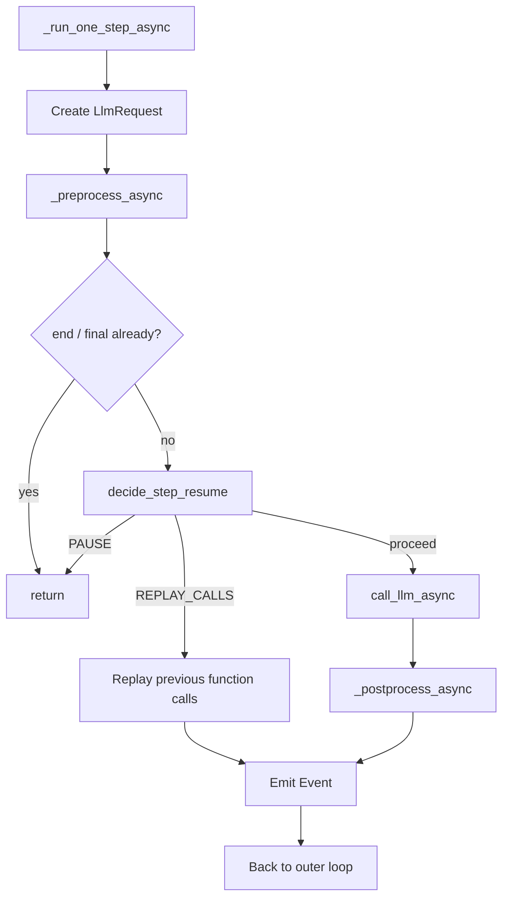
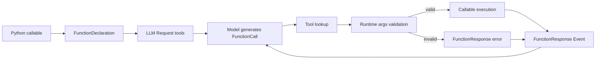
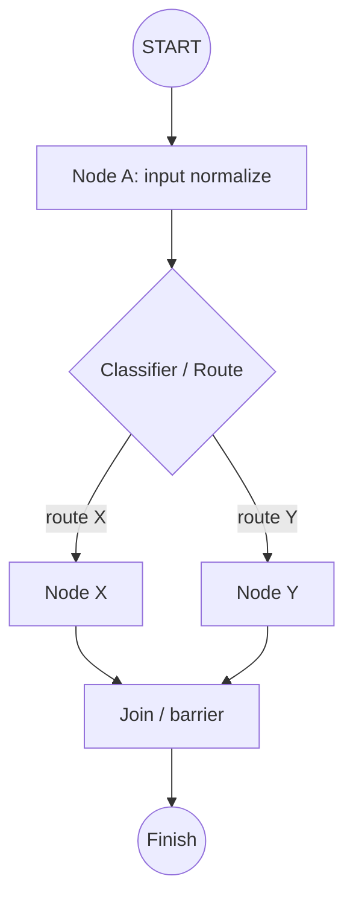
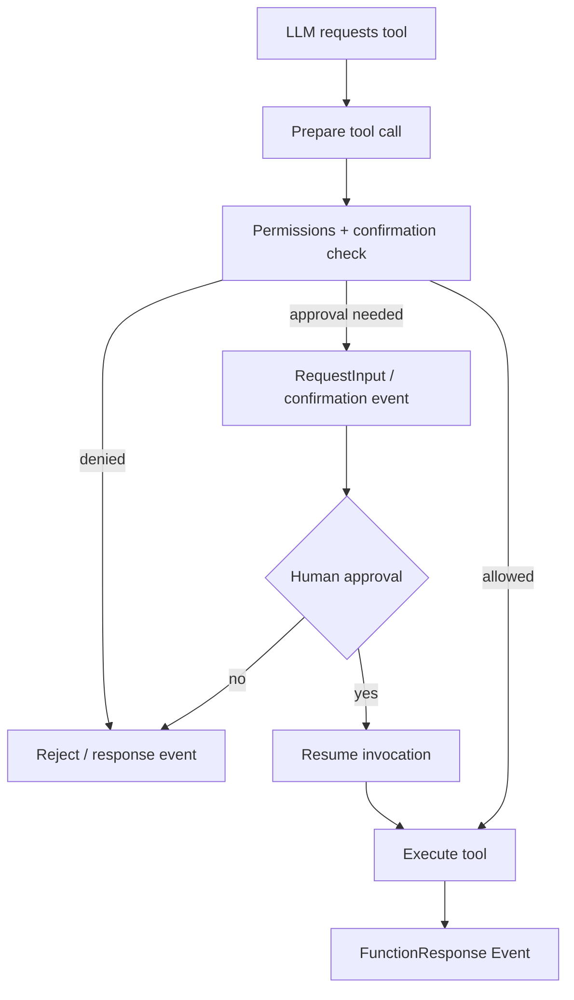

# Google ADK — 2차 심층 학습: 실행 엔진·이벤트·워크플로·소스코드 분석

> **대상:** Google Agent Development Kit(ADK) **Python v2.13.0**, Git tag [`v2.13.0`](https://github.com/google/adk-python/tree/v2.13.0)  
> **기준 시점:** 2026-10-31. 릴리스 변경 사항: [공식 Releases](https://github.com/google/adk-python/releases/tag/v2.13.0).  
> **목적:** ADK의 사용법을 넘어, 내부 루프/상태/동시성/승인/복구/설계 선택을 이해하고 **다른 Agent Framework와 코드 수준에서 비교·발표**할 수 있게 한다.  
> **제외:** 반도체 데모·실제 Agent 제작·모델 API 실행·부하/정확도 벤치마크. 아래 예제는 원리 설명과 코드 추적을 위한 것으로 실행 검증 결과가 아니다.  
> **근거 표기:** **[SRC]** v2.13.0 공개 소스 / **[DOC]** 공식 문서 / **[INF]** 근거에 기반한 설계 해석 / **[UNV]** 실측·추가 확인 필요. 소스 링크는 문서 끝의 인덱스에 모았다.

---

## 읽는 법: 1차와 2차의 차이

1차 학습에서 `LlmAgent`, `Runner`, `Session`, `Tool`, `Workflow`의 기능을 이해했다면, 여기서는 **실제로 어느 함수가 이벤트를 만들고 소비하는가, 누가 루프를 멈추는가, 무엇이 디스크에 남고 무엇은 남지 않는가**를 묻는다. 기능을 지원한다는 사실만으로 끝내지 않는다. 모든 장에서 **문제 → 코드 경로 → 상태/분기 → 기술적 이유 → 실패 모드 → 비교 포인트**를 따라간다.

### 2차 학습의 핵심 질문 18개

1. `Runner.run_async()`에서 루트가 `LlmAgent`, 기존 `BaseAgent`, 2.0 `Workflow`인 경우 서로 다른 실행 경로는 무엇인가?
2. 하나의 사용자 입력이 `Event`, `InvocationContext`, `Session`에 각각 어떻게 표현되는가?
3. LLM 호출 루프의 정확한 단위는 무엇이며, 종료 판정은 어떤 조건으로 이루어지는가?
4. 프롬프트는 어떤 Processor를 어떤 순서로 통과하고, 어느 단계에서 Tool 목록이 확정되는가?
5. 모델이 `FunctionCall` 여러 개를 내면 누가 조회·검증·실행·응답 병합을 수행하는가?
6. 병렬 Tool의 결과는 어떤 순서로 모델에 복귀하며, 중간 실패 시 이미 성공한 Tool은 어떻게 취급되는가?
7. `before_tool_callback`을 실행하는 지점은 준비 단계인가, 실행 단계인가?
8. `Event.is_final_response()`가 참이면 전체 애플리케이션 실행도 반드시 끝나는가?
9. `State`의 `temp:`, `user:`, `app:` 키는 무슨 수명주기를 가지는가?
10. Session History와 `MemoryService`의 검색 저장소는 어떻게 다른가?
11. Context Caching과 Context Compaction은 서로 무슨 정보를 재사용·소실시키는가?
12. `ParallelAgent`는 어느 Python 동시성 Primitive를 쓰고 Event를 어떻게 합치는가?
13. ADK 2.0 `Workflow`의 `Graph`, `BaseNode`, `Trigger`와 실행 상태는 어떤 관계인가?
14. HITL의 승인 대기는 Tool 호출 이전에 어떻게 만들어지며, 재개 시 무엇을 다시 실행하는가?
15. 실패·취소·Checkpoint 복원에서 외부 부작용은 중복 실행될 수 있는가?
16. Callback·Plugin·LLM 지침·Sandbox 중 어느 것이 진짜 실행 경계에서 강제되는가?
17. HTTP Serving·Streaming·Cancel·Cron 등은 SDK 내장인가, 별도 실행 인프라의 책임인가?
18. ADK와 Hermes/OpenAI Agents SDK/PydanticAI/MAF의 설계 철학이 어디에서 달라지는가?

### 증거 등급

| 표기 | 의미 | 해석 기준 |
|---|---|---|
| [SRC] | 버전 고정 공개 파일에서 함수와 조건 확인 | 경로·메서드·주요 분기를 인용 |
| [DOC] | 공식 사용자 문서·릴리스에서 확인 | 공개 API와 지원 범위 설명 |
| [INF] | 설계적 추론 또는 비교 평가 | 구현 사실처럼 단정하지 않음 |
| [UNV] | 코드를 실행하거나 시스템을 계측해야 판단 가능 | 성능·복구 성공률·전체 보안 보장은 주장하지 않음 |

## 목차

1. 분석 범위·프레임워크/SDK/Runtime 구분
2. v2.13.0 아키텍처와 1.x/2.x 경계
3. 실제 모듈 지도 및 고정 버전 소스 추적
4. Runner의 `run_async()` 진입과 분기
5. InvocationContext·Session·Event의 생명주기
6. LlmAgent → BaseLlmFlow의 호출 관계
7. Agent Loop 1 step의 내부 상태 전이와 종료 조건
8. Prompt Assembly·Processor Pipeline과 Tool 목록
9. 모델 호출·Streaming·오류·Budget
10. Tool Schema·Python 실행기의 경계
11. FunctionCall 준비·Callback·검증·응답 이벤트
12. 병렬 Tool 실행·ContextVars·취소·부분 성공
13. Event의 최종 응답 판정·State Delta 적용
14. Session Service·Memory Service·Artifact Service
15. Context Caching·Compression·Prompt 안정성
16. Sequential·Parallel·Loop Agent(레거시 패턴)
17. Multi-Agent 위임과 AgentTool·Task Mode·A2A
18. ADK 2.0 Graph Workflow의 Node·Edge·Scheduler
19. Workflow의 동시성·상태 전이·재시도·Checkpoint
20. Human-in-the-loop·확인·복원과 보안 경계
21. Plugins·Callbacks·Guardrails의 실제 위치
22. MCP·Skills·모델 제공자·외부 통합
23. Serving·Streaming·Cron·백그라운드 작업의 경계
24. 장애·Race Condition·부작용·재현성
25. 코드 추적 워크북(12개)
26. 여섯 개 다른 기술과의 비교 분석
27. 발표 구성(14장)·자가 점검 문제
28. 소스코드·공식 문서 인덱스

---

# Part I. 실행 엔진이 무엇을 책임지는가

## 1. ADK는 SDK인가, Framework인가, Harness인가?

**쉬운 설명:** `google-adk`는 Python 패키지로 설치하는 개발 도구이면서, Agent 실행 루프·도구·세션·워크플로·평가 관련 추상화를 제공하는 **프레임워크**다. SDK는 배포 형태, Framework는 제어 구조, Harness는 모델 주위 실행 환경과 정책의 역할을 강조하는 말이므로 배타적이지 않다. [DOC]

**정확한 설명:** ADK의 `LlmAgent`는 모델에 도구·지시문을 제공하고, `BaseLlmFlow`는 모델 요청·도구 결과의 반복을 조직하며, `Runner`는 외부 Session/Memory/Artifact 서비스와 이벤트 실행 수명주기를 이어 준다. `Workflow`는 LLM이 다음 단계를 자유롭게 결정하는 루프와 다른, 명시적인 그래프 오케스트레이션이다. **모델 추론 자체**는 Google GenAI 또는 어댑터 뒤의 외부 모델이 담당한다. [SRC: S01–S03, S10]



> **주의:** 개념도이며 모든 내부 Call Stack을 그대로 재현하지 않는다. 특히 v2.13.0의 LlmAgent 루트는 `Runner._run_node_async()` 경로를 사용하는 점이 중요하다. [S01]

### 프레임워크가 제공하지 않는 보장

- 모델 출력의 사실성, Tool 반환의 의미 정확성, 내부 권한 부여 정책, 물리적 프로세스 격리, 외부 API의 Exactly-once 처리를 자동 보장하지 않는다.
- SDK 기능이 있음과 모든 모델·Provider에서 완전히 동일하게 동작함은 다르다.
- Session/Memory 구현이 존재해도 영구 DB, 데이터 보존 정책, 보안 운영 설정은 별도로 필요하다.

## 2. 버전 경계: ADK 1.x와 2.13.0을 혼동하지 않기

**v2.13.0 릴리스**는 2026-10-22 날짜로 기록되며 PyPI 업로드는 2026-10-23로 표시된다. 이는 타임존·배포 시각 차이와 구별할 정보다. [R01]

핵심 이행은 다음 세 축이다.

| 이전에 익숙한 구조 | v2.13.0의 중요한 차이 | 조사 의미 |
|---|---|---|
| `LlmAgent` + `BaseLlmFlow` | 여전히 핵심 실행 경로 | Agent Loop 자체를 분석 |
| `SequentialAgent`·`ParallelAgent`·`LoopAgent` | 레거시 패턴 유지, `ParallelAgent`는 deprecated | 예제 가용성과 장기 API 방향 분리 |
| 새 `Workflow` | `BaseNode`, `Graph`, 실행 노드 상태, Event replay, checkpoint | 모델 자율 실행과 결정적 Workflow 구분 |
| `Runner(agent=...)` | `App`/`Node`의 호환·정규화 경로, 루트 유형별 분기 | 오래된 Runner 호출 설명을 그대로 사용하지 않음 |
| 과거 `functions.py` 중심 Tool 처리 | 실제 구현은 `flows/llm_flows/tools/` 내부 여러 파일로 분리 | 최신 함수 위치를 확인 |

[SRC] `ParallelAgent`의 deprecation 문구에는 Workflow가 아직 `LlmAgent`의 Subagent로 바로 사용되는 모든 상황을 대체하지 못한다는 제약도 기재되어 있다. 단순히 “대체 완료”로 설명하지 않는다. [S09]

## 3. 코드 맵: 파일마다 책임은 무엇인가?

| 역할 | 핵심 파일(v2.13.0) | 주요 추적 지점 |
|---|---|---|
| 외부 실행 | `src/google/adk/runners.py` | `Runner.run_async`, `_run_node_async`, `_process_and_append_event` |
| LLM Agent | `agents/llm_agent.py` | `_run_async_impl`, `_llm_flow`, `_run_impl` |
| LLM 반복 | `flows/llm_flows/base_llm_flow.py` | `run_async`, `_run_one_step_async` |
| Tool Batch | `flows/llm_flows/tools/_batch_executor.py` | `_prepare_function_calls`, `_gather_or_cancel`, `handle_function_call_list_async` |
| Tool 한 건 | `flows/llm_flows/tools/_caller.py` | `_prepare_single`, `_execute_single_prepared_call_async` |
| 함수형 Tool | `tools/function_tool.py` | `FunctionTool.run_async`, 스키마·타입 검증 |
| Event | `events/event.py` | `Event`, `is_final_response`, `NodeInfo` |
| 세션 저장 계약 | `sessions/base_session_service.py` | `append_event`, `temp:` 처리 |
| 구형 병렬 Agent | `agents/parallel_agent.py` | `_merge_agent_run`, `asyncio.TaskGroup` |
| Graph 데이터 | `workflow/_graph.py` | `Graph`, `Edge`, RoutingMap |
| Workflow 엔진 | `workflow/_workflow.py` | `_run_impl`, `_run_loop`, `_handle_completion`, `_emit_node_checkpoint` |
| Node 정규화 | `workflow/_base_node.py` | `BaseNode.run`, `_run_impl` |
| 실행 컨텍스트 | `agents/invocation_context.py` | Session/Plugin/Tool/Abort/Resume 참조 |

모든 경로는 [S01–S13]의 버전 고정 링크를 사용한다. 소스의 함수가 바뀌면 해당 Git tag를 바꿔 재검증해야 한다.

## 4. Runner.run_async(): 사용자 입력이 시스템 안으로 들어오는 순간

[SRC] `Runner.run_async()`는 `user_id`, `session_id`, `new_message`, `invocation_id`, `state_delta`, `run_config`, `abort_signal` 등을 받는다. **루트가 `LlmAgent`인지 `Workflow` 노드인지, 다른 `BaseAgent`인지**에 따라 실행 경로가 달라진다. [S01, `run_async`]

```text
Caller
  └─ Runner.run_async(user_id, session_id, new_message, ...)
        ├─ Root = LlmAgent → effective_mode(chat/task) 확인
        │        → Session 조회/생성 → _run_node_async(...)
        ├─ Root = BaseNode(not BaseAgent) → _run_node_async(...)
        └─ 기존 BaseAgent 경로 → InvocationContext 구성
                                 → plugin wrapper / event loop
```

특히 v2.13.0 코드에는 `LlmAgent` 루트에서 기본 `chat` mode를 결정하고, `task` mode의 완료 결과를 terminal event의 `output`으로 전달하는 구분이 나타난다. [SRC: S01]

### 실행 전 검증

- 입력 `Content`가 다른 role로 들어와도 `user` 역할로 정규화하는 로직이 있다.
- 사용자 메시지에 `function_call`을 직접 끼워 넣는 것을 거부하는 검사도 존재한다. 이는 사용자 메시지가 Tool 호출을 위조하지 못하게 하는 **입력 무결성 경계**다. [S01]
- 이미 존재하는 Session을 찾을지, 새로 생성할지는 `SessionService`/Runner 설정에 달려 있다.

### 새 Invocation과 Resume의 차이

| 새 요청 | Resume 요청 |
|---|---|
| 새 사용자 입력과 식별자로 Invocation 생성 | 기존 Session 이벤트에서 이어갈 Invocation 확인 |
| 유입 메시지 Event 기록 | 승인 응답·입력 재개 또는 기존 invocation ID 활용 |
| 현재 Flow 시작 | 복원된 Event/상태를 고려해 단계 진행 |
| 새 도구 실행 가능 | 이전 성공 작업의 재실행 여부를 반드시 확인해야 함 |

**설계 질문:** 서버 요청이 끊겨도 Session은 남을 수 있지만, Tool의 OS 프로세스나 외부 API 호출이 실제로 취소됐다는 보장은 별개다. 호출자 연결 종료/abort_signal/도구의 작업 취소 경계를 분리해서 설명한다.

## 5. InvocationContext·Session·Event를 분리해서 생각하기



| 객체 | 개념적 범위 | 소유·수명 | 주의점 |
|---|---|---|---|
| `InvocationContext` | 실행 1회에 필요한 서비스, 현재 agent, 식별자, abort/resume | Runner 실행 문맥 | 장기 메모리 그 자체 아님 |
| `Event` | 모델/도구/상태/그래프 실행의 한 기록·신호 | 생성 후 Runner/Session의 처리 | 모든 Event가 영구 저장되는 것은 아님 |
| `Session` | 동일 사용자 대화의 이력과 State | SessionService | 한 Session에 여러 Invocation 가능 |
| `MemoryService` | 여러 세션에 걸친 검색 저장소 | 별도 서비스 | Session 이벤트가 자동으로 전부 Memory에 색인된다고 가정하지 않음 |
| `ArtifactService` | 파일·이미지·바이너리 등 버전 있는 결과물 | 별도 서비스 | State의 값과 실제 파일을 구별 |

**핵심:** ADK에서 ‘메모리’를 하나의 Dictionary처럼 설명하면 구조를 놓친다. **대화 이력 저장, 현재 상태, 검색 인덱스, 파일 보관**의 책임이 다르다. [DOC: D03, D04]

# Part II. Agent Loop를 코드에서 읽기

## 6. LlmAgent는 Loop 소유자가 아니라 Flow 실행의 진입점이다

[SRC] `LlmAgent._run_async_impl(ctx)`는 준비된 상태를 읽고 `self._llm_flow.run_async(ctx)`가 반환하는 Event를 전달하는 경로를 가진다. 출력 State 저장, 스트리밍 결과 처리, pause 등 Agent 수준의 래핑 로직이 있다. **실제 `while` 반복은 `BaseLlmFlow.run_async()`**에 존재한다. [S02, S03]

```text
Runner → LlmAgent.run_async / BaseNode.run
                    ↓
          LlmAgent._run_async_impl
                    ↓
          BaseLlmFlow.run_async  ────────┐
                    ↓                   │
          _run_one_step_async           │
                    ↓                   │
          model request/response        │
                    ↓                   │
          postprocess + Tools           │
                    ↓                   │
        마지막 이벤트 조건 판정 ──────→ 반복/종료
```

**주의:** LlmAgent를 `Workflow` 내 노드로 사용할 때는 `_run_impl` 및 `workflow/_llm_agent_wrapper.py` 경로가 개입한다. 동일 Agent가 호출 환경에 따라 달리 감싸질 수 있음을 구분한다. [S02]

## 7. `BaseLlmFlow.run_async`: 반복과 종료의 실제 조건

[SRC: S03, 약 264–285행]의 핵심을 **의사코드**로 재구성:

```python
# 교육용 의사코드: 실제 원본 복제 아님
while True:
    if ctx.is_aborted is True:
        break
    last_event = None
    async for event in one_llm_step(ctx):
        last_event = event
        yield event
        if ctx.is_aborted is True:
            break
    if ctx.is_aborted is True:
        break
    if last_event is None or last_event.is_final_response() or last_event.partial:
        break
```

### 이 로직에서 무엇을 배워야 하나?

1. **모델을 한 번 호출했다고 Agent 작업이 종료되는 것이 아니다.** Tool 호출이 반환되면 다음 모델 요청이 필요할 수 있다.
2. 마지막 Event가 최종 응답인지 `is_final_response()`로 판단한다. `FunctionCall`만 있는 Event는 일반적으로 최종이 아니다.
3. Abort는 루프 앞/이벤트 전달 중/루프 끝에서 확인해 지연을 줄인다.
4. 마지막 이벤트가 예상 밖의 `partial`이면 경고하고 종료한다. 즉 Streaming 단편 상태까지 판단에 들어간다.
5. 이 루프만으로 무한 실행이 절대 불가능한 것은 아니다. 최대 LLM 호출 수, 애플리케이션 예산, 시간 제한을 별도로 고려해야 한다.

### 종료 상태 매트릭스

| 상황 | 일반적인 경로 | 설명 |
|---|---|---|
| 일반 텍스트 완성 | final Event → break | 사용자에게 보일 최종 응답 |
| Function Call 요청 | Tool → FunctionResponse → 다음 LLM step | 아직 사고/행동 연속 |
| `ctx.is_aborted` | Loop 중단 | 외부 작업 취소는 별도 확인 |
| step이 Event를 생성하지 않음 | `last_event is None` → 종료 | 계속할 근거가 없음 |
| 마지막이 partial | 경고 후 종료 | 정상적인 완료 신호와 구분 |
| HITL·Workflow interrupt | 별도 재개/중단 로직 | 단순 최종 텍스트 종료와 다름 |
| 모델/Tool 오류 | 정책에 따라 Event/예외/Retry | 모두 같은 종류의 Retry가 아님 |

## 8. `_run_one_step_async`: 모델 호출 1회의 실제 단계

[SRC] 이 함수는 주석에서 한 step을 **하나의 LLM 호출**이라고 정의한다. 일반 경로는 아래와 같다. [S03, 약 306–370행]

1. `LlmRequest()` 생성.
2. `_preprocess_async`로 이전 대화, 지시문, Tool, 동적 요청 등을 조립.
3. 전처리 과정에서 Invocation을 끝내거나 이미 처리된 최종 응답이 있으면 중단.
4. `decide_step_resume`으로 `PAUSE`, `REPLAY_CALLS`, 정상 모델 호출을 분기.
5. 필요할 때 `_call_llm_async`로 Model Adapter 호출.
6. `_postprocess_async`에서 Callback, 모델 출력, Function Call, Tool Result 등을 Event로 변환.
7. Event yield 후 다음 Loop로 복귀.



**심층 포인트:** 재개 시 항상 모델을 다시 부르는 것이 아니라 기존 Function Call을 재생하는 경로가 있다. 하지만 “Replay = 외부 부작용을 전혀 반복하지 않음”이라고 단정해서는 안 된다. 실제 복원 경계와 Tool의 멱등성을 함께 확인해야 한다.

## 9. 최종 모델 입력은 단순한 `instruction + history`가 아니다

[SRC] `BaseLlmFlow.__init__`는 `request_processors`, `tool_request_processors`, `response_processors`를 구분한다. Tool 목록이 아직 준비되지 않은 초기 처리기와, Toolset 인증·도구 resolve·동적 Instruction 등 Tool 확정 이후 처리기의 순서가 중요하다. [S03, 약 86–113행]

```text
Session/State + current input
  → Request processors (history, cache/compaction 등 구성된 단계)
  → Tool request processors
       · toolset auth
       · agent tools resolve
       · dynamic instructions
  → LlmRequest (contents / config / tools)
  → Model Adapter request
  → Response processors + Tool postprocessing
```

**주의:** 이것은 처리기 그룹의 흐름이고, 전처리기 전체의 정확한 등록 순서는 `AutoFlow` 또는 `SingleFlow`의 생성 코드를 추가 확인해야 한다. 임의로 ‘항상 동일한 문자열 순서’라고 주장하면 안 된다. 모델에 전달되는 **최종 요청 객체**와 내부 Instruction 템플릿, Tool Declaration, 세션 기록은 서로 별도 필드로 표현될 수 있다.

### Prompt Prefix Cache를 생각할 때

- 큰 공통 Instruction/Tool Schema를 반복 요청에 재사용하려면 Provider의 캐시 정책, 같은 Prefix, 토큰 한도, TTL 등이 충족되어야 한다.
- 사용자의 세션 기록이 길어져도 자주 바뀌는 부분을 뒤쪽에 두는 편이 Prefix 재사용에 유리할 수 있다. **단 실제 ADK 요청 빌더가 정확히 어떤 정렬을 보장하는지와 Provider의 Cache Key를 구분해야 한다.**
- Model Context Caching과 Session 저장, 응답 캐시, Compaction은 서로 다른 기술이다.

## 10. 모델 호출·Streaming·예산·오류 경로

[SRC] `flows/llm_flows/core/_model_call.py`를 따라 Model Resolution → Request → SDK 호출 → 응답 처리 흐름을 분석한다. `BaseLlmFlow._call_llm_async()`는 그 함수로 위임하는 얇은 메서드이다. [S03, S14]

검토해야 할 항목은 다음과 같다.

| 영역 | 소스에서 찾을 것 | 주의할 질문 |
|---|---|---|
| 모델 선택 | `LlmAgent.canonical_model_async()` 및 Model Adapter | Dynamic model 교체/Provider 호환성 |
| 호출 예산 | `RunConfig` 및 LLM 호출 상한 | 상한이 전체 Workflow/모델 시도/재시도 중 어디에 적용되는가 |
| Streaming | Partial Event와 Complete Event 구분 | UI 연결을 닫으면 실행이 취소되는가 |
| 오류 | 모델 API/HTTP/timeout/empty response의 분기 | 에러를 최종 Event로 바꿀지 예외 전파할지 |
| 중단 | `abort_signal`, `ctx.is_aborted` | 자식 Tool도 실제 중단하는가 |
| 관찰성 | OpenTelemetry, Plugin Hooks | 민감한 Prompt/Tool Result가 노출되는가 |

[D08]의 `max_llm_calls` 및 관련 런타임 설정은 버전에 따라 기본값·예외가 있을 수 있다. 문서의 숫자만 보지 말고 고정 버전 타입과 실행 경로를 함께 확인해야 한다.

---
# Part III. Tool 실행기는 어떻게 작동하는가

## 11. FunctionTool: Python 함수가 모델 Tool이 되는 과정

Tool 호출은 세 단계로 구분해야 한다.

1. **등록/노출:** Python callable의 signature·docstring·타입 힌트에서 모델이 볼 FunctionDeclaration/JSON Schema를 만든다.
2. **모델 선택:** LLM이 스키마를 읽고 함수명·인자를 생성한다. 모델은 Tool 코드를 직접 실행하지 않는다.
3. **실행:** Framework가 함수명을 Tool 레지스트리에서 찾고 실제 Python 코드를 호출한 다음 `FunctionResponse`를 모델에 돌려준다.

[SRC] `tools/function_tool.py`의 `FunctionTool`은 함수 선언을 캐시하는 `_build_declaration_cached`와 `run_async`를 제공한다. `run_async`는 타입/구조 검증 결과가 잘못됐으면 오류 응답을 반환하며 실제 도구를 호출하지 않는다. 필요한 인자가 누락된 경우도 오류로 반환해 모델이 재시도할 기회를 얻는다. [S06]



**핵심 차이:** 스키마를 모델에 제공하는 것과 Runtime 입력 검증은 별개다. JSON Schema가 있어도 모델이 늘 올바르게 호출한다는 보장은 없다. 또 입력 타입이 맞는다고 DB 조회 권한이나 데이터의 의미가 맞는 것도 아니다.

### Tool 생명주기를 검사하는 질문

- 동기 함수는 스레드로 오프로드되는가, 아니면 이벤트 루프를 차단하는가? `utils/_sync_runner.py`의 `_invoke_callable` 경로를 확인해야 한다.
- 함수가 Python 객체·Pydantic Model을 반환하면 FunctionResponse에 어떻게 직렬화되는가?
- `ToolContext`는 사용자 신원을 어떻게 전달하며, 그 신원이 신뢰할 수 있는 인증 결과인지 누가 보증하는가?
- `FunctionTool`의 Python 내부 검증과 MCP 서버의 별도 검증이 일치하는가?
- 대형 Tool 결과가 Context Window를 넘으면 어느 단계에서 자르는가?

## 12. FunctionCall 리스트 처리: 준비와 실행을 분리한다

[SRC] v2.13.0에서 Tool 실행의 핵심 경로는 다음과 같다. [S04, S05]

```text
LLM response: FunctionCall[1..N]
    └─ handle_function_call_list_async()
         ├─ _prepare_function_calls()
         │     └─ _prepare_single() × N
         │           · FunctionCall args deep copy
         │           · function_name → Tool lookup
         │           · independent ToolContext 생성
         │           · ContextVars snapshot 저장
         │           · Tool 미발견 오류는 준비 결과에 보관
         └─ _execute_prepared_function_calls_async()
               └─ _execute_single_prepared_call_async() × N
                     · before_tool Plugin/Callbacks
                     · authorization / confirmation gate
                     · actual BaseTool.run_async
                     · after_tool callbacks / errors
                     · FunctionResponse Event 생성
```

**중요한 구현 사실:** `_prepare_single` 자체는 **before-tool callback이나 Tool 본체를 실행하지 않는다.** 그 콜백은 실행 단계에 함께 배치된다. 준비 단계에서 모든 콜백을 먼저 수행하면 이벤트 루프가 비차단인 Tool부터 순서대로 끝나는 특성과 결과 타이밍이 달라질 수 있기 때문이다. [SRC: S05, `_prepare_single` 설명]

### 존재하지 않는 Tool을 모델이 호출하면?

일반적으로 lookup 오류를 처리한다. 단 v2.13.0 `_prepare_single`은 곧바로 외부 실행을 시도하지 않고 오류를 기록하며, **before-tool callback이 해당 호출에 응답을 제공할 기회**를 유지한다. 이 점은 단순 `raise KeyError` 방식과 차이가 있다. [S05]

### `before_tool_callback`과 `after_tool_callback`의 의미

| 종류 | 개입 시점 | 가능한 활용 | 실수하기 쉬운 점 |
|---|---|---|---|
| Before Tool | 실제 Tool 실행 전 | 차단, 결과 대체, 감사 로그, 파라미터 점검 | callback이 곧 Sandbox는 아님 |
| Tool 본체 | 등록한 callable/MCP 실행 | 외부 API, DB, 계산 | 실제 권한은 해당 Tool 실행 자격증명이 결정 |
| After Tool | Tool 결과 생성 후 | 후처리·필터링·마스킹 | 이미 발생한 외부 부작용을 취소하지 못함 |
| Error Callback | Tool 또는 실행 오류 경로 | 복구용 결과·재시도 정책 | 예외를 무조건 삼키면 고장 원인 은폐 |

[DOC] v2.12.0 릴리스에서 `after_tool_callback`을 통해 모델에 돌려주기 전에 Tool 출력을 필터링하는 기능이 명시되었다. **출력을 필터링한다고 이전에 이미 수행된 데이터 조회가 되돌아가는 것은 아니다.** [R02]

## 13. 병렬 Tool Calling의 실제 동시성 구현

[SRC] `tools/_batch_executor.py`에서 두 단계 모두 `asyncio` 기반 Task를 만든다. 준비 단계는 `asyncio.create_task`와 `_gather_or_cancel`, 실행 단계는 준비된 호출 각각을 Task로 구성한 뒤 같은 취소·정리 유틸리티를 사용한다. [S04]

```python
# 교육용 의사코드 (실제 소스 구조를 요약한 예시)
prepared = await gather_or_cancel([
    create_task(prepare_one(call)) for call in function_calls
])
results = await gather_or_cancel([
    start_in_copied_context(execute_one(item)) for item in prepared
])
return merge_response_events(results)
```

**병렬성 ≠ 항상 CPU 병렬 연산.** 여러 I/O 작업은 Asyncio 이벤트 루프에서 대기 시간을 겹칠 수 있지만 CPU-bound Python 코드는 별도의 Process/Thread 전략 없이는 GIL과 CPU 부하에 영향을 받는다. Tool이 비동기 함수인지, 동기 래퍼가 Thread를 쓰는지, 모델 Provider가 동시 호출을 지원하는지 별도로 분석해야 한다.

### ContextVars 복제의 이유

[SRC] 준비 결과에는 `contextvars.copy_context()` 스냅샷이 포함되고, 실행 Task는 그 스냅샷을 기반으로 시작하도록 구현된다. 이는 Tool A의 실행 문맥 변경이 Tool B의 문맥으로 뜻밖에 흘러가는 문제를 줄이기 위한 분리다. **다만 별도 ToolContext를 갖는 것과 외부 DB에서 서로 충돌하는 쿼리/수정을 막는 것은 전혀 다르다.** [S04, S05]

### 병렬 Tool 중 하나가 실패한다면

[SRC] `_gather_or_cancel`은 `asyncio.gather`를 기다리다가 예외나 취소가 발생하면 아직 실행 중인 Task에 취소를 요청하고, 이후 남은 Task들의 완료/예외를 회수한다. `GeneratorExit`도 별도 처리한다. [S04]

[SRC] `_execute_prepared_function_calls`는 실패 시 **이미 끝난 일부 Tool의 실제 성공 응답을 보존**할 수 있다. 그러나 모든 Event를 그대로 재사용하지는 않는다. ‘단순 Tool 결과’로 분류할 수 있는 응답만 별도 `kept_event`에 남기고, 제어 흐름을 변경하는 승인·이관·escalation 신호 등은 제외하는 경로가 있다. [S04]

```text
Tool A: 50ms → Success / DB write completed ─┐
Tool B: 80ms → Raises exception ───────────────┼─► cancel Tool C
Tool C: 300ms → Cancel requested ─────────────┘
                        |
             preserve eligible completed A
                        |
                 error propagation
```

**설계적 결론 [INF]:** 성공한 결과 이벤트를 보존한다는 사실은 외부 Tool 작업의 Transaction/Exactly-once를 보장하지 않는다. 이미 끝난 Tool의 DB 수정은 프레임워크가 되돌릴 수 없다. 네트워크 요청 취소가 실제 서버 처리를 중단시키지도 못할 수 있다.

### 실패 모델별 비교

| 상황 | 구현상 관찰할 지점 | 애플리케이션이 보완할 것 |
|---|---|---|
| 여러 조회가 동시 실행 | `_batch_executor`의 Task 생성 | 읽기 전용 권한/부하 제한 |
| Tool 하나 예외 | `_gather_or_cancel` | 실패 시 유실·중복 결과 식별 |
| Tool은 성공했지만 응답 전송 실패 | `FunctionResponse` Event의 저장 여부 | 멱등 Key·작업 원장 |
| Tool 하나가 서버 내부에서 실행 계속 | Python Task 취소만으로 보장 불가 | 외부 작업 상태 확인·타임아웃 |
| 두 Tool이 같은 State Key 수정 | 병렬 결과/Delta 병합 | 충돌 규칙, 직렬화 또는 분리 |
| 사용자 연결 중단 | `abort_signal` 및 Task cleanup | 백그라운드 실행 정책 분리 |

## 14. 병렬 Tool과 병렬 Agent는 같은 것이 아니다

| 항목 | 병렬 Tool Calling | 병렬 Agent |
|---|---|---|
| LLM 호출 | 하나의 모델 응답이 N개 Tool 요청 | 여러 하위 Agent가 독립적인 모델 실행 가능 |
| 동시성 단위 | Tool 실행 Task | Agent의 AsyncGenerator 실행 Task |
| 공유 상태 | 보통 동일 Invocation의 Tool 결과를 합침 | Agent Branch Context를 별도로 구성 |
| 출력 합치기 | FunctionResponse Events 병합 | 여러 Agent의 Event Stream 병합 |
| 실패·취소 | 한 Tool 실패 시 형제 Task 취소 | Branch 하나 실패/에스컬레이션 시 나머지 중단 가능 |
| 비용 | 주로 외부 Tool 비용 | 하위 Agent의 추가 모델 호출 비용 포함 |

**발표 핵심 문장:** 병렬 Tool은 *같은 모델 판단의 여러 함수 실행*이고, 병렬 Agent는 *여러 독립 실행 흐름을 동시에 굴리는 것*이다.

# Part IV. 이벤트와 상태 저장의 실제 의미

## 15. `Event.is_final_response()`의 정밀한 정의

[SRC] `events/event.py`의 `is_final_response()`는 단순히 `finish_reason == stop`을 검사하지 않는다. 대략 다음을 판별한다. [S07]

- 명시된 summarization skip/long-running tool 표시가 있을 때는 최종 응답으로 취급하는 경우가 있다.
- 오류 코드가 존재하고 Partial도 아니며 Function Call이 없으면 완결된 Event로 취급하는 분기가 있다.
- 일반적으로 **Function Call·Function Response가 없고, Partial이 아니며, 뒤에 미완결 코드 실행 결과가 없을 때** 최종 응답이다.
- **하나의 Invocation 안에서 참여 Agent마다 `is_final_response() == True`인 Event가 존재할 수 있다.** 이것은 애플리케이션의 모든 하위 작업이 끝났다는 뜻과 다르다.

```python
# 교육용 판정 의사코드
if skip_summarization or long_running_tool_ids:
    return True
if completed_error_event_without_function_call:
    return True
return no_function_calls_and_no_function_responses_and_not_partial_and_no_trailing_code_result
```

### Event와 Workflow의 종료를 혼동하면 생기는 문제

UI에서 어느 하위 Agent의 final Event만 보고 전체 Workflow를 완료로 표시한다면, 뒤에서 실행 중인 다른 Branch가 누락될 수 있다. 따라서 **Agent 관점의 final, Workflow 노드 완료, Invocation 완료**를 별도 상태로 관리해야 한다. [SRC/INF]

## 16. `SessionService.append_event`: 영구 저장과 일시 상태의 경계

[SRC] `BaseSessionService.append_event(session, event)`의 핵심 분기에는 다음이 있다. [S08]

```python
# 교육용 의사코드
if event.partial:
    return event  # partial 조각은 이 기본 구현의 Session append 대상 아님
apply_temp_state_in_memory(session, event)
event = strip_temp_keys_from_event_delta(event)
update_session_state(session, event)
session.events.append(event)
return event
```

**이 코드는 특히 중요하다.** `temp:` 키는 다음 Agent가 같은 Invocation 동안 읽을 수 있도록 메모리상의 Session State에 먼저 반영하지만, Event의 State Delta에서 제거하여 장기 저장을 막는다. 따라서 다음을 구분한다.

| 자료 | 어디에 보이는가 | 기본 수명 | 핵심 오해 |
|---|---|---|---|
| Partial Streaming 조각 | UI/스트림 | 일시적 | 모든 토큰이 Event DB에 그대로 쌓인다고 가정 |
| 비부분 Event | Session Event 목록 | SessionService 백엔드에 따라 지속 | Event 하나 = 사용자 발화 하나가 아님 |
| `temp:` State | 현재 실행 중 인메모리 상태 | Invocation 범위 중심 | 영구 DB에 모두 저장된다고 가정 |
| Session-level State | Session 저장/복원 | 설정에 따라 지속 | 모든 State Key가 모든 사용자에게 공유된다고 가정 |
| `user:` / `app:` State | 사용자/앱 범위 의미 | 서비스별 구현에 의존 | 멀티 테넌트 인증·격리 자동 보장으로 오해 |

[D03]에는 State Prefix의 범위가 안내되어 있다. 코드 분석 시 `State`와 각 DB-backed SessionService가 scope별 값을 어떻게 쓰고 읽는지도 함께 확인한다.

### Concurrent Session update / Stale Session

[SRC] `BaseSessionService.append_event` 인터페이스에는 저장된 Revision보다 오래된 Session으로 쓰기를 시도할 때 `StaleSessionError`를 낼 수 있다는 설명이 있다. 이는 **동일 Session에 여러 Runner가 동시에 쓰는 상황이 본질적인 동시성 문제**임을 드러낸다. [S08]

[INF] 대규모 Serving에서는 사용자 요청 단위가 별개라고 Session 쓰기도 독립적인 것은 아니다. 동일 Session에 대한 Lock/Optimistic Revision/Conflict Retry 정책을 구현 서비스와 함께 확인해야 한다. 마지막 쓰기가 무조건 승리하는 구조라면 일부 State가 소실될 수 있다.

## 17. State / Memory / Artifact / Context의 정확한 차이

| 컴포넌트 | 저장 대상 | 검색/조회 | 모델 입력으로 들어가는 방식 |
|---|---|---|---|
| Session Events | 모델/Tool/사용자 상호작용 이력 | SessionService | History Processor가 선택/가공한 부분 |
| Session State | 업무 진행 상태·구조화 키값 | 특정 scope key 읽기 | Instruction/Tool/Context에서 참조할 때 |
| MemoryService | 세션 밖 검색 가능한 장기 기록 | `search_memory` 계열 | Tool/Memory 프로세서가 검색 결과를 넣을 때 |
| ArtifactService | 파일·바이너리·중간 산출물 | Artifact ID/버전 | Tool로 읽거나 결과를 Content에 주입할 때 |
| Compaction Summary | 과거 대화의 압축 표현 | Session events/compaction | 오래된 Raw Events 일부 대체 |
| Context Cache | 모델 제공자 측 계산 재사용 | Provider의 캐시 API/정책 | 캐시 참조 또는 캐시된 프롬프트 부분 활용 |

**매우 중요한 원칙:** MemoryService가 존재한다고 과거 모든 Session이 자동으로 저장·검색·삽입되는 것은 아니다. 앱이 언제 `add_session_to_memory` 같은 경로로 기억을 넣고, 어떤 검색 Tool이 실제 호출되는지 확인해야 한다. [D04]

## 18. 왜 파일 기반이 아니라 Service Interface인가?

[SRC/DOC] ADK의 Session/Memory/Artifact는 공통 인터페이스와 구현체를 제공하는 형태다. 이 설계 덕분에 InMemory, DB, 클라우드 서비스 등 실행 환경을 바꿀 수 있다. [S08, D04]

**장점 [INF]:** 애플리케이션은 기록을 *어디에 저장하는지*와 Agent 실행을 분리할 수 있다. 로컬 학습 환경을 Enterprise DB로 옮길 때 Loop 코드 자체를 최소한으로 유지할 수 있다.

**단점 [INF]:** 인터페이스가 같아도 구현마다 일관성, 저장 지연, TTL, 검색 알고리즘, 테넌트 격리 보장의 수준이 다르다. 특히 InMemory가 데이터베이스 ACID 동작이나 재시작 후 복구를 대표하지 못한다.

# Part V. 실제 Context/Cache/Memory 동작을 이해하기

## 19. Prefix Caching: 같은 Prompt를 보내는데 왜 절약되는가?

**기초:** 모델에 동일한 Prefix 토큰을 다시 전송하더라도, Provider가 이전 Prefix 계산 결과를 저장해 재사용한다면 모든 토큰에 대한 내부 Attention/KV 관련 계산을 새로 할 필요가 없을 수 있다. **입력 요청에 동일 데이터가 들어간다**는 사실과 **모델이 처음부터 다시 계산한다**는 사실은 다르다.

| 경우 | 요청에 들어가는 데이터 | 가능한 계산/요금 처리 |
|---|---|---|
| 캐싱 없음 | 매 호출 전체 Prefix+Suffix | 전량 새 계산/청구 |
| 캐시 일치 | Prefix는 같고 최근 질문만 변경 | 재사용 가능한 Prefix 계산 절약 |
| 캐시 깨짐 | Prefix의 앞부분부터 달라짐 | 일치하는 구간 축소·재생성 가능 |
| 캐시 TTL 만료 | 텍스트가 같더라도 캐시 객체는 없음 | 다시 캐시 생성 필요 |
| Context Compaction 발생 | 과거 메시지가 요약으로 대체 | Prefix가 상당 부분 변경될 수 있음 |

[DOC] ADK는 `ContextCacheConfig`로 모델의 Context Caching 설정을 관리하며, `min_tokens`, `ttl_seconds`, `cache_intervals` 등의 정책을 문서화한다. 이는 MemoryService나 일반 응답 캐시와 다른 기능이다. [D05]

### Prefix가 ‘깨진다’는 의미

- 기존 고정 Instruction과 Tool Schema **앞부분**의 문자열·필드·순서가 바뀌면 동일 Prefix 길이가 줄어들 수 있다.
- 대화 요약, 동적 Instruction, Tool 목록 변경은 최종 요청을 바꾸므로 Cache Hit에 영향을 줄 수 있다.
- Provider의 실제 캐시 키·Token Count·모델 이름·세부 옵션이 무엇인지는 해당 Provider 스펙 및 실행 Trace로 확인해야 한다.
- `ContextCacheConfig`가 설정되어 있다고 **모든 호출에서 Cache Hit가 발생한다는 보장은 없다**.

## 20. Context Compaction: 무엇을 버리고 무엇을 남기는가?

[DOC] `EventsCompactionConfig`는 오래된 Session History를 요약 또는 줄이는 전략을 제공하며, 토큰 임계값 기반과 일정 Invocation 간격 기반을 설명한다. 최근 이벤트는 Raw 형태로 남겨 참조성을 유지할 수 있다. [D06]

[SRC] Runner에는 Invocation 종료 이후 best-effort Compaction을 수행하는 `_run_post_invocation_compaction` 경로가 있으며, 동시에 업데이트된 Session 때문에 과거 요약이 현재 정보를 덮어쓰지 않도록 확인하는 로직이 존재한다. [S01]

```text
Session: E1..E100
         ├─ 오래된 E1..E85 → summary/compaction event
         └─ 최근 E86..E100 → raw retained history
                   ↓
           Next model request context
```

**핵심 주의:** 위는 설명용 시나리오이며 `85/15`를 ADK 기본 설정으로 주장하는 것이 아니다. 컴팩션은 Token Budget을 줄일 수 있지만, 세부 수치·Tool 결과·예외 상황·승인 근거가 요약에서 누락될 수 있다. **압축된 요약은 이전 이력의 완전한 재현본이 아니다.**

### 캐싱과 압축의 Trade-off

| 목표 | 캐싱에 유리한 전략 | 압축에 유리한 전략 | 충돌 가능성 |
|---|---|---|---|
| 공통 규칙 재사용 | 앞부분 고정·동일 정책 | 변경 최소화 | 동적 Instruction 삽입 시 캐시 부분 감소 |
| 긴 대화 비용 절감 | 안정된 Prefix 재사용 | 오래된 History 요약 | 요약이 Prefix 재사용을 방해 가능 |
| 정확한 과거 기록 | Raw Event 보관 | 추출한 핵심 정보 유지 | 누락·왜곡 위험 |
| 실행 재현성 | Cache Hit 여부 로깅 | Compaction 버전 추적 | 동일 원문 복원 불가 가능 |

## 21. Retrieval / RAG / MemoryService의 선택

“ADK는 RAG를 하나만 사용한다”는 설명은 부정확하다. ADK는 MemoryService를 통해 대화 장기 기억을 검색할 수도 있고, MCP/Vector DB/API Tool을 통해 문서를 검색할 수도 있다. 과거 Session 원문 검색, LLM이 추출한 장기 Memory, 도메인 문서 Vector Search는 서로 다르다. [D04]

| 검색 기법 | 장점 | 약점 | 평가 관점 |
|---|---|---|---|
| InMemory 키워드 검색 | 간단·설치 쉬움 | 동의어·의미 매칭 취약 | Recall, 속도 |
| Vector Search | 의미 유사 문서 검색 | Exact ID/수치 조건이 약할 수 있음 | Grounding, 오탐 |
| BM25/FTS | 정확 키워드·기술 용어 | 표현이 다르면 누락 | 키워드 일치 |
| Hybrid Search | 키워드+의미 균형 | 시스템 복잡도와 튜닝 | Recall/Precision |
| 구조화 DB Tool | 필터·집계·추적 가능 | 스키마/권한 설계 필요 | 계산 정확성 |

**설계적 결론:** 검색 방식은 도메인 데이터의 특성에 따라 선택할 문제이고, 프레임워크가 제공하는 Memory 인터페이스의 존재만으로 특정 검색 알고리즘이 강제되는 것은 아니다.

---
# Part VI. Multi-Agent와 명시적 Workflow

## 22. 기존 Template Workflow는 어떤 구조였나?

ADK가 초기에 제시한 대표 패턴은 세 가지다.

- **SequentialAgent:** Subagent를 순서대로 실행한다. 앞 단계의 `output_key` 등을 State로 넘기는 구조를 활용할 수 있다.
- **ParallelAgent:** 여러 Subagent를 별도 Branch로 동시에 실행하고 Event를 합친다.
- **LoopAgent:** 종료·반복 조건에 따라 Subagent 실행을 되풀이한다.

이들은 **LLM이 그때그때 다음 실행 경로를 자유롭게 결정하는 '자율 에이전트' 자체가 아니라 실행 패턴을 고정한 조정자**다. 구성요소가 Agent라는 점과 Workflow 제어 흐름을 갖는다는 점을 동시에 가진다.

### `ParallelAgent`의 실체

[SRC] `agents/parallel_agent.py`의 `_create_branch_ctx_for_sub_agent`는 부모 `InvocationContext`를 복사하고 Subagent마다 Branch를 만든다. `_merge_agent_run`은 `asyncio.TaskGroup` 및 `asyncio.Queue`로 여러 Event 스트림을 합친다. [S09]

```text
ParallelAgent
 ├─ branch A: sub-agent A → Event A1 ─┐
 ├─ branch B: sub-agent B → Event B1 ─┼─> queue → parent event stream
 └─ branch C: sub-agent C → Event C1 ─┘
```

병렬 Tool의 `asyncio.gather`와 달리, ParallelAgent는 **Agent마다 여러 이벤트를 시간에 따라 계속 생성하는 AsyncGenerator**들을 합쳐야 한다. 따라서 각 Branch에서 나온 Event를 Queue에 넣고, 부모가 소비했다는 Ack(`asyncio.Event`)를 기다리는 구조가 있다. [S09]

이 Ack가 중요한 이유는 하위 Generator가 상위 소비자의 속도를 무시하고 무한히 Event를 생산하지 않도록 **생산자-소비자 사이의 Backpressure**를 형성하기 때문이다. `asyncio.TaskGroup`은 Branch 중 하나가 실패하거나 escalation이 발생했을 때 다른 Branch를 취소하고 오류를 다시 전파하는 데도 관여한다.

### `ParallelAgent`의 deprecated 주의

[SRC] v2.13.0 소스에서 `ParallelAgent`는 Workflow로 전환할 것을 권하는 deprecated 데코레이터를 갖는다. **하지만 Workflow를 `LlmAgent`의 Subagent로 바로 모든 경우에 넣을 수 있는 것은 아직 아니라는 제한**도 명시되어 있다. 장기 유지보수에선 신규 Graph Workflow를 우선 분석하되, 이전 템플릿 실행 경로를 버려선 안 된다. [S09]

## 23. Multi-Agent Delegation: AgentTool·Transfer·Task Mode

Multi-Agent는 'Agent가 여러 개 존재한다'만으로 구별하기 어렵다. 최소 다음 세 가지를 나눠야 한다.

| 방식 | 흐름 제어 | 반환 형태 | 핵심 조사 대상 |
|---|---|---|---|
| Subagent Transfer | 현재 모델이 다른 Agent로 제어권 이전 | 새 Agent의 Event Stream | Transfer Event와 Agent routing |
| Agent as Tool / `AgentTool` | 부모 모델이 하위 Agent를 Tool처럼 호출 | Tool Result로 반환 | 독립 실행·상태 격리·비용 |
| Graph Workflow 노드 | 개발자가 Edge로 실행 경로 명시 | Node Output/Event | Scheduler·Trigger·Checkpoint |

**서로 다른 질문:** 하위 Agent를 호출했을 때 부모 컨텍스트를 얼마나 공유하는가, 하위 응답을 통째로 상위에 전달하는가, 부모가 최종 응답 생성 권한을 유지하는가, 실패 시 재시작하는 단위는 무엇인가?

[SRC] v2.13.0의 루트 `LlmAgent`는 `chat`와 `task` mode를 구분하고, Task Mode는 `finish_task` 도구 완료 결과를 terminal Event의 `output`으로 보내는 경로가 있다. 다만 이것이 병렬 Agent 구현이나 A2A 통신과 동의어는 아니다. [S01]

### MCP와 A2A의 범주 차이

- **MCP:** Agent Runtime이 외부 Tool/Resource/Prompt를 연결하는 데 초점을 둔다. Tool 공급자와 모델 호출자가 분리된다.
- **A2A:** 독립적으로 운영되는 Agent/Task 시스템끼리 상태·메시지·아티팩트를 주고받는 프로토콜이다. 상대 Agent가 별도 프로세스나 서버에 있을 수 있다.
- **AgentTool:** 한 애플리케이션 안에서 Agent를 Tool로 감싸는 라이브러리 수준 추상화다.

프로토콜이 비슷한 기능을 표현하더라도 **어느 프로세스와 신원·실행 권한을 공유하는지**가 중요하다. 단순히 'Subagent가 있으니 A2A'라고 표현하지 않는다.

## 24. ADK 2.0 Workflow: Graph와 Node라는 다른 실행 세계

[SRC] `workflow/_workflow.py`는 `Workflow(BaseNode)`로 정의되어 있다. 이 클래스는 **그래프 정의와 실행 엔진을 결합**하며 `_run_impl`에서 SETUP → LOOP → FINALIZE 단계를 수행한다. [S10]

[SRC] `workflow/_graph.py`의 `Graph`와 `Edge`는 노드 연결/라우팅 구조를 표현한다. `RoutingMap`은 조건에 따라 다른 대상 Node를 활성화할 수 있게 하는 선언형 데이터다. [S11]



이 그림에서 **Node는 Agent일 수도 있고, Python 함수나 Tool을 래핑한 노드일 수도 있다.** 따라서 모든 Node가 독자적인 LLM 사고 루프를 갖지는 않는다.

### `BaseNode.run()`의 실제 경계

[SRC] `BaseNode.run(ctx, node_input)`는 입력을 검증하고 `_run_impl()`의 Yield를 정규화한다. 

- `None`: 출력하지 않고 건너뛴다.
- `Event`: 그대로 이벤트 경로로 전달한다(필요한 output 검증 포함).
- `RequestInput`: interrupt 성격의 Event로 변환한다.
- 그 외 Python 값: 검증 후 `Event(output=...)`로 감싼다.

[참조: S12, `run` 약 153–195행]

**설계적 핵심:** 개발자는 계산 로직이 반드시 Event 객체를 직접 만들어야 한다고 생각하지 않아도 된다. Node 경계에서 결과를 같은 Event Stream으로 통일하고, Graph가 그 Output/Route를 읽어 다음 노드를 결정한다.

### Agent Loop vs Workflow Loop

| 비교 | LLM Agent Loop | Graph Workflow Loop |
|---|---|---|
| 다음 단계 선택 | 모델 응답의 Tool Call·Transfer | Graph Edge·Trigger·Route |
| 반복 단위 | 대개 LLM 호출 1회 | 노드 Schedule·완료·다음 Trigger |
| 중간 결과 | 대화 내용/Tool Event | Node Output/Route/State Event |
| 예외/복구 | Agent/Tool Run의 재호출·Resume | 실패한 Node 실행·Workflow 재개 |
| 장점 | 유연한 탐색과 판단 | 실행 경로 통제·감사·재현성 |
| 위험 | 비용·환각·불필요한 Tool 호출 | Graph 복잡성·상태/Join 관리 |

## 25. Workflow Scheduler는 무엇을 보존하는가?

[SRC] `Workflow._run_impl`은 이전 Events를 스캔해 실행 이력을 복구하는 절차를 거친 뒤 `_run_loop`로 진입한다. `_run_loop`는 현재 준비 가능한 Node를 스케줄링하고 완료를 처리하며, 최종 상태를 정리한다. [S10]

```text
Workflow._run_impl
  ├─ scan existing workflow events (resume / replay)
  ├─ construct loop state
  ├─ _run_loop
  │    ├─ consume trigger(s)
  │    ├─ schedule ready node(s)
  │    ├─ collect output / interrupt / exception
  │    ├─ update NodeState
  │    ├─ emit checkpoint if configured
  │    └─ buffer downstream triggers
  └─ finalize / end_of_agent marker / cleanup
```

Node State에는 최소 다음 개념이 필요하다.

- **Ready/Pending:** 실행 가능하지만 아직 완료하지 않음.
- **Running:** Async Task가 실행 중임.
- **Waiting/Interrupted:** 외부 승인·입력 또는 추가 Output을 기다림.
- **Completed:** 출력/Route를 수집했고 후속 실행의 원인이 될 수 있음.
- **Failed/Retry:** 오류 및 재시도 정책에 따라 다시 수행될 수 있음.

실제 v2.13.0 `NodeStatus`는 `INACTIVE`, `PENDING`, `RUNNING`, `COMPLETED`, `WAITING`, `FAILED`, `CANCELLED`를 정의한다. Enum 정수 값이 복원 Session에 기록되므로 항목을 재배정하면 안 된다는 소스 주석도 있다. [SRC: S17]

### Edge·Trigger·Join 분석

그래프는 단순 DAG로만 끝나지 않을 수 있다. 조건 Edge는 특정 경로만 활성화하고, Fan-out은 여러 Node를 동시에 실행하며, Join/Barrier는 선행 Node들의 완료 조건을 확인해야 한다. `workflow/_workflow.py`에는 `_buffer_barrier_trigger`와 `_buffer_downstream_triggers`가 존재한다. [S10]

**학습 질문:** 선행 노드 둘 중 하나가 실패했을 때 Join은 영원히 대기하는가, 실패를 전달하는가, 또는 다른 Branch가 결과를 대체하는가? 이는 그래프 선언뿐 아니라 Scheduler의 예외 경로를 확인해야 한다.

## 26. Workflow의 Checkpoint는 ‘완전한 프로세스 스냅샷’인가?

**아니다.** Checkpoint가 의미하는 것은 어떤 노드가 완료·대기·중단되었는지 재개에 필요한 정보를 보존하는 것이지, Python 프로세스의 모든 변수·스레드·열려 있는 DB 연결·외부 API 상태까지 그대로 저장한다는 뜻이 아니다.

[SRC] `Workflow._emit_node_checkpoint`는 resumable Invocation일 때 Node별 `status` 및 `interrupts`를 담은 상태 Event를 생성한다. 보안상 `resume_inputs`의 자격증명 값을 상태 스냅샷에 그대로 넣지 않는다는 설명이 소스에 있다. 재개 시 관련 입력은 Session Event에서 복구하도록 설계되어 있다. [S10, 약 641–673행]

[SRC] 코드에는 `scan_workflow_events`를 통한 이벤트 기반 복원과 `# TODO: resume from checkpoint event` 주석이 함께 존재한다. 따라서 **Checkpoint Event를 기록하는 기능**과 **모든 경로를 Checkpoint만으로 완전 복원하는 구현**을 같은 수준으로 설명하면 안 된다. [S10]

### Replay와 재실행의 구분

| 용어 | 의미 | 주의점 |
|---|---|---|
| Resume | 이전 실행 식별자/상태로 이어 시작 | 어디까지 완료됐는지 파악해야 함 |
| Replay | 저장된 Event/Output로 이전 단계를 빠르게 지나감 | 외부 API 작업을 재생하는 것과 다름 |
| Retry | 실패한 Node/Tool을 다시 실행 | side effect 중복 가능 |
| Checkpoint | 중간 실행 상태를 기록 | 외부 프로세스 전체 Snapshot 아님 |
| Rewind | 과거 Event 시점으로 논리 상태 복원 | 외부 DB 변경 자동 롤백 아님 |

[DOC/R03] v2.9.0 릴리스에서는 실패한 Workflow Node가 Resume 시 다시 실행되도록 하는 동작 변화가 명시되어 있다. 따라서 Tool/Node에서 외부 부작용을 발생시키고 응답 기록 전 실패한다면 **같은 작업이 다시 수행될 수 있다**. 멱등성 없는 외부 Tool은 위험하다.

## 27. HITL: 승인·중단·재개가 모델 프롬프트와 다른 이유

“모델에게 실행 전에 승인을 구하라고 Instructions에 써 둔다”는 것은 보안상 충분하지 않다. 실제 승인이 필요한 경우 **런타임이 Tool 실행 전에 판단하고, 승인 전 Tool을 호출하지 않아야 한다.**

[SRC/DOC] ADK는 Tool Confirmation과 Workflow `RequestInput` 경로를 지원한다. `BaseNode.run()`은 `RequestInput`을 Interrupt Event로 변환하며, Tool 실행 경로는 Confirmation Gate 및 Callback을 통해 승인을 요구할 수 있다. [S05, S12, R02]



**이 그림은 실행 개념도**이다. Permission/Plugin/Tool Confirmation의 **실제 평가 우선순위**는 해당 Tool·Runner 경로의 콜백 호출 순서에서 확인해야 한다. `RequestInput`은 Graph Node에도 쓰이므로 모두 FunctionTool 승인으로 환원해서는 안 된다.

### Tool 승인과 인증의 경계

- 승인 전에도 Tool이 다른 서비스의 자격증명을 갖고 있으면 외부 API는 접근 가능할 수 있다. **승인 UI는 권한 관리의 대체물이 아니다.**
- 승인 후 다시 모델을 실행할 때 이미 완료된 Tool이 재호출되는지 확인해야 한다.
- 같은 승인 토큰이 다른 Session/Invocation/Tool 인자에 재사용되지 않도록 앱 경계를 둔다.
- 외부 Tool에는 최소 권한, 서버 측 ACL, 입력 검증, 감사 기록을 적용해야 한다.

## 28. Callback·Plugin은 Guardrail인가, Hook인가?

**기초:** Callback은 특정 실행 단계에서 호출되는 사용자 함수를 뜻하고, Plugin은 여러 Agent에 공통 적용하는 Lifecycle Hook 묶음으로 볼 수 있다. ADK는 `before_model`, `after_model`, `before_tool`, `after_tool`, 오류 및 Event 처리 같은 확장 지점을 제공한다. [D07]

**실제 실행 위치:** [S05] `_execute_single_prepared_call`은 Tool 호출 주위에서 Plugin 및 Agent의 Tool Callback을 실행하고, 실행 결과 Event를 만든다. [S01] Runner는 Event를 Session에 추가하기 전 Plugin의 Event Hook을 처리하는 경로를 제공한다.

| Guardrail 범주 | 강제 위치 | 의미 | 적용 한계 |
|---|---|---|---|
| System Instruction | LLM Request | 모델에 행동 규칙 안내 | 모델 자체의 비준수 가능 |
| Before Model Plugin | 모델 요청 전 | 입력/컨텍스트 점검·차단/대체 | 모든 외부 Tool 보호에는 불충분 |
| Before Tool Callback | Tool 호출 직전 | 위험 인자·권한 검사·승인 | Callback 우회 경로를 모두 검토해야 함 |
| After Tool Callback | Tool 실행 후 | 민감 결과 필터·오류 변환 | 이미 발생한 side effect는 남음 |
| Tool 내부 권한 검사 | 외부 코드 실행 경계 | 신원/스코프/테넌트 검사 | 구현자가 안전하게 작성해야 함 |
| OS/Network Sandbox | 프로세스·네트워크 자원 경계 | 파일·프로세스·네트워크 접근 제한 | ADK 프레임워크 바깥 설정이 추가로 필요 |

**중요:** Plugin을 장착했다고 ‘모든 입력·출력·도구가 자동으로 안전하다’고 주장할 수 없다. **직접 강제해야 하는 경계가 어디인지**가 학습 목적이다.

## 29. MCP·Skills·Model 추상화

### Tool / MCP / Skill / Plugin의 구분

| 구성요소 | 역할 | 실행 단위 | 관리 포인트 |
|---|---|---|---|
| `BaseTool` / FunctionTool | callable 실행 | Tool 호출 | 스키마·인자·권한·출력 |
| MCP Toolset | 외부 MCP 서버의 도구 노출 | Transport/RPC 호출 | 인증·네트워크·서버 신뢰 |
| Skill / SkillToolset | 작업 지침·리소스·관련 Tool을 묶어 점진적 활용 | Skill 로딩/관련 Tool 호출 | 선택·활성화·품질·리소스 수명 |
| Plugin | 실행 Lifecycle 개입 | Hook 실행 | 공통 정책·로그·관찰성 |
| Agent/Workflow | 의사결정·흐름 통제 | Model Loop/Node | 상태·종료·오류 처리 |

[DOC/R] v2.10.0은 실험적 Skill Lifecycle 및 수명 관리 기능을 설명하며 v2.13.0까지 관련 기능이 존재한다. 다만 **Skill 자동 생성이 보편적으로 내장되었다**, 또는 **Skill의 내용이 검증을 통과해야만 실행된다**는 식으로 확대 해석하지 않는다. [R04]

### Local Model·LLM Gateway

ADK의 모델 인터페이스는 실제 제공자 호출을 추상화하므로 Gemini 외 모델 연결 경로도 있다. 하지만 Function Calling, Streaming, Token Usage, Context Cache, JSON Schema, Tool 승인/재개 호환성은 Provider마다 차이가 있다. **BaseLlm 인터페이스가 있다고 모든 모델의 역량이 똑같아지는 것은 아니다.**

### 누가 Tool을 실행하나?

MCP Client는 외부 MCP 서버와 통신한다. SDK에 Tool 이름이 등록되더라도 실제 데이터 접근은 서버가 갖는 인증·네트워크 권한에 의해 결정된다. MCP의 Transport 보안, ToolResult 신뢰성, Prompt Injection 방지와 Tool 내부 권한 정책은 별도 검토 대상이다.

## 30. Serving·Streaming·Cron·Background Task: ADK의 책임 한계

ADK는 CLI/Web 개발 환경, Runner, Event Streaming과 배포 연결점을 제공하지만, 이를 곧바로 상용 멀티테넌트 서버의 완전한 스케줄러·작업 큐·IAM·운영 정책이라고 봐서는 안 된다.

| 요구 | ADK가 제공/연결하는 것 | 서비스 운영자가 설계할 것 |
|---|---|---|
| API 요청/응답 | Runner/Streaming/Event | HTTP 인증·Rate Limit·타임아웃 |
| 장기 작업 | Workflow/Resume 경로 | Worker Queue·Heartbeat·Lease·Retry |
| 동시 Session | SessionService/Run Context | 동일 Session 업데이트 동기화 |
| 서버 재시작 | 저장된 Session·Node 상태 | 어떤 작업을 재개할지 판별·재실행 정책 |
| Scheduler/Cron | 외부 예약 트리거와 Runner 연결 가능 | Cron 저장·시각·중복 실행 방지·권한 |
| Observability | Telemetry/Plugins/Evaluation | 수집 범위·민감 정보 마스킹·보존 정책 |
| 장애 대응 | Exception/Event/Abort | 중복 Tool 실행 방지, 외부 부작용 복구 |

**Cron에 대한 결론:** Cron은 Agent의 핵심 Loop가 아니라 *언제 새로운 Invocation/Task를 시작할지* 결정하는 Trigger 계층이다. Hermes처럼 내장 Scheduler가 있는 시스템과 달리, ADK에서는 외부 스케줄러/서비스와 Runner를 결합하는 설계도 유효하다. 장기 작업·자동 실행의 실용성은 별도의 Scheduler 기능 유무보다 **멱등성·인증·오류 재시도·상태 보존**이 좌우한다.

---
# Part VII. 실패를 통해 구조를 이해하기

## 31. 실행 실패 시나리오 24개

다음은 **문서·소스에 드러난 제약에서 유도한 검토 과제**다. 소스 확인 없이 실제 발생 빈도나 피해 확률을 단정하지 않는다.

| 번호 | 장애/경계 상황 | 원인이 발생하는 계층 | 확인할 구현·대응 |
|---|---|---|---|
| F01 | 모델이 존재하지 않는 Tool 이름 생성 | FunctionCall Lookup | `_prepare_single`, before-tool fallback 가능 여부 |
| F02 | Tool 인자 누락 또는 타입 불일치 | FunctionTool | `run_async` validation error 반환, 모델 수정 여부 |
| F03 | 첫 번째 Tool 성공, 두 번째 실패 | Batch Executor | 완료된 결과 보존, 형제 Task 취소 |
| F04 | Python Task 취소 후 외부 API는 진행 | Tool/Network | 외부 idempotency key, 상태 조회 |
| F05 | 두 병렬 Tool이 같은 외부 행을 변경 | External DB | 동시성 제어/트랜잭션/Lock |
| F06 | 두 병렬 Tool이 동일 State Key를 갱신 | ToolContext/State Delta | 병합 순서·충돌 정책 |
| F07 | Streaming Client가 중간에 연결 종료 | Runner/Event Stream | `abort_signal`, generator cleanup |
| F08 | Partial Event를 Session 기록으로 오해 | SessionService | `append_event`의 partial 분기 |
| F09 | 오래된 Session 객체로 새 Event append | Persistent SessionService | `StaleSessionError`, 동시 쓰기 감지 |
| F10 | `temp:` State를 영구 복원된다고 가정 | State Scope | 임시 delta 제거 여부 |
| F11 | 한 Agent의 final을 전체 완료로 표시 | Multi-Agent Event | `is_final_response`의 Agent 범위 |
| F12 | Compaction이 근거 수치·Tool 결과를 생략 | Context Management | 원본 Event/Artifact 유지와 요약 검증 |
| F13 | Dynamic Prompt 변화로 Cache miss | Model/Cache | Cache token/TTL/Prefix 안정성 추적 |
| F14 | MCP Tool 서버가 악성 텍스트를 반환 | Tool trust boundary | 도구 출력 검증 및 Instruction 격리 |
| F15 | Callback을 달았지만 우회 Tool 실행 경로 존재 | Guardrail Policy | 모든 Tool 래핑·권한 검사 위치 |
| F16 | 승인된 Tool을 다른 인자로 재실행 | HITL/Resume | 승인 Scope 바인딩, Tool call ID |
| F17 | Workflow Node가 부작용 후 실패 | Workflow Retry | Resume 시 중복 수행 방지 |
| F18 | Workflow Node 완료 Event 기록 전 서버 다운 | Checkpoint/Replay | 완료 기록의 원자성 경계 |
| F19 | ParallelAgent 하위 하나 오류 | Agent TaskGroup | Queue 오류 전달 및 형제 취소 |
| F20 | Graph Join에 한 Branch 출력 누락 | Trigger/Scheduler | Wait/Route/Barrier 정의 |
| F21 | 긴 Session을 매 요청 전체 로딩 | SessionService | GetSessionConfig, Compaction, 지연 |
| F22 | Callback이 예외를 삼켜 Tool 실패가 성공처럼 보임 | Plugin/Error handling | 로그/예외 전파/재시도 정책 |
| F23 | Model Provider 교체 후 FunctionCall 형식 다름 | Model Adapter | 모델별 Schema·Streaming·Tool compatibility |
| F24 | Cron 중복 트리거로 같은 Invocation 여러 번 시작 | External Scheduler | Lease/중복 검사/멱등 키 |

### 대표 사례 A: 부분 성공을 보존하지만 외부 부작용은 남는다

1. 모델은 한 번에 조회 Tool 2개와 수정 Tool 1개를 호출한다.
2. Batch Executor가 병렬 실행한다.
3. 수정 Tool이 먼저 서버에서 커밋되지만 FunctionResponse Event는 아직 Session에 저장되지 않는다.
4. 다른 Tool의 Exception으로 Batch가 실패하며 나머지 Task가 Cancel된다.
5. SDK가 이미 완료한 일부 결과를 `kept_event`로 보존할 수 있다.
6. 다시 실행할 때 수정 Tool이 또 실행되면 외부 데이터가 중복 변경될 수 있다.

**교훈:** Event 로그는 **관찰/복원**에 도움을 줄 수 있지만 외부 시스템의 분산 트랜잭션 관리나 Exactly-once를 자동 대체하지 않는다.

### 대표 사례 B: Prompt Caching과 Compaction을 동시에 켜면?

1. 모델 호출 A와 B는 큰 공통 Instruction을 공유하여 동일 Prefix 캐시 재사용 가능성이 있다.
2. 대화가 길어져 Context Compaction이 트리거된다.
3. 오래된 Raw Events가 요약된 형태로 요청에 재구성된다.
4. 모델 입력이 과거와 달라져 Cache Hit 구간이 달라질 수 있다.
5. 비용/지연 절감은 Cache/Compaction 각각의 Token Usage와 호출 타이밍을 계측해야 판단된다.

**교훈:** 둘은 모두 비용 최적화 계열이지만 **동일한 기능이 아니며 상호 간섭할 수 있다**.

### 대표 사례 C: HITL이 있다고 자동으로 안전한가?

승인 대기가 있더라도 이전 Tool에서 이미 민감 데이터를 조회했을 수 있고, 승인 대기 이전에 호출된 비동기 Tool이 실행 중일 수 있다. 따라서 보안 설계에서는 **모든 위험 Tool의 실행 직전에 강제되는 인증·권한 검사**가 우선이다. 승인 Hook/Callback은 보조 기제다.

## 32. 재현성·관찰성 측정 항목

실행 실험은 이번 범위에서 제외하지만, 코드 구조의 이해와 발표 설득력을 위해 어떤 값이 필요한지는 정리한다.

| 관찰 값 | 왜 필요한가? | 정보 원천 |
|---|---|---|
| Invocation / Session ID | 여러 요청과 상태 연결 | Runner / Event |
| Agent/Node 경로 | 어디서 판단했는지 | Event `NodeInfo`, branch |
| 모델명·버전 | 재현성과 품질 편차 | Model Adapter config |
| ToolCall ID·인자 | 실제 부작용과 연결 | FunctionCall Event |
| Tool 반환·오류 | 실패/부분 성공 분석 | FunctionResponse Event |
| Pre/Post Callback 결과 | 정책 우회·차단 확인 | Plugin/Tracing |
| Prompt Tokens / Cached Tokens | 비용과 캐싱 분석 | Provider Usage |
| Compaction 발생·요약 범위 | Context 변화 설명 | Session/Event/Telemetry |
| Node 상태 전이 | Workflow 복원 분석 | NodeStatus, checkpoint events |
| 취소·재시도 시각 | 중복 호출 판단 | Task logs/Worker logs |
| 외부 멱등 키 | 실제 부작용 중복 방지 | Business Tool/외부 API |

**질문:** 같은 User Prompt, 같은 Tool 출력, 같은 모델이더라도 Event Ordering과 대화 Compaction이 다르면 실제 다음 모델 요청이 달라질 수 있다. 'LLM Temperature=0'만으로 전체 Agent 실행 재현성이 보장되지 않는다.

# Part VIII. 코드 추적 워크북

## 33. 코드 추적의 원칙

각 워크북은 원본 URL을 열고 **입력값 → 호출자 → 함수 → 조건 → 상태 변화 → 출력/오류 → 다음 단계**를 손으로 따라가는 연습이다. 이 문서의 의사코드는 실제 소스 발췌가 아니라 실행 의도를 보여주는 교육용 재구성이다.

### WB-01. Runner가 루트 유형에 따라 다르게 실행하는 이유

- **경로:** [S01 `runners.py`](https://github.com/google/adk-python/blob/v2.13.0/src/google/adk/runners.py#L1047-L1165)
- **입력:** `user_id/session_id/new_message`와 서로 다른 `App.root_agent` 종류.
- **분기:** `LlmAgent` / `BaseNode(not BaseAgent)` / 기존 Agent.
- **상태:** Session 조회, Invocation 식별, `abort_signal` 전달.
- **질문:** 같은 Agent 객체를 여러 Runner 요청이 공유한다면 mutable field의 안전성은 누가 책임지는가?
- **발표:** `Runner`는 단순한 `while` 루프가 아니라 앱·세션·루트 유형을 정규화하는 경계.

### WB-02. Agent Loop의 단일 반복을 끝까지 따라가기

- **경로:** [S02 `llm_agent.py`](https://github.com/google/adk-python/blob/v2.13.0/src/google/adk/agents/llm_agent.py#L555-L599) → [S03 `base_llm_flow.py`](https://github.com/google/adk-python/blob/v2.13.0/src/google/adk/flows/llm_flows/base_llm_flow.py#L264-L370).
- **조건:** LLM 응답이 일반 텍스트 vs FunctionCall인 경우.
- **확인:** 마지막 Event, `is_final_response()`, abort 검사, 다음 step 여부.
- **발표:** LLM 요청 한 번과 전체 Agent Invocation 한 번을 구분하라.

### WB-03. Tool Schema를 만드는 근거

- **경로:** [S06 `function_tool.py`](https://github.com/google/adk-python/blob/v2.13.0/src/google/adk/tools/function_tool.py).
- **입력:** Python Callable과 Type Annotation/Docstring.
- **확인:** Declaration Cache, FunctionTool의 `run_async` 인자 검증.
- **질문:** Provider별로 JSON Schema가 다르면 어느 Adapter가 이를 보정하는가?

### WB-04. Callback은 언제 실행되는가?

- **경로:** [S05 `tools/_caller.py`](https://github.com/google/adk-python/blob/v2.13.0/src/google/adk/flows/llm_flows/tools/_caller.py#L384-L462).
- **확인:** `_prepare_single` vs `_execute_single_prepared_call`.
- **핵심:** 준비 단계의 Tool Name Lookup과 실제 Before Tool Callback 실행을 구분.
- **발표:** Guardrail이 끼어드는 위치는 Tool 스키마 정의와 다른 단계다.

### WB-05. 병렬 Tool에서 한 호출만 실패한다면?

- **경로:** [S04 `_batch_executor.py`](https://github.com/google/adk-python/blob/v2.13.0/src/google/adk/flows/llm_flows/tools/_batch_executor.py#L173-L305).
- **확인:** `_gather_or_cancel` → Cancel pending → `_keep_completed_responses`.
- **조건:** 완료 결과가 Plain Tool Response인지 Control-flow Action인지.
- **질문:** 세 개 Tool 중 하나가 쓰기 부작용을 이미 일으켰을 때 복구는 어디에서 수행하는가?

### WB-06. Event가 종료를 의미하는 범위

- **경로:** [S07 `event.py`](https://github.com/google/adk-python/blob/v2.13.0/src/google/adk/events/event.py#L261-L282).
- **확인:** FunctionCall/FunctionResponse/Partial/Error 판단.
- **질문:** Subagent A의 final Event가 발생했지만 B가 아직 작업 중이라면 화면의 완료 표시 조건은?

### WB-07. Event가 Session State를 바꾸는 순간

- **경로:** [S08 `base_session_service.py`](https://github.com/google/adk-python/blob/v2.13.0/src/google/adk/sessions/base_session_service.py#L153-L204).
- **입력:** `state_delta={'temp:foo': 1, 'bar': 2}`.
- **확인:** in-memory State 반영 순서, 영구 Event에 남는 값, Partial 처리.
- **질문:** 한 Invocation이 끝나고 다시 Session을 불러오면 `temp:foo`는 남아야 하는가?

### WB-08. ParallelAgent는 왜 Event Queue와 Ack를 사용하는가?

- **경로:** [S09 `parallel_agent.py`](https://github.com/google/adk-python/blob/v2.13.0/src/google/adk/agents/parallel_agent.py#L83-L155).
- **확인:** `asyncio.TaskGroup`, `Queue`, `resume_signal`, 에러 전파/Branch 종료.
- **질문:** Queue가 Ack 없이 계속 커진다면 어떤 문제가 발생하는가?

### WB-09. Graph Node Output이 다음 Edge로 가기까지

- **경로:** [S12 `workflow/_base_node.py`](https://github.com/google/adk-python/blob/v2.13.0/src/google/adk/workflow/_base_node.py#L153-L195) → [S10 `workflow/_workflow.py`](https://github.com/google/adk-python/blob/v2.13.0/src/google/adk/workflow/_workflow.py).
- **확인:** `Event(output=...)` 정규화, `_handle_completion`, Trigger 버퍼링.
- **질문:** Node가 `None`만 반환했을 때 다음 Node를 활성화할 조건은?

### WB-10. Workflow Checkpoint에 무엇이 남는가?

- **경로:** [S10 `workflow/_workflow.py`](https://github.com/google/adk-python/blob/v2.13.0/src/google/adk/workflow/_workflow.py#L641-L673).
- **확인:** Node 상태 Event, `status/interrupts`, 민감 `resume_inputs` 제외.
- **질문:** 외부 API가 이미 완료됐다는 사실을 Checkpoint만 보고 재구성할 수 있는가?

### WB-11. Workflow Resume과 실패 Node의 재실행

- **경로:** [S10 `workflow/_workflow.py`](https://github.com/google/adk-python/blob/v2.13.0/src/google/adk/workflow/_workflow.py#L218-L272), [S15 DynamicNodeScheduler](https://github.com/google/adk-python/blob/v2.13.0/src/google/adk/workflow/_dynamic_node_scheduler.py), [R03 v2.9.0 Release](https://github.com/google/adk-python/releases/tag/v2.9.0).
- **확인:** `scan_workflow_events`, Dynamic Node dedup/replay/re-run.
- **질문:** 성공 Event 없이 프로세스가 죽은 경우 같은 수정 Tool은 몇 번 실행될 수 있는가?

### WB-12. Plugin이 실행을 가로채는 방법

- **경로:** [S16 `plugin_manager.py`](https://github.com/google/adk-python/blob/v2.13.0/src/google/adk/plugins/plugin_manager.py).
- **확인:** Callback 등록 순서, non-None 결과의 short-circuit, Runner의 on_event 처리.
- **질문:** 정책 Plugin의 우선순위보다 먼저 실행되는 Plugin이 결과를 반환하면 정책 Plugin이 호출되지 않을 수도 있는가?

### 소스 추적 심화 실습(코드 실행 없음)

다음은 실제로 프로그램을 돌리지 않고 GitHub 소스만으로 분석하는 과제다.

```text
[읽기 1] Runner.run_async
[읽기 2] LlmAgent._run_async_impl
[읽기 3] BaseLlmFlow._run_one_step_async
[읽기 4] Tool _batch_executor / _caller
[읽기 5] Event.is_final_response
[읽기 6] SessionService.append_event
[읽기 7] Workflow._run_impl / _handle_completion
```

순서대로 각 함수에 대해 **(a) 받은 객체 (b) 수정되는 상태 (c) 새로 생성하는 Event (d) 예외를 받는 위치 (e) 실행 재개할 때 복구하는 값**을 표로 기록한다. 코드 전체를 복사하는 것보다 호출 관계를 직접 그리는 편이 발표에도 유리하다.

# Part IX. 기술 간 설계 비교

## 34. 7개 기술과 ADK의 실제 설계 차이

아래 표는 **각 기술의 주된 추상화/설계 중심을 비교한 학습용 요약**이다. 지원 유무를 버전별로 완전히 감사한 기능 목록이 아니므로, 특정 기능이 없다는 뜻으로 받아들이지 않는다.

| 기술 | 대표 실행 제어 형태 | 가장 중요한 심화 비교 포인트 |
|---|---|---|
| Google ADK | `Runner` + `Event/Session` + `BaseLlmFlow` + Graph Workflow | 이벤트 기반 상태·Workflow 복구와 모델 루프의 분리 |
| OpenAI Agents SDK | `Runner` 중심 Model/Tool/Handoff 실행 | 경량 RunState·Handoff와 ADK Event 저장 체계 비교 |
| PydanticAI | 내부 Agent Graph + ToolManager + 검증 | Graph 상태 전이·출력 타입 검증 vs ADK Event/Node 모델 |
| Hermes Agent | 완성형 Harness + Agent Loop + Gateway/Memory | 세션 기록·파일 메모리·Cron·자가 Skills와 서비스 경계 |
| Claude Code | 완성형 CLI Harness | 비공개 내부 엔진, Hooks·Permissions·Skills·도구 환경 |
| Claude Agent SDK | SDK → CLI Runtime 통신 | 개발자 공개 제어 범위·독립 Process/Resume |
| Microsoft Agent Framework | Agent Pipeline + ChatClient Tool Loop + Workflow | Middleware 계층과 Graph/Superstep/Checkpoint 구현 차이 |

### 비교 주제 A. 어떤 코드가 Loop를 소유하나?

- **ADK:** `BaseLlmFlow.run_async()`에 모델 중심 반복이 명시적으로 있고, Graph Workflow는 별도 Scheduler를 갖는다.
- **OpenAI Agents SDK:** Runner가 Model Response를 해석해 NextStep을 결정하는 설계.
- **PydanticAI:** 내부 Agent Graph Node 전이와 Tool/Output 종료 전략 중심.
- **Hermes:** 보다 일체화된 Harness가 모델 호출과 주변 서비스 실행을 연결.
- **Claude Agent SDK:** 공개 Python SDK에서 CLI 호출·통신은 보이지만 Claude Code 내부 핵심 Loop 전체를 동일하게 추적할 수 없음.
- **Microsoft Agent Framework:** Agent/ChatClient의 Tool 루프와 별도 Graph Workflow Engine을 구분.

**발표 시 질문:** 하나의 Agent에 무한 반복 방지·취소·예산 통제를 넣어야 한다면 어느 계층에 넣는 것이 가장 자연스러운가?

### 비교 주제 B. 병렬성은 무엇을 기준으로 보장하나?

| 실행 단위 | Google ADK 구현 | 비교할 포인트 |
|---|---|---|
| 모델이 생성한 여러 Tool 호출 | `_batch_executor`의 `asyncio` Task | OpenAI/PydanticAI의 Tool 병렬 정책 |
| 여러 Agent 실행 흐름 | `ParallelAgent`의 TaskGroup + Queue | Hermes Subagent, Claude Agent SDK Subagent |
| 결정적 Graph Node 여러 개 | Workflow Scheduler의 Node Task | Microsoft Workflow, Pydantic Graph |
| 외부 Worker 여러 개 | ADK 바깥의 서버/Queue/Worker | SDK 지원 범위와 별도 운영 인프라 구별 |

**반드시 확인:** 병렬 동작이 Thread인지 Async I/O인지 Process인지 서버 Worker인지에 따라 CPU 사용, 취소, 공유 메모리, 레이스 컨디션, 장애 복구 특성이 달라진다.

### 비교 주제 C. Memory에서 무엇을 기본으로 가정하나?

- **ADK:** Session Events/State와 독립 MemoryService/ArtifactService를 분리해 인터페이스 중심으로 설계한다.
- **Hermes:** 파일 기반 주요 Memory와 검색 가능한 세션 기록을 별도 취급한다.
- **PydanticAI/OpenAI Agents SDK:** 기본 대화 기록/RunState와 장기 검색을 구분해 사용자 구현 또는 확장 구성으로 연결한다.
- **Claude Code:** CLAUDE.md/Auto Memory/Session을 각각 다른 지식·지시 저장 계층으로 관리한다.
- **MAF:** Context Provider/Memory 및 Workflow 상태를 다른 실행 계층으로 구성한다.

**설계 질문:** 개발자가 Memory를 구현한다면 검색 API만 제공할 것인가, 저장을 판단하는 정책과 중요도 갱신, 개인 정보 삭제, 검색 결과 검증까지 프레임워크가 책임질 것인가?

### 비교 주제 D. 상태 복원은 어디에서 일어나나?

ADK의 Session Event Replay/Workflow Checkpoint는 모델 대화를 이어가는 것과 달리 Node 완료 여부까지 재구성해야 하는 경우를 다룬다. MAF의 Workflow Checkpoint, OpenAI Agents SDK의 RunState, PydanticAI의 Deferred Tool과 비교할 때에는 **상태의 크기**보다 **실패 시 무엇을 다시 실행하는지**를 중심으로 비교해야 한다.

### 비교 주제 E. Guardrails를 어디에 둬야 하나?

세 기술이 모두 'Guardrail 지원'이라고 주장해도, 정책을 모델 Input에 넣는지, Tool Dispatch 직전에 강제하는지, 별도 Sandbox에 적용하는지에 따라 안전성은 전혀 다르다. ADK에서는 Plugin이 여러 실행 지점에 개입할 수 있고, Tool 자체도 권한을 검사할 수 있지만 시스템 전체의 권한을 단일 설정으로 모두 강제한다고 가정하지 않는다.

## 35. 자체 Agent Framework를 설계한다면 무엇을 채택할 것인가?

이번 학습은 실제 개발 결론을 미리 정하는 것이 목적이 아니라 **설계 대안을 이해하는 것**이 목적이다. 다음은 ADK에서 배울 수 있는 선택지다.

| 설계 영역 | ADK에서 관찰한 선택 | 채택 시 이점 | 고려할 비용 |
|---|---|---|---|
| 실행 기록 | Event 중심 | 추적·재현·도구 및 상태 변경 경로 정리 | Event 정규화·버전·저장 비용 |
| 실행 판단 | LLM Flow와 Workflow 분리 | 자율 판단과 결정적 절차를 조합 | 서로 다른 실행 계약을 이해해야 함 |
| 데이터 수명 | Session/State/Memory/Artifact 분리 | 저장소 교체·데이터 범위 명확 | 저장/검색 인프라 구성 필요 |
| Tool | Schema/Prepare/Execute/Response 분리 | 검증·승인·로그 개입점 제공 | 콜백·오류·병렬 예외 복잡 |
| 동시성 | Tool Task vs Agent Stream vs Graph Node | 용도별 최적 실행 | 취소/중복/Context 공유 주의 |
| 복구 | Event Scan + Node State | 중단 뒤 재진입 및 흐름 추적 | Exactly-once 보장 별도 필요 |
| 확장 | Plugin/Callback/Toolset | 공통 정책과 인터페이스 재사용 | 실행 순서·우회 경로 관리 필요 |
| Cache/Compaction | Provider Cache와 History 압축 분리 | 비용·지연·Window 제어 | 캐시 무효화·정보 손실 위험 |

**가장 큰 시사점:** 좋은 Framework는 많은 기능을 한 객체에 붙이는 것보다, *실행 단위·상태 단위·권한 단위·실패 단위*를 명확히 구분해 설계한다.

# Part X. 발표·복습

## 36. 14장 발표 권장 구조

각 슬라이드는 **핵심 도식 1개 + 구현 사실 1–2개 + 설계 시사점 1개**를 중심으로 하고, 많은 원본 코드는 부록에 남긴다.

| 장 | 발표 제목 | 화면에 보여줄 시각 자료 | 발표자가 알아둘 코드 |
|---|---|---|---|
| 01 | ADK는 어떤 유형의 Framework인가 | Agent/Runtime/Provider 레이어 | `Runner`, `LlmAgent`, `Workflow` |
| 02 | 1.x에서 2.x까지의 변화 | Template vs Graph 비교 | `ParallelAgent` deprecated 제약 |
| 03 | 한 요청의 실행 경로 | Runner 진입 Flowchart | `Runner.run_async` |
| 04 | Agent Loop는 언제 멈추나 | Step/Final/Abort 상태도 | `BaseLlmFlow.run_async` |
| 05 | LLM 입력은 어떻게 구성되나 | Processor Pipeline | `request_processors` |
| 06 | Tool Call 실행 경로 | Schema/Prepare/Execute/Response | `_batch_executor`, `_caller` |
| 07 | 병렬 Tool의 오류 | A/B/C Tool 타임라인 | `_gather_or_cancel` |
| 08 | Event와 Session/State | Event-Sourcing 개념도 | `append_event`, `is_final_response` |
| 09 | Cache·Compaction·Memory | 세 가지 독립 층 비교 | Provider/Session/Compaction |
| 10 | 병렬 Agent는 어떻게 다른가 | TaskGroup + Queue | `_merge_agent_run` |
| 11 | ADK 2.0 Graph Workflow | Graph, Trigger, Node Status | `Workflow._run_loop` |
| 12 | 승인·Checkpoint·복구 | Pause → Resume → Retry | `RequestInput`, checkpoint |
| 13 | 보안·Serving의 실제 책임 | Trust Boundary와 운영 인프라 | Tool Callback/Plugin |
| 14 | 타 프레임워크와의 차이 | 설계 선택 비교표 | 코드 경계별 근거 |

### 발표에서 보여주기 좋은 코드 5개

1. `BaseLlmFlow.run_async()`의 루프와 `is_final_response()` 검사.
2. `_batch_executor._gather_or_cancel`의 형제 Task 취소·대기.
3. `BaseSessionService.append_event()`의 `temp:` State 적용·제거.
4. `ParallelAgent._merge_agent_run()`의 `TaskGroup` + Event Queue + Ack.
5. `Workflow._emit_node_checkpoint()`의 NodeStatus/interrupt 기록.

이 다섯 개만으로도 **루프/동시성/상태/멀티에이전트/복구**를 실제 구현 근거로 제시할 수 있다.

## 37. 자가 점검 35문항

1. SDK·Library·Framework·Harness는 왜 서로 배타적 분류가 아닌가?
2. `Runner`와 `LlmAgent`가 같은 객체라면 어떤 문제가 생길까?
3. `run_async`는 루트 종류에 따라 어떤 경로를 선택하는가?
4. `InvocationContext`와 `Session`의 범위를 어떻게 구분하는가?
5. 왜 `Event` 하나를 사용자 메시지 하나라고 해석하면 안 되는가?
6. `BaseLlmFlow`의 모델 호출 1회와 Invocation 1회는 어떻게 다른가?
7. 실제 종료 판단에 Function Call/Partial/Abort가 어떻게 관여하는가?
8. `Event.is_final_response()`가 전체 Multi-Agent 완료를 의미하지 않는 이유는?
9. `request_processors`와 `tool_request_processors`를 분리한 이유는?
10. 모델용 JSON Schema와 Runtime Tool 검증은 어떻게 다른가?
11. Tool이 등록되었지만 실제 실행되지 않을 수 있는 경우 4가지는?
12. Tool Lookup 오류가 준비 단계에서 바로 끝나지 않을 수 있는 이유는?
13. `_prepare_single`과 `_execute_single_prepared_call`이 나뉜 이유는?
14. Tool 병렬 실행에서 Thread와 asyncio Task는 어떻게 다른가?
15. `ContextVars` 스냅샷은 왜 필요한가?
16. 병렬 Tool 실패 시 완료된 결과를 보존하는 이유는?
17. 왜 그 결과 보존이 Exactly-once를 보장하지 못하는가?
18. Partial Event가 기본 Session Append에서 저장되지 않는 이유는?
19. `temp:` 값을 왜 Event delta에서 제거하는가?
20. SessionService의 Stale Session 탐지와 DB Lock의 관계는?
21. MemoryService를 선언해도 검색이 자동으로 수행되지 않을 수 있는 이유는?
22. Prompt Caching과 Compaction의 차이는?
23. 캐싱을 켜도 프롬프트 토큰을 다시 보내야 할 수 있는 이유는?
24. 병렬 Agent에서 Queue와 Ack가 무엇을 보장하는가?
25. 왜 병렬 Agent와 병렬 Tool을 같은 표로만 비교하면 부족한가?
26. `ParallelAgent`가 deprecated인데도 바로 지울 수 없는 이유는?
27. `Workflow`의 `BaseNode`는 어떤 반환값을 Event로 정규화하는가?
28. Graph Route와 Subagent Handoff는 어떻게 다른가?
29. NodeStatus는 왜 세션에 저장할 때 Enum 값의 안정성이 필요한가?
30. Workflow Replay는 재실행과 어떻게 다른가?
31. Checkpoint가 OS Process의 메모리 전체 스냅샷이 아닌 이유는?
32. HITL이 있어도 Tool ACL이 필요한 이유는?
33. `before_tool_callback`이 안전하더라도 Tool 자체가 위험할 수 있는 이유는?
34. Cron 트리거와 Agent Loop의 역할은 어떻게 다른가?
35. ADK와 OpenAI/PydanticAI/MAF가 같은 기능을 다른 계층에서 구현하는 예시는 무엇인가?

## 38. 학습 후 스스로 설명할 수 있어야 할 최종 7문장

1. ADK는 모델이 아니라 **Runner/Agent/Workflow/Services를 분리한 Framework**이다.
2. 모델 반복은 `BaseLlmFlow.run_async`에 있으며, 한 Step은 일반적으로 모델 호출 하나를 의미한다.
3. 여러 Tool은 Prepare와 Execute를 분리하고, Async Task로 병렬 처리하며, 실패 시 형제 Task 취소 및 일부 완료 결과 보존을 다룬다.
4. Event는 User/LLM/Tool/Node/State를 연결하는 공통 기록이고, Session은 이를 보유하는 대화 단위다.
5. Session State, Long-term Memory, Artifact, Cache, Compaction은 같은 Memory가 아니다.
6. Graph Workflow의 Node/Edge/Trigger/Checkpoint는 LLM의 자유로운 Tool 선택과 별도 실행 제어를 제공한다.
7. **승인·체크포인트·이벤트 기록**만으로 보안·외부 부작용의 Exactly-once·완전 복구를 보장할 수는 없다.

---

# Part XI. 공식 소스코드 및 문서 인덱스

## 39. 버전 고정 공개 소스코드

링크의 기본 경로는 모두 `google/adk-python` **`v2.13.0`**이다. 이 인덱스는 GitHub 공개 원본을 공부할 때 직접 방문하는 작업 목록이며, 본문에는 원본의 긴 코드를 복제하지 않았다.

| ID | 고정 버전 링크 | 조사 역할 |
|---|---|---|
| S01 | [runners.py](https://github.com/google/adk-python/blob/v2.13.0/src/google/adk/runners.py) | Runner, Session/Invocation/Event 처리, Abort, Compaction |
| S02 | [agents/llm_agent.py](https://github.com/google/adk-python/blob/v2.13.0/src/google/adk/agents/llm_agent.py) | LlmAgent 실행, Mode, Flow 위임 |
| S03 | [flows/llm_flows/base_llm_flow.py](https://github.com/google/adk-python/blob/v2.13.0/src/google/adk/flows/llm_flows/base_llm_flow.py) | Agent Loop, request/response processors, resume |
| S04 | [flows/llm_flows/tools/_batch_executor.py](https://github.com/google/adk-python/blob/v2.13.0/src/google/adk/flows/llm_flows/tools/_batch_executor.py) | 병렬 Tool 실행, 취소, 부분 성공 보존 |
| S05 | [flows/llm_flows/tools/_caller.py](https://github.com/google/adk-python/blob/v2.13.0/src/google/adk/flows/llm_flows/tools/_caller.py) | 준비·단일 Tool 실행·Callbacks |
| S06 | [tools/function_tool.py](https://github.com/google/adk-python/blob/v2.13.0/src/google/adk/tools/function_tool.py) | 선언 생성, 타입 검증, 실제 Python 함수 호출 |
| S07 | [events/event.py](https://github.com/google/adk-python/blob/v2.13.0/src/google/adk/events/event.py) | Event, NodeInfo, Final 판정 |
| S08 | [sessions/base_session_service.py](https://github.com/google/adk-python/blob/v2.13.0/src/google/adk/sessions/base_session_service.py) | Session append와 Temp State 처리 |
| S09 | [agents/parallel_agent.py](https://github.com/google/adk-python/blob/v2.13.0/src/google/adk/agents/parallel_agent.py) | TaskGroup, Event Queue, Branch |
| S10 | [workflow/_workflow.py](https://github.com/google/adk-python/blob/v2.13.0/src/google/adk/workflow/_workflow.py) | Graph 오케스트레이션, Trigger, State, Checkpoint |
| S11 | [workflow/_graph.py](https://github.com/google/adk-python/blob/v2.13.0/src/google/adk/workflow/_graph.py) | Edge/Graph/RoutingMap |
| S12 | [workflow/_base_node.py](https://github.com/google/adk-python/blob/v2.13.0/src/google/adk/workflow/_base_node.py) | Node Input/Output, Event 정규화 |
| S13 | [agents/invocation_context.py](https://github.com/google/adk-python/blob/v2.13.0/src/google/adk/agents/invocation_context.py) | Execution Context/Services/Resume/Abort |
| S14 | [flows/llm_flows/core/_model_call.py](https://github.com/google/adk-python/blob/v2.13.0/src/google/adk/flows/llm_flows/core/_model_call.py) | Model 호출과 오류·Telemetry |
| S15 | [workflow/_dynamic_node_scheduler.py](https://github.com/google/adk-python/blob/v2.13.0/src/google/adk/workflow/_dynamic_node_scheduler.py) | Dynamic Node Dedup/Resume/Re-run |
| S16 | [plugins/plugin_manager.py](https://github.com/google/adk-python/blob/v2.13.0/src/google/adk/plugins/plugin_manager.py) | Lifecycle Hooks와 Short-circuit |
| S17 | [workflow/_node_status.py](https://github.com/google/adk-python/blob/v2.13.0/src/google/adk/workflow/_node_status.py) | NodeStatus Enum 안정성 |

## 40. 공식 기술 문서·릴리스

| ID | 공식 자료 | 핵심 검증 항목 |
|---|---|---|
| R01 | [v2.13.0 릴리스](https://github.com/google/adk-python/releases/tag/v2.13.0) | 최신 분석 기준, 기능과 변경사항 |
| R02 | [v2.12.0 릴리스](https://github.com/google/adk-python/releases/tag/v2.12.0) | Workflow 확인/Tool Output Callback/안전 개선 |
| R03 | [v2.9.0 릴리스](https://github.com/google/adk-python/releases/tag/v2.9.0) | Resume 시 실패 Node 재실행 동작 |
| R04 | [v2.10.0 릴리스](https://github.com/google/adk-python/releases/tag/v2.10.0) | Skill Lifecycle/관찰성 |
| D01 | [ADK 공식 사이트](https://adk.dev/) | 프레임워크와 핵심 API 개요 |
| D02 | [ADK 2.0 개요](https://adk.dev/2.0/) | Workflow와 Node 개념·마이그레이션 |
| D03 | [State](https://adk.dev/sessions/state/) | State Scope와 변경 방식 |
| D04 | [Memory](https://adk.dev/sessions/memory/) | MemoryService 및 장기 기억 |
| D05 | [Context Caching](https://adk.dev/context/caching/) | ContextCacheConfig, TTL·Cache Interval |
| D06 | [Context Compaction](https://adk.dev/context/compaction/) | 오래된 Events 요약 및 축약 전략 |
| D07 | [Plugins](https://adk.dev/plugins/) | Lifecycle Hooks와 Policy 개입 |
| D08 | [RunConfig](https://adk.dev/runtime/runconfig/) | 최대 LLM 호출·Streaming·Session Config |
| D09 | [Sessions Overview](https://adk.dev/sessions/) | Session/Event/State/Memory 구분 |
| D10 | [Google ADK GitHub](https://github.com/google/adk-python) | 전체 저장소, 테스트·샘플 탐색 |

## 41. 검증 범위 및 남은 질문

**이번 문서에서 확인한 것:** 2026-10-31 기준 공식 릴리스와 `v2.13.0` 태그에 있는 Python 소스에서 주요 클래스/함수/분기/상태를 추적했다. [SRC]의 주장에는 가능한 한 고정 버전 경로를 연결했다.

**이번 문서에서 수행하지 않은 것:** 설치·실제 LLM 호출·Tool 실행·Session DB 복원 실험, 프로파일링, Cache Hit 계측, 다양한 Provider와 모델의 호환성 평가, 다중 Worker/대규모 부하 테스트, 실제 기업 환경 보안 감사.

**후속으로 더 볼 만한 코드 지점:** `workflow/_node_runner.py`의 실제 재시도 실행, `agents/context.py`의 Node 호출·Context 동기화, `flows/llm_flows/prompt/`의 Processor 정렬, `tools/_confirmation_utils.py`의 승인 범위, `sessions`의 Database·Cloud Backend의 Revision/Lock 처리, `eval`의 기준·Trajectory 기록 구조. 이번 2차 분석에서 확인한 핵심 구현과 인접하지만, 별도 실험 없이 성능이나 완전성에 대한 결론까지 내릴 수는 없다.

**최종 메시지:** ADK를 외우는 것이 아니라 **Loop의 소유자, 상태의 소유자, 부작용의 소유자, 실패 복구의 소유자**를 코드에서 구분할 수 있다면 다른 Framework의 설계와도 직접 비교할 수 있다.
