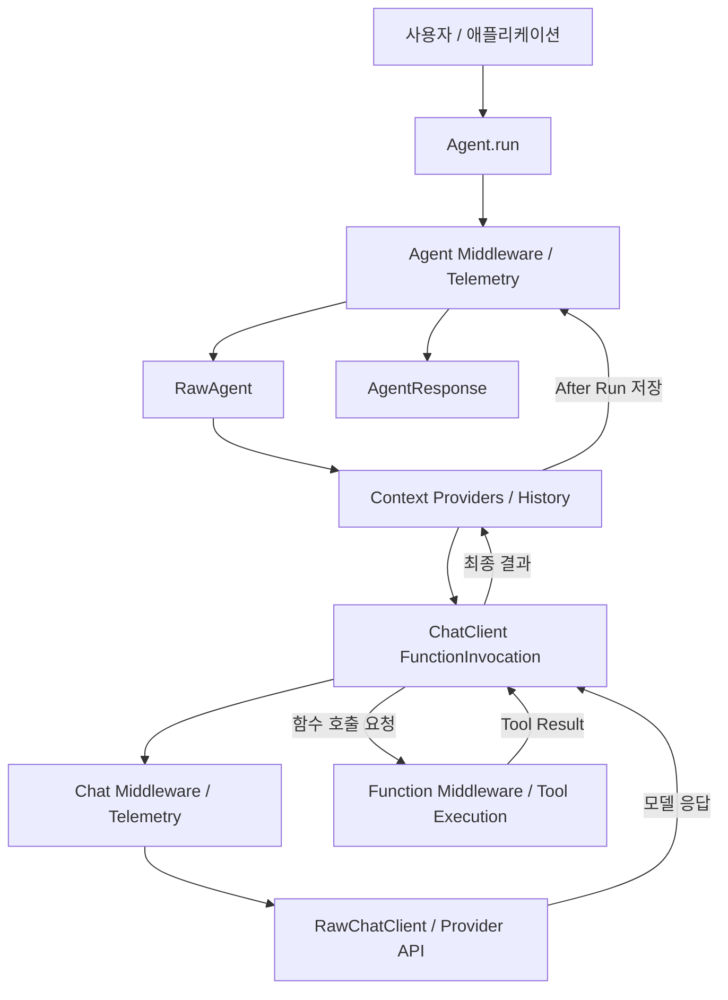
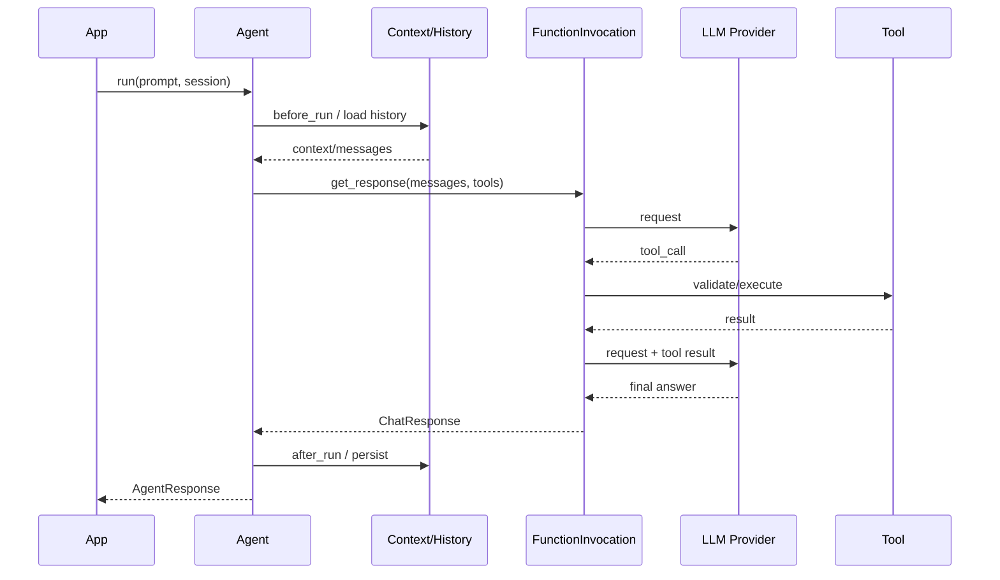
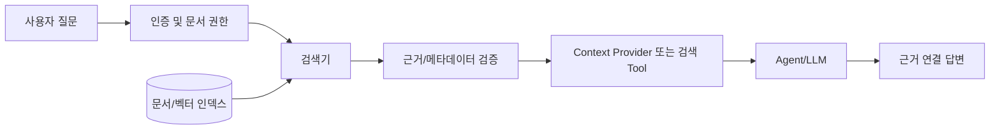
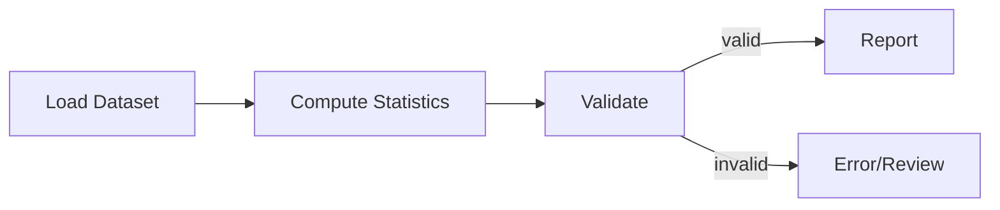
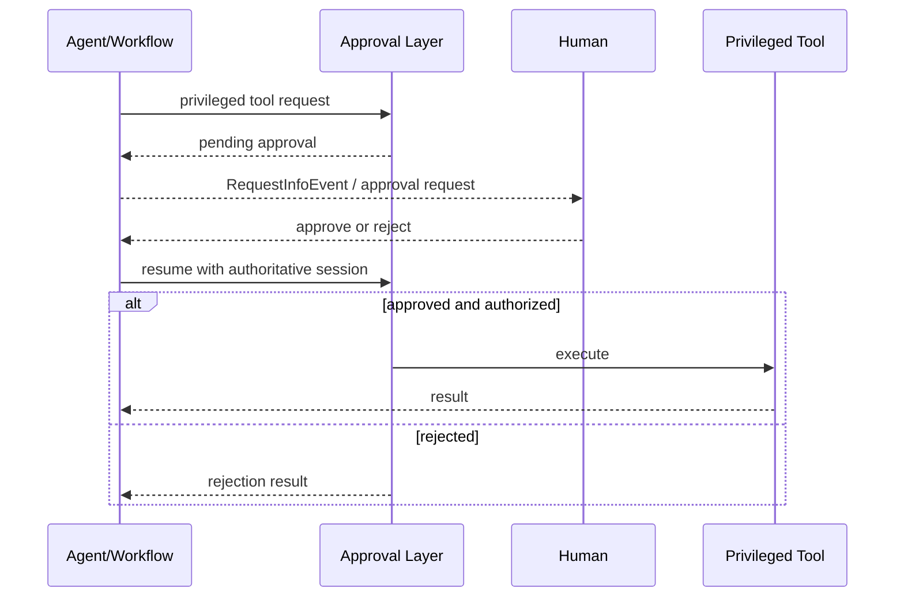
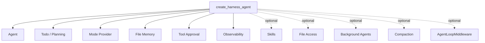
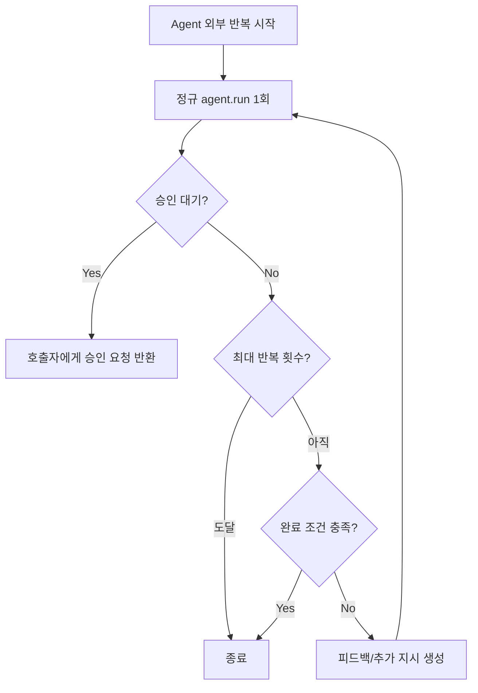
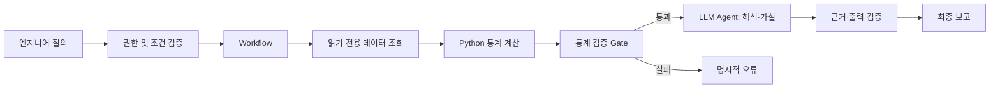
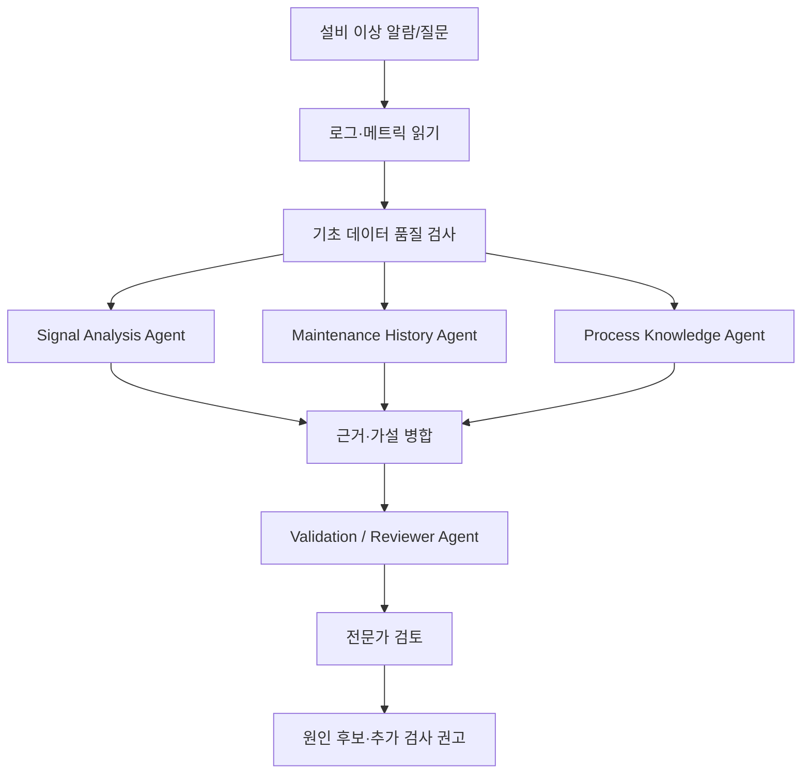

# Microsoft Agent Framework — 심층 학습 및 아키텍처·소스코드 분석

> **분석 범위:** Python SDK 중심, .NET/Go는 구조·기능 차이가 중요한 경우만 보조 비교  
> **기준일:** 2026-10-31 (KST)  
> **고정 릴리스:** `python-1.24.0` (공식 GitHub 릴리스 날짜 2026-10-30, 태그 커밋 `43d767c`)  
> **목표:** Agent 개발 전 단계의 기술 학습, 아키텍처 이해, 실제 공개 코드 추적, 반도체 도메인 Agent 데모 설계 기준 도출  
> **자료 수준:** 기초 → 중급 → 심화 → 코드 레벨 → 실무 설계  
> **주의:** 코드 예제는 실행 검증하지 않았다. 확인된 공식 API 예제와 설계용 의사코드를 분리한다. 최신 문서가 태그보다 앞서갈 수 있어 고정 버전의 API를 우선한다.

---

## 학습 방법과 증거 등급

이 문서에서는 단순히 '지원한다'가 아니라 **어떤 계층에서 무엇을 제공하는지, 개발자가 무엇을 직접 구현해야 하는지**를 설명한다.

- **[공식 문서]** Microsoft Learn에 명시된 제품 기능·사용 규약.
- **[공개 코드]** `python-1.24.0` 태그의 GitHub 소스에 존재하는 클래스·파일·흐름. 코드 링크로 직접 확인 가능.
- **[의사코드]** 원리를 설명하기 위해 재구성한 예시. 실제 소스와 1:1로 일치하는 코드는 아니다.
- **[설계 제안]** 반도체 도메인 적용을 가정한 권장 아키텍처. Microsoft 기본 기능과 구별한다.
- **[미검증]** 직접 실행·성능 측정·폐쇄망 실증을 수행하지 않은 항목.

### 목차

1. 3분 핵심 요약
2. 탄생 배경: AutoGen / Semantic Kernel과의 관계
3. 전체 제품 범위: Agents / Workflows / Harness / Integrations
4. 설치와 가장 작은 Agent
5. 핵심 객체 사전
6. 가장 중요한 Python 런타임 아키텍처
7. `Agent.run()` 호출부터 종료까지
8. Tool 정의·실행·재시도
9. Middleware: Agent / Chat / Function
10. Session, History, State, Memory의 차이
11. Context Compaction과 RAG
12. Workflow: Agent Loop와 완전히 다른 실행 개념
13. Graph Workflow와 Functional Workflow 비교
14. Multi-Agent Orchestration
15. Human-in-the-loop(HITL)와 승인
16. Checkpoint와 Persistence
17. Harness Agent의 구성과 일반 Agent와의 차이
18. Agent Loop의 두 층: Tool Loop vs 재실행 Loop
19. Skills, MCP, CodeAct, Background Agents
20. Guardrails, 보안, FIDES
21. Observability / Evaluation / Deployment
22. 코드 분석 범위와 저장소 레이아웃
23. 코드 레벨 ① — Agent의 계층 구조
24. 코드 레벨 ② — Context Provider와 Session 저장
25. 코드 레벨 ③ — Tool Loop와 Middleware
26. 코드 레벨 ④ — AgentLoopMiddleware
27. 코드 레벨 ⑤ — Workflow 실행 및 복구
28. 무엇이 기본 제공되고 무엇을 직접 만들어야 하는가?
29. 반도체 시나리오 A — 공정 데이터 분석 Agent
30. 반도체 시나리오 B — 기술 문서·공정 지식 Agent
31. 반도체 시나리오 C — 설비 이상 원인 분석 Multi-Agent
32. 기술적 장점과 단점
33. 다른 학습 대상과의 비교 — 설계 철학 중심
34. 프레임워크 선정 질문 20개
35. 단계별 후속 실험 설계
36. 핵심 내용을 다시 10문장으로 요약
37. 확인 질문과 학습용 답변
38. 공식 참고자료 및 공개 코드 링크

---

# Part I. 기초 이해

## 1. 3분 핵심 요약

**Microsoft Agent Framework(MAF)**는 모델을 호출하는 단일 함수가 아니라, **Agent 구성·도구 호출·세션 및 메모리·미들웨어·명시적 워크플로·멀티에이전트 오케스트레이션·운영 기능**을 함께 제공하는 오픈소스 개발 프레임워크다. Python, .NET, Go를 지원하지만 플랫폼별 기능 완성도와 구현 방법은 다르다. [D01][D02]

한 문장으로:

> 'LLM이 필요한 비결정적 판단'은 Agent로, '순서·검증·승인·복구가 중요한 절차'는 Workflow로 표현하고, 두 가지를 조합하는 개발 도구.

**가장 중요한 네 축**

| 영역 | 무엇인가 | 쉬운 예시 | 핵심 선택 기준 |
|---|---|---|---|
| Agent | LLM 기반 판단과 Tool 선택을 하는 실행 단위 | '불량률이 왜 증가했는지 조사' | 탐색 경로가 고정되지 않았는가? |
| Workflow | Executor·Edge로 정의하는 통제 가능한 실행 흐름 | 데이터 조회 → 계산 → 검증 → 승인 | 단계·분기·복구 규칙이 명시적인가? |
| Harness Agent | 계획·Todo·파일 메모리·승인·컨텍스트 압축 등을 조합한 운영형 Agent | 여러 파일을 분석하는 장시간 조사 담당 | 기본 Agent보다 실행 환경이 많이 필요한가? |
| Integrations | 공급자·도구·메모리·호스팅 등 외부 시스템 연결 | OpenAI 호환 LLM, MCP, 저장소 | 사내 인프라와 연결 가능한가? |

**처음 접하는 사람이 헷갈리기 쉬운 부분**

1. **Agent Framework는 LLM 자체가 아니다.** 별도의 모델 API 또는 로컬/사내 서빙 엔드포인트가 필요하다.
2. **Agent가 항상 Workflow를 의미하지 않는다.** 단일 Agent는 Tool을 몇 번 반복 호출한 후 답할 수 있다.
3. **'Tool Loop'와 'Agent Loop'는 다를 수 있다.** Python에서는 ChatClient의 `FunctionInvocation`이 Tool 반복을 맡는다. Harness의 `AgentLoopMiddleware`는 완료 조건을 평가하여 **Agent 실행 전체**를 다시 호출할 수 있다. [D06][S07]
4. **Session ≠ 장기 지식 메모리 ≠ Workflow Checkpoint.** 목적·수명·저장 대상이 다르다.
5. **'기업용'이라고 해서 보안이 자동 완성되지는 않는다.** 실제 인증, 인가, 데이터 반출, Tool 권한, 재실행에 따른 중복 작업은 애플리케이션에서 관리해야 한다.
6. **'지원 가능'과 '기본 활성화'는 다르다.** `Skills`, `file access`, `shell`, `background agents` 등은 옵션 또는 별도 패키지/준비가 필요한 경우가 있다.

### 이번 학습에서 얻어야 할 핵심 관점

- 모델과 Agent의 책임 경계를 구분할 수 있는가?
- 자동 Tool Loop가 실제로 어디에 존재하는가?
- Context Provider가 입력을 바꾸고 History Provider가 상태를 어떻게 남기는가?
- 명시적 Workflow를 사용하는 것이 오히려 더 안전한 부분은 무엇인가?
- 장애 후 재개, 승인, 평가가 단일 실행보다 무엇이 복잡한가?

## 2. 탄생 배경: AutoGen / Semantic Kernel과의 관계

Microsoft는 Agent Framework를 AutoGen과 Semantic Kernel의 후속 진화 방향으로 소개한다. AutoGen의 대화형/협업형 에이전트 추상화와 Semantic Kernel의 기업용 상태·통합·관측 기능을 계승하면서, **명시적인 Graph Workflow**와 통합된 Agent 개념을 제공한다. [D02]

단, '후속'이 **기존 프로젝트가 자동으로 호환되거나 교체된다는 뜻은 아니다.** 마이그레이션 경로, API 변경, 프레임워크별 런타임 차이를 별도로 점검해야 한다.

| 시스템 | 역사적 강조점 | MAF를 공부할 때의 비교 포인트 |
|---|---|---|
| AutoGen | 여러 Agent 간 대화·협업·오케스트레이션 | Group Chat, Handoff, Magentic 패턴 |
| Semantic Kernel | 모델·플러그인·기업 시스템 통합 | ChatClient, Context, Middleware, 배포 |
| Microsoft Agent Framework | Agent와 결정적 Workflow 및 운영 기능의 조합 | 단일 API 계층과 실행 모형의 일관성 |

## 3. 전체 제품 범위: Agents / Workflows / Harness / Integrations

### 3.1 Agent

Agent는 '이 입력을 기반으로 어떤 답변과 Tool 호출을 만들지'를 모델과 결합해 처리한다. Python의 중심 인터페이스는 `Agent`, 공통 실행 형태는 `run(...)`이다. 다른 구현체나 원격 Agent도 공통 프로토콜 관점에서 다룰 수 있다. [D03][S02]

### 3.2 Workflow

Workflow는 **정해진 경로**에서 함수를 실행하거나 Agent를 넣어 조합한다. 예를 들어 `DataLoader → FeatureAnalyzer → Reviewer → Reporter`라면, 각 단계의 경계와 실행 순서를 코드로 명시한다. [D09]

### 3.3 Harness

Harness는 새 모델이 아니라 기존 Agent 구성요소를 미리 결합한 실행 환경이다. 기본적으로 계획·Todo, 동작 모드, 파일 메모리, Tool 승인, 관측 등을 조합하며 옵션에 따라 압축·Skills·파일 접근·백그라운드 위임·재실행 루프를 추가한다. Python의 진입점 중 하나는 `create_harness_agent(...)`. [D04]

### 3.4 Integrations

ChatClient, Agent 서비스, 외부 툴, MCP, 벡터 저장소, 호스팅 등 구성요소 간 연결을 제공한다. **지원 모델 = 특정 플랫폼에 종속**은 아니다. 하지만 프로바이더별 Tool Calling, Streaming, Structured Output, Hosted Tool 제공 여부가 다르므로 실제 연결 시 기능표를 확인해야 한다. [D02][D12]

### 3.5 Agent / Workflow 선택 규칙

```text
질문: 작업 경로를 코드로 명시할 수 있는가?
  ├─ 예: 검증·집계·승인·로그 관리가 중요 → Workflow 중심
  └─ 아니오: 모델의 도구 탐색과 추론이 필요 → Agent 중심

질문: 둘 다 필요한가?
  └─ 대체로 그렇다면 Workflow의 일부 Executor에 Agent 배치
```

> 권장 원칙: **명확한 계산·검증·정책 판단을 LLM으로 대체하지 않는다.** 예를 들어 수율 계산은 Python 함수에서, 개선 원인 가설 생성은 Agent에서 수행한다.

## 4. 설치와 가장 작은 Agent

### 4.1 Python 환경

2026-10-30 릴리스 `python-1.24.0`은 **Python 3.11 이상을 지원 기준선**으로 명시했다. 3.10은 설치 메타데이터 때문에 설치될 수 있지만 호환성 보장은 아니다. 특정 통합 패키지의 상한·조건은 별도로 검증한다. [R01]

```bash
# 예시: 새 Python 3.11+ 환경에서 실행
uv venv --python 3.11
source .venv/bin/activate  # Windows: .venv\\Scripts\\activate
uv pip install 'agent-framework==1.24.0'

# 필요한 통합만 따로 설치하는 방식도 가능
uv pip install 'agent-framework-core==1.24.0' 'agent-framework-openai==1.24.0'
```

`agent-framework`는 통합 편의를 위한 패키지, `agent-framework-core`는 핵심 추상화 패키지다. 사용하지 않는 통합까지 과도하게 설치하지 않도록 의존성을 확인하는 편이 좋다. 버전 일치 여부는 잠금 파일과 `pip list` 등으로 확인한다. [S01]

### 4.2 최소 Python 예제 — 공식 API 형태

```python
import asyncio
from agent_framework import Agent
from agent_framework.openai import OpenAIChatClient

async def main():
    agent = Agent(
        client=OpenAIChatClient(model="gpt-4o"),
        instructions="You are a concise technical assistant.",
    )
    response = await agent.run("DRAM과 NAND의 차이를 짧게 설명해줘.")
    print(response.text)

asyncio.run(main())
```

- `Agent(...)`: 모델 클라이언트, instruction, tool, 미들웨어, context provider를 모은다.
- `OpenAIChatClient(...)`: 모델 호출 담당. **실제 API 자격 증명·요금·연결이 별도로 필요하다.**
- `agent.run(...)`: 최종 응답을 받는다. 스트리밍 모드에서는 별도 응답 스트림을 처리한다.

**검증 사항:** API 키 설정, `open`/`close` 자원 생명주기, 인스턴스가 지원하는 옵션을 SDK 버전 문서로 확인해야 한다. 공식 예제가 작동할 수 있는 구조라고 하더라도, 여기서는 네트워크 호출 테스트를 수행하지 않았다. [D03][S10]

### 4.3 도구 연결 예제

```python
from agent_framework import Agent
from agent_framework.openai import OpenAIChatClient


def calculate_yield(good: int, total: int) -> float:
    """Calculate yield percent given good die count and total die count."""
    if total <= 0 or not (0 <= good <= total):
        raise ValueError("Invalid counts")
    return round(good * 100.0 / total, 4)

agent = Agent(
    client=OpenAIChatClient(model="gpt-4o"),
    instructions="For numeric yield, call calculate_yield; never invent counts.",
    tools=[calculate_yield],
)
```

Python 함수가 Tool로 노출되면 도구 설명과 입력 스키마가 LLM에 전달되고, 모델이 호출을 요청할 수 있다. 입력·인가·감사 로직은 단순한 type hint만으로 충족되지 않는다. [D08][S03]

## 5. 핵심 객체 사전

| 객체 | 기능 | 구별해야 할 개념 |
|---|---|---|
| `Agent` | 호출 가능한 Agent 실행 엔트리 | LLM 모델 그 자체가 아님 |
| `BaseAgent`, `RawAgent` | 더 낮은 수준의 실행/구현 계층 | 공개된 구현 관계를 소스에서 추적 |
| `SupportsAgentRun` | Agent 호환 프로토콜 | 상속하지 않아도 프로토콜을 구현하면 호환 가능 |
| `BaseChatClient` | 실제 모델 클라이언트 추상화 | Agent, Tool Registry와 역할 구분 |
| `Message` / `Content` | 역할·본문·Tool 요청 등 메시지 표현 | 단순 문자열보다 다양한 타입 가능 |
| `ChatResponse` | ChatClient 수준 결과 | `AgentResponse`와 구별 |
| `FunctionTool`, `@tool` | 함수 → 모델 호출 가능 Tool | 모델의 요청과 실제 OS 실행은 별개 |
| `AgentSession` | 대화 상태·서비스 연속성 정보 | 영구 지식 DB가 아님 |
| `ContextProvider` | 실행 전후 기억/검색 등 주입 | Tool과 혼동 금지 |
| `HistoryProvider` | 대화 이력의 저장·로딩 | 원본 자료 저장소와 구분 |
| `AgentMiddleware` | Agent 전체 호출 감싸기 | Chat/Function 미들웨어와 적용 위치가 다름 |
| `WorkflowBuilder` | Executor 및 Edge로 그래프 구성 | Agent Loop와 달리 순서가 명시적 |
| `CheckpointStorage` | Workflow 진행 상태 저장 | AgentSession 직렬화와 별도 |
| `create_harness_agent` | 기본 기능이 포함된 Agent 구성 | 범용 기본 Agent와 기본값이 다름 |

**함수 이름/계층 출처:** [S02]–[S08], [D03], [D06].

---

# Part II. 단일 Agent 아키텍처와 실행 원리

## 6. 가장 중요한 Python 런타임 아키텍처

공식 Agent Pipeline 문서는 Python `Agent`를 **외부 Agent 래핑 계층**과 **교체 가능한 ChatClient 계층**으로 구분한다. 여기서 특히 중요한 포인트는 *모델 호출마다 반복되는 Tool Loop가 반드시 Agent의 최상위 `run()` 안에 직접 작성된 것은 아니라는 것*이다. [D06]



위 그림은 공식 설명을 학습용으로 단순화한 것이다. 실제 Streaming·승인·게이트·예외 경로는 더 복잡하다.

### 6.1 각 레이어의 구체적인 책임

1. **Agent Middleware**: 호출 제한, 사용자 식별·요청 검사, 로깅, 실행 결과 변경 등 Agent 전체 요청을 감싼다.
2. **RawAgent**: 입력과 세션을 바탕으로 Context Provider를 호출하고 ChatClient 실행으로 연결한다.
3. **History / Context Provider**: 이전 메시지, 검색 결과, 기억, 런타임 도구·옵션 등을 준비한다.
4. **FunctionInvocation**: ChatClient가 모델 응답을 받으면 Tool 호출 요청을 해석하고 실행·결과 추가·재호출을 수행한다.
5. **Chat Middleware**: 모델 요청 단위로 정책·로그·검증 등을 개입시킨다.
6. **RawChatClient**: 실제 공급자 API 호출과 응답 형식 변환을 담당한다.
7. **후처리/저장**: History Provider와 Context Provider가 실행 결과에 따라 상태를 업데이트할 수 있다.

**설계 시사점:** 모델 요청에만 적용하려는 정책을 Agent Middleware에 등록하면 원하는 만큼 세분화되지 않을 수 있다. '원문이 외부로 나가기 전' 통제는 Chat 단계, '실제 SQL 실행 전' 통제는 Function Tool/실행 인가 계층에 두는 것이 더 명확하다.

## 7. `Agent.run()` 호출부터 종료까지

가장 쉬운 입력/출력 경로는 다음과 같다.

```text
1) app: Agent.run(user_message, session=...)
2) Agent Middleware가 진입 (요청 전체 트레이싱/검사)
3) History Provider가 현재 세션의 과거 대화를 로드
4) Context Providers가 메모리·RAG·도구·옵션을 보강
5) ChatClient/FunctionInvocation이 모델을 호출
6a) 도구 요청 없음 → 답변 반환
6b) 도구 요청 있음 → Tool 검사·실행 → Tool 결과 추가 → 모델 재호출
7) 필요한 후처리·이력 저장
8) Agent Middleware가 결과 반환
9) AgentResponse 전달
```

### Agent Loop 안에서 종료 조건은?

- 모델이 최종 텍스트/구조화 결과를 반환하고 더 실행할 Tool 호출이 없으면 Tool Loop가 종료될 수 있다.
- 요청 및 Tool 호출 횟수 상한, 정책, 취소, 승인 요청, 예외는 별도 중단 경로다.
- 모델이 계속 Tool을 요구하는 상황에 대한 최대 호출 수·실행 시간·토큰 제한을 애플리케이션 정책으로 설정해야 한다.
- **'모델이 질문에 답했지만 검토 결과 미완료'**일 경우, 별도 `AgentLoopMiddleware`가 Agent 전체를 재실행하는 패턴을 사용할 수 있다. [D06][S07]

### 시퀀스 다이어그램



**중요:** 위 도식은 정상적인 단일 Tool 호출을 나타낸다. 여러 Tool 병렬 호출, 승인 중단, Streaming, Hosted Tool은 별도 분기로 취급해야 한다.

## 8. Tool 정의·실행·재시도

### 8.1 Function Tool의 네 단계

```text
[Python 함수]
   ↓  @tool / FunctionTool
[이름 + 설명 + 입력 스키마]
   ↓
[모델이 tool_call(name, arguments)를 생성]
   ↓
[실행기에서 arguments 검증 / 인가 / 실제 함수 호출]
   ↓
[Tool 결과를 모델 대화에 다시 전달]
```

`FunctionTool`은 함수 서명에서 JSON Schema를 만들고 파라미터 검증을 지원한다. 하지만 **사용자가 제공한 임의 JSON Schema가 보안 정책이나 권한 보장을 대체하는 것은 아니다**. 공식 소스 문서에도 Caller-supplied Schema의 검증 범위와 보안 경계의 차이를 명시한다. [S03]

### 8.2 Tool 유형

| 유형 | 역할 | 반도체 사례 | 주요 위험 |
|---|---|---|---|
| Function Tool | Python 함수 호출 | 수율 계산, 집계 | 인가 누락·잘못된 인자 |
| Local MCP | 로컬/사내 도구 서버 | 사내 문서 검색 | 권한·도구 노출 |
| Hosted MCP | 공급자 호스팅 도구 | 제공자 제공 검색 | 데이터가 외부 서비스에 전달될 수 있음 |
| Code Interpreter | 코드 계산 | 통계 분석 | 샌드박스 범위 |
| Shell Tool | 명령 실행 | 로그 파싱 | OS·파일 시스템 접근 |
| File Search / Web Search | 문서·외부 자료 검색 | 공정 기술 동향 | 근거 품질·정보 반출 |

도구 종류는 공식 문서의 제공 범주에 근거하지만, 사용 가능 여부·모델 지원·환경 제약은 Tool마다 다르다. [D08]

### 8.3 Tool Calling의 안전한 설계

- Tool 등록 때 **읽기와 쓰기를 물리적으로 분리**한다 (`get_metrics` vs `update_recipe`).
- 모델이 만든 SQL 문자열을 바로 실행하지 말고, 승인된 조회 템플릿·파라미터 바인딩·테이블 Allowlist를 사용한다.
- 최대 조회 건수/기간, 비용, 실행 시간을 설정한다.
- 예외 메시지에 DB 비밀이나 설비 식별자가 그대로 포함되지 않게 정제한다.
- Tool 결과가 다시 모델 문맥에 들어갈 때 신뢰 등급과 출처를 유지한다.
- 재실행을 고려해 쓰기 작업은 idempotency key와 승인 기록을 남긴다.

### 8.4 자동 Tool 호출 vs 고정 Workflow

> Tool 호출의 *선택 순서*를 모델에 맡긴다 = Agent식 실행.  
> SQL 조회 → Python 계산 → 검증 → 보고를 **항상 같은 순서**로 처리한다 = Workflow식 실행.

단순 계산이 반복적으로 동일해야 한다면 Workflow 또는 일반 Python 함수가 더 예측 가능하다.

## 9. Middleware: Agent / Chat / Function

세 레벨의 개입 지점은 매우 중요하다. [D06][S04]

| 계층 | 감싸는 범위 | 적합한 작업 | 착각하기 쉬운 점 |
|---|---|---|---|
| Agent Middleware | `run()` 전체 | tenant 인증·실행 횟수·최종 결과 로깅 | Tool 하나당 한 번 실행되는 것은 아님 |
| Chat Middleware | 모델 호출마다 | Prompt 관리·모델 요청 검증·토큰 사용 추적 | Tool 실행 전 인가만으로는 부족 |
| Function Middleware | 함수 호출마다 | Tool 인자 검증·권한·감사·결과 필터링 | Provider-hosted Tool은 호출 경로가 다를 수 있음 |

### 9.1 Middleware 이해 예제

```python
# 공식 코어 문서에서 사용되는 API 형태에 가까운 개념 예제.
from agent_framework import AgentMiddleware, AgentContext

class AuditMiddleware(AgentMiddleware):
    async def process(self, context: AgentContext, call_next) -> None:
        print("agent request started")
        await call_next()
        print("agent request completed")
```

- `call_next()` 전후에 로직을 넣는 **onion / chain-of-responsibility** 패턴이다.
- 미들웨어가 실행을 중단하거나 결과를 변경할 수도 있다.
- **중단 정책**과 사용자 화면에 보여 줄 **오류 설명**을 분리한다.
- 정책 실패 시 기본은 차단(Fail Closed)을 선호한다.

### 9.2 정책 계층의 흔한 실수

1. 프롬프트에 '쓰기 금지'만 적고 DB 계정에는 쓰기 권한이 남아 있음.
2. Agent Middleware로 승인을 구현했으나 백그라운드 Tool 경로는 우회할 수 있음.
3. Hosted Tool을 로컬 Function Middleware와 동일하게 통제할 수 있다고 오해함.
4. Tool 출력 일부를 로깅하다가 생산 기밀을 그대로 외부 Observability로 전송함.

## 10. Session, History, State, Memory의 차이

### 10.1 가장 중요한 비교표

| 개념 | 보관 대상 | 유지 단위 | 설명 |
|---|---|---|---|
| Session | 실행 연속성·conversation ID·상태 | 사용자/대화 | 동일 대화 이어가기 |
| History | 과거 메시지·Tool 요청/결과 | 턴 또는 세션 | 모델 입력 재구성 |
| Context Provider | 매번 주입할 추가 정보 | 실행 전/후 | RAG, 사용자 선호, 단기/장기 메모리 |
| Long-term Memory | 추출한 지속 정보 | 여러 세션 | 어떤 정보를 기억할지 설계 필요 |
| Workflow State | Executor별 상태·다음 메시지 | 하나의 Workflow 실행 | 흐름 제어에 필요 |
| Checkpoint | 시점별 Workflow 상태 스냅샷 | Superstep 등 | 실패 후 재개 |

단순히 Session을 만들었다고 **장기 메모리 검색 엔진이 자동 제공되는 것은 아니다.** [D07][D10]

### 10.2 Session 사용 예제

```python
session = agent.create_session()
a = await agent.run("이번 대화에서 DRAM 공정 관련 항목만 살펴보자.", session=session)
b = await agent.run("앞에서 정한 범위로 3가지 가설을 정리해줘.", session=session)

# 외부 저장은 애플리케이션 책임
serialized = session.to_dict()
# app_db.save(user_id, serialized)

# 복원 예시
from agent_framework import AgentSession
restored = AgentSession.from_dict(serialized)
```

서비스 측 conversation ID가 저장될 수도 있다. 복원 전 **인증 사용자가 해당 세션 소유자라는 점**을 서버에서 검증해야 한다. [D07]

### 10.3 History Provider

`InMemoryHistoryProvider`는 테스트와 간단한 데모에 유용하다. 로컬 이력 저장과 원격 서비스가 관리하는 대화 이력은 수명·권한·직렬화 형태가 다르다. `FileHistoryProvider` 등 추가 옵션이 있지만 실험적 기능 여부와 지속성·동시성 한계를 확인해야 한다. [S06]

### 10.4 Context Provider

Context Provider는 실행 직전에 원격 검색 결과·메모리·추가 지침 등을 제공하고 실행 이후 저장 작업을 수행할 수 있다. **Tool은 모델이 요청해 호출하는 함수이고, Context Provider는 모델 호출 전후에 런타임이 준비하는 문맥/상태 기능**이라는 차이가 있다. [D06][D11]

**반도체 사례:** 담당 라인에 대한 접근 권한과 사용자 질의의 장비 범위를 확인한 뒤, 허용 범위의 기준 문서나 공정 이력만 컨텍스트에 주입한다.

---
# Part III. 상태·워크플로·멀티에이전트 심화

## 11. Context Compaction과 RAG

### 11.1 메모리와 Context가 다른 이유

LLM의 Context Window는 **한 번의 모델 요청에서 참고할 수 있는 입력 용량**이다. 외부 DB에 오래 저장된 정보라 해도 현재 모델 요청에 전달하지 않으면 모델이 직접 알 수 없다. 반대로 최근 메시지를 길게 전달한다고 해서 장기 메모리가 구축된 것은 아니다.

| 기법 | 해결하는 문제 | 운영상 유의점 |
|---|---|---|
| 원본 History 그대로 전달 | 대화 연속성 | 토큰과 지연 증가 |
| Window / Truncation | 한도를 넘지 않기 | 앞서 나온 중요한 정보 유실 |
| Summarization/Compaction | 짧게 유지하면서 정보 보존 | 요약 오류와 출처 누락 |
| RAG Retrieval | 외부 문서에서 필요한 부분 선택 | 권한, 검색 품질, 근거 버전 |
| File Memory | 명시적인 지속 정보 기록 | 저장 범위와 보존 정책 |

### 11.2 Compaction 동작의 개념

```text
현재 messages + tool traces
         ↓
(설정한 정책) 컨텍스트 예산 초과 감지
         ↓
대화 일부 요약/압축 또는 선택적 제거
         ↓
필수 지침·활성 Tool 맥락·후속 상태 보존
         ↓
다음 모델 요청에 새 Context 공급
```

**중요:** Tool 호출 내용과 그 결과는 서로 참조하는 논리적 묶음이다. 도구 호출만 남고 결과가 제거되는 식으로 압축하면 모델이 잘못된 맥락을 가질 수 있다. 고정 버전 소스의 개발 가이드에서도 함수 호출/결과 및 reasoning 연관 정보를 함께 보존하는 규칙을 강조한다. [S09]

`python-1.24.0` 릴리스에는 `AgentTriggeredCompactionStrategy`, `UnloadSkillsCompactionStrategy`라는 **실험적** 기능이 추가되었다. 이름만 보고 Harness에서 자동으로 항상 켜진다고 가정하지 않는다. 사용 여부와 옵션, 실험적 API 변경 가능성을 별도로 확인한다. [R01]

### 11.3 RAG의 위치

RAG(Retrieval-Augmented Generation)는 일반적으로 다음 흐름으로 구성한다.



- **선조회 방식:** 질문마다 Context Provider가 검색하여 모델 요청에 자동으로 근거를 넣음.
- **에이전트 선택 방식:** Agent에 검색 Tool을 제공하여 필요할 때 모델이 호출.
- **혼합 방식:** 짧은 기본 정책/용어는 Provider가 넣고 큰 문서 탐색은 Tool로 수행.

반도체 지식 Agent에서는 `doc_id`, `revision`, `effective_date`, `equipment_group`, `access_scope` 같은 근거 메타데이터가 중요하다. **임베딩을 사용한다는 이유만으로 정확한 문서를 찾았다고 믿으면 안 된다.**

## 12. Workflow: Agent Loop와 완전히 다른 실행 개념

Workflow는 단순히 Agent를 여러 개 붙인 것이 아니다. **Executor가 메시지를 받아 실행하고, Edge가 다음 실행 대상으로 전달하는 그래프 런타임**이다. [D09]

### 12.1 세 핵심 객체

- **Executor:** 함수 또는 Agent를 포함한 일 수행 단위. 입력과 출력의 타입을 가질 수 있다.
- **Edge:** 한 Executor의 출력을 다른 Executor의 입력으로 보내는 연결.
- **Workflow:** 그래프 정의, 상태·스케줄·이벤트·완료 조건을 관리.



### 12.2 Superstep이란?

공식 문서는 Python Workflow 엔진을 Pregel-like 실행으로 소개한다. 간단히 말하면 **현재 단계에서 실행 가능한 Executor들이 작업을 수행하고, 생성된 메시지가 다음 단계에 전달되는 동기화 단위**다. [D09][D13]

예를 들어:

```text
Superstep 0: Start → Executor A에 데이터 준비
Superstep 1: Executor A 실행, B/C에 결과 전달 예약
Superstep 2: Executor B, C가 처리
Superstep 3: Join Executor가 결과 수집
Superstep 4: Report Executor 실행
```

체크포인트는 일반적으로 각 Superstep의 작업이 완료된 시점에 저장된다. 따라서 **Workflow Checkpoint가 SQL 트랜잭션처럼 모든 외부 부작용을 원자적으로 되돌리는 것은 아니다.** [D10]

### 12.3 장점과 비용

장점은 실행 경로, 상태 변화, 승인 위치, 재시도 조건을 코드로 명시할 수 있다는 것. 단점은 그래프·상태·타입·이벤트 관리 비용이 생긴다는 것이다. 단순 Q&A라면 일반 Agent가 더 적합할 수 있다.

## 13. Graph Workflow와 Functional Workflow 비교

Python에는 두 가지 주요 표현 방식이 있다. 공식 문서는 **Functional Workflow가 실험적**이라고 설명한다. [D09]

| 항목 | Graph (`WorkflowBuilder`) | Functional (`@workflow`/`@step`) |
|---|---|---|
| 제어 흐름 | 명시적 Edge와 Executor | Python의 `if`, `for`, `asyncio.gather` 등 |
| 주요 장점 | 타입 검증·가시성·분기 경로 | 기존 Python 함수 구조와 친숙 |
| 병렬 | Fan-out/Fan-in · Superstep | `asyncio.gather()` 등 |
| 이벤트 | Executor / Workflow 이벤트 | Decorated step 이벤트 |
| HITL | `RequestInfoExecutor` 등 | `ctx.request_info()` |
| 복구 | Superstep 단위 | `@step` 결과 캐싱 등 |
| 성숙도 | 기본 Graph API | 실험적 기능 포함 |

### 13.1 `WorkflowBuilder` 최소 예시 — 공식 문서의 구성 패턴

```python
from agent_framework import WorkflowBuilder

# DataProcessor, Validator, Formatter는 개발자가 작성한 Executor라고 가정
processor = DataProcessor()
validator = Validator()
formatter = Formatter()

builder = WorkflowBuilder(start_executor=processor)
builder.add_edge(processor, validator)
builder.add_edge(validator, formatter)
workflow = builder.build()
```

위는 **공식 사용 패턴을 보여 주기 위한 코드 조각**이며, `DataProcessor` 등 실제 클래스 구현은 생략했다. 즉 복사해서 곧바로 실행 가능한 완결 예제가 아니다. [D13]

### 13.2 타입과 Edge 조건

Builder는 Executor의 입력/출력 타입 호환성을 검사하는 기능을 제공한다. Python 타입 힌트는 정적 계약을 명확하게 할 뿐 **도메인 데이터의 정확성**까지 보장하지 않는다.

- 타입 체크: `dict`가 와야 할 자리에 `list`가 전달되었는가?
- 도메인 검증: `yield_pct=150`가 불가능한 값인가?
- 보안 검증: 이 사용자가 해당 라인 데이터를 볼 수 있는가?

세 가지는 독립적으로 검증해야 한다.

### 13.3 병렬 처리 시 주의

두 Executor가 같은 메모리 상태, 임시 파일, DB 행을 변경한다면 동시성 충돌이 발생할 수 있다. 병렬 분석에서는 **읽기 전용 입력, 독립 결과, Join에서 명시적 병합**을 기본값으로 설계하는 것이 유리하다.

## 14. Multi-Agent Orchestration

Agent Framework는 Sequential, Concurrent, Handoff, Group Chat, Magentic 패턴을 지원한다. [D14]

| 패턴 | 실행 방식 | 적합한 사례 | 주의할 점 |
|---|---|---|---|
| Sequential | 차례로 실행 | 조회 → 요약 → 검토 | 앞 단계 오류 전파 |
| Concurrent | 여러 Agent 병렬 | 각 공정 가설 독립 검토 | 비용·중복 결과·Join |
| Handoff | Agent 간 통제 이관 | 장비 전문가 → 소재 전문가 | 종료 규칙과 순환 |
| Group Chat | 공통 대화를 번갈아 진행 | 작성자·검토자·분석가 협업 | 반복 대화로 비용 증가 |
| Magentic | 관리자 Agent가 동적으로 배정 | 탐색적 복합 원인 분석 | 통제와 재현성 낮아질 수 있음 |

### 14.1 Graph 기반 Multi-Agent가 유리할 때

각 Agent의 역할과 데이터 접근 범위를 분리할 수 있다. 예를 들어 `DataAgent`에게는 사내 데이터 조회 Tool, `ExpertAgent`에게는 기술 문서 검색 Tool, `ReviewerAgent`에게는 규칙 검사 Tool을 제공한다.

### 14.2 Group Chat의 세션 오해

Group Chat에서 참여자들이 **같은 Session 인스턴스를 공유하는 것은 아니다.** 공식 문서는 각 Agent가 별도 세션을 유지하고 오케스트레이터가 발화를 전파해 문맥을 동기화한다고 설명한다. 서로 다른 Agent 유형이 같은 Session을 무조건 공유하면 상태 처리 불일치가 생길 수 있기 때문이다. [D15]

### 14.3 멀티에이전트로 만들기 전에 물어볼 질문

1. 전문가별로 서로 다른 Tool·보안 권한·프롬프트가 필요한가?
2. 병렬 수행이 실제 지연 시간을 줄이는가?
3. 분업 후 결과를 일관되게 검증할 수 있는가?
4. 하나의 Agent에 서브루틴/Tool을 추가하는 것으로 해결되지 않는가?
5. 서로 다른 모델이 만든 근거와 데이터 범위를 어떻게 합치는가?

**권장:** 단일 Agent로 기준선 평가 → 역할 분리가 효과적임을 확인한 뒤 Multi-Agent 확장.

## 15. Human-in-the-loop(HITL)와 승인

HITL은 사람을 매번 모델 응답 끝에 넣는다는 뜻이 아니다. **특정 Tool 실행이나 Workflow 단계에서 정책에 의해 실행을 일시 중지하고, 승인/추가 입력을 받은 뒤 재개**하는 방식이다. [D16]

### 15.1 왜 필요한가?

- 생산 관리 시스템에 대한 변경 요청
- 외부 전송·파일 삭제·고비용 대량 조회
- 정확성 검증이 필요한 보고서 배포
- 데이터 분류·접근 권한 변경

### 15.2 승인 실행의 개념 흐름



### 15.3 승인 상태와 보안 경계

공개 소스 개발 가이드는 Python의 로컬 승인 응답이 **권위 있는 `AgentSession`에 기록된 대기 요청과 연결**되어야 한다고 명시한다. 단지 사용자가 입력 문자열에 "approved"라고 썼다는 이유로 실행을 승인해서는 안 된다. [S09]

- 요청 고유 ID와 Tool 호출 발생 지점을 연결한다.
- 승인자는 누가, 어떤 데이터를, 어떤 파라미터로 바꿀지 확인한다.
- 승인이 거부되면 사용자에게 대체 경로를 보여 준다.
- 재개할 때 이미 수행된 Tool을 중복 실행하지 않는지 테스트한다.

### 15.4 Workflow 요청과 Tool 승인 구분

| 요청 유형 | 예시 | 실행 맥락 |
|---|---|---|
| Request Info | '분석할 기간을 선택하세요' | 사용자로부터 추가 정보 수집 |
| Tool Approval | '이 설비 설정 변경을 승인합니까?' | 위험한 Tool 실행 전 승인 |
| Review Gate | '보고서 초안을 배포해도 됩니까?' | 워크플로 단계 정책 |

Workflow의 `RequestInfoEvent`는 HITL 구현에 활용되며, 도구 승인은 도구별 승인 내용과 상호작용할 수 있다. [D16]

## 16. Checkpoint와 Persistence

### 16.1 무엇을 저장하나?

Workflow Checkpoint는 일반적으로 다음을 포함할 수 있다. [D10]

- Executor들의 현재 상태
- 다음 Superstep으로 전달될 메시지
- 처리 중인 승인/요청 및 응답
- 공유 상태와 실행 재개 위치

### 16.2 제공되는 Python 저장소 유형

| Store | 지속성 | 용도 |
|---|---|---|
| `InMemoryCheckpointStorage` | 프로세스 내 | 간단한 테스트와 데모 |
| `FileCheckpointStorage` | 파일 시스템 | 단일 머신 재실행 |
| `CosmosCheckpointStorage` | 별도 Azure 패키지 | 분산·서비스 환경의 저장 가능성 |

`FileCheckpointStorage`는 로컬 경로를 명시해야 한다. `CosmosCheckpointStorage`를 사용한다고 자동으로 적절한 tenant 보안과 운영 정책이 완성되는 것은 아니다. [D10]

### 16.3 Checkpoint 최소 구조 예시

```python
from agent_framework import InMemoryCheckpointStorage, WorkflowBuilder

storage = InMemoryCheckpointStorage()

# start_executor, next_executor는 실제 Executor 객체로 미리 정의
builder = WorkflowBuilder(
    start_executor=start_executor,
    checkpoint_storage=storage,
)
builder.add_edge(start_executor, next_executor)
workflow = builder.build()
```

**주의:** 이 코드는 Checkpoint 설정 형식을 보여 주는 불완결 예제다. 요청/응답 승인, `checkpoint_id`를 통한 복구 등은 실제 저장소를 사용하여 별도 검증해야 한다.

### 16.4 Checkpoint와 외부 부작용 문제

다음 상황을 생각해 보자.

```text
Tool이 파일 업로드 성공
→ Workflow가 상태 저장 전에 프로세스 크래시
→ Checkpoint 복원
→ 같은 파일 업로드가 다시 실행
```

따라서 외부 작업은 적어도 **중복 실행 방지 키, 정확한 완료 기록, 작업 전/후 상태 검사, 재실행 가능성**을 고려해야 한다. 체크포인트는 '상태를 복원하는 장치'이지, 임의의 외부 시스템에 대해 정확히 한 번(exactly-once) 수행을 보장하는 만능 트랜잭션이 아니다.

### 16.5 Python v1.13.0 이후 Checkpoint 변경

공식 문서상 v1.13.0부터 Workflow 입력 전 Entry Checkpoint 및 요청 응답 전달 시의 진입 체크포인트가 추가되어 재생 가능성을 개선했다. 고정 버전 v1.24.0에서는 **문서의 오래된 저장 포맷을 그대로 전제하지 말고** 복원 호환성과 실행 이벤트 순서를 확인해야 한다. [D10]

---

# Part IV. Harness·확장·보안·운영

## 17. Harness Agent의 구성과 일반 Agent와의 차이

### 17.1 Harness란 무엇인가?

일반 Agent가 '모델 + Instruction + Tool + Context'라는 기본 골격이라면, Harness는 업무 지속성에 필요한 운영 기능을 **한 번에 합성**한다. [D04]



### 17.2 생성 예시

```python
from agent_framework import create_harness_agent
from agent_framework.openai import OpenAIChatClient

agent = create_harness_agent(
    client=OpenAIChatClient(model="gpt-4o"),
    name="semiconductor-researcher",
    harness_instructions="Use tools deliberately and report verified results.",
    agent_instructions="Analyze approved semiconductor reference material only.",
)
```

`harness_instructions`와 `agent_instructions`는 서로 다른 계층이다. 일반적으로 전자는 Harness 운영 방식, 후자는 도메인별 임무 정의에 가까운 용도로 이해할 수 있다. [D04]

### 17.3 무엇이 기본 활성화되나? (Python 중심)

| 기능 | 기본/설정 | 비고 |
|---|---|---|
| Todo tracking | Harness 기본 | 일정/완료 상태 관리 |
| Plan/Execute Mode | Harness 기본 | 동작 모드 관리 |
| Session File Memory | Harness 기본 | 기본 파일 저장 경로 확인 필요 |
| Tool Approval | Harness 기본 정책 조합 | 자동 승인의 범위 점검 |
| OpenTelemetry | Harness 기본 구성 | 민감 로그 반출 주의 |
| Context Compaction | 설정 조건에 따라 | Token limit/strategy 설정 필요 |
| Skills | Python에서는 Opt-in | `skills_paths`/Provider |
| Shared File Access | Opt-in | `file_access_store` 제공 |
| Background Agents | Opt-in, 일부 실험적 | 위임·완료 회수 별도 |
| Shell | 별도 패키지/옵션, 실험적 가능성 | 격리·정책 필수 |
| Bounded Loop | Opt-in | `loop_should_continue` 등 |

위 표는 공식 Harness 개념 문서와 고정 버전 소스의 설명을 조합한 것. Python과 .NET의 기본값이 **완전히 같지 않다**. [D04][S09]

### 17.4 Harness의 장점과 위험

**장점:** 긴 조사에 필요한 많은 기능을 개별 구현하지 않고 시작할 수 있다.  
**위험:** 기본 제공 Tool과 저장 경로를 검토하지 않고 기업용 호스트에 올리면 예상하지 못한 파일 쓰기·검색·통신이 발생할 수 있다.

따라서 사내 프로토타입이라면 먼저 **사용 가능한 Tool 목록, 저장 디렉터리, 모델 엔드포인트, 외부 통신 경로**를 문서화한다.

## 18. Agent Loop의 두 층: Tool Loop vs 재실행 Loop

이 부분은 타 프레임워크와 비교할 때 특히 중요하다.

### 18.1 Tool Loop

`FunctionInvocation`이 모델 응답에서 함수 호출 요청을 발견하고 실행 결과를 돌려 주는 동안 반복된다. 하나의 `agent.run()` 안에서 여러 차례 모델 호출과 Tool 호출이 생길 수 있다. [D06][S03]

### 18.2 AgentLoopMiddleware

`_harness/_loop.py`에 존재하는 `AgentLoopMiddleware`는 별개로 **Agent 전체 실행을 반복할지** 판단한다. 공식 소스 설명상 predicate 기반, judge client 기반의 형태가 존재하며, 실행 횟수 상한, 다음 메시지, 평가 결과 등에 따라 반복할 수 있다. [S07][S09]

```python
# 학습용 의사코드: 실제 메서드 본문 아님
async def outer_agent_loop(task):
    for iteration in range(allowed_iterations):
        response = await run_one_agent_request(task)
        if contains_pending_approval(response):
            return response  # 승인 요청을 사용자에게 넘긴다.
        if not await should_continue(response):
            return response
        task = make_followup_message(response)
    return response
```

### 18.3 완료 평가의 위험

- LLM-as-a-judge가 잘못 판단할 수 있다.
- 반복마다 Tool 호출 비용과 지연이 쌓인다.
- `max_iterations=None` 같은 무제한 설정은 장기 무한 반복 위험이 있다.
- 이미 수행한 부작용 있는 Tool을 다시 실행할 수 있다.
- **승인 대기 중인 응답을 강제로 반복해서는 안 된다.** 소스 개발 가이드는 승인 요청 발견 시 외부 루프를 탈출해 호출자에게 전달하는 안전 처리를 설명한다. [S09]

## 19. Skills, MCP, CodeAct, Background Agents

### 19.1 Skills

Skills는 `SKILL.md`와 부속 자료·스크립트로 도메인별 작업 절차를 제공하는 방식이다. Python은 `SkillsProvider`와 파일/인라인/클래스 기반 Skill 소스 등을 지원한다. [D17]

**점진적 공개(Progressive Disclosure)**

```text
Skill 이름·설명만 먼저 표시
  ↓
필요해지면 load_skill
  ↓
관련 파일이 필요하면 read_skill_resource
  ↓
허용된 스크립트가 있으면 run_skill_script
```

이 구조는 모든 Skill 내용을 처음부터 Context Window에 넣지 않아도 된다는 장점이 있다.

**개발 시 주의:** `skills_paths`만 설정한 경우 스크립트 실행기가 자동 제공되는 것으로 가정하지 않는다. 파일 스크립트를 실행하려면 별도의 안전한 `script_runner` 구성과 승인 정책이 필요할 수 있다. Skill Tool도 승인을 요구하는 기본값을 가진다. [D17]

### 19.2 MCP

MCP는 Agent Framework와 외부 Tool/Resource 제공자를 연결하는 프로토콜이다. MCP Tool의 이름, 입력 스키마, 원격 서버 권한, 승인 규칙을 서로 구별해야 한다.

`python-1.24.0`에는 **로컬 MCP Tool/Prompt의 목록에 없는 항목에 대한 기본 승인 모드**를 설정하는 기능이 추가되었다. 명시적으로 `never_require_approval`을 설정했다고 모든 신규 Tool이 안전하다는 뜻은 아니다. [R01]

**보안 설계:** 허용 Tool 목록을 최소화하고 서버의 실행 권한을 별도로 제한한다. Model-visible Tool 스키마는 서버 자체의 파일/네트워크 권한을 제한하지 않는다.

### 19.3 CodeAct

CodeAct는 모델이 여러 도구 호출을 코드로 작성·실행하는 접근이다. 일반 Function Calling과 다르게 코드 실행 환경, 사용 가능한 라이브러리, 파일/네트워크 접근과 샌드박스 설계가 핵심이다. 제공자마다 구현·격리 기능이 다르다. [D18]

### 19.4 Background Agents와 Background Responses

- **Background Agents:** 별도의 하위 Agent에게 작업을 위임하고 결과를 회수하는 패턴.
- **Background Responses:** 한 모델 공급자의 장시간 요청을 계속 처리하거나 재접속하는 패턴.

두 용어는 이름이 비슷하지만 다르다. Harness 문서도 명시적으로 구분한다. [D04]

## 20. Guardrails, 보안, FIDES

### 20.1 Guardrails는 하나의 객체가 아니다

실제 운영에서는 입력, 모델 요청, 도구 호출, 모델 출력, 저장/외부 전송마다 별도 경계가 필요하다.

| 경계 | 예시 통제 | 담당 계층 |
|---|---|---|
| 사용자 입력 | 권한·쿼리 스코프 | API/Auth, Agent Middleware |
| 검색 문서 | 등급·ACL·신뢰 표기 | Retriever/Context Provider |
| 모델 요청 | 기밀 텍스트 레드랙션 | Chat Middleware/Gateway |
| Tool 실행 | 읽기 전용, Allowlist, 승인 | Function Middleware + 실제 Tool 서버 |
| 코드 실행 | 컨테이너·파일/네트워크 격리 | Sandbox/실행 환경 |
| 결과 반환 | 근거 확인, PII·기밀 제거 | Output Validator/API |
| 기록 저장 | 보존 기한·암호화·tenant 분리 | 저장소/로그 파이프라인 |

### 20.2 FIDES: 정보 흐름 제어

Agent Framework Python에는 `agent_framework.security`에 실험적 **FIDES(Flow Integrity Deterministic Enforcement System)** 기능이 있다. 입력과 결과에 무결성·기밀성 레이블을 적용하고, 민감한 Tool을 호출하기 전에 정책을 확인하는 정보 흐름 기반 접근이다. [D19]

핵심 요소:

- `ContentLabel`: trusted/untrusted와 public/private 등 출처·비밀도 레이블.
- `LabelTrackingFunctionMiddleware`: Tool 입력·출력에 레이블 전파.
- `PolicyEnforcementFunctionMiddleware`: 호출 전 정책 검사.
- `quarantined_llm` / `ContentVariableStore`: 신뢰할 수 없는 내용을 제한된 경로에서 처리하는 도구.

### 20.3 FIDES의 한계

- 실험적 API이며 Python 중심이다.
- 데이터 소스의 모든 레이블이 자동으로 완벽하게 붙는 것은 아니다.
- Tool 또는 CodeAct 실행 중 모든 파일/네트워크 동작이 무조건 차단되는 것이 아니다.
- Tool 서버 자체의 인가 및 데이터 반출 통제가 여전히 필요하다.
- 사용자 입력, Tool 결과, RAG 문서에서 발생하는 **Prompt Injection**을 여러 계층에서 방어해야 한다.

### 20.4 반도체 도메인 보안 기본값

1. 사내 모델 또는 승인된 LLM Gateway 우선.
2. 작업 범위와 계정 접근 권한 최소화.
3. 생산 DB는 읽기 전용 연결 및 조회 범위 제한.
4. 문서 RAG에 권한 필터 적용.
5. 모델에 기밀 원문 전체를 보내지 않고 가능한 경우 통계 집계와 근거만 전달.
6. 이벤트·프롬프트·응답을 저장할 때 사내 보존 정책에 따라 마스킹.
7. 생산 장비 자동 제어는 데모 범위에서 제외.

## 21. Observability / Evaluation / Deployment

### 21.1 Observability

Agent Framework는 실행·모델·도구 호출 수준의 추적, 로그, 메트릭을 위한 통합을 제공한다. Harness 문서는 OpenTelemetry 기반 관측 기능을 기본 기능으로 설명한다. [D04][D18]

**기록할 정보:**

- `request_id`, `session_id`, `workflow_run_id`, `executor_id`
- model/provider, prompt/template revision
- Tool name, 호출 수, 지연 시간, 실패 유형, 승인 이력
- 입력 데이터셋의 버전/조회 조건/권한 스코프
- 출력 근거의 문서 리비전
- 토큰 수·비용·처리 시간

**하지 말아야 할 것:** 원시 설비 로그·고객 정보·생산 기밀을 무조건 외부 추적 서비스로 전송하는 것.

### 21.2 Evaluation

모델 답변이 유창한지만 평가하면 안 된다. 최소한 다음 다섯 영역을 구분한다.

| 평가축 | 측정 방법 | 반도체 예시 |
|---|---|---|
| 정확성 | 정답/전문가 검증 세트 | 수율·통계값 일치 |
| Grounding | 근거가 답변을 뒷받침하는지 | SOP 리비전·인용 일치 |
| Tool Reliability | 적절한 호출·파라미터 | 조회 범위·함수 인자 |
| Safety | 금지 작업 실패율 | 미승인 데이터 반출 차단 |
| Cost/Latency | 호출 횟수·소요 시간 | 작업당 API 비용 |

**LLM-as-a-judge만으로 최종 품질을 확정하지 않는다.** 재현 가능한 정량 계산에는 일반 코드의 테스트와 결과 비교가 우선이다.

### 21.3 배포·호스팅

프레임워크는 다양한 호스팅·서빙 옵션과 프로토콜 통합을 제공하지만, **프레임워크 설치 = 생산 서비스 운영 완료**가 아니다. 다음을 추가로 설계해야 한다.

- 요청 인증, 사용자별 접근 정책, tenant 격리
- 워커 수와 동시성, 작업 큐와 재시도 정책
- 세션 저장소·Checkpoint 저장소·암호화
- 공정 데이터베이스 연결 풀·쿼리 타임아웃
- 모델 Gateway 정책·토큰/쿼터 제한
- 롤백, 감사, 장애 복구, 모니터링
- 제공자·SDK 버전 변경 시 리그레션 테스트

---
# Part V. 공개 소스코드 구조와 실행 경로

## 22. 코드 분석 범위와 저장소 레이아웃

> 이 장의 파일 위치는 **`python-1.24.0` 태그를 기준으로 열어 확인한 고정 링크**를 우선한다. GitHub의 `main` 브랜치는 분석 이후 바뀔 수 있으므로 함수와 구조를 비교할 때 사용하지 않는다.

### 22.1 저장소 구조

```text
microsoft/agent-framework
├── python/
│   ├── README.md
│   ├── pyproject.toml
│   ├── packages/
│   │   ├── core/
│   │   │   └── agent_framework/
│   │   │       ├── __init__.py
│   │   │       ├── __init__.pyi
│   │   │       ├── _agents.py
│   │   │       ├── _clients.py
│   │   │       ├── _types.py
│   │   │       ├── _tools.py
│   │   │       ├── _middleware.py
│   │   │       ├── _sessions.py
│   │   │       ├── _mcp.py
│   │   │       ├── _skills.py
│   │   │       ├── _workflows/
│   │   │       │   └── _workflow.py
│   │   │       ├── _harness/
│   │   │       │   └── _loop.py
│   │   │       └── security.py
│   │   └── <integration-packages>/
│   └── samples/
└── dotnet/
```

**주:** 위 트리는 주요 분석 파일을 추려 만든 축약본이며, 실제 디렉터리 전체를 열거한 것은 아니다. 기본 구조는 릴리스 고정 `AGENTS.md`에서 확인할 수 있다. [S01]

### 22.2 읽는 순서 추천

| 순서 | 모듈 | 집중할 질문 |
|---|---|---|
| 1 | `_agents.py` | `Agent`, `RawAgent`, `BaseAgent` 간 역할은? |
| 2 | `_sessions.py` | Session 상태가 어떻게 직렬화되고 Provider에 전달되는가? |
| 3 | `_clients.py` | 모델 요청과 ChatClient 계층은 어떻게 분리되는가? |
| 4 | `_tools.py` | 함수 Tool의 스키마·인자 검증·실행은 어디서 일어나는가? |
| 5 | `_middleware.py` | Agent/Chat/Function 정책 개입은 어디서 일어나는가? |
| 6 | `_workflows/_workflow.py` | Graph 실행과 Checkpoint의 주요 진입점은? |
| 7 | `_harness/_loop.py` | Agent 전체를 왜, 언제 다시 실행하는가? |
| 8 | `_skills.py` / `_mcp.py` | 외부 기능을 어떻게 검색·노출·호출하는가? |
| 9 | `security.py` | 보안 정책 구현은 어떻게 결합하는가? |

### 22.3 실제 소스 링크

- [S01] Core 개발 가이드: [AGENTS.md — 고정 버전](https://github.com/microsoft/agent-framework/blob/python-1.24.0/python/packages/core/AGENTS.md)
- [S02] Agent 구현: [`_agents.py`](https://github.com/microsoft/agent-framework/blob/python-1.24.0/python/packages/core/agent_framework/_agents.py)
- [S03] Tool 정의와 호출: [`_tools.py`](https://github.com/microsoft/agent-framework/blob/python-1.24.0/python/packages/core/agent_framework/_tools.py)
- [S04] Middleware: [`_middleware.py`](https://github.com/microsoft/agent-framework/blob/python-1.24.0/python/packages/core/agent_framework/_middleware.py)
- [S05] ChatClient: [`_clients.py`](https://github.com/microsoft/agent-framework/blob/python-1.24.0/python/packages/core/agent_framework/_clients.py)
- [S06] Session/Provider: [`_sessions.py`](https://github.com/microsoft/agent-framework/blob/python-1.24.0/python/packages/core/agent_framework/_sessions.py)
- [S07] AgentLoopMiddleware: [`_harness/_loop.py`](https://github.com/microsoft/agent-framework/blob/python-1.24.0/python/packages/core/agent_framework/_harness/_loop.py)
- [S08] Workflow 실행: [`_workflows/_workflow.py`](https://github.com/microsoft/agent-framework/blob/python-1.24.0/python/packages/core/agent_framework/_workflows/_workflow.py)
- [S09] 고정 릴리스 Core 내부 설명: [AGENTS.md 관련 섹션](https://github.com/microsoft/agent-framework/blob/python-1.24.0/python/packages/core/AGENTS.md)
- [S10] Core README: [패키지 설명](https://github.com/microsoft/agent-framework/blob/python-1.24.0/python/packages/core/README.md)

## 23. 코드 레벨 ① — Agent의 계층 구조

고정 버전의 `_agents.py`에서는 다음 구조를 확인할 수 있다. [S02]

- `SupportsAgentRun`: 공통 `run()` 시그니처와 Session 관련 인터페이스를 기술하는 `Protocol`.
- `BaseAgent`: 식별자, Provider 등 공통 기반 추상화. 직접 실행 가능한 구체 Agent가 아님.
- `RawAgent`: ChatClient를 이용한 실제 핵심 Agent 실행을 구현하는 계층. 미들웨어·Telemetry를 자체적으로 둘러싼 완전체와 구분.
- `Agent`: 공개 사용 API로 표준 Middleware 및 Telemetry 계층을 포함한다.

여기서 `Protocol`은 Java의 인터페이스처럼 특정 명시적 상속만 허용하는 방식이 아니다. **필요한 메서드를 구현하면 구조적 타입 호환이 가능**하다.

### 23.1 핵심 호출 시그니처

공개 코드의 `SupportsAgentRun.run()` 선언에서는 주요 옵션으로 아래를 확인한다.

```python
# 소스 시그니처를 학습을 위해 발췌·단순화한 것
run(
    messages=None,
    *,
    stream=False,
    session=None,
    function_invocation_kwargs=None,
    client_kwargs=None,
)
```

| 매개변수 | 의미 | 사용 시 판단 |
|---|---|---|
| `messages` | 모델에 전달할 입력 | 문자열, 메시지 구조 등 타입 |
| `stream` | 점진적 출력 여부 | UI/중단·취소 처리 |
| `session` | 실행 간 상태 공유 | 사용자/tenant 소유권 |
| `function_invocation_kwargs` | Tool 실행 시 런타임 전달 값 | Model-supplied 인자와 분리·검증 |
| `client_kwargs` | 모델 클라이언트별 설정 | Provider 독립성이 깨지는 지점 |

**개발 관점:** '모델이 제공한 인자'와 '서버에서 신뢰하여 전달하는 런타임 인자'는 다르게 취급해야 한다. 실제 Tool 호출에서는 명칭 충돌과 전달 범위를 검사한다.

### 23.2 리소스 생명주기

고정 버전의 `RawAgent.open()`/`close()` 및 상속 구조는 모델 클라이언트와 MCP 연결의 초기화·정리를 담당한다. `async with agent:`도 사용 가능하다. [D03][S01]

```python
async with agent:
    answer = await agent.run("안녕하세요")
```

장시간 살아 있는 Agent 인스턴스가 닫힌 클라이언트를 다시 재사용하지 않는지, 사용자 간 상태가 공유되지 않는지, 비정상 예외 시 리소스가 정리되는지도 실험 시 확인한다.

## 24. 코드 레벨 ② — Context Provider와 Session 저장

### 24.1 핵심 클래스

고정 버전 `_sessions.py`에서 `ContextProvider`, `HistoryProvider`, `SessionContext` 및 세션 직렬화 구조를 확인한다. [S06]

예를 들어 `ContextProvider`의 실행 전/후 확장 지점은 다음과 같은 모양이다.

```python
# 개념만 보여 주는 API 발췌 (실제 매개변수 세부사항은 소스 확인)
class ContextProvider:
    async def before_run(self, *, agent, session, context, state):
        ...
    async def after_run(self, *, agent, session, context, state):
        ...
```

**실제 흐름**

```text
Agent.run(session)
  → Provider별 state 확보 (세션에 종속)
  → before_run(session, context, state)
  → History와 추가 Context를 모델 요청에 반영
  → ChatClient 및 Tools 실행
  → after_run(session, context, state)
  → 세션 상태 직렬화·저장(별도 설계)
```

### 24.2 세션 직렬화의 실제 포인트

고정 버전 소스에는 세션 상태의 값이 JSON 친화적인 형태인지 검사하고, 사용자 지정 클래스는 `register_state_type()` 등의 등록 경로로 처리하는 메커니즘이 존재한다. `AgentSession.state`에 임의의 Python 객체를 넣기만 하면 모든 저장소에서 영구 복원되는 것이 아니다. [S06]

따라서:

1. Python의 파일 핸들·DB 커넥션을 Session에 직접 저장하지 말 것.
2. 도메인 상태는 JSON 직렬화 가능한 값·등록된 타입으로 분리할 것.
3. 직렬화와 복원 후 동등성을 테스트할 것.
4. 저장 포맷 스키마 버전 및 마이그레이션 정책을 둘 것.
5. 사용자/tenant ID는 인증된 서버 컨텍스트에서 부여할 것.

## 25. 코드 레벨 ③ — Tool Loop와 Middleware

### 25.1 `FunctionTool` 스키마·호출

`_tools.py`의 `FunctionTool`은 Python 함수를 Tool 객체로 감싼다. 소스 설명상 입력 스키마 생성 및 검증을 지원하지만, 원격 모델이 제시한 모든 입력을 **신뢰 가능한 인가 요청으로 간주해서는 안 된다.** [S03]

```python
# 실제 소스의 구조를 간소화한 의사코드
async def invoke_tool(call, registered_tools, auth_ctx):
    tool = resolve_registered_tool(call.name)
    parsed = validate_schema(call.arguments, tool.schema)
    authorize_tool_call(auth_ctx, tool.name, parsed)  # 앱이 강화해야 할 경계
    result = await tool.invoke(parsed)
    return serialize_tool_result(result)
```

이 의사코드에서 `authorize_tool_call`은 **프레임워크 내부에 해당 이름의 함수가 있다는 뜻이 아니라, 개발자가 보장해야 하는 인가 단계를 명시한 것**이다.

### 25.2 모델 호출과 반복

고정 버전 Core `AGENTS.md`는 `use_function_invocation()` 등을 Tool 자동 반복에 연관된 API로 명시한다. 전체 프레임워크의 공식 Pipeline 문서도 FunctionInvocation을 ChatClient 계층에 둔다. [S01][D06]

```python
# 이해용 의사코드: 실제 내부 while 구현 복제 아님
async def function_invocation_loop(messages, tools):
    for _ in range(max_tool_rounds):
        result = await call_llm(messages, tool_schemas(tools))
        if not result.requests_local_tool_calls:
            return result
        for call in result.local_tool_calls:
            tool_result = await run_local_tool_with_middleware(call)
            messages.append(tool_result)
    raise RuntimeError("tool round limit reached")
```

**알아둘 점:** `Hosted` Tool이나 서버가 자체 실행을 맡는 Tool은 같은 로컬 함수 경로로 실행되지 않을 수 있다. 보안·계측·승인 적용 영역을 공급자별로 확인해야 한다.

### 25.3 `AgentMiddleware.process`

`_middleware.py`의 `AgentMiddleware`는 Agent 호출 전후를 가로챈다. 중요한 진입점은 `process(context, call_next)` 형태다. [S04]

```python
# 공식 소스의 인터페이스 패턴에 가까운 예시
class TenancyMiddleware(AgentMiddleware):
    async def process(self, context: AgentContext, call_next) -> None:
        # 1) 여기서 인증 컨텍스트를 검사할 수 있다.
        # 2) 실제 서버 API에서는 별도 인증 계층이 선행되어야 한다.
        await call_next()
        # 3) 감사 데이터를 기록할 수 있다.
```

**정책 설계:** 감사 로그와 실행 허용 여부를 하나의 단일 프롬프트에만 맡기지 않는다.

## 26. 코드 레벨 ④ — AgentLoopMiddleware

고정 소스 `_harness/_loop.py`에 `AgentLoopMiddleware` 클래스가 존재하고, 소스 docstring은 `should_continue` 함수가 참인 동안 Agent를 다시 호출한다고 설명한다. Judge 기반 반복을 지원하는 `with_judge(...)` 경로, 반복 횟수·피드백 등의 옵션이 있다. [S07]

다음은 **소스 개념을 반영한 재구성된 흐름**이다.



**중요한 판단:** 완료 조건으로 '모든 Todo가 끝났는가'를 사용할 수 있지만, 이것이 정답 정확도나 데이터 무결성을 보장하지는 않는다. 정량 결과 검증은 외부 코드 테스트·전문가 검토와 분리한다.

## 27. 코드 레벨 ⑤ — Workflow 실행 및 복구

`_workflows/_workflow.py`에 `Workflow` 구현이 존재한다. 고정 소스의 클래스 설명은 **Executor 그래프를 Pregel-like Superstep으로 실행**한다고 명시한다. [S08]

이 파일에서 확인할 주요 지점:

1. `Workflow`: 실행 가능한 그래프 모델.
2. `run(...)`: Streaming/Non-Streaming 선택 및 최초 실행·응답·Checkpoint 복원의 진입점.
3. `_execute_with_message_or_checkpoint(...)`: 새 입력 또는 복구 위치를 처리하는 경로.
4. `_run_workflow_with_tracing(...)`: Workflow 실행과 텔레메트리를 연결하는 부분.
5. Executor의 입력 타입 검사 및 시작 메시지 전파.
6. 최초 Entry Checkpoint 생성과 이후 Superstep 저장.

```python
# 실제 메서드 관계를 설명한 의사코드
async def run_workflow(message=None, checkpoint_id=None, responses=None):
    if checkpoint_id:
        await restore_checkpoint(checkpoint_id)
    elif message is not None:
        await validate_start_executor_input(message)
        await queue_initial_message(message)
        await save_entry_checkpoint()
    if responses:
        await resolve_pending_requests(responses)
    while has_runnable_executors():
        await execute_next_superstep()
        await save_checkpoint_if_enabled()
    return collect_workflow_outputs()
```

위 함수·조건은 개념용이다. 실제 `run` 시그니처와 부작용 순서는 제공자·실행 모드에 따라 다를 수 있다. [S08]

### 27.1 왜 Source 수준의 검증이 중요한가?

- 어떤 시점에서 Checkpoint를 쓰는지에 따라 외부 Tool 중복 실행 위험이 달라진다.
- Streaming API에서 사용자에게 이미 보낸 문장을 되돌릴 수 있는지 여부가 달라진다.
- 승인 재개 시 Pending Request ID를 어디서 읽는지 알아야 한다.
- '오류 발생 시 자동 복구'라고 추상적으로 표현하는 것은 불충분하다.

### 27.2 소스코드 읽기 실습 순서

1. `Workflow.run()`의 파라미터에서 `message`, `checkpoint_id`, `responses`를 찾는다.
2. 신규 실행과 복구 실행이 어디서 분기하는지 확인한다.
3. Superstep을 실제 수행하는 내부 Runner로 이동한다.
4. Checkpoint 생성 조건을 찾는다.
5. 요청·승인 이벤트를 저장하고 재발행하는 코드를 따라간다.
6. 테스트 코드에서 동일 데이터 입력 시 재실행 횟수를 관찰한다.

**직접 코드 실행 및 디버거 추적은 수행하지 않았다.** 이 문서는 확인한 파일·클래스 구조와 공식 문서에 근거한 분석 가이드를 제공한다.

---

# Part VI. 실제 개발을 위한 설계 기준

## 28. 무엇이 기본 제공되고 무엇을 직접 만들어야 하는가?

| 기능 | 프레임워크 측 요소 | 실무에서 직접 설계·구현해야 하는 부분 |
|---|---|---|
| Agent Run | `Agent`, ChatClient 등 | 사용자별 서비스 API·취소·쿼터 |
| Tool | `FunctionTool`, MCP | 도구별 인가·업무 검증·부작용 통제 |
| Session | `AgentSession`/History | 사용자 소유권·저장·암호화·보존 기간 |
| Memory | Context Provider·File Memory 등 | 무엇을 기억할지, 삭제·검색 기준 |
| RAG | 검색 Tool/Context 통합 | 문서 ETL·리비전·ACL·정답 근거 검증 |
| Tool Loop | FunctionInvocation | 호출 수 상한·비용 정책·금지 도구 |
| Outer Loop | AgentLoopMiddleware | 신뢰할 완료 판단 기준 |
| Workflow | WorkflowBuilder·Executor | 단계 설계·도메인 타입·품질 Gate |
| HITL | 승인 및 RequestInfo | 승인자 권한·증빙·UX·재개 API |
| Checkpoint | 저장소와 복원 API | 외부 부작용 중복 방지·운영 모니터링 |
| Observability | OTel 등 | 기밀 마스킹·지표 정의·보존 정책 |
| Evaluation | 평가 통합 | 도메인 정답셋·회귀 테스트·모델 비교 |
| 배포 | 호스팅 통합 | 인프라 구성·고가용성·네트워크 정책 |

### 28.1 선택해야 할 최소 아키텍처

**작은 데모:** 단일 Agent + 읽기 전용 함수 Tool + 기본 Session + 실행 로그 + 소수의 자동 테스트.  
**워크플로 데모:** 통계 파이프라인 + 검증 Executor + 단일 Agent 분석 단계 + Checkpoint.  
**기업형 실험:** 인증·ACL·RAG·분산 저장·승인·실행 비용 제어·평가·보안 감사.

처음부터 많은 Agent와 여러 Provider를 도입하면 어느 계층에서 오류가 났는지 설명하기 어려워진다.

## 29. 반도체 시나리오 A — 공정 데이터 분석 Agent

### 29.1 목표

'특정 기간에 한 공정 단계의 수율이 왜 떨어졌는가?'라는 질의에 대해, 승인된 집계 데이터를 조회하고 통계적으로 검토하여 가능한 원인과 근거를 구조화해 제시한다.

### 29.2 권장 구조



**권장:** 조회, 수식 계산, 데이터 품질 검사는 일반 함수/Executor로 작성하고, 수율 원인에 대한 가설 정리·자료 설명 등 비정형 추론만 Agent에 맡긴다.

### 29.3 최소 Tool 설계

```python
# 설계 예제: 실행 가능한 실제 DB 연결 코드가 아님
class ReadOnlyMetricsTool:
    async def get_yield_summary(self, *, authorized_scope, period, line, step):
        # 인증된 scope만 사용하여 사전에 정의한 집계 쿼리 실행
        # SQL 문장을 LLM이 직접 만드는 방식을 기본 허용하지 않음
        ...

class StatisticsTool:
    def compare_windows(self, *, baseline: list[float], target: list[float]):
        # 표본 수, 누락률, 중앙값, 분산, 신뢰구간 계산
        ...
```

### 29.4 데이터/출력 계약

| 필드 | 예시 | 검증 |
|---|---|---|
| `line_id` | 인증된 한 라인 코드 | 권한 스코프와 일치 |
| `period` | 최근 14일 | 최대 조회 기간 제한 |
| `feature_set` | 공정 온도·압력 등 | 허용된 컬럼 집합 |
| `sample_count` | 정수 | 최소 표본 수 기준 |
| `statistical_result` | 계산된 수치 | Python 결과와 일치 |
| `hypotheses` | 원인 가설 배열 | 가설이지 확정 원인이 아님 |
| `supporting_evidence` | 조회 조건/분포/문서 | 재현 가능 식별자 |
| `confidence_notes` | 불확실성·제약 | 과도한 단정 방지 |

### 29.5 평가 지표

- 수치 계산 일치율 / 유효 범위 외 결과 비율
- 허용되지 않은 테이블/컬럼 조회 차단률
- Tool 호출 최소 횟수/최대 호출 한도
- 결측·표본 편향 발견율
- 같은 데이터에 대한 결과 편차
- 사용자에게 제시한 근거 재현 가능성

## 30. 반도체 시나리오 B — 기술 문서·공정 지식 Agent

### 30.1 목표

SOP, 공정 가이드, 장비 설명서, 기술 보고서 등에서 **권한 내 문서만** 검색하고, 버전과 출처를 제시하여 기술 질문에 답하는 Agent.

### 30.2 권장 구조

```text
질문 → 사용자 권한 및 문서 분류 확인
    → 검색 도구 또는 Context Provider
    → 문서 원문/요약 및 revision 추출
    → Agent 답변 초안
    → 근거·인용·버전 검증
    → 답변 제공
```

### 30.3 핵심 설계 고려사항

1. **Revision-aware 검색:** 오래된 SOP와 최신 SOP가 함께 발견되면 적용 우선순위 명시.
2. **권한 필터가 먼저:** LLM으로 검색한 뒤 민감 문서를 제거하는 것보다 검색 단계에서 권한 검사.
3. **PDF/OCR 품질:** 표, 이미지, 도면의 파싱 오류 처리.
4. **추측 제어:** 근거가 없으면 '문서에서 확인되지 않음'으로 보고.
5. **출처 포맷:** 문서 ID, 버전, 챕터, 유효일, 문단/페이지.
6. **프롬프트 인젝션:** 문서 본문에 포함된 'Tool 호출 명령'은 명령이 아니라 인용 데이터로 처리.
7. **모델/서빙 제약:** 공정 문서가 외부 모델 서비스로 전송될 수 있는지 정책 확인.

### 30.4 Agent vs Provider 결정

- 질문마다 반드시 검색해야 한다면 `ContextProvider` 선조회 방식이 적합할 수 있음.
- 여러 문서를 반복 탐색하고 후속 검색이 필요하다면 검색 Tool 사용이 유리.
- 정밀한 인용·동적 컨텍스트·서브 질문이 섞인다면 두 방식을 결합.

## 31. 반도체 시나리오 C — 설비 이상 원인 분석 Multi-Agent

### 31.1 목표

설비 로그, 공정 변화, 유지보수 이력, 알람 기록을 확인하고 원인 후보를 정리하되, **생산 설비에 제어 명령을 직접 내리지 않는 데모**.

### 31.2 구조 제안



**추천 구성:** 우선 Concurrent + Join + Validation, 필요할 때만 Magentic과 같은 동적 Manager 방식을 평가.

### 31.3 역할별 권한

| 역할 | 허용할 기능 | 기본 금지할 기능 |
|---|---|---|
| Signal Analyst | 읽기 전용 로그·통계 계산 | 설비 명령 변경 |
| Maintenance Analyst | 작업 이력 검색 | 정비 지시 자동 발행 |
| Domain Expert | SOP·기술 문서 검색 | 생산 레시피 수정 |
| Reviewer | 근거 비교·불확실성 검토 | 임의 외부 전송 |
| Human Reviewer | 승인/피드백 | 시스템 경계를 우회하는 승인 |

### 31.4 평가 지표

- 과거 이상 사례에 대한 Top-k 원인 후보 포함률
- 근거 없는 가설 발생률
- 잘못된 Tool 접근 차단률
- 분석 시간 및 병렬화 실효성
- 승인 중단·재개 후 중복 실행 여부
- 전문가 평가 일치율

### 31.5 왜 워크플로가 중심이어야 하나?

설비 관련 분석은 데이터 준비·검증·근거 병합·사람 승인 위치가 비교적 명확하다. 순수 Agent의 자유 탐색에 모든 결정을 맡기는 것보다 **결정적인 절차는 Workflow, 지식 기반 추론은 Agent**로 배치하는 것이 운영상 설명과 감사에 유리하다.

---

# Part VII. 비교 평가, 체크리스트 및 참고문헌

## 32. 기술적 장점과 단점

| 평가 항목 | 장점 | 한계/트레이드오프 |
|---|---|---|
| 아키텍처 | Agent, Workflow, Harness를 한 체계에서 다룸 | 다뤄야 할 개념과 계층이 많음 |
| Model | 공급자 추상화 및 다양한 통합 | 기능/옵션은 공급자별로 다름 |
| Tool | Function, MCP, Hosted Tool 등 폭넓음 | 승인·권한·실행 책임이 달라짐 |
| Memory | Session, History, Context Provider 분리 | 영구 메모리 내용 관리·검색 품질은 별도 설계 |
| Multi-Agent | 다양한 오케스트레이션 패턴 | 디버깅·비용·상태 관리 복잡화 |
| Workflow | 타입·명시적 흐름·재개 | 작은 앱에는 설계 오버헤드 |
| Harness | Todo/승인/파일 메모리 등 조합 | 기본값·실험 기능·저장 위치 검토 필요 |
| Safety | Middleware, Approval, FIDES 등 층별 통제 | 모든 보안이 자동 보장되지는 않음 |
| 운영 | OTel, 평가, 호스팅 등 확장성 | 실서비스용 인증/저장/모니터링은 직접 연결 |
| 유지보수 | 오픈소스, 공식 문서/샘플 풍부 | 빠른 릴리스에 따른 API·포맷 변경 확인 필요 |

## 33. 다른 학습 대상과의 비교 — 설계 철학 중심

> 아래 비교는 각 프레임워크의 **상대적 설계 강조점**을 요약한 것으로, 성능 순위나 동일 환경 벤치마크 결과가 아니다. 기능 세부 지원은 버전·추가 패키지·모델별로 달라진다.

| 비교 대상 | 주된 관점 | MAF와 비교해 살펴볼 질문 |
|---|---|---|
| OpenAI Agents SDK | 경량 Agent·Runner·Handoff | Tool Loop를 어느 객체가 소유하는가? 명시적 Workflow/Checkpoint의 역할은? |
| PydanticAI | 타입·의존성·검증 중심 | 출력 검증·에러 경로와 Workflow 계층의 차이는? |
| Google ADK | Agent/Runner/Event/State와 Workflow | Event 처리 및 Workflow 상태 저장 구조가 어떻게 다른가? |
| Claude Agent SDK | Claude Code 기반 자율 실행 환경 접근 | MAF에서 개발자가 구성하는 런타임과 번들 Harness의 자유도는? |
| Hermes | 완성형 자율 Agent/Harness | 기본 메모리·Tool·Skills·Gateway 정책을 얼마나 변경할 수 있는가? |
| Claude Code | 코딩 Agent 제품/환경 | 개발 도구로 사용하기와 프레임워크로 앱을 개발하기의 차이는? |

### 핵심 차이를 기억하기 좋은 문장

- **MAF:** 여러 '일의 단계'와 'Agent의 판단'을 하나의 명시적 실행 체계로 조합하는 데 강점.
- **PydanticAI:** Python 타입·검증·의존성 제어 관점의 강점.
- **Google ADK:** Runner·Event·Session 중심의 Agent 실행과 오케스트레이션.
- **OpenAI Agents SDK:** 비교적 간결한 Agent 실행·도구·인계 추상화.
- **Hermes/Claude Code:** 이미 준비된 자율 실행형 Agent/Harness를 연구할 때 강점.

이 비교는 동일한 벤치마크로 확인한 결론이 아니므로 **정량적 우열로 사용하지 않는다**.

## 34. 프레임워크 선정 질문 20개

### A. 모델/인프라

- [ ] 기존 사내 LLM Gateway가 OpenAI 호환 API를 제공하는가?
- [ ] 대상 모델이 Function Calling·Structured Output·Streaming을 지원하는가?
- [ ] 모델 전송 데이터 범위와 저장·로깅 정책을 통제할 수 있는가?
- [ ] 폐쇄망 환경에서 패키지·모델·Tool 서버를 구성할 수 있는가?

### B. 실행·구조

- [ ] 단일 Agent가 충분한가, 명시적 Workflow가 필요한가?
- [ ] Tool Loop 호출 횟수와 실행 시간 상한을 설정했는가?
- [ ] 데이터 조회·계산은 결정적인 코드로 구현했는가?
- [ ] 멀티에이전트가 실제로 단일 Agent보다 나은지 검증할 계획이 있는가?

### C. 메모리/상태

- [ ] Session, 장기 메모리, 원본 데이터, Checkpoint를 분리했는가?
- [ ] 대화·문서·근거의 사용자/tenant 권한을 적용하는가?
- [ ] 저장 데이터의 만료·삭제·암호화·백업 정책이 있는가?
- [ ] SDK 버전 변경 시 복구/직렬화 호환성을 테스트하는가?

### D. 보안/운영

- [ ] Tool별 접근 권한과 기본 차단 정책을 구현했는가?
- [ ] 승인 요청을 정당한 세션/사용자/Tool ID에 결합했는가?
- [ ] 재시도/재개 시 외부 작업의 멱등성을 확보했는가?
- [ ] 코드 실행과 파일/네트워크 권한을 샌드박스로 제한하는가?

### E. 검증/품질

- [ ] 수치 계산의 Ground Truth가 있는가?
- [ ] RAG 결과의 문서 리비전과 인용을 검증하는가?
- [ ] Tool 호출/실패/비용/지연 메트릭을 측정하는가?
- [ ] 사람이 검토할 수 있는 작업 이력과 원인 분석 근거를 남기는가?

## 35. 단계별 후속 실험 설계

현재는 실제 개발이 아니라 학습 단계이므로, 추후 실험할 때 아래 순서로 제안한다.

| 단계 | 간단한 실험 | 비교할 지표 | 통과 기준 예시 |
|---|---|---|---|
| P0 | 최소 단일 Agent Q&A | 응답 정확도·지연 | 기준 답안과 주요 사실 일치 |
| P1 | 단일 읽기 전용 Tool | Tool 호출 정확성 | 금지 쿼리 100% 차단 |
| P2 | Session 다중 턴 | 상태·권한 격리 | 다른 계정 정보 유출 0건 |
| P3 | Context Provider RAG | 근거·문서 버전 | 모든 중요 주장에 근거 연결 |
| P4 | Workflow 3단계 | 순서·타입·분기 | 잘못된 입력 반드시 차단 |
| P5 | HITL 승인/거절 | 재개·중복 실행 | 미승인 Tool 실행 0건 |
| P6 | Checkpoint 복구 | 재실행 일관성 | 중복 부작용 0건 |
| P7 | Multi-Agent 비교 | 비용·지연·정확도 | 기준선 대비 개선 여부 검증 |

### 35.1 최소 데이터셋 구성 제안

반도체 생산 데이터 대신 **합성 데이터**로 시작한다.

- 3개 라인, 5개 공정 단계, 30일 분량의 가상 시계열
- 정상 구간과 명시적으로 삽입한 이상 구간
- 원인 변수·누락·이상치·시간 정렬 오류를 의도적으로 포함
- 문서 RAG용 샘플 SOP 10개와 버전 충돌 시나리오
- Tool 접근 권한 케이스: 허용 20개, 차단 20개
- 승인·재개·장애 복구 케이스 10개

이 수량은 **설계 제안**이지, Microsoft가 제공하는 공식 벤치마크 요구사항이 아니다.

## 36. 핵심 내용을 다시 10문장으로 요약

1. Microsoft Agent Framework는 Agent, Workflow, Harness, Integrations를 함께 제공하는 개발 프레임워크다.
2. Python Agent 실행과 ChatClient의 모델/도구 실행은 서로 구분된 계층이다.
3. Tool 호출 자동 반복은 ChatClient의 `FunctionInvocation` 계층과 연결된다.
4. Harness의 `AgentLoopMiddleware`는 특정 완료 조건까지 Agent **전체**를 재실행하는 별도 방식이다.
5. Session은 대화 연속성을 지원하지만 지식 검색용 장기 메모리를 자동 의미하지 않는다.
6. Context Provider는 모델 호출 전후의 데이터·도구·메모리 주입을 담당한다.
7. Workflow는 Executor와 Edge를 통해 통제 가능한 실행 경로를 명시한다.
8. Superstep과 Checkpoint로 복구가 가능하지만 외부 Tool 부작용의 정확히 한 번 실행은 별도 설계해야 한다.
9. Tool 승인, Middleware, FIDES, 샌드박스 등을 결합하되 인가는 실제 도구 서버에서도 강제해야 한다.
10. 반도체 데모는 수치·보안·검증은 결정적 코드로, 추론·가설 생성은 Agent로 나누는 설계가 출발점이다.

## 37. 확인 질문과 학습용 답변

**Q1. MAF는 OpenAI 모델을 반드시 써야 하나?**  
아니다. 다양한 모델 공급자 및 자체 호스팅 방식과 결합할 수 있지만, Tool Calling·Structured Output 등은 모델/Adapter별로 지원 차이가 있다.

**Q2. MAF는 LangGraph와 같은가?**  
둘 다 워크플로·상태를 다루는 부분이 있지만, 이 문서에서는 LangGraph 내부를 분석하지 않았다. MAF는 Agent/ChatClient/Middleware/Harness/Workflow를 통합적으로 설명하는 데 집중한다.

**Q3. Workflow를 쓰면 LLM 판단이 사라지는가?**  
아니다. 명시적 Executor로 일의 순서를 관리하면서 특정 Executor 안에서 Agent를 호출할 수 있다.

**Q4. Agent가 자동으로 장기 메모리를 저장하나?**  
일반 Agent는 구성에 따라 달라진다. Harness는 파일 메모리 등 기본 Provider를 조합할 수 있지만, 도메인별 장기 기억 검색의 정확성·정책은 직접 설계해야 한다.

**Q5. 타입 안전하면 수율 계산이 항상 정확한가?**  
아니다. 올바른 타입으로 잘못된 수치를 반환할 수 있다. 계산 결과는 별도 통계 코드로 검증한다.

**Q6. Checkpoint가 있으면 장애 후 작업을 정확히 이어서 수행할 수 있나?**  
Workflow 내부 상태 복원에 도움이 되지만, 외부 시스템의 부작용을 포함한 정확히 한 번 실행은 자동 보장되지 않는다.

**Q7. 일반 Agent와 Harness 중 무엇을 먼저 공부해야 하나?**  
처음에는 일반 Agent + Function Tool + Session을 이해한 뒤 Harness를 공부하는 것이 내부 동작과 기본 설정을 이해하기 쉽다.

**Q8. Skills와 MCP의 관계는?**  
Skills는 작업 노하우/절차를 묶어 점진적으로 로딩하는 패키지, MCP는 도구/리소스 연결 규약이다. 일부 구현은 MCP를 Skill 공급원으로 활용한다.

**Q9. 모두 오픈소스인가?**  
Python 프레임워크 핵심 소스는 공개돼 있지만 외부 모델 서비스나 관리형 Agent/호스팅·제공자 구현이 모두 같은 라이선스나 공개 범위인 것은 아니다.

**Q10. 기업 환경에서 가장 중요한 기술 선정 기준은?**  
'다양한 Agent를 만들 수 있다'보다 **접근 통제·데이터 이동 경계·재현성·승인·감사·실행 비용·운영 복구**를 우선 평가한다.

---

## 38. 공식 참고자료 및 공개 코드 링크

> 열람 기준: 2026-10-31. 공식 문서는 지속적으로 갱신되므로 원문 최신 내용과 고정 버전 릴리스의 차이를 확인할 것. 문서의 대괄호 인용은 아래 원문으로 연결한다.

### A. Microsoft Learn — 개념과 기능

| 식별자 | 출처 | 무엇을 확인할 때 보는가 |
|---|---|---|
| [D01] | [공식 문서 포털](https://learn.microsoft.com/en-us/agent-framework/) | 전체 학습 지도 |
| [D02] | [Microsoft Agent Framework Overview](https://learn.microsoft.com/en-us/agent-framework/overview/) | 제품 정의, AutoGen/Semantic Kernel 관계 |
| [D03] | [Agent Concepts](https://learn.microsoft.com/en-us/agent-framework/concepts/agents/) | Agent 인터페이스, provider, session |
| [D04] | [Agent Harness](https://learn.microsoft.com/en-us/agent-framework/concepts/harness) | 기본/선택 기능, `create_harness_agent` |
| [D05] | [Get Started](https://learn.microsoft.com/en-us/agent-framework/get-started/) | 단계별 공식 튜토리얼 |
| [D06] | [Agent Pipeline Architecture](https://learn.microsoft.com/en-us/agent-framework/concepts/agents/agent-pipeline) | Python Agent/ChatClient 실행 계층 |
| [D07] | [Conversations & Memory](https://learn.microsoft.com/en-us/agent-framework/concepts/agents/conversations/) | Session·History·Memory 구분 |
| [D08] | [Tools](https://learn.microsoft.com/en-us/agent-framework/agents/tools/) | Function/MCP/Hosted/Code Tool |
| [D09] | [Workflow Concepts](https://learn.microsoft.com/en-us/agent-framework/concepts/workflows/) | Graph/Functional·Superstep |
| [D10] | [Workflow Checkpoints](https://learn.microsoft.com/en-us/agent-framework/workflows/checkpoints/) | 저장·재개·복구 예제 |
| [D11] | [Context Providers](https://learn.microsoft.com/en-us/agent-framework/concepts/agents/conversations/context-providers) | 메모리·RAG·상태 공급 |
| [D12] | [Agent Framework Integrations](https://learn.microsoft.com/en-us/agent-framework/integrations/) | 외부 모델/서비스 통합 |
| [D13] | [Workflow Builder & Execution](https://learn.microsoft.com/en-us/agent-framework/concepts/workflows/builder-and-execution) | Builder·Executor·Edge |
| [D14] | [Workflow Orchestrations](https://learn.microsoft.com/en-us/agent-framework/workflows/orchestrations/) | Sequential/Concurrent/Handoff/GroupChat/Magentic |
| [D15] | [Group Chat Orchestration](https://learn.microsoft.com/en-us/agent-framework/workflows/orchestrations/group-chat) | Agent별 Session 및 대화 동기화 |
| [D16] | [Workflow Human-in-the-loop](https://learn.microsoft.com/en-us/agent-framework/workflows/human-in-the-loop) | 승인·RequestInfoEvent·재개 |
| [D17] | [Agent Skills](https://learn.microsoft.com/en-us/agent-framework/agents/skills) | SkillsProvider·Progressive Disclosure |
| [D18] | [Agent Capabilities](https://learn.microsoft.com/en-us/agent-framework/agents/) | Loop/Observability/Evaluation/CodeAct |
| [D19] | [Agent Security with FIDES](https://learn.microsoft.com/en-us/agent-framework/agents/security) | 실험적 Label 정책과 한계 |
| [D20] | [Session](https://learn.microsoft.com/en-us/agent-framework/agents/conversations/session) | 직렬화·서비스 소유 세션 ID |
| [D21] | [Storage](https://learn.microsoft.com/en-us/agent-framework/agents/conversations/storage) | 영구 저장과 호환성 |

### B. 릴리스·고정 소스코드

| 식별자 | 출처 | 기준 |
|---|---|---|
| [R01] | [Python 1.24.0 공식 릴리스](https://github.com/microsoft/agent-framework/releases/tag/python-1.24.0) | 2026-10-30 |
| [S01], [S09] | [Core AGENTS.md](https://github.com/microsoft/agent-framework/blob/python-1.24.0/python/packages/core/AGENTS.md) | 패키지 모듈·설계 주의 |
| [S02] | [`_agents.py`](https://github.com/microsoft/agent-framework/blob/python-1.24.0/python/packages/core/agent_framework/_agents.py) | Agent/RawAgent/Protocol |
| [S03] | [`_tools.py`](https://github.com/microsoft/agent-framework/blob/python-1.24.0/python/packages/core/agent_framework/_tools.py) | Tool 스키마·입력 |
| [S04] | [`_middleware.py`](https://github.com/microsoft/agent-framework/blob/python-1.24.0/python/packages/core/agent_framework/_middleware.py) | Middleware |
| [S05] | [`_clients.py`](https://github.com/microsoft/agent-framework/blob/python-1.24.0/python/packages/core/agent_framework/_clients.py) | Chat Client |
| [S06] | [`_sessions.py`](https://github.com/microsoft/agent-framework/blob/python-1.24.0/python/packages/core/agent_framework/_sessions.py) | Session/Provider |
| [S07] | [`_harness/_loop.py`](https://github.com/microsoft/agent-framework/blob/python-1.24.0/python/packages/core/agent_framework/_harness/_loop.py) | Outer Agent Loop |
| [S08] | [`_workflows/_workflow.py`](https://github.com/microsoft/agent-framework/blob/python-1.24.0/python/packages/core/agent_framework/_workflows/_workflow.py) | Workflow.run / Checkpoint |
| [S10] | [Core README](https://github.com/microsoft/agent-framework/blob/python-1.24.0/python/packages/core/README.md) | 설치 및 패키지 구조 |

### C. 선택적 확장 학습

- [Python API Reference](https://learn.microsoft.com/en-us/python/api/agent-framework-core/agent_framework.workflow?view=agent-framework-python-latest)
- [Workflow — Magentic](https://learn.microsoft.com/en-us/agent-framework/workflows/orchestrations/magentic/)
- [Agent Framework 원본 저장소](https://github.com/microsoft/agent-framework)
- [Python 소스 및 샘플](https://github.com/microsoft/agent-framework/tree/python-1.24.0/python)
- [Python 프로젝트 패키지 버전 정보](https://github.com/microsoft/agent-framework/blob/python-1.24.0/python/pyproject.toml)

### D. 검증 범위와 한계

1. 이 문서는 `python-1.24.0`의 공식 릴리스·Microsoft Learn·GitHub에 공개된 핵심 코드 파일 및 설명을 토대로 작성했다.
2. 개별 파일의 전체 함수 호출 그래프를 실행 디버거로 검증한 **동적 코드 추적 보고서는 아니다.** 코드 경로와 책임은 확인 가능한 범위까지만 서술했고 상세 실행 흐름에는 의사코드를 썼다.
3. 설치·CLI·모델 API·DB Tool·MCP 연결·Checkpoint 재개에 대한 **실제 실행 테스트를 수행하지 않았다.**
4. 릴리스 당일 기능 추가와 빠른 변경에 유의해야 한다. 특히 FIDES·Functional Workflow·일부 Harness 확장·MCP 규격 변경 등은 API 상태와 버전 적합성을 확인한다.
5. 상용 모델/관리형 서비스의 비용, 데이터 거주지, SLA, 인프라 정책은 각 공급자 약관·배포 환경에 따라 다르므로 여기에 일반화된 보장은 포함하지 않는다.
6. 반도체 시나리오는 설계 제안이며 특정 회사의 실제 공정 데이터, 비밀 SOP, 장비 설정을 사용하지 않았다.

---

## 최종 결론

**Microsoft Agent Framework의 가장 중요한 학습 포인트는 'Agent가 얼마나 자율적인가' 자체보다, 모델이 주도하는 Tool 실행과 사람이 정의하는 Workflow 실행을 명확히 나누고, 그 사이에 상태·검증·승인·복구를 설계하는 방법이다.**

반도체 Agent 데모를 목표로 한다면 처음부터 모든 기능을 사용하기보다 다음 순서가 합리적이다.

**(1)** 단일 Agent의 호출/Tool Loop 분석 → **(2)** 읽기 전용 Tool과 상태 관리 → **(3)** 검증형 Workflow → **(4)** 승인·Checkpoint → **(5)** 필요성이 입증된 Multi-Agent → **(6)** Harness/보안/운영 확장.

이 순서로 학습하면 프레임워크의 기능을 나열하는 데서 그치지 않고, **어느 부분에 Agent를 쓰고 어느 부분에는 일반 코드가 더 안전하며, 무엇이 실제 개발 비용이 되는지** 판단할 수 있다.

<!-- 문서 본문에 사용된 근거 표기의 Markdown 참조 링크 -->
[D01]: https://learn.microsoft.com/en-us/agent-framework/
[D02]: https://learn.microsoft.com/en-us/agent-framework/overview/
[D03]: https://learn.microsoft.com/en-us/agent-framework/concepts/agents/
[D04]: https://learn.microsoft.com/en-us/agent-framework/concepts/harness
[D05]: https://learn.microsoft.com/en-us/agent-framework/get-started/
[D06]: https://learn.microsoft.com/en-us/agent-framework/concepts/agents/agent-pipeline
[D07]: https://learn.microsoft.com/en-us/agent-framework/concepts/agents/conversations/
[D08]: https://learn.microsoft.com/en-us/agent-framework/agents/tools/
[D09]: https://learn.microsoft.com/en-us/agent-framework/concepts/workflows/
[D10]: https://learn.microsoft.com/en-us/agent-framework/workflows/checkpoints/
[D11]: https://learn.microsoft.com/en-us/agent-framework/concepts/agents/conversations/context-providers
[D12]: https://learn.microsoft.com/en-us/agent-framework/integrations/
[D13]: https://learn.microsoft.com/en-us/agent-framework/concepts/workflows/builder-and-execution
[D14]: https://learn.microsoft.com/en-us/agent-framework/workflows/orchestrations/
[D15]: https://learn.microsoft.com/en-us/agent-framework/workflows/orchestrations/group-chat
[D16]: https://learn.microsoft.com/en-us/agent-framework/workflows/human-in-the-loop
[D17]: https://learn.microsoft.com/en-us/agent-framework/agents/skills
[D18]: https://learn.microsoft.com/en-us/agent-framework/agents/
[D19]: https://learn.microsoft.com/en-us/agent-framework/agents/security
[D20]: https://learn.microsoft.com/en-us/agent-framework/agents/conversations/session
[D21]: https://learn.microsoft.com/en-us/agent-framework/agents/conversations/storage
[R01]: https://github.com/microsoft/agent-framework/releases/tag/python-1.24.0
[S01]: https://github.com/microsoft/agent-framework/blob/python-1.24.0/python/packages/core/AGENTS.md
[S02]: https://github.com/microsoft/agent-framework/blob/python-1.24.0/python/packages/core/agent_framework/_agents.py
[S03]: https://github.com/microsoft/agent-framework/blob/python-1.24.0/python/packages/core/agent_framework/_tools.py
[S04]: https://github.com/microsoft/agent-framework/blob/python-1.24.0/python/packages/core/agent_framework/_middleware.py
[S05]: https://github.com/microsoft/agent-framework/blob/python-1.24.0/python/packages/core/agent_framework/_clients.py
[S06]: https://github.com/microsoft/agent-framework/blob/python-1.24.0/python/packages/core/agent_framework/_sessions.py
[S07]: https://github.com/microsoft/agent-framework/blob/python-1.24.0/python/packages/core/agent_framework/_harness/_loop.py
[S08]: https://github.com/microsoft/agent-framework/blob/python-1.24.0/python/packages/core/agent_framework/_workflows/_workflow.py
[S09]: https://github.com/microsoft/agent-framework/blob/python-1.24.0/python/packages/core/AGENTS.md
[S10]: https://github.com/microsoft/agent-framework/blob/python-1.24.0/python/packages/core/README.md
