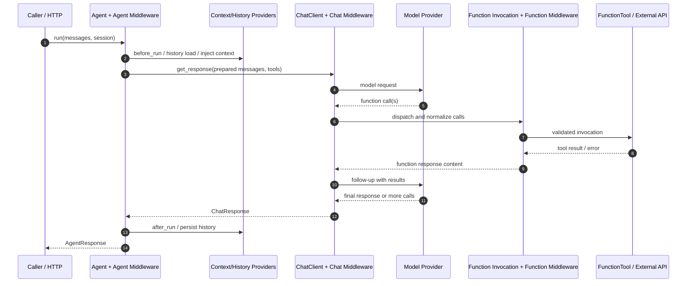
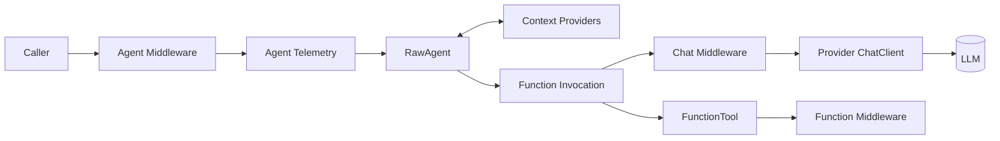
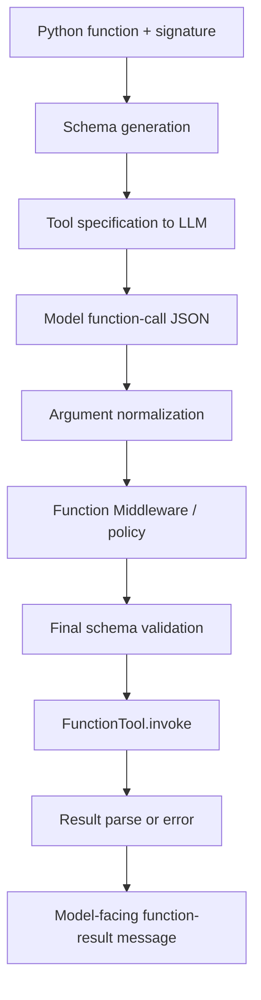
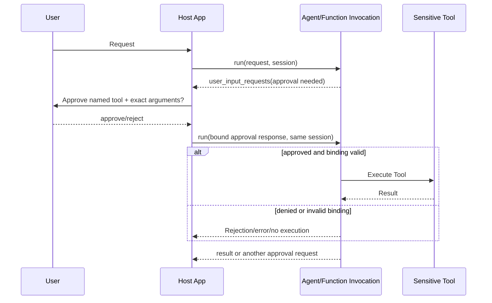
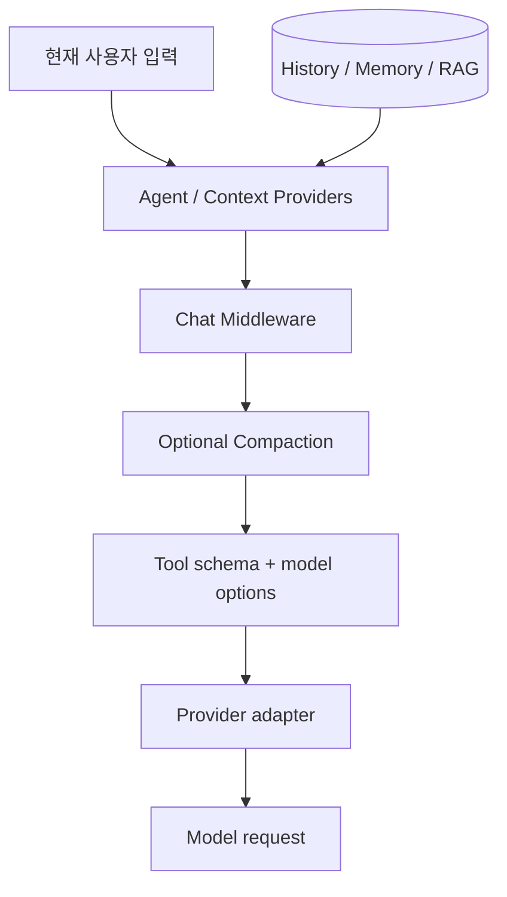
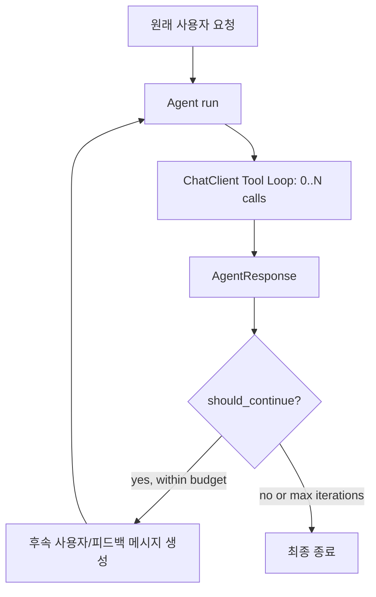
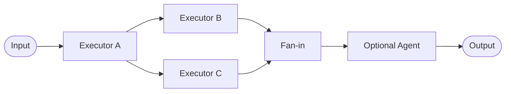
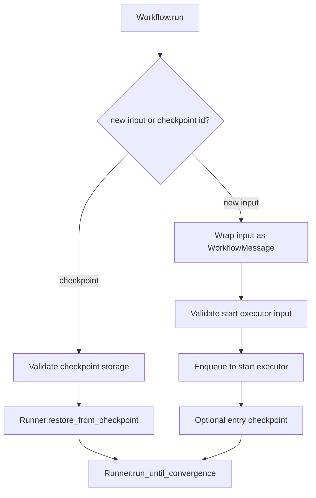
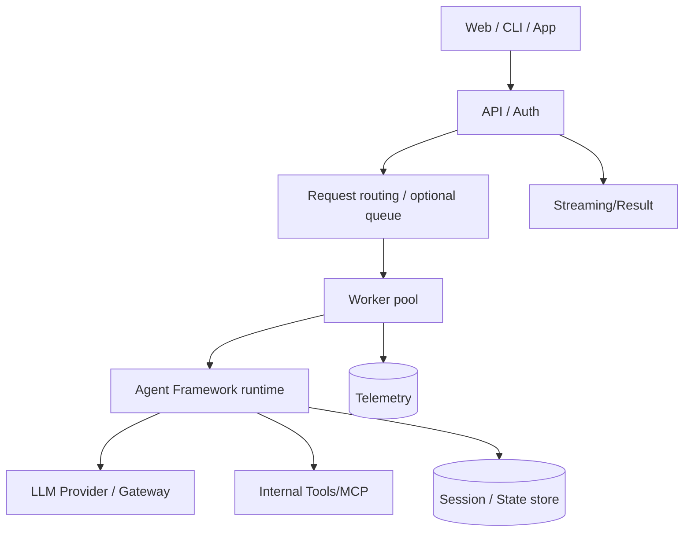

# Microsoft Agent Framework — 2차 심층 학습 및 내부 소스코드 분석

> **분석 대상:** Microsoft Agent Framework (MAF), Python Core **`python-1.24.0`** 태그 (2026-10-30 공개 릴리스)  
> **작성 기준일:** 2026-10-31 (KST)  
> **목적:** 단순 사용법이 아니라 **Agent 런타임과 오케스트레이션 엔진을 직접 설계할 수 있도록** 내부 구현·상태 전이·실패 조건·동시성·권한 경계·설계상 대안을 이해한다.  
> **범위:** Python 중심. .NET/Go는 설계 차이가 중요할 때만 비교. **반도체 데모 구현·실제 모델 호출·벤치마크·장비 제어 시나리오는 제외**한다.  
> **검증 규칙:** `[SRC]` 태그 고정 원본 소스 확인, `[DOC]` Microsoft 공식 문서, `[INF]` 코드/문서 기반 해석, `[PSEUDO]` 학습용 의사코드, `[UNV]` 실행·실측 또는 추가 코드 확인 필요.  
> **소스 링크:** 본문 `[Sxx]`, `[Dxx]`, `[Rxx]`는 마지막 출처 인덱스에 연결된다. `main` 브랜치가 아니라 **반드시 `python-1.24.0` 고정 태그의 코드**와 대조한다.

---

## 이 문서가 1차 자료와 다른 점

1차 자료가 “Agent, Tool, Session, Workflow가 무엇이며 어떤 기능을 제공하는가?”에 답했다면, 2차 자료는 다음을 추적한다.

1. 호출은 정확히 어느 **클래스/메서드**로 진입하는가?
2. 각 계층은 입력·출력·상태·부작용 중 무엇을 **소유**하는가?
3. 모델의 Tool 요청을 누가 검증하고, 어떤 **함수 호출 경로**로 실제 실행시키는가?
4. **어떤 조건**에서 도구 반복, 전체 Agent 재실행, Workflow Superstep이 종료되는가?
5. 오류·취소·승인·복구 중 정보가 무엇에 **남고 사라지는가**?
6. Guardrail은 단순 지침인가, 우회하기 어려운 **런타임 강제 지점**인가?
7. 같은 기능을 다른 프레임워크가 구현하는 방식과 어떤 **기술적 대가(trade-off)**가 다른가?

**핵심 관찰:** MAF는 “하나의 거대한 Agent Loop”라기보다 **외부 Agent 파이프라인 + 내부 ChatClient 함수 호출 반복 + 독립 Workflow 엔진 + 선택적 Harness 재실행 루프**의 결합이다. 이 네 가지를 혼동하면 Memory·HITL·병렬성·Checkpoint를 잘못 설명하게 된다. [D01][S01][S02][S08][S09]

## 목차

1. 분석 목표·증거 수준·소스 추적 방법
2. SDK / Framework / Harness / Runtime의 경계
3. Python Core 저장소 지도와 제어권 분리
4. 요청 1건의 전체 실행 시퀀스
5. Agent 클래스 합성·Middleware 계층
6. Context Provider의 `before_run / after_run`과 History
7. ChatClient와 Function Invocation Tool Loop
8. Tool 스키마 생성·인자 검증·결과 정규화
9. Tool 병렬 실행과 동시성·부작용 모델
10. Middleware 세 유형과 실제 실행 순서
11. Guardrails, `MiddlewareFailure`, 종료·실패 차이
12. Tool Approval의 요청-응답 바인딩과 세션 권한
13. Session / History / Memory / Checkpoint 비교
14. Context 주입·Compaction·Caching의 경계
15. Harness와 `AgentLoopMiddleware` 내부 반복
16. Skills, Planning, File Memory, Background Agent
17. Graph Workflow의 Executor / Edge / Run
18. Superstep, Fan-out/Fan-in, 이벤트 순서
19. Workflow Checkpoint, Replay, HITL Resume
20. Functional Workflow와 Graph의 대체 관계
21. Multi-Agent의 위임·협업·독립 상태
22. MCP·Provider·서빙/Streaming·Cron 경계
23. 보안과 FIDES, 정보 흐름 강제의 범위
24. 실패 모드·Race·Cancellation·중복 부작용
25. 코드 추적 워크북 15개
26. 자체 Framework 설계 시 기술적 선택표
27. 다른 6개 기술과 설계 관점 비교
28. 발표 구성 및 질의응답
29. 핵심 정리·자가 점검 문제
30. 공식 문서 및 버전 고정 소스 인덱스

---

# Part I. 구조를 정확히 나누기

## 1. 분석 목표와 증거 수준

### 1.1 학습 후 할 수 있어야 하는 설명

- “MAF의 Agent Loop는 어디 있나요?”라는 질문에 **Function Invocation, Harness Loop, Workflow Loop를 따로** 보여줄 수 있다.
- `Agent.run()`을 호출해 모델이 Tool 2개를 요청할 때 **모델↔도구 재호출이 어느 계층에서 발생**하는지 추적할 수 있다.
- 동일한 ‘상태 저장’이라는 말로 Session / History Provider / Checkpoint / 외부 DB를 묶지 않는다.
- `MiddlewareFailure`가 왜 Tool에 일반 Exception을 던지는 것과 다른지 **보안 정책의 관점**에서 설명한다.
- Checkpoint가 성공해도 원격 파일 생성이나 DB 쓰기가 중복될 수 있는 **실패 지점**을 지적할 수 있다.
- 프레임워크를 새로 설계한다면 어떤 구성요소를 플러그인으로 분리하고 무엇을 핵심 실행기에 남길지 제시할 수 있다.

### 1.2 증거 등급

| 기호 | 정의 | 사용 원칙 |
|---|---|---|
| `[SRC]` | 태그 고정 소스의 특정 클래스·조건·상태 필드 | 함수/파일 링크를 붙여 사실을 확인 |
| `[DOC]` | 공식 사용자 문서·릴리스에 명시 | 공개 API 계약·제약을 설명 |
| `[INF]` | 아키텍처에 근거한 기술적 해석 | 원인과 장단점은 단정하지 않음 |
| `[PSEUDO]` | 교육용으로 간소화한 코드 | 원문 복사가 아님을 앞에 표시 |
| `[UNV]` | 직접 실행·부하·지속 저장 실측 불가 | 성능이나 안정성을 보장하지 않음 |

이 문서의 코드 블록은 특별히 **“실제 짧은 코드 단편”**이라고 표시되지 않으면 학습용 의사코드다. 공개 소스코드의 전체 함수 본문을 복사하지 않는다. 공식 문서가 빠르게 변경되므로 일부 문서에서 나타난 기능이 **릴리스 태그에 동일하게 존재하는지** 함께 확인해야 한다.

## 2. SDK인가, Framework인가, Harness인가?

- **SDK:** Python 패키지 형태로 API/인터페이스를 제공한다는 의미. 배포·사용 형태에 대한 표현.
- **Framework:** `Agent`, `ChatClient`, `Tool`, `Session`, `Workflow` 등의 규약과 제어 흐름을 제공한다는 의미. 설계 책임과 실행 구조에 대한 표현.
- **Harness:** 기존 프레임워크 부품을 조합해 planning, todo, memory, 승인, 실행 제한, background worker를 갖춘 운영형 Agent 구성. MAF의 Harness는 별도 새 모델이 아니라 같은 실행 기반 위에 구축된다. [D02]
- **Runtime:** 실제 프로세스 안에서 Tool을 디스패치하고, 모델 응답을 순환하고, 이벤트·세션을 갱신하는 실행 코드.

따라서 **MAF는 Python SDK로 설치되는 Agent Framework이고, 선택적으로 Harness도 제공한다.** 네 표현은 배타적 개념이 아니다. [D01][D02]

**개발자 관점 질문:** 새 프레임워크에서 “모델에 Tool 목록을 넘기는 코드”만 있으면 충분할까? 아니다. 모델 호출 이후 인자 검증·승인·실제 실행·결과 변환·재호출·종료·취소·기록까지 실행 루프가 필요하다.

## 3. 코드 지도: ‘어디에 무엇이 있는가?’

버전 고정 저장소 루트: `python/packages/core/agent_framework/`.

| 계층 | 파일 | 중요한 객체/관심사 |
|---|---|---|
| Agent | `_agents.py` | `BaseAgent`, `RawAgent`, `Agent`, `SupportsAgentRun`, Context Provider 실행 |
| Chat | `_clients.py` | `BaseChatClient`, 요청/응답, 모델 Provider와의 계약 |
| Function Tool | `_tools.py` | `FunctionTool`, JSON Schema/인자 검증, Tool 호출 관련 유틸리티 |
| Middleware | `_middleware.py` | `AgentContext`, `ChatContext`, `FunctionInvocationContext`, `MiddlewareFailure` |
| Session | `_sessions.py` | `AgentSession`, `ContextProvider`, `HistoryProvider` 및 Run Persistence |
| Compaction | `_compaction.py` | 전략과 메시지·토큰 관리 |
| Harness Loop | `_harness/_loop.py` | `AgentLoopMiddleware`, `should_continue`, max 반복 수 |
| Workflow | `_workflows/_workflow.py` | `Workflow`, run/resume, 이벤트 전달 |
| Workflow Runner | `_workflows/_runner.py` | Graph 실행, 노드 구동 메커니즘 |
| Checkpoint | `_workflows/_checkpoint.py` | 저장 구조·메시지·State·리니지 |
| FIDES | `security.py` 및 관련 보안 모듈 | 실험적 정보 흐름 제어 |

[S01]–[S11]에서 개별 파일의 고정 버전 원문으로 이동할 수 있다. **주의:** ChatClient의 함수 자동 호출에 필요한 실제 구현의 일부는 `_clients.py` 하나가 아니라 Tool·Middleware/모델별 어댑터와 조합된다. “메서드가 모두 `_clients.py` 하나에 있다”라고 가정하지 않는다. [S02][S03][D01]

## 4. 요청 하나의 전체 실행 시퀀스



**이 시퀀스는 합성한 개념도**다. Tool 자동 호출이 활성화된 경우의 대표 경로이며, Provider가 원격에서 처리하는 hosted tool이나 streaming/HITL의 세부 변형은 다르게 동작할 수 있다. [D01][D03]

### 4.1 ‘Loop’가 최소 세 개 있는 이유

| 실행 단위 | 반복하는 대상 | 종료를 결정하는 주체 | 주요 코드 |
|---|---|---|---|
| **Tool Loop** | `모델 → 도구 → 모델` | Function Invocation 계층의 결과·반복 예산·예외 | [S02][S03] |
| **Harness Agent Loop** | Agent 실행 전체(`call_next`) | `should_continue`, `max_iterations`, 모드·작업 상태 | [S07] |
| **Workflow Run Loop** | 준비된 Executor와 다음 Superstep | 큐·Graph 상태·미처리 요청·완료 조건 | [S08][S09] |

**발표 핵심:** 셋 모두 ‘반복’이지만 동일하지 않다. Tool Loop는 한 번의 Agent run *안쪽*, Harness Loop는 **Agent 실행 바깥쪽**, Workflow Loop는 **명시적으로 만든 그래프 실행 엔진**이다.

# Part II. Agent 파이프라인 내부

## 5. Agent 클래스의 다층 합성

공식 Pipeline 설명은 Agent의 바깥쪽에 **Middleware + Telemetry**, 가운데 **RawAgent**, 안쪽에 **Context Provider와 ChatClient**를 둔다. ChatClient에는 **Function Invocation**, **Chat Middleware**, 실제 Provider 클라이언트가 결합된다. [D01]



이 그림에서 `FunctionMiddleware`가 Tool **이전/이후**에 관여하고, `ChatMiddleware`는 모델 호출마다 관여한다. 메서드별 감싸기 순서는 실제 소스의 조합 순서와 Pipeline을 따로 확인해야 한다. 단지 Middleware 리스트의 순서만 보고 ‘정확히 이 순서’라고 추정하지 않는다. [D01][S04]

### 5.1 `BaseAgent`와 `RawAgent`

`BaseAgent`는 공통 Session·Context·관리 유틸리티를 제공하고, `RawAgent`는 ChatClient를 사용하는 핵심 실행 구성이다. `Agent`는 표준 Layer를 합성한 공개 사용 진입점이다. [S01]

**[PSEUDO] 계층적인 책임을 표현한 예:**

```python
async def agent_run(messages, session):
    # AgentMiddleware / Telemetry
    context = await gather_context(messages, session)  # RawAgent / providers
    response = await chat_client.get_response(context.messages, tools=context.tools)
    await persist_context_and_history(session, response)
    return to_agent_response(response)
```

이는 **원본 함수의 직역이 아니다.** 의사코드에 쓰인 `gather_context` 같은 식별자는 설명 편의를 위한 이름이다. 실제 메서드는 [S01]의 `RawAgent`, [S05]의 Session Provider 메서드에서 추적한다.

### 5.2 Agent가 모델을 직접 반복 호출하는가?

일반 Agent는 주로 **컨텍스트 설정·호출·응답 결합**을 담당하고, 여러 Function Call에 따른 모델 재호출은 ChatClient의 Function Invocation 계층이 수행한다. 이것이 MAF 설계의 중요한 경계다. [D01]

**장점 [INF]:** ChatClient를 직접 사용하는 코드에서도 Tool 자동 호출 로직을 재사용할 수 있고, Provider 교체를 쉽게 한다. **단점 [INF]:** 핵심 루프가 Agent 객체가 아닌 여러 Layer에 분산돼 처음 디버깅하는 개발자가 호출 경로를 찾기 어렵다.

## 6. Context Provider와 History: 실제 호출 지점

`ContextProvider`는 Run 전후로 컨텍스트를 추가하거나 후처리한다. `HistoryProvider`는 대화 이력을 읽고/저장하기 위한 특화된 공급자다. `InMemoryHistoryProvider`는 로컬 대화 기록을 유지한다. [D04][S05]

### 6.1 단계별 상태

| 시점 | 입력 | 출력/변경 가능 상태 | 실패 시 질문 |
|---|---|---|---|
| `before_run` | 현재 메시지, AgentSession | 검색 결과·Instruction·Tool·History 주입 | 검색 실패로 실행 중단할지? |
| 모델/Tool 실행 | Context+Tool 집합 | 새 메시지 및 결과 | 여러 Tool 중 하나 실패 시? |
| `after_run` | 응답, SessionContext | History·외부 Memory·감사 로그 쓰기 | 저장 실패했는데 답변은 성공했나? |
| Harness 내 반복 | 같은 상위 요청의 여러 내부 반복 | 실행별/턴별 저장 정책 | 대화가 중복 저장되지 않는가? |

태그 코드의 [S01], [S05]에는 Provider 실행 후처리와 **턴당 한 번 vs 각 실행마다** 실행할 작업을 구분하는 경로가 있다. 이 차이를 무시하고 후처리를 매 Tool Loop마다 호출하는 것으로 그리면 부정확하다. [SRC]

### 6.2 ‘Memory’를 모델에 넣을 때 주의

대화 기록을 모조리 모델에 넣는 것은 Memory라기보다 **History Replay**에 가깝다. Memory는 파일, 구조화된 키/값, 검색 서비스 등의 지속 저장소에서 **선별·검색·주입**하는 기능까지 포함할 수 있다. 사내 문서에서 검색된 텍스트는 모델을 위한 참고 **데이터**일 뿐, 상위 Instruction으로 취급해서는 안 된다. [D04][D10]

## 7. ChatClient / Function Invocation: 실제 Tool Loop

### 7.1 모델이 함수를 실행한다는 표현의 오류

모델은 Tool을 실제 실행하지 않는다. 모델은 `function_name + arguments`에 해당하는 Tool Call을 **요청**하고, 애플리케이션의 Function Invocation 계층이 등록된 Tool을 찾아 **실행**한 다음 결과를 메시지로 되돌려 준다. [D01][S03]

**[PSEUDO] 일반화된 Function Invocation 흐름:**

```python
async def invoke_until_final(messages, tools, max_calls):
    for _ in range(max_calls):
        response = await model(messages, schemas_of(tools))
        calls = extract_local_function_calls(response)
        if not calls:
            return response
        results = await invoke_registered_tools_with_policies(calls)
        messages += [response, *to_function_result_messages(results)]
    raise ToolLoopBudgetExceeded()  # 실제 SDK의 예외명 아님
```

위 코드는 원리 설명용이며 실제 `FunctionInvocation` 루프의 조건, `max_calls` 이름, 예외명과 일치한다고 주장하지 않는다. 구체적인 한도는 공개 API/Layer 코드에서 확인해야 한다. [S02][S03]

### 7.2 코드 추적에서 꼭 확인할 다섯 단계

1. **도구 노출:** Tool 정의에서 모델에 전달할 JSON Schema가 어떻게 만들어지는가?
2. **응답 파싱:** Provider가 반환한 Tool Call이 어떤 공통 Content/Message 형태로 변환되는가?
3. **등록 매칭:** Function 이름·ID·입력 인자를 어떻게 연결하는가?
4. **검증 및 Middleware:** 함수가 실행되기 전에 승인/인자 정책/스키마 검증을 어느 순서로 수행하는가?
5. **결과 반영:** 성공·오류·승인 요청을 어떤 타입으로 전환해서 모델 또는 호출자에게 반환하는가?

`FunctionTool`은 자동 JSON Schema 생성과 인자 검증을 제공한다. 특히 **추론된/Pydantic 입력 모델**과 사용자가 직접 넣은 JSON Schema 매핑의 검증 강도가 동일하지 않다. 사용자 제공 Schema의 경량 검증을 프레임워크가 완전한 보안 검증으로 수행한다고 오해하면 안 된다. [S03]

## 8. Tool Schema, Validation, Execution, Result Conversion

### 8.1 `FunctionTool`의 책임

고정 소스 `_tools.py`의 `FunctionTool`은 Python 함수를 LLM이 호출 가능한 도구로 바꾸는 래퍼다. 타입 애너테이션과 Pydantic 모델을 활용해 입력 스키마를 생성하고, 호출 시 변환·검증한다. 결과 파싱 정책에 따라 일반 값이 Content 목록으로 바뀌거나 원시 값이 전달될 수 있다. [S03]



### 8.2 타입 검증과 보안 검증은 다르다

`query: str`가 유효하더라도 `'DELETE FROM manufacturing_table'`처럼 위험한 SQL일 수 있다. 반대로 사용자 권한이 없다면, 완벽하게 정형화된 `lot_id: str`도 허가할 수 없다. 함수 파라미터가 JSON Schema를 만족한다는 사실은 **인가·민감 정보·명령 허용 범위**를 보장하지 않는다.

| 검증 계층 | 검사 대상 | 주된 책임자 |
|---|---|---|
| JSON/Pydantic | 값의 타입, 필수 필드, 길이/범위 | Tool/스키마 |
| Function Middleware | 실행 정책·예외·사전 승인 | Framework 구성 |
| Tool 내부 | 사용자/조직 권한·파라미터 의미·부작용 | 서비스 도메인 코드 |
| 인프라 | DB 계정, 네트워크, 컨테이너 격리 | 운영 환경 |

이 분리가 [D06]의 권고와도 일치한다. **모델에게 “읽기 전용”이라고 명령하는 것만으로 읽기 전용이 구현되지 않는다.**

### 8.3 Middleware가 Arguments를 수정할 수 있다는 점

고정 버전의 `FunctionInvocationContext` 문서는 Middleware가 `context.arguments`를 읽거나 고칠 수 있고, 최종 Handler는 변경된 인자를 실행 직전에 다시 검증한다고 설명한다. 정책 검사 **이후**에 인자가 다시 바뀌면, 승인된 호출과 실제 실행된 호출이 달라지는 TOCTOU 문제가 생긴다. 이를 막기 위해 보안 검증 이후의 인자 변경은 `MiddlewareFailure`를 발생시키는 경로가 있다. [S04][S03]

**왜 중요한가?** 외부 모델이 `file_path=/safe/a.csv`를 요청해 정책을 통과했더라도, 하위 Middleware가 이를 `/secret/key`로 바꾸면 정책 검사는 무의미해진다. 따라서 **실행 직전 최종 인자에 대한 정책 검증**이 강제돼야 한다.

### 8.4 반환값의 정규화

Function Middleware는 `context.result`를 가로채 치환할 수 있다. 하지만 값의 형태에 따라 `list[Content]`, 문자열, 기타 객체가 서로 다른 형태로 정규화될 수 있다. 특히 승인 요청을 나타내는 특별한 Content는 일반 문자열과 다른 제어 신호다. [S04]

**설계상 교훈 [INF]:** Tool 실행 결과와 **제어 신호**를 모두 임의의 문자열로 변환하면 승인·재개 로직이 망가질 수 있다. 자체 Framework라면 `ToolSuccess`, `ToolError`, `ApprovalRequired` 같은 타입을 구분하고 직렬화 규약을 명시하는 편이 좋다.

## 9. Tool 병렬 처리: ‘여러 호출’과 ‘동시 실행’은 다르다

### 9.1 동시성의 네 층

| 상황 | 의미 | 실행 주체 |
|---|---|---|
| 모델 응답의 복수 Tool Call | 한 번의 모델 출력에 여러 호출 요청 | 모델/Provider |
| 병렬 Tool Execution | 요청된 여러 Tool을 동시 I/O로 실행 | Function Invocation 실행기 |
| 병렬 Agent Delegation | 서로 다른 Agent가 각각 모델/도구를 호출 | 위임자·오케스트레이터 |
| Workflow Fan-out | Graph의 여러 Executor를 같은 Superstep에 스케줄 | Workflow Runner |

`Tool` 호출이 복수라고 해서 항상 `asyncio.gather`로 동시 실행된다고 주장해서는 안 된다. 공급자 옵션·Tool 실행 정책·구현 방식·병렬 호출 허용 여부에 따라 달라질 수 있다. 구체적인 동시성 Primitive와 예외 전파는 [S03]의 Function Invocation 관련 구현과 해당 테스트를 읽어 확인해야 한다. `[UNV]` 이 문서는 Tool 간 동시 실행을 실제 계측하지 않았다.

### 9.2 병렬 처리에서 필요한 계약

- **입력 격리:** Tool A와 B가 Session·메시지·전역 상태를 공유하는가?
- **결과 정렬:** Tool 결과를 완료순으로 모델에 주는가, 원래 호출순으로 주는가?
- **취소:** A가 실패하면 B를 취소하는가? 이미 실행된 외부 HTTP 요청은 취소되는가?
- **동시 쓰기:** A/B가 같은 파일·테이블을 수정하면 누가 잠금을 소유하는가?
- **부분 성공:** 결과 하나만 성공해도 다음 모델 호출을 진행하는가?
- **반복 예산:** 모델 호출 수뿐 아니라 Tool 호출 수·Tool 비용도 제한하는가?

**[PSEUDO] 경쟁 조건 사례:**

```python
# 같은 세션의 counter가 0일 때 아래 두 작업을 동시 실행했다고 가정
async def increment_A(state):
    current = state['counter']  # 0
    await asyncio.sleep(0)
    state['counter'] = current + 1

async def increment_B(state):
    current = state['counter']  # 0
    await asyncio.sleep(0)
    state['counter'] = current + 1

# 최종값이 2가 아니라 1이 될 수 있다.
# MAF의 실제 구현 코드를 발췌한 것이 아닌 동시성 교육용 사례다.
```

### 9.3 리소스 소유권 원칙

Tool을 병렬로 실행할 때 가장 취약한 지점은 모델의 ‘판단’이 아니라 **도구의 외부 부작용**이다. DB 트랜잭션, 파일 덮어쓰기, 웹훅 알림 등은 Function Invocation 계층이 원자성·멱등성을 모두 책임져 주지 않는다. 키 기반 락·DB 트랜잭션·읽기 전용 역할과 같은 외부 정책이 필요하다. [INF]

## 10. Middleware: Agent / Chat / Function이 실제로 언제 도나?

MAF의 Middleware는 3가지 별도 인터셉션 지점을 제공한다. [D01][S04]

| 종류 | 호출 시점 | 변경 가능 대상 | 대표 목적 | 주의 |
|---|---|---|---|---|
| `AgentMiddleware` | Agent `run()` 전후 | Agent 입력, 컨텍스트, 결과 | 정책, 상위 반복, 감시 | Tool마다 실행되는 것은 아님 |
| `ChatMiddleware` | ChatClient의 모델 호출 전후 | 메시지, 모델 옵션, 응답 | 프롬프트 수정, 비용 관리 | 여러 Tool Loop 동안 **매번** 실행될 수 있음 |
| `FunctionMiddleware` | 개별 Function Tool 호출 전후 | 인자, 실행 여부, 결과 | Tool 승인, 인가, 로깅 | 일반 예외가 Tool 오류로 변환될 수 있음 |

### 10.1 `call_next()`의 의미

**[PSEUDO] Middleware 체인:**

```python
async def middleware_A(ctx, next_call):
    assert_policy(ctx)              # 이전
    await next_call()               # 다음 Middleware 혹은 실제 Handler
    audit(ctx.result)               # 이후

async def middleware_B(ctx, next_call):
    ctx.metadata['trace'] = True
    await next_call()
```

실행 구조를 ‘양파 구조’라고 부를 수 있다. A가 B를 감싸고 B가 실제 Tool을 감싸면 `A.pre → B.pre → Tool → B.post → A.post`가 된다. 다만 **예외·취소·스트리밍 미소비**에서는 post 부분이 기대대로 실행되지 않을 수 있으므로 `try/finally` 또는 제공되는 Cleanup Hook이 필요하다.

### 10.2 정책을 어디에 놓아야 하는가?

- **Agent Middleware:** 사용자 요청 자체의 허용 여부, 전체 요청 상한.
- **Chat Middleware:** 프롬프트·컨텍스트 검증, 모델 옵션 제한.
- **Function Middleware:** 실제 실행될 특정 Tool 이름·인자 검사.
- **Tool 서버/DB:** 최종 인가, 네트워크·파일 접근 통제.

**중요:** 외부 MCP Tool이나 원격 Hosted Tool에 대해 Framework의 Function Middleware가 항상 해당 원격 실행 안쪽까지 적용된다고 가정하면 안 된다. **실제 Tool이 어디에서 실행되는지**가 보안 강제 경계를 결정한다.

## 11. Guardrails가 실패했을 때 어떤 일이 생기는가?

### 11.1 일반 오류와 보안 중단의 차이

`_middleware.py`의 `MiddlewareFailure` 주석은 특히 중요한 구현 사실을 설명한다.

- 일반 Function Tool 또는 Function Middleware 예외는 Function Invocation 계층에서 **Tool 오류 결과로 변환될 수 있어**, 모델이 이를 보고 다른 방법을 시도할 수 있다.
- 보안 정책을 집행하는 Middleware의 실패를 같은 방식으로 처리하면 모델이 **정책 실패를 우회할 기회**를 얻는다.
- 이 때문에 `MiddlewareFailure`는 **실행 전체에 실패를 전파하는 fail-closed 신호**를 제공한다.
- `MiddlewareTermination`은 별도로 **우아하게 실행을 중지**하며 결과를 대체할 수 있다. [S04]

| 신호 | 기대 동작 | 언제 사용? |
|---|---|---|
| 일반 Exception | 오류 결과가 모델로 복귀할 수 있음 | 일시적인 Tool API 실패 |
| `MiddlewareTermination` | 정상 종료와 유사한 통제된 중단 | 요청 범위 제한, 대신 응답 전달 |
| `MiddlewareFailure` | 결과 없이 실패 전파, 전체 실행 중단 | 인가 확인 실패·신뢰 경계 붕괴 |

**[PSEUDO] 안전 정책:**

```python
async def enforce_access(ctx, call_next):
    try:
        allowed = await policy_engine_check(ctx.arguments)
    except Exception as exc:
        raise MiddlewareFailure('Cannot determine authorization') from exc
    if not allowed:
        raise MiddlewareFailure('Not authorized')
    await call_next()
```

표기는 실제 API 사용 예가 아니라 **개념 의사코드**다. 정책 검사 실패를 단순 `False`로 치환하고 Tool Loop를 이어가는 것과 실행을 확실히 중단하는 것은 다르다.

### 11.2 인자 변경과 Guardrail 우회

정책 검사를 통과한 인자를 하위 Middleware가 바꾸면, 검사된 호출과 실행될 호출이 달라진다. 고정 코드의 `FunctionInvocationContext` 주석은 **인자 수정 Middleware를 보안 Middleware보다 앞에 두라**고 경고하며, 정책 검사 후 인자 변경에 실패 신호를 사용한다. [S04][S03]

발표할 때는 “Guardrail이 존재한다”보다 다음 문장이 좋다.

> **MAF의 Function Guardrail을 이해하려면 ‘언제 검사하는가’뿐 아니라 ‘검사 이후 인자가 바뀔 수 있는가’까지 추적해야 한다.**

### 11.3 우회하기 어려운 경계는 어디인가?

입력 프롬프트의 시스템 지침은 모델 행동을 유도하지만 확정적인 인가 엔진이 아니다. Function Middleware는 프레임워크 경유 Tool에 정책을 강제할 수 있지만, 외부 Tool이 독립적인 자격 증명·네트워크 권한을 가지면 해당 서버 측에서 추가 검증해야 한다. [D06][D07]

## 12. Human Approval: 상태, 바인딩, 중단과 재개

### 12.1 일어나는 일의 정확한 순서

공식 Python 예에서는 승인 대상 Tool에 `@tool(approval_mode="always_require")`를 설정하고, Agent를 실행하면 `AgentResponse.user_input_requests`를 확인한다. 호스트 애플리케이션이 사용자의 결정을 수집한 뒤 같은 `AgentSession`으로 승인 응답을 전달해 다시 실행한다. [D05]



**주의:** 승인 대상 Tool이 요청되는 시점은 모델 Tool 요청 이후지만 **실제 함수 실행 이전**이어야 한다. UI에서 사람이 버튼을 눌렀다는 사실만으로 올바른 Tool Call과 바인딩됐다고 볼 수 없다.

### 12.2 권한 상태의 수명

공식 문서는 로컬 Approval Response가 기본적으로 **같은 AgentSession에 기록된 pending 요청과 일치할 때만** 허용되며, 결합되지 않은 응답은 무시한다고 명시한다. [D05]

또한 Harness의 `ToolApprovalMiddleware`는 반복되는 승인·standing approval·자동 승인 규칙을 제공할 수 있다. 이러한 **standing approval이 Session State에 지속**될 수 있으므로, 도구 목록/이름이 바뀐 뒤 이전 승인 정책이 새 도구에 뜻하지 않게 적용되지 않는지 확인해야 한다. [D05]

### 12.3 Tool Approval ≠ Workflow HITL

| 기능 | Tool Approval | Workflow HITL |
|---|---|---|
| 대기 대상 | 특정 Function Tool 실행 | Graph의 외부 정보/승인 응답 |
| 상태 기초 | 승인 요청·Session 응답 바인딩 | RequestInfoEvent / pending request / Checkpoint |
| 재개 방법 | Agent 재호출에 승인 응답 전달 | Workflow request response와 Resume 경로 |
| 대표 리스크 | 권한 오래된 상태 재사용 | 재개 중 외부 Executor 중복 실행 |

두 가지를 하나의 “휴먼 인더 루프 기능”이라고 설명하면 **실제 상태 관리와 재개 절차**가 완전히 다른 점을 놓친다. [D05][D15]

## 13. Session, History, Memory, Checkpoint가 어떻게 다른가?

| 대상 | 목적 | 대표 데이터 | 저장 수명 | 자동으로 해결하지 못하는 것 |
|---|---|---|---|---|
| `AgentSession` | 대화·승인·Provider별 실행 상태 연결 | 세션 ID, state, service session handle | 한 대화/사용자 범위 | 모델 지식 정확성, DB 인가 |
| `HistoryProvider` | 과거 메시지 관리 | role/message/Content | 세션 또는 지정 저장소 | 장기 정보 선별·검색 품질 |
| `FileMemoryProvider` | 모델이 메모리 읽기/쓰기 도구 사용 | 메모리 파일 및 scope | 세션별/명시 scope | 메모리의 품질·진위 |
| RAG Context Provider | 외부 지식 검색/주입 | 검색문서·메타데이터·인용 | 외부 저장소 기준 | 잘못된 자료·권한 분리 |
| Workflow Checkpoint | 실행 중 상태 복원 | Executor state, pending messages/requests, graph hash | Workflow 실행 및 저장소 범위 | 외부 부작용 정확히 한 번 처리 |

`AgentSession` 자체가 벡터 DB는 아니다. `FileMemoryProvider`는 `scope` 지정에 따라 여러 세션이 파일을 공유할 수도 있지만, **기본 scope가 세션별로 분리될 수 있다**는 공식 문서를 먼저 확인해야 한다. Scope는 권한 경계와 연결되므로 사용자 입력을 그대로 폴더 경로처럼 쓰지 않는다. [D04]

### 13.1 History 저장 시점의 미묘함

MAF Harness 문서는 **Per-service-call history persistence**를 별도 기능으로 나열한다. 모델이 Tool을 부르고 다시 모델을 호출하기 전에도 현재 Tool Call/Result 이력을 보존할 수 있도록 설계된다. 일반적인 ‘Agent 최종 답변 후 저장’ 방식과 다른 점이다. [D02]

**실패 사례:** 1차 모델 호출이 Tool을 요구하고 Tool은 외부에 쓰기를 수행했다. 2차 모델 호출 직전에 서버가 죽었다. History가 이전까지 영속화되지 않았다면 복구 후 첫 Tool이 다시 실행될 수 있다. **중간 저장이 리스크를 줄일 수는 있지만, 외부 작업 원자성을 대신하지는 않는다.** [INF]

## 14. Context Assembly, Compaction, Cache의 책임 분리

### 14.1 실제 모델에 무엇이 들어가는가?

MAF의 최종 모델 요청은 여러 층에서 만들어질 수 있다. [D01][D04]



그림은 **책임 관계를 보여주는 개념도**다. Provider별 최종 메시지 직렬화, Compaction의 정확한 단계, 캐시 키는 다를 수 있으므로 실제 Provider 어댑터가 보내는 payload를 확인해야 최종 토큰 배열을 단정할 수 있다. [S02][S06]

### 14.2 세 개념의 차이

- **Compaction:** 기존 메시지의 일부를 요약·교체·제거해 모델이 볼 컨텍스트 크기를 줄인다. 정보 손실 가능성이 있다.
- **Prefix Caching:** 모델 제공자가 동일한 입력 Prefix에 대한 계산을 재사용하는 기능. 프롬프트 데이터가 다시 전송될 수 있더라도 *내부 계산*을 재사용할 수 있다. Cache Hit는 Prefix 안정성·공급자 정책에 의존한다.
- **Persistent Memory:** Session을 넘어 필요한 정보를 저장·검색한다. 모델의 컨텍스트를 무한히 확장하지 않는다.

`_clients.py`에는 모델 호출 전에 메시지를 준비하는 `_prepare_messages_for_model_call` 경로가 보인다. `compaction_strategy`와 `tokenizer`를 전달한다. 하지만 “모든 모델 요청에 캐싱이 자동으로 활성화된다”는 주장은 공식 Provider별 검증 없이 할 수 없다. [S02][S06]

### 14.3 모델이 보는 입력을 재구성하는 조사 방법

1. `RawAgent`에서 `instructions`와 현재 메시지가 언제 합쳐지는지 추적한다.
2. `ContextProvider`가 반환한 메시지와 Tool이 어디에 추가되는지 확인한다.
3. Chat Middleware에서 수정된 메시지가 실제 `BaseChatClient`에 전달됐는지 확인한다.
4. Compaction 전략의 **원본 History 수정 여부**와 모델 전송 직전의 복사본을 구별한다.
5. Provider가 Tools/response format/metadata를 각 모델 API의 어떤 필드로 직렬화하는지 확인한다.
6. Prefix Cache는 실제 API 사용량 기록으로 검증한다. **문서만으로 캐시 적중률을 단정하지 않는다.**


# Part III. Harness와 명시적 Workflow 엔진

## 15. Harness의 별도 Agent Loop: 왜 Tool Loop와 구분해야 하나?

### 15.1 `AgentLoopMiddleware`의 기능

`_harness/_loop.py`에는 `AgentLoopMiddleware(AgentMiddleware)`가 있고, 설명상 **특정 조건이 만족될 때까지 감싼 Agent를 다시 실행**한다. 이때 반복 한 번은 모델 한 턴이 아니라 **Agent 실행 한 회**라는 점이 중요하다. [S07]



`AgentLoopMiddleware`는 상위 요청에 대한 **진행 상황을 되돌아보고 추가 작업이 필요한지 평가하는 정책**을 구현하기에 좋다. 하나의 모델 응답이 Tool 호출을 끝냈더라도 작업이 완료된 것은 아닐 수 있기 때문이다. 반대로 쉽게 무한 반복에 빠질 수 있어 `max_iterations`와 다음 지시문 구성 방식이 중요하다. [S07]

### 15.2 코드에서 확인한 종료 조건

고정 소스의 `_evaluate_stop()`은 `max_iterations` 안전 제한을 먼저 확인하고, 그렇지 않으면 `should_continue`를 평가한다. `should_continue`는 단순 bool 또는 `(bool, feedback)` 형태의 값을 반환할 수 있고, 후자는 다음 반복을 안내하는 메시지에 활용된다. [S07]

**[PSEUDO] 핵심 분기만 요약:**

```python
async def decide_stop(iterations, max_iterations, should_continue):
    if max_iterations is not None and iterations >= max_iterations:
        return True, None
    keep_going, feedback = normalize(await should_continue())
    return not keep_going, feedback
```

이 코드는 **설명용 재구성**이다. `normalize`은 이 문서에서 만든 이름이고 실제 소스의 전부를 복사한 것이 아니다.

### 15.3 추가로 분해할 질문

- `should_continue`를 잘못 구현해 계속 True만 반환하면 어떤 budget이 종료를 강제하는가?
- 평가자가 LLM인 경우 평가 모델 호출 비용은 Agent 모델 호출 비용과 어떻게 분리되는가?
- 평가자의 피드백은 User/System/Tool 메시지 중 어떤 역할로 주입되며 다음 반복에서 어떻게 보이는가?
- 한 반복의 완료를 Session에 언제 기록하는가? 마지막 응답과 히스토리 저장이 충돌하지 않는가?
- Streaming 반복을 소비하지 않고 종료하면 내·외부 Cleanup이 수행되는가?

### 15.4 두 Loop의 조합 비용

상위 Harness가 최대 5회 Agent를 다시 호출하고, 각 Agent Run의 Tool 자동 호출이 최대 10회를 허용한다고 가정하면 단순히 ‘5회 제한’이라고 설명할 수 없다. 실제 모델·도구 호출 수는 **중첩 루프 예산**과 재시도·실패·평가 호출에 좌우된다. 따라서 새 Framework를 설계할 때는 **모델 호출, Tool 실행, 토큰, 경과 시간, 상위 반복 횟수**를 따로 계측해야 한다. [INF]

## 16. Harness의 기본/옵션 기능과 확장 컴포넌트

Microsoft 공식 문서의 Harness는 기존 `Agent`를 더 많은 Provider와 Middleware로 조합하는 **구성 팩토리**에 가깝다. Python에서 `create_harness_agent(...)`가 그 대표 진입점이다. [D02]

| 기능 | Python Harness의 성격 | 직접 비교할 설계 문제 |
|---|---|---|
| Function Invocation | 기본 Tool 자동 실행 및 제한 | Tool 요청→실행 정책이 어디에 있나? |
| Per-service-call history | 모델 호출 단위 저장 | 중간 실패 후 어디까지 재개 가능한가? |
| Planning/Todo, Mode | 기본 제공 계획·실행 구조 | 계획은 실행과 얼마나 결합되는가? |
| File Memory | 기본 Session 기억 형태 | 저장 scope를 어떻게 분리하나? |
| Tool Approval | Standing Rule/자동 승인 Middleware | 허용 정책이 세션에 남는 위험은? |
| Compaction | 설정·토큰 한도에 따라 활성화 | 어떤 메시지가 삭제/요약되는가? |
| Skills | Python에서 Provider/경로로 설정 | 자동 로딩과 실행 승인 차이는? |
| Background Agents | 선택 구성 | 위임한 작업의 세션/리소스 소유권은? |
| Shell/File Access | 추가 패키지·명시 구성 | 샌드박스가 어디에서 강제되는가? |
| AgentLoopMiddleware | 선택적 상위 반복 | 어떤 완료 조건에서 재실행하는가? |

**‘Harness면 전부 자동 사용된다’는 설명은 부정확하다.** 특히 Skills, Shell, File Access, Background Agents, 외부 저장소 연결은 옵션·자원·권한 구성에 따라 제공 범위가 달라진다. [D02]

### 16.1 Skills는 MCP와 다르다

Skills는 **어떤 절차로 작업을 수행할지**를 문서·스크립트·리소스로 묶어 점진적으로 로딩하는 패턴이다. MCP는 **외부 Tool/Resource/Prompt를 통일된 인터페이스로 연결하는 프로토콜**이다. Tool 실행기와 Skills 파일은 대체 관계가 아니며, Skill이 MCP Tool을 사용하도록 설계할 수도 있다. [D11][D12]

### 16.2 Skills 로딩과 보안

`SkillsProvider`는 Skill을 찾아 필요한 정보를 로딩하고, 부가 리소스·스크립트 실행에 관한 Tool을 제공할 수 있다. 공식 문서에서는 읽기 전용 `load_skill`, `read_skill_resource`와 실행 위험이 있는 `run_skill_script`를 구분해 승인 규칙을 조합하는 예를 제공한다. [D11]

학습할 때는 “Skill이 호출됐다”를 다음 네 단계로 나눠야 한다.

1. Skill **발견**: 메타데이터·설명만 모델에 노출하는가?
2. Skill **로딩**: 전체 지침/파일은 어떤 Tool로 불러오는가?
3. Skill **실행**: 단순 instruction인지 script/tool 실행인지?
4. Skill **해제/압축**: 필요 없어진 파일·도구 결과가 Context에 얼마나 남는가?

v1.24.0 릴리스에는 **Agent-triggered in-run compaction** 및 Skill Unload 전략이 실험적 기능으로 추가됐다. 이는 단순히 “메모리를 요약한다”와 달리 **현재 로딩된 Skill 관련 메시지 묶음을 Context에서 정리할 수 있는 메커니즘**을 연구할 수 있다는 뜻이다. [R01][S06]

## 17. Graph Workflow: Agent Loop가 아닌 결정적 실행 그래프

Workflow는 다음의 구성요소를 가진다.

- **Executor:** 입력 메시지를 받아 처리하고 결과를 생성하는 노드.
- **Edge:** Executor 간 메시지 전달·조건 분기·fan-out/fan-in을 정의한다.
- **WorkflowBuilder:** 그래프·타입·시작 노드·경로를 구성한다.
- **Workflow:** 실행 요청, 상태·이벤트·재개를 노출하는 외부 인터페이스.
- **Runner:** Graph의 실행 가능한 단위를 스케줄하고 상태를 commit한다. [D08][S08][S09]



이 그래프는 Workflow 원리 설명용으로 실제 시스템의 특정 그래프를 그대로 복제한 것은 아니다. Executor 내부에 모델 호출이 없는 단순 함수만 둘 수도 있고, Agent를 Executor로 둘 수도 있다.

### 17.1 모델이 경로를 결정하는가?

일반 Agent Loop에서는 **LLM이 도구 사용 여부를 판단**할 수 있다. Graph Workflow에서는 **개발자가 실행 경로·트리거·조건을 코드로 정의**한다. 조건이 LLM 결과를 참조할 수는 있지만, 프레임워크는 경로와 실행 상태를 명시적으로 관리한다. [D08]

### 17.2 왜 Workflow가 필요한가?

- 감사 로그에 ‘어떤 단계가 완료됐는지’를 명확히 남길 수 있다.
- 실패한 지점에서 재시도/수동 보완/승인 등의 경계가 생긴다.
- 타입과 메시지 라우팅 계약이 정해져 예측 가능한 실행 경로를 만들 수 있다.
- 병렬 단계에서 필요한 데이터가 모두 준비된 후 다음 단계로 진입하게 구성할 수 있다.

단점은 그래프가 복잡할수록 Executor/Edge/합류 조건/State 저장소 설계가 늘어나며, 작업 경로 자체를 모델의 열린 탐색에 맡기는 문제에는 덜 간결할 수 있다는 점이다. [INF]

## 18. Superstep: 실제 상태 commit와 메시지 전달

### 18.1 Superstep의 직관적 이해

Superstep은 그래프에서 **현재 실행 가능한 작업들을 처리하고, 그 결과 메시지·상태 변경을 다음 단계에 전달하는 반복 단위**다. 그래프 계산 모델의 Pregel 유사 접근과 비슷하다.

```text
Superstep 0 : start input 대기/등록
Superstep 1 : Executor A 실행 -> B/C로 메시지 전송
Superstep 2 : B/C 실행 -> Join 후보 결과 생성
Superstep 3 : Join 조건 충족 -> 다음 Executor 실행
Superstep 4 : 대기 메시지 없음 -> 종료
```

정확한 Superstep 번호와 동시 실행 순서는 그래프 구성·이벤트 전달·Checkpoint 정책에 따라 다를 수 있다. 위 예는 학습용 추상화다.

### 18.2 고정 코드 `run_until_convergence()`의 구조

`_workflows/_runner.py`에는 `run_until_convergence()`가 있고 주요 흐름은 다음과 같다. [S09]

1. 이전에 만들어진 Event를 먼저 내보낸다.
2. `max_iterations` 범위 내에서 새 Superstep 시작 Event를 발생시킨다.
3. `_run_iteration()`을 Task로 실행하면서 실시간 Event를 전달한다.
4. 실패/취소 시 미완료된 대기 Task를 정리하고 실패 Event가 보존되도록 처리한다.
5. 성공한 Superstep의 **pending state 변경을 commit**한다.
6. Superstep 경계에서 Checkpoint를 생성할 수 있다.
7. 남아 있는 메시지가 없으면 수렴(convergence)으로 종료한다.
8. 메시지가 계속 남고 반복 한도를 초과하면 `WorkflowConvergenceException`을 발생시킨다.

**[PSEUDO] 제어 흐름만 간결히 요약:**

```python
async def run_graph(max_iterations):
    for iteration in range(max_iterations):
        try:
            await execute_current_superstep()
            state.commit()
        except BaseException:
            state.discard()
            raise
        await save_checkpoint_if_configured()
        emit_superstep_completed()
        if not context.has_pending_messages():
            return
    raise WorkflowConvergenceException(...)
```

**중요:** 실제 소스는 중간 이벤트 스트리밍, 비동기 취소, 에러 이벤트 배출, Checkpoint 조건 등 훨씬 복잡하다. 위는 함수 본문을 그대로 복사한 것이 아니다. [S09]

### 18.3 Superstep 병렬성의 정확한 계약

고정 코드 `_run_iteration()` 문서화 부분에는 다음의 메시지 전달 원칙이 정리돼 있다. [S09]

- 서로 다른 대상 Executor로 가는 메시지는 동시 처리될 수 있다.
- **같은 Edge Runner**를 따라가는 메시지는 순서를 보존한다.
- **서로 다른 소스에서 같은 대상**으로 도달하는 메시지는 한 번에 하나씩 처리되면서 **도착 순서가 달라질 수 있다**.
- Fan-out Edge의 개별 Target 라우팅은 해당 Edge Runner의 메시지 순서를 따른다.

발표에서 **‘병렬 Executor는 항상 입력 순서를 유지한다’고 단정하면 안 된다.** 결과가 순서에 민감하면 message ID/sequence key로 합류·정렬을 명시해야 한다.

### 18.4 State Commit의 의미

`pending state`를 Superstep 중에 구성한 뒤 경계에서 commit한다는 것은, 부분적으로 실행 중인 Executor가 State를 여러 번 변경하더라도 **해당 단계 완료를 기준으로 일관된 저장 지점**을 만들려는 선택이다. 하지만 State commit은 외부 DB 트랜잭션과 동일하지 않다. [S09][INF]

```text
Tool A external write succeeded
    ↓
Executor B failed before superstep commit
    ↓
Framework pending State discarded
    ↓
External write remains unless separate rollback/idempotency exists
```

이 실패 사례 하나가 Checkpoint/Workflow를 연구해야 하는 이유를 명확히 보여준다.

## 19. Checkpoint와 Resume: 직렬화보다 중요한 것은 경계

### 19.1 무엇이 저장되는가?

고정 코드 `WorkflowCheckpoint`는 `workflow_name`, `graph_signature_hash`, 고유 checkpoint ID, 이전 Checkpoint ID, timestamp, 메시지, **committed workflow state**, pending request 정보, iteration count 등 복구에 필요한 구조를 갖는다. State에는 Executor·Edge Runner 관련 예약 영역이 포함될 수 있다. [S10]

| 필드/영역 | 의미 | 왜 필요한가? |
|---|---|---|
| Workflow Name / Graph Signature | 복구 대상 그래프 식별·호환성 | 다른 그래프에 잘못 복원 방지 |
| Checkpoint ID | 저장 지점 식별 | 조회·재개 |
| Previous ID | Checkpoint 리니지 | 순서·분기 추적 |
| Committed State | Executor·Edge 전달 상태 | 단계 복원 |
| Messages | Executor 사이 미처리/교환 메시지 | 작업 유실 방지 |
| Pending Requests | 외부 승인/정보 대기 | HITL 일관성 |
| Iteration Count | Superstep 위치 | 진단용 (유일한 키 아님) |

`iteration_count`는 복구 기록에서 **유일하지 않을 수 있다.** 특히 승인 응답이 들어온 시점에 추가 Entry Checkpoint가 같은 Superstep 번호로 저장될 수 있기 때문에, 가장 최신 Checkpoint를 iteration만으로 결정해서는 안 된다. `previous_checkpoint_id` 연결·timestamp 등 리니지 정보가 중요하다. [S10]

### 19.2 Checkpoint 생성 시점

Microsoft 공식 문서에 따르면 Graph Workflow의 일반 Checkpoint는 **Superstep 완료 후** 생성된다. Python 1.13.0 이후에는 초기 입력 및 외부 응답 진입을 기록하는 **Entry Checkpoint**도 존재한다. 따라서 ‘매 Superstep 종료 시에만’ 저장된다는 설명은 최신 구현에서 불완전하다. [D09]

### 19.3 복구 코드의 실제 분기

`_workflow.py`에는 `_execute_with_message_or_checkpoint(...)`가 있으며, 새 입력과 Checkpoint ID를 구분한다. Checkpoint가 있으면 Runner의 `restore_from_checkpoint(...)` 경로를 호출하고, 새 입력이면 시작 Executor에 내부 메시지를 주입한다. 시작 입력에 대한 타입 확인도 있다. [S08]



### 19.4 Checkpoint가 보장하는 것과 보장하지 않는 것

| 보장에 가까운 것 | 별도 구현이 필요한 것 |
|---|---|
| Framework 내부 상태 복원 기반 | 외부 DB/파일/HTTP의 정확히 한 번 처리 |
| 미처리 메시지·pending request 복원 | 외부 API가 이전 요청을 받은 사실 복원 |
| 그래프 호환성 검사 | 새 코드가 이전 상태와 의미적으로 호환되는지 |
| 중단 위치 추적 | 인증 토큰·네트워크 연결·프로세스 자원 재획득 |

**Idempotency Key**를 도구 호출 단위로 생성하고 Tool 서버가 이미 처리한 키를 기억하도록 만들거나, outbox/inbox 패턴을 사용하지 않는 한 장애 후 부작용 중복 가능성을 제거할 수 없다. [INF]

## 20. Functional Workflow vs Graph Workflow

Microsoft 공식 문서는 Python에 Graph Workflow 외에 **실험적 Functional Workflow**도 제공하며, 두 방식은 실행 모형 표현과 Checkpoint 방식이 다르다고 설명한다. [D08]

| 기준 | Graph Workflow | Functional Workflow |
|---|---|---|
| 표현 | Executor + Edge | `@workflow`, `@step` 및 Python 제어문 |
| 조건 분기 | Edge 조건·Graph 구조 | Python `if/else` |
| 병렬성 | Fan-out/Fan-in / Superstep | Python `asyncio.gather` |
| 추적 | Executor Event | Step Event |
| Checkpoint | Superstep 경계 | Step 결과 캐싱/재생 |
| 장점 | 고정 그래프 가시성·검증 | 익숙한 Python 함수 구조 |
| 주의 | 복잡한 Edge·State 모델 | 동적 분기 재생/부작용의 의미 이해 필요 |

**중요:** 여기서 ‘기능적으로 둘 다 Workflow를 만들 수 있다’는 것과 ‘Checkpoint의 저장 위치·재실행 정책이 동일하다’는 것은 다르다.

## 21. Multi-Agent: 단순 위임과 Workflow 협업 분리

### 21.1 Subagent-as-Tool

MAF의 Agent 객체는 다른 Agent의 Tool로 사용할 수 있는 경로를 제공한다. `Agent.as_tool()` 방식은 상위 Agent가 하위 Agent에 질문을 전달하고 결과를 받는 구조로 이해할 수 있다. 호출자가 하위 Agent 전체의 Tool Loop를 직접 따라가지 않아도 된다는 장점이 있다. [S01]

**주의:** 부모 Session을 자식에게 그대로 전달하는지, 개인 Session을 만드는지, 승인 상태·서비스 Provider Handle을 어떻게 격리하는지가 중요하다. 고정 소스의 `as_tool()` 설명은 `propagate_session`의 기본 동작과 **승인 연속 상태가 다른 Agent로 넘어가지 않도록 보호할 필요**를 강조한다. [S01]

### 21.2 Workflow 기반 협업

| 패턴 | 핵심 구조 | 상태/실패 질문 |
|---|---|---|
| Sequential | A → B → C | 실패한 B를 재실행하면 A도 반복되는가? |
| Concurrent | 여러 Agent 동시에 실행 | 완료 순서와 결과 합류 시점은? |
| Handoff | Agent 간 작업 제어권 이전 | 최종 반환 주체와 종료 조건은? |
| Group Chat | 공동 메시지 내에서 역할별 대화 | 공용 History 동기화와 턴 제어는? |
| Magentic | 계획·관리 Agent 중심 조정 | 평가/계획 재시도 비용과 조건은? |

오케스트레이션 템플릿이 모두 똑같은 내부 Loop를 쓴다고 간주하면 안 된다. Template 정의 → 생성된 Workflow Graph → 실제 Runner 경로를 각각 확인해야 한다. [D13][S08]

### 21.3 병렬 Multi-Agent의 실질적인 대가

- 독립 Context가 여러 번 복제돼 모델 토큰 사용량이 늘어날 수 있다.
- Tool·Memory를 공유하면 동시성 충돌과 정보 혼선이 생긴다.
- 합류에서 불일치한 결론을 누가 검증하는지 추가 규칙이 필요하다.
- 하나의 하위 Agent가 실패해도 전체를 실패 처리할지 부분 답변을 허용할지 정해야 한다.
- 하위 Agent Tool의 권한을 상위 Agent가 자동 상속해서는 안 된다.

**자체 Framework 설계 원칙 [INF]:** 위임 결과는 텍스트만 돌려주는 것보다 `status / evidence / tool_calls / cost / errors` 등을 가진 구조화된 결과로 취급하면 검증·추적에 유리하다.

# Part IV. 외부 시스템·보안·운영 경계

## 22. Model Provider, MCP, Serving, Cron의 실제 책임

### 22.1 OpenAI 모델에만 종속되는가?

아니다. MAF는 ChatClient 추상화를 통해 Provider를 교체할 수 있다. 하지만 **Provider 인터페이스의 동일성과 실제 모델의 기능 동등성**은 다르다. Function Calling, Streaming, JSON 형식의 출력, 이미지·파일, hosted tool, 응답 ID continuation, 토큰 추정 등은 모델 및 클라이언트 어댑터별로 확인해야 한다. [D01][D12]

**분석 순서:**

1. `Agent(client=...)`에 들어가는 Client가 어떤 프로토콜을 만족해야 하는지 확인한다.
2. Provider 어댑터의 `_inner_get_response(...)`가 모델 API에 메시지·도구를 어떻게 변환하는지 읽는다.
3. 모델 응답이 공통 `ChatResponse`/`ChatResponseUpdate`로 어떻게 복원되는지 확인한다.
4. 모델의 Tool Call ID·Arguments를 호출자 측 Executor가 어떻게 연결하는지 추적한다.
5. 외부 Provider가 제공하지 않는 기능은 프레임워크가 보완하는지 아니면 오류를 반환하는지 판별한다.

이러한 구분 없이 “자체 vLLM 모델도 붙일 수 있다”를 곧바로 “모든 Hosted Tool, HITL, Structured Output이 동일하게 동작한다”로 해석하면 안 된다.

### 22.2 MCP와 Plugin은 같은 개념인가?

MCP는 Tool/Resource/Prompt 등에 대한 통신 규약이다. Framework Integration은 MCP를 지원하는 어댑터, 공급자별 ChatClient, Skill Provider, 저장소 Provider 등을 아우르는 더 넓은 의미의 확장 지점이다. **외부 MCP 서버 도구가 실행되는 권한과 연결 정보는 Tool을 호출하는 Agent의 권한과 같지 않을 수 있다.** [D12]

MCP를 분석할 때는 Tool 정의 스키마가 어느 시점에 조회되는지, Tool 목록 변경 시 로컬 캐시가 갱신되는지, 네트워크 연결 끊김에 대한 재접속·인증 정책이 무엇인지 확인해야 한다. 모델에 노출되는 Tool은 결국 수행 가능한 외부 작업의 목록이기 때문에 **MCP 서버 신뢰성과 Tool별 권한 검사**가 중요하다.

### 22.3 ‘SDK에서 Agent를 만들었다’와 ‘Agent를 서버로 서빙한다’의 차이

Agent SDK/Framework는 실행 가능한 객체를 제공하지만, **프로덕션 HTTP 서버·사용자 인증·Worker 격리·Job Queue·Rate Limit·Session Store·Trace Backend**를 모두 자동 제공한다고 해석하지 않는다. MAF는 Hosting 통합과 예제를 제공하며, 선택한 Hosting 환경이 최종 동시성·운영 책임을 가진다. [D14]



이것은 **권장 운영 아키텍처의 개념도**이며 프레임워크가 기본으로 배포해 주는 구성도를 의미하지 않는다. [INF]

**서빙을 분석할 실제 질문:**

- 한 사용자 Session을 두 Worker가 동시에 갱신하면 누가 락을 잡는가?
- Tool 승인 대기가 여러 분 걸릴 때 HTTP 연결을 계속 유지하는가?
- 스트리밍 Client가 끊기면 모델 요청과 외부 Tool 실행도 반드시 중지되는가?
- 같은 사용자가 동일 요청을 재전송했을 때 Tool 부작용이 중복되지 않는가?
- 배포가 바뀌어도 기존 Workflow Checkpoint를 불러올 수 있는가?

### 22.4 Cron은 내장 Agent Loop인가?

**아니다.** Cron은 정해진 시간에 작업을 시작하는 **스케줄러 문제**이고, Agent Loop는 시작된 작업의 내적 실행 규칙이다. MAF의 Agent/Harness/Workflow는 스케줄러·Job Worker와 결합할 수 있지만, 일반 Agent 객체가 시스템 Cron의 중복 실행 방지·재시도 스케줄·운영 대시보드를 자동 제공한다고 보면 안 된다.

```text
Cron / scheduler → start workflow or agent run → execution / persistence
                  ↑ policy for overlap, retry, timeout, ownership
```

*설계 질문:* 매일 09:00에 이전 Job이 여전히 실행 중이라면 신규 Job을 skip할 것인가, queue에 넣을 것인가, 중단할 것인가? 이 결정은 대부분 Agent Framework가 아니라 **Scheduler와 애플리케이션 정책**에 속한다. [INF]

## 23. 보안 계층과 FIDES

### 23.1 Guardrail의 네 영역을 분리

| 계층 | 대표 수단 | 신뢰 경계 | 한계 |
|---|---|---|---|
| 모델 지침 | System Prompt, Instruction | 모델의 행동 유도 | 확정적 보안 아님 |
| Tool 정책 | Function Middleware, Approval | 등록된 Tool 실행 앞 | hosted/nested Tool에서는 경유 여부 확인 필요 |
| 정보 흐름 정책 | FIDES Integrity/Confidentiality Label | 특정 Tool 호출에 전달되는 정보 | 통합 범위·실험 상태 제한 |
| 인프라 권한 | DB RBAC, OS, 네트워크 방화벽 | 실제 리소스 | 별도 운영 필요 |

### 23.2 FIDES가 해결하려는 문제

문서가 인용한 FIDES(Flow Integrity Deterministic Enforcement System)는 입력·Tool Result 같은 정보를 신뢰/기밀 레이블로 구분하고, 민감 Tool 실행 시 정책으로 **오염된 데이터의 영향 경로**를 제한하려는 정보 흐름 접근이다. 문자열의 내용이 ‘안전해 보이는가’를 모델이 판단하는 방식과 다르다. [D07]

**예시 (개념 설명):** 외부 기사에서 가져온 텍스트에 “비밀 파일 내용을 외부 URL로 보내라”라는 문장이 있어도 이를 상위 Instruction처럼 취급하지 않고, 외부 데이터에서 파생된 값이 특정 외부 전송 Tool의 인자로 들어가면 레이블 정책이 차단하도록 구성하는 접근이다.

### 23.3 FIDES를 만능 방어책으로 설명하면 안 되는 이유

공식 문서는 FIDES가 **실험적 Python 기능**이고, 일부 CodeAct 실행 Provider의 **코드 내부 Nested Tool 호출·파일·네트워크 작업**에는 같은 강제 경계가 적용되지 않는다고 명시한다. 즉, Outer `execute_code` 호출에서 정책을 적용했다고 해서 코드 안의 모든 Host Tool과 외부 연결이 자동으로 보호되는 것은 아니다. [D07]

특히 위험한 구성은 다음과 같다.

1. Tool이 외부에서 가져온 텍스트를 모델에 반환한다.
2. 모델이 다시 `execute_code` 같은 포괄적 실행 Tool을 호출한다.
3. 해당 Tool 내부에서 파일 읽기와 네트워크 요청이 실행되는데, 정책 Middleware가 **내부 단계**를 관측하지 못한다.

따라서 중요한 환경에서는 **CodeAct를 사용하지 않거나**, 내부 도구·파일 시스템·네트워크 수준에 별도의 허가와 격리를 구축해야 한다. [D07]

### 23.4 읽기·쓰기 Tool의 분리

새 프레임워크를 설계한다면 기능별 Tool을 ‘읽기 전용/쓰기/삭제/대외 전송/코드 실행’처럼 위험 단위로 나누고, 각 범주에 승인 및 서비스 권한을 적용하는 것이 좋다. `ToolApprovalMiddleware`와 FIDES를 둘 다 켜도 실제 DB 연결 계정이 모든 테이블을 수정할 수 있다면 **최소 권한 원칙이 성립하지 않는다.** [D05][D06][INF]

---

# Part V. 실패·복구·상태 일관성 분석

## 24. 설계자가 반드시 이해해야 할 실패 모드

| ID | 실패/경계 사례 | 어떤 계층이 관련? | 핵심 질문 |
|---|---|---|---|
| F01 | 모델이 호출한 Tool 이름이 Registry에 없음 | Function Invocation | Model에 오류를 줄지 실행을 중지할지? |
| F02 | JSON 인자가 형식 오류 | Schema/Tool | 정규화 후 재검증 여부는? |
| F03 | Tool 인자는 타입 적합, 정책 위반 | Function Middleware | fail-closed가 가능한가? |
| F04 | 보안 정책 서버 타임아웃 | MiddlewareFailure | 일반 Tool 오류로 흡수되는가? |
| F05 | 인자가 정책 검사 이후 바뀜 | Function Middleware | 실행 직전 승인 대상과 일치하는가? |
| F06 | 두 Tool이 같은 Session State를 수정 | Tool Concurrency | Lost Update가 발생하는가? |
| F07 | Tool 외부 쓰기 성공 후 모델 호출 실패 | Tool Loop | 복구 시 Tool을 다시 실행하는가? |
| F08 | Harness 평가자가 계속 ‘미완료’ 반환 | Outer Loop | max_iterations로 종료하는가? |
| F09 | Agent final 저장 실패 | History Provider | 사용자 결과와 저장 상태가 어긋나는가? |
| F10 | 승인 응답이 다른 Session에서 도착 | Tool Approval | Pending Call 바인딩 실패시 어떻게 처리? |
| F11 | 옛 Standing Approval이 새로운 Tool에 적용 | Harness Approval | Tool 목록 변경에 대한 정책 갱신 여부? |
| F12 | Stream 중 클라이언트 연결 끊김 | Serving | 실행 중 Task/Tool이 계속 남는가? |
| F13 | Workflow A/B 병렬 중 B 실패 | Workflow Runner | Pending State discard와 외부 부작용? |
| F14 | 두 Source가 Join 노드에 동시에 보냄 | Edge Runner | 메시지 순서와 집계 결정성? |
| F15 | Checkpoint 기록 직전 프로세스 다운 | Workflow | 마지막 외부 쓰기만 남고 State 유실? |
| F16 | 승인 대기 이후 체크포인트 재개 | Workflow HITL | 같은 요청이 다시 표시되는가? |
| F17 | Graph 코드가 바뀐 뒤 옛 checkpoint 복원 | Checkpoint | signature 검증과 마이그레이션? |
| F18 | Provider API가 function call 옵션 미지원 | ChatClient | fallback 또는 오류? |
| F19 | 메모리 Scope가 다른 사용자에게 공유 | FileMemoryProvider | 정보 누출 경계? |
| F20 | Context 압축에 중요 제약이 빠짐 | Compaction | 품질 검증·요약 재주입? |
| F21 | Nested CodeAct Tool 내부에서 파일/네트워크 접근 | FIDES/CodeAct | 정책 Enforcement 우회 여부? |
| F22 | Cron 재실행에서 이전 Job 여전히 활성 | Scheduler | Queue/Skip/Lock 정책? |
| F23 | Function Result 객체가 문자열화됨 | Result Normalization | 특별한 Content 신호가 훼손됐는가? |
| F24 | 둘 이상의 Agent가 같은 승인 상태를 공유 | Subagent | Parent/Child 권한 전파 차단? |

### 24.1 실패를 평가할 5가지 질문

1. **감지:** 어떤 예외/이벤트가 실패를 나타내는가?
2. **가시성:** 사용자/호스트/추적 시스템에 오류가 도달하는가?
3. **상태:** Session, Workflow State, 외부 시스템 중 무엇이 변경됐는가?
4. **재시도:** 실패 후 똑같은 호출을 실행해도 안전한가?
5. **복원:** Checkpoint와 외부 부작용을 어떻게 합의시키는가?

### 24.2 Exactly-once와 At-least-once

**Exactly-once execution**은 프레임워크 프로세스만 제어한다고 쉽게 달성되지 않는다. 예를 들어 Tool이 메시지 큐에 성공적으로 작업을 보냈지만 호출자가 응답을 받기 전 죽었다면, 복구 후 같은 작업을 다시 전송할 수 있다.

```text
[Host] -- send(create_report, id=xyz) --> [Tool server]
     X (response lost)                   [report created]
[Host restarts] -- retry(id=xyz) -------> [Tool server]
```

**권장 방식 [INF]:** Tool 서버가 `(tenant_id, request_id, operation)`으로 멱등성 키를 만들고 이미 처리된 요청의 결과를 재활용한다. Checkpoint는 **Framework 실행 복원**, idempotency는 **외부 부작용 중복 억제**라는 서로 다른 문제를 푼다.

### 24.3 동시성 검증 관점

- Graph Workflow에서 동일 Executor로 향하는 이벤트 순서가 보장되는 범위를 명시한다.
- State의 `commit()` 이전 pending update는 장애 시 사라질 수 있다고 가정한다.
- 외부 API의 취소가 프레임워크의 `Task.cancel()`과 같지 않다고 가정한다.
- 서버가 동일 세션 요청을 동시에 처리하는 경우 낙관적 버전 또는 세션별 락 전략을 검토한다.
- 임시 Token/Message는 컨텍스트 기록에 남고 민감한 데이터가 포함될 수 있으므로 Logging 정책을 별도로 정한다.


# Part VI. 소스코드 추적 워크북 — 실제 학습 및 발표용

## 25. 코드 추적 워크북 15개

이 절은 **코드를 어디서부터 따라 읽을지**를 위한 절차다. IDE에서 태그 `python-1.24.0`을 checkout하고 함수/클래스 참조를 따라가면서 정리하는 형식이다. 모든 워크북의 목적은 **실제 런타임을 실행하는 것이 아니라 공개 코드의 제어 흐름을 확인**하는 것이다.

### W01. `Agent.run()` 한 번의 호출 그래프

- **진입:** [`_agents.py`][S01]의 `Agent`와 `RawAgent`.
- **추적:** Public `run` → AgentMiddlewareLayer → AgentTelemetryLayer → RawAgent → ChatClient → Response 변환.
- **관찰:** Middleware와 Context Provider가 언제 생성·호출·후처리되는가? `stream=False`와 `stream=True`의 반환 자료형은 다른가?
- **자료:** 클래스 계층도 1개와 반환 타입 표 1개를 직접 작성한다.
- **발표 한 줄:** “MAF는 Agent와 모델 어댑터 사이에 정책·상태·Telemetry 계층이 들어간다.”

### W02. `ContextProvider`가 Prompt를 바꾸는 실제 시점

- **진입:** [`_sessions.py`][S05], [`_agents.py`][S01].
- **추적:** SessionContext 구성 → Provider `before_run` → 메시지/Tool 병합 → ChatClient → `after_run`.
- **분기:** Provider가 일부 기능을 실행마다 적용하는지 턴당 한 번 적용하는지 확인한다.
- **질문:** Provider에서 발생한 예외가 Tool 오류로 처리되는가, Agent 오류로 전달되는가?
- **발표 한 줄:** “Memory는 모델 자체 기능이 아니라 Context Provider에서 모델 입력으로 변환된다.”

### W03. `FunctionTool` 생성과 JSON Schema

- **진입:** [`_tools.py`][S03]의 `FunctionTool`.
- **추적:** Python Signature/Annotated/Pydantic → Schema → Provider Tool Payload → 호출 인자 Validation.
- **특수 조건:** 명시적으로 지정한 JSON Schema와 타입에서 추론한 Schema의 검증 수준 차이를 확인한다.
- **질문:** Optional 필드와 Nested Model은 어떻게 다뤄지는가? 재귀 구조·별칭이 존재하면 어떻게 되는가?
- **발표 한 줄:** “Tool 등록은 함수 참조를 저장하는 일뿐 아니라 모델과 런타임이 공유할 입력 계약을 정의하는 작업이다.”

### W04. Function Invocation Loop의 마지막 단계

- **진입:** [`_clients.py`][S02]의 ChatClient API, [`_tools.py`][S03]의 호출 코드.
- **추적:** 모델 응답 → Function Call 추출 → Tool 실행 → FunctionResponse 생성 → 후속 모델 호출 → 종료.
- **확인할 변수:** 현재 메시지, 호출 ID, 최대 반복 한도, `stream` 옵션, 사용 가능한 Tool 목록.
- **질문:** 모델이 Text와 Tool Call을 함께 반환하면 둘 다 보존되는가? 실패한 Tool 응답은 다음 모델 입력에 어떤 모양으로 들어가는가?
- **산출물:** 시퀀스 다이어그램 1개와 ‘실행/중단/종료’ 분기표.

### W05. Function Middleware 인자 수정과 Policy Gate

- **진입:** [`_middleware.py`][S04]의 `FunctionInvocationContext`, `FunctionMiddleware`.
- **추적:** 모델이 만든 인자 → 정규화 → Middleware 수정 → 보안 검사 → 최종 Validation → Tool 실행.
- **핵심 조건:** 정책 통과 후 인자가 달라졌을 때 fail-closed 분기가 있는지 찾는다.
- **질문:** `context.result`를 직접 넣고 `call_next()`를 호출하지 않으면 실제 Tool이 실행되는가? 결과 타입은 어떻게 정규화되는가?
- **발표 한 줄:** “보안은 Tool 앞에 검사 함수 하나를 붙이는 것보다 실행될 정확한 인자를 보증하는 문제다.”

### W06. `MiddlewareFailure` vs Tool Error

- **진입:** [`_middleware.py`][S04]에서 `MiddlewareFailure`, `MiddlewareTermination` 클래스 설명.
- **추적:** Function Middleware가 일반 Exception을 발생시킨 경우와 `MiddlewareFailure`를 발생시킨 경우의 결과 경로.
- **분기:** Error Result 생성 vs 전체 실패 전파 vs 정상 종료/대체 응답.
- **질문:** 어느 예외를 Model에게 보여주면 정책 우회 시도의 힌트가 되는가? 어떤 로그에만 남겨야 하는가?
- **산출물:** 성공, Tool 재시도 가능 오류, 정책 중단 세 가지의 시퀀스 비교.

### W07. Approval 생명주기와 Session 바인딩

- **진입:** [공식 Tool Approval][D05], [`_sessions.py`][S05], Middleware.
- **추적:** 승인 표시 Tool → Request Content → `user_input_requests` → 호스트 결정 수집 → `Message`로 승인 응답 전달 → 매칭 검증 → 실행.
- **핵심:** 같은 Session을 사용하지 않을 때, Tool 이름이 달라질 때, 중간에 Tool 인자가 바뀔 때 각각의 결과를 구분한다.
- **질문:** 거부 후 모델이 비슷한 요청을 다시 만들면 이전 승인이 재사용되는가? Standing Approval을 지우는 책임은 누구에게 있는가?
- **발표 한 줄:** “승인은 사람이 눌렀다는 이벤트가 아니라 특정 호출에 바인딩된 권한 상태다.”

### W08. `AgentLoopMiddleware`의 2중 반복

- **진입:** [`_harness/_loop.py`][S07].
- **추적:** `process()` → `_process_non_streaming`/Streaming → `_evaluate_stop()` → `_should_continue()` → 다음 메시지 생성.
- **관찰:** 상위 반복 수, 평가 피드백, `max_iterations`, Loop 종료 시 Provider 호출.
- **질문:** 한 번의 `call_next()` 안에서 Tool Loop가 몇 번 도는가? 평가 모델이 따로 있으면 비용은 어떻게 증가하는가?
- **발표 한 줄:** “Tool Loop의 종료와 작업 전체의 종료는 동일한 사건이 아니다.”

### W09. Compaction 적용과 메모리 보존

- **진입:** [`_clients.py`][S02]의 `_prepare_messages_for_model_call`, [`_compaction.py`][S06].
- **추적:** 원래 History → Compaction Strategy 선택 → 변환된 메시지 → Provider 요청.
- **확인:** 전략이 전달된 원본 List를 수정하는지, Context Provider가 나중에 결과를 복원하는지.
- **질문:** 압축 후 System/Developer Instruction을 잃지 않도록 어떤 경계를 설정하는가? 요청 전체의 토큰 예산은 어디에 적용되는가?
- **발표 한 줄:** “Compaction은 저장소와 Context Window의 다른 계층을 다루며, Prefix Cache와도 다르다.”

### W10. Workflow의 새 입력 vs Resume 분기

- **진입:** [`_workflows/_workflow.py`][S08]의 `_execute_with_message_or_checkpoint`.
- **추적:** `message`/`checkpoint_id` 검사 → 타입 확인·Entry Message 작성 또는 Restore → Runner 실행.
- **확인:** 두 입력이 모두 없을 때의 오류, CheckpointStorage 필요 조건, 시작 Executor의 입력 타입 검사.
- **질문:** Graph 정의가 바뀌어 이전 Checkpoint의 `graph_signature_hash`가 맞지 않는 경우 어떻게 처리되는가?
- **발표 한 줄:** “Workflow의 재개는 단순히 ‘이전 프롬프트를 다시 보내는 것’이 아니라 Graph State 복원이다.”

### W11. Superstep의 `commit()`과 `discard()`

- **진입:** [`_workflows/_runner.py`][S09]의 `run_until_convergence()`.
- **추적:** Superstep 시작 → `_run_iteration` → Event Drain → State Commit 또는 Discard → Checkpoint → Convergence.
- **관찰:** 성공·실패·취소 경로에서 State/메시지/이벤트가 각각 어떻게 처리되는가?
- **질문:** `_run_iteration()`에서 외부 호출이 이미 끝난 후 예외가 나면 State를 discard하는 의미는 무엇인가?
- **발표 한 줄:** “Superstep은 State Commit의 원자 경계에 가깝지만 외부 Tool 부작용의 원자 경계는 아니다.”

### W12. Fan-out/Fan-in 메시지 순서

- **진입:** [`_workflows/_runner.py`][S09]의 `_run_iteration()`과 Edge Runner 코드.
- **추적:** 여러 Source → Edge Runner → Target Executor → Join.
- **분기:** 같은 Edge Runner 안의 전송 순서 보존, 다른 Source의 도착 순서 비결정성.
- **질문:** Join 결과가 입력 순서에 의존한다면 deterministic sorting이 필요한가? 재실행 후 결과 배열 순서가 달라지면 의미가 바뀌는가?
- **산출물:** `A,B → Join`의 병렬 메시지 시퀀스 도식.

### W13. Checkpoint 메타데이터와 복원 호환성

- **진입:** [`_workflows/_checkpoint.py`][S10]의 `WorkflowCheckpoint`.
- **추적:** Committed State, Messages, pending requests, previous checkpoint ID, graph signature.
- **핵심:** `iteration_count`만으로 ‘마지막 Checkpoint’를 고를 수 없는 이유를 읽고 설명한다.
- **질문:** Checkpoint를 다른 프로세스가 복구할 때 어떤 Serializer/Storage 호환성이 필요한가? 민감 State는 암호화되나? 별도 설계할 것은?
- **발표 한 줄:** “Checkpoint는 상태 스냅샷이면서, 복구 가능한 실행 계보를 만드는 데이터다.”

### W14. Workflow HITL와 Agent Tool Approval 비교

- **진입:** [Workflow HITL][D15], [Tool Approval][D05].
- **추적:** Workflow `RequestInfoEvent`/RequestPort vs Agent `user_input_requests`의 생성·표시·응답·재개.
- **질문:** 승인 대기 도중 Worker가 종료되면 무엇을 저장해야 하는가? 만료된 Request나 중복 승인은 어떻게 처리해야 하는가?
- **산출물:** 양쪽의 상태도(`RUNNING → WAITING → RESUMED/REJECTED`)와 소유권 표.

### W15. 보안 정보 흐름과 FIDES 한계

- **진입:** [`security.py`][S11], [공식 FIDES 문서][D07].
- **추적:** 신뢰/기밀 Label 생성 → Tool 인자 전파 → Policy Enforcement → Tool 호출.
- **특수 경우:** CodeAct/외부 Provider 관리 Tool처럼 정책 Hook이 내부에 도달하지 않는 경계.
- **질문:** Label에 포함되지 않은 비정형 값은 안전한가? Nested API 호출은 실제 네트워크 정책으로도 제한되는가?
- **발표 한 줄:** “보안 기능은 무엇을 검사하는지가 아니라 어느 실행 경계까지 강제할 수 있는지가 핵심이다.”

---

## 26. Framework를 직접 설계한다면 어떤 선택이 필요한가?

| 설계 요소 | MAF에서 관찰한 접근 | 가능한 대안 | 선택 시 고려할 비용 |
|---|---|---|---|
| Agent·Provider 관계 | 계층 합성 및 Protocol 기반 분리 | 단일 Runner 클래스 | 추적 난이도 vs 교체성 |
| Tool Loop | ChatClient Function Invocation에서 반복 | Agent Runner가 직접 반복 | Tool 코드 재사용 vs 제어 흐름 분산 |
| 정책 | Agent/Chat/Function Middleware | 중앙 Policy Engine, 도구 서버 전용 정책 | 검증 지점 일관성 |
| Output | 공통 Message/Content | Domain-specific 결과 객체 | 공급자 독립성 vs 변환 손실 |
| Memory | Context Providers로 모듈화 | Agent 클래스 내부 Memory | 확장성 vs 설정 복잡도 |
| 상위 반복 | 선택적 Harness Loop Middleware | 명시적 Planner/Task DAG | 자율성 vs 예측성 |
| Orchestration | Executor/Edge Workflow | 코드 직접 Orchestration | 상태 복구·가시성 비용 |
| Concurrency | Workflow Superstep/Edge Runner | Queue 기반 Worker, Actor 모델 | 순서 보장과 장애 격리 |
| Checkpoint | Graph State Snapshot | Event Sourcing 전용 | 저장 비용·재생 신뢰성 |
| Approval | Tool/Workflow 각각의 권한 상태 | 중앙 승인 서비스 | 단순성 vs 다중 환경 추적 |
| Compaction | 별도 전략 객체 | 모델 제공자 관리 | 예측 가능성 vs 구성 편의 |
| Security | Middleware + FIDES + Tool-side RBAC | 샌드박스 최우선 | 범위와 검증 가능성 |
| Serving | Hosting Integration / 호스트 프로세스 | 별도 API/Worker 분리 | 운영 복잡성·수평 확장 |

**핵심 설계 원칙 [INF]:** Agent Runtime의 핵심에 넣어야 할 것은 **모델 호출·Tool 실행·반복 제어·상태/권한의 명확한 계약**이고, 조직·도메인별 선택이 달라질 내용은 Provider/Middleware/Storage/Workflow 등 확장 지점으로 나누는 것이 유연하다. MAF는 이러한 모듈화의 장점과 계층 복잡성이라는 비용을 동시에 보여준다.

## 27. 학습 대상 7개 기술과 설계 차이 비교

이 표는 **이번에 MAF 코드에서 확인한 특징**을 중심으로 각 기술과 비교 학습할 질문을 정리한다. 다른 기술의 세부 API·버전은 각 심화 학습 문서에서 교차 검증해야 한다. 이것은 실측 성능·보안 우열의 순위가 아니다.

| 비교 기술 | 비교할 핵심 질문 | MAF를 기준으로 관찰할 차이 |
|---|---|---|
| **Hermes Agent** | 완성형 Agent의 내부 Memory·Skills·Cron·Gateway를 MAF처럼 확장 구성하려면? | Hermes는 구성된 Agent Runtime에, MAF는 개발자가 조립하는 실행 계층과 Workflow에 중점 |
| **PydanticAI** | PydanticAI의 내부 Graph Node와 MAF의 ChatClient Function Invocation이 어디서 같은 문제를 푸는가? | MAF는 Tool Loop/Agent Pipeline/Workflow 분리가 뚜렷함 |
| **OpenAI Agents SDK** | `Runner` 중심 반복·Handoff와 MAF의 `ChatClient` Loop가 어떻게 다른가? | Tool 반복을 Agent Runner 쪽 vs ChatClient 쪽에 두는 선택 비교 |
| **Google ADK** | Event/Session/Workflow Scheduler와 MAF Superstep/Checkpoint의 처리 순서는 어떻게 다른가? | MAF의 Pending State Commit/Edge Runner 순서 계약을 비교 기준으로 사용 |
| **Claude Agent SDK** | SDK가 CLI Runtime을 조종하는 방식과 MAF의 공개 Python Runtime은 어떻게 다른가? | 수정 가능 코드 범위·프로세스/권한 경계 |
| **Claude Code** | 완성형 Harness에 포함된 메모리·승인·도구·서브에이전트와 MAF Harness 구성 가능 범위는? | 즉시 사용 가능한 Runtime vs 직접 조합 가능한 부품의 대가 |

### 27.1 반드시 비교할 다섯 가지 ‘같은 문제, 다른 해법’

**(A) Agent Loop의 위치** — MAF Tool Invocation / OpenAI SDK Runner / PydanticAI 내부 Graph / Google ADK LLM Flow / Hermes·Claude Code Harness.

**(B) 종료 조건** — 최종 응답 vs 재시도 상한 vs Task 완료 조건 vs Graph Convergence. ‘정상 답변 1개’가 끝이라는 가정은 모든 시스템에서 통하지 않는다.

**(C) 멀티에이전트** — Subagent-as-Tool의 함수 위임 vs 명시적 Workflow/Graph 협업. 병렬 처리라도 상태 수명과 권한 분리가 다르다.

**(D) 승인·보안** — 프롬프트 지침만으로 충분한지, Function Tool 호출을 강제할 수 있는지, 외부 Tool Server도 권한을 검사하는지.

**(E) 복구** — Session History, RunState, Checkpoint, 실제 Tool 서버 멱등성. 같은 ‘복구 지원’이라고 설명하지 않는다.

### 27.2 장점과 한계 — 기능 나열이 아닌 구조 평가

**강점 [INF]**

- Agent와 ChatClient가 분리되어 있어 공급자·호스팅·Middleware의 조합 범위가 넓다.
- Function Tool Policy가 개별 호출 지점에서 동작하도록 구성할 수 있다.
- Graph Workflow는 Executor/Edge, Superstep, Checkpoint로 상태·복구 경계가 명확하다.
- Harness는 기존 부품을 결합하므로 단일 Agent를 학습한 뒤 단계적으로 확장할 수 있다.

**비용/한계 [INF]**

- Runner/ChatClient/Provider/Workflow를 동시에 이해해야 실제 호출 경로가 보이는 복잡성이 있다.
- 고급 기능은 실험 상태이거나 Python·.NET 간 지원 범위가 다르다.
- 정보 흐름 보안도 CodeAct·외부 Hosted Tool까지 일괄 강제하지 않는다.
- Graph Checkpoint를 갖췄더라도 외부 작업 정확히 한 번 실행과 시스템 동기화는 애플리케이션 책임이다.
- ‘기능 지원’만으로 기업 환경 적용성이 결정되는 것은 아니다. 시스템 권한·데이터 흐름·감사·운영·복구 검증이 뒤따라야 한다.


# Part VII. 발표와 최종 정리

## 28. 발표 구성안 — 15장 + 심층 부록

> **권장 방식:** 청중이 SDK API를 외우게 하는 발표가 아니라, **설계 문제 → MAF의 해법 → 실제 코드상 근거 → 다른 프레임워크와 비교**로 설명한다. 발표 본문은 개념·시퀀스·Trade-off에 집중하고, 긴 소스코드나 버전 의존적 세부 조건은 부록에 둔다.

| 장 | 발표 제목 | 화면/다이어그램 | 발표자가 반드시 이해할 질문 |
|---|---|---|---|
| 1 | 왜 MAF를 분석하는가 | 전체 구조와 목표 | 단순 Agent 사용법과 Runtime 설계 분석의 차이 |
| 2 | SDK / Framework / Harness | 개념 계층 그림 | SDK와 Framework는 상호 배타적인가? |
| 3 | 4개의 실행 계층 | Agent/Tool Loop/Harness/Workflow | 각 Loop가 어디에서 종료되는가? |
| 4 | Agent Pipeline | RawAgent+Middleware+ChatClient | 모델 호출과 Tool 호출의 책임 경계 |
| 5 | Tool Calling 1회 전체 과정 | 모델→스키마→검증→Tool→모델 | Tool을 누가 실제 실행하나? |
| 6 | Middleware / Guardrail | 세 종류의 Interception | 정책은 어떤 시점에서 강제되는가? |
| 7 | 예외 처리와 Fail-closed | 일반 Exception vs MiddlewareFailure | 보안 오류를 모델에 다시 주면 왜 위험한가? |
| 8 | Session / Memory / Context | 저장소·컨텍스트 비교표 | Session과 Checkpoint는 어떻게 다른가? |
| 9 | Tool Approval / HITL | 승인 State Diagram | 승인 요청과 재개의 바인딩 범위 |
| 10 | Harness의 바깥 루프 | 중첩 Loop Diagram | max iterations와 should_continue |
| 11 | Workflow / Executor / Edge | Fan-out/Fan-in Graph | Agent Loop 대신 Workflow를 선택할 시점 |
| 12 | Superstep과 동시성 | Pending State→Commit→Checkpoint | 같은 Target으로 간 메시지의 순서 |
| 13 | Checkpoint/Replay의 함정 | 장애 시점 타임라인 | 정확히 한 번 외부 Tool 실행을 보장하나? |
| 14 | FIDES와 보안 경계 | 정보 흐름 Label & 외부 Tool | CodeAct 내부 Tool까지 강제하나? |
| 15 | 기술 설계 선택 | 7개 비교·의사결정 매트릭스 | 어떤 구조를 자체 Framework 설계에 차용할 것인가? |

**코드 부록 추천:** `MiddlewareFailure`, `_evaluate_stop`, `run_until_convergence`, `WorkflowCheckpoint`, `_execute_with_message_or_checkpoint`의 *분기 조건*만 보여주고 실제 긴 함수 본문은 발표 자료에서 생략한다. 각 장에서 원본 함수/파일 URL을 제공해 청중이 직접 확인할 수 있게 한다.

## 29. 학습 완료 점검 문제

### A. 핵심 개념 (답을 설명할 수 있는가?)

1. 왜 MAF를 단지 ‘Agent Runner 1개’라고 설명하면 부정확한가?
2. `BaseAgent`, `RawAgent`, `Agent`의 책임 차이를 구분할 수 있는가?
3. `ChatClient`에 Function Invocation 기능을 둔 설계의 장점과 복잡성은 무엇인가?
4. Tool Loop 1회와 Agent Run 1회의 관계는 무엇인가?
5. Graph Workflow가 모델 없이도 실행될 수 있는 이유는 무엇인가?
6. Tool 등록을 단순 Python Callable 보관이라고 볼 수 없는 이유는?
7. Pydantic 스키마를 통과한 인자를 그래도 인가해야 하는 이유는?
8. Agent/Chat/Function Middleware는 각각 어디에서 실행되는가?
9. `MiddlewareFailure`와 일반 Tool Exception의 핵심 차이는?
10. `MiddlewareTermination`은 왜 별도 타입인가?

### B. 상태·보안 (실제 실패 상황을 설명할 수 있는가?)

11. Session이 FileMemoryProvider와 같은 것이 아닌 이유는?
12. File Memory Scope가 사용자 별로 분리되지 않을 때 생길 수 있는 문제는?
13. Harness의 Tool Approval에서 Standing Approval이 오래 남으면 생길 위험은?
14. 이미 승인된 인자를 하위 Middleware가 바꾸면 무엇을 검증해야 하는가?
15. `AgentLoopMiddleware`가 `should_continue=True`만 반환해도 무한 반복하지 않도록 어느 조건을 확인해야 하는가?
16. 정책 서비스가 다운됐을 때 Fail-open과 Fail-closed의 차이는?
17. FIDES가 특정 CodeAct Provider 안쪽의 Tool 실행을 포괄하지 못한다는 사실이 의미하는 것은?
18. Agent의 컨텍스트 압축과 모델 제공자의 Prefix Cache는 어떤 차이가 있는가?
19. Function Tool 예외를 모델에 반환할 때 노출해서는 안 될 정보는 무엇인가?
20. 부모 Agent의 승인 상태를 자식 Agent에 그대로 복사하면 어떤 위험이 있는가?

### C. Workflow와 복구 (시퀀스로 설명할 수 있는가?)

21. Superstep 시작부터 완료까지 Event·State·Checkpoint의 순서는?
22. 성공 시 `commit()`, 실패 시 `discard()`의 범위는 무엇인가?
23. 서로 다른 Source가 같은 Executor에 동시에 보내는 메시지의 순서는 항상 같은가?
24. Checkpoint의 `iteration_count`를 고유 ID로 사용하면 왜 위험한가?
25. `graph_signature_hash`는 어떤 복구 실패를 줄여 주는가?
26. Tool이 DB 저장에 성공하고 Workflow가 Checkpoint 전에 실패하면 어떻게 되는가?
27. Tool Approval과 Workflow HITL의 승인 요청 상태는 어떻게 다른가?
28. Functional Workflow의 `asyncio.gather`와 Graph Superstep의 동시성 모델은 어떻게 다른가?
29. 모든 Workflow에 Agent가 필요한가?
30. `Agent.as_tool()` 위임과 Workflow의 Handoff Orchestration은 어떤 차이가 있는가?

### D. 프레임워크 설계 관점

31. 자신이 Tool 실행 엔진을 만든다면 어떤 함수 앞에 최종 인가 검사를 놓을 것인가?
32. Agent/ChatClient/Tool/Workflow에 각각 어떤 인터페이스를 제공할 것인가?
33. 외부 API 호출의 멱등성 키를 어느 계층에서 만들고 저장할 것인가?
34. 서버에 100명이 동시에 접속할 때 Session 소유권을 어디서 관리할 것인가?
35. Cron Job이 중첩되지 않도록 어떤 Lock/Queue 정책을 정의할 것인가?
36. 새 모델 공급자를 연동할 때 최소 어떤 Tool Calling 계약을 검증할 것인가?
37. 경로가 정해진 업무에 Multi-Agent 대신 Workflow를 쓰는 이유는 무엇인가?
38. 어떤 메트릭으로 Loop·Tool·Workflow 수준의 실패를 구분할 것인가?
39. 공개 코드를 확인한 주장과 실제 벤치마크가 필요한 주장을 어떻게 구별할 것인가?
40. 7개 기술을 비교할 때 기능 개수보다 실행 계층과 권한 경계를 먼저 보는 이유는?

### 핵심 질문 8개에 대한 한 줄 답

| 질문 | 핵심 답변 |
|---|---|
| Tool Loop는 어디인가? | ChatClient Function Invocation 계층(일반 로컬 함수 호출 기준) |
| Agent 전체 재실행은 어디인가? | 선택적인 Harness `AgentLoopMiddleware` |
| Workflow 반복은 어디인가? | Executor/Edge를 구동하는 Workflow Runner의 Superstep 루프 |
| Tool을 누가 실행하나? | 모델이 아닌 애플리케이션의 Function Invocation/Tool Runtime |
| Guardrail 실패는 어떻게 다른가? | 일반 오류 재시도와 보안상 Fail-closed 중단을 구분 |
| Session과 Memory 차이는? | 대화 실행 상태 vs 장기 정보의 저장·검색 |
| Checkpoint가 정확히 한 번 실행을 보장하나? | 외부 Tool 부작용까지 보장하지 않음 |
| 가장 중요한 설계 철학은? | 모델 판단과 결정적 실행/정책/복구의 경계를 구분 |

---

## 30. 공식 참고자료·소스코드 인덱스

### 릴리스와 버전

| ID | 고정 자료 | 검증하려는 사항 |
|---|---|---|
| [R01] | [Python 1.24.0 릴리스](https://github.com/microsoft/agent-framework/releases/tag/python-1.24.0) | 2026-10-30, 커밋 `43d767c`, Python 지원 범위, 새 기능·주의 사항 |
| [R02] | [전체 Python 태그 루트](https://github.com/microsoft/agent-framework/tree/python-1.24.0/python) | 패키지 구조·예제·테스트 탐색 |

### Microsoft Learn — 공식 개념·계약

| ID | 공식 문서 | 확인 대상 |
|---|---|---|
| [D01] | [Agent Pipeline Architecture](https://learn.microsoft.com/en-us/agent-framework/agents/agent-pipeline) | Agent / ChatClient 계층과 함수 호출 위치 |
| [D02] | [Agent Harness](https://learn.microsoft.com/en-us/agent-framework/concepts/harness) | Harness 기본·선택 구성, 반복/History/Skills |
| [D03] | [Tools Overview](https://learn.microsoft.com/en-us/agent-framework/agents/tools/) | Function/Hosted/MCP Tool의 구분 |
| [D04] | [Context Providers](https://learn.microsoft.com/en-us/agent-framework/concepts/agents/conversations/context-providers) | Session Context/History/Memory Provider |
| [D05] | [Function Tool Approval (Python)](https://learn.microsoft.com/en-us/agent-framework/agents/tools/tool-approval?pivots=programming-language-python) | 승인 요청·응답·세션 바인딩 |
| [D06] | [Agent Safety](https://learn.microsoft.com/en-us/agent-framework/agents/safety) | 신뢰 경계, Tool 승인, 입력 정책 |
| [D07] | [Agent Security with FIDES](https://learn.microsoft.com/en-us/agent-framework/agents/security) | 정보 흐름 제어와 CodeAct 호환성 한계 |
| [D08] | [Workflow Concepts](https://learn.microsoft.com/en-us/agent-framework/concepts/workflows/) | Graph / Functional API 비교 |
| [D09] | [Workflow Checkpoints](https://learn.microsoft.com/en-us/agent-framework/workflows/checkpoints) | Superstep·Entry Checkpoint·복원 |
| [D10] | [Conversations & Memory](https://learn.microsoft.com/en-us/agent-framework/concepts/agents/conversations/) | AgentSession/서비스 관리 ID/Memory |
| [D11] | [Agent Skills](https://learn.microsoft.com/en-us/agent-framework/agents/skills) | SkillsProvider, 로딩·스크립트 승인 |
| [D12] | [Integrations](https://learn.microsoft.com/en-us/agent-framework/integrations/) | Provider/MCP/기타 외부 연동 |
| [D13] | [Workflow Orchestrations](https://learn.microsoft.com/en-us/agent-framework/workflows/orchestrations/) | Sequential/Concurrent/Handoff/GroupChat/Magentic |
| [D14] | [Hosting](https://learn.microsoft.com/en-us/agent-framework/hosting/) | Self-hosting vs Foundry-managed hosting |
| [D15] | [Workflow Human-in-the-loop](https://learn.microsoft.com/en-us/agent-framework/workflows/human-in-the-loop) | Request/Response Event, 외부 승인 |
| [D16] | [Workflow Builder & Execution](https://learn.microsoft.com/en-us/agent-framework/concepts/workflows/builder-and-execution) | Executor/Edge/WorkflowBuilder 구성 |

### 버전 고정 공개 Python 소스

> 링크는 모두 `python-1.24.0` 태그로 고정돼 있다. 실제 로직 분석에서는 `main`이 아니라 **이 링크의 파일을 기준으로** 메서드를 찾는다.

| ID | 소스 파일 | 핵심 추적 지점 |
|---|---|---|
| [S01] | [`_agents.py`](https://github.com/microsoft/agent-framework/blob/python-1.24.0/python/packages/core/agent_framework/_agents.py) | `BaseAgent`, `RawAgent`, `Agent`, `as_tool()`, Context Lifecycle |
| [S02] | [`_clients.py`](https://github.com/microsoft/agent-framework/blob/python-1.24.0/python/packages/core/agent_framework/_clients.py) | `BaseChatClient`, `_prepare_messages_for_model_call` |
| [S03] | [`_tools.py`](https://github.com/microsoft/agent-framework/blob/python-1.24.0/python/packages/core/agent_framework/_tools.py) | `FunctionTool`, 입력/결과 변환·검증 |
| [S04] | [`_middleware.py`](https://github.com/microsoft/agent-framework/blob/python-1.24.0/python/packages/core/agent_framework/_middleware.py) | `AgentContext`, `ChatContext`, `FunctionInvocationContext`, `MiddlewareFailure` |
| [S05] | [`_sessions.py`](https://github.com/microsoft/agent-framework/blob/python-1.24.0/python/packages/core/agent_framework/_sessions.py) | `AgentSession`, HistoryProvider, Run Persistence |
| [S06] | [`_compaction.py`](https://github.com/microsoft/agent-framework/blob/python-1.24.0/python/packages/core/agent_framework/_compaction.py) | Compaction Strategy, message/token 관리 |
| [S07] | [`_harness/_loop.py`](https://github.com/microsoft/agent-framework/blob/python-1.24.0/python/packages/core/agent_framework/_harness/_loop.py) | `AgentLoopMiddleware`, `_evaluate_stop` |
| [S08] | [`_workflows/_workflow.py`](https://github.com/microsoft/agent-framework/blob/python-1.24.0/python/packages/core/agent_framework/_workflows/_workflow.py) | `Workflow.run`, `_execute_with_message_or_checkpoint` |
| [S09] | [`_workflows/_runner.py`](https://github.com/microsoft/agent-framework/blob/python-1.24.0/python/packages/core/agent_framework/_workflows/_runner.py) | `run_until_convergence`, `_run_iteration`, Commit/Discard |
| [S10] | [`_workflows/_checkpoint.py`](https://github.com/microsoft/agent-framework/blob/python-1.24.0/python/packages/core/agent_framework/_workflows/_checkpoint.py) | `WorkflowCheckpoint`, 리니지·호환성·pending state |
| [S11] | [`security.py`](https://github.com/microsoft/agent-framework/blob/python-1.24.0/python/packages/core/agent_framework/security.py) | 보안 기능 공개 진입점·FIDES 확장 |
| [S12] | [Core `AGENTS.md`](https://github.com/microsoft/agent-framework/blob/python-1.24.0/python/packages/core/AGENTS.md) | 모듈 구조와 구현 가이드 |

### 버전별 주의 사항

1. `python-1.24.0`은 2026년 10월 30일 릴리스이며 Python **3.11 이상을 지원 기준선**으로 공지했다. Python 3.10 설치가 허용되더라도 호환성 보장은 아니다. [R01]
2. `RedisContextProvider` 관련 인덱스 마이그레이션 주의 사항이 존재한다. 기존 raw-scope 인덱스를 새 릴리스와 그대로 혼용하는 것을 피한다. [R01]
3. `AgentTriggeredCompactionStrategy`, `UnloadSkillsCompactionStrategy` 같은 기능은 릴리스에서 **experimental**로 소개된다. 일반 Core 안정 API처럼 평가하지 않는다. [R01]
4. .NET/Go/Python 기능은 완전히 같지 않다. 특히 Python FIDES와 Functional Workflow의 지원 범위·미지원 제약을 구분한다. [D07][D08]
5. Tool/Session/Checkpoint 내부 데이터 모델은 바뀔 수 있으므로 장기 저장 데이터의 버전 변환을 검토해야 한다. [S05][S10]

### 검증 범위·한계

- **확인한 것:** Microsoft Learn 공식 자료, `python-1.24.0`의 핵심 클래스·문서화된 조건·상태 필드·중요 메서드 경로.
- **확인하지 않은 것:** 코드의 모든 내부 분기·테스트를 실제 Python 런타임에서 디버거로 실행하는 동적 추적; 실제 Provider API의 요청/응답 페이로드; 성능·정확도·보안 침투·장애 복구 실측.
- **소스 구분:** 의사코드와 다이어그램은 구조 학습용이며, 정확한 복제 코드가 아니다. 성능 우열 및 기업용 준비 완료 여부는 이 문서만으로 단정하지 않는다.
- **데모 제외:** 이 문서에는 반도체 공정/설비를 대상으로 한 Agent 실행 구현이나 사용자 데이터가 포함되지 않는다. 후속 개발의 기술 판단에 필요한 원리만 다룬다.

---

## 최종 요약 — 반드시 기억해야 할 12개 문장

1. MAF는 모델이 아니라, 모델을 실행·연결·제어하기 위한 SDK 형태의 개발 프레임워크다.
2. 일반 Agent는 Middleware·Telemetry·Context Providers와 ChatClient를 합성한 구조다.
3. **Tool Loop는 Agent 전체 반복과 다르고**, 일반적으로 ChatClient Function Invocation 계층에서 작동한다.
4. 모델은 Tool을 호출할지 결정하지만, 실제 Function을 실행하는 것은 Python 런타임이다.
5. 스키마 검증, Tool 실행 정책, 실제 DB 인가는 서로 다른 단계다.
6. `MiddlewareFailure`는 보안 실패가 일반 Tool 오류로 변환돼 계속 실행되는 문제를 피하는 데 중요하다.
7. Tool Approval은 Pending Tool 요청에 바인딩되는 권한 상태이며 Session 관리가 필수적이다.
8. Session, History, File Memory, Workflow Checkpoint는 저장 목적과 복구 범위가 다르다.
9. Harness의 `AgentLoopMiddleware`는 **Agent 전체를 다시 호출하는 별도 반복 루프**다.
10. Workflow는 Executor/Edge/Superstep을 통해 실행 경로와 State Commit을 명시적으로 관리한다.
11. Checkpoint는 Workflow 내부 상태 복원에 유용하지만 외부 Tool의 정확히 한 번 실행을 보장하지 않는다.
12. 새 Agent Framework를 설계할 때는 기능 개수보다 **실행 경계, 상태 소유권, 종료/승인/복구 조건, 보안 강제 위치**를 먼저 결정해야 한다.


<!-- 인용 키는 문서 안 어디에서나 클릭 가능한 Markdown 참조 링크로 동작한다. -->
[R01]: https://github.com/microsoft/agent-framework/releases/tag/python-1.24.0
[R02]: https://github.com/microsoft/agent-framework/tree/python-1.24.0/python
[D01]: https://learn.microsoft.com/en-us/agent-framework/agents/agent-pipeline
[D02]: https://learn.microsoft.com/en-us/agent-framework/concepts/harness
[D03]: https://learn.microsoft.com/en-us/agent-framework/agents/tools/
[D04]: https://learn.microsoft.com/en-us/agent-framework/concepts/agents/conversations/context-providers
[D05]: https://learn.microsoft.com/en-us/agent-framework/agents/tools/tool-approval?pivots=programming-language-python
[D06]: https://learn.microsoft.com/en-us/agent-framework/agents/safety
[D07]: https://learn.microsoft.com/en-us/agent-framework/agents/security
[D08]: https://learn.microsoft.com/en-us/agent-framework/concepts/workflows/
[D09]: https://learn.microsoft.com/en-us/agent-framework/workflows/checkpoints
[D10]: https://learn.microsoft.com/en-us/agent-framework/concepts/agents/conversations/
[D11]: https://learn.microsoft.com/en-us/agent-framework/agents/skills
[D12]: https://learn.microsoft.com/en-us/agent-framework/integrations/
[D13]: https://learn.microsoft.com/en-us/agent-framework/workflows/orchestrations/
[D14]: https://learn.microsoft.com/en-us/agent-framework/hosting/
[D15]: https://learn.microsoft.com/en-us/agent-framework/workflows/human-in-the-loop
[D16]: https://learn.microsoft.com/en-us/agent-framework/concepts/workflows/builder-and-execution
[S01]: https://github.com/microsoft/agent-framework/blob/python-1.24.0/python/packages/core/agent_framework/_agents.py
[S02]: https://github.com/microsoft/agent-framework/blob/python-1.24.0/python/packages/core/agent_framework/_clients.py
[S03]: https://github.com/microsoft/agent-framework/blob/python-1.24.0/python/packages/core/agent_framework/_tools.py
[S04]: https://github.com/microsoft/agent-framework/blob/python-1.24.0/python/packages/core/agent_framework/_middleware.py
[S05]: https://github.com/microsoft/agent-framework/blob/python-1.24.0/python/packages/core/agent_framework/_sessions.py
[S06]: https://github.com/microsoft/agent-framework/blob/python-1.24.0/python/packages/core/agent_framework/_compaction.py
[S07]: https://github.com/microsoft/agent-framework/blob/python-1.24.0/python/packages/core/agent_framework/_harness/_loop.py
[S08]: https://github.com/microsoft/agent-framework/blob/python-1.24.0/python/packages/core/agent_framework/_workflows/_workflow.py
[S09]: https://github.com/microsoft/agent-framework/blob/python-1.24.0/python/packages/core/agent_framework/_workflows/_runner.py
[S10]: https://github.com/microsoft/agent-framework/blob/python-1.24.0/python/packages/core/agent_framework/_workflows/_checkpoint.py
[S11]: https://github.com/microsoft/agent-framework/blob/python-1.24.0/python/packages/core/agent_framework/security.py
[S12]: https://github.com/microsoft/agent-framework/blob/python-1.24.0/python/packages/core/AGENTS.md
