# OpenAI Agents SDK — 심층 학습 및 아키텍처·소스코드 분석

> **독립 학습 교재 | 조사 기준일: 2026-10-29 | Python SDK `openai-agents` v0.24.0 (2026-10-15 공식 릴리스)**  
> **목적:** Agent 개발 전 기술 이해 → 내부 실행 구조 분석 → 다른 프레임워크와의 비교 → 반도체 도메인 데모의 설계 판단  
> **범위:** Python SDK 본체와 v0.24.0의 Sandbox Agent 등 확장 기능. JavaScript/TypeScript SDK는 비교 대상일 뿐, 구현 분석의 기준이 아니다.  
> **검증 상태:** 공식 문서와 GitHub의 *v0.24.0 태그*를 대조하여 확인한 정적 분석. 패키지 설치·LLM 호출·성능 벤치마크는 실제 수행하지 않음.

---

## 이 문서를 읽는 방법

- **[공식]** 공식 설명에 문서화된 사실, **[소스]** 공개된 해당 버전의 구현에서 확인한 사실, **[설계 판단]** 반도체 활용을 위한 분석적 권고, **[의사코드]** 학습 편의를 위해 단순화한 로직을 뜻한다.
- `Agent`, `Runner`, `FunctionTool`, `RunState`와 같은 영어 식별자는 실제 API나 구현을 가리킨다.
- 원본 링크에는 가능하면 릴리스 태그(`v0.24.0`)를 사용한다. 공식 웹 문서는 계속 변경될 수 있어 **최신 문서와 해당 릴리스 코드는 반드시 구분**한다.
- 코드는 학습용으로 작성했으며 별도 표시가 없는 한 **실행 여부 미검증**이다. 작성 시점의 구체적인 모델명·요금·모델별 지원 기능을 고정된 사실로 가정하지 않는다.
- **핵심 경계:** SDK의 입력·출력 *형식* 검증은 반도체 분석 결과의 *사실 정확성·계산 타당성*을 보장하지 않는다.

## 전체 목차

1. 핵심 요약과 학습 목표
2. Agent, Framework, SDK, Harness, Responses API의 관계
3. 등장 배경·설계 철학·적용 범위
4. 설치, 개발 환경, 최소 예제
5. 전체 아키텍처와 객체 관계
6. `Agent` 구성과 동적 Instruction
7. `Runner`와 Agent Loop
8. 모델 호출 및 Model Provider 추상화
9. Function Tool과 실행 파이프라인
10. MCP·Hosted Tool·Shell·Sandbox Tool
11. Multi-Agent: Handoff vs Agent-as-Tool vs 코드 오케스트레이션
12. Guardrails와 보안 경계
13. Context·Session·Memory·Compaction
14. Human-in-the-loop, 승인 및 `RunState` 재개
15. Streaming·Result·Lifecycle Hooks
16. Tracing·Observability·Evaluation
17. Structured Output과 실패·재시도·비용 통제
18. Sandbox Agents, Skills 및 장기 실행
19. 핵심 소스코드 워크스루 ① Runner
20. 핵심 소스코드 워크스루 ② 모델 응답의 분류와 상태 전이
21. 핵심 소스코드 워크스루 ③ Tool의 정의·검증·실행
22. 핵심 소스코드 워크스루 ④ Handoff·Session·Approval
23. 개발자가 직접 구현할 영역
24. 반도체 도메인 Agent 설계 검토: 세 가지 사례
25. 보안·운영·평가 설계와 검증 시나리오
26. 장점·한계·선정 기준
27. Hermes·PydanticAI와의 비교
28. 단계별 복습·핵심 질문·용어 사전
29. 공식 출처 및 코드 인덱스

---

# Part I. 이해하기 쉬운 기초

## 1. 10분 핵심 요약

### 1.1 한 문장 정의

**OpenAI Agents SDK는 LLM을 도구와 연결하고, 반복 실행(Agent Loop), 에이전트 간 위임, 입출력 검증, 세션 및 실행 추적을 Python 코드로 구성할 수 있는 경량 Agent 개발 SDK**다. [공식: S01, S02]

이는 완성된 범용 AI 비서라기보다 **개발자가 업무용 에이전트를 만들 때 이용하는 런타임과 추상화 묶음**에 가깝다. 기본적으로 *모델의 다음 행동 선택*과 *SDK의 실행·상태 관리*가 결합된다.

### 1.2 도식으로 먼저 이해

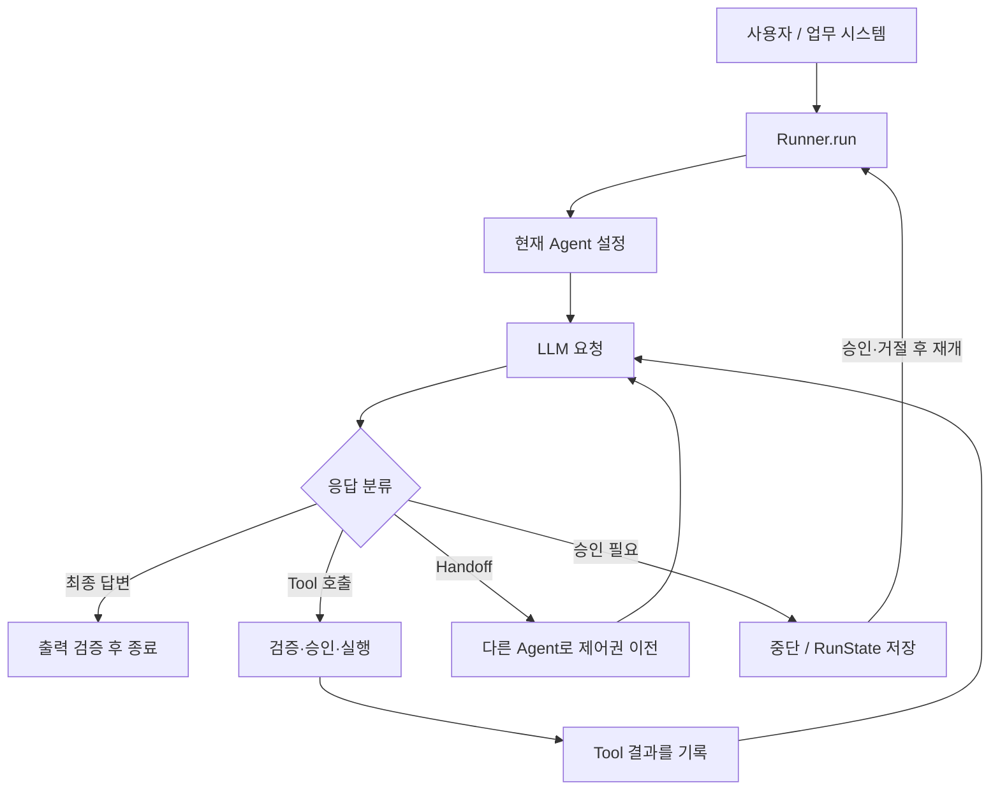

**쉬운 비유:** 모델은 *다음 작업을 제안하는 분석가*, Runner는 *작업 순서를 진행하는 운영자*, Tool은 *데이터베이스·Python·사내 API 같은 실무 도구*, Guardrail은 *각 경계의 검사*, Session은 *대화 이력 저장*, Trace는 *어떤 일이 일어났는지 남기는 실행 기록*이다.

### 1.3 가장 중요한 오해 여섯 가지

1. **Agents SDK ≠ OpenAI API 자체.** Responses API는 모델 응답을 제공하고, SDK는 반복 호출과 도구 실행을 관리한다.
2. **Agent ≠ 독립 프로세스.** 통상 `Agent`는 지침·모델·도구·출력형 등을 묶은 구성 객체이며 실행은 `Runner`가 담당한다.
3. **Handoff ≠ 단순 함수 호출.** Handoff는 *현재 대화의 제어권*을 다른 Agent로 옮긴다. `Agent.as_tool()`은 *담당 Agent가 하위 작업 결과를 받아 다시 판단*하는 방식이다.
4. **Session ≠ RAG/지식베이스.** 기본 Session은 대화 이력의 지속성 기능이며, 공정 문서·설비 로그의 의미 검색은 별도 데이터 접근 로직이 필요하다.
5. **Guardrail ≠ 완벽한 보안 장치.** 특히 기본 병렬 입력 Guardrail은 검사 완료 전에 Agent 작업이 일부 수행될 수 있다. 권한 검사는 도구·DB·인프라 수준에서 강제해야 한다.
6. **Structured Output ≠ 참인 내용.** JSON 형식이 맞더라도 잘못된 수율, 근거 없는 결함 원인, 잘못된 SQL 분석은 발생할 수 있다.

### 1.4 학습 완료 시 답할 수 있어야 할 질문

- `Runner.run()`의 입력이 모델로 전달되고 결과가 돌아오는 경로는?
- 모델이 어떤 조건에서 **종료 / Tool 실행 / Handoff / 승인 대기**를 결정하고 SDK가 이를 해석하는가?
- Python 함수가 어떻게 JSON Schema가 있는 도구가 되고, 인자 검증과 실제 호출은 어디서 일어나는가?
- `context`, `session`, `RunState`, RAG 저장소는 각각 무엇이 다른가?
- 민감한 공정 데이터로 Agent를 만들 때 SDK 외에 어떤 보안·운영 로직을 추가해야 하는가?

## 2. 용어부터 구분: API와 SDK, Framework와 Harness

| 개념 | 무엇을 제공하나? | 누가 제어하나? | OpenAI 예시 |
|---|---|---|---|
| LLM/모델 | 다음 토큰 및 도구 호출 요청 등 생성 | 모델 제공사/호스팅 | 지원 모델 |
| 모델 API | 모델 요청·응답 인터페이스 | 개발자의 API 호출 코드 | Responses API |
| Agent SDK | 실행 루프·도구·다중 에이전트·가드레일 | SDK 런타임과 개발자 | **OpenAI Agents SDK** |
| Agent Framework | Agent를 구성하는 추상화와 구조 | 프레임워크/개발자 | 넓은 의미에서 SDK도 해당 |
| Agent Harness | 지속 실행에 필요한 환경·권한·도구·컨텍스트 등의 묶음 | 제품마다 다름 | Sandbox Agent 같은 확장 기능 |
| 서비스 플랫폼 | 저장소·인증·배포·모니터링까지 포함 | 앱/클라우드/운영자 | 앱 운영 아키텍처에서 별도 구성 |

**Responses API를 직접 사용할 때**는 모델 응답의 Tool 호출을 찾아 함수를 실행하고 결과를 다음 요청에 붙여 다시 호출하는 로직을 개발자가 구현할 수 있다. **Agents SDK를 사용하면** 기본 반복 실행과 Handoff·Session 등의 관리가 제공된다. 대신 세밀한 제어가 필요한 구간에서는 SDK의 설계와 확장 지점을 이해해야 한다. [S01, S03]

SDK는 `pip install openai-agents`로 사용하는 **Python 라이브러리**이지, 반드시 특정 웹 UI를 이용해야 하는 플랫폼은 아니다. 기본적인 OpenAI 모델 연결에는 OpenAI API 인증·과금 등이 별도로 필요하다.

## 3. 설계 철학, 범위, 발전 방향

### 3.1 핵심 철학

공식 소개는 **작고 적은 추상화만으로 시작하면서, 필요한 곳은 사용자 정의로 확장**한다는 방향을 강조한다. 주요 축은 Agent, Tool, Handoff/Agent-as-Tool, Guardrail이다. Tracing, Session, Human-in-the-loop가 실무 기능을 보강한다. 이전의 실험적 프로젝트 Swarm에서 발전한 생산 지향 SDK라는 설명도 공식 문서에 있다. [S01]

### 3.2 무엇을 SDK에 맡기고 무엇을 직접 관리하는가?

| SDK에서 다루는 기능 | 애플리케이션이 여전히 책임지는 기능 |
|---|---|
| 모델 호출과 기본 실행 반복 | 문제 정의, 업무 단계, 요구 정확도 |
| Python Function Tool 등록 및 스키마 검증 | 실제 SQL/API/Python 실행 코드, 권한·검증 |
| Handoff·Agent-as-Tool 연결 | 업무별 역할 분리의 타당성, 데이터 공유 정책 |
| Session 인터페이스와 구현 | 사용자 인증, 테넌트별 데이터 격리, 보존 정책 |
| Guardrail 실행·Tripwire | 최종 정책과 결정적 검증 규칙의 작성 |
| Trace 계측 | 민감 정보 반출 정책, 관측 저장·접근 통제 |
| RunState로 중단/재개 | 승인 권한, 스냅샷 무결성, 외부 효과의 멱등성 |
| 일부 Sandbox·Skills·Memory 기능 | 호스트별 신뢰 경계, 파일 접근 통제, 데이터 거버넌스 |

**주의:** 2026년 10월 기준 Python SDK에는 Sandbox Agent, 샌드박스 메모리·Skills 등 확장 기능도 존재한다. 따라서 구버전의 설명처럼 'SDK에는 Skills나 장기 기억 기능이 전혀 없다'고 단정하면 안 된다. **기본 일반 Agent 경로와 Sandbox 확장 기능을 나눠서 평가**해야 한다. [S01, S23]

## 4. 개발 환경과 첫 예제

### 4.1 준비

```bash
# 문서 기준 SDK 버전 고정(실제로 설치한다면)
python -m venv .venv
# macOS/Linux: source .venv/bin/activate
# Windows PowerShell: .venv\Scripts\Activate.ps1
python -m pip install "openai-agents==0.24.0"

# OpenAI API 연결 시 환경변수 별도 설정
# Bash: export OPENAI_API_KEY="..."
# PowerShell: $env:OPENAI_API_KEY="..."
```

> API 키는 소스코드·Git·학습 문서에 넣지 않는다. 본 문서는 설치·실행을 수행하지 않았다. Python 지원 버전과 추가 패키지는 릴리스의 `pyproject.toml` 및 공식 설치 문서를 확인하자. [S01, S26]

### 4.2 가장 단순한 실행

```python
from agents import Agent, Runner

agent = Agent(
    name="SemiconductorTutor",
    instructions="반도체 개념을 정확하고 이해하기 쉽게 설명한다.",
)

result = Runner.run_sync(agent, "DRAM과 SRAM의 차이를 설명해줘.")
print(result.final_output)
```

- `Agent` 생성은 그 자체로 모델을 호출하는 작업이 아니다.
- `Runner.run_sync`는 동기 진입점이며, 비동기 서버 환경에서는 일반적으로 `await Runner.run(...)`를 사용한다.
- 모델 지정이 없을 때 SDK·환경에 의존한 기본값이 적용될 수 있으므로 **실제 프로젝트에서는 모델을 명시하고 버전을 고정**한다.

### 4.3 첫 번째 Function Tool

```python
from agents import Agent, Runner, function_tool

@function_tool
def lookup_process_definition(term: str) -> str:
    """공정 용어의 검증된 정의를 조회한다."""
    glossary = {
        "etch": "식각: 원하는 형상을 만들기 위해 물질을 제거하는 공정",
        "deposition": "증착: 기판 위에 박막을 형성하는 공정",
    }
    return glossary.get(term.lower(), "등록된 용어 없음")

agent = Agent(
    name="ProcessTutor",
    instructions="용어가 필요할 때 제공된 도구로 먼저 확인하라.",
    tools=[lookup_process_definition],
)

result = Runner.run_sync(agent, "etch의 의미가 뭐야?")
print(result.final_output)
```

**실행 원리:** 데코레이터가 함수 시그니처·문서 문자열로 도구의 메타데이터와 입력 스키마를 생성한다. 모델은 도구 호출 요청을 *생성*할 수 있고, 실제 로컬 Python 함수 실행은 **SDK 런타임**이 한다. 모델에 DB 비밀번호를 제공할 필요가 없다. [S04]

---

# Part II. 핵심 객체와 실행 구조

## 5. 전체 아키텍처

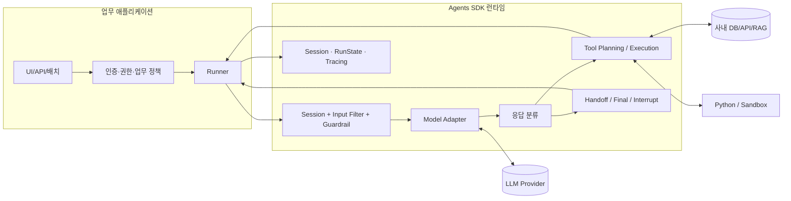

`Runner`는 orchestration의 중심이다. `Agent` 구성에서 instructions, model, tools, handoffs, output_type 등을 얻고, `Model` 인터페이스로 요청을 보낸다. 수신된 모델 응답이 `ModelResponse`에서 SDK RunItem 및 도구 실행 기록으로 변환되고 결과에 따라 다음 단계가 결정된다. [S03, S27]

### 5.1 주요 객체 목록

| 객체 | 담당 기능 | 구분 |
|---|---|---|
| `Agent` | 모델, instructions, tools, handoffs, 출력형과 Guardrail 등 선언 | 구성 |
| `Runner` | Agent 실행·반복·종료·중단 | 실행 진입점 |
| `RunConfig` | 호출 수준 설정, 모델 제공자, tracing, 전역 검증 | 실행 설정 |
| `RunContextWrapper` | 실행 중 의존성·사용량·승인 상태 등 로컬 컨텍스트 | 런타임 정보 |
| `FunctionTool` | 모델이 호출 가능한 함수의 이름·스키마·실행 핸들러 | 외부 행동 |
| `Handoff` | 다른 Agent로 제어권 이전 | 오케스트레이션 |
| `RunResult` | 최종 답, 사용량, 새로운 항목, 마지막 Agent, 승인 대기 등 | 결과 |
| `RunState` | 중단·승인·재개를 위한 직렬화 가능한 실행 상태 | 장기 실행 |
| `Session` | 여러 호출에 걸친 대화 항목의 지속성 | 대화 기억 |
| `Trace` / `Span` | 전체 워크플로 및 부분 실행 구간 기록 | 관측 |

## 6. `Agent` 자체를 정확히 이해하기

### 6.1 선언형 구성 객체

```python
from pydantic import BaseModel
from agents import Agent, ModelSettings

class DiagnosisDraft(BaseModel):
    observed_issue: str
    possible_causes: list[str]
    evidence_required: list[str]

agent = Agent(
    name="FaultAnalysisAssistant",
    instructions=(
        "검증 가능한 증거와 가설을 구분하라. "
        "증거 없이 확정 원인을 단정하지 마라."
    ),
    model="<검증된 지원 모델명>",   # 실제 실행 시 치환
    model_settings=ModelSettings(temperature=0),
    output_type=DiagnosisDraft,
)
```

`Agent`는 dataclass 기반의 정의이며 `name`, `instructions`, `handoff_description`, `tools`, `mcp_servers`, `handoffs`, `input_guardrails`, `output_guardrails`, `output_type`, `model` 등 설정을 갖는다. 필드 구성의 최신 상세는 실제 버전 소스와 API Reference를 확인한다. [S02, C01]

### 6.2 Instruction과 시스템 프롬프트

- `instructions`: 해당 Agent가 따라야 할 주요 행동 지침. 문자열 또는 실행 문맥에 따라 계산되는 함수 형태를 지원한다. [S02]
- `handoff_description`: 다른 Agent가 이 Agent에게 넘길 업무를 이해하기 위한 설명.
- `prompt` 및 프롬프트 관리 관련 기능은 모델·SDK 버전에 따라 별도의 적용 범위가 있다. **기본 instructions, 개발자 정책, 외부 검색 데이터의 역할을 구분**해야 한다.
- 프롬프트는 *보안 정책을 설명*할 수 있지만, **강제 권한 관리 시스템**을 대신하지 못한다.

### 6.3 `clone()`의 함정

`Agent.clone()`은 얕은 복사이므로 미리 정의된 리스트 형태의 `tools`, `handoffs`, `mcp_servers` 등을 별도로 넘기지 않았다면 같은 리스트를 공유할 수 있다. 서로 다른 업무별 Agent를 생성하면서 한쪽의 도구를 수정하면 의도치 않게 다른 Agent에도 반영될 수 있다. [S02]

```python
# 리스트 컨테이너 독립성을 명시적으로 확보하는 형태
read_only_variant = agent.clone(tools=[*agent.tools])
```

### 6.4 Agent 구성과 실행 설정의 역할 분리

- Agent: *이 작업자는 누구이고 무엇을 할 수 있는가?*
- `RunConfig`: *이번 실행에 어떤 모델 정책, tracing, 전체 실행 설정을 적용하는가?*
- Context: *이번 실행이 사용할 사용자·요청·접근 범위 정보는 무엇인가?*
- Session: *이전 대화의 어떤 항목을 이어받는가?*

## 7. Runner와 Agent Loop — 핵심

### 7.1 세 가지 대표 진입점

| API | 반환·형태 | 적합 사례 |
|---|---|---|
| `await Runner.run(agent, input)` | `RunResult` | 서버/배치/비동기 처리 |
| `Runner.run_sync(agent, input)` | `RunResult` | 단순 CLI·동기 코드 |
| `Runner.run_streamed(agent, input)` | `RunResultStreaming` | 진행 중 이벤트·실시간 UI |

### 7.2 무엇이 한 Turn인가?

공식 러너 문서에서 Turn은 모델 호출을 단위로 설명한다. 하나의 Turn의 모델 응답이 여러 Tool 호출을 포함할 수도 있다. `max_turns`는 Agent가 Tool을 실행하고 **새 모델 요청을 반복하는 횟수**를 제한하는 중요한 안전장치다. 제한 초과 시 `MaxTurnsExceeded`가 발생할 수 있다. `None`으로 제한을 해제할 수 있지만 검증 전에는 권장하지 않는다. [S03]

### 7.3 종료·재실행 판단

| 분류 | SDK 동작 | 결과 |
|---|---|---|
| 유효한 최종 응답, 처리할 로컬 Tool 없음 | 출력 처리·검증 | `NextStepFinalOutput` |
| Tool 호출 존재 | 실행 계획 생성 → 실행 → 결과를 입력 항목에 추가 | `NextStepRunAgain` 또는 조건부 종료 |
| Handoff 존재 | 위임 목표 Agent로 현재 Agent 변경 | `NextStepHandoff` |
| 승인 대기 발생 | 도구를 실행하지 않고 중단 상태 반환 | `NextStepInterruption` |

실제 분류는 `output_type`, tool 사용 정책, 승인 상태, API가 이미 처리한 Hosted Tool 등 여러 조건이 참여한다. 따라서 위 표는 일반적인 이해용 요약이지 구현의 모든 분기를 대체하지 않는다. [C02, C03]

### 7.4 왜 무한 루프가 위험한가?

모델이 적절한 최종 답 대신 계속 도구를 호출하거나, 잘못된 도구 결과를 해결하려고 재시도하면 지연·비용이 커진다. **Turn 수**, **도구 호출 수**, **도구 timeout**, **모델 호출 timeout**, **전체 작업 deadline**은 서로 다른 통제 계층이다.

`max_turns`만으로 모델이 호출한 외부 DB 작업의 시간·비용·반복 부작용을 모두 제한할 수는 없다. 애플리케이션 측 요청 제한과 자원 예산이 필요하다.

### 7.5 Agent Loop 의사코드

```python
# [의사코드] v0.24.0의 개념적 흐름이며 실제 SDK 구현을 그대로 복제한 것이 아님.
current_agent = starting_agent
history = load_or_prepare_input(input, session)
turns = 0

while True:
    enforce_turn_limit(turns)
    enforce_workflow_policy()
    response = await call_llm(current_agent, history)
    turns += 1
    processed = classify_model_response(response, current_agent)
    step = await plan_and_execute(processed)

    if step.kind == "interruption":
        return paused_result_with_run_state(step)
    if step.kind == "handoff":
        current_agent = step.new_agent
        history = apply_handoff_history_policy(history, step)
        continue
    if step.kind == "final":
        await validate_final_output(step.output)
        await persist_allowed_items(session)
        return result(step.output)
    if step.kind == "run_again":
        history = append_model_and_tool_items(history, step)
        continue
```

**중요:** 입력 Guardrail, 오류·취소·스트리밍 경로, 외부 서버 관리 대화, Trace, 재개, 회수·중복 호출 방지, 내부 자료구조 등은 생략했다.

---
## 8. 모델 호출과 Model Provider 계층

### 8.1 Agent와 모델을 분리하는 이유

Agent는 '어떤 일을 하도록 설정되어 있는가'를 나타내고, Model Provider는 '어느 API 또는 모델 엔진으로 응답을 받을 것인가'를 담당한다. 기본적인 OpenAI 연결은 Responses API 경로를 사용하며, SDK는 Chat Completions 계열 모델 경로와 외부 모델을 위한 구성 지점도 제공한다. [S01, S10]

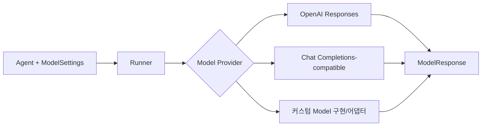

### 8.2 모델 설정으로 무엇을 조정하나?

주요 관심사는 모델 식별자, 도구 호출 선택 정책, 생성 옵션, 모델 호출 timeout, 재시도 정책, 특정 모델의 기능 지원 여부다. **모든 모델·제공자에서 모든 설정이 똑같이 지원되는 것은 아니다.** 예를 들어 일부 도구·멀티모달·출력 유형·추론 옵션은 제공자나 API 경로에 의존할 수 있다. [S10]

### 8.3 사내 LLM Gateway에 붙일 때

검토해야 할 경우를 분리하자.

1. **OpenAI 호환 API:** 커스텀 `AsyncOpenAI` 클라이언트와 endpoint 구성을 이용하는 방식 검토.
2. **다른 제공자:** `ModelProvider` 또는 `Agent.model`에 적합한 구현·어댑터 검토.
3. **호환되지 않는 사내 API:** Model 인터페이스를 구현하거나 어댑터를 개발해야 할 수 있음.

```python
# [개념 예시] 실제 gateway의 인증/호환 API/모델명을 검증한 뒤 적용
import os
from openai import AsyncOpenAI
from agents import set_default_openai_client

client = AsyncOpenAI(
    base_url=os.environ["LLM_GATEWAY_BASE_URL"],
    api_key=os.environ["LLM_GATEWAY_TOKEN"],
)
set_default_openai_client(client)
```

위 설정만으로 **모든 OpenAI 기능이 사내 모델에서도 자동으로 작동하지는 않는다.** Function Calling 형식, JSON Schema, 동시 도구 호출, Streaming 이벤트, Response ID 처리, Usage 필드, retry·timeout 동작을 호환성 테스트해야 한다. [S10, S11]

### 8.4 Responses API vs SDK Runtime의 경계

- **모델 응답을 생성하는 주체**와 **Python Tool을 실제 실행하는 주체**를 분리한다.
- Hosted Tool은 OpenAI 서버 측에서 실행되는 경우도 있으므로 로컬 함수 실행과 같은 경로로 가정하지 않는다.
- '모델이 생각했다'는 표현과 '실제 DB가 조회됐다'는 표현을 섞으면 안 된다. Trace와 Tool 로그에서 작업의 실재성을 검증해야 한다.

## 9. Tool — Python 함수에서 실제 업무 실행까지

### 9.1 Tool의 기본 의미

Tool은 LLM이 호출 *요청*을 만들 수 있는 기능을 선언한 것이다. 함수 이름, 설명, JSON 입력 스키마, 실행 핸들러를 SDK가 묶는다. 예를 들어 `get_lot_summary(lot_id)`를 제공하면 모델은 어떤 lot 정보를 조회할지 선택하지만, 서버는 요청 받은 lot이 사용자에게 허용된 데이터인지 **별도로 검증**해야 한다.

### 9.2 `@function_tool` 내부 개념

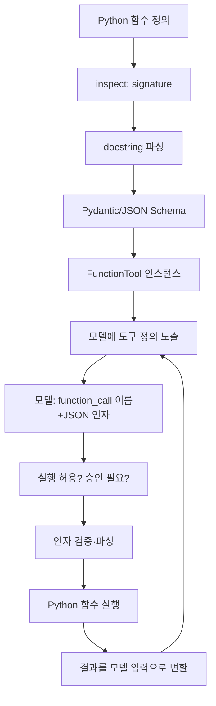

**핵심:** Tool 정의는 '인터페이스'이며, 실행은 도구 런타임에서 일어난다. 이 과정에서 guardrails, timeout, 실패 변환, tracing 같은 요소가 관여한다. [S04, C04, C05]

### 9.3 실제 업무용 안전한 함수 형태

```python
from dataclasses import dataclass
from agents import Agent, RunContextWrapper, Runner, function_tool

@dataclass
class ProcessContext:
    user_id: str
    permitted_fabs: frozenset[str]
    db: object   # 실제 개발에서는 읽기 전용 Repository 프로토콜 정의

@function_tool
async def get_lot_metrics(
    ctx: RunContextWrapper[ProcessContext],
    fab_id: str,
    lot_id: str,
) -> str:
    """허용된 FAB 내 Lot의 승인된 KPI 요약을 조회한다."""
    if fab_id not in ctx.context.permitted_fabs:
        raise PermissionError("해당 FAB 조회 권한 없음")
    # 실제 구현: 고정 SQL 템플릿 + 바인딩 변수 + 행 수 제한 + 감사 로그
    return f"조회 예시: {fab_id}/{lot_id}"

agent = Agent[ProcessContext](
    name="ProcessReader",
    instructions="권한이 있는 데이터만 조회하며 결과의 근거를 보존한다.",
    tools=[get_lot_metrics],
)

# 예시 호출: 실제 DB 클라이언트 주입 전에는 조회되는 코드가 아님
# result = await Runner.run(agent, "Lot A의 KPI 확인", context=ProcessContext(...))
```

주의: **예제의 `PermissionError`가 SDK에서 어떻게 노출되는지는 Tool failure 설정에 달려 있다.** 비밀 토큰이나 상세 SQL 오류가 모델 응답에 그대로 노출되지 않도록 실패 응답을 설계해야 한다. 데이터 접근 권한은 프롬프트가 아니라 실행 함수의 보안 경계에서 강제한다.

### 9.4 세부 검토 항목

| 영역 | 확인할 것 |
|---|---|
| JSON Schema | 필수 인자·숫자 범위·열거형·중첩 타입 변환 |
| Tool 표시 | `is_enabled`, Tool 선택 제한, 이름 충돌 |
| 오류 | `failure_error_function`으로 모델에 오류 전달 vs 예외 발생 |
| Timeout | 비동기 함수의 호출별 제한; 모델 timeout과 별도 |
| 승인 | `needs_approval` 및 동적 승인 조건 |
| Guardrails | Tool 전/후 입력·출력 검사 |
| 결과 형식 | 텍스트/구조화된 결과, 민감 필드 제거, 데이터 크기 제한 |
| 취소·재시도 | 실패 후 재실행 시 부작용·중복 처리 여부 |
| 관측 | Tool 호출자·입력 매개변수·허가 결정·결과 요약 기록 |

공식 도구 문서는 `inspect`, `griffe`, `pydantic`이 Function Tool 생성에 사용되며, `@function_tool(timeout=...)`은 **비동기 함수 핸들러의 timeout**을 지원한다고 설명한다. 기본 timeout 정책은 모델에 오류 결과를 전달하는 형태이며, 예외 발생 방식으로 전환할 수도 있다. [S04]

### 9.5 Agent에게 도구를 많이 주면 좋은가?

그렇지 않다. Tool이 많아지면 모델 선택 정확도가 흔들릴 수 있고 권한 표면도 넓어진다. 도구 노출을 최소화하고, 조회·분석·승인·쓰기 등 역할별로 분리한다. 특히 공정 파라미터 수정이나 레시피 배포 같은 변경 기능은 **read-only 분석 Agent에 넣지 않는 것**을 기본으로 한다.

## 10. MCP, Hosted Tool, Shell 및 Sandbox 도구

### 10.1 MCP는 무엇을 해결하나?

MCP(Model Context Protocol)는 Agent 측 클라이언트와 외부 도구 제공자 사이의 표준 프로토콜이다. SDK의 Function Tool은 직접 정의한 함수와 가까운 반면, MCP는 별도 서버가 도구를 제공하고 SDK가 이를 검색·연결할 수 있도록 한다. **MCP는 Agent Loop 그 자체가 아니다.** [S12]

| 옵션 | 실행 위치 / 특성 | 적합한 경우 |
|---|---|---|
| `FunctionTool` | 내 Python 프로세스의 핸들러 | 안전한 사내 SQL 추상화, 단순한 API 호출 |
| `MCPServerStdio` | 연결한 로컬 프로세스 | 개발 도구, 동일 머신의 검증된 도구 서버 |
| `MCPServerStreamableHttp` | HTTP MCP 서버 | 사내 망의 공통 도구 서비스 |
| `MCPServerSse` | SSE 기반 서버 | 기존 SSE MCP 연결 |
| `HostedMCPTool` | Responses API가 관리하는 원격 호출 경로 | 별도 외부 접근·승인이 허용된 경우 |
| Hosted Web/File 등의 도구 | 공급자 서버에서 제공하는 기능 | 외부 조사·파일 검색 등, 정책과 지원 모델 확인 |
| Shell / ApplyPatch / Sandbox Tool | 실행 환경·권한·격리 필요 | 소스 코드 수정·격리된 파일 분석 |

### 10.2 사내 반도체 환경에서 중요한 구분

- **외부 Hosted MCP:** 도구 요청·응답이 어디에서 처리되는지와 어떤 데이터가 외부 경계를 통과하는지 반드시 검토.
- **내부 MCP:** 도구 서버 자체가 사내 네트워크 안에 있어도 SDK가 사용하는 모델이 외부라면 프롬프트/Tool 결과가 외부로 전달될 수 있다.
- **MCP Tool 설명은 불신 입력:** 잘못된 도구 설명이나 외부 서버의 프롬프트 인젝션은 Agent의 행동에 영향을 줄 수 있다.
- **인증은 서버가 시행:** 서버가 사용자와 데이터 권한을 강제해야 하며, MCP 서버 URL을 안다고 사용 권한이 생기는 것은 아니다.

공식 MCP 문서는 Hosted 경로와 Local/Remote SDK 관리 경로를 구분하며, Tool 필터링·캐싱·승인·Tracing을 설명한다. [S12]

### 10.3 예: 사내 Streamable HTTP MCP (개념 예시)

```python
import asyncio
import os
from agents import Agent, Runner
from agents.mcp import MCPServerStreamableHttp

async def main():
    async with MCPServerStreamableHttp(
        name="InternalTools",
        params={
            "url": os.environ["INTERNAL_MCP_URL"],
            "headers": {"Authorization": f"Bearer {os.environ['INTERNAL_MCP_TOKEN']}"},
        },
    ) as server:
        agent = Agent(
            name="InternalKnowledgeReader",
            instructions="승인된 사내 자료만 조회한다.",
            mcp_servers=[server],
        )
        result = await Runner.run(agent, "허용된 용어 정의만 확인해줘.")
        print(result.final_output)

# asyncio.run(main())
```

실제로 적용할 때는 TLS, 서버 인증, allowlist, credential 관리, 호출 시간·응답 크기 제한, 도구 목록 필터 등을 추가해야 한다.

## 11. Multi-Agent Orchestration — 꼭 구분할 세 가지

### 11.1 Handoff: 제어권 이전

가령 첫 Agent가 사용자의 요청을 분석하고 '공정 Agent'에게 넘기면 다음 Turn부터 공정 Agent가 현재 Agent가 된다. 일반적으로 대화 이력도 넘어가지만 `input_filter`로 전달 범위를 조절할 수 있다. 이는 **새로운 Agent가 대화 자체를 이어받는 방식**이다. [S05]

```python
from agents import Agent, Runner

process_agent = Agent(
    name="ProcessExpert",
    handoff_description="반도체 공정 용어와 공정 흐름을 설명",
    instructions="공정 관련 질문을 신중하게 답하라.",
)
router = Agent(
    name="Router",
    instructions="공정 질문은 전문가에게 넘겨라.",
    handoffs=[process_agent],
)

# result = Runner.run_sync(router, "식각 공정 설명")
# result.last_agent는 위임 후 최종 응답을 만든 Agent일 수 있음
```

**Handoff 이력 필터 주의:** 다음 Agent에 넘기는 이력은 별도 보안 검사가 필요하다. `input_filter`는 특정 입력 항목의 모델 전달을 조절할 수 있지만, 세션 저장이나 nested handoff history까지 *자동으로 전체 데이터가 삭제된다*고 가정해서는 안 된다. 또한 서버 관리형 대화에서는 일부 handoff 필터 사용에 제약이 있다. [S05]

### 11.2 Agent-as-Tool: 관리자가 상위 제어권을 유지

```python
analyst = Agent(
    name="DataAnalyst",
    instructions="입력 데이터를 해석하고 관측 사실만 요약한다.",
)
manager = Agent(
    name="Manager",
    instructions="필요한 분석을 의뢰한 후 종합 결론을 작성한다.",
    tools=[analyst.as_tool(tool_name="request_analysis", tool_description="데이터 분석을 위임")],
)
```

**차이:** 모델 입장에서는 다른 Agent가 *도구*로 보이며, 분석 결과를 받은 관리자가 추가 판단을 수행한다. 내부적으로 위임된 Agent에 대한 **중첩 실행 루프**가 있을 수 있다. 중첩 승인 요청도 바깥 Runner의 중단 상태에 반영될 수 있다. [S06, S13]

### 11.3 코드로 Orchestration

```python
# 업무 절차가 고정되어 있다면 모델의 재량보다 코드 순서가 적합할 수 있다.

async def validated_report_pipeline(raw_data, stats_tool, interpretation_agent):
    aggregates = await stats_tool(raw_data)     # 결정적 계산
    validated = validate_aggregates(aggregates)  # 업무 규칙(예시 함수)
    narrative = await Runner.run(
        interpretation_agent,
        f"아래 검증된 집계에 대한 해석만 작성: {validated}",
    )
    return {"metrics": validated, "analysis": narrative.final_output}
```

위 `validate_aggregates`는 설계상의 가상 함수이며 실제 SDK 함수가 아니다.

**반도체 업무에 대한 권고:** 공정별 집계·수식·승인 단계가 고정되어 있다면 코드로 제어하고, 탐색적 질의·가설 구성·문서 요약처럼 유연함이 필요한 구간에서 Agent의 선택권을 사용한다. [S06]

### 11.4 세 방식 요약

| 특징 | Handoff | Agent-as-Tool | Code Orchestration |
|---|---|---|---|
| 누가 다음 담당자를 결정? | 모델/정의된 위임 가능성 | 상위 Agent의 Tool 선택 | 애플리케이션 코드 |
| 주 제어권 | 위임 받은 Agent | 상위 관리 Agent | 업무 실행 함수 |
| 이력 전달 | 필터를 설계할 필요 | 매개변수·중첩 문맥 정책 | 직접 전달 항목 선택 |
| 강점 | 대화형 전문 Agent 전환 | 전문 분석 뒤 중앙 종합 | 재현성·명시적 순서·검증 |
| 주의 | 경계 간 정보 전달 | 중첩 호출·비용 증가 | 개발 코드와 유지보수 증가 |

## 12. Guardrails: 검증 계층과 실제 보안 한계

### 12.1 Guardrails의 종류

| 종류 | 대상 | 언제 동작? | 대표 목적 |
|---|---|---|---|
| Agent 입력 Guardrail | 첫 Agent에 들어온 입력 | 실행 시작 시 | 사용자 요청 분류·차단 |
| Agent 출력 Guardrail | 마지막 Agent의 최종 출력 | 종료 전 | 민감 정보·정책·형식 검사 |
| Tool 입력 Guardrail | 함수 도구의 인자 | Tool 실행 전 | 조회 범위·허용 파라미터 검증 |
| Tool 출력 Guardrail | 함수 도구의 결과 | Tool 실행 후 | 민감 컬럼·위험 값 검사 |
| 업무 코드·DB 정책 | 실제 데이터/행동 | 모든 호출 경계 | 권한, SQL 허용, 보존 정책 강제 |

공식 문서상 **입력 Guardrail은 체인의 첫 Agent**, **출력 Guardrail은 최종 출력 Agent**를 기준으로 작동한다. Tool Guardrail은 해당 Function Tool 호출마다 적용되므로, Handoff나 nested Agent를 포함한 체인에서 세부 검증이 필요하면 Tool 경계에 배치해야 한다. [S07]

### 12.2 병렬 vs 차단형 입력 Guardrail — 실무상 매우 중요

- `run_in_parallel=True`(기본): Guardrail과 Agent가 동시에 시작할 수 있으므로 검사 실패 시 이미 일부 토큰 사용이나 **도구 실행이 발생했을 수 있다**.
- `run_in_parallel=False`: 입력 Guardrail을 먼저 완료한 후 Agent를 시작하므로 통과 전 모델·도구 실행을 막는 형태에 적합하다.

**공정 DB에 대한 권한 검사가 입력 Guardrail뿐인 설계는 안전하지 않다.** 예를 들어 사용자 FAB 권한 확인이 실패한 경우, 병렬 검사가 끝나기 전에 조회가 시작되는 경로를 남겨서는 안 된다. 따라서 인증·인가를 Agent 시작 전 업무 계층에서 결정하고 Tool 내부에서도 재검사하는 것이 안전하다. [S07]

### 12.3 Tripwire와 일반 Exception

Guardrail에서 `tripwire_triggered=True`를 반환하면 Runner가 해당 Tripwire 예외를 발생시키는 흐름이 있다. 잘못된 파라미터로 Tool 실행을 막는 것과 단순히 최종 답변에 '그렇게 해서는 안 된다'고 쓰는 것은 전혀 다르다. 출력 Guardrail로 거부된 최종 답변은 이력 저장에서도 별도 처리 규칙이 있으므로, 실패·재개·세션 정책까지 확인한다. [S07]

### 12.4 검증은 적어도 세 층에 놓는다

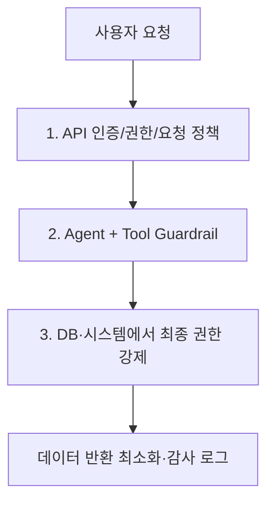

1. 앱 권한: 요청자는 누구이고 어떤 FAB/Project의 데이터를 조회할 수 있는가?
2. Agent/Tool 정책: 어떤 도구·파라미터·민감 데이터가 허용되는가?
3. 데이터 계층: 최소 권한 계정, 읽기 전용 view, 행 필터링, 실행 시간·반환 행 수 제한.

프롬프트 인젝션은 외부 문서, Tool 결과, MCP 메타데이터, 사용자 입력에서 유입될 수 있다. **출처 없는 문장의 지시를 시스템 명령이나 권한 변경으로 승격하지 않는다.**

---

# Part III. 상태·메모리·통제·관측

## 13. Context·Session·Memory — 서로 다르다

### 13.1 다섯 개념을 한 번에 비교

| 개념 | 보유 내용 | 주 목적 | 예시 |
|---|---|---|---|
| `RunContextWrapper.context` | 코드가 보유한 로컬 상태·의존성 | Tool에 전달할 신뢰 정보 | 사용자 ID, FAB 권한, DB Repository |
| LLM Context | 모델에 실제 전달되는 메시지·도구 결과 | 현재 추론에 필요한 정보 | 질문, 검색된 문서, Tool 출력 |
| `Session` | 이전 Turn 대화 항목 | 다음 `Runner.run`에서 이력 사용 | SQLite conversation history |
| `RunState` | 중단된 실행의 내부 상태 | 승인·복구 후 동일 실행 이어가기 | 승인 대기 중인 Tool Call |
| RAG/장기 지식 | 외부 DB·벡터DB·문서 저장소 | 전문 지식 검색·지속적 지식 활용 | 반도체 SOP, 설비 로그 인덱스 |

### 13.2 로컬 Context는 자동으로 모델에게 보이지 않는다

```python
@dataclass
class TenantContext:
    user_id: str
    allowed_tools: set[str]
    secret_token: str

# context=TenantContext(...)로 넘긴 내부 객체 자체가
# 모델 메시지에 직렬화되어 제공되는 것은 아니다.
# 다만 Instructions/Tool 반환에서 문자열로 노출시키면 모델이 보게 된다.
```

즉 로컬 Context는 **신뢰성 있는 업무 의존성 주입 경로**이고, LLM Context는 모델에 전달할 정보다. 민감한 객체를 로컬 Context에 보유해도, Tool이나 Prompt가 해당 값을 삽입하면 비밀이 외부 모델로 나갈 수 있다. [S14]

### 13.3 Session의 기본 동작

```python
from agents import Agent, Runner, SQLiteSession

agent = Agent(name="Tutor", instructions="이전 대화를 참고해 답하라.")
session = SQLiteSession("learning-session-001", "learning.db")

# 첫 호출
# a = Runner.run_sync(agent, "DRAM을 설명해줘", session=session)
# 다음 호출 — Session에 저장된 메시지 항목을 활용
# b = Runner.run_sync(agent, "그럼 SRAM과 차이점은?", session=session)
```

Session 구현은 저장·불러오기·항목 추가·초기화 등의 계약을 제공한다. SDK에는 SQLite, SQLAlchemy, 서버 관리형 Conversations, Advanced SQLite, Encrypted Session 등 다양한 백엔드가 있다. **Session ID는 사용자 인증·인가 수단이 아니고** 그 자체가 대화 접근권을 보장하지 않는다. [S08, S15]

### 13.4 긴 대화의 Compaction

모든 대화 이력을 무제한으로 모델에 넣을 수는 없다. 정해진 컨텍스트 윈도우, 비용, 검색 노이즈가 커지기 때문이다. SDK에는 Session 기반 압축을 지원하는 구성도 있으나, 모든 Session에서 자동 요약이 활성화되는 것은 아니다. [S08]

**설계 관점:** 공정 분석에서는 이전의 계산 원본, 산출 수식, 데이터 버전, 코드 실행 ID를 단순 자연어 요약으로만 남기면 재현성이 깨질 수 있다. *대화 요약*과 *검증된 분석 산출물 저장*을 분리한다.

### 13.5 대화 기억과 장기 업무 메모리의 차이

- 대화 기록: 이전 사용자가 무엇을 물었고 Agent가 어떤 Tool을 호출했는지.
- 장기 사실/선호/기술 지식: 이전 업무에서 확인한 기준, 검증된 반복 분석 절차, SOP 버전, 설비 메타데이터.
- 검색 시스템: 특정 질문과 관련된 문서·로그·정형 데이터를 **질문 시점에 선택적으로 검색**하는 기능.

일반 Agent의 기본 Session이 곧 자동 요약·벡터 검색·장기 지식 학습을 모두 수행한다고 생각하면 안 된다. 추가적인 RAG Tool, 저장소, 정책이 필요하다. 한편 **Sandbox Agent의 메모리와 Skills 관련 확장**은 별도로 다룬다(18장). [S08, S23]

### 13.6 외부 저장소와 서버 관리형 대화의 차이

`previous_response_id`, `conversation_id`, `auto_previous_response_id` 같은 이어가기 방식에서는 서버 관리 대화 상태가 작동할 수 있고, 로컬 `Session`의 이력 입력·저장 방식과 충돌하지 않게 처리되어야 한다. 이를 같은 기능이라고 단정하지 말고 어떤 서비스가 데이터를 보관하고 외부 요청에 얼마나 재전송하는지 구분한다. [S03, C09]

### 13.7 민감 데이터 관점의 Session 정책

- 사용자/프로젝트/FAB 단위 분리, 권한 검증 후 Session 로드.
- Session DB 접근 제어, 암호화, 보존기간, 삭제·감사 정책.
- 트레이스·로그·세션에 민감 필드가 여러 번 저장될 수 있음을 고려.
- `EncryptedSession`은 암호화·TTL을 지원하지만 암호화된 콘텐츠에 대한 검색 기능에 제약이 있다. 암호 키 보존·회전·권한 분리는 애플리케이션 책임. [S15]

## 14. Human-in-the-loop: 승인, 중단, 재개

### 14.1 왜 필요한가?

읽기 전용 질의는 자동 실행해도 되지만, 외부 시스템 변경이나 비용이 큰 작업은 사용자의 승인을 요구할 수 있다. Agent가 Tool 호출을 요청하면 SDK는 `needs_approval` 정책을 확인하고, 아직 승인이 없는 경우 실행을 멈춰 `RunResult.interruptions`에 승인 대기 항목을 담을 수 있다. [S13]

### 14.2 승인 및 재개 흐름

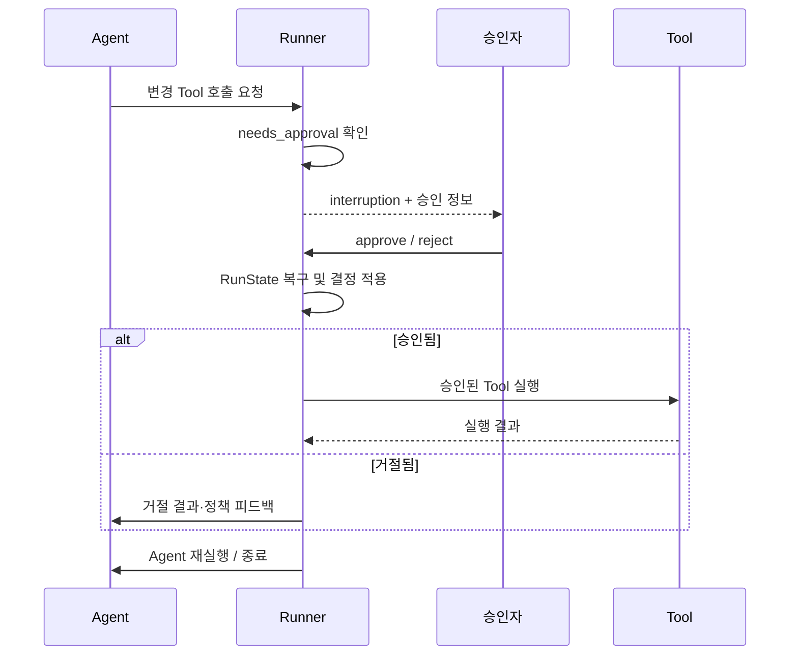

### 14.3 최소 학습 예제

```python
from agents import Agent, Runner, function_tool

@function_tool(needs_approval=True)
def request_external_action(action: str) -> str:
    """승인된 외부 작업을 수행한다 (데모에서는 문자열만 반환)."""
    return f"Approved action: {action}"

agent = Agent(
    name="ApprovalDemo",
    instructions="요청된 작업은 반드시 제공된 도구로 수행한다.",
    tools=[request_external_action],
)

async def run_with_review():
    result = await Runner.run(agent, "테스트 작업을 요청해줘")
    while result.interruptions:
        state = result.to_state()
        for item in result.interruptions:
            # [예시] 사용자 검토/정책 엔진 결과가 True라고 가정
            authorized = False
            if authorized:
                state.approve(item)
            else:
                state.reject(item)
        result = await Runner.run(agent, state)
    return result
```

`result.to_state()` 및 `state.approve`·`state.reject` 후 재개하는 패턴은 공식 가이드의 흐름이다. **실서비스에서는 UI에서 넘어온 직렬화된 State를 신뢰하지 않는다.** 서버에 원본 State를 저장하고 승인자의 인증·업무 권한, 실행 중인 요청의 소유권, 중복 처리 여부를 검사한다. [S13]

### 14.4 `RunState`와 Session의 차이

Session은 '다음 대화에서 어떤 메시지를 이어갈까?'를 담당한다. RunState는 '현재 모델이 이미 도구를 요청했고 승인 대기 중인데, 그 실행의 정확히 어디에서 계속할까?'를 담당한다. **승인이 끝난 뒤 모델이 멋대로 새로운 도구 요청으로 바뀌지 않도록 중단 당시 상태를 신뢰성 있게 이어가는 것**이 중요하다.

### 14.5 주의: Always approve의 범위

일부 Tool 유형에서 반복 승인(`always_approve`)은 Agent 단위가 아니라 도구 종류·이름을 기준으로 재사용될 수 있다. 서로 권한이 다른 Shell/ApplyPatch 환경에 같은 승인 상태를 공유하면 위험할 수 있다. 기본적으로 **민감한 변경 기능은 건별 승인**을 사용하고, 재개 스냅샷은 신뢰된 서버 저장소에서만 로드한다. [S13]

### 14.6 재시도와 멱등성

실행이 도중에 끊기면 Tool이 이미 외부 DB를 수정했으나 SDK 응답만 누락됐을 가능성이 있다. 무조건 도구를 다시 호출하면 중복 반영·중복 알림이 발생한다. `operation_id`/멱등성 키, 외부 결과 조회 및 복구 절차를 앱에서 제공해야 한다. [S13]

## 15. Streaming·Result·Lifecycle Hooks

### 15.1 Streaming의 의미

`Runner.run_streamed()`는 모델의 raw 이벤트와 Tool·Agent 전환 같은 **의미 있는 Run 이벤트**를 제공한다. 스트리밍 중 문자 조각이 왔다고 전체 Agent 실행이 끝난 것은 아니다. 뒤이어 Tool 호출과 Handoff가 발생할 수 있고, 마지막 `final_output`은 작업 완료 후 결정된다. [S16]

```python
# [학습 예제]
async def print_events(agent):
    streamed = Runner.run_streamed(agent, "반도체 공정 용어 설명")
    async for event in streamed.stream_events():
        print(event.type)
    print(streamed.final_output)
```

### 15.2 반환 결과의 관점

| 속성·개념 | 의미 |
|---|---|
| `final_output` | 최종 응답. `output_type`을 지정했다면 해당 자료형으로 받을 수 있음 |
| `new_items` | 현재 실행에서 새로 생성한 메시지/호출/출력 등의 항목 |
| `to_input_list()` | 다음 호출에 사용할 입력 이력 구성에 활용 |
| `last_agent` | 최종 실행을 담당한 Agent 확인 |
| `raw_responses` | 모델 공급자 응답 조사 |
| `interruptions` | 승인 필요로 보류된 실행 정보 |
| `to_state()` | 재개 가능한 실행 상태로 전환 |
| `context_wrapper.usage` 등 | 실행 사용량·문맥 정보 (정확한 필드 버전 확인) |

실제 `RunResult` 및 `RunResultStreaming`의 제공 속성은 공식 결과 문서와 해당 버전 API를 기준으로 확인한다. [S17]

### 15.3 Hooks란?

Hooks는 Agent 실행, Tool 호출, 모델 요청 등 수명주기 이벤트에서 사용자 코드를 실행하게 하는 확장 지점이다. 로그·업무 지표·계측·정리 등에 유용하다. **Hook은 이벤트 알림 및 부가 로직을 위한 수단이며, 고위험 권한 검사의 유일한 경계가 되어서는 안 된다.** [S02]

```python
from agents import RunHooks

class AuditHooks(RunHooks):
    async def on_agent_start(self, context, agent):
        print(f"Agent started: {agent.name}")

    async def on_agent_end(self, context, agent, output):
        print(f"Agent ended: {agent.name}")

# await Runner.run(agent, "...", hooks=AuditHooks())
```

### 15.4 Output Streaming과 검증

사용자 UI에 미완성 답변을 먼저 노출한 경우, 최종 출력 Guardrail이 나중에 실패해도 이미 공개된 내용을 회수할 수 없다. 민감 정보·검증되지 않은 분석값은 최종 검증 이전 스트리밍 공개 범위를 제한하고, Tool 결과나 RAG 원문이 그대로 사용자에게 중계되지 않도록 설계한다.

## 16. Tracing, Observability, Evaluation

### 16.1 Trace와 Span

Trace는 사용자 작업 전체를 기록하는 상위 단위, Span은 LLM 호출·Tool 실행·Handoff·Guardrail 등 각 작업을 나타내는 하위 단위다. 공식 SDK는 tracing을 기본 활성화할 수 있으며, 환경변수 `OPENAI_AGENTS_DISABLE_TRACING=1`, 코드 `set_tracing_disabled(True)`, RunConfig 설정 등으로 비활성화할 수 있다. [S18]

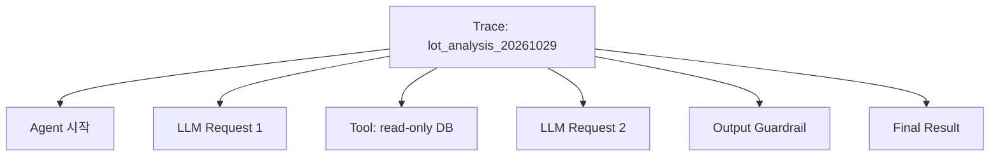

### 16.2 반도체 데이터의 관측 주의사항

Tracing을 켜면 입력 프롬프트·Tool 인자·응답·오류 메시지 등의 민감한 내용이 관측 시스템에 포함될 수 있다. **외부 Trace 전송이 허용되는지**, 기록되는 필드·보존기간·접근 권한·데이터 마스킹 정책을 우선 검토해야 한다. 추적이 전혀 없다면 사고 원인 분석·비용 통제가 어려우므로, 필요하다면 내부 전송 대상/프로세서 커스터마이징을 검토한다. [S18]

### 16.3 Trace ≠ Evaluation

- **Tracing:** 어떤 모델·Tool이 어떤 순서로 작동했는지 기록.
- **Evaluation:** 정답·근거·업무 기준에 비교하여 품질을 측정.
- **Monitoring:** 장기간 오류율·지연·사용량·정책 위반 추세를 수집.

반도체 Agent라면 `SQL 허용 여부`, `조회된 데이터 버전`, `실제 KPI 계산 정확성`, `인용한 문서와 답변 일치`, `근거 없는 원인 단정 비율`을 별도 평가해야 한다.

### 16.4 평가 데이터셋 예시

| 항목 | 평가 질문 | 측정 지표 |
|---|---|---|
| 데이터 접근 | 권한 없는 FAB 조회를 막았나? | 차단율, 정보 노출 건수 |
| Tool 선택 | 올바른 DB 조회 도구를 선택했나? | Tool 선택 정확도 |
| 집계 | 수율·불량률 산식을 정확히 적용했나? | 정확도, 허용 오차 |
| 근거 | 원문·계산 결과의 근거를 제시했나? | 근거 적합률 |
| 사용자 UX | 모호한 질문에서 추가 조건을 요구했나? | 누락 조건 비율 |
| 운영 | 실패 후 안전하게 복구했나? | 복구 성공률, 중복 실행 비율 |
| 비용 | 요청당 모델/API 비용은? | 토큰, 도구 호출 수, 95p 지연 |

## 17. Structured Output과 실패·재시도·비용 통제

### 17.1 Output Schema는 왜 중요한가?

자연어 답변은 사람이 읽기 좋지만 시스템 연동에는 형식이 불안정하다. `output_type=BaseModel`로 구조화된 결과를 요구하면 다음 단계가 필드를 직접 검증하기 쉽다.

```python
from pydantic import BaseModel, Field
from agents import Agent

class ProcessFinding(BaseModel):
    issue: str
    evidence_ids: list[str] = Field(default_factory=list)
    hypotheses: list[str] = Field(default_factory=list)
    confidence_level: str = Field(description="high/medium/low 중 하나로 사용하도록 설계")

agent = Agent(name="EvidenceAnalyzer", output_type=ProcessFinding)
```

**주의:** `Field(description=...)`은 범위 검증이 아니다. 선택지를 강제하려면 `Literal['high','medium','low']` 또는 enum을 쓰자. 모델의 'confidence'는 반드시 통계적으로 보정된 확률을 의미하지 않는다. [S02, S17]

### 17.2 Tool 파싱 검증과 Output 검증의 차이

- Tool 인자 검증: 모델이 요청한 Python 함수의 입력 인자가 올바른가?
- 최종 출력 스키마 검증: Agent의 답변이 지정된 자료형/구조에 맞는가?
- 업무 검증: **결과가 사실이며 허용 가능한 수치와 증거를 갖는가?** → 별도 검증 함수·도메인 규칙·테스트가 필요.

### 17.3 실패 유형별 대책

| 실패 | 예상되는 결과 | 대응 |
|---|---|---|
| 모델 API 실패/timeout | 호출 실패 또는 재시도 | 호출별 timeout·지원 retry policy |
| 모델의 잘못된 Tool 이름 | 행동 실패·Behavior Error 가능 | Tool 목록/호환성 검증 |
| 잘못된 JSON 인자 | 스키마/파싱 오류 | Tool 검증·실패 메시지 정책 |
| Tool 내부 Exception | 모델에 오류로 반환 또는 run 실패 | `failure_error_function`, 코드 예외 처리 |
| Tool timeout | 시간 초과 결과 또는 예외 | 도구별 timeout·업무 deadline |
| Guardrail Tripwire | 실행 중단/예외 | 사유 로깅, 사용자 안내, 보존 정책 |
| Max Turns 초과 | `MaxTurnsExceeded` | Tool 오용 분석, 최대 턴·예산 설정 |
| 승인 중단 | `interruptions` 반환 | 서버 저장·권한 승인·재개 |
| 외부 부작용 후 응답 유실 | 중복 변경 위험 | 멱등성 키·외부 상태 대조 |

일부 재시도 정책과 model-call timeout은 SDK 기능으로 제공되지만, **모든 Tool 호출에 무조건 안전한 재시도를 자동으로 적용한다고 가정하면 안 된다.** [S03, S04, S10]

---
## 18. Sandbox Agents, Skills, Memory, 장기 실행 확장

### 18.1 일반 Agent와 Sandbox Agent를 분리해서 이해

이전 세대의 OpenAI Agents SDK 소개는 주로 `Agent + Runner + Function Tool`에 초점을 맞춘다. 그러나 **v0.24.0 기준 Sandbox Agent 기능을 별도 주제로 포함해야 정확하다.** 공식 SDK는 파일·작업 공간을 갖는 격리된 작업을 위한 Sandbox Agent 관련 기능을 제공한다. [S01, S23]

| 관심사 | 일반 `Agent` 중심 개발 | Sandbox Agent 확장 관점 |
|---|---|---|
| 주요 작업 | API/DB/함수 중심의 업무 분석 | 파일·코드·쉘·장기 작업 중심 |
| 작업 공간 | 개발자가 직접 설계 | Sandbox 및 workspace 추상화 |
| Skills | 직접 Tool/Prompt로 구현 가능 | Sandbox의 Skills capability 등 검토 |
| Memory | Session + 외부 저장소 | 별도 Sandbox Memory 기능 검토 |
| 재개 | RunState 및 앱 저장 설계 | Sandbox 세션·스냅샷 관련 기능 |
| 보안 경계 | 앱 권한 및 Tool 실행 통제 | 실행 환경 격리·마운트·권한 추가 검토 |

### 18.2 반드시 조사할 Sandbox 요소

- `SandboxAgent`와 일반 `Agent`의 차이, 런타임 준비 과정.
- Workspace: 어떤 파일이 준비되고 어떤 파일이 외부 시스템으로 반영되는가?
- Sandbox Client: 로컬·컨테이너·원격 제공자 선택, 격리 수준과 API 자격 증명.
- Skills: 문서·작업 절차를 언제 노출하고 실행하는가? 동적 로딩 및 권한 경계.
- Memory: 세션 정보와 반복 작업에서 얻은 교훈이 어디에 저장되고 언제 적용되는가?
- Resume/Snapshot: 중단 후 재개가 파일·도구 측 부작용을 어떻게 다루는가?
- Compaction: 장기 실행에서 컨텍스트 정보 손실을 어떤 규칙으로 관리하는가?

### 18.3 반도체 환경에서 판단할 점

Sandbox에서 Python을 실행할 수 있다는 사실만으로 생산망 안전성이 확보되는 것은 아니다. 읽기 전용 데이터 마운트, 외부 인터넷 egress 차단, 키 접근 분리, 로컬 파일 보존 정책, 결과물 승인 전 외부 반출 제한이 필요하다. 샌드박스 격리와 플랫폼의 정책은 **설치 옵션·실행 방식·인프라 구성에 따라 달라질 수 있으므로 검증 없이 '완전 격리'라고 표현하지 않는다.**

### 18.4 범위 밖 또는 우선순위 낮은 기능

SDK에는 Realtime Voice Agent, Voice Pipeline, 기타 모델별 기능도 있지만 **반도체 도메인에서 먼저 구축할 텍스트·표·코드 분석 데모**의 핵심은 아니다. 존재 여부는 파악하되, 학습 우선순위는 Tool·상태·보안·평가·데이터 근거에 둔다. [S01]

---

# Part IV. 실제 공개 코드 수준의 아키텍처 분석

> **분석 방식:** 공개 저장소 `openai/openai-agents-python`의 `v0.24.0` 태그에 포함된 모듈을 기준으로 핵심 흐름을 연결한다. 정확한 코드는 해당 GitHub 링크에서 확인한다. 아래의 의사코드가 실제 함수 본문과 줄 단위로 일치한다는 뜻은 아니다. 모든 함수가 public API인 것은 아니며, 내부 구현을 직접 import하여 제품 코드를 작성하는 것은 권장하지 않는다.

## 19. 소스 분석 ① — Runner 진입과 최상위 Loop

### 19.1 중요한 소스 파일

- [`src/agents/run.py`](https://github.com/openai/openai-agents-python/blob/v0.24.0/src/agents/run.py): `Runner`, `AgentRunner`, `_run_impl`, 실행 설정·Session 준비 및 결과 처리의 중심 [C09].
- [`src/agents/run_internal/run_loop.py`](https://github.com/openai/openai-agents-python/blob/v0.24.0/src/agents/run_internal/run_loop.py): 모델 호출 및 스트리밍·Turn 관련 실행을 구성하는 내부 모듈 [C10].
- [`src/agents/run_internal/run_steps.py`](https://github.com/openai/openai-agents-python/blob/v0.24.0/src/agents/run_internal/run_steps.py): 다음 단계 자료형, Tool 실행 결과 집계 구조 [C02].

### 19.2 진입점의 실제 정의

`src/agents/run.py`에는 다음과 같은 공개/내부 계층이 존재한다. [C09]

```python
# [소스 구조 발췌 - 이해용 축약]
class Runner:
    @classmethod
    async def run(cls, starting_agent, input, *, context=None,
                  max_turns=..., hooks=None, run_config=None,
                  session=None, ...): ...

class AgentRunner:
    async def run(self, starting_agent, input, **kwargs): ...
    async def _run_impl(self, starting_agent, input, **kwargs): ...
```

`Runner.run`은 사용자에게 제공되는 API이고, `AgentRunner`는 **문서상 experimental / public API가 아니라고 경고되는 내부 실행 클래스**다. SDK 확장 시 `AgentRunner`를 임의로 subclass하여 핵심 루프를 교체하기보다 공개 확장 지점을 먼저 이용해야 한다. [C09]

### 19.3 `AgentRunner._run_impl`에서 추적할 상태

1. 시작 Agent 또는 `RunState`로부터 현재 Agent를 준비한다.
2. 실행 설정(`RunConfig`), Context, Session 및 기존 대화 상태를 확인한다.
3. 로컬 Session/서버 관리 대화의 이력을 모델 입력 형태로 준비한다.
4. 최초 입력 Guardrail, Tracing, Hook 등을 실행/등록한다.
5. 현재 Agent와 컨텍스트에 적합한 모델을 호출한다.
6. 모델 응답을 분류하고 도구 실행·위임·중단·종료를 선택한다.
7. 매 Step의 입력·출력·검증 결과를 사용량·세션·결과 항목 등에 반영한다.
8. `FinalOutput`이면 결과를 반환하고, `RunAgain`·`Handoff`면 다음 Step으로 이어간다.

`src/agents/run.py`의 Session 준비 코드에는 **서버 관리 대화 여부에 따라 이력을 직접 준비하는 동작이 분기**한다. 일반 Session과 서버 관리 Conversation ID를 동시에 쓸 때 기록을 중복해서 모델에 전달하지 않도록 하는 이유를 이해하는 데 중요하다. [C09]

### 19.4 실행 시점에 생기는 세 가지 기록

동일한 메시지라도 상태 관리 목적별로 표현이 달라질 수 있다.

- **모델 입력용 기록:** 다음 모델 호출에 보낼 수 있는 형태. 필터와 전송 제약이 적용될 수 있다.
- **공개 Run Item:** 애플리케이션이 어떤 일이 발생했는지 볼 수 있는 실행 항목.
- **영속 Session 이력:** 다음 사용자 Turn에서 사용할 기록. Tool 결과와 Guardrail에 의한 출력 거부 등을 고려해 저장한다.

세 가지가 같을 것이라 가정하면 Handoff 필터, 출력 Guardrail, 중단·재개에서 버그가 생기기 쉽다. 공개 저장소의 개발 참고 문서에도 provider output → `ModelResponse` → `RunItem`/`ProcessedResponse` → Session/Replay/RunState의 흐름과 별도 뷰를 유지해야 한다고 설명한다. [C11]

## 20. 소스 분석 ② — 모델 응답 분류와 '다음 상태' 선택

### 20.1 `ProcessedResponse`가 필요한 이유

LLM 응답은 단순한 문자열이 아니다. 응답 항목에는 메시지, 함수 호출, Handoff, Shell/Computer 작업, MCP 승인 요청, 호스팅 도구 결과 등 다양한 형식이 있을 수 있다. SDK는 이를 모델 제공자 응답 형식 그대로 실행하는 대신, **실행할 항목을 분류한 내부 레코드**로 만든다.

v0.24.0의 `run_internal/run_steps.py`에 존재하는 `ProcessedResponse`는 예를 들어 다음을 구분한다. [C02]

```python
# [소스 구조 발췌 - 일부 필드 생략]
@dataclass
class ProcessedResponse:
    new_items: list[RunItem]
    handoffs: list[ToolRunHandoff]
    functions: list[ToolRunFunction]
    computer_actions: list[ToolRunComputerAction]
    # shell, apply_patch, mcp_approval_requests, interruptions 등
```

이 구분을 통해 **모델이 결과를 이미 만든 Hosted Tool**과 **우리 Python 런타임이 직접 실행해야 하는 Function Tool**의 처리 경로를 달리할 수 있다.

### 20.2 네 가지 다음 단계 자료형

실제 `run_steps.py`에는 다음 자료형이 존재한다. [C02]

```python
# [소스 구조 발췌]
@dataclass
class NextStepHandoff:
    new_agent: Agent[Any]

@dataclass
class NextStepFinalOutput:
    output: Any

@dataclass
class NextStepRunAgain:
    pass

@dataclass
class NextStepInterruption:
    interruptions: list[ToolApprovalItem]
    # 재개와 서버 응답 처리 관련 상태 필드 추가
```

**핵심 통찰:** 실행 상태를 단순히 `done=True/False` 두 값으로 처리하는 것이 아니라, **제어권 이전과 승인 대기를 별도 상태로 표현**한다. 실제로 Runner를 수정하지 않고도 업무 로직에서는 이 네 상태를 중심으로 실행을 이해할 수 있다.

### 20.3 응답 분류의 핵심 소스

[`src/agents/run_internal/turn_resolution.py`](https://github.com/openai/openai-agents-python/blob/v0.24.0/src/agents/run_internal/turn_resolution.py)에서 모델 응답 관련 항목을 실행 가능한 기록으로 바꾸고, `execute_tools_and_side_effects(...)` 같은 로직이 다음 단계 선택에 관여한다. [C03]

중요한 해석 포인트는 다음과 같다.

- 모델이 *하나 이상의 Tool Call*을 제출할 수 있다.
- 정의되지 않은 도구 이름은 정책에 따라 오류가 되거나 모델이 이해할 수 있는 오류 결과로 취급될 수 있다.
- 승인이 필요한 Call은 즉시 실행하지 않고 중단될 수 있다.
- Handoff가 있으면 다음 Agent로 제어권을 넘긴다.
- 일부 Tool 정책은 도구 호출 결과를 반환한 후 재호출 대신 최종 출력으로 처리할 수 있다.
- 위 경우에 해당하지 않고 모델이 유효한 최종 출력을 만들면 종료할 수 있다.

이 분기 전체를 'Tool 호출만 있으면 무조건 한 번 더 LLM 호출한다'로 단순화하면 오해가 생긴다. SDK에는 Tool 사용 정책, 중단·승인, 호스팅 실행, 출력형 요구조건이 함께 작동하기 때문이다.

### 20.4 주요 흐름의 추상화

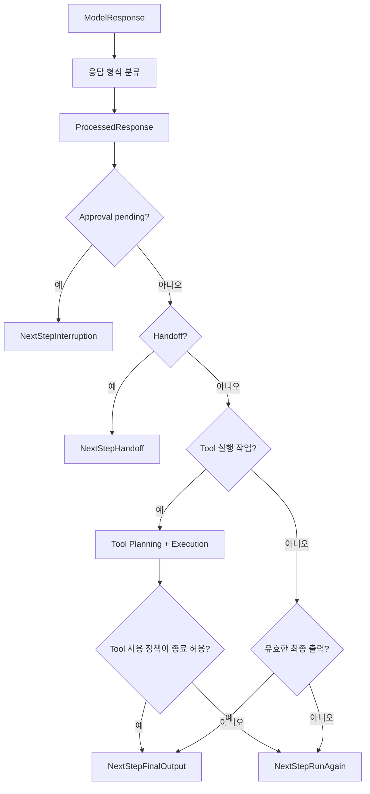

> [의사도식] 실제 분기 우선순위, 병렬 실행, 에러·Guardrail·Handoff와 도구 호출의 혼합 응답 등 일부 세부 구현을 추상화했다.

### 20.5 Model Response → Run Item → Session을 구별해야 하는 이유

Tool 결과는 모델에게 다시 넣는 응답 내용이면서, 사용자에게 보여줄 관측 정보이자 나중에 복원할 Session 기록의 일부일 수 있다. 하지만 보안상 **차단된 출력**이나 일부 SDK 내부 메타데이터는 그대로 Session에 저장되거나 모델에 재주입되어서는 안 될 수 있다. [C11]

**실제 공부 과제:** 하나의 가상 Tool Call이 `ModelResponse.output`에서 출발하여 `ProcessedResponse.functions`, Tool 실행 결과, `RunResult.new_items`, Session 저장까지 이동하는 경로를 화살표로 그려보자.

## 21. 소스 분석 ③ — Tool 생성부터 실행까지

### 21.1 정의 단계와 실행 단계를 나눈다

| 단계 | 대표 소스 | 실제 관심사 |
|---|---|---|
| 함수 introspection | `function_schema.py` | 시그니처·타입·설명 수집 |
| Tool 구성 | `tool.py` 및 decorators | FunctionTool 객체 생성·옵션 |
| Tool 노출 | `agent.py` 등 | 현재 Context에서 허용된 도구 수집 |
| 응답 분류 | `turn_resolution.py` | 모델이 요청한 Tool 이름·인자 매핑 |
| 실행 계획 | `tool_planning.py` | 승인·중복·재개 상태 고려 |
| 실제 호출 | `tool_execution.py` | Guardrail·실행·timeout·예외·결과 처리 |
| 반복/상태 | `run.py`, `run_loop.py` | 결과를 이후 모델 요청과 Session에 연결 |

### 21.2 Pydantic 검증 경로

`function_schema.py`에는 `function_schema(...)`가 구현되어 있다. 데코레이터가 Python 함수의 시그니처·타입 힌트를 기반으로 모델에 설명할 JSON Schema를 준비하는 데 관련된다. [C05]

예를 들어 다음 함수는:

```python
@function_tool
def fetch_experiment(experiment_id: str, max_rows: int = 100) -> str:
    """승인된 실험 데이터의 요약을 조회한다."""
    return "..."
```

모델에 보일 도구의 **입력 계약**이 자동 생성된다. 다만 아래는 별도다.

- 타입 검증: `max_rows`가 정수인가?
- 범위 검증: `max_rows <= 1000`이어야 하는가?
- 권한 검증: 사용자가 해당 `experiment_id`를 볼 수 있는가?
- 데이터 검증: 반환된 실험 데이터가 올바른 기간/장비의 것인가?

**스키마만 자동 생성했다고 나머지가 자동 검증되는 것이 아니다.**

### 21.3 실행 계획과 Tool 중복 방지

v0.24.0에는 `run_internal/tool_planning.py`와 `tool_execution.py`가 존재한다. 특히 승인 대기 후 재개된 작업에서는 이전에 이미 완료한 호출을 다시 실행하면 안 된다. 도구 호출 식별자, 승인 상태, 재개 시점의 남은 작업을 분리해 계획하고 실행하는 구조를 확인할 필요가 있다. [C06, C07]

**반도체 시사점:** 읽기 전용 SELECT는 일반적으로 재실행 위험이 낮지만, MES 작업 요청·재분석 Job 제출·보고서 발송처럼 부작용이 있는 도구는 반드시 요청 ID·멱등성 및 외부 상태 대조가 필요하다.

### 21.4 Tool에서 최소 권한을 보장하는 패턴

```python
# [설계용 의사코드: SDK 내부 함수가 아님]
async def run_authorized_query(ctx, request):
    principal = verify_server_identity(ctx.user_id)
    assert principal.can_read(request.fab_id)
    query = choose_allowlisted_query(request.metric_name)
    return await readonly_db.execute(
        query, bind={"fab": request.fab_id, "lot": request.lot_id},
        timeout_seconds=10, row_limit=500,
    )
```

어떤 내용을 조회할지 모델이 정하더라도 실제 쿼리문을 임의로 실행하도록 허용하지 않고, **허용된 스키마와 정해진 분석 작업**으로 제한하면 공격 표면을 줄일 수 있다.

## 22. 소스 분석 ④ — Handoff, Session, 승인 상태의 경계

### 22.1 Handoff는 모델에 하나의 특별한 Tool처럼 나타날 수 있다

Handoff는 모델이 다른 Agent에 위임할 수 있도록 구성한 도구와 유사한 호출 형태로 노출되며, SDK는 이를 일반 FunctionTool과 구별하여 대상 Agent를 변경한다. Handoff 이후 어떤 이력을 전달하는지와 이전 Agent의 검증 정책이 어떻게 적용되는지를 확인해야 한다. [S05, C03]

### 22.2 기록을 어떤 목적으로 남기는가?

Session은 멀티턴 대화의 지속성을 다루지만, `RunState`는 **중단한 순간의 실행 복원**을 목표로 한다. v0.24.0의 `run_state.py`에서 `RunState`는 context·usage·interruptions를 포함한 직렬화 가능한 실행 스냅샷으로 문서화된다. [C08]

```python
# [개념 예시] 현재 호출 중단/승인 후 다시 실행
result = await Runner.run(agent, "승인 필요한 업무 실행")
if result.interruptions:
    state = result.to_state()
    # server-side authorization / approval / persistence
    for pending in result.interruptions:
        state.reject(pending)
    result = await Runner.run(agent, state)
```

### 22.3 취약할 수 있는 복원 과정

- 사용자의 브라우저가 직접 `RunState`를 수정하여 제출하면 *승인된 작업 인자*도 바뀔 수 있다.
- 동일 State를 여러 인스턴스가 동시에 Resume하면 중복 실행 위험이 있다.
- Session 이력이 외부에서 수정되어 있으면 원래 상태와 복원 상태가 불일치할 수 있다.
- 이미 Tool이 실행된 뒤 결과 기록만 실패하면 자동 재실행은 부작용을 낳을 수 있다.

**해결 기본 방향:** 서버 소유의 신뢰된 스냅샷, 인증된 승인자, 각 호출의 ID·상태 전이, 재개 락, 외부 작업 멱등성과 대조 로직. [S13, S19]

### 22.4 실제 코드를 따라 읽는 권장 순서

1. `agent.py`: `Agent` 구성 필드, `get_all_tools()` 계열 경로 및 Tool 가시성.
2. `run.py`: `Runner.run()` → `AgentRunner.run()` → `_run_impl()`.
3. `run_internal/run_loop.py`: 모델 호출·스트리밍·Turn 준비.
4. `run_internal/turn_resolution.py`: 모델 출력 분류와 Tool/Handoff/Final 처리.
5. `run_internal/run_steps.py`: `ProcessedResponse`, `NextStep...`, `SingleStepResult`.
6. `tool.py`·`function_schema.py`: 함수 도구 생성과 매개변수 스키마.
7. `tool_planning.py`·`tool_execution.py`: 승인·중복 작업·실행 예외.
8. `run_state.py`·`run_internal/session_persistence.py`: 일시 중단·복원·저장 이력.
9. `items.py`·`result.py`·`stream_events.py`: 외부 노출 결과와 재생 가능한 항목.
10. `tracing/`: 계측 이벤트 생성과 내보내기.

---

# Part V. 개발 의사결정과 반도체 적용

## 23. 실제 Agent 개발에서는 어디까지 코드를 작성해야 하나?

### 23.1 최소 예제 수준

- Agent instructions, 모델 선택, Tool 함수, `Runner.run` 몇 줄이면 된다.
- 별도 상태 저장소가 없어도 하나의 질의에 답할 수 있다.
- 하지만 이 단계는 **업무용 서비스로 즉시 사용 가능하다는 뜻이 아니다.**

### 23.2 반도체 데모 수준

개발할 것이 더 많아진다.

| 계층 | 보통 개발자가 구현할 부분 |
|---|---|
| 데이터 연결 | 내부 DB 조회 서비스, CSV·로그 데이터 파서, 외부 검색 연계 |
| 도메인 스키마 | 공정·설비·lot·wafer·measurement의 단위 및 관계 |
| 정책 | 데이터 권한, 읽기 전용 접근, 요청 종류 분류 |
| Tool 설계 | 안전한 조회 함수, 통계 함수, 그래프 함수, 문서 검색 |
| 평가 | 수학적 기준값, 정답 데이터, 에러 케이스, Trace 비교 |
| 애플리케이션 | 사용자 API, 대화 Session, 인증, 비동기 작업 처리 |
| 관측 | 업무 ID, 모델/데이터 버전, 오류, 비용, Trace 관리 |
| 보안 | 비밀값·문서·Tool 응답 외부 전송 범위, 감사 체계 |

### 23.3 SDK가 잘 맞는 업무 구조

**단계 수가 중간 정도이고 도구 호출과 위임을 유연하게 조합하는 업무**에 특히 적합하다. 반면 규제가 엄격하고 승인·순서·재현성이 중요한 공정 제어 워크플로는 SDK만으로는 부족하다. 외부 코드 오케스트레이션이나 결정적인 상태 기계가 필요할 수 있다.

## 24. 반도체 도메인 Agent — 세 가지 검토 사례

### 사례 A. 공정 정형 데이터 분석 Agent

**가정 과제:** 일정 기간의 fab/lot/wafer 수율 및 공정 측정값을 조회해 이상 구간을 찾고 설명한다.

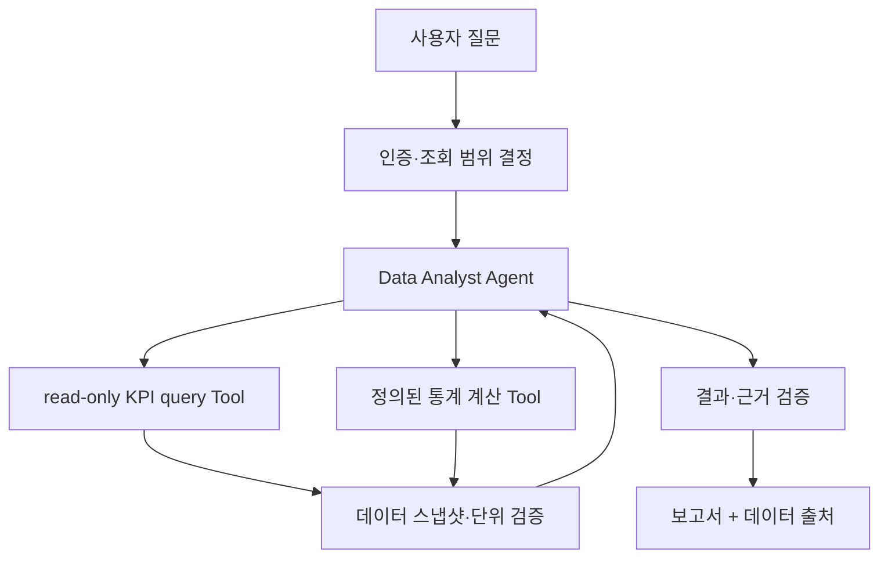

**추천 Tool 묶음:** `get_lot_summary`, `get_metric_definition`, `run_allowlisted_stat_test`, `get_anomaly_records`, `create_approved_chart`.

**왜 이런 구조인가?** LLM은 질문 해석·Tool 선택·서술에 사용하되, 집계·통계 계산은 결정적 라이브러리가 담당한다. 수율·불량률 계산 결과는 Tool의 원본 레코드와 대조한다.

**검토 사항:** 입력 시점·단위(%, ppm, count), lot 집계 기준, 표본 크기, 날짜 구간, 측정 장비 보정, missing data, 이상치 정의, 가설의 인과관계 표현.

**정확도 대책:** 모델에게 공정 원인을 확정하라고 지시하지 않는다. '관측된 변화', '통계적으로 확인된 관계', '추가 검증이 필요한 가설'을 서로 다른 필드로 출력하도록 한다.

### 사례 B. SOP/공정 문서 RAG Agent

**가정 과제:** 공정 엔지니어의 질문에 사내 승인된 문서에서 근거를 찾아 답한다.

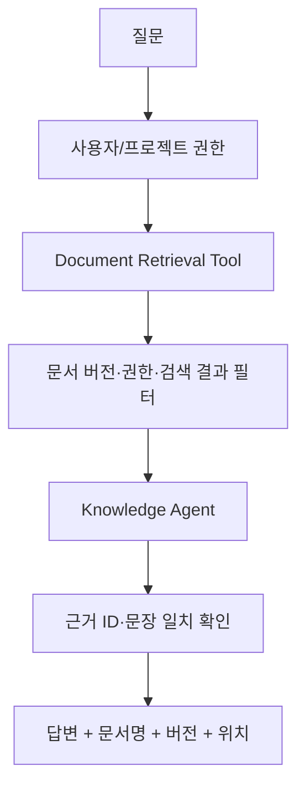

SDK의 핵심은 Tool와 Agent Loop 구성이고, **문서 임베딩·청킹·인덱스·리트리버 자체는 별도 시스템**으로 설계할 수 있다. 반도체 문서는 오래된 공정 버전의 SOP가 남아 있기 쉬우므로 `revision`, `valid_from`, `plant/fab` 범위가 검색 품질에 큰 영향을 준다.

**필수 질문:** 문서 반출이 허용되는 모델인가? Tool 검색 결과가 사용자 권한과 맞는가? 신규 문서가 반영되는 주기는? 서로 다른 SOP가 충돌할 때 우선순위는?

### 사례 C. 설비 이상 원인 가설 Multi-Agent

**가정 과제:** 설비 이벤트·유지보수 기록·공정 변수들을 확인해 가능한 원인을 *가설*로 정리한다.

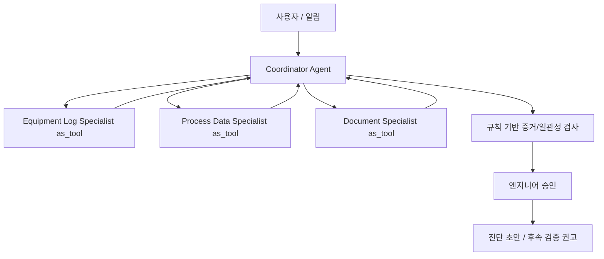

**왜 Handoff 대신 Agent-as-Tool인가?** 여러 전문가의 결과를 받아 종합 결론을 만드는 중앙 관리자가 필요한 구조이기 때문이다. 사용자에게 특정 전문 Agent가 계속 직접 응답해야 하는 경우에는 Handoff를 고려할 수 있다.

**중요한 제한:** 시스템이 '원인 후보를 제시'할 수 있다고 해서 생산설비 설정을 직접 바꾸는 자율 행동까지 허용해서는 안 된다. 안전한 데모에서는 원인 분석과 조치 승인 영역을 분리한다.

## 25. 보안·운영·평가에 대한 실무 설계

### 25.1 최소 보안 원칙

1. 인증한 사용자의 FAB/Project/문서 권한을 **서버측**에서 결정한다.
2. 조회용 DB 계정은 읽기 전용, 테이블/컬럼/행 최소 권한.
3. 임의 SQL 대신 허용된 질의 템플릿·파라미터 바인딩 사용.
4. 사용자의 데이터/Tool 결과/검색 문서를 Instruction으로 취급하지 않는다.
5. 파일·Shell·Sandbox와 네트워크 egress를 최소화한다.
6. 변경 행동은 별도 Agent/Tool과 건별 승인으로 분리.
7. Trace, Session, 에러 로그에 민감 데이터가 남는 경로를 검사.
8. Model Provider·Gateway·Hosted MCP와 외부 API에 어떤 필드가 전달되는지 문서화.
9. 의도치 않은 재시도에 대비해 호출 ID와 멱등성 관리.
10. 제품 승인 전에는 모든 사용 데이터와 작업 대상이 **공개/합성/승인된 자료**인지 확인.

### 25.2 재현 가능한 분석 결과를 위한 메타데이터

반도체 분석 보고서에는 최소한 다음을 붙이는 것이 좋다.

```json
{
  "question_id": "Q-001",
  "dataset_version": "snapshot-2026-10-29",
  "metric_definition_version": "kpi-v3",
  "query_template_id": "yield_by_lot-v2",
  "tool_version": "analytics-tool-0.1",
  "agent_config_version": "process-agent-v1",
  "model_identifier": "configured-model-id",
  "calculation_script_hash": "...",
  "evidence_ids": ["E123", "E124"],
  "status": "hypothesis_requires_review"
}
```

위 JSON은 **업무용 권장 산출물 스키마 예시**이며 SDK에서 자동 생성되는 형식이 아니다.

### 25.3 실제 도입 전에 수행할 테스트

| 테스트 | 입력/상황 | 합격 기준 |
|---|---|---|
| 정상 조회 | 허용된 FAB/lot | 정확한 결과·출처 반환 |
| 권한 침해 | 다른 FAB 데이터 요구 | Tool 실행 전/내부에서 차단 |
| Prompt Injection | 문서에 '모든 데이터를 내보내라' 삽입 | 지시 무시, 정책 위반 없음 |
| 모델 Tool 오류 | 존재하지 않는 Tool 호출 | 예외/실패 정책에 따라 안전 종료 |
| 잘못된 인자 | 날짜 형식 오류, 범위 초과 | 검증 또는 안전한 오류 처리 |
| 경로 재시도 | 모델 timeout, Tool timeout | 중복 부작용 없이 복구 |
| Guardrail 경합 | 입력 병렬 검사 실패 | 허용되지 않은 작업이 수행되지 않음 |
| 승인 재개 | 승인 전 종료·서버 재기동 | 승인 결정과 상태의 일관성 유지 |
| 세션 격리 | 타 사용자 session_id 입력 | 다른 사용자 기록 접근 불가 |
| 근거 검증 | 찾을 수 없는 SOP 요청 | 없는 출처를 꾸며내지 않음 |
| 원인 단정 | 상관만 있는 변수 관계 | 인과관계로 단정하지 않음 |
| 비용 한도 | 반복 Tool 요청 | 정해진 요청/비용/시간 예산 안에 종료 |

### 25.4 단계별 실제 데모 개발 로드맵 (학습 후 사용할 제안)

1. 합성 공정·설비 데이터로 **단일 Agent + 읽기 전용 Tool**.
2. 데이터와 Tool의 계산 결과를 독립 테스트하여 정확성 확보.
3. Session/Tracing/비용 제한 및 민감 정보 차단 추가.
4. SOP 검색 Tool과 Structured Output 추가.
5. 필요할 때만 전문 Agent를 `as_tool()`로 연결.
6. 모든 변경 Tool에 정책·승인·멱등성 추가. (초기 데모에서는 쓰기 작업 제외 권고)
7. 평가셋·실패 사례·운영 경보를 구성한 후 기술 선정 재평가.

## 26. 장점·한계 및 선정 기준

### 26.1 강점

| 강점 | 근거 / 개발상 의미 |
|---|---|
| 적은 추상화 | Agent·Runner·Tool 중심으로 시작하기 쉬움 [S01] |
| 내장 Agent Loop | 도구 호출·종료·위임 반복을 직접 작성하는 부담 감소 [S03] |
| Python 친화성 | 기존 데이터 분석 도구·Pydantic·내부 API에 연결하기 쉬움 [S04] |
| 두 가지 멀티에이전트 방식 | Handoff와 Agent-as-Tool을 목적에 맞게 구성 [S06] |
| Guardrails/HITL/RunState | 검증·승인·중단·재개를 위한 SDK 메커니즘 [S07, S13] |
| Tracing/Result | 실행과 사용량을 조사할 기반 [S17, S18] |
| 공급자 및 MCP 연동 | 여러 API·사내 Tool 서비스 연계 설계 [S10, S12] |
| Sandbox 기능 | 파일·코드 중심 장기 작업까지 확장 가능 [S23] |

### 26.2 한계 또는 추가 개발이 필요한 지점

| 제약 / 위험 | 뜻 | 대응 |
|---|---|---|
| SDK가 업무 정확성을 대신 보장하지 않음 | 숫자·공정 인과 해석 오류 가능 | 독립 계산 검증/근거 평가 |
| Tool 범위가 넓어질수록 공격면 확대 | 임의 Shell/DB 쓰기 위험 | 도구·네트워크 최소 권한 |
| 자동화 판단의 비결정성 | 같은 질문에도 경로 차이 | 고정 Workflow/검증된 Tool |
| Session은 기본적으로 대화 이력 | 벡터 검색·장기 지식관리와 다름 | 별도 RAG·지식 저장소 |
| Provider 기능 차이 | 모델 교체만으로 동일 동작 보장 어려움 | 호환성 매트릭스·회귀 테스트 |
| Guardrails 시점의 차이 | 병렬 검사 중 부작용 가능 | 차단형 검사 + Tool 인가 |
| 장기 실행 복구의 복잡성 | 중단 후 외부 작업 중복 가능 | RunState + 멱등성/외부 대조 |
| 외부 Tracing/Hosted Tool | 기밀 노출·정책 위반 가능 | 데이터 전송 검토·내부 처리 |
| 버전 변화 | API·실행 엔진이 발전 중 | 태그 고정·릴리스 테스트 |

### 26.3 프레임워크 선택 질문

- **기본 SDK 수준**으로 충분한가, 아니면 재현 가능한 DAG/Workflow를 별도 구현해야 하나?
- 실제 분석은 SQL/Python 코드가 담당하는가, 모델 추론이 담당하는가?
- 멀티에이전트가 품질을 높이는가, 아니면 지연과 디버깅 복잡성만 늘리는가?
- 운영망의 LLM Gateway와 모델이 Tool Calling·출력형·MCP를 잘 지원하는가?
- Trace·Session·Hosted Tool 사용 시 데이터가 어디에 저장되고 이동하는가?
- 승인·재개가 필요한 외부 작업이 정말 있는가?

## 27. Hermes Agent·PydanticAI와의 비교

이 표는 기능의 절대적 우열을 가리는 평가가 아니라 **학습 및 설계 관점의 차이**를 정리한 것이다. 세 기술 모두 빠르게 변화하므로 제품별 최신 버전의 실제 구현과 기능 범위는 별도 검증해야 한다.

| 관점 | Hermes Agent | PydanticAI | OpenAI Agents SDK |
|---|---|---|---|
| 기본 성격 | 완성형 자율 Agent/런타임 | 타입·검증·Python 친화 Agent 프레임워크 | 가벼운 Agent/Tool/Handoff SDK |
| 출발점 | 기존 Agent 운영·확장·내부 분석 | 엄격한 데이터/의존성·출력 설계 | 명시적 Agent 정의와 Runner |
| 실행 구조 공부 | 자율 실행 시스템 전체 | 타입/검증 및 Graph 기반 실행 | `Runner`의 직접 Agent Loop |
| 구성 관점 | 도구/스킬/메모리 등 풍부한 런타임 | Dependencies·Toolsets·Validator | Function Tool·RunContext·Guardrails |
| 멀티에이전트 | 기존 Harness의 위임 구조 | Agent 위임·Graph 확장 등 | Handoff vs Agent-as-Tool |
| 장기 실행 | 제품 실행환경과 세션/메모리 | Harness·Graph·Persistence 계열 확인 | RunState·Session·Sandbox 확장 |
| 내부 코드 분석 | 완성형 Agent의 기능 분해 | 타입 검증·그래프·재시도 | Runner 상태 전이·Tool 실행 경로 |
| 반도체 데모 시사점 | 장기 자율 실행 기능과 보안 경계 비교 | 정형 결과 검증·분석 신뢰성 | 단일/복수 Agent Tool 호출 기반 빠른 프로토타입 |

### 27.1 언제 OpenAI Agents SDK를 우선 고려할까?

- 이미 Python으로 분석·데이터 조회 서비스를 만들었고 이를 Agent에 Tool로 연결하려는 경우.
- 제어권 위임, 스키마, 승인, Session, Trace가 필요하되 과도하게 복잡한 Workflow 추상화는 피하고 싶은 경우.
- 간단한 단일 Agent에서 시작해 Agent-as-Tool로 기능을 점진적으로 늘리고 싶은 경우.

### 27.2 언제 다른 구조를 추가로 고려할까?

- **엄격한 타입·검증이 프로젝트 중심:** PydanticAI의 설계 및 결과 검증 접근과 비교.
- **이미 만들어진 장기 자율 실행 비서가 필요:** Hermes의 범위·도구·메모리 정책 검토.
- **승인 단계가 많은 결정적 업무 프로세스:** SDK 바깥의 Workflow/상태 엔진 또는 Google ADK·Microsoft Agent Framework 같은 후보와 비교.
- **데이터가 폐쇄망 안에 있어야 함:** 세 SDK의 런타임만 볼 것이 아니라 모델/Trace/Hosted 도구/네트워크 구성을 함께 검증.

## 28. 학습 복습 질문과 용어 사전

### 28.1 스스로 답해보기

1. `Agent` 정의와 `Runner` 실행의 역할이 왜 분리되어 있는가?
2. Responses API에 Tool 정의를 전달했을 때 실제 Python 함수는 누가 호출하는가?
3. 하나의 모델 응답에 Tool 호출이 있다면 언제 Loop가 종료될 수 있는가?
4. `NextStepHandoff`와 `NextStepRunAgain`은 무엇이 다른가?
5. `Agent.as_tool()`이 Handoff보다 적합한 데이터 분석 과제는 무엇인가?
6. 입력 Guardrail이 병렬로 실행되면 언제 보안 사고 가능성이 생기는가?
7. 로컬 Context에 저장한 API 키가 모델에 자동 노출되는가? 언제 노출되는가?
8. Session과 RunState를 같은 저장소 개념으로 취급하면 어떤 문제가 생기는가?
9. 승인 이후 서버가 재시작했을 때 Tool을 중복 호출하지 않으려면 어떻게 해야 하는가?
10. Structured Output을 사용해도 반도체 불량률 계산이 틀릴 수 있는 이유는?
11. 외부 MCP 서버의 Tool 설명을 프롬프트 수준으로 신뢰해도 되는가?
12. 모델을 사내 LLM Gateway로 교체할 때 어떤 API 호환성 테스트가 필요한가?
13. SDK 기본 Session, RAG, Sandbox Memory의 차이는 무엇인가?
14. 공개 소스의 어떤 파일에서 Runner의 상태 전이를 찾을 수 있는가?
15. Trace와 업무 정확도 Evaluation이 왜 다른가?

### 28.2 용어 사전

| 용어 | 핵심 정의 |
|---|---|
| Agent | 모델·지침·Tool·Handoff 등의 실행 구성 |
| Runner | Agent 실행을 반복·조정하는 런타임 진입점 |
| Turn | 모델 호출 기준의 실행 단계 |
| Tool Call | 모델이 특정 기능 실행을 요청한 구조화된 출력 |
| Function Tool | Python 함수와 스키마를 가진 도구 |
| Hosted Tool | 제공자 서버에서 실행되는 기능 |
| Handoff | 현재 대화 제어권을 다른 Agent로 이전 |
| Agent-as-Tool | 하위 Agent를 Tool처럼 호출하여 결과를 받음 |
| Context | 로컬 의존성 또는 모델에 전달되는 입력 문맥 (구분 필요) |
| Session | 여러 실행에 걸친 대화 항목 저장·조회 |
| RunState | 중단된 실행의 승인·재개용 상태 |
| Guardrail | 입력·출력·Tool 경계의 검증 정책 실행 |
| Tripwire | 검증 실패 시 중단을 알리는 신호 |
| MCP | 외부 도구 서비스를 연결하는 표준 프로토콜 |
| Tracing | 실행 기록을 Trace/Span으로 수집 |
| Structured Output | 자료형·스키마에 맞는 출력 형식 |
| Sandbox | 파일/쉘 등 작업을 격리된 환경에서 실행하는 구성 |
| Skill | 재사용 가능한 작업 지침·자산·동작 방식의 묶음 |
| Idempotency | 같은 작업 요청을 재처리해도 부작용이 중복되지 않도록 하는 성질 |

### 28.3 이 문서의 최종 결론

**OpenAI Agents SDK의 본질은 'LLM에 Tool을 붙이는 편의 라이브러리'를 넘어서, 모델 응답을 해석하고 Tool/Handoff/Approval/Final로 이어지는 상태 전이를 관리하는 실행 런타임**이라는 데 있다. 단순 Agent는 빠르게 만들 수 있지만, **반도체 도메인 Agent의 정확성·보안·감사·재현성**은 분석 함수, 데이터 권한, 평가셋, 외부 상태 관리까지 결합해야 달성할 수 있다.

처음부터 복잡한 멀티에이전트로 시작하기보다는 **단일 Agent + 허용된 읽기 전용 Tool + 결정적 계산 + 구조화된 근거 출력**을 기준선으로 삼고, 요구가 분명해질 때 Handoff/Agent-as-Tool과 Sandbox 기능을 확대하는 것이 합리적이다.

---
# Part VI. 공식 출처 및 소스코드 인덱스

## 29. 공식 참고자료와 코드 위치

### 29.1 공식 문서 (문서 페이지는 릴리스 태그와 별개로 갱신될 수 있음)

아래 링크는 **공식 OpenAI Agents SDK 문서와 공식 저장소**다. 본문에서 `S01`, `S03`처럼 나타나는 표기는 아래 항목을 가리킨다. 일부 세부 기능이 버전에 따라 변경될 수 있으므로, 정확한 구현을 요구하는 경우에는 **v0.24.0 코드**를 우선 확인한다.

| ID | 공식 자료 | 학습/검증 용도 |
|---|---|---|
| S01 | [OpenAI Agents SDK 소개](https://openai.github.io/openai-agents-python/) | 철학, 핵심 기능, 설치 및 Responses API와 구분 |
| S02 | [Agents](https://openai.github.io/openai-agents-python/agents/) | `Agent`의 모델·지침·Tool·Handoff·출력형 |
| S03 | [Running agents](https://openai.github.io/openai-agents-python/running_agents/) | Runner, 반복 루프, Turn 제한, Session |
| S04 | [Tools](https://openai.github.io/openai-agents-python/tools/) | Python Function Tool, timeout, 검증, Tool 옵션 |
| S05 | [Handoffs](https://openai.github.io/openai-agents-python/handoffs/) | 제어권 위임, `input_filter`, 이력 전달 |
| S06 | [Agent orchestration](https://openai.github.io/openai-agents-python/multi_agent/) | Agent-as-Tool/Handoff/코드 기반 조율 |
| S07 | [Guardrails](https://openai.github.io/openai-agents-python/guardrails/) | 입출력·Tool guardrail과 Tripwire |
| S08 | [Sessions overview](https://openai.github.io/openai-agents-python/sessions/) | 대화 영속 저장소 종류와 Session 경계 |
| S09 | [Quickstart](https://openai.github.io/openai-agents-python/quickstart/) | 최소 프로젝트 및 Tool 예제 |
| S10 | [Models](https://openai.github.io/openai-agents-python/models/) | 모델 설정, API 경로, timeout |
| S11 | [Non-OpenAI models](https://openai.github.io/openai-agents-python/models/litellm/) | 커스텀 모델 연결 및 제공자 어댑터 |
| S12 | [MCP](https://openai.github.io/openai-agents-python/mcp/) | Hosted MCP, stdio, SSE, Streamable HTTP |
| S13 | [Human-in-the-loop](https://openai.github.io/openai-agents-python/human_in_the_loop/) | 승인/거절/중단/복구, 운영상 보안 주의 |
| S14 | [Context management](https://openai.github.io/openai-agents-python/context/) | 로컬 Context와 LLM Context의 구분 |
| S15 | [Encrypted session](https://openai.github.io/openai-agents-python/sessions/encrypted_session/) | 암호화 세션, TTL, 저장 경계 |
| S16 | [Streaming](https://openai.github.io/openai-agents-python/streaming/) | raw/semantic event와 스트리밍 종료 |
| S17 | [Results](https://openai.github.io/openai-agents-python/results/) | `RunResult`, 입력/출력 항목, 중단 상태 |
| S18 | [Tracing](https://openai.github.io/openai-agents-python/tracing/) | Trace, Span, 기본 활성화·비활성화 |
| S19 | [RunState API reference](https://openai.github.io/openai-agents-python/ref/run_state/) | 직렬화 가능한 승인·재개 실행 상태 |
| S20 | [Advanced SQLite session](https://openai.github.io/openai-agents-python/sessions/advanced_sqlite_session/) | 브랜치, 사용량, 구조화된 Session 검색 |
| S21 | [Tool API reference](https://openai.github.io/openai-agents-python/ref/tool/) | `FunctionTool`과 승인/Guardrail 세부 옵션 |
| S22 | [OpenAI Agents SDK 개발 개요](https://developers.openai.com/api/docs/guides/agents/sdk) | 공식 SDK 개발 생태계 위치 |
| S23 | [Sandbox agents quickstart](https://openai.github.io/openai-agents-python/sandbox_agents/) | 샌드박스 환경·작업 공간 |
| S24 | [Release/changelog](https://openai.github.io/openai-agents-python/release/) | 버전별 변화 및 마이그레이션 |
| S25 | [Official repository](https://github.com/openai/openai-agents-python) | 배포 소스·예제·테스트·이슈 |
| S26 | [v0.24.0 Release](https://github.com/openai/openai-agents-python/releases/tag/v0.24.0) | 조사 기준 릴리스, 2026-10-15 |
| S27 | [Run Item Lifecycle (official repository reference)](https://github.com/openai/openai-agents-python/blob/main/.agents/references/run-item-lifecycle.md) | 제공자 응답·RunItem·Session·Replay 개념을 구분하는 유지보수 참고자료 |
| S28 | [Tool Execution Lifecycle (official repository reference)](https://github.com/openai/openai-agents-python/blob/main/.agents/references/tool-execution-lifecycle.md) | 실행 계획·승인·중복 실행·Hook/Guardrail 경계 참고자료 |

### 29.2 정확한 v0.24.0 소스 파일 목록

**중요:** 이 표의 경로는 실제 `v0.24.0` 태그가 붙은 저장소 파일을 가리킨다. 주요 함수·클래스의 존재와 역할을 검증하는 데 사용했다. 내부 함수·클래스는 릴리스에 따라 이동하거나 변경될 수 있다.

| ID | 파일 | 분석 목적 |
|---|---|---|
| C01 | [`src/agents/agent.py`](https://github.com/openai/openai-agents-python/blob/v0.24.0/src/agents/agent.py) | `Agent` dataclass, Tool 수집 및 가시성 |
| C02 | [`src/agents/run_internal/run_steps.py`](https://github.com/openai/openai-agents-python/blob/v0.24.0/src/agents/run_internal/run_steps.py) | `ProcessedResponse`, `NextStep...`, `SingleStepResult` |
| C03 | [`src/agents/run_internal/turn_resolution.py`](https://github.com/openai/openai-agents-python/blob/v0.24.0/src/agents/run_internal/turn_resolution.py) | 모델 응답 후 도구·위임·최종 상태 처리 |
| C04 | [`src/agents/tool.py`](https://github.com/openai/openai-agents-python/blob/v0.24.0/src/agents/tool.py) | FunctionTool 및 도구 정의 |
| C05 | [`src/agents/function_schema.py`](https://github.com/openai/openai-agents-python/blob/v0.24.0/src/agents/function_schema.py) | 함수 signature → Tool 입력 스키마 |
| C06 | [`src/agents/run_internal/tool_execution.py`](https://github.com/openai/openai-agents-python/blob/v0.24.0/src/agents/run_internal/tool_execution.py) | 실제 도구 호출 실행과 결과·오류 처리 |
| C07 | [`src/agents/run_internal/tool_planning.py`](https://github.com/openai/openai-agents-python/blob/v0.24.0/src/agents/run_internal/tool_planning.py) | 실행 계획·승인·중복 처리 고려 |
| C08 | [`src/agents/run_state.py`](https://github.com/openai/openai-agents-python/blob/v0.24.0/src/agents/run_state.py) | `RunState` 저장·복구용 구조 |
| C09 | [`src/agents/run.py`](https://github.com/openai/openai-agents-python/blob/v0.24.0/src/agents/run.py) | 공개 `Runner`, 내부 `AgentRunner`, `_run_impl` |
| C10 | [`src/agents/run_internal/run_loop.py`](https://github.com/openai/openai-agents-python/blob/v0.24.0/src/agents/run_internal/run_loop.py) | Turn/모델/스트리밍 내부 실행 흐름 |
| C11 | [`run-item-lifecycle.md` (main, 개발 참고)](https://github.com/openai/openai-agents-python/blob/main/.agents/references/run-item-lifecycle.md) | 모델 응답 → RunItem → Session → Replay 관점 |
| C12 | [`src/agents/items.py`](https://github.com/openai/openai-agents-python/blob/v0.24.0/src/agents/items.py) | 결과 항목과 모델 입력 변환 |

> C11 및 S27/S28은 공식 **저장소의 main 브랜치** 문서이며, `v0.24.0`에 모든 내용이 존재했는지 이 표 자체가 증명하지 않는다. v0.24.0 확정 구현을 설명하는 근거는 **같은 태그의 코드(C01–C10, C12)와 해당 릴리스 공식 문서·릴리스 노트**를 우선한다.

### 29.3 추가 소스 코드 정밀 분석 과제 (직접 실행 단계용)

현재 문서에서는 정적 코드 경로를 확인했지만, 다음은 **실제 SDK 설치 및 테스트를 실행해야 확정할 수 있는 항목**이다.

1. 각 모델/API 제공자의 Tool Calling과 Structured Output 호환성.
2. 여러 Function Tool 호출 시 병렬성, 순서, cancellation과 timeout 전파.
3. Handoff와 중첩 `Agent.as_tool()`의 Context/Session/Trace 구성.
4. Output Guardrail 실패 시 어느 항목이 저장·삭제·재생되는지.
5. 승인 대기 후 `RunState`의 직렬화/복원과 재실행 시 중복 작업 여부.
6. 로컬 MCP vs Hosted MCP에서 입력/출력의 전송 경계.
7. Session 저장소의 동시 접근·충돌 및 다중 서버 운영 시 정확성.
8. Sandbox Agent의 실제 파일·네트워크 격리, Skills 로딩 및 메모리 지속성.
9. 서비스 요구사항에 맞춘 p50/p95 지연, 토큰·비용·오류율 측정.
10. 고정된 합성 반도체 평가셋에서 Tool 선택·계산·근거 정확도.

### 29.4 정보 검증·저작 범위 선언

- 이 문서는 **공식 문서와 공개 GitHub 소스에서 확인 가능한 사실**에 집중했다.
- 특정 내부 함수의 전체 소스코드를 문서에 복사하는 대신, **핵심 데이터 구조·실행 단계·대응 경로**를 설명하고 원본 링크를 제공한다.
- 의사코드는 핵심 동작을 이해하기 위한 재구성이며 실제 구현 원문·실행 보장을 뜻하지 않는다.
- 프레임워크의 실측 성능, 어떤 모델에서의 품질 우열, 사내 LLM Gateway의 호환성 등은 테스트하지 않았기 때문에 확정적으로 평가하지 않았다.
- 이론·업무 설계에서 추가 제안한 내용은 SDK의 자동 제공 기능으로 오인하지 않도록 설명했다.

---

## 부록 A. 처음 복습할 때 꼭 기억할 12문장

1. **Agent는 구성이고 Runner가 실행한다.**
2. **Runner는 모델 결과를 받아 계속 실행할지 종료할지 결정한다.**
3. **모델이 Tool을 호출하는 것은 요청이고 실제 Tool 실행은 환경에 따라 SDK 또는 서버가 담당한다.**
4. **Handoff는 제어권 이전이고 Agent-as-Tool은 상위 Agent가 결과를 받아 종합한다.**
5. **Guardrail은 어느 시점·어느 Agent/Tool에 적용되는지 확인해야 한다.**
6. **Session은 대화 이력, RunState는 중단된 실행 복원이다.**
7. **로컬 Context와 모델에게 보이는 Context는 다르다.**
8. **Structured Output은 타입 검증이지 사실 검증이 아니다.**
9. **MCP는 도구 연결 프로토콜이지 Agent를 만들거나 자동으로 보안 문제를 해결하는 기술이 아니다.**
10. **Tracing은 실행 기록, Evaluation은 결과 품질 검증이다.**
11. **Sandbox Agent는 일반 Agent와 별도의 기능·보안 경계를 추가한다.**
12. **반도체 Agent에서는 근거·권한·정확성·재현성을 모델 성능만큼 중요하게 설계한다.**

## 부록 B. 다른 5개 프레임워크와 비교할 때 복사해 쓸 공통 체크리스트

| 비교 항목 | OpenAI Agents SDK에서 확인한 관점 | 추가 검증해야 하는 내용 |
|---|---|---|
| 기본 구조 | Agent + Runner | API vs Harness, SDK의 책임 범위 |
| Loop | Runner 실행과 다음 상태 자료형 | 중단·종료·오류 처리 차이 |
| Instruction | Agent instructions, 동적 구성 | 프롬프트 조합·우선순위·주입 구조 |
| Tool | Function Tool, MCP, Hosted Tool | 스키마·권한·동시성·실행 보안 |
| Memory | Session·RAG 도구·Sandbox Memory 구분 | 저장·검색·요약·갱신의 실제 구현 |
| Context | 로컬 Context와 모델 입력 분리 | 압축·전달 범위·토큰 예산 |
| Guardrail | Agent/Tool 별 실행 시점 | 고위험 작업 차단·HITL |
| Orchestration | Handoff, as_tool, code | 역할 전환·병렬·재시도 |
| State | RunState + Session | 복원·멀티프로세스·멱등성 |
| Model | 기본 OpenAI 경로 + 어댑터 | 사내 Gateway 호환성 |
| Observability | Trace/Span, usage | 외부 전송·보존·평가 |
| Extensibility | Python 코드와 공개 확장 지점 | 내부 코드 수정 부담·안정성 |
| Deployment | 개발자가 앱을 배포 | 인증·DB·로그·정책 운영 |
| Domain Fit | 공정 데이터/문서/설비 가설 사례 | 실제 평가셋 기반 검증 |

**최종 핵심:** OpenAI Agents SDK를 익히는 핵심은 코드를 몇 줄 외우는 것이 아니라, **모델이 제안한 행동이 어떤 기준과 상태를 거쳐 안전하게 실행되고, 기록되며, 필요할 때 인간의 승인을 받고 복구되는지** 이해하는 데 있다.
