# OpenAI Agents SDK — 2차 심층 학습: Agent Runtime의 코드·상태·실행 정책 분석

> **학습 목적:** OpenAI Agents SDK 사용법 소개가 아니라, 공개된 Python SDK의 실행 엔진을 역추적하여 Agent Framework를 직접 설계할 때 필요한 선택을 이해한다.  
> **기준:** `openai-agents` **v0.24.0** (2026-10-15 릴리스), 조사 기준일 2026-10-31.  
> **고정 소스:** https://github.com/openai/openai-agents-python/tree/v0.24.0  
> **공식 문서:** https://openai.github.io/openai-agents-python/  
> **범위:** 기본 실행, 실행 상태, Tool/Guardrails/Handoff, 병렬성, 오류·복구, Context/Session/Cache, Serving, 아키텍처 Trade-off. **실제 도메인 데모와 실측 벤치마크 제외.**

## 전체 목차

- **Part I.** SDK의 역할, Agent 정의, 버전 고정 — §1~4
- **Part II.** Runner·Agent Loop·상태 기계·최종 모델 입력 — §5~10
- **Part III.** Tool 생성·실행·병렬성·취소·오류 처리 — §11~16
- **Part IV.** Guardrails·HITL·RunState·중단/재개 — §17~21
- **Part V.** Handoff·Agent-as-Tool·오케스트레이션 — §22~25
- **Part VI.** Session·Memory·Compaction·Prefix Cache — §26~30
- **Part VII.** Streaming·Serving·Cron·Model Provider·MCP·Sandbox — §31~39
- **Part VIII.** Observability·테스트·자체 Framework 설계·7개 비교 — §40~44
- **Part IX.** 소스 추적 연습 — §45~50
- **Part X.** 실패 모드와 설계 평가 — §51~52
- **Part XI.** 발표 흐름과 복습 질문 — §53~54
- **Part XII.** 공식 문서·코드 링크·검증 한계 — §55~57

**권장 읽기 순서:** 1차 문서를 이미 학습했다면 §5~21(실제 Loop, Tool, Guardrails)을 먼저 읽고 §26~39(상태·운영), §45~52(실제 코드 추적)로 넘어가도 된다. 발표를 준비할 때는 §53을 마지막에 활용한다.

---

## 문서를 읽는 법: 증거 등급

- **[SRC]** v0.24.0의 공개 Python 코드에서 확인되는 객체·함수·분기. 파일 경로는 고정 태그를 사용한다.
- **[DOC]** 공식 문서에 명시된 계약·동작. 문서 웹사이트가 새 버전으로 바뀔 수 있으므로 고정 소스와 함께 확인한다.
- **[INF]** 구현과 컴퓨터 시스템 원리를 근거로 도출한 설계 해석. 제품의 공식 보장사항이 아니다.
- **[UNV]** 현재 자료만으로 검증하지 못한 세부사항. 사실처럼 서술하지 않는다.
- **[PSEUDO]** 이해를 위한 의사코드. 실제 함수의 본문을 그대로 전사한 것이 아니다.

### 학습 후 도달해야 할 수준

1. `Runner.run()` 한 번이 여러 LLM 호출과 Tool 실행으로 이어지는 이유를 설명한다.
2. 단일 요청의 실제 `Agent → Runner → Model → ProcessedResponse → Tool/Handoff/Final` 호출 경로를 소스 파일 단위로 찾는다.
3. `RunState`, `Session`, `RunContextWrapper.context`, 모델 입력, Tracing 데이터가 서로 다른 상태임을 설명한다.
4. `NextStepFinalOutput / NextStepRunAgain / NextStepHandoff / NextStepInterruption`이 언제 만들어지는지 설명한다.
5. 병렬 Guardrail과 병렬 Tool의 차이, 취소와 롤백의 차이를 설명한다.
6. 보안·승인·모델 호환성·외부 저장소의 책임 주체를 판별한다.
7. Hermes·PydanticAI·Google ADK·Microsoft Agent Framework와 공통 구현 문제를 비교한다.

---

# Part I. Agent SDK를 실행 엔진으로 읽는 방법

## 1. 1분 요약: SDK가 실제로 책임지는 일

OpenAI Agents SDK는 Python 프로그램 안에서 동작하는 **에이전트 실행 라이브러리/SDK**다. Agent 정의, 실행 루프, 로컬 함수 호출, Handoff, Guardrail 실행, 결과·상태 표현과 Tracing을 제공한다. 사용자는 별도 서버 앱, 데이터 저장소, 외부 시스템 권한, 조직별 정책을 설계할 수 있고 필요에 따라 구현해야 한다. [DOC: D01, D02]

`Responses API`는 원격 모델에 요청하는 API이며, SDK는 그 API 및 호환 모델 인터페이스 위에서 **여러 차례의 의사결정과 도구 실행을 조직하는 런타임**이다. 이것이 가장 중요한 역할 구분이다.

| 구성 요소 | 누가 실행하는가? | 무엇을 담당하는가? |
|---|---|---|
| Python 애플리케이션 | 개발자 서버/프로세스 | 인증, 업무 API, 사용자별 권한, 배포, 크론, 큐, DB |
| `Agent` | SDK 내 설정 객체 | 모델, 지시문, 도구, Handoff, 출력 계약 |
| `Runner` | SDK Python 코드 | 모델 재호출, 단계별 결과 처리, Loop, 중단·완료 판단 |
| `Model` 구현 | SDK 어댑터 | 원격 LLM의 요청·응답 타입을 SDK 인터페이스로 변환 |
| 실제 LLM | 외부/자체 모델 서비스 | 다음 텍스트, Tool Call, Handoff Call 등을 생성 |
| `FunctionTool` | SDK 래퍼 + 사용자 함수 | 스키마/검증/Hook/실제 코드 실행 |
| Session 저장소 | SDK 내장 또는 사용자 구현 | 다음 애플리케이션 Turn에서 사용할 이력 관리 |
| 승인 시스템 | SDK 상태 + 외부 사람/정책 | Tool 실행 전 멈춤/승인/거절/재개 |

**SDK는 웹 서버가 아니다.** `Runner.run(...)`을 FastAPI나 워커에서 호출해야 HTTP 서비스가 된다. **SDK가 LLM 서버(vLLM/SGLang)인 것도 아니다.** 로컬 모델을 외부의 OpenAI 호환 서버로 서빙해 SDK와 연결할 수 있으나, 호환 API 제공 여부에 따라 기능이 달라진다.

## 2. 한 번의 사용자 요청과 한 번의 모델 호출은 다르다

- **사용자 요청**: 앱이 `Runner.run(...)`을 호출한 업무 단위.
- **모델 Turn**: SDK가 특정 Agent의 모델을 호출하고 결과를 처리하는 반복 단위.
- **Tool Call**: 모델 출력 안의 호출 요청 하나. 모델 Turn 하나에 여러 개가 생길 수 있다.
- **Run**: Loop가 최종 완료되거나 승인 대기 등 중단 지점에 도달하는 SDK 실행.
- **Session**: Run 간에 유지하는 대화 이력의 논리 식별자 및 저장 인터페이스.
- **Subagent as Tool**: 부모가 자식 Agent를 호출하고 자식 Run 결과를 Tool 출력으로 받는 중첩 실행.
- **Handoff**: 같은 Run 안에서 현재 Agent의 제어권을 다른 Agent로 넘김.

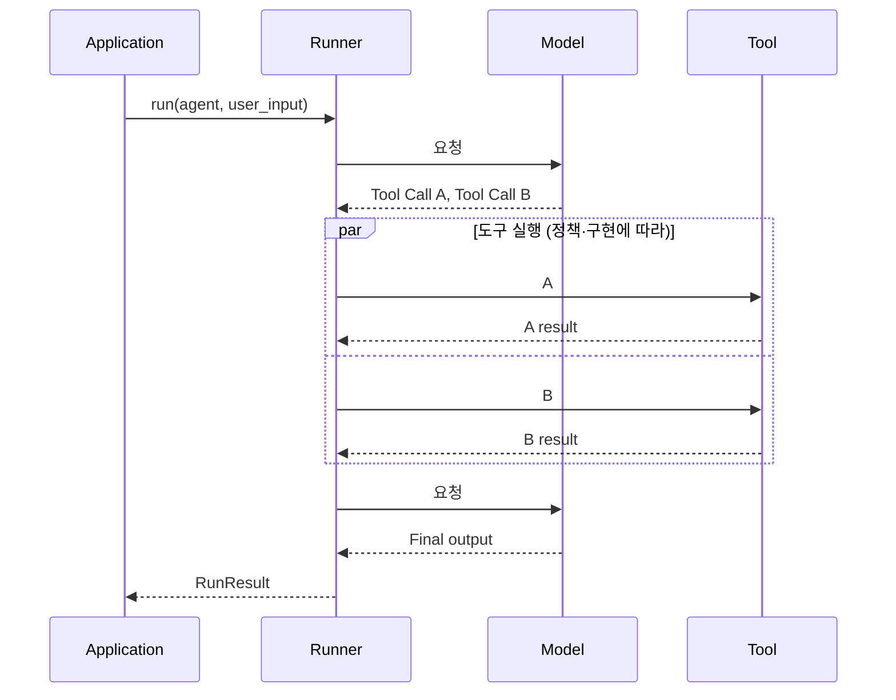

**발표 포인트:** 한 번의 `Runner.run`은 한 번의 LLM 요청과 동의어가 아니다. SDK가 실제로 반복하는 단위와 완료 조건을 코드로 확인하는 것이 Agent 프레임워크 분석의 출발점이다.

## 3. `Agent`는 상태를 가진 실행 프로세스인가?

기본적으로 `Agent`는 이름, 모델 선택, 지시문, 도구, Handoff, 출력 형식을 담는 **구성 객체**로 이해하는 것이 정확하다. 대화 이력이나 모델 입력 전체가 항상 `Agent` 객체 안에 저장되는 것은 아니다. `RunContextWrapper`, Session, RunState는 서로 다른 목적의 상태다.

일부 도구·설정·콜백은 Agent 객체에 연결되므로 재사용 시 동시성 및 가변 객체의 공유 위험을 별도로 검토해야 한다. **같은 Agent 객체를 여러 사용자에게 재사용한다고 해서 자동으로 사용자별 데이터 격리가 보장되는 것은 아니다.** [INF]

`Agent.as_tool()`은 별도 실행을 하는 자식 Agent를 Tool처럼 노출한다. `handoffs`는 현재 Agent 소유권 전환이다. 두 방식을 `multi-agent`라는 하나의 단어로 뭉뚱그리지 않는다. [DOC: D06, D07]

## 4. v0.24.0 고정과 버전 차이

- `v0.24.0` 릴리스 커밋: `17d994bd3045dae71acda676a4ef4762ed8ecd94` (공식 GitHub 릴리스·PyPI 출처).
- 핵심 변경: MCP annotation 노출, Run 전체 Tool 오류 포맷터 지원, OpenAI Conversations Session 저장 쓰기 분할, 승인 대기 중 자동 압축 보류 등. [DOC: D00]
- 이 문서의 모든 파일 경로는 `https://github.com/openai/openai-agents-python/blob/v0.24.0/` 접두사에 상대 경로를 붙여 찾는다.
- Python SDK를 기준으로 하며 TypeScript SDK의 실행 내부와 동일하다고 주장하지 않는다.

**버전 고정 이유:** Runner의 함수 분할, Tool 분기, Session 저장 및 Sandbox 기능은 릴리스별로 크게 달라질 수 있다. `main`에서 읽은 코드를 v0.24.0의 구현 사실로 가져오면 안 된다.

---

# Part II. 실행 구조와 실제 호출 경로

## 5. 실제 패키지 아키텍처

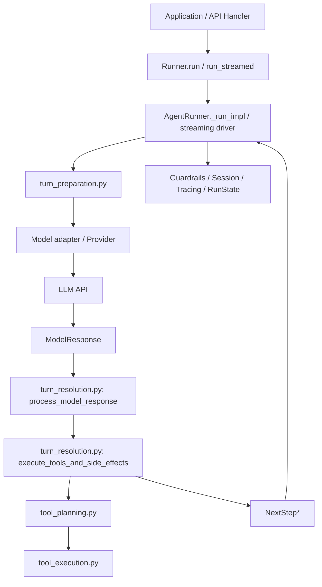

| 영역 | 고정 소스 경로 | 의미 |
|---|---|---|
| 공개 Runner 인터페이스 | `src/agents/run.py` | `Runner`, `AgentRunner`, `_run_impl`, RunResult 처리 |
| Loop 실행 유틸 | `src/agents/run_internal/run_loop.py` | 단일 Turn, Stream, 모델 호출·도구 실행 지원 함수 |
| 준비 | `src/agents/run_internal/turn_preparation.py` | 모델·도구·Handoff·출력 스키마 준비 |
| 모델 응답 분류·정리 | `src/agents/run_internal/turn_resolution.py` | `process_model_response`, NextStep 결정, Final/Handoff |
| 내부 결과 모델 | `src/agents/run_internal/run_steps.py` | `ProcessedResponse`, `SingleStepResult`, `NextStep*` |
| Tool 실행 계획 | `src/agents/run_internal/tool_planning.py` | 신규·재개 실행의 도구 계획 및 승인 처리 |
| Function/로컬 Tool 실행 | `src/agents/run_internal/tool_execution.py` | 검증, 승인 검사, 비동기 실행, 실패 정리 |
| Guardrail | `src/agents/run_internal/guardrails.py` | 입력·출력 Guardrail 실행 |
| Session 저장 | `src/agents/run_internal/session_persistence.py` | 읽기/쓰기/중단/Compaction 연동 |
| 일시중단 상태 | `src/agents/run_state.py` | 중단된 Run의 상태 및 직렬화 |

**[SRC]** 위 파일들의 존재와 주요 내보내기(import 및 `__all__`)는 v0.24.0 고정 파일에서 확인된다. 파일명만 보고 함수를 짐작하지 않는다. 한 기능이 여러 모듈로 분리되어 있으므로 실제 호출자부터 역추적한다. [S01~S10]

## 6. `Runner.run` → `_run_impl`: 상위 호출 분석

`src/agents/run.py`에서는 `Runner.run(...)`/`AgentRunner.run(...)` 진입 시 RunConfig의 정규화, Tracing 설정, 도구 구성 보호 컨텍스트, 모델 Provider 자원의 소유권 등을 관리한 뒤 내부 `_run_impl`에 위임한다. [SRC: S01]

관찰된 핵심 구조:

1. `run(...)`이 `run_config`와 Provider 소유권을 정리한다.
2. 예외와 Tracing을 감싸는 실행 스코프를 만든다.
3. 구성 기준 Agent를 정한다. 이어지는 RunState 재개면 저장된 현재 Agent가 사용될 수 있다.
4. `agent_tool_configuration_run(...)` 안에서 `_run_impl(...)`을 호출한다.
5. 생성한 Provider를 본 실행이 소유한 경우 `finally`에서 정리한다.
6. `_run_impl`은 `RunState` 재개 여부, `max_turns`, `hooks`, `session`, 대화 ID와 Response ID 옵션을 받아 처리한다.

**왜 관심 가져야 할까?** 외부 Agent 요청이 단순히 모델 호출을 감싸는 것이 아니라, **자원 소유권, 예외와 민감정보, 저장 상태, 실행 정책**을 함께 가진다는 점을 보여준다.

```python
# [PSEUDO] 공개 run.py의 계층을 학습용으로 축약한 구조
async def run(agent, input, config):
    provider, owns_provider = normalize_provider(config)
    try:
        with tracing_scope(config), guarded_agent_tool_configuration(agent):
            return await _run_impl(agent, input, config)
    finally:
        if owns_provider:
            await close_provider(provider)
```

이는 실제 SDK 함수 구현을 그대로 인용한 것이 아니며 공개 소스의 **책임 분리**를 보여주는 그림이다.

### 6.1 Resume가 새 Run과 달라지는 지점

`input`이 `RunState`인지 확인하고 원래 입력, 직전 Current Agent, 승인 정보, 모델 대화 연결 설정 및 재개 상태를 복원한다. 단순히 원래 사용자 문장을 처음부터 다시 실행하는 방식이 아니어야 이중 실행을 줄일 수 있다. 단, **외부 Tool 부작용에 대한 exactly-once를 SDK 단독으로 보장하는 것은 아니다.** [SRC: S01, S09]

### 6.2 상태에 따라 다른 모델 입력

최초 요청은 새 입력과 Session 기록을 조합할 수 있다. Resume는 `normalize_resumed_input(...)`, 승인 결정을 포함한 RunState와 현재까지 생성된 RunItem을 반영한다. Server conversation ID/previous response ID 방식은 로컬 Session 기록을 매번 전부 재전송하는 방식과 다르다. [SRC: S01, S08]

## 7. 단일 모델 Turn은 무엇을 수행하는가?

한 번의 반복에서 실행되는 핵심 단계:

1. **현재 Agent**의 모델·지시문·도구 목록·Handoff·출력 스키마를 준비.
2. 모델에 전달할 입력 메시지를 준비·필요한 경우 필터링.
3. 모델 API 호출(정상 응답 또는 스트림).
4. `process_model_response(...)`로 모델 출력 항목을 **실행 가능한 SDK 내부 항목**으로 변환.
5. Tool 실행/승인, Handoff·Final 분기.
6. RunItem·Session·Tracing·사용량·현재 Agent 상태 반영.
7. `NextStep`에 따라 종료, 다음 모델 호출, 다른 Agent로 이동, 승인 대기.

**모델이 스스로 Python 함수를 호출하는 것은 아니다.** 모델은 구조화된 Function Call을 출력하고, 실제 Python 실행 여부는 런타임이 결정한다.

## 8. `ProcessedResponse`와 `NextStep` 상태 기계

`src/agents/run_internal/run_steps.py`의 핵심 NextStep 계열:

- `NextStepRunAgain`: 모델 입력에 Tool 결과/새 항목을 반영한 후 다시 모델 호출.
- `NextStepHandoff`: 현재 Agent를 다른 Agent로 전환하고 그 Agent로 Loop 계속.
- `NextStepFinalOutput`: 최종 결과를 내고 종료.
- `NextStepInterruption`: 승인 등 추가 결정을 위해 일단 멈춤.

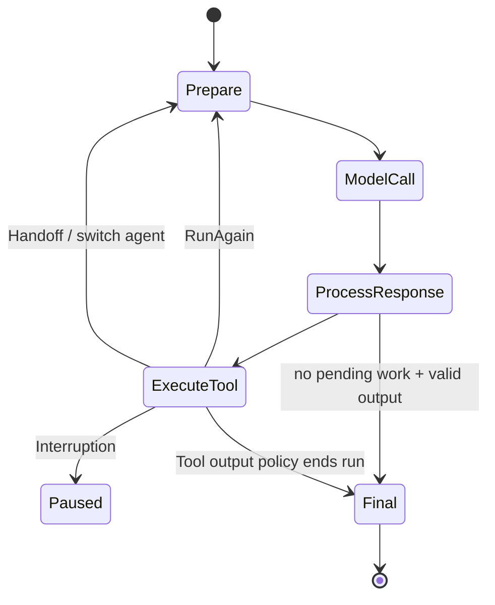

**주의:** 위 흐름도는 개념을 설명하는 것으로, 실제 예외·Guardrail·Session 저장 및 Hosted Tool 예외 경로는 더 많다. 구체 분기는 `turn_resolution.py`와 `run_steps.py`를 병행해 본다. [SRC: S03, S04]

### 8.1 종료 조건을 정확히 분리

| 발생 상황 | 결과 경향 | 추가 확인할 조건 |
|---|---|---|
| 모델이 Tool 없이 유효한 최종 출력을 반환 | Final | Output Type·Guardrail·Output Parsing |
| 로컬 Function Tool 하나 또는 여러 개 요청 | 재호출 | 승인·`tool_use_behavior`·도구 예외 |
| Handoff Tool 호출 | Handoff | 대상 Agent, input filter, history ownership |
| 도구에 승인 필요 | Interruption | 승인 상태, 동시 다른 도구 요청 |
| Tool 반환값으로 실행 종료 가능 | 조건부 Final | `tool_use_behavior` |
| 허용 모델 Turn 초과 | 예외 | `max_turns`, error handler·상태 처리 |

한 번의 API 응답 안에 최종 텍스트와 Tool Call이 공존하는 경우, 텍스트가 있다고 무조건 종료하지 않는다. 공식 문서는 **요구된 출력 형태의 텍스트가 있고 처리할 Tool Call이 없을 때**를 기본 최종 조건으로 설명한다. [DOC: D02]

### 8.2 `max_turns`의 의미와 안전 한계

`max_turns`는 모델 실행 반복 횟수의 상한이다. Tool 호출 하나하나의 개수 상한도 아니고, 전체 시간 제한도 아니다. `None`이면 해당 반복 횟수 제한을 풀 수 있으나, 무제한 Tool·비용 실행을 허용해도 안전하다는 의미는 아니다.

다음 제한은 별도의 문제다: (a) Provider 요청 시간, (b) 전체 Run deadline, (c) Tool당 timeout, (d) 동시 도구 수, (e) 토큰·비용 예산, (f) 데이터/네트워크 권한, (g) 부작용 재시도 제한.

## 9. `turn_resolution.py`를 읽는 순서

아래 함수 순서로 읽으면 효과적이다. 실제 호출 관계를 이해하기 위한 **탐색 순서**이며 모든 실행에서 일렬로 호출된다는 뜻은 아니다.

- `process_model_response`: SDK가 이해할 수 있는 Tool/Handoff/텍스트/호스팅 결과로 응답 분류.
- `execute_tools_and_side_effects`: 현재 Turn의 실행 계획을 수행하고 다음 단계를 정함.
- `execute_handoffs`: 선택된 Handoff 처리와 새 Agent 전환.
- `check_for_final_output_from_tools`: Tool 결과를 최종 출력으로 간주할지 검사.
- `execute_final_output`: 최종 출력 처리와 검증·Hook 연계.
- `resolve_interrupted_turn`: 승인 등으로 중단된 Turn 재개 처리.
- `get_single_step_result_from_response`: 모델 응답을 개별 실행 결과로 정리.

`tool_planning.py`에 `_build_plan_for_fresh_turn`, `_build_plan_for_resume_turn`, `_execute_tool_plan`, `_collect_tool_interruptions` 등이 분리되어 있다. 따라서 Tool 실행을 단순 `for tool in model.calls: await tool()` 수준으로 표현하면 **승인·재개·중복 호출 제거·결과 순서·실패 처리**를 놓친다. [SRC: S03, S05]

### 9.1 새 Turn과 Resume의 Tool 계획이 다른 이유

새 Turn에서는 방금 모델이 생성한 Tool Calls를 처리한다. Resume에서는 이전에 **승인 대기였던 호출**과 이미 **완료된 호출**을 구별해야 한다. 단지 RunState에 저장된 요청들을 다시 순회하여 모두 실행하면 부작용이 중복될 수 있다.

**[INF] 설계 원리:** `pending_calls`, `completed_calls`, `approval_decisions`, `tool_outputs`를 구분해서 저장하지 않는 프레임워크는 안정적인 중단·재개를 구현하기 어렵다.

## 10. 최종 모델 입력은 어떻게 구성되는가?

모델이 보는 입력과 Python 내부 Context 객체는 다르다.

```text
[모델에 전달되는 후보 요소]
  현재 Agent instructions / model settings
  필요한 tool schemas와 handoff schemas
  서버 대화 상태 참조 또는 직전 기록에서 준비한 model input items
  사용자 메시지
  이전 assistant 응답과 tool result
  필요한 경우 input_filter/compaction을 거친 변환된 이력
```

**`RunContextWrapper.context`에 들어있는 Python DB 연결, 인증 객체, 로컬 서비스 객체가 자동으로 모델 입력 문자열로 직렬화되는 것은 아니다.** 모델은 Tool 실행의 반환값이나 지시문 생성 코드가 명시적으로 노출한 값만 보게 된다는 점이 핵심이다. 그러나 Tool 결과를 그대로 반환하면 결국 민감정보가 모델 입력으로 들어갈 수 있다. [DOC: D02, D08]

### 10.1 실제 최종 요청을 역추적하는 법

1. Agent에서 `instructions`가 문자열인지 콜백인지 확인한다.
2. `turn_preparation.get_all_tools/get_handoffs/get_output_schema`의 실행 결과를 찾는다.
3. `session_persistence.prepare_input_with_session`에서 가져온 저장 이력을 확인한다.
4. `maybe_filter_model_input`과 Handoff 필터링에 따른 변경을 확인한다.
5. Model Adapter(Responses/Chat Completions)의 입력 변환을 확인한다.
6. Tracing/Mock Model에 기록된 **실제 요청 형태**와 비교한다. 이 마지막 단계는 후속 검증 과제이며 이번 문서에서 캡처했다고 주장하지 않는다.

### 10.2 Prompt caching의 원리와 SDK에서의 위치

Provider의 Prompt Prefix Cache는 **매번 입력을 보내더라도 앞부분의 모델 계산을 재사용**할 수 있는 구조다. SDK에는 `run_internal/prompt_cache_key.py`의 `PromptCacheKeyResolver`, `model_settings_with_prompt_cache_key` 등의 경로가 있다. [SRC: S02]

```text
요청 A: [Instructions][Tool schema][History A][New input]
요청 B: [Instructions][Tool schema][History A][Tool output][Next input]
         <------ 재사용 가능한 동일 Prefix 후보 ------>
```

- Cache Key 설정과 실제 Cache Hit는 다르다. 모델/Provider/토큰화/유효기간/요청 형식이 영향을 준다.
- Handoff로 Agent instructions와 Tool schema가 바뀌면 Prefix 재사용 범위가 줄 수 있다.
- Session 압축·History Filter가 오래된 메시지를 다시 쓰면 뒤쪽 동일 기록의 캐시까지 영향을 받을 수 있다.
- 정확한 Cache Hit 비율·절감액은 Provider 사용량 또는 실측이 필요하다. 이 문서는 성능 수치를 제시하지 않는다.

### 10.3 Context Compression은 자동 장기 기억과 다르다

공식 Session 중 `OpenAIResponsesCompactionSession`은 underlying Session의 이력을 압축할 수 있다. 이는 대화 컨텍스트 크기를 관리하기 위한 것으로, 중요 사실을 독립적인 장기 Memory로 정규화·검증하여 보관하는 기능과 동일하지 않다. [DOC: D05]

**v0.24.0 릴리스 주의:** 승인 대기 상황에서 자동 압축을 지연하는 수정이 포함되었다. 승인/복원에 필요한 원본 항목이 압축으로 사라지거나 변경되면 정합성 문제가 생길 수 있기 때문이다. [DOC: D00]

---

# Part III. Tool Calling: 스키마에서 실제 실행까지

## 11. Tool 종류부터 실행 경계를 나눈다

SDK에서 `tools=[...]`에 들어간 모든 항목이 같은 위치에서 실행되는 것은 아니다.

| 도구 유형 | 실행 주체 | 일반적인 책임 경계 | 중요 검사 |
|---|---|---|---|
| `FunctionTool` (`@function_tool`) | 사용자 Python 런타임 | 사용자 코드가 DB/API/파일 접근 | Argument validation, Tool Guardrail, Approval, 업무 권한 |
| `Agent.as_tool()` | 부모 Runner가 중첩 Agent 실행 | 자식 Run, 내부 Tool, 승인 전파 | 부모/자식 Context, 승인/이력 전파 |
| `Hosted` OpenAI Tool | OpenAI 모델 플랫폼 | OpenAI 측 도구 처리 | 해당 도구 자체의 정책 및 제공 기능 |
| 로컬 `ShellTool` / `ApplyPatchTool` | 앱이 제공한 Executor / Editor | OS/파일 시스템 | Sandbox, Approval, 실행 권한 |
| `ComputerTool` | 앱 측 컴퓨터 작업 | 브라우저/데스크톱 | Safety Check, 실행 환경 |
| Local MCP | 연결된 MCP 서버 | 서버의 도구 실행 환경 | 서버 인증, Tool filtering, Approval |
| Hosted MCP | OpenAI 호스팅 연결 경로 | 모델 서비스 및 MCP 서버 | Hosted MCP Approval/Tool 정책 |
| Sandbox Agent의 Tool | Sandbox Backend | 격리 실행 공간 | 파일·네트워크·비밀정보 권한 |

**[DOC]** Tool Guardrail은 모든 Hosted Tool과 Handoff에 자동 적용되는 전역 방화벽이 아니다. Function Tool 주변 검증이 중심이다. 각 도구별로 안전 정책을 분리해야 한다. [D04, D09]

## 12. Python 함수가 Tool이 되는 세 단계

### 12.1 스키마 변환

Python 함수의 매개변수, 타입 힌트, docstring 등을 참고하여 Function Tool의 JSON Schema 및 설명을 구성한다. Pydantic 기반 파싱·검증 기능을 사용한다. [DOC: D09]

### 12.2 모델에게 도구를 노출

`turn_preparation.get_all_tools()` 등에서 활성화 여부, 도구 목록과 Handoff를 정리해 모델 측 요청에 연결한다. **Tool을 등록했다는 것**과 **모델이 실제로 그 Tool을 호출한다는 것**은 다르다.

### 12.3 실행 요청을 SDK가 처리

모델 응답에 `function_call`이 나오면 SDK는 Tool 이름과 호출 ID를 사용해 실행 계획을 만든다. 호출 인자를 검증한 뒤 Function Tool의 실행기로 넘기며, 승인 및 Guardrail 결과에 따라 실행 대신 중단 또는 거절이 일어날 수 있다. [SRC: S03, S05, S06]

```python
# [PSEUDO] 실제 데코레이터 구현을 대체하는 설명 코드
schema = derive_json_schema(python_fn)
model_request.tools.append(schema)
model_output = await llm(...)
for call in model_output.tool_calls:
    tool = lookup_tool_by_name(call.name)
    parsed = validate_call_arguments(call.arguments, tool.schema)
    if approval_required(call, parsed):
        record_pending_approval(call)
    else:
        result = await execute_with_guardrails(tool, parsed)
        append_result_for_next_model_turn(call.id, result)
```

### 12.4 Argument validation ≠ 업무 데이터 검증

`lot_id: str` 스키마를 통과해도 그 Lot의 조회 권한이 있는지, SQL이 안전한지, 결과가 실제로 존재하는지까지 보장하지 않는다. **타입 검증 → 인증/인가 → 업무 규칙 → 실행 → 결과 검증**은 별도 계층이다.

## 13. `tool_execution.py`의 내부 구조와 실패 처리

[SRC: S06] `tool_execution.py`에는 `execute_function_tool_calls`, `function_needs_approval`, `resolve_enabled_function_tools`와 Shell/ApplyPatch/Computer 관련 실행 함수가 있다. v0.24.0에는 함수 도구를 배치로 실행할 때 **작업 상태·취소·후처리·오류 우선순위**를 관리하는 구조가 있다.

공개 코드에서 확인한 내부 자료구조 예:

- `_FunctionToolTaskState`: 개별 Tool Run, 순서, 실제 `asyncio.Task`, post-invoke 단계 진입 여부.
- `_FunctionToolFailure`: 실패 예외와 호출 순서 및 발생 소스(`direct`, `cancelled_teardown`, `post_invoke`).
- `_select_function_tool_failure`: 동시에 실패한 여러 Tool 중 어떤 실패를 표면화할지 결정.
- `_consume_function_tool_task_result`: 백그라운드 Task에서 늦게 발생한 예외의 처리.
- `_FUNCTION_TOOL_CANCELLED_DRAIN_SECONDS` 등: 취소 후 남은 작업 정리를 위한 상수.

이 구조가 중요한 이유는 **여러 Tool을 동시에 실행할 때 한 개가 실패한다고 나머지 모든 Task가 마법처럼 사라지는 것은 아니기 때문**이다.

### 13.1 실패 전파 설계에서 알아야 할 질문

- 동시 실행한 다른 Tool에 취소 요청을 보내는가?
- 취소된 Tool에서 `finally` 또는 외부 API 요청이 여전히 진행 중일 수 있는가?
- Task가 취소된 후 남은 예외를 어떻게 회수하는가?
- Tool 결과를 모델 입력에 쌓는 순서는 호출 완료 순서인가, 요청 순서인가?
- 이미 외부 시스템을 변경한 Tool에 대한 보상 트랜잭션을 누가 구현하는가?

이 내용이 처음 어려우면 Python `asyncio.create_task`, `asyncio.gather`, `asyncio.CancelledError`, `try/finally`를 먼저 복습하면 좋다.

## 14. 병렬 Tool Call: 무엇이 병렬인가?

**병렬의 단계는 셋으로 나눠야 한다.**

1. **모델 수준:** 한 모델 응답이 `Tool A, Tool B`를 동시에 요청하는 것.
2. **SDK 수준:** 여러 Tool 요청을 Python 비동기 Task로 동시에 스케줄링하는 것.
3. **시스템 수준:** DB 드라이버·네트워크·실제 외부 서버가 요청을 실제로 겹쳐 처리하는 것.

모델이 3개 Tool을 한 번에 내놓아도 실제 속도가 3배로 빨라진다고 보장하지 않는다. 동기 함수의 차단, 서비스 Rate Limit, GIL 영향, 공유 DB 락, 워커 수 제한 등으로 이득이 감소할 수 있다.

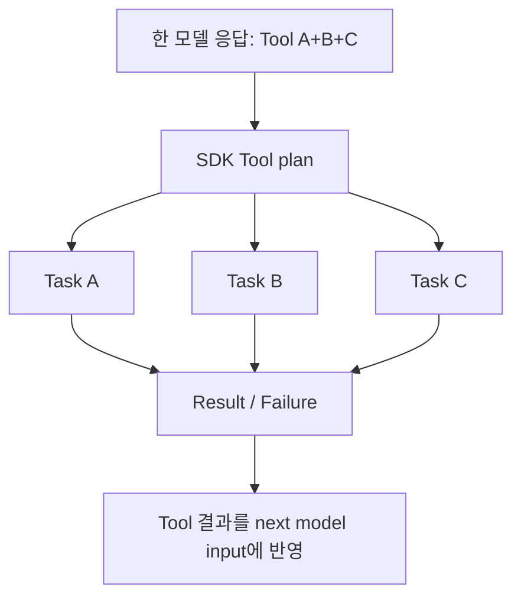

**[SRC]** v0.24.0의 `tool_execution.py`에는 Function Tool 배치를 위한 `asyncio.Task` 상태·취소 정리·오류 우선순위 처리 코드가 있다. 즉 **병렬 Tool 실행은 실체가 있는 Runtime 기능**이다. 그러나 특정 Tool 유형, 승인 대기, 스트리밍 및 오류 분기에서 항상 동일하게 동작하는지 개별 경로를 확인해야 한다.

### 14.1 병렬 실행에서 데이터 경합이 발생하는 이유

읽기 전용 Tool은 병렬 이점이 큰 반면 같은 파일을 수정하거나 같은 세션 상태를 바꾸는 Tool은 경쟁이 발생한다. 프레임워크가 **애플리케이션 도메인의 모든 충돌을 자동 판정하는 것은 아니다.** 필요 시 개발자가 read/write lock, 세마포어, 낙관적 버전 확인, DB transaction을 설계해야 한다. [INF]

### 14.2 병렬 Tool vs 병렬 Agent

- **병렬 Tool**: 모델 하나가 여러 Tool을 호출해 실행함. 보통 다음 모델 호출은 그 결과를 수집한 뒤 계속 진행.
- **병렬 Agent**: 부모가 여러 `Agent.as_tool()` 자식 또는 외부 작업을 동시에 실행하도록 구성. 각 Agent는 자체 LLM Loop를 돌 수 있음.
- **Handoff**: 다음 Agent로 소유권 이전. 같은 시점에 독립 Agent가 여러 개 실행된다는 뜻이 아님.

**발표에 반드시 넣을 문장:** 여러 Tool 호출, 여러 Agent 호출, 여러 모델 호출은 서로 다른 병렬성이다.

## 15. Tool 결과로 종료할 수도 있다: `tool_use_behavior`

일반적인 Tool Flow는 `도구 결과 → 모델 재호출 → 최종 답`이지만, 일부 Agent 설정에서는 Tool 결과를 최종 출력으로 사용하는 정책이 가능하다. [DOC: D09]

이 설계는 정형 결과를 이미 확보했을 때 비용과 Latency를 줄일 수 있지만, 모델이 요약·해석할 기회를 건너뛰므로 최종 출력 스키마와 에러 메시지 처리 정책을 명확히 해야 한다.

### 15.1 결과 문자열과 구조화 출력의 혼동

Pydantic 모델 등으로 설정한 `output_type`이 있다고 해서 실제 세계에서 참인 답을 보장하는 것은 아니다. 출력 구조 유효성, 데이터 근거의 타당성, 계산 재현성은 서로 다른 검증 기준이다.

## 16. Function Tool 실패는 어떻게 보이는가?

도구 실행에서 오류가 났을 때 고려해야 할 층:

1. 호출 인자 JSON 자체가 잘못됨.
2. Pydantic/스키마 검증 실패.
3. `needs_approval`에 따른 승인 대기·거절.
4. Tool Input Guardrail에서 거절/차단.
5. Python 함수 예외·Timeout·취소.
6. Tool Output Guardrail에서 결과 거절/교체/차단.
7. Tool 결과를 모델 입력으로 변환하는 단계의 에러.
8. 모델 재호출 또는 전체 Run 종료 오류.

v0.24.0에는 Run 전체에 적용되는 Tool 오류 메시지 포맷터 기능이 추가되었다. `RunConfig.tool_error_formatter`는 특정 에러를 **모델에 어떻게 보여줄지**에 개입할 수 있지만, underlying 부작용을 되돌리거나 접근제어를 대신하지 않는다. [DOC: D00, D10]

---

# Part IV. Guardrails와 승인: 정말 어디서 막히는가?

## 17. Guardrail은 한 번의 전역 검사 함수가 아니다

| 검사 | 적용 단계 | 대상 | 핵심 한계 |
|---|---|---|---|
| Input Guardrail | 시작 Agent가 받는 사용자 입력 | 첫 번째 Agent의 초기 요청 | 기본 병렬 모드에선 모델/Tool이 먼저 시작할 수 있음 |
| Output Guardrail | 최종 출력 도출 | 최종 답변의 Agent | 중간 Tool의 부작용을 소급 취소하지 않음 |
| Tool Input Guardrail | Function Tool 호출 전 | 해당 Function Tool 인자 | Handoff/Hosted Tool 전체를 자동 보호하지 않음 |
| Tool Output Guardrail | Function Tool 반환 후 | 해당 Function Tool 반환값 | 이미 Tool에서 일어난 부작용은 되돌리지 못함 |
| Approval/HITL | 승인 대상 Tool 실행 전 | 해당 Tool call | 정책·상태·사람의 결정 및 실행 환경에 의존 |
| OS/DB/Sandbox 권한 | 실제 작업 수행 위치 | 프로세스/자원 | SDK Guardrail과 별도의 강제 보안 경계 |

[DOC: D04, D10] **입력 Guardrail과 Tool Approval은 서로 대체재가 아니다.**

## 18. Input Guardrail의 병렬 모드가 만드는 위험

공식 문서에 따르면 Input Guardrail의 기본 실행 방식은 **병렬(`run_in_parallel=True`)** 이다. Guardrail이 입력을 검사하는 동안 Agent의 실행도 시작할 수 있다. 따라서 Guardrail Tripwire가 뒤늦게 감지되어 실행을 취소하더라도 그 전에 토큰 소비 또는 Tool 부작용이 발생했을 수 있다. [DOC: D04]

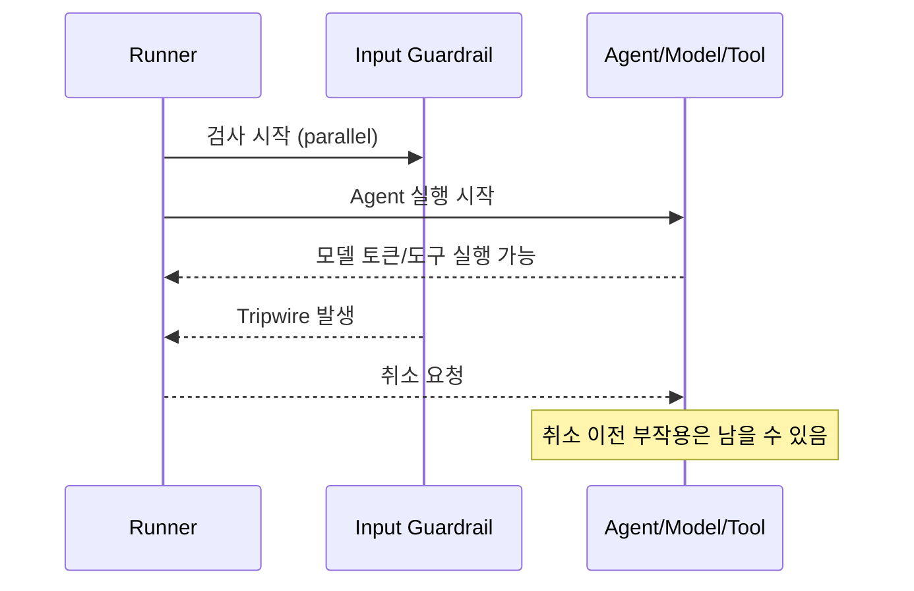

### 18.1 차단이 목적이면 Blocking 모드

`run_in_parallel=False` 설정은 첫 모델 실행 전에 Input Guardrail을 끝낸다. 단점은 Guardrail 실행을 기다리므로 Latency가 증가할 수 있다는 점이다. 반면 위험한 요청이 확인되면 모델·도구가 시작되지 않는다. [DOC: D04]

**Guardrail 단계가 중요하다:** 출력 Guardrail이 통과해야 최종 답변을 보여주더라도, 중간 Tool이 이미 데이터베이스를 수정한 후라면 그 수정이 자동 롤백되는 것은 아니다.

## 19. `run_internal/guardrails.py` 추적

[SRC: S07] 모듈에는 `run_input_guardrails`, `run_input_guardrails_with_queue`, `run_single_input_guardrail`, `run_output_guardrails`, `run_single_output_guardrail`, `input_guardrail_tripwire_triggered_for_stream` 등의 함수가 있다.

코드 분석 순서:

1. Guardrail이 어느 Agent에 연결되는가?
2. 해당 함수가 `asyncio` Task로 시작되는가, 차단형으로 기다리는가?
3. 검사 결과가 Tripwire로 표시될 때 어떤 예외 또는 Run 상태를 만드는가?
4. 모델 실행 중이면 Cancellation 경로가 실행되는가?
5. 이미 발생한 Stream Event와 Session 저장 항목은 어떻게 처리하는가?
6. Output Guardrail 실패 시 사용자에게 보이거나 Session에 저장되는 정보는 무엇인가?

특히 스트리밍에서는 **Event가 이미 사용자에게 노출된 상태**를 고려해야 한다. 안전한 출력이 필요한 시스템에서 Raw Token Delta를 아무 검증 없이 즉시 공개하는 설계는 출력 Guardrail의 의미를 약화할 수 있다. [INF]

## 20. `needs_approval`과 RunState 중단

승인이 필요한 Tool 호출이 발생하면 SDK는 `interruptions`를 포함한 결과를 반환하고, 앱은 `result.to_state()`로 중단 상태를 직렬화한 후 사람이나 외부 정책이 승인·거절한 결과를 반영해 재개할 수 있다. [DOC: D03]

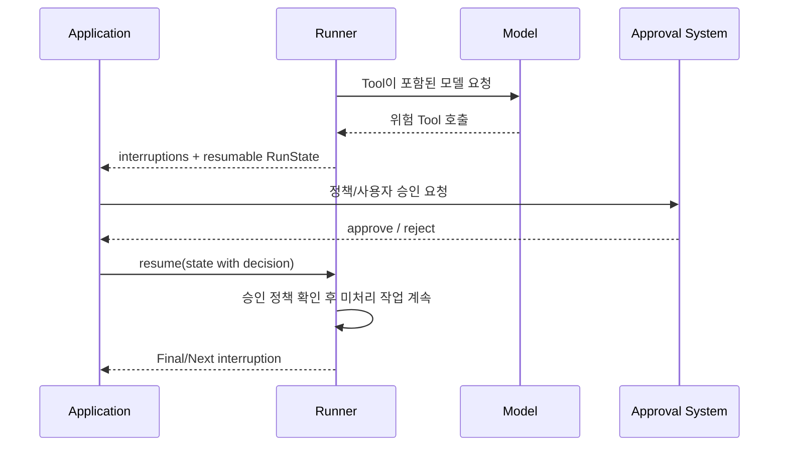

### 20.1 중요한 개념: 승인 보존 범위

- 승인 판단은 **현재 호출 ID**에 적용할 수 있다.
- `always_approve=True`, `always_reject=True`는 재사용할 `RunContextWrapper` 또는 직렬화한 RunState에 지속될 수 있다.
- **일반 Python context 객체만 새 Runner 호출에 재사용해도 승인 상태가 자동 유지되는 것은 아니다.**
- Function Tool의 sticky 결정은 해당 Agent 범위에서 관리된다.
- **로컬 `ShellTool`/`ApplyPatchTool`의 sticky 승인은 Agent별이 아니라 도구 유형·이름 기준으로 적용될 수 있어**, 서로 다른 권한을 가진 도구에서 예상치 못한 승인 재사용 위험이 있다.
- Hosted MCP의 sticky 승인에는 서버 레이블과 Tool 이름 조합이 사용된다.

이 차이는 공식 HITL 문서에서 특별히 경고하는 사항이다. 보안에 민감하다면 전역 영구 승인보다 호출별 승인, 별도 ContextWrapper, 실행 환경 권한 분리를 우선 검토해야 한다. [DOC: D03]

### 20.2 승인 없이 실행되는 기본값을 혼동하지 말 것

로컬 Shell/ApplyPatch Tool에서 `needs_approval`은 별도로 활성화해야 할 수 있다. `on_approval` Callback을 제공했다는 사실만으로 승인 단계가 항상 작동하지 않는다. Hosted Tool, Computer Safety Check, 일반 Function Tool은 서로 다른 API를 사용한다. [DOC: D03]

### 20.3 Fail-closed와 잘못된 도구 인자

함수 형태로 승인 여부를 판단하는 Policy에서 인자 JSON이 없거나 잘못되었을 때, 안전하게 인자를 해석할 수 없으면 자동 승인 콜백 대신 수동 승인을 요구하는 동작이 공식 문서에 명시되어 있다. 즉 **승인 정책의 입력도 검증 대상**이다. [DOC: D03]

## 21. 승인·중단·재개가 정확히 한 번 실행을 보장하는가?

**아니다.** SDK가 Run 상태를 직렬화하여 승인 대기를 복원할 수 있어도, 외부 DB/API 작업의 성공 여부와 SDK 상태가 원자적으로 함께 저장되는 것은 아니다. 다음과 같은 실패를 가정해야 한다.

```text
T1: Tool 실행 → 외부 시스템 변경 성공
T2: SDK 프로세스 종료 → 결과 저장 실패
T3: 앱이 재개 → 같은 Tool 재호출 가능성
```

핵심 설계 대안:

- Tool Call ID 또는 업무 요청 ID 기반 **Idempotency Key**.
- 상태와 실행 요청을 함께 기록하는 Transactional Outbox.
- 외부 시스템의 상태 조회 및 이미 처리된 요청 탐지.
- Side effect Tool을 승인 대상 및 전용 워커로 분리.
- 취소·Timeout 발생 시 보상 작업 또는 운영자 확인.

이 항목들은 **SDK의 자동 내장 보증이 아니라, 자체 Agent 런타임 설계 시 고려할 일반적인 분산 시스템 원칙**이다. [INF]

---

# Part V. Multi-Agent 및 오케스트레이션

## 22. Handoff와 Agent as Tool은 근본적으로 다르다

| 질문 | Handoff | `Agent.as_tool()` |
|---|---|---|
| 현재 대화의 소유 Agent | 대상 Agent로 전환 | 부모 Agent가 유지 |
| 별도 Agent Loop | 대상 Agent로 이어감 | 중첩 Run이 실행될 수 있음 |
| 결과의 귀속 | 대상 Agent가 사용자 최종 결과 생성 가능 | 자식 결과가 부모의 Tool Output이 됨 |
| 입력 맥락 | Handoff history 필터·매퍼로 관리 | 자식 Tool 입력·Context/이력 정책으로 관리 |
| 승인 중단 | 같은 Run의 현재 단계에서 발생 | 중첩 승인도 외부 Run에 전파 가능 |
| 병렬화 | 자체적으로 병렬 실행의 뜻은 아님 | 부모가 여러 자식 Tool을 실행하도록 설계 가능 |

Handoff는 '담당자를 바꾸는 것', Agent as Tool은 '전문가에게 질문하고 다시 돌아오는 것'에 가깝다. [DOC: D06, D07]

## 23. Handoff 내부 코드와 역사(History) 관리

핵심 추적 경로:

```text
Agent.handoffs
  → turn_preparation.get_handoffs
  → LLM에 Handoff가 호출 가능한 Tool로 노출
  → turn_resolution.process_model_response
  → is_handoff_tool_call
  → execute_handoffs
  → NextStepHandoff
  → 새 Agent의 다음 모델 Turn
```

[SRC: S03] `is_handoff_tool_call`은 모델 출력이 Handoff로 등록된 맨몸(bare) Tool 이름에 해당하는지를 확인한다. 일반 Function Tool과 Handoff는 겉으로는 모두 모델의 Tool Call 형식일 수 있지만, Runner가 해석하는 **다음 단계**는 다르다.

### 23.1 `input_filter`를 왜 따로 제공할까?

보통 Handoff 대상에게는 기존 대화와 도구 결과가 전달되지만, 필요하지 않은 기록을 줄이거나 민감 정보를 숨기기 위해 필터를 사용할 수 있다. 그러나 Structured Tool Items를 제거했다고 해서 **일반 텍스트 메시지에 복사된 민감 정보까지 자동 삭제되는 것은 아니다.** [DOC: D07]

### 23.2 모델 생성 Handoff Metadata vs 앱 Context

`handoff(input_type=...)`를 통해 모델이 생성한 이유·우선순위 등 작은 Metadata를 수신할 수 있지만, 이것이 기존 Python `RunContextWrapper.context`를 대체하거나 대상 Agent를 동적으로 자동 선택하는 기능은 아니다. 어떤 Agent로 넘길지 이미 정의된 Handoff의 선택과 분리해야 한다. [DOC: D07]

### 23.3 Handoff와 Guardrail의 적용 범위

Input Guardrail은 첫 Agent, Output Guardrail은 최종 출력 Agent라는 경계가 있다. Handoff 시 모든 중간 Agent가 동일한 Guardrail로 재검사된다고 가정하면 안 된다. 각 Agent 및 Tool에 실제 필요한 검증을 배치해야 한다. [DOC: D04, D07]

## 24. 중첩 `Agent.as_tool()` 실행과 승인 전파

일반 Function Tool처럼 보이지만 내부적으로 자식 Agent가 별도 Run을 수행할 수 있다는 점이 핵심이다.

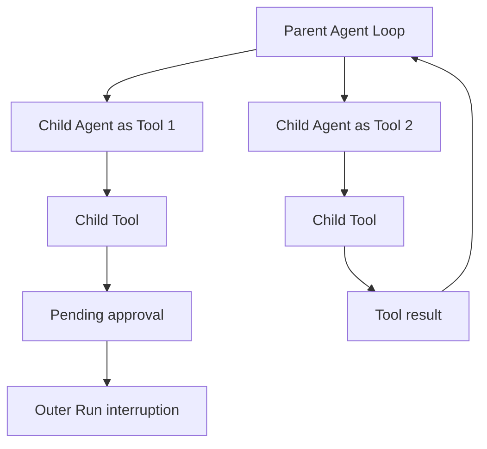

공식 HITL 문서는 Nested `Agent.as_tool()` 내부 Tool의 승인 필요도 바깥 Run에 전달될 수 있으며, **부모 최상위 RunState에서 승인하고 최초 Starting Agent를 사용해 재개**해야 한다고 설명한다. [DOC: D03]

이 동작은 단순히 `await Runner.run(child)`하고 문자열을 돌려주는 것보다 복잡하다. 상태·승인·결과의 소유권이 부모와 자식 사이에 연결되어야 한다.

## 25. Agent 협업을 위한 세 가지 방식과 선택 기준

1. **Handoff 기반:** 최종 응답 책임을 특정 Agent에게 넘길 때.
2. **Agent-as-Tool:** 부모가 여러 전문가를 호출하고 결과를 통합할 때.
3. **Python Workflow 기반:** 순서·조건·병렬·비용 정책이 고정적이어서 LLM에게 결정을 맡길 필요가 적을 때.

OpenAI Agents SDK의 Runner가 **모든 다단계 업무의 완전한 DAG 스케줄러를 자동 제공한다는 뜻은 아니다.** 명시적인 장기 Workflow나 작업 큐는 사용자 애플리케이션 또는 별도 오케스트레이터로 설계할 수 있다.

### 25.1 모델이 위임할지 결정하는 것과 프로그램이 결정하는 것

- LLM 기반 위임: 유연성은 좋으나 호출 경로, 지연, 비용 변동성이 커질 수 있다.
- 코드 기반 위임: 실행 경로가 예측 가능하고 로깅·검증이 쉽지만 상황별 적응력은 제한될 수 있다.
- 혼합형: 고정된 단계 사이의 판단만 Agent에게 맡김.

**설계자의 질문:** 다른 Agent를 부르는 이유가 단지 다른 지시문 때문인지, 권한·모델·컨텍스트를 격리할 실질적인 목적이 있는지 먼저 판단해야 한다.

---

# Part VI. Session, RunState, Memory, 캐싱, 영속성

## 26. 상태를 최소 다섯 종류로 나누자

'에이전트가 상태를 저장한다'는 말만으로는 구현을 이해할 수 없다.

| 상태 종류 | 대표 객체/형태 | 범위 | 모델이 직접 보는가? |
|---|---|---|---|
| 모델 대화 기록 | `RunItem`, 입력 메시지 | 현재/이전 모델 Turn | 직렬화·필터링된 부분만 |
| 앱 의존성 객체 | `RunContextWrapper.context` | 해당 Run 또는 주입한 공유 객체 | 자동 노출되지 않음 |
| Session | `Session` 구현 | 여러 사용자 Turn | 다음 Run에서 읽어 입력으로 반영될 수 있음 |
| 일시중단 복원 상태 | `RunState` | 승인·중단·재개 | 필요한 기록만 모델 요청으로 변환 |
| 외부 업무 상태 | DB·파일·커스텀 Memory | 영구 혹은 업무 수명 | Tool/프롬프트로 노출된 때만 |
| 관측 상태 | Trace/Span/Usage | 운영·디버깅 | 보통 모델 입력이 아님 |

**질문:** `RunContextWrapper.context`에 `db_connection`이 있다면 모델이 DB 연결 문자열을 보나? → 아니야. Tool이 사용하도록 주입된 Python 객체다. 단, Tool 결과나 지시문으로 연결 정보를 노출하면 그때 모델 입력에 포함될 수 있다.

## 27. `Session`은 '학습된 장기 메모리'가 아니다

OpenAI Agents SDK의 Session은 기본적으로 **이전 대화 이력 기록과 재사용**에 초점이 있다. 이력을 저장한다고 해서 Agent가 자동으로 중요한 사실을 추출하고, 근거 검증하고, 영구적 지식베이스의 충돌을 해결하는 것은 아니다. [DOC: D05]

### 27.1 Session 인터페이스의 핵심 연산

- `get_items()`: 지금까지의 이력 조회.
- `add_items(...)`: 새 RunItem/메시지 기록 저장.
- `pop_item()` 또는 이력 수정 관련 연산: 대화 이력 수정·정리.
- `clear_session()`: 저장된 Session 항목 제거.

정확한 메서드 세부 형태는 구현체에 따라 차이가 있으므로 `Session` 추상 인터페이스와 구체 Session 유형을 분리해 읽어야 한다.

### 27.2 대표 저장 구현을 왜 여러 개 제공할까?

| Backend | 적합 조건 | 검토할 점 |
|---|---|---|
| `SQLiteSession` | 단일 노드/간단한 실험 | 파일 권한, 멀티프로세스, 잠금, 사용자별 접근통제 |
| Redis 기반 Session | 여러 앱 인스턴스가 이력 공유 | TTL, 네트워크, 장애 복구, 순서, 인증 |
| SQLAlchemySession | 기존 RDB와 통합 | Transaction, connection pool, schema migration |
| MongoDBSession | 문서형 운영 저장소 | 순서, Atomic sequence, 인증 |
| OpenAIConversationsSession | 원격 서버 관리형 이력 | 외부 데이터 전송과 보존 정책 |
| `OpenAIResponsesCompactionSession` | 이력 압축이 필요한 긴 대화 | 원본 손실, 승인 상태와 충돌, Compaction 비용 |
| `EncryptedSession` | 저장 데이터 암호화/TTL | Key 관리, 무결성·순서 검증은 별도 |

[DOC: D05] **중요:** `SQLiteSession`의 `session_id`는 이력을 선택하는 식별자이지 사용자 인증 증명이 아니다. 공식 문서는 DB 파일이 신뢰되지 않거나 외부에서 변조될 경우 이를 자동 탐지하지 못할 수 있다고 경고한다. 암호화한 Session도 **기록 누락·순서의 완전성**을 자동 보장하지 않는다.

### 27.3 저장된 Session과 모델 요청 입력은 동일하지 않다

SDK 내부는 저장용 View, 사용자에게 노출할 Run Items, 다음 모델 요청에 재사용할 View를 분리할 수 있다. Handoff Filter, Output Guardrail, 중단 승인, 모델 API에서 지원하지 않는 항목 등의 이유로 세 집합이 달라진다. [SRC: S08, S11]

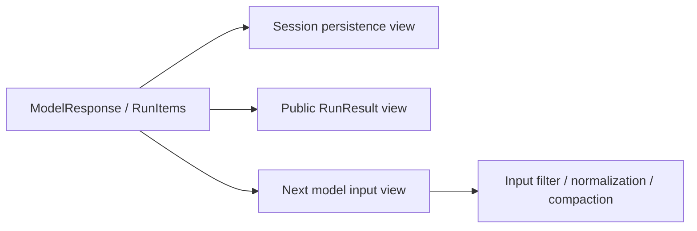

**코드 추적:** `run_internal/session_persistence.py` 및 `run_internal/items.py`의 `prepare_model_input_items`, `run_items_to_input_items`를 함께 읽는다. 단순히 `history = all_messages`로 구현하면 완료된 Tool 호출과 응답의 짝이 깨지거나, 승인 관련 Metadata가 유실되는 문제를 만들 수 있다.

## 28. `RunState`와 Session의 본질적 차이

- **Session:** 여러 Run 간 대화 이력을 관리.
- **RunState:** **현재 Run이 어디까지 실행됐는지**와 재개 시 필요한 승인·실행 문맥을 담음.

예: 데이터 수정 Tool이 승인 대기 중이면 Session에 사용자의 질문이 저장되어 있더라도, '어떤 Tool Call ID가 대기 중이고 승인 결과가 무엇인가'가 없으면 안전하게 재개하기 어렵다. 이 정보는 RunState의 영역이다. [DOC: D03, D11]

### 28.1 'RunState를 저장하면 그 즉시 모든 외부 상태도 복원되나?'

아니다. RunState는 앱 프로세스가 들고 있는 모든 라이브 DB 연결, 파일 핸들, 외부 Docker 컨테이너 또는 네트워크 작업을 무조건 직렬화할 수 있는 객체가 아니다. SDK의 RunState와 개별 Sandbox Session State·Snapshot은 별개의 경계다.

### 28.2 승인 대기 시 상태를 어떻게 보존할까?

실무적으로는 `run_id`, `user_id`, `tenant_id`, `state_version`, `approval_id`, `tool_call_id`, 만료시각, 승인자, 정책 버전 등을 함께 저장하는 방식을 검토한다. 이들은 **SDK가 기본 제공하는 필드 전체 목록이 아닌 운영 시스템 설계 제안**이다. [INF]

### 28.3 Resume 보안

저장된 RunState를 사용자가 조작 가능한 입력처럼 취급하면 위험하다. 승인 상태와 Tool 인자에 직결되므로 저장 암호화/서명, 사용자/테넌트 권한 매핑, 만료 처리, 재사용 감지 등을 앱 계층에서 검토한다. '직렬화할 수 있다'는 말은 '인증 없이 누구나 재개해도 된다'는 뜻이 아니다.

## 29. Context History의 길이가 무한히 늘어나면?

Session 저장 공간이 충분해도 모델의 Context Window는 유한하며, 긴 입력은 비용·지연·정확도 저하를 야기할 수 있다. 다음 선택이 필요하다.

1. 최근 N개의 대화 메시지만 선택.
2. 과거 Tool Output 중 재조회 가능한 항목을 버림.
3. 오래된 대화를 요약/압축해 유지.
4. 관련 기록만 검색해 RAG 방식으로 넣음.
5. 서버 측 대화 상태(Conversation/previous response ID) 활용.

**[DOC]** SDK는 세션 이력 절단·압축 등의 기능을 제공하되, 도메인별 핵심 사실 선택·충돌 조정까지 자동으로 정확하게 해결해 준다고 볼 수 없다.

### 29.1 'RAG'의 의미를 정확히

RAG는 검색된 외부 정보를 생성 입력에 주입하는 큰 패턴이다. 검색 저장소가 반드시 벡터 DB여야 하는 것은 아니다. Session의 최근 기록 전체를 붙이는 단순 히스토리 재사용과, 쿼리로 관련 정보를 선별하는 검색 시스템은 서로 구별한다.

### 29.2 Compaction의 Trade-off

- 장점: 입력 토큰·맥락 길이 감소.
- 위험: 근거/단위/예외사항이 요약에서 빠져 오류 발생.
- 통제: 반드시 보존해야 할 중요 필드는 구조화 저장하고, 원본 인용과 출처 ID 유지.
- 승인 대기 중에는 원본 Tool Call/응답 항목과 상태를 보존해야 함. v0.24.0에서 관련 변경이 있었음.

## 30. Prompt Prefix Caching: 같은 내용도 매번 보내야 하는데?

**핵심:** 모델 서버의 캐시는 이전 요청 Prefix의 계산 결과를 재사용하는 것이지, 네트워크 요청의 Prefix 문자열을 완전히 생략하는 기술과 동일하지 않다.

| 요소 | 캐시 효율에 미치는 영향 |
|---|---|
| 고정 instructions 앞에 배치 | 동일 접두부 재사용 가능성 증가 |
| 동일 Tool schema 순서 유지 | Tool schema가 캐시 키/요청 표현에 포함되는 Provider에 유리할 수 있음 |
| 매 Turn 날짜·랜덤 정보가 앞부분에 추가 | 그 변경 지점 이후 동일 Prefix 감소 |
| Handoff로 Agent 교체 | 새 지시문·Tool schema로 Prefix 변경 가능 |
| 세션 기록을 새 요약으로 치환 | 요약 시작 지점 이후 동일성 약화 |
| 모델·Provider 변경 | 기존 Cache 재사용이 제한될 수 있음 |

SDK에 `prompt_cache_key` 관련 처리가 있다는 사실과 특정 Provider에서 실제로 얼마나 절약되었는지는 서로 다른 문제다. Caching 유효성은 외부 모델 서버의 구현 계약에 의존한다. [SRC: S02; INF]

---

# Part VII. Streaming, 취소, Serving, 장애 복구

## 31. Streaming은 토큰 단위 출력만이 아니다

`Runner.run_streamed(...)`가 `RunResultStreaming`을 반환하고, `stream_events()`를 순회하면 Raw Response Event, RunItem Event, AgentUpdated Event 등의 SDK 이벤트를 구독할 수 있다. Tool 실행·Handoff·중단·최종 저장은 스트림 중간 또는 종료 시점에 발생한다. [DOC: D12]

### 31.1 가장 중요한 최신 주의사항

**마지막 출력 토큰이 사용자에게 도착했다고 Run이 완전히 종료된 것이 아니다.** 세션 저장, 승인 기록, Compaction, 리소스 정리가 이어질 수 있다. 공식 문서는 `stream_events()`를 **끝까지 소비**해 비동기 이터레이터가 종료될 때 실행 완료를 판단하라고 설명한다. [DOC: D12]

이것을 놓치면 UI는 완료라고 표시했는데, DB에 대화 기록이 저장되지 않았거나 에러가 소비되지 않는 등의 상태 불일치가 생긴다.

## 32. 스트리밍 취소: Immediate vs After Turn

| 동작 | 의미 | 고려할 문제 |
|---|---|---|
| `cancel()` | 즉시 취소 요청 | Tool Cleanup과 외부 부작용이 남을 수 있음 |
| `cancel(mode="after_turn")` | 현재 모델/Tool Turn 마무리 후 중단 | 완료된 Turn의 상태·사용량 반영에 유리하나 작업이 더 진행됨 |
| Stream Iterator 조기 종료 | UI 소비를 멈춤 | 백그라운드 Run이 계속될 수 있음 |
| `stream_events()` 정상 소진 | Stream 수명 종료 | SDK 정리 완료 기준; 별도 Tool 자원 정리는 추가 확인 가능 |

[DOC: D12] **`async for`에서 `break`만 했다고 Run이 취소되지는 않는다.** 앱이 사용자 연결 끊김을 처리할 때 실행도 멈춰야 한다면 명시적으로 `cancel()`을 호출하고 후속 정리 흐름을 드레인해야 한다. `aclose()`만 호출하면 Run을 완료할 때까지 기다릴 수 있다.

### 32.1 HTTP 연결이 끊겼다면?

SSE/WebSocket 연결이 끊겼다는 것, Python Task가 취소됐다는 것, Tool 실행이 취소됐다는 것, 외부 API 작업이 원상복구됐다는 것은 각각 다르다. Agent Serving에서는 이 네 경계를 분리해 설계해야 한다.

## 33. Streaming 코드 경로와 Non-Streaming 비교

비스트리밍은 `AgentRunner._run_impl`에서 결과를 반환하기 전의 상태를 정리한다. Streaming은 `run_internal/run_loop.py`의 `start_streaming`, `_save_stream_items`, `_finalize_streamed_final_output`, `_finalize_streamed_interruption` 등의 경로에서 이벤트 전송과 상태 저장을 관리한다. [SRC: S01, S02]

이 차이 때문에 안전성 관련 수정 시 **비스트리밍 테스트만 통과하는 구현은 부족**하다. 모델 호출 이벤트 시작/끝, Tool Output, 최종 Guardrail, 취소, 오류 전파가 두 경로에서 의미상 정합적인지 검증해야 한다.

## 34. HTTP 서버에서 Agent를 서빙하는 구조

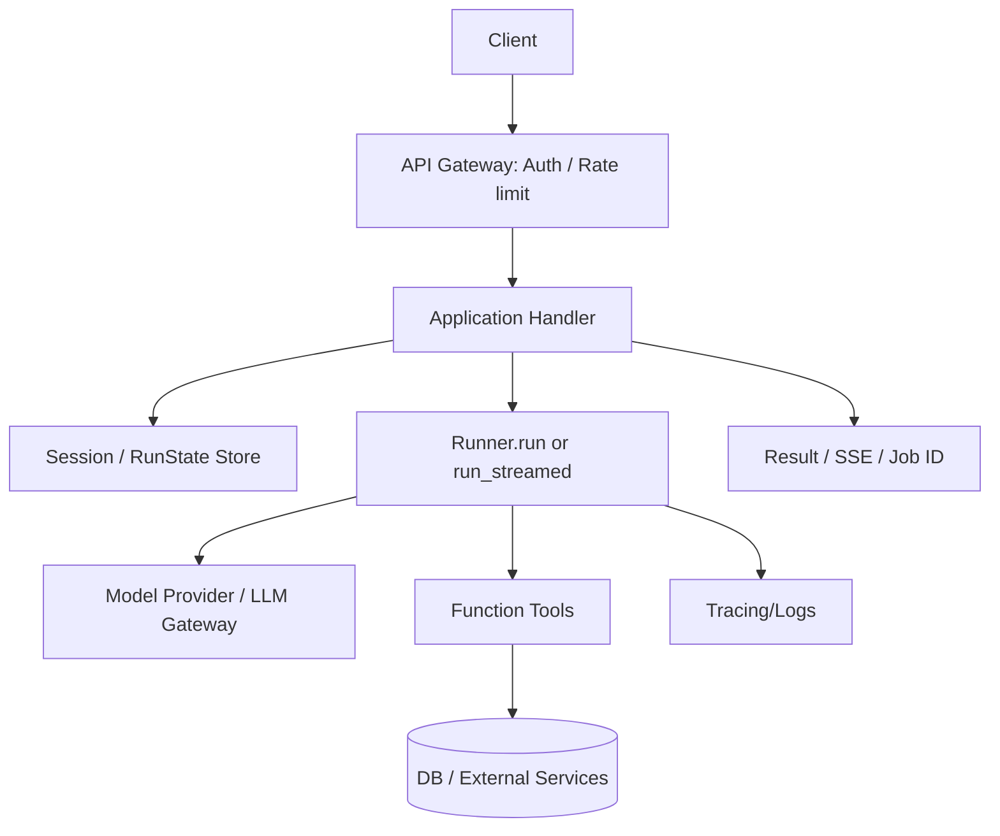

SDK는 이 구조에서 D 부분을 도와주지만 A·B·C의 모든 운영 기능과 G의 데이터 권한까지 제공하는 것은 아니다.

### 34.1 동기 처리형 요청

- 클라이언트 요청 동안 서버 Handler가 Run을 기다린다.
- 최종 결과를 한 번에 반환한다.
- 짧은 분석에 간단하지만 HTTP Timeout, 연결 끊김, 리버스 프록시 제한에 주의해야 한다.

### 34.2 SSE 스트리밍

- 비동기 `run_streamed` 이벤트를 UI에 전달한다.
- 사용자에게 진행 상황을 보여줄 수 있다.
- 연결 끊김 시 소비자와 실제 Run의 수명을 별도 관리해야 한다.

### 34.3 작업 큐 기반 비동기 실행

- API는 작업을 수락하고 `job_id`를 반환한다.
- 별도 Worker에서 `Runner.run`을 실행한다.
- 앱 DB에 RunState/상태 전이를 기록하고 완료·실패를 조회하거나 알림한다.
- 큐 중복 수신, Worker 재시작, Tool Idempotency 정책은 앱이 설계한다.

**중요:** 이 세 Serving 패턴은 SDK가 제공하는 완제품이 아니라 **SDK 위에 구현할 수 있는 애플리케이션 아키텍처**다. [INF]

## 35. 여러 사용자가 동시에 요청하면?

- 동일 Agent 정의를 공유하는 것과 사용자별 Session을 공유하는 것은 별개.
- 인증 사용자 ID와 Session ID의 접근 통제는 앱이 강제해야 함.
- 공유 Tool 객체가 가변 Cache/Connection/파일을 갖는다면 동시성 검토가 필요.
- 동일 Session에 두 Run이 동시에 쓰면 순서가 섞일 수 있음. Session Backend별 일관성 정책 확인.
- `max_turns`는 테넌트별 Rate Limit/동시 실행 상한을 대체하지 않음.
- 외부 API Provider 할당량, Tool별 DB Connection Pool, 모델 서비스 Rate Limit을 합산해서 설계해야 함.

## 36. 장기 실행 워크플로·Cron은 내장됐는가?

Hermes처럼 Agent 자체에 사용자용 Cron 기능이 포함된 완성형 애플리케이션과 달리, Agents SDK의 일반 Runner는 **모델 요청을 받은 뒤 실행하는 SDK 엔진**이다.

Cron/주기 스케줄링, 메시지 큐, 사용자 알림, 실행 이력 대시보드를 원한다면 일반적으로 애플리케이션 또는 외부 스케줄러가 `Runner`를 호출한다. Sandbox 확장·전용 통합(예: 별도 Workflow Runtime) 등이 제공되어도 **단순 Runner에 Cron Daemon이 자동 포함되어 있다고 해석하지 말 것**.

Cron이 유용한가? 반복 리포트, 점검/요약 같은 업무에는 유용할 수 있다. 다만 사용자·조직 데이터 권한, Scheduler 장애, 실패 재실행의 중복 부작용, 자동 실행 횟수 통제를 추가로 설계해야 한다. **이번 문서는 데모 설계를 다루지 않는다.**

## 37. Model Adapter 및 LLM Gateway: OpenAI API가 필수인가?

아니다. SDK의 `Model` 인터페이스를 만족하는 제공자 또는 OpenAI 호환 Adapter를 활용할 수 있다. 공식적으로 `OpenAIResponsesModel`과 `OpenAIChatCompletionsModel`을 제공하고, LiteLLM 등 별도 경로도 있다. [DOC: D13]

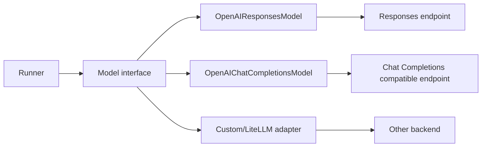

### 37.1 vLLM/SGLang 연결 가능성과 검증 포인트

로컬/사내 vLLM 또는 SGLang 서버가 OpenAI 호환 API를 제공하면 연결을 시도할 수 있지만, **필드와 기능의 실제 호환성은 별도**다.

- Function Calling JSON 형식과 `tool_choice` 지원.
- Parallel Tool Call 지원 여부 및 변형.
- Structured Output/JSON Schema의 엄격성.
- Streaming Chunk를 SDK가 해석할 수 있는지.
- Tool Call ID 및 reasoning 항목 처리.
- `response_id` / server conversation 상태 지원 여부.
- Prompt Cache 및 Usage 통계 지원.

API 모양이 유사하다는 이유로 Hosted Search, Compaction, Computer Use, Hosted MCP 등의 기능도 자동 동일 지원한다고 설명하면 안 된다.

## 38. MCP와 Plugin, Skills의 차이

| 개념 | 본질 | 실행·소유 경계 |
|---|---|---|
| Function Tool | SDK의 Python Callable | 사용자 앱 프로세스/워커 |
| MCP Tool | 표준 프로토콜로 노출되는 기능 | 별도의 MCP 서버 및 연결 Transport |
| Hosted MCP Tool | 모델 플랫폼이 MCP 도구를 호출하는 경로 | Hosted provider + MCP 서버 |
| Plugin | 여러 Tool·설정·자산을 묶는 제품별 배포 단위(일반 개념) | 해당 플랫폼 구현에 따라 다름 |
| Skill | 재사용 가능한 작업 지침·자산·절차(제품별 형식) | 선택·로딩·실행 방식이 플랫폼마다 다름 |
| Sandbox Capability | 격리 환경에 특정 Tool/파일/기능을 부여 | SDK Sandbox 런타임과 Backend |

**MCP와 Plugin은 같은 말이 아니다.** MCP는 상호운용 도구/컨텍스트 인터페이스를 규정하는 프로토콜이고 Plugin은 특정 제품의 확장 패키징 관례일 수 있다. SDK는 다양한 Tool과 MCP 서버를 연결하지만 Hermes/Claude Code의 Plugin 및 Skill 관리 모델과 완전히 동일한 기능을 기본 Runner가 제공한다고 가정해서는 안 된다.

### 38.1 MCP 통신 종류

공식 MCP 문서는 `MCPServerStdio`, `MCPServerSse`, `MCPServerStreamableHttp`, `HostedMCPTool`을 구분한다. 신뢰 가능한 서버만 사용하고, 필요 도구만 필터링하며, 원격 서버에 제공하는 Credentials 범위를 최소화하라고 안내한다. [DOC: D14]

### 38.2 MCP 사용 시 공개할 Tool 목록도 보안이다

Tool 이름과 설명만 보고 모델이 필요한 일을 할 수 있어도, 호출 자격증명·서버 경로·실제 데이터 권한은 별도다. 이름 충돌 방지를 위한 Tool 네이밍, Static/Dynamic Filter, Approval, RPC Timeout을 고려해야 한다.

## 39. Sandbox Agent, Skills, File Memory는 Core Runner와 분리해 이해

v0.24.0의 SDK 생태계는 `SandboxAgent`, Sandbox Client, Capability, Manifest, Skills/Memory와 관련된 기능도 제공한다. [DOC: D15]

하지만 Core `Agent` 하나를 생성했다는 이유로 자동으로 격리 파일 시스템·장기 Skill 기억·실행 워크스페이스가 생기는 것은 아니다. `SandboxAgent`와 `RunConfig`의 Sandbox 설정 및 제공자 자원 연결을 별도로 이해해야 한다.

- **Manifest:** 새 Sandbox Session 시작 시의 작업공간 구성/파일 초기 상태.
- **Capability:** Tool, 지시문, Runtime 동작을 추가하는 능력 단위.
- **SandboxSession:** 실제 파일·명령 실행의 소유 객체.
- **Sandbox Session State / Snapshot:** 라이브 Sandbox가 아니라 재개/새 환경 초기화에 사용하는 별도 상태 표현.
- **Sandbox Memory:** 환경 안에 보존되는 학습·작업 지식. Core Session 이력과 다름.

**핵심 질문:** Agent Runtime에 코드 실행 능력을 넣는 순간 모델 판단 외에 OS 권한·네트워크·파일·비밀정보 노출 문제가 추가된다. 이 계층은 출력 Guardrail만으로 해결할 수 없다.

---

# Part VIII. 평가, 운영 보안과 자체 Framework 설계

## 40. Observability: 무엇을 남겨야 하는가?

최소 다음 항목은 분리해서 기록한다.

| 기록 항목 | 유용한 질문 |
|---|---|
| Run ID / Session ID / Agent 이름 | 어떤 실행이 어느 사용자·대화의 것인가? |
| Model 호출 메타데이터 | 모델·설정·토큰·지연 정보는? |
| Tool Call ID / 인자·응답 형태 | 어떤 함수가 어떤 이유로 실행되었나? |
| Handoff 시작·종료 | 누가 제어권을 넘겼나? |
| Guardrail/Approval 결과 | 차단·승인 정책이 적용되었나? |
| RunState snapshot/version | 어디서 멈췄고 어떻게 재개했나? |
| 외부 Tool 부작용·Idempotency ID | 중복 실행과 실제 변경을 추적할 수 있나? |
| Prompt Cache/Compaction | 캐시 재사용과 입력 변화가 있었나? |

SDK에는 Trace/Span 기반 실행 관측 기능이 있다. 다만 **기본 Tracing은 민감한 모델 입력·출력과 Function 인자·결과를 기록할 수 있다**. 공식 문서에 따르면 `trace_include_sensitive_data`의 기본값이 `True`일 수 있으므로 민감한 업무 환경에서는 반드시 먼저 검토해야 한다. [DOC: D16]

### 40.1 Tracing은 곧 Evaluation이 아니다

- **Tracing:** 무엇이 어떻게 실행되었는지 관측.
- **Evaluation:** 주어진 목적을 얼마나 잘 달성했는지 평가.
- **Monitoring:** 운영 중 비용·실패율·지연시간 추적.
- **Audit:** 권한·승인·데이터 처리의 추적 가능성.

실행 경로가 모두 기록됐다고 판단이 정확해지는 것은 아니다. 정답률, Tool 선택 적절성, 불필요한 반복 호출, 근거 신뢰성은 별도의 평가 지표가 필요하다.

## 41. 코드 기반 테스트 전략: 모델 호출 없이도 Loop를 검증할 수 있다

공식 `agents.testing`은 `ScriptedModel`, `ModelStep`, `assistant_message()`, `function_call()` 같은 Deterministic Test 도구를 제공한다. 정규화된 Model 인터페이스를 교체해 Runner 자체의 Tool, Handoff, Session, Streaming, Retry를 검증할 수 있다. [DOC: D17]

```python
# [PSEUDO] 테스트 아이디어. 실제 Test API 호출을 완성한 실행 예제는 아님.
scripted_model = [
    ModelOutput(function_call="lookup", args={"id": "x"}),
    ModelOutput(final_text="done"),
]
result = await Runner.run(agent_using(scripted_model), "query")
assert_called_once("lookup")
assert result.final_output == "done"
```

위 예제는 테스트 아이디어를 표현한 **의사코드**다. 실제 라이브러리 함수와 객체 형태는 [D17]의 `ScriptedModel` 예제를 참고한다.

### 41.1 코드 단위에서 반드시 재현할 테스트(후속 연구 계획, 현재 미실행)

1. Tool 없이 한 번에 Final 출력.
2. 한 모델 응답에서 Function Tool 2개 실행.
3. Tool 한 개 실패와 다른 Tool이 취소되는 상황.
4. Handoff 이후 최종 Agent가 다른 경우.
5. Input Guardrail 병렬 모드에서 차단 발생.
6. Input Guardrail 차단형 모드에서 Tool 실행 0회 확인.
7. Tool Input/Output Guardrail의 실패 경로.
8. `RunState`로 중단→승인→재개, 동일 Tool 중복 실행 여부.
9. Handoff 뒤 `input_filter`와 Session 기록 비교.
10. Stream Iterator 조기 종료/Cancel 후 백그라운드 Task 상태.
11. Model Retry와 `max_turns`의 상호작용.
12. Compaction 전후 모델 입력 View의 정합성.

**Mock Test의 한계:** Scripted Model 테스트가 성공해도 실제 모델이 정확히 같은 Tool을 선택하거나, 로컬 vLLM의 Tool Calling 형식이 일치한다는 뜻은 아니다. API Wire Format은 실제 Adapter 및 통제된 네트워크 경계로 별도 테스트해야 한다. [DOC: D17]

## 42. 자체 Agent Framework를 설계한다면 필요한 최소 컴포넌트

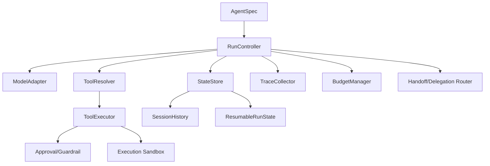

이것은 OpenAI SDK의 실제 클래스 다이어그램이 아니라 **7개 Agent 시스템에서 공통 구조를 비교하기 위한 개념 설계**다. [INF]

### 42.1 인터페이스 경계를 선택하는 기준

| 경계 | 중요한 질문 | 잘못 설계하면 |
|---|---|---|
| Model Adapter | Tool/Streaming/JSON 호환성을 어디서 처리? | 제공자 변경 시 Core Loop 대량 수정 |
| Runner Core | 종료 조건과 상태 전이를 어디서 관리? | 예외 분기 누락·무한 반복 |
| Tool Registry | 승인/인자 검증을 한곳에서 강제? | 우회 경로와 중복 구현 |
| Session Store | 모델 입력과 저장 View를 분리? | Handoff/Approval 기록 소실 |
| RunState | Resume에 필요한 상태를 무엇까지 보존? | Tool 중복 실행·불완전 재개 |
| Guardrail | 차단형/병렬형 정책이 명확? | 위험 작업이 검사보다 먼저 실행 |
| Concurrency | 공유 상태/순서/취소 범위가 명확? | Race condition·불완전 정리 |
| Sandbox | 모델과 OS 실행 권한 경계 존재? | 기밀 노출·파일 변조 |
| Streaming | 소비자 종료와 Run 종료를 분리? | 보이지 않는 백그라운드 실행 |

## 43. 설계 Trade-off를 도출하는 프레임

기술 선택에는 항상 이득과 비용이 함께 있다.

### 43.1 경량 Runner vs 명시적 Graph Runtime

- Runner 기반: 모델 응답에 따라 Tool/Handoff/Final을 반복하는 구조가 이해하기 쉽고 빠르게 구현 가능.
- Graph 기반: 미리 정의된 전이, 복잡한 Workflow, Checkpoint를 명시적으로 표현하기 유리할 수 있음.
- 절충안: Agent 내부 의사결정은 Runner, 업무 순서·승인은 코드 Workflow로 관리.

### 43.2 모델에게 위임 vs 코드가 위임 결정

- 모델 결정: 자연어의 다양한 상황에 대응하지만 경로가 변동적.
- 코드 결정: 재현성과 관리 편의성이 높지만 동적으로 변하는 상황을 예외 규칙으로 처리해야 할 수 있음.

### 43.3 요청 중 모든 작업 완료 vs Job Queue

- 동기 실행: 운영 단순, 실패 확인 용이, HTTP Timeouts 제약.
- 비동기 Job: 장기 실행에 유리, 상태 저장·재시도·중복 실행 정책이 필요.

### 43.4 메모리 자동 요약 vs 명시적 도메인 데이터 저장

- 자동 요약: 개발 부담 감소, 정보 누락·오해 위험.
- 구조화 기록: 검증/감사 유리, 설계·운영 비용 증가.

### 43.5 병렬 Tool vs 순차 Tool

- 병렬: 지연 감소 가능, 실패·취소·순서·동기화 복잡성 증가.
- 순차: 데이터 의존성이 있는 작업에 안전, 지연시간 증가 가능.

## 44. 다른 6개 기술과 비교할 때의 기준값

| 비교 지점 | OpenAI Agents SDK (본 문서 기준) | 이후 비교 질문 |
|---|---|---|
| 실행 모델 | Runner + NextStep 기반 Loop | Hermes의 Loop, PydanticAI의 Graph와 어떻게 다른가? |
| Tool 처리 | Function Tool 검증·승인·계획·실행 | Tool 충돌 격리와 동시성의 책임 범위는? |
| Guardrail | Input/Output/Function Tool + HITL | 기본 차단형인가 병렬형인가? |
| 상태 | Session + RunState + Application Context 구분 | Memory/Session/Checkpoint의 역할이 명확한가? |
| Multi-Agent | Handoff와 Agent-as-Tool | 담당권 이전과 자식 실행이 어떻게 분리되는가? |
| Serving | 앱에 SDK로 포함 | 완성형 CLI/Gateway/스케줄러가 있는가? |
| Persistence | 다수 Session Backend | 장애·승인·부작용 exactly-once를 어떻게 다루는가? |
| Memory | Session history + Sandbox Memory 등 | 기본 장기 Memory의 자동화 수준은? |
| Workflow | Run Loop와 외부 코드 Workflow 조합 가능 | ADK/MS Agent Framework의 Graph와 비교하면? |
| Model | OpenAI + 호환 Provider/Custom adapter | 사내 LLM 및 API 편차를 어디서 흡수하는가? |
| 관측 | Tracing/Usage + 테스트 도구 | 민감정보·재현성 정책을 어떻게 제공하는가? |

### 44.1 Hermes와 비교 시 중요 질문

Hermes는 사용자 지향 완성형 Agent Runtime/CLI/Gateway를 갖추므로 메모리·Skills·Cron·Gateway 등 기능이 하나의 시스템으로 묶여 있다. OpenAI Agents SDK는 개발자에게 **자신의 서비스 안에 Agent Engine을 포함할 자유**를 주는 쪽에 가깝다. 기능 수만 비교하지 않고 목적과 책임 경계를 함께 비교해야 한다.

### 44.2 PydanticAI와 비교 시 중요 질문

PydanticAI의 Node/Graph 구조는 상태 전이가 클래스 구조에 더 명시적으로 드러날 수 있고, OpenAI SDK는 `RunResult`와 `NextStep` 중심으로 실행 결과를 분류한다. 두 프레임워크 모두 Pydantic/타입 검증을 활용하지만, 타입 정의가 실행 흐름의 중심인 정도와 Output Retry·Dependency 처리 방식은 별도 비교해야 한다.

### 44.3 Google ADK와 비교 시 중요 질문

ADK는 Runner/Event/Session/State의 이벤트 흐름을 중심으로 설명할 수 있다. OpenAI SDK는 RunItem과 Session 보존, NextStep를 중심으로 분석한다. 두 시스템의 Event 처리와 복원 가능성, Agent 교체 및 Model Input History 변환 방식의 차이를 확인해야 한다.

### 44.4 Microsoft Agent Framework와 비교 시 중요 질문

MS Agent Framework는 일반 Agent Pipeline 외에 Workflow Executor·Edge·Superstep과 Checkpoint를 제공한다. OpenAI SDK의 Handoff를 MS Workflow의 Edge 또는 Checkpoint와 1:1 매칭해서는 안 된다. **LLM 기반 동적 위임**과 **명시적 Workflow 제어**를 구분해야 한다.

### 44.5 Claude Code / Claude Agent SDK와 비교 시 중요 질문

Claude Agent SDK는 공개 Python SDK와 번들 CLI Runtime의 경계가 존재한다. OpenAI SDK는 Runner 주요 구현이 Python 공개 코드에 있어 직접 추적 가능하다는 장점이 있다. 반대로 CLI Harness가 제공하는 파일·프로세스·프로젝트 기반 기능은 일반 SDK만으로 자동 대체되지 않는다.

---

# Part IX. 코드 추적 실습형 해설 — 실행하지 않고 소스를 읽는 방법

## 45. 코드 트레이스 A: 한 번에 답하는 Run

**연구 질문:** Tool Call이 없는 정상 모델 응답을 어떻게 종료로 판정하는가?

```text
① Runner.run(agent, input)
② AgentRunner._run_impl(...)
③ 현재 Agent의 모델·도구·출력 스키마 준비
④ Model.get_response(...)
⑤ process_model_response(...)
⑥ 도구 또는 Handoff가 필요한지 확인
⑦ 최종 응답 검증 및 Output Guardrail
⑧ NextStepFinalOutput
⑨ RunResult(final_output, new_items, last_agent, ...)
⑩ Session/Trace 정리 후 반환
```

이는 코드에 실제로 존재하는 함수·객체를 연결한 **흐름 요약**이며, `⑦~⑩` 세부 호출 순서는 분기와 저장 Backend에 따라 달라질 수 있다. [SRC: S01~S04, S07, S08]

**읽을 때 확인:** `Agent.output_type`이 None/문자열/Pydantic 타입일 때 최종 판정이 어떻게 달라지는가? 왜 모델이 Tool Call을 동시에 요청했다면 최종 텍스트의 존재만으로 종료하기 어려운가?

## 46. 코드 트레이스 B: Tool 호출 후 다시 모델이 답하는 Run

**연구 질문:** Tool Result는 어떤 경로로 다시 LLM 입력이 되는가?

```text
① ModelResponse: function_call(name, arguments, call_id)
② process_model_response → ToolRunFunction 기록
③ _build_plan_for_fresh_turn / _execute_tool_plan
④ function_needs_approval + Guardrail/인자 검증
⑤ execute_function_tool_calls → 실제 Python Callable
⑥ 호출 ID와 Tool Result를 연결하여 RunItem 생성
⑦ NextStepRunAgain
⑧ RunItem → model input item 변환
⑨ 모델 재호출
⑩ 다음 응답에서 Final/Handoff/Tool 결정
```

**확인할 핵심:** 같은 모델 응답에 Tool A/B 두 개가 있으면 실행을 어떻게 스케줄링하는지, A 실패와 B 성공 시 순서·예외가 어떻게 처리되는지, Tool Output Guardrail이 B 결과를 수정하면 다음 모델 입력에는 무엇이 남는지.

## 47. 코드 트레이스 C: Handoff

**연구 질문:** 모델의 Handoff Call이 어떻게 Agent 교체가 되는가?

```text
① Agent A의 handoffs 목록을 Tool 형태로 노출
② 모델이 handoff 이름으로 Tool Call 출력
③ is_handoff_tool_call(...)
④ execute_handoffs(...)
⑤ input_filter / history 설정 적용
⑥ NextStepHandoff(target_agent=B)
⑦ Runner가 current agent를 B로 변경
⑧ B의 instructions/model/tools 기준으로 다음 모델 호출
⑨ 최종 결과의 last_agent는 B가 될 수 있음
```

**설계 분석:** Handoff는 Tool 결과 한 개를 받는 것보다 강한 제어권 전환이다. 따라서 '이전 Agent의 Tool Output이 반드시 다음 Agent에 보인다' 같은 가정을 금지한다. History Mapper/Filter의 로딩 규칙이 중요한 이유다.

## 48. 코드 트레이스 D: 승인 대기·재개

**연구 질문:** 승인 대기 중 동일 Tool이 두 번 호출되는 위험을 어떻게 줄이는가?

```text
① Model이 승인 대상 Tool Call 출력
② SDK가 호출 식별자 및 Rule 확인
③ 미승인 Tool Call을 실행하지 않고 interruption 생성
④ result.to_state()를 저장하고 외부 승인 대기
⑤ 사용자/정책이 특정 Tool Call에 approve/reject
⑥ Runner.run(original_starting_agent, resumed_run_state)
⑦ _build_plan_for_resume_turn로 완료/대기 호출 구분
⑧ 필요한 미완료 작업만 진행
⑨ 상태/결과 기록, 새 승인 필요 시 재중단
```

**주의:** Resume 알고리즘이 중복 실행을 줄이는 구조를 가진다는 점과 외부 부작용의 exactly-once가 보장된다는 점은 다르다. SDK 저장과 외부 Tool 트랜잭션은 원자적으로 묶이지 않을 수 있다.

## 49. 코드 트레이스 E: 스트리밍 출력 중 사용자가 연결 종료

**연구 질문:** SSE 연결이 끊기면 실행도 자동 중단되는가?

```text
① Runner.run_streamed → RunResultStreaming
② 별도 Task에서 Agent Loop 수행
③ UI Consumer가 stream_events()를 구독
④ 사용자 탭 닫기 / network disconnect
⑤ Consumer만 종료되면 Loop가 계속될 수 있음
⑥ 애플리케이션이 명시적 cancel() 요청
⑦ 이벤트/최종 오류/Session cleanup 경로를 끝까지 처리
⑧ 완전히 취소되지 않은 외부 Tool 작업은 별도 추적
```

Streaming은 비스트리밍보다 **실행자·소비자·사용자 네트워크 연결**이 분리되기 때문에 동일한 정책이라도 더 복잡하다. [DOC: D12]

## 50. 소스코드 읽는 연습: 대조 질문 15개

1. `run.py`에서 RunState를 처음 확인하는 곳은 어디인가?
2. Resume에서 기존 Current Agent를 어떻게 보존하는가?
3. `turn_preparation.get_all_tools`에서 Tool 동적 활성화는 어떤 영향을 받는가?
4. `run_steps.py`의 `ProcessedResponse`와 `SingleStepResult`는 어떤 시점의 데이터인가?
5. `process_model_response`는 Handoff와 Function Tool을 구별할 때 무엇을 사용하는가?
6. `tool_planning.py`에서 Fresh와 Resume 계획은 어떤 자료구조를 공유하는가?
7. `tool_execution.py`의 Function Tool 실패 처리에서 우선하는 예외는 무엇인가?
8. 하나의 배치 실행에서 Task 취소 이후 남은 예외는 어떻게 처리되는가?
9. `run_internal/guardrails.py`의 Input Guardrail 병렬 여부는 어디서 전달받는가?
10. Tool Output Guardrail이 거부했을 때 모델이 보게 되는 메시지는 무엇인가?
11. Handoff 뒤 Session에는 어떤 RunItem이 남고 다음 모델에게는 어떤 메시지가 전달되는가?
12. Session Save 실패가 발생하면 RunResult는 이미 사용자에게 노출되었을 수 있는가?
13. Stream Queue의 종료 신호는 언제 기록되는가?
14. `RunResultStreaming.cancel(mode="after_turn")`는 현재 Tool의 결과 저장을 어떻게 처리하는가?
15. Tracing이 민감데이터를 캡처하지 않게 설정했을 때 어떤 Metadata는 여전히 남는가?

---

# Part X. 실패 모드와 품질 분석을 위한 연구 질문

## 51. 16개 실패 사례와 Runtime 책임

| 상황 | 실제 위험 | 주로 책임지는 계층 | 코드/문서 조사 위치 |
|---|---|---|---|
| 모델이 Tool Call을 무한 반복 | 지연·비용 폭증 | Runner/RunConfig | `max_turns`, D02 |
| 모델 응답에 없는 Tool 이름 | 잘못된 Tool 실행 가능성 | Tool Resolver | `turn_resolution.py` |
| Tool 인자가 Malformed JSON | 승인/검증 오류 | Tool/Approval | `tool_execution.py`, D03 |
| Function Tool에서 DB 권한 위반 | 정보 노출 | Tool 애플리케이션 | 앱 측 DB 인증·인가 |
| Input Guardrail이 늦게 차단 | 이미 Tool 실행 | Guardrail 정책 | D04 |
| Output Guardrail 실패 | 답변 노출/저장 부정합 | Runner/Streaming | `guardrails.py`, D04 |
| 승인 전 Session 압축 | 승인 복원 정보 손실 | Session/Compaction | v0.24.0 changelog |
| Tool A 성공, Tool B 실패 | 일부 부작용만 남음 | Tool 실행/외부 DB | `tool_execution.py` |
| Task Cancel 뒤 Tool이 계속 실행 | 예상치 못한 작업 지속 | Runtime + External Tool | `run_loop.py`, D12 |
| HTTP 연결 종료 | Run의 무인 지속 | App Server | D12 |
| Handoff 뒤 민감정보 전달 | 경계 누출 | Handoff Filter | D07 |
| Session ID 다른 사용자에게 노출 | 대화 기록 유출 | App Auth + Store | D05 |
| RunState 재실행 | Side-effect 중복 | Runtime + Idempotency | D03 |
| Provider가 Tool Calling 형식 다르게 응답 | Adapter 실패 | Model Adapter | D13 |
| Tracing에 민감정보 포함 | 외부 로깅 노출 | Trace 설정 | D16 |
| Sandbox Tool이 파일 접근 범위 초과 | 데이터 손상 | Sandbox/OS 권한 | D15 |

### 51.1 Guardrail의 Fail-open / Fail-closed를 구분

- **Fail-closed:** 판단할 수 없으면 실행 거부/승인 요구. 특히 위험한 Tool에 적합.
- **Fail-open:** 검증 실패 시 경고 후 계속 실행. 가용성이 최우선이고 부작용이 없는 작업에서나 신중히 고려.
- SDK의 모든 Guardrail이 무조건 Fail-closed로 통일되어 있다고 주장하지 말 것. 실제 코드를 검사하고 검사 유형별 정책을 정리한다.

### 51.2 Retry는 하나의 의미가 아니다

- **Model Retry:** 일시적 API 오류에 대응하는 모델 호출 재시도.
- **Tool Retry:** 실패한 Tool 호출을 다시 실행하거나 재시도 결과를 모델에 보여줌.
- **Workflow Resume:** 승인/취소 이후 이미 진행된 Run을 이어감.
- **Application Job Retry:** Worker 장애 후 전체 작업을 다시 수락.

이 네 개를 하나의 '에이전트 재시도'라는 기능으로 뭉뚱그리면 중복 부작용과 상태 정합성을 분석할 수 없다.

## 52. 기능 지원 여부가 아니라 제어 가능성을 평가

각 기술을 5단계로 평가하는 방법을 추천한다.

1. **Core에서 직접 구현:** 내부 호출 및 상태 전이를 소스에서 수정 가능.
2. **옵션/Hook로 제어:** 구현은 숨기고 정책 변경점만 노출.
3. **확장 패키지/플러그인 제공:** 별도 설치·설정 필요.
4. **애플리케이션 개발 필요:** SDK 밖에서 직접 구현.
5. **지원 여부 미확인/제약:** 기능을 주장할 소스·공식 문서 근거 부족.

예: `Guardrail`이 있다는 사실보다 'Run의 어느 단계에 실행되며, 실제 DB 수정에 대한 강제 권한을 갖는가'를 기록해야 한다.

---

# Part XI. 발표 구성 및 복습

## 53. 기술 발표 권장 구성: 본문 13장 + 부록

| 슬라이드 | 제목 | 핵심 메시지 | 시각화/코드 |
|---|---|---|---|
| 1 | SDK는 무엇인가 | SDK vs API vs Harness 경계 | 계층 구조 |
| 2 | 한 번의 Run은 여러 Turn | 모델 출력 후 SDK가 계속 실행 | Sequence Diagram |
| 3 | 전체 아키텍처 | Runner·Preparation·Resolution·Tool Execution 분리 | 모듈 다이어그램 |
| 4 | Runner State Machine | 네 가지 `NextStep` | 상태 전이도 |
| 5 | 모델 최종 입력 | Session·Context·Tool Schema·Prompt Cache | 입력 조립 흐름 |
| 6 | Function Tool 파이프라인 | schema → lookup → validation → execute → result | 도구 경로 |
| 7 | 병렬 Tool과 실패 처리 | 동시 Task/취소/오류 우선순위 | Thread/async 타임라인 |
| 8 | Guardrail 적용 위치 | Input 병렬 모드 위험 | 병렬 시퀀스 |
| 9 | HITL와 RunState | 승인·중단·재개의 핵심 | 상태 다이어그램 |
| 10 | Multi-Agent | Handoff vs Agent-as-Tool | 비교 표/다이어그램 |
| 11 | Session·Memory·Compaction | 저장/모델 입력/복원 상태는 다름 | 3개 저장 View |
| 12 | Streaming·Serving | 사용자 연결 ≠ Run 수명 | 서버 구조 |
| 13 | 설계 Trade-off | OpenAI SDK의 철학과 다른 Framework 비교 | 의사결정 표 |

**발표 본문에 넣을 코드:** `Runner` 실행 개념, `NextStep` 4분기, `execute_function_tool_calls`의 async Task 관리, Guardrail 병렬/Blocking 모드처럼 핵심 3~4곳만 발췌·축약한다. 나머지 세부 함수·오류 케이스는 부록 또는 발표자의 학습 자료로 둔다.

### 53.1 슬라이드 4 발표자 대본 예시

> 'Agent SDK가 LLM에 질문하고 답변을 받아 그대로 돌려주는 라이브러리로 보일 수 있지만, 핵심은 모델이 낸 출력을 해석해 다음 행동을 정하는 Runner에 있습니다. 결과가 Tool이면 Tool을 실행하고 모델을 다시 부르며, Handoff면 현재 Agent를 바꾸고, 최종 답변이면 종료합니다. 승인이 필요한 호출이면 상태를 저장하고 외부 결정을 기다리도록 중단합니다. 이 네 상태를 정확히 구별하면 대부분의 내부 실행 경로를 따라갈 수 있습니다.'

### 53.2 슬라이드 8 발표자 대본 예시

> 'Guardrail을 지원한다고 해서 모든 검사가 Tool 실행보다 먼저 끝나는 것은 아닙니다. OpenAI SDK의 Input Guardrail은 기본적으로 Agent와 병렬로 실행될 수 있어, 차단 결과가 뒤늦게 나오면 이미 토큰을 사용하거나 Tool이 실행되었을 수 있습니다. 위험한 Tool을 정말 막으려면 Blocking Input 검사와 Tool 단계 승인/권한 검증이 필요합니다.'

### 53.3 슬라이드 12 발표자 대본 예시

> '스트림에서 마지막 토큰을 받았다고 Agent 실행이 끝난 것은 아닙니다. 세션 기록을 저장하거나 승인 상태를 정리하는 단계가 뒤따를 수 있습니다. 또한 프론트엔드에서 이벤트 소비를 중단해도 백그라운드 Run이 계속될 수 있습니다. 그래서 Agent Serving은 모델과 Tool의 실행 수명, 사용자 네트워크 연결, 작업 취소를 분리해서 관리해야 합니다.'

## 54. 학습 확인을 위한 24문항

### A. 원리

1. 왜 API는 프레임워크가 아닐 수도 있지만 SDK는 프레임워크와 겹치는 영역을 가질까?
2. 한 번의 `Runner.run`에 몇 번의 모델 호출이 들어갈 수 있는가?
3. Function Tool의 이름을 모델이 생성했다고 Python 함수가 즉시 실행되는가?
4. `NextStepFinalOutput`과 `NextStepRunAgain`의 차이는?
5. 모델 응답에 Tool Call과 텍스트가 함께 있을 때 어떤 문제가 생기는가?
6. 왜 `max_turns`만으로 비용·시간을 보장할 수 없는가?

### B. Context와 상태

7. Python `RunContextWrapper.context`와 LLM Context Window는 같은가?
8. Session 기록과 모델에 전달된 입력 목록은 항상 동일한가?
9. RunState 없이 승인 대기를 복원하면 어떤 정보가 부족한가?
10. 모델 입력에 같은 Prefix를 매번 넣어도 캐시가 유용한 이유는?
11. Compaction에서 원본 Tool Call/Response 짝을 잃으면 어떤 문제가 생기는가?
12. 대화 Session과 영구적인 지식 메모리는 어떤 점이 다른가?

### C. 안전·오류·병렬

13. 병렬 Input Guardrail이 왜 위험한 부작용을 이미 허용했을 수 있는가?
14. Output Guardrail이 SQL 쓰기를 되돌릴 수 있는가?
15. `needs_approval`과 `on_approval`은 같은가?
16. 일반 함수 Tool과 Shell/ApplyPatch Tool의 sticky approval 범위가 어떻게 다른가?
17. Async Task의 `cancel()`은 외부 시스템 변경을 되돌리는가?
18. 동일 RunState를 재사용하는 외부 애플리케이션의 중복 실행은 어떻게 막는가?

### D. Multi-Agent·Serving·비교

19. Handoff와 Agent-as-Tool 중 어떤 방식이 최종 사용자 답변의 소유자를 바꾸는가?
20. Agent-as-Tool 안에서 승인 중단이 발생하면 어떤 RunState에서 승인하는가?
21. SSE 연결이 끊겼을 때 Run은 반드시 중단되는가?
22. SDK는 Cron 및 Job Queue까지 자동 운영하는 제품인가?
23. vLLM 호환 Chat Completions API만 있다고 Responses API Hosted Tool도 쓸 수 있는가?
24. ADK Graph, PydanticAI Graph, MS Workflow와 OpenAI Runner를 어떤 공통 기준으로 비교해야 하는가?

### 54.1 스스로 설명할 수 있으면 학습 완료로 볼 8문장

- OpenAI Agents SDK의 Agent Loop는 모델이 아니라 SDK Runtime이 관리한다.
- 모델의 Tool Call은 실행 명령 후보이며, 실제 실행은 Tool Executor와 정책이 담당한다.
- `RunState`는 중단된 실행의 복원, `Session`은 대화 이력, Context는 Python 의존성·실행 정보를 포함한다.
- Handoff는 제어권 이전, Agent-as-Tool은 중첩 실행 후 결과 반환이다.
- Guardrail은 입력·출력·도구 단계로 나뉘고 실행 시점과 차단 범위가 다르다.
- 병렬 실행은 속도를 개선할 수 있지만 상태·취소·오류 복구를 더 어렵게 만든다.
- Streaming 종료·Task 취소·외부 Tool 부작용 정리는 서로 다르다.
- 프레임워크 선정은 기능 수보다 시스템 책임 경계와 코드 수준의 Trade-off 비교에 달려 있다.

---

# Part XII. 출처·고정 코드 인덱스·검증 한계

## 55. 공식 출처 인덱스

| ID | 공식 자료 | URL |
|---|---|---|
| D00 | GitHub Releases (v0.24.0, 2026-10-15) | https://github.com/openai/openai-agents-python/releases/tag/v0.24.0 |
| D01 | Agents SDK 개요 | https://developers.openai.com/api/docs/guides/agents/sdk |
| D02 | Running agents | https://openai.github.io/openai-agents-python/running_agents/ |
| D03 | Human-in-the-loop | https://openai.github.io/openai-agents-python/human_in_the_loop/ |
| D04 | Guardrails | https://openai.github.io/openai-agents-python/guardrails/ |
| D05 | Sessions Overview | https://openai.github.io/openai-agents-python/sessions/ |
| D06 | Agent orchestration | https://openai.github.io/openai-agents-python/multi_agent/ |
| D07 | Handoffs | https://openai.github.io/openai-agents-python/handoffs/ |
| D08 | Context management | https://openai.github.io/openai-agents-python/context/ |
| D09 | Tools | https://openai.github.io/openai-agents-python/tools/ |
| D10 | Guardrails / Approval (OpenAI developers) | https://developers.openai.com/api/docs/guides/agents/guardrails-approvals |
| D11 | SDK RunState reference | https://openai.github.io/openai-agents-python/ref/run_state/ |
| D12 | Streaming | https://openai.github.io/openai-agents-python/streaming/ |
| D13 | Models | https://openai.github.io/openai-agents-python/models/ |
| D14 | MCP | https://openai.github.io/openai-agents-python/mcp/ |
| D15 | Sandbox Concepts | https://openai.github.io/openai-agents-python/sandbox/guide/ |
| D16 | Tracing | https://openai.github.io/openai-agents-python/tracing/ |
| D17 | Testing | https://openai.github.io/openai-agents-python/testing/ |
| D18 | Results / Stream cancellation API | https://openai.github.io/openai-agents-python/ref/result/ |
| D19 | PyPI v0.24.0 package provenance | https://pypi.org/project/openai-agents/0.24.0/ |

> 공식 문서 URL은 현행 버전으로 갱신될 수 있다. 구현 사실 검증의 우선순위는 아래 **v0.24.0 고정 소스**에 둔다. 문서 내용과 코드가 충돌하면 두 자료의 버전 차이를 먼저 확인한다.

## 56. 소스코드 인덱스 — v0.24.0 고정 링크

| ID | 파일 | 집중 탐색할 객체·함수 |
|---|---|---|
| S01 | [src/agents/run.py](https://github.com/openai/openai-agents-python/blob/v0.24.0/src/agents/run.py) | `Runner`, `AgentRunner`, `_run_impl` |
| S02 | [src/agents/run_internal/run_loop.py](https://github.com/openai/openai-agents-python/blob/v0.24.0/src/agents/run_internal/run_loop.py) | 단일 Turn 실행, `start_streaming`, Stream 종료·Session 저장 |
| S03 | [src/agents/run_internal/turn_resolution.py](https://github.com/openai/openai-agents-python/blob/v0.24.0/src/agents/run_internal/turn_resolution.py) | `process_model_response`, `execute_tools_and_side_effects`, `execute_handoffs` |
| S04 | [src/agents/run_internal/run_steps.py](https://github.com/openai/openai-agents-python/blob/v0.24.0/src/agents/run_internal/run_steps.py) | `NextStep*`, `ProcessedResponse`, `SingleStepResult` |
| S05 | [src/agents/run_internal/tool_planning.py](https://github.com/openai/openai-agents-python/blob/v0.24.0/src/agents/run_internal/tool_planning.py) | `_build_plan_for_fresh_turn`, `_build_plan_for_resume_turn`, `_execute_tool_plan` |
| S06 | [src/agents/run_internal/tool_execution.py](https://github.com/openai/openai-agents-python/blob/v0.24.0/src/agents/run_internal/tool_execution.py) | `execute_function_tool_calls`, `_FunctionToolTaskState`, `_FunctionToolFailure` |
| S07 | [src/agents/run_internal/guardrails.py](https://github.com/openai/openai-agents-python/blob/v0.24.0/src/agents/run_internal/guardrails.py) | `run_input_guardrails`, `run_output_guardrails` |
| S08 | [src/agents/run_internal/session_persistence.py](https://github.com/openai/openai-agents-python/blob/v0.24.0/src/agents/run_internal/session_persistence.py) | `prepare_input_with_session`, `save_result_to_session` |
| S09 | [src/agents/run_state.py](https://github.com/openai/openai-agents-python/blob/v0.24.0/src/agents/run_state.py) | RunState 직렬화, 승인 결정, 재개 |
| S10 | [src/agents/run_internal/turn_preparation.py](https://github.com/openai/openai-agents-python/blob/v0.24.0/src/agents/run_internal/turn_preparation.py) | `get_all_tools`, `get_handoffs`, `get_output_schema` |
| S11 | [src/agents/run_internal/items.py](https://github.com/openai/openai-agents-python/blob/v0.24.0/src/agents/run_internal/items.py) | 모델 입력 아이템 변환·정규화 |
| S12 | [src/agents/run_internal/prompt_cache_key.py](https://github.com/openai/openai-agents-python/blob/v0.24.0/src/agents/run_internal/prompt_cache_key.py) | PromptCacheKeyResolver 및 ModelSettings 관련 |
| S13 | [src/agents/tool.py](https://github.com/openai/openai-agents-python/blob/v0.24.0/src/agents/tool.py) | Tool 정의, Function Tool 계약 |
| S14 | [src/agents/handoffs.py](https://github.com/openai/openai-agents-python/blob/v0.24.0/src/agents/handoffs.py) | Handoff 클래스 및 구성 |
| S15 | [src/agents/agent.py](https://github.com/openai/openai-agents-python/blob/v0.24.0/src/agents/agent.py) | Agent 정의, as_tool, 출력 정책 |
| S16 | [src/agents/run_internal/model_retry.py](https://github.com/openai/openai-agents-python/blob/v0.24.0/src/agents/run_internal/model_retry.py) | Model Retry 제어 |
| S17 | [src/agents/run_internal/streaming.py](https://github.com/openai/openai-agents-python/blob/v0.24.0/src/agents/run_internal/streaming.py) | Stream Queue로 이벤트 전달 |
| S18 | [src/agents/run_internal/error_handlers.py](https://github.com/openai/openai-agents-python/blob/v0.24.0/src/agents/run_internal/error_handlers.py) | 에러를 최종 결과로 처리하는 확장 지점 |
| S19 | [src/agents/run_internal/blocked_output.py](https://github.com/openai/openai-agents-python/blob/v0.24.0/src/agents/run_internal/blocked_output.py) | Output Guardrail 차단 후 결과/저장 정리 |
| S20 | [src/agents/run_internal/tool_use_tracker.py](https://github.com/openai/openai-agents-python/blob/v0.24.0/src/agents/run_internal/tool_use_tracker.py) | Tool 사용 및 모델 자원 추적 |
| S21 | [tests/test_agent_runner.py](https://github.com/openai/openai-agents-python/blob/v0.24.0/tests/test_agent_runner.py) | 기본 Runner 실행 테스트 |
| S22 | [tests/test_agent_runner_streamed.py](https://github.com/openai/openai-agents-python/blob/v0.24.0/tests/test_agent_runner_streamed.py) | Streaming 차이 테스트 |
| S23 | [tests/test_run_state.py](https://github.com/openai/openai-agents-python/blob/v0.24.0/tests/test_run_state.py) | RunState 중단·재개 테스트 |
| S24 | [tests/test_guardrails.py](https://github.com/openai/openai-agents-python/blob/v0.24.0/tests/test_guardrails.py) | Guardrail 동작 테스트 |

### 56.1 대표 함수 역추적 순서

```
run.py : AgentRunner._run_impl
  ├─ turn_preparation.py : get_all_tools/get_handoffs/get_model
  ├─ run_internal/run_loop.py : Model I/O 및 Loop 지원
  ├─ turn_resolution.py : process_model_response
  │     ├─ run_steps.py : ProcessedResponse / NextStep*
  │     └─ tool_planning.py : _build_plan_for_fresh_turn
  │            └─ tool_execution.py : execute_function_tool_calls
  ├─ guardrails.py : run_input_guardrails/run_output_guardrails
  ├─ session_persistence.py : prepare_input_with_session/save_result_to_session
  └─ run_state.py : paused/resumed state
```

이 그림은 개념상 호출 주체를 표현한 **탐색용 다이어그램**이며 Python의 정확한 전체 Stack Trace를 복제한 것이 아니다. 스택을 확인할 때는 `run.py`와 `run_internal/run_loop.py`의 양방향 호출을 실제 소스에서 이어서 따라가야 한다.

## 57. 조사 범위와 검증 한계

**완료한 범위**

- 공식 v0.24.0 릴리스와 출처/고정 커밋 확인.
- GitHub v0.24.0의 주요 Runner, Turn Resolution, Tool Execution, Guardrail, State/Session 코드 파일 구조 확인.
- 공식 Guardrail, HITL, Streaming, Handoff, Sessions, MCP, Sandbox, Testing 문서 확인.
- 확인 가능한 실행 분기·함수명·객체를 기반으로 기술 설계 차이 분석.
- 데모 실행 없이 자체 Framework 설계 시 필요한 책임 분리와 오류 조건을 정리.

**수행하지 않은 범위**

- Git 저장소를 로컬에 내려받아 테스트를 직접 실행하거나 전체 함수·조건을 정적 분석하는 작업.
- 실시간 Provider API, 로컬 LLM, MCP 서버에 대한 네트워크 실행 검증.
- Guardrail Race Condition, 스트리밍 취소, Provider Cache Hit의 실측.
- 변경 가능한 웹 문서와 고정 태그 사이의 모든 차이를 전수검사.
- 특정 Enterprise Gateway/폐쇄망/모델에 대한 정상 동작 보증.

따라서 **실제 소스에서 확인된 함수 존재 및 제어 흐름**과 **소스 일부·공식 문서에 근거한 일반화된 실행 설명**, **분산 시스템 설계 제안**을 구분해서 읽어야 한다. 구조도 및 의사코드는 이해를 위한 표현이지 실행 로그를 캡처한 것이 아니다.

---

# 최종 요약 — SDK 자체를 설계한다면 배워야 할 핵심 12문장

1. Agent Runtime은 모델 응답을 **다음 실행 단계로 해석하는 상태 기계**다.
2. 모델 API가 Tool Call을 출력해도 실제 Python 실행은 SDK Runtime이 담당한다.
3. `Runner.run`은 한 번의 사용자 요청에서 여러 모델 호출을 만들 수 있다.
4. Function Tool은 스키마·검증·승인·실행·결과 저장 단계로 분리된다.
5. 동시 Tool 실행은 `asyncio` Task·실패 회수·취소 정리까지 함께 설계해야 한다.
6. Guardrail은 어느 단계에서 실행되는지가 중요하며 Input Guardrail은 기본적으로 병렬일 수 있다.
7. HITL는 승인 결정 자체뿐 아니라 중단된 **실행 상태**를 보존해야 성립한다.
8. Handoff는 제어권 이전이고 `Agent.as_tool()`은 부모가 소유권을 유지하는 중첩 실행이다.
9. Session 이력·RunState·Python Context·모델 입력은 별도의 데이터 경계다.
10. Prompt Caching은 입력 생략이 아니라 모델 측 계산 재사용이며 Compaction은 별개의 기능이다.
11. Streaming에서 마지막 토큰과 Agent Run 종료 시점은 다를 수 있다.
12. SDK의 기능만으로 업무 시스템의 권한·외부 부작용·운영 복구가 완성되지는 않는다.

**학습 결론:** OpenAI Agents SDK에서 가장 공부할 가치가 있는 부분은 API 편의성이 아니라 `AgentRunner`가 모델·Tool·상태·검증·저장을 연결하는 방식과, 그 실행 책임을 Python 애플리케이션과 어떻게 나누는지이다.
