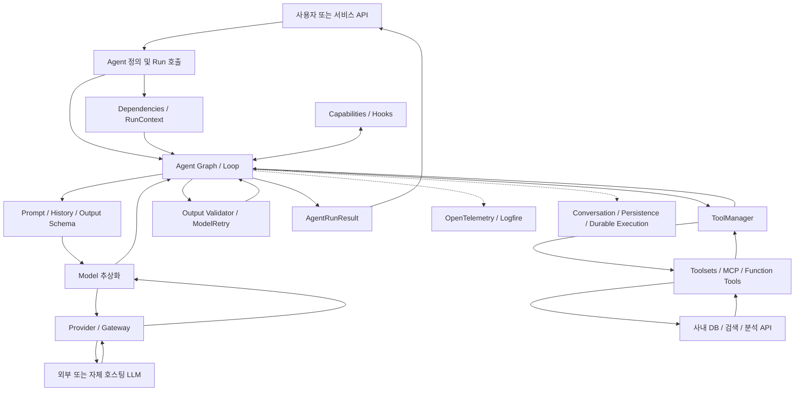
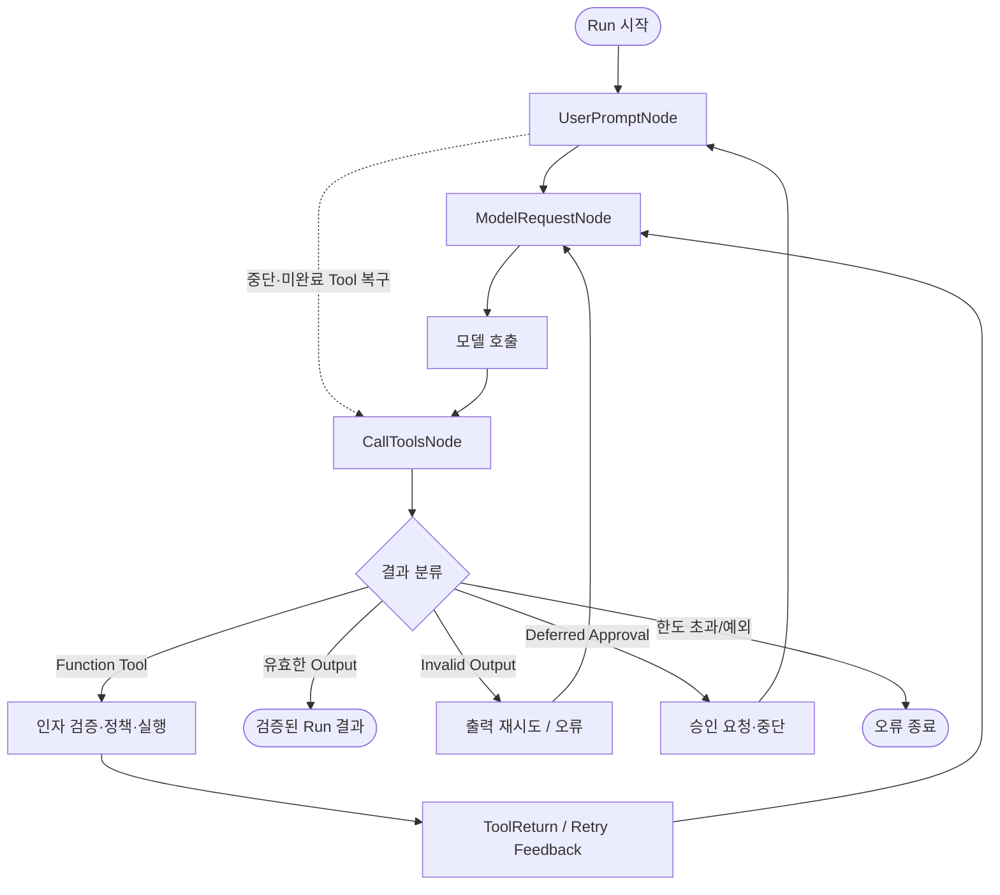
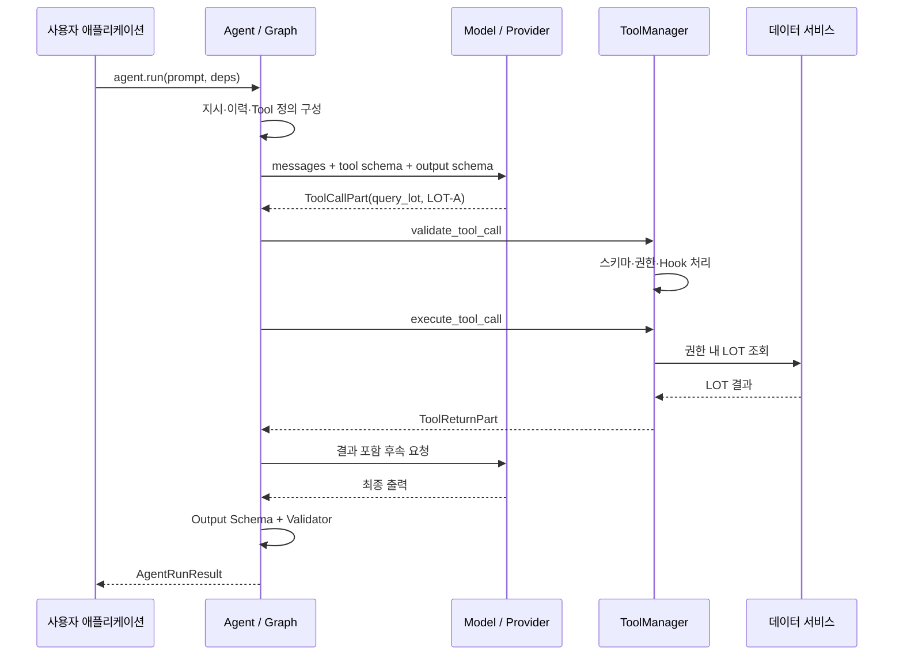
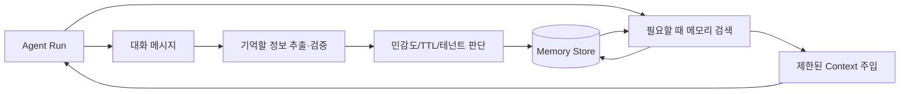
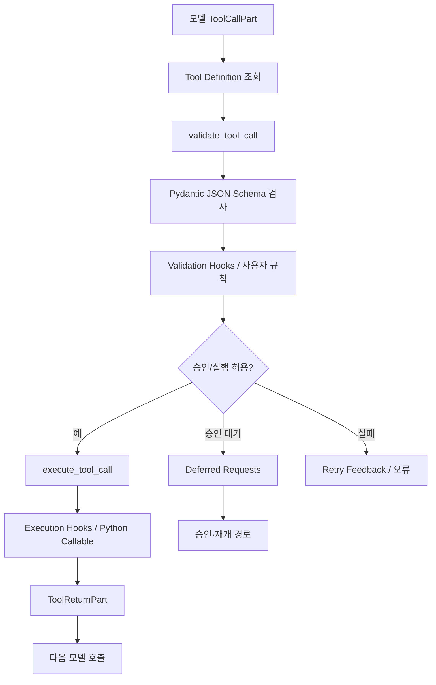
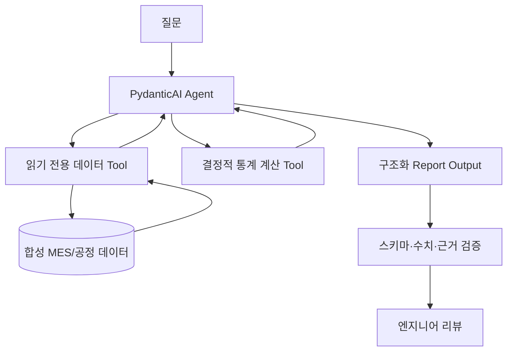

# PydanticAI 심층 학습 및 아키텍처·소스코드 분석

> **대상**: AI Agent 기본 개념을 학습한 뒤 실제 프레임워크의 설계·내부 구현을 이해하려는 개발자  
> **학습 목표**: 기초 개념 → 사용 방식 → Agent Loop·Tool·State·Memory·Guardrails → 소스코드 핵심 로직 → 반도체 Agent 적용성까지 단계별로 이해  
> **조사 기준일**: **2026-10-29** · **주요 기준 버전**: **PydanticAI v2.61.0** (공식 GitHub 릴리스에서 2026-10-23 버전 확인)  
> **자료 우선순위**: 공식 Pydantic 문서, 공식 GitHub의 `v2.61.0` 태그 소스코드, 공식 예제·릴리스 노트  
> **범위**: 조사 및 설계 분석. 프레임워크 설치·모델 호출·테스트·성능 벤치마크는 이번 문서 작성 과정에서 수행하지 않음.

---

## 0. 이 문서를 읽는 방법과 검증 원칙

### 0.1 학습 순서

| 학습 단계 | 주요 장 | 학습 후 답해야 할 질문 |
|---|---|---|
| **입문** | 1~4 | PydanticAI는 무엇이며 Pydantic, LLM, SDK와 어떻게 다른가? |
| **기본 기능** | 5~10 | Agent, Dependencies, Tools, Output, Retry, Conversation은 무엇인가? |
| **아키텍처** | 11~17 | 내부 Loop, Hooks, Memory, MCP, Multi-Agent, Harness는 어떻게 연결되는가? |
| **코드 분석** | 18~22 | 요청이 실제로 어떤 클래스·함수·파일을 따라 실행되는가? |
| **개발 판단** | 23~28 | 안전성, 검증, 배포, 장단점, 반도체 도메인 적합성을 어떻게 판단하는가? |
| **참조** | 29~31, 부록 | 기능 비교표, 용어 사전, 공식 출처, 복습 질문 |

### 0.2 출처 신뢰도 표시

- **[공식]** Pydantic 측의 공식 문서·릴리스에서 확인한 사항.
- **[코드]** 공식 GitHub `v2.61.0` 태그의 파일/함수에서 확인한 사항.
- **[해석]** 위 사실에 근거하여 작성한 기술적 판단이나 비교.
- **[예시]** 학습·설계용 가상 사례, 테스트를 진행하지 않은 예제 코드 또는 의사코드.
- **[확인 필요]** 실제 모델·버전·폐쇄망·조직별 환경에서 검증할 사항.

**중요한 한계**: 이 문서는 공식 웹 문서와 웹에서 열람 가능한 공개 소스코드를 조사해 작성했다. 코드를 로컬에 클론해 실행하거나 모든 분기·서드파티 패키지 구현을 감사한 것은 아니다. 문서의 예제 코드는 공식 사용법을 바탕으로 한 교육용 코드이며, 실행 검증 완료를 의미하지 않는다. 공개 코드에서 확인한 *정확한 함수명*과 이해를 위한 *의사코드*를 별도 표시한다. 특히 `v2.61.0` 태그로 소스 링크를 고정했으며 `main` 분기의 추가 변경과 혼동하지 않는다. [S01][S02][C01]

### 0.3 1분 핵심 요약

**PydanticAI는 Python으로 LLM Agent를 정의·실행하기 위한 타입 중심(type-safe) Agent 프레임워크다.** 개발자는 모델, 지시문, 도구, 의존성, 기대 출력 타입을 선언한다. 프레임워크는 모델 호출 → 도구 실행/출력 해석 → 검증·재시도 → 최종 결과 반환을 관리한다. 내부 구현은 `pydantic-graph` 기반 실행 노드를 사용한다. [S03][C02]

반드시 기억할 7가지:

1. **Pydantic = 데이터 검증 라이브러리**, **PydanticAI = LLM Agent를 만드는 프레임워크**. 같은 제품이 아니다.
2. `Agent`는 모델 자체가 아니다. 모델 호출과 반복·도구·출력을 조율하는 **개발용 추상화**다.
3. `deps_type`과 `RunContext`를 통해 DB 클라이언트·사용자 권한 등 **런타임 의존성**을 주입한다. 이를 LLM에게 모두 전달하는 것은 아니다.
4. `output_type`은 **타입/구조 검증**에 유리하지만, 모델이 생성한 수치·원인·근거의 **사실적 정답을 자동 보증하지 않는다**.
5. `ToolManager`는 도구 **스키마 검증과 실행을 분리**한다. 모델이 Tool을 '요청'하고, 실제 Tool은 호스트 코드가 실행한다. [C03]
6. **대화 기록 유지**와 **장기 기억 검색**은 구별해야 한다. 장기 Memory·Skills·Compaction 등은 별도 Harness/Capabilities로 확장 가능하다. [S04][S05]
7. 실제 개발에서는 프레임워크 기능뿐 아니라 **모델 접근 방식, 사내 데이터 통제, 검증 정책, 실행 격리, 평가 설계**가 품질을 좌우한다.

---

# Part I. PydanticAI의 기초

## 1. PydanticAI는 무엇인가?

### 1.1 쉬운 비유

'공정 수율 분석 결과를 JSON으로 작성해줘'라는 요청을 LLM에 직접 던지면 모델이 그럴듯한 문장을 답할 수는 있다. 그러나 애플리케이션에서 필요한 `wafer_id`, `yield_pct`, `anomalies`, `evidence`가 누락되거나 타입이 잘못될 수 있고, DB 조회를 안전하게 시행하는 로직도 따로 필요하다.

PydanticAI는 이때 **LLM을 이용하는 Python 애플리케이션의 실행 골격**이다.

- 개발자: 모델 선정, 데이터 조회 도구 등록, 출력 데이터 타입 선언, 검증 기준 작성.
- 모델: 답변을 생성하고 필요하면 도구 호출을 제안.
- PydanticAI 런타임: 도구 인자 검증, Python 함수 실행, 모델에 도구 결과 전달, 출력 유효성 확인, 사용량·실행 이력 노출.
- 개발자가 만든 시스템: 실제 DB 보안, 업무 규칙, RAG 품질, 승인 UI, 장기 저장소, 배포·평가 책임.

**핵심**: PydanticAI는 '반도체를 알고 있는 AI'가 아니라 '반도체 도메인 Agent를 정확하고 관리 가능하게 개발하는 데 유용한 Python 프레임워크'다. [S03]

### 1.2 Python 생태계에서의 위치

| 기술 | 역할 | PydanticAI와의 관계 |
|---|---|---|
| Python | 개발 언어 | PydanticAI의 주 실행 환경 |
| Pydantic | Python 타입 힌트에 기반한 런타임 데이터 검증·직렬화 | Tool·출력·설정 스키마 검증에 활용 |
| LLM (OpenAI·Anthropic·Google·로컬 모델 등) | 언어 이해, 행동 선택, 텍스트·도구 호출 생성 | SDK가 연결하는 모델 공급자 |
| Model API / Gateway | HTTP 등으로 모델 요청 수신·응답 | PydanticAI 아래의 모델 접속 계층 |
| **PydanticAI** | Agent 정의, 요청·도구·출력 루프 | **학습 주제의 중심** |
| pydantic-graph | 상태·노드 기반 실행 그래프 | PydanticAI Agent 내부에 사용, 독립 Workflow에도 사용 가능 |
| pydantic-evals | 실험 데이터셋과 평가기 기반 평가 | Agent 품질 평가에 별도 활용 |
| Logfire / OTel | 관측·트레이싱 | 모델·Tool·Agent 호출의 성능·오류 추적 |
| PydanticAI Harness | Memory·Skills·계획·서브에이전트·가드레일 등 기능 조합 | 별도 `pydantic-ai-harness` 패키지로 확장 |
| vLLM / SGLang 등 | 모델 추론 서버 | PydanticAI 그 자체가 아니며, 호환 API를 통한 연결 대상 |

PydanticAI는 특정 LLM 모델을 설치해 GPU에서 로딩하는 솔루션이 아니다. 프레임워크가 호출할 **모델·Provider·Endpoint**는 별도로 설정해야 한다. [S01][S06]

### 1.3 SDK인가? 완성형 Agent인가?

- **주된 정체성**: Agent 개발 프레임워크/SDK. 개발자가 자신의 서비스·Tool·데이터 흐름을 Python 코드로 구성한다.
- **내장 런타임**: Agent Loop, 도구 및 출력 검증, 모델 호출, 스트리밍, 메시지 이력 등.
- **추가 Harness**: 별도 패키지에서 기억, 계획, Skills, 파일, 셸, 서브에이전트, Guardrails 등을 조합 가능.
- **완성형 에이전트에 가까운 구성**: Harness가 제공하는 Coder·Researcher 등은 조합된 기능 스택으로 바로 사용하는 예시다. 단, 이것이 모든 Agent에 기본 포함되는 것은 아니다. [S04][S05]

따라서 'PydanticAI는 Hermes 같은 완성된 Agent다'라고 단정하면 부정확하다. **직접 구성하는 개발 프레임워크이지만 필요에 따라 상당한 Harness 기능을 덧붙일 수 있다**고 이해하면 된다.

## 2. 왜 PydanticAI가 등장했는가?

일반적인 LLM API는 메시지를 보내고 응답을 받는 호출 수준의 인터페이스를 제공한다. Agent 서비스에는 추가 문제가 있다.

1. 모델이 요청한 Tool 이름/인자와 실제 Python 함수의 규약을 어떻게 맞출 것인가?
2. 잘못된 JSON이나 출력 타입을 어떻게 처리할 것인가?
3. DB·인증 정보·테넌트 정보를 모델 입력과 구분하여 어떻게 넘길 것인가?
4. 여러 번 모델을 호출하는 동안 메시지 이력, 재시도 한도, 비용을 어떻게 관리할 것인가?
5. 실행을 테스트하고 관측하며 이후 구조를 확장하려면 어떤 추상화가 필요한가?

PydanticAI는 이에 대해 **Python 타입 시스템, Pydantic의 스키마, Dependency Injection, 명시적 Tools, 실행 그래프**를 핵심 설계 수단으로 사용한다. [S03][S07]

### 2.1 '타입 안전성'은 정확히 무엇을 의미하나?

Python의 `float`·`str`·`list` 타입과 `BaseModel` 같은 선언을 이용해 입력·출력 계약을 표현하고, 실제 값이 그 계약에 맞는지 검사한다는 의미다.

```python
from pydantic import BaseModel, Field

class ProcessSummary(BaseModel):
    lot_id: str
    yield_pct: float = Field(ge=0, le=100)
    suspected_causes: list[str]
```

이 구조는 `yield_pct=130`을 거부하도록 설계할 수 있지만, `yield_pct=93.2`가 **실제 생산 기록의 진실인지** 판단하지 못한다. `lot_id`에 적힌 문자열이 실제 LOT인지도 별도 DB 조회가 필요하다.

- **구조적 정확성**: 필드 존재, 타입, 수치 범위, 형식.
- **의미적 정확성**: 업무 규칙, 데이터 참조 무결성, 근거 포함 여부.
- **사실 정확성**: 참조 데이터로 재계산·검증한 수치/인과관계의 진위.

이 세 가지를 구분해야 'Structured Output을 쓰면 LLM의 환각이 사라진다'는 오해를 피할 수 있다.

## 3. 버전·설치·환경 개요

### 3.1 이번 문서의 버전 기준

- 공식 릴리스 목록에서 **v2.61.0(2026-10-23)**을 확인했다. [S02]
- PydanticAI v2.0 정식 릴리스는 2026-06-23이다. [S08]
- 최신 릴리스에서는 **Python 3.11 이상**이 요구된다. v2.55.0부터 모든 패키지에 적용된 변경이다. [S02]
- v1에 대한 오래된 블로그·코드는 기본값, 경고, 반환 객체, 기능 지원 범위가 다를 수 있다. 이 문서는 **v2 계열 중심**이다.
- 문서에 링크된 `v2.61.0` GitHub 소스는 고정된 버전이며, 공식 온라인 문서의 현재 내용과 미세한 차이가 생길 가능성은 존재한다.

### 3.2 설치 예시 [예시·미실행]

```bash
# Python 3.11+ 환경 예시
uv init pydanticai-study
cd pydanticai-study
uv python pin 3.11
uv add 'pydantic-ai==2.61.0'

# 선택적: 별도 Harness 기능을 활용할 경우
uv add pydantic-ai-harness

# 평가·관측은 별도 패키지/구성을 검토
```

패키지 설치만으로 모델 API 비용·인증·사내 GPU 연결·DB 연결이 해결되는 것은 아니다. 사용 모델의 API Key나 Gateway 인증을 별도로 구성해야 한다. **버전을 고정하고 필요하다면 lockfile과 함께 재현**하는 방식을 권장한다.

### 3.3 필요한 선수 개념

| 개념 | 최소로 알아야 할 것 |
|---|---|
| Python 타입 힌트 | `str`, `float`, `list`, `dataclass`, `BaseModel`, 제네릭 |
| JSON Schema | Tool·Structured Output에 필요한 필드/유형을 나타내는 규약 |
| async/await | 비동기 모델·도구 호출, 스트리밍, 동시 실행 |
| HTTP API | 모델 서비스 및 사내 Gateway와 연결 |
| Function Calling | 모델이 구조화한 도구 호출 요청을 **호스트 런타임**이 실행하는 패턴 |
| State / Persistence | 메모리상 실행 상태와 저장되는 실행·대화 기록의 차이 |
| Validation / Retry | 실패한 작업을 검증하고 오류를 되돌려 재요청하는 처리 |

## 4. 사용 경험을 통해 전체 구조 이해

### 4.1 가장 작은 Agent [공식 API 기반·미실행]

```python
from pydantic_ai import Agent

# 모델명은 설치 환경에서 사용 가능한 실제 모델 식별자로 교체
agent = Agent('openai:<model-id>', instructions='질문에 간결하게 답해라.')

result = agent.run_sync('DRAM과 NAND의 차이를 두 문장으로 설명해 줘.')
print(result.output)
```

중요한 점:

- `Agent(...)`: 모델, 지시문, 도구, 출력 유형 등 설정을 담은 Agent 객체.
- `run_sync`: 동기 실행. `run`: 비동기 실행.
- `result.output`: 모델 응답의 최종 결과(지정했다면 Pydantic 타입).
- **모델 선택 없이도 프레임워크 내부 구조 학습이 가능**하지만 실제 답변 생성은 외부 모델 또는 테스트 모델이 필요하다. [S03]

### 4.2 구조화 출력 추가 [예시·미실행]

```python
from pydantic import BaseModel, Field
from pydantic_ai import Agent

class Finding(BaseModel):
    equipment: str
    risk_score: float = Field(ge=0, le=1)
    reason: str

agent = Agent(
    'openai:<model-id>',
    output_type=Finding,
    instructions='설비 이상 징후를 정해진 구조로 요약해라.',
)
result = agent.run_sync('장비 EQ-17의 경보를 요약해 줘.')
finding: Finding = result.output
```

**주의**: 임의로 장비 상태를 말하지 않게 하려면, 진짜 알람 로그를 검색하는 Tool과 '자료가 없으면 모른다고 답하라'는 정책 및 결과 검증 로직까지 추가해야 한다.

### 4.3 Function Tool 추가 [예시·미실행]

```python
from pydantic_ai import Agent

agent = Agent('openai:<model-id>')

@agent.tool_plain
def lookup_alarm(equipment_id: str) -> dict:
    """장비별 알람 요약을 조회한다. 실제 개발에서는 읽기 전용 데이터 API로 교체."""
    sample = {'EQ-17': {'alarm': 'TEMP_HIGH', 'count': 4}}
    return sample.get(equipment_id, {'alarm': None, 'count': 0})

result = agent.run_sync('EQ-17 최근 알람을 확인해 줘.')
```

모델은 `lookup_alarm`을 '실행해 달라'고 요청할 수 있다. PydanticAI는 호출 인자를 검증하고 해당 Python 함수를 실행해 결과를 모델 메시지에 되돌려준다. **모델이 OS나 DB 함수를 스스로 직접 실행하는 것은 아니다.** [S09][C03]

---

# Part II. 핵심 컴포넌트와 개발 사용법

## 5. Agent, Model, Provider, Run의 역할

### 5.1 주요 객체

| 구성요소 | 역할 | 알아야 하는 API·개념 |
|---|---|---|
| `Agent` | 모델·도구·지시문·출력·기능 집합의 중심 객체 | `Agent(...)` |
| `Model` | 특정 LLM과 통신하는 공통 추상화 | Provider별 Model 구현, 모델 식별자 |
| `Provider` | 모델 서비스의 인증·URL·클라이언트 설정 계층 | API Key, `base_url`, HTTP Client |
| `AgentRunResult` | 실행 후 출력·메시지·사용량 등을 제공 | `result.output`, `all_messages()` |
| `RunContext` | Tool·Instructions·Validator에서 실행 문맥 접근 | `ctx.deps`, `ctx.usage`, `ctx.retry` 등 |
| `UsageLimits` | 요청·토큰 등의 한도 관리 | 사전 설정된 리소스/모델 사용량 제한 |
| `AgentRun` | 실행 중 노드 단위 조작/관찰 | `agent.iter()` |
| `ModelMessage` | 모델 요청·응답의 타입 있는 기록 | `ModelRequest`, `ModelResponse`, Part들 |
| `Capability` | 재사용 가능한 Agent 기능·Hook 묶음 | `capabilities=[...]` |

공식 Agent 문서는 `run`, `run_sync`, `run_stream`, `run_stream_events`, `iter` 등 여러 실행 방식을 제공한다. 내부적으로 `pydantic-graph`를 사용하며, 대부분의 단순 사용에서는 직접 그래프를 건드릴 필요가 없다. [S03]

### 5.2 Run, Step, Conversation, Session의 차이

- **Run**: 사용자가 Agent를 한 번 실행하여 결과를 얻는 단위(도구·모델을 여러 번 호출할 수 있음).
- **Step**: Run 내부에서 모델 요청이 진행되는 반복 단계.
- **Conversation**: 여러 Run에 걸쳐 이어지는 대화 맥락과 기록.
- **Session**: 일반적 애플리케이션 개념(사용자별 상호작용 단위)과 PydanticAI의 구체 API 이름은 혼동하지 말 것. 현행 공식 문서는 Conversation과 메시지 이력의 구분을 강조한다.
- **Persistent Memory**: 여러 대화에 걸쳐 기억할 정보를 검색하는 별도 계층. 단순히 `message_history`를 넘기는 것과 다르다. [S10][S11]

### 5.3 스트리밍 방식 비교

| 실행 API | 사용 시점 | 세부 특징 |
|---|---|---|
| `run_sync()` | CLI·간단한 동기 코드 | 완료된 결과를 한 번에 받음 |
| `await run()` | 비동기 웹 서비스 | 완료 결과를 async로 받음 |
| `run_stream()` | 사용자에게 응답을 점진적으로 출력 | 스트림과 최종 결과를 추적, 조기 종료 조건 이해 필요 |
| `run_stream_events()` | 도구 호출·모델 출력 등 이벤트를 세밀하게 처리 | 이벤트를 직접 조합하는 소비자 코드 필요 |
| `iter()` | 내부 그래프를 노드 단위로 연구·수정 | `UserPromptNode`, `ModelRequestNode`, `CallToolsNode` 관찰 가능 |

**비교 시사점**: 애플리케이션 개발자는 `run()`으로 시작하되, 실제 Agent Loop 분석을 할 때 `iter()`와 소스코드를 같이 보면 좋다. [S03]

## 6. Instructions / System Prompt / Dependency Injection

### 6.1 지시문은 어디에 존재하는가?

- **Instructions**: Agent 수행 목적·규칙 등 개발자가 모델에 전달하는 지시.
- **System Prompt**: 시스템 레벨 메시지로 들어가는 지시. Instructions와 동일시하지 말고 공식 API의 구성·메시지 처리 규칙을 확인해야 한다.
- **Dynamic Instructions**: 실행 시점의 `RunContext`를 참조하여 지시를 생성 가능.
- **Tool Description**: Tool의 목적·인자 설명을 모델에 전달하는 별도 스키마/설명.
- **Capability Instructions**: Capability가 모델에 추가하는 지시문.

PydanticAI v2에는 명명된 instruction part, 출처 식별 및 Capability·Toolset 기반 지시 결합 기능이 있다. 이를 단순히 문자열 하나로 합쳐진 불변 시스템 프롬프트라고 이해하면 중요한 부분을 놓친다. [S03][S12][C02]

### 6.2 Dependency Injection이 중요한 이유

DB 접근 객체나 사용자의 승인 범위 등을 Agent 생성 시 전역 변수로 붙잡지 않고, **각 실행에 필요한 의존성을 `deps`로 주입**한다.

```python
from dataclasses import dataclass
from pydantic_ai import Agent, RunContext

@dataclass
class AnalysisDeps:
    tenant_id: str
    allowed_lots: set[str]
    # 실제 구현에서는 read_only_db, query_service 등도 포함

agent = Agent('openai:<model-id>', deps_type=AnalysisDeps)

@agent.tool
def get_lot_meta(ctx: RunContext[AnalysisDeps], lot_id: str) -> dict:
    """해당 실행에서 조회 권한이 있는 LOT 정보만 반환한다."""
    if lot_id not in ctx.deps.allowed_lots:
        raise PermissionError('허용되지 않은 LOT 조회')
    return {'lot_id': lot_id, 'tenant': ctx.deps.tenant_id}

result = agent.run_sync(
    'LOT-A 정보를 조회해 줘.',
    deps=AnalysisDeps(tenant_id='fab-demo', allowed_lots={'LOT-A'}),
)
```

**왜 중요한가?**

1. 여러 사용자·Fab·공장 그룹을 동일 Agent 정의로 처리할 수 있다.
2. 테넌트 경계를 Tool에 구현할 수 있다.
3. DB Mock을 주입하여 테스트하기 쉽다.
4. 모델 프롬프트에 실제 비밀키/DB 접속 정보를 넣을 이유가 없다.
5. 요청마다 서로 다른 자원·정책을 적용할 수 있다.

주의: Dependency Injection은 **그 자체가 보안 격리 수단은 아니다**. 도구 구현에서 실제 서버 측 권한 확인이 필요하다. [S07]

## 7. Function Tools · Toolsets · Native Tools

### 7.1 세 가지 Tool의 개념

| 유형 | 수행자 | 예시 | 핵심 구분 |
|---|---|---|---|
| **Function Tool** | Agent 호스트의 Python 코드 | 사내 DB 읽기·수치 계산 | 모델 요청 → PydanticAI가 실행 |
| **Toolset** | PydanticAI가 관리하는 도구 묶음/추상화 | 공정 조회 Tool 5개 묶음 | 여러 도구를 동적으로 제공·필터·조합 |
| **Native Tool** | 지원하는 모델 공급자 측 | 서버에서 수행되는 검색 등 | Provider가 처리할 수 있는 기능, Python 함수와 다름 |

모든 'Tool'이 로컬에서 실행되는 것은 아니다. 특히 Provider-native tool은 공급자에 따라 API·성능·로그·데이터 이동 범위가 달라진다. [S09][S13][S14]

### 7.2 Tool 등록 방식

```python
from pydantic_ai import Agent, RunContext

agent = Agent('openai:<model-id>', deps_type=str)

@agent.tool
async def query_with_context(ctx: RunContext[str], equipment: str) -> str:
    """권한/환경 문맥이 필요한 도구."""
    return f'project={ctx.deps}, equipment={equipment}'

@agent.tool_plain
def calculate_ratio(numerator: float, denominator: float) -> float:
    """문맥이 필요 없는 순수 계산 도구."""
    if denominator == 0:
        raise ValueError('분모는 0일 수 없음')
    return numerator / denominator
```

`@agent.tool`은 기본적으로 `RunContext`를 받는 Tool이며, `@agent.tool_plain`은 그렇지 않은 Tool로 이해하면 편하다. 함수의 시그니처와 Docstring은 Tool 정의·입력 스키마를 구성할 때 사용한다. [S09]

### 7.3 Tool 정의에서 추적할 요소

- 함수명과 Tool 명칭이 모델에 어떻게 노출되는가?
- 함수 파라미터의 타입·선택 여부·기본값이 JSON Schema에 어떻게 표현되는가?
- 누락/오타 인자가 전달되면 어느 단계에서 검증되는가?
- 같은 응답에서 Tool 여러 개가 호출되면 병렬인가, 순차인가?
- 일정 권한 이하의 사용자에게 Tool을 감추거나 거절할 수 있는가?
- Tool 반환값이 모델 컨텍스트에 어느 크기까지 들어가는가?
- 예외를 모델에 재시도 피드백으로 돌려줄지 실행 자체를 실패시킬지 정책이 있는가?

### 7.4 Toolset 합성·필터링

공식 Toolset은 Tool 묶음과 그 변형을 관리하는 추상화다. `FilteredToolset`은 실행 컨텍스트와 Tool 정의를 보고 특정 Tool의 노출 여부를 결정할 수 있다. `CombinedToolset`, `PrefixedToolset` 등 다른 합성 형태도 문서에서 확인할 수 있다. [S13]

예: '엔지니어는 `read_wafer_data`만', '승인된 관리자만 `write_maintenance_note`'를 모델에 노출하더라도 **백엔드 실행 시점의 권한 검사를 반드시 반복**해야 한다.

### 7.5 Tool 호출 = Tool 실행이 아님

```text
LLM: "query_lot_data(lot_id='LOT-A') 호출"
    ↓
PydanticAI: tool_name 조회 + JSON 인자 검증
    ↓
실행 정책·Hooks·승인 확인
    ↓
Python Tool 실행 (DB/API 호출)
    ↓
반환값/예외를 메시지에 기록
    ↓
LLM에 후속 요청
```

이 구분이 Agent 보안과 디버깅에서 핵심이다. [C03][C04]

## 8. Structured Output / 출력 검증

### 8.1 출력 모드를 구별해야 한다

PydanticAI의 출력은 단순 텍스트만 의미하지 않는다. 공식 문서는 `ToolOutput`, `NativeOutput`, `PromptedOutput`, `TextOutput` 등 다양한 형태를 설명한다. 모델/공급자의 기능에 따라 사용하는 전략과 지원 여부가 다를 수 있다. [S15]

| 방식 | 개략적 원리 | 고려점 |
|---|---|---|
| `ToolOutput` | 결과를 모델의 Tool Call처럼 만들어 출력 타입으로 해석 | 모델의 Function Calling 능력에 의존 |
| `NativeOutput` | Provider의 구조화 응답 기능 활용 | Provider가 지원하는 스키마 범위를 확인 |
| `PromptedOutput` | 프롬프트로 형식을 안내하고 반환 텍스트 파싱·검증 | 형식 위반 가능성, 재시도 설계 필요 |
| `TextOutput` | 텍스트 기반 종료 결과 | 별도 검증·후처리 필요 가능 |

`output_type=MyModel`이 단일 고정 경로로만 처리된다고 단정하지 않는다. 선택된 모델과 OutputSpec에 따라 출력용 Tool, Native Schema 또는 텍스트를 활용한다.

### 8.2 Pydantic Validation과 Output Validator

```python
from pydantic import BaseModel, Field
from pydantic_ai import Agent, ModelRetry

class YieldReport(BaseModel):
    lot_id: str
    yield_pct: float = Field(ge=0, le=100)
    basis: str

agent = Agent('openai:<model-id>', output_type=YieldReport, retries=2)

@agent.output_validator
def check_report(output: YieldReport) -> YieldReport:
    if len(output.basis.strip()) < 10:
        raise ModelRetry('basis에 근거를 구체적으로 제시해야 합니다.')
    return output
```

- **스키마 검증**: 타입·필수 필드·범위.
- **사용자 Validator**: 추론 결과가 특정 업무 규칙을 충족하는지 추가 검증.
- **ModelRetry**: 수정 요청을 모델에 전달해 다시 생성하게 만드는 제어 신호.
- **최종 검증**: 관측 데이터에서 다시 계산한 실제 수율과 일치하는지 확인하는 별도 도메인 코드 필요.

출력 검증을 무제한 재시도로 처리하면 비용·지연시간이 커질 수 있으므로 **재시도 한도와 실패 시 정책**을 함께 설계한다. [S15][S16]

### 8.3 모델 생성의 구조적 보장과 한계

- Pydantic 검증은 **허용된 스키마에 들어맞는 값**을 판별한다.
- `basis='엔지니어링 경험상 그럴 듯함'`은 문자열로는 유효하지만 근거로는 부족하다.
- 생성된 보고서의 데이터 검증은 **DB 집계 재계산, 규칙 엔진, 출처 대조, 독립 검사**로 수행해야 한다.
- Agent의 출력이 고위험 운영 판단으로 이어지면 **사람의 승인과 변경 권한 분리**가 필요하다.

## 9. Retry, 오류 처리, 실행 한도

### 9.1 Retry는 하나가 아니다

| 실패 | 발생 지점 | 예시 | 주로 필요한 대응 |
|---|---|---|---|
| Tool 인자 검증 실패 | 모델이 Tool 호출 인자를 만듦 | 필수 인자 누락, 타입 오류 | Model에게 피드백하여 인자 재생성 |
| Tool 도메인 검증 실패 | Python 함수 수행 전후 | 존재하지 않는 LOT, 허용 범위 외 요청 | 업무 규칙 오류 반환 또는 `ModelRetry` |
| 출력 검증 실패 | `output_type` 및 Validator | 잘못된 필드·불충분한 근거 | Output Retry, 한도 소진 시 실패 |
| Provider/API 실패 | 모델 네트워크 호출 | 429, 5xx, 연결 끊김 | 백오프, 모델 대체, 호출 예산 통제 |
| 도구 시스템 장애 | DB/API/파일 시스템 | DB 타임아웃, 권한 거절 | 재시도 가능성 판단, 중복 실행 방지 |
| 비즈니스 의사결정 실패 | 의미·논리적 결과 | 정상 LOT을 불량으로 판단 | 도메인 테스트, 평가, 사람의 검토 |

**핵심:** 스키마 오류 수정에 사용하는 `ModelRetry`와 인프라 API 재시도는 같은 개념이 아니다. 정상성·안전성 검증도 별도 단계다. [S16]

### 9.2 사용량 제한과 종료 조건

- `UsageLimits`를 이용해 호출 수/토큰 등의 한도를 제어할 수 있다.
- Tool 실행 횟수, API 비용, 최장 실행 시간, 과도한 반복은 별도 정책으로 관리해야 할 수 있다.
- 모든 오류에서 자동으로 무한 복구하는 것은 아니다. 한도를 초과하면 실행 오류가 발생할 수 있다.
- 엔터프라이즈 환경에서는 한 요청의 사용량과 **사용자·조직 단위 월간 예산**을 구분한다.

**반도체 사례:** 긴 SQL 결과를 매 Tool Call마다 1만 행씩 반환하면 컨텍스트가 급증한다. 서버에서 집계한 요약·샘플만 반환하고 원본은 승인된 별도 저장소에서 관리하도록 설계한다.

### 9.3 `end_strategy`가 중요한 이유 (v2)

PydanticAI `v2.61.0`의 `_agent_graph.py`에는 `EndStrategy = Literal['early', 'graceful', 'exhaustive']`가 있으며, **v2 기본값은 `graceful`**이다. 이는 모델이 한 응답에서 최종 출력과 Function Tool 호출을 함께 제안했을 때의 처리 방식을 좌우한다. [C02]

| 설정 | 개념 | 주의할 점 |
|---|---|---|
| `early` | 유효한 최종 결과가 나오면 불필요한 Function Tool 실행을 건너뛰는 조기 종료 성향 | v1 기본 동작을 유지하고자 할 때 검토 |
| `graceful` **(v2 기본)** | 응답에서 나열된 순서를 고려해 최종 출력 이전의 Function Tool은 처리하고 성공한 최종 출력으로 종료 | 순서가 실제 비즈니스 부작용을 좌우할 수 있음 |
| `exhaustive` | 요청된 Tool을 폭넓게 실행하며 최종 출력 선택; 병렬이 기본이 될 수 있음 | 부작용 있는 Tool에 특히 조심, 순차 실행 옵션 검토 |

실제 코드는 더 많은 예외(일반 텍스트 출력, `ModelRetry`, NativeOutput 등의 특별 경로)를 처리한다. **`graceful`=항상 모든 Tool 실행**, **`early`=항상 모든 Tool 생략**처럼 과도하게 단순화하면 안 된다. [C02][C04]

---

## 10. Messages, Conversation, History, State, Persistence

### 10.1 하나의 대화는 어떤 형태인가?

기본적인 메시지 계층:

```text
ModelRequest
  ├─ SystemPromptPart / UserPromptPart / InstructionPart 등
  ├─ ToolReturnPart (이전 Tool 실행 결과)
  └─ RetryFeedbackPart (필요 시)
ModelResponse
  ├─ TextPart / 기타 콘텐츠 Part
  └─ ToolCallPart (모델의 도구 실행 요청)
```

Tool을 실행한 결과는 새 `ModelRequest`의 메시지 Part로 다음 모델 호출에 전달된다. PydanticAI는 이런 Part를 타입이 있는 Python 객체로 관리한다. v2.60에서는 기존 `RetryPromptPart`의 역할을 `ToolReturnPart(outcome='retried')`와 `RetryFeedbackPart`로 구분하는 변경이 공지되었다. 오래된 예제를 그대로 해석하면 안 된다. [S10][S02][C02]

### 10.2 대화 이력 재사용

```python
from pydantic_ai import Agent

agent = Agent('openai:<model-id>')
first = agent.run_sync('반도체 식각 공정이란?')
second = agent.run_sync('방금 설명을 한 줄로 요약해 줘.', message_history=first.all_messages())

print(second.output)
```

이는 **메시지 이력을 다음 Run에 제공하는 것**이다. DB에 영구 저장되거나 키워드·벡터 기반 장기 메모리 검색이 자동으로 이루어지는 것은 아니다. [S10]

### 10.3 Conversation과 영속성

PydanticAI는 대화·메시지의 직렬화/검증을 지원한다. 이는 대화를 외부 DB·캐시·스토리지에 저장할 수 있는 출발점이다. 다만 저장소 수명주기, 접근제어, TTL, 암호화, 인덱스 및 개인정보 삭제 정책은 애플리케이션이나 추가 연동 기술에 달려 있다. [S11]

구분 예시:

| 층 | 저장 대상 | 권장 관리 주체 |
|---|---|---|
| Run 임시 상태 | 이번 반복에서 쓰는 메시지·Tool 결과·실행 단계 | Agent Runtime |
| Conversation 저장 | 여러 Run에 걸친 대화 메시지 | 앱 DB/저장소·연동 계층 |
| 세션 메타데이터 | 사용자 ID·Tenant·시작 시각·권한 | 애플리케이션 |
| 장기 지식·경험 | 선호·기억·과거 분석 요약 | Harness Memory 또는 별도 저장 시스템 |
| 원본 제조 데이터 | LOT/Wafer/Equip·센서 시계열 | 별도 권한 제어 데이터 플랫폼 |
| Agent 실행 감사 로그 | Tool 호출 근거·결과·승인 기록 | 관측·감사 저장소 |

**반도체 데모 시 권장:** 프롬프트·응답 전체를 그대로 보존하지 말고, 데이터 민감도에 따라 마스킹·보존 기한·접근 통제를 적용한다.

# Part III. 전체 아키텍처와 확장 구조

## 11. PydanticAI의 전체 아키텍처

### 11.1 개념적 구성도



이 다이어그램은 역할을 이해하기 위한 **[해석] 계층도**이다. 실제 구현에서는 Hook·Capability·Toolset 등 일부 계층이 별도 래퍼로 결합되고, 요청 준비·메시지 이력 갱신이 한 번의 선형 경로만으로 이루어지지는 않는다. [S03][S12][C01][C02]

### 11.2 개발자가 구현하는 범위

| 개발 항목 | PydanticAI의 도움 | 일반적으로 개발자가 해야 할 일 |
|---|---|---|
| Agent Loop | 모델 재호출, Tool/출력 분기 내장 | 업무상 종료·승인 기준 설계 |
| Tool 등록·검증 | 스키마화, 인자 검증, Tool 호출 분기 | 실제 DB/API 함수 구현, 권한, 실패 정책 |
| Structured Output | 타입 검사 및 Validator 연계 | 실데이터 기준 검증, 증빙·인과 검토 |
| Conversation | 메시지 구조·재사용·직렬화 | DB 저장, 보존·삭제, 인증·격리 |
| Memory/Skills | Harness에서 기능 제공 | 지식 구조, 접근 권한, 업데이트 승인 |
| Observability | OTel/Logfire 연동 | 민감정보 필터링, 운영 지표·경보 |
| Evals | 평가 도구·데이터셋 API | 평가용 정답·실험설계·비교 지표 |
| Deployment | 여러 통합·실행 기능 | 운영 인프라·CI/CD·보안 심사 |

## 12. 내부 Agent Loop — 모델 요청부터 완료까지

### 12.1 가장 중요한 핵심

공식 Agent 문서는 **각 Agent가 내부적으로 pydantic-graph를 사용해 실행 흐름을 관리**한다고 설명한다. `v2.61.0` 코드의 주요 노드는 다음 셋이다. [S03][C02]

- `UserPromptNode`: 입력 메시지·지시문·이력·재개 상태를 준비.
- `ModelRequestNode`: 모델 요청을 준비하고 공급자에 호출.
- `CallToolsNode`: 모델 응답을 해석하고 Function Tool / Output을 처리해 종료 또는 후속 모델 요청으로 분기.

### 12.2 상태 전이 다이어그램



**주의**: 실제 코드는 Provider 응답 연속 이어받기, Streaming, Cancellation, Capability Hook, 여러 Tool 동시 요청, Deferred Tool, Resume 등을 포함한다. 도표는 일반 경로 중심의 학습용 단순화이다. [C02][C04]

### 12.3 시퀀스 관점



### 12.4 Agent Loop와 Workflow의 차이

- **Agent Loop**: 다음 행동을 모델이 결정하는 유동적인 반복 제어.
- **Workflow**: 사전에 정한 단계·분기·승인 게이트의 흐름 제어.
- PydanticAI는 기본 Agent Loop를 내장한다.
- `pydantic-graph`는 별도로 정형 Workflow/FSM을 구성할 때 사용할 수 있다.
- Multi-Agent 구조를 개발할 때 **모델 자율 제어**가 적절한 단계와 **코드가 확정적으로 통제해야 하는 단계**를 구분하는 것이 좋다. [S03][S17]

## 13. Hooks와 Capabilities: 런타임을 어떻게 확장하는가?

### 13.1 Hooks란?

모델 요청 전후, Tool 호출 전후, Run 수명주기 등 특정 실행 지점에 개발자 로직을 개입시키는 확장 지점이다. 공식 Hooks와 Capabilities 문서를 참조하면 다음과 같은 사용례를 볼 수 있다. [S12][S18]

- `before_run`: 실행 시작 전 컨텍스트·정책 준비.
- `before_model_request`: 모델 호출 전 메시지/컨텍스트 정책 적용.
- `before_tool_execute`: Tool 실행 직전 인자·권한·안전 정책 적용.
- `wrap_tool_execute`: 실행을 감싸 타이밍·트레이싱·정책 처리.
- `on_tool_execute_error`: Tool 예외를 분류·처리.
- `after_tool_execute`: 도구 결과 후속 처리.
- `wrap_run`: Run 전체 수명주기를 감싸기.

**확인 중요:** 실제 Hook 호출 순서는 Capability 합성과 스트리밍·동시 Tool·Output Tool 경로에 따라 달라진다. 모든 Hook이 모든 Provider Native Tool에 일률적으로 적용된다고 가정하지 말 것. [C03][C06]

### 13.2 Capability란?

**Capability는 Tool·Instruction·Hook·모델 설정·Model 선택 정책 등을 하나로 묶은 재사용 가능한 Agent 기능 단위**다. 공식 문서는 이를 PydanticAI의 주요 확장 추상화라고 설명한다. [S05]

```python
# 개념 시연: 공식 Capability 구성 방식 기반, 미실행
from pydantic_ai import Agent
from pydantic_ai.capabilities import Capability

policy = Capability(
    id='fab-policy',
    instructions='허용된 데이터와 Tool 결과만 근거로 답해라.',
)
agent = Agent('openai:<model-id>', capabilities=[policy])
```

Capability를 여러 개 조합하면 같은 기능을 여러 Agent에 재사용할 수 있다. **Capability ≠ 모델의 Skill 지시문**이다. Capability는 프로그램의 실행 지점에 개입할 수 있는 **Python 런타임 구성요소**이고, Skill은 주로 Agent가 참고할 작업 지침·절차 패키지라는 차이가 있다.

### 13.3 왜 내부 구조 분석이 필요한가?

표면상 `capabilities=[X, Y]`처럼 단순해 보이지만 내부에서는:

1. Capability들의 Hook과 설정을 합성한다.
2. Agent Run 초기화·실행 단계마다 해당 Hook을 호출한다.
3. Toolset·모델 요청·출력 등에 개입한다.
4. 예외와 재시도·취소·상태 저장에도 영향을 줄 수 있다.

따라서 **같은 기능이라도 원래 Agent API에 생성자 인자를 하나씩 추가하는 방식**과 **조합 가능한 Capability로 만드는 방식**의 설계 장단점을 비교할 수 있다. [C01][C06]

## 14. Memory와 Context 관리

### 14.1 반드시 구분해야 할 5개

| 개념 | 저장/관리 대상 | PydanticAI의 위치 |
|---|---|---|
| Message History | 현재/과거 대화의 메시지 | Core의 모델 메시지 및 이력 API |
| Context Window | 모델에 실제 전송되는 토큰 구성 | Runtime + 프롬프트/History 처리 + 모델 제약 |
| Compaction | 오래된 Context를 요약·삭제/압축 | Core/별도 Harness Capability 등 |
| Long-term Memory | 여러 세션에 걸쳐 보존할 정보 | PydanticAI Harness Memory 또는 별도 저장소 |
| RAG Knowledge | 기술 문서, SOP, 공정 지식의 검색 | Tool·MCP·외부 검색 시스템으로 구현 |

RAG는 **지식을 찾는 시스템**이고, Memory는 **어떤 사실을 어떤 기준으로 기억·갱신할지 관리하는 체계**다. 같은 벡터 검색을 활용할 수 있어도 역할은 다르다.

### 14.2 Core와 Harness의 차이

- Core: 대화 메시지 유지·재사용, 모델에 넘길 History 제어, Capability 기반 조절 등.
- Harness: `Memory`, `ConversationSearch`, `Compaction`, `ToolOutputLimits` 등을 제공한다. [S04][S19][S20]
- Memory는 파일·PostgreSQL 등 저장소 구현을 선택할 수 있으며, 자동으로 무한히 무엇이든 영구 기억하는 것이 아니라 **기능 활성화와 정책 설계**가 필요하다.
- Conversation Search는 저장된 대화에 대한 검색 기능이고, Memory의 노트북형 영구 기억과는 다른 기능이다.

### 14.3 전형적인 Long-term Memory 아키텍처 [설계 예]



**이 도식은 실제 Harness 내부 구현을 1:1 묘사한 것이 아니라 기업용 설계 원칙을 설명한다.** 장기 기억은 기록 대상·검색·삭제·출처·충돌 해결·정보 보존 정책에 따라 별도로 설계되어야 한다. 공정 기밀/개인정보/고객사 데이터는 기억 저장 대상에서 기본 제외하는 편이 안전하다.

### 14.4 Context Compaction은 무슨 역할인가?

긴 Agent 실행에서는 메시지 이력이 커져 비용·지연이 증가하고 모델 컨텍스트 제한에 도달한다. 공식 Harness는 다음과 같은 방식을 제공한다. [S20]

- Sliding Window: 오래된 기록을 제거하고 최근 맥락만 유지.
- Summarization: 오래된 기록을 모델 요약으로 대체.
- Tool Result Clearing: 지나치게 큰 Tool 결과를 치우거나 제한.
- Provider-native Compaction: 해당 모델 공급자의 서버측 기능 활용(지원 모델 한정).

**주의:** 요약은 추정·누락을 일으킬 수 있다. 공정 수율 수치·LOT ID·고장코드처럼 정확한 식별자가 필요한 데이터는 **요약본만 신뢰하지 말고 원본 데이터와 참조 링크를 유지**하는 방식이 적절하다.

## 15. Skills, MCP, RAG, 외부 시스템 연동

### 15.1 Skills

PydanticAI Harness의 `Skills`는 Agent Skill 패키지(`SKILL.md`)를 읽어 해당 작업 절차를 필요할 때 모델에 제공하는 기능이다. 최근 공식 문서는 디렉터리 스캔 → 유효한 Skill을 등록 → 모델이 `load_capability`로 선택적으로 로딩하는 방식을 설명한다. [S21]

```text
.agents/skills/
  lot-analysis/
    SKILL.md
    references/
      metric_dictionary.md
  equipment-diagnostics/
    SKILL.md
```

예시 `SKILL.md`:

```markdown
---
name: lot-analysis
description: LOT 수율 지표를 보고할 때 참조하는 절차
---
LOT ID를 확인하고, 읽기 전용 조회 도구만 사용한 다음,
사용한 데이터 시점·필터·산식·근거를 보고서에 명시한다.
```

**Skill은 지식·절차의 패키지**이며, 그 자체로 Agent의 모델 가중치를 학습시키는 기능은 아니다. Skill 파일 안에 임의 명령이 포함될 수 있으므로 신뢰하는 출처에서만 가져와 검토한다. [S21]

### 15.2 MCP 연결

PydanticAI는 MCP Client/Server 및 별도 MCP Capability·Toolset 구성 방식을 제공한다. [S22]

```text
PydanticAI Agent (MCP Client)
    └── 사내 MCP 서버
          ├── read_lot_summary
          ├── find_equipment_alarm
          └── search_process_sop
```

- **MCP 서버**: Tool·리소스 등을 표준 인터페이스로 노출.
- **MCP 클라이언트**: Agent가 서버를 연결하여 도구를 발견·호출.
- **업무 데이터 권한**: MCP를 쓴다고 자동으로 안전해지지 않는다. 권한·네트워크·로그 보안은 별도 설계.

### 15.3 RAG와 Memory는 어떻게 다른가?

반도체 전문 문서 RAG를 만든다고 가정할 때:

1. 공식 SOP·공정 지침을 청크로 분할하여 검색 인덱스 구성.
2. 사용자 질문에 맞는 문서를 검색.
3. 검색 결과를 Tool Return으로 반환.
4. Agent가 참조 근거와 함께 답변.
5. 최종 답변에 문서 버전, 문단 ID 등 검증 가능한 출처를 포함.

PydanticAI가 자동으로 **사용자의 사내 문서 전체를 수집·임베딩·평가**해 주는 것은 아니다. RAG 검색 파이프라인은 외부 컴포넌트·코드로 구성한다. 공식 RAG 예제가 출발점이 될 수 있다. [S23]

## 16. Multi-Agent, Workflow, Subagent

### 16.1 기본 Multi-Agent 패턴

| 패턴 | 구조 | 장단점 |
|---|---|---|
| Agent Delegation | 한 Agent의 Tool 내부에서 다른 Agent 실행 | 구현 간단, 위임 도중 맥락·비용 추적 필요 |
| Programmatic Handoff | 코드가 상태/분기 조건을 판단해 다음 Agent 호출 | 통제가 쉬우나 흐름 코드 작성 증가 |
| Graph Workflow | pydantic-graph로 명시적 단계·분기·상태 정의 | 재현성·설명력이 높으나 설계 필요 |
| Harness Subagents | 별도 Capability로 하위 Agent 위임 | 기능 확장 쉬우나 권한·예산·결과 통합 정책 필요 |

PydanticAI 공식 문서는 Multi-Agent 애플리케이션 패턴을 별도 설명하며, Harness는 `Subagents`, `Dynamic Workflow`, `Advisor` 등을 제공한다. **이것이 모두 Core Agent의 자동 기본 동작이라는 뜻은 아니다.** [S17][S04]

### 16.2 반도체 원인 분석 예시 [설계]

```text
Supervisor: "LOT 불량 원인 검토"
  ├─ Data Agent: 샘플·수율 데이터 집계 (읽기만)
  ├─ Equipment Agent: 설비 로그·경보 검토 (읽기만)
  ├─ Knowledge Agent: SOP·기술 문서 검색 (읽기만)
  └─ Report Agent: 근거·한계와 함께 결과 병합
            ↓
      인간 엔지니어 검토 및 승인
```

Multi-Agent를 무조건 쓰기보다는 **단일 Agent + 명확한 Tool + 검증**으로 충분한지 먼저 비교해야 한다. 복수 Agent가 서로 다른 근거를 중복·충돌시키면 잘못된 결과를 강화할 수 있다.

### 16.3 모델 자율성과 명시적 워크플로의 경계

- '어느 자료를 더 검색할지'는 모델에게 선택권을 줄 수 있다.
- '모든 수치에 출처가 필요한가'는 코드·출력 계약이 강제하는 편이 좋다.
- '설비에 설정을 전송할지'는 모델 자율 결정이 아니라 **서버 권한·사람 승인 정책**으로 제한해야 한다.
- 안전 필수 절차가 있다면 명시적 Workflow와 인가가 우선이며, 프롬프트만으로 강제하는 방식은 불충분하다.

## 17. PydanticAI Harness와 관련 생태계

### 17.1 Core, Harness, Graph, Evals, Logfire를 분리해 보자

| 구성 | 기본 목적 | 대표 기능 | 비고 |
|---|---|---|---|
| **PydanticAI Core** | 타입 중심 Agent 엔진 | Run/Tools/Output/History/Capabilities | 자체 Python Agent 개발의 중심 |
| **PydanticAI Harness** | 긴 자율 작업을 위한 동작 스택 | Memory, Skills, Planning, Shell, Sandbox, Subagents, Guardrails | 별도 패키지, 버전 정책 다름 |
| **pydantic-graph** | 명시적 상태·실행 그래프 | Node, State, Branch, 병렬 처리 | Agent Loop 내부 구현에도 이용 |
| **pydantic-evals** | 시스템 품질 평가 | Dataset, Evaluator, Test Case, Report | 별도 데이터/지표 설계 필요 |
| **Pydantic Logfire** | 실행 관측·디버깅 | Trace, Span, 오류·토큰 비용 관찰 | OpenTelemetry 기반 연동 |

### 17.2 Harness의 주요 기능 지도

공식 Harness 문서에는 Coder·Researcher와 다음 범주의 Capability가 설명되어 있다. [S04][S05]

- **실행 환경**: FileSystem, Shell, Workspace, 샌드박스 연결.
- **사고/계획/위임**: Thinking, Planning, Subagents, Dynamic Workflow.
- **Context**: Code Mode, Tool Search, Compaction, Tool Output Limits.
- **Knowledge/Memory**: Memory, Conversation Search, Skills, Repo Context.
- **안전/제어**: Guardrails, Prompt Injection Defender, Spend Limits, Tool Approval.
- **운영**: Durable Execution, Instrumentation, Step Persistence 등.

**기술 판단 시 주의**: Core의 안정성 정책과 Harness 0.x API의 진화 속도는 다르다. 공식 문서는 Harness가 `0.x` 버전 정책을 사용하며 마이너 버전 사이에 API 변경이 가능하다고 설명한다. 도입 전에 **패키지별 버전 고정과 마이그레이션 비용**을 별도 평가한다. [S04]

### 17.3 Guardrails가 뜻하는 것

- **Input Guardrail**: 위험 입력·민감정보 처리.
- **Tool Guardrail**: 도구 요청·인자·실행 결과·권한 제어.
- **Output Guardrail**: 결과에서 비밀정보·금지 정보·정책 위반 확인.
- **Human-in-the-loop**: 위험한 Tool 실행 앞에 별도 승인 요청·재개.

Core의 `output_validator`, `@agent.tool(...requires_approval=...)` 같은 기능과 Harness의 `Guardrails` Capability는 **대상 범위와 구현 위치가 다르다**. 명칭만으로 동일하다고 간주하면 안 된다. [S24][S25]

### 17.4 Deferred Tool 및 Human Approval

공식 문서는 Tool에 `requires_approval=True`를 설정하거나 실행 도중 `ApprovalRequired`를 발생시키는 방식을 설명한다. 승인 요청은 실행을 잠시 미루고 나중에 답변을 주입해 이어갈 수 있다. [S25]

```python
from pydantic_ai import Agent

agent = Agent('openai:<model-id>')

@agent.tool_plain(requires_approval=True)
def publish_diagnostic_note(note_id: str) -> str:
    """모의 진단 기록을 공식 게시하기 위한 승인 필요 도구."""
    return f'{note_id}: published'
```

`requires_approval=True`는 Tool의 실제 승인 UI·누가 승인했는지에 대한 감사·조직 결재 규칙을 모두 자동 생성하는 것은 아니다. 별도 **승인 주체 식별, 위임 방지, 재개 시 권한 재검사, 만료, 로그**가 필요하다.

# Part IV. 실제 소스코드 수준 분석 — v2.61.0

> 여기서부터는 **공개 소스코드에서 확인한 클래스/함수**를 기준으로 설명한다. 파일 링크는 `v2.61.0` 태그에 고정한다. 각 절의 **[단순화 의사코드]는 원본을 그대로 복사한 것이 아니라 동작 이해용으로 재구성**한 코드다. 참조 위치가 명시되더라도 전체 call graph·모든 Provider 동작을 실행 검증했다는 뜻은 아니다.

## 18. 코드베이스 구조와 진입점

### 18.1 소스코드 지형도

PydanticAI 공식 저장소에서 Agent 실행과 관련된 핵심 파일은 다음과 같다. [C01]~[C07]

```text
pydantic-ai/
├─ pydantic_ai_slim/
│  └─ pydantic_ai/
│     ├─ agent/
│     │  ├─ __init__.py          # Agent 생성, run / iter, 준비와 수명주기
│     │  └─ abstract.py          # Agent 추상 API
│     ├─ _agent_graph.py          # Agent Loop / 세 노드 / 상태 / 모델 요청
│     ├─ _tool_execution.py       # 다중 Tool Call 처리, 종료 전략, 병렬 실행
│     ├─ tool_manager.py         # Tool 등록/정의 조회, 인자 검증, 실행 및 Retry
│     ├─ tools.py                # 공개 Tool/Runtime 타입
│     ├─ toolsets/               # Toolset 인터페이스 및 조합
│     ├─ output.py               # 공개 출력 API/OutputSpec
│     ├─ _output.py              # OutputSchema / OutputProcessor / Validator
│     ├─ messages.py             # ModelRequest/Response/Part 정의
│     ├─ _run_context.py         # RunContext 및 실행 문맥
│     ├─ models/                 # Model 추상화와 Provider 구현
│     ├─ capabilities/           # 확장 기능과 수명주기 Hooks
│     ├─ _history_processor.py   # History 처리 API
│     ├─ _system_prompt.py       # 지시문·시스템 메시지 처리
│     ├─ usage.py                # Usage/UsageLimits
│     ├─ conversation.py         # Conversation 관련 API
│     └─ _instrumentation.py     # 관측/트레이싱 기반 로직
├─ pydantic_graph/               # 범용 실행 Graph 구성요소
├─ pydantic_evals/               # 평가 관련 패키지
├─ pydantic_ai_harness/ 또는 관련 Harness 패키지 코드
├─ docs/                         # 공식 문서 소스
└─ examples/ ...                 # 사용 예제
```

**주의:** 위 트리는 각 컴포넌트의 논리적 위치를 정리한 것이다. 하위 패키지의 정확한 배포명·디렉터리 구조는 릴리스별로 변경될 수 있으며 `pydantic_ai_harness` 경로가 단일 루트에 항상 존재한다고 가정하지 않는다. 주요 실행 파일 4개는 실제 v2.61.0 링크를 확인했다. [C01][C02][C03][C04]

### 18.2 가장 먼저 읽을 파일 5개

1. [`agent/__init__.py`](https://github.com/pydantic/pydantic-ai/blob/v2.61.0/pydantic_ai_slim/pydantic_ai/agent/__init__.py): 외부 Agent API가 내부 Graph로 들어가는 연결.
2. [`_agent_graph.py`](https://github.com/pydantic/pydantic-ai/blob/v2.61.0/pydantic_ai_slim/pydantic_ai/_agent_graph.py): 모델 호출/도구 분기/최종 종료.
3. [`tool_manager.py`](https://github.com/pydantic/pydantic-ai/blob/v2.61.0/pydantic_ai_slim/pydantic_ai/tool_manager.py): Tool 인자 검증과 실행 경로.
4. [`_tool_execution.py`](https://github.com/pydantic/pydantic-ai/blob/v2.61.0/pydantic_ai_slim/pydantic_ai/_tool_execution.py): 여러 Tool Call 처리와 순서/병렬성.
5. [`_output.py`](https://github.com/pydantic/pydantic-ai/blob/v2.61.0/pydantic_ai_slim/pydantic_ai/_output.py): OutputSchema와 결과 검증.

## 19. `Agent.iter()` → Run 준비 → Graph 실행 추적

### 19.1 진입점 확인 [코드]

`agent/__init__.py`에서 `iter()`는 `@asynccontextmanager` 기반으로 정의되어 있고, 실행 전에 `_prepare_run(...)` 경로를 거친다. `_prepare_run()`은 실행별 입력/모델/출력/History/Capability 등을 준비하는 데 핵심적인 지점이다. 준비된 Run이 실제 graph를 열고 실행하는 별도의 수명주기를 갖는다. [C01]

주목할 실제 함수와 라인 범위(원본 소스의 행 번호, 태그 고정):

| 함수·클래스 | 위치 | 역할 |
|---|---|---|
| `Agent.iter` | `agent/__init__.py` 약 1368행 | 하위 Agent Graph 반복 접근용 Context Manager |
| `Agent._prepare_run` | 같은 파일 약 1526행 | 실행별 Model, Output, History, Capability 준비 |
| `_PreparedAgentRun.open` | 같은 파일 약 4480행 | 실행 자원/Capability 수명주기 진입 및 정리 |
| `GraphAgentState` | `_agent_graph.py` 약 353행 | 메시지·Usage·Retry·Run Step 보유 |
| `UserPromptNode` | `_agent_graph.py` 약 609행 | 사용자 메시지와 Instructions 준비 |
| `ModelRequestNode` | `_agent_graph.py` 약 1316행 | 모델 요청 준비/호출 |
| `CallToolsNode` | `_agent_graph.py` 약 2179행 | 모델 응답 처리, Tool·Output·재호출·종료 결정 |

**핵심**: `Agent` 클래스는 Agent가 무슨 일을 할지를 기술하고, **Graph가 한 번의 실행에서 어떻게 진행되는지**를 맡는다. 이는 '사용자-facing 정의 API'와 '실행 루프'를 분리한 설계다. [C01][C02]

### 19.2 한눈에 보는 내부 Call Graph [단순화 의사코드]

```python
# 실제 API 이름/계층을 바탕으로 한 교육용 축약본. 실행용 아님.
async def conceptual_agent_run(agent, user_prompt, deps):
    prepared = await agent._prepare_run(user_prompt, deps=deps, ...)
    async with prepared.open() as run:
        # 내부에서 pydantic-graph 기반 노드 순회
        while not run.complete:
            current_node = await run.advance()
            if current_node.type == 'user_prompt':
                prepare_messages_and_instructions()
            elif current_node.type == 'model_request':
                response = await call_selected_model()
            elif current_node.type == 'call_tools':
                next_node_or_end = await handle_output_and_tool_calls(response)
        return run.result
```

위 코드에 등장하는 `run.advance()`, `prepare_messages_and_instructions()` 등은 **실제 라이브러리의 호출 API가 아니다**. 역할을 전달하기 위한 함수명으로 만든 의사코드다. 실제 사용자는 `agent.run()` 또는 `async with agent.iter(...)`를 사용한다. [S03]

### 19.3 `GraphAgentState`의 주요 필드 [코드]

`_agent_graph.py`의 `GraphAgentState`에는 다음과 같은 정보가 존재한다.

- `message_history`: 지금까지 모델과 교환한 메시지들.
- `usage`: 토큰·요청 등의 사용량.
- `output_retries_used`: 출력 관련 재시도 사용량.
- `run_step`: 현재 반복 단계.
- `run_id`: 실행을 구분하는 식별자.
- 추가로 실행 재개/메시지 처리/동적 도구 등을 위한 상태를 가진다. [C02]

설계 시사점: 실제 Agent를 디버깅하려면 '현재 메시지'만 보지 말고 **(1) 단계 번호, (2) 사용량, (3) 재시도 소비, (4) 도구 호출/결과 대응, (5) 종료 유형**을 함께 기록해야 한다.

## 20. `_agent_graph.py`: 세 가지 핵심 노드

### 20.1 `UserPromptNode` — 입력 구성

**책임:** 새로운 사용자 입력, 기존 메시지 History, System Prompt/Instructions, 미완료 Tool 호출, Deferred Tool 결과 등을 반영해 다음 단계로 이어준다. [C02]

이 단계에서 확인할 질문:

- 이전 메시지가 있을 때 동적 지시문을 어떻게 다시 평가하는가?
- 이미 처리되지 않은 Tool Call이 있는 상태에서 새 사용자 질문이 들어오면 어떻게 반응하는가?
- 새로운 Conversation인지 기존 Conversation 재개인지 무엇으로 판별하는가?
- 승인 결과(Deferred Results)는 어느 지점에서 반영되는가?

중요: **'유저 입력 수신 → 무조건 즉시 모델 호출'이 아니다.** 이미 미완료된 작업, Tool 결과 또는 중단된 모델 응답이 있으면 이를 먼저 처리/복구하는 분기가 존재한다. [C02]

### 20.2 `ModelRequestNode` — Model API 호출

**책임:** 모델에 전달할 요청 파라미터와 History를 준비하고 Model 객체를 호출한다. `_prepare_request_parameters` 등에서 Tool 정의 및 Output Schema와 관련된 설정을 결합한다. [C02]

```text
[현재 Graph State]
    → Model Request 준비
    → Instruction + Message History 선택
    → Function Tool Schema / Output Schema 구성
    → Model Request Parameters 생성
    → Provider Model 호출
    → ModelResponse 수신
    → CallToolsNode로 이동
```

여기서 중요한 개념은 **모델이 Tool 목록을 실제로 본다**는 점이다. Tool Python 코드가 모델에 통째로 전송되는 것이 아니라, 적절한 도구 메타데이터·스키마가 모델 요청 파라미터에 구성된다. 실행 시 Tool 본체는 Python 호스트에 남아 있는 것이 일반적이다.

### 20.3 `CallToolsNode` — Agent의 핵심 분기점

`CallToolsNode`는 모델 응답을 읽어 **최종 출력인지, Function Tool 호출인지, 오류·재시도인지** 판단한다. 적절한 다음 노드를 반환하거나 그래프 종료를 지시한다. 여러 도구 실행 처리는 `_tool_execution.py`의 `process_tool_calls(...)`와 연결된다. [C02][C04]

예시:

```text
ModelResponse:
  ToolCallPart(name='find_alarm', args={'equip_id': 'EQ-17'})
            ↓
  CallToolsNode
            ↓
  Function Tool: 검증 → 실행 → ToolReturnPart
            ↓
  다음 ModelRequestNode

ModelResponse:
  Output Tool 또는 Native Structured Output
            ↓
  CallToolsNode
            ↓
  OutputSchema + Validators
            ↓
  최종 결과 또는 Retry
```

### 20.4 중요한 실패 처리

`GraphAgentState.consume_output_retry()`는 output 재시도 예산을 소모하며 한도를 넘으면 오류를 발생시키는 경로다. Tool별 Retry 예산과 Output Retry 예산은 구분해 읽어야 한다. [C02][C03]

**사례:** 모델이 `risk_score=1.7`을 생성한다 → Pydantic Field 검증이 실패할 수 있다 → 프레임워크가 수정 피드백을 모델에 반환한다 → 모델이 재시도한다 → 설정한 출력 재시도 한도를 초과하면 계속 답을 만들어내기보다 실패로 처리한다.

이런 구조는 반도체 분석 결과를 '무조건 성공한 것처럼 출력'하는 설계보다 낫지만, 실데이터 없이 **정확한 이상 원인을 찾는 능력**까지 제공하지는 않는다.

## 21. `ToolManager`와 `_tool_execution.py`: 인자 검증부터 실제 실행까지

### 21.1 `ToolManager`의 실제 책임 [코드]

공식 코드 `tool_manager.py`에서 `ToolManager`는 해당 Step의 Toolset 정의를 관리하고 Tool 호출을 검증·실행하며 Retry를 처리한다. [C03]

주요 함수:

| 메서드 | 코드 위치(대략) | 의미 |
|---|---:|---|
| `ToolManager.for_run_step` | 378행 | 다음 실행 Step에서 도구 정의·재시도 상태 준비 |
| `_validate_tool_args` | 543행 | Pydantic Schema 기반 인자 검증 |
| `_run_validate_hooks` | 584행 | 인자 검증 Hook 개입 |
| `_run_execute_hooks` | 657행 | Tool 실행을 Capability Hook으로 감쌈 |
| `validate_tool_call` | 841행 | 실제 실행 없이 Tool 호출 인자 검증 |
| `execute_tool_call` | 920행 | 검증한 Tool 호출을 실행 |
| `validate_output_tool_call` | 959행 | Output Tool 검증 경로 |
| `execute_output_tool_call` | 1023행 | Output Tool 처리 경로 |
| `handle_call` | 1224행 | 단일 호출의 통합 검증/실행/지연 처리 |
| `resolve_deferred_tool_calls` | 1325행 | 보류 Tool 호출을 처리할 핸들러 호출 |

행 번호는 `v2.61.0` 태그 원본 기준이다. 코드 리팩터링으로 변할 수 있다. [C03]

### 21.2 2단계 검증/실행 구조



위 도식은 **논리적 흐름을 단순화**한 것으로, 실제 Hook/Approval 검사 순서는 Tool 유형과 Deferred 처리 방식에 따라 다르다. 코드에서 `validate_tool_call`과 `execute_tool_call`이 별도 메서드로 존재한다는 점이 핵심이다. [C03]

### 21.3 Tool 검증이 보안을 완성하지는 않는다

Tool 인자의 타입이 `equipment_id: str`이라는 것만 확인하면 `equipment_id='OTHER_FAB_SECRET'` 같은 값도 정상 문자열이다. 서버의 권한 확인이 없다면 타입 검증은 무력하다.

**권장 흐름:** 입력 스키마 → 도구별 인가 → 테넌트 필터 → 읽기 전용 DB 세션 → 쿼리 파라미터 바인딩 → 결과 크기 제한 → 민감정보 마스킹 → 감사 로그.

### 21.4 여러 Tool Call 동시 실행

`_tool_execution.py`는 한 응답에 여러 Tool Call이 있는 경우 출력 전략 및 도구 유형에 따라 실행 순서를 관리한다. `process_tool_calls`와 `_GracefulProcessor` 등의 구현이 있다. [C04]

- 단순 병렬 호출은 읽기 전용 계산/검색에서 유용할 수 있다.
- 쓰기·삭제·결재와 같은 **부작용 있는 Tool**은 병렬 실행 시 순서/중복 문제가 생긴다.
- '두 가지 함수가 모두 실행되었으니 그 결과가 한 트랜잭션으로 원자적이었다'고 가정하지 않는다.
- 멱등성 키, 트랜잭션, 재시도/취소 시 부작용 보상 로직은 백엔드 설계에서 따로 다뤄야 한다.

### 21.5 `early` / `graceful` / `exhaustive` 구현 추적

실제 `_tool_execution.py`에는 전략별 Processor가 있으며 `_GracefulProcessor`는 Tool 호출 등장 순서를 바탕으로 Output Tool 앞에 놓인 Function Tool 묶음을 처리하는 경로를 구현한다. [C04]

학습 실험 제안(실행은 후속 단계):

1. `function_a`와 `final_result`를 같은 응답에서 요청하는 FakeModel 구성.
2. `end_strategy` 세 값을 바꾸어 실행 경로 기록.
3. Function Tool 실행 횟수·순서·재시도/예외 처리를 비교.
4. `sequential=True`를 적용한 Tool과 병렬 Tool의 차이 측정.
5. 모델의 일반 텍스트 출력과 구조화 Output Tool의 종료 조건 차이를 관찰.

## 22. `_output.py`, `Capabilities`, Provider 경로 코드 분석

### 22.1 OutputSchema는 어떻게 작동하는가?

`_output.py`에는 `OutputSchema`, `OutputToolset`, Output Processor 계열 구현이 있다. `OutputSchema`는 출력 허용 범위, Output Tool 정의·프로세서, 모드 등 결과 스키마 관련 상태를 담는다. [C05]

실제 처리 개념:

```text
개발자 output_type 정의
   ↓
Output Schema / Processor 생성
   ↓
선택된 모델에 결과 형식 전달
   ↓
ModelResponse 수신 (Tool / Native / Text 형태)
   ↓
값 파싱 및 Pydantic Validation
   ↓
사용자 Output Validator / Capability Hook
   ↓
성공 → RunResult, 실패 → Retry / Exception
```

**Output Tool도 Tool이지만 일반 Function Tool과는 다르게 검증/후처리 Hook 경로가 구분**된다는 점이 핵심이다. `tool_manager.py`에도 `validate_output_tool_call`과 `execute_output_tool_call`이 별도 존재한다. [C03][C05]

### 22.2 `Capabilities/abstract.py`의 설계

`AbstractCapability` 계열은 공통 Hook 함수와 여러 기능의 합성을 지원하는 추상 계층이다. Core Agent는 여기에 해당하는 동작을 호출하여 실행 중간에 개발자 정의 정책을 적용할 수 있다. [C06]

Capability 설계는 **횡단 관심사(cross-cutting concerns)**와 연결해 이해하면 쉽다.

- 보안: 모든 Tool 실행 전 인가 검사.
- 비용: 모델 호출 전 예산 검사.
- 품질: 모델 출력 전후 검증·감사.
- 관측: 모든 Run·Tool 호출의 지연 기록.
- 프롬프트: 조직 공통 지침 주입.

Tool 함수마다 같은 코드를 복사하는 방식보다 **중앙 정책을 재사용**하기 좋지만, Capability가 여러 개 겹치면 실행 순서·예외 우선순위를 더 정교하게 이해해야 한다.

### 22.3 Provider/Model 계층은 어떻게 분석할까?

문서에서 특정 Provider의 모델 ID를 지정하면, Runtime은 `Model` 추상화를 통해 해당 모델 구현을 선택하고 Provider API로 요청을 보낸다. 지원 모델별 모델 설정·기능(Structured Output, Native Tool, Streaming, Thinking 등)은 다르다. [S06]

실제 개발 전 필수 확인 항목:

1. 해당 모델이 Tool Calling을 안정적으로 지원하는가?
2. Structured Output 제약을 얼마나 지원하는가?
3. Native Tools가 요구하는 별도 공급자 API가 있는가?
4. 모델 응답에 토큰 사용량과 Stop Reason 정보가 일관되게 오는가?
5. 모델 Gateway에서 스키마·Tool 호출을 재가공하거나 누락시키지 않는가?
6. Async·Streaming·Timeout·Retry 동작이 호환되는가?

**모델 독립적 인터페이스 ≠ 모든 모델의 기능·품질이 완전히 동일**하다는 뜻은 아니다.

### 22.4 기능별 코드 추적표 — 실무 복습용

| 보고 싶은 동작 | 시작 파일 | 뒤이어 볼 대상 | 관찰할 값 |
|---|---|---|---|
| Agent 생성과 Run 준비 | `agent/__init__.py` | `_prepare_run`, `_PreparedAgentRun.open` | model, deps, history, capabilities |
| 모델 요청 파라미터 구성 | `_agent_graph.py` | `ModelRequestNode`, `_prepare_request_parameters` | instructions, messages, schemas |
| Tool 호출 분기 | `_agent_graph.py` | `CallToolsNode`, `_tool_execution.py` | `ToolCallPart`, output strategy |
| Tool 인자 타입 오류 | `tool_manager.py` | `_validate_tool_args`, `validate_tool_call` | args, validation exception |
| Tool 권한·승인 | `tool_manager.py` | validate / execute hooks, deferred resolution | approval status, requester |
| Tool 병렬·순차 실행 | `_tool_execution.py` | `process_tool_calls`, strategy processor | call index, results order |
| Structured Output | `_output.py` | `OutputSchema`, OutputProcessors | typed result, validation result |
| Output Retry | `_agent_graph.py` | `GraphAgentState.consume_output_retry` | retry count, feedback, outcome |
| 대화 재사용 | `messages.py`, `conversation.py` | Agent `run/iter`의 History 입력 | conversation id, message parts |
| Capability Hook | `capabilities/abstract.py` | Agent/ToolManager의 Hook 호출 | hook order, intercepted values |
| 모델/Provider | `models/` | 선택한 Provider 구현 | request payload, tool schema |

### 22.5 실제로 코드 분석 보고서를 작성한다면

각 코드 경로는 다음 8가지를 기록한다.

```text
1. 공개 API 진입점: 어떤 함수 호출인가?
2. 내부 핵심 클래스: 객체의 책임은 무엇인가?
3. 실행 상태: State에 저장되는 값은 무엇인가?
4. 입력: 모델 메시지 / Tool Schema / Deps가 어디서 왔는가?
5. 분기: Tool / Output / Retry / Error에서 무엇이 다른가?
6. 예외: 어느 오류가 처리되고, 어느 오류가 상위로 전파되는가?
7. Side effects: Tool 실행으로 실제로 무엇이 변경되는가?
8. 확장 지점: 이 동작을 Hook/Capability/사용자 코드로 바꿀 수 있는가?
```

이 형식으로 정리하면 OpenAI Agents SDK·Google ADK·Microsoft Agent Framework·Claude Agent SDK·Hermes와도 비교하기 쉽다.

# Part V. 실무 개발·운영 관점 분석

## 23. 모델·Gateway·로컬 LLM 연결 설계

### 23.1 모델 호환성은 무엇을 의미하나?

공식 PydanticAI는 여러 상용 모델 공급자와 로컬/호환 API 기반 모델의 Model 구현을 제공한다. OpenAI 호환 API를 사용하면 사내 LLM Gateway, Ollama, 자체 서빙 플랫폼과 연결할 가능성이 있다. 단, 해당 Gateway가 요청/응답 형식과 Function Calling을 실제로 호환하는지 확인해야 한다. [S06][S31]

```text
사내 개발자 API
    └─ PydanticAI Agent
          └─ Model Adapter
                └─ 사내 LLM Gateway
                      ├─ 모델 A (클라우드)
                      ├─ 모델 B (사내 인프라)
                      └─ 모델 C (사내 GPU에 배포)
```

이 도식은 설계 예시다. **PydanticAI가 사내 GPU를 직접 배치하거나 vLLM 서버를 운영하는 기능은 아니다.**

### 23.2 모델 교체 시 남는 문제

같은 `Agent` 구조라도 모델 변경 시 다음은 달라질 수 있다.

- Function Calling에 대한 인자 정확도.
- Structured Output 스키마 지원 범위.
- 긴 문서 처리·검색 후 판단 능력.
- 한국어 반도체 전문 용어 이해도.
- Tool Calling 횟수, 실패율, 재시도 비용.
- Context Window와 토큰당 지연.
- 사내 Gateway API 및 인증 적합성.

따라서 **모델을 교체할 수 있다**는 기능과 **모델을 교체해도 Agent의 성능이 동일하다**는 주장은 분리해야 한다.

### 23.3 사내 도입 전 모델 호환성 시험 항목

| 항목 | 확인 방법 | 실패 시 영향 |
|---|---|---|
| 모델 연결 | 최소 API 호출 | Agent 실행 불가 |
| Function Calling | 필수·선택 인자 여러 건 | Tool 호출 실패/오류 증가 |
| Structured Output | 중첩 JSON Schema, 필수 필드 | 재시도 비용·품질 저하 |
| Streaming | 스트림 조각·Tool Delta 해석 | UI 동기화 문제 |
| Usage | 호출당 토큰·비용 수집 | 비용 관리 부정확 |
| Timeouts | 느린 모델·게이트웨이 | 장시간 대기·실패 |
| Cancellation | 사용자가 취소한 요청 | 유휴 리소스·중복 도구 호출 |
| Data Residency | 요청 페이로드·로그 전송 경로 | 기업 기밀 유출 가능 |

## 24. 보안·Guardrails·Human-in-the-loop 상세 설계

### 24.1 최소 신뢰 원칙

반도체 Agent는 기술적으로 공장/연구소 자료에 접근할 수 있으므로 보안 요구가 일반 Q&A보다 높다. 다음을 기본 원칙으로 둔다.

1. **기본 Read-only**: 초기 데모 Tool은 읽기 작업만 제공.
2. **Allowlist**: 데이터셋·테이블·쿼리 종류를 사전에 제한.
3. **서버 측 인가**: 모델이 선택한 Tool과 파라미터를 신뢰하지 않음.
4. **Tenant/Fab 경계**: 사용자·조직·Fab 수준의 권한을 DB까지 전달.
5. **결과 크기/반출 제한**: 원본 시계열·고객사 데이터 전체가 LLM로 유입되지 않게 제한.
6. **Human Approval**: 쓰기·삭제·설정 변경은 승인 없이는 실행 불가.
7. **Auditability**: 어떤 조회를 어떤 근거로 수행했는지, 승인자를 포함해 기록.
8. **재현 가능성**: 모델·Prompt·Tool 버전·입력 데이터 버전·산식 저장.

### 24.2 Guardrail이 해결하지 못하는 것

- 프롬프트로 '조회하지 마'라고 적는 것만으로 OS/DB 권한이 생기거나 제한되지 않는다.
- Pydantic Schema가 유효하더라도 비밀 테이블 이름이 `str`인 문제는 남는다.
- 모델이 Tool 반환 문서에서 악성 지시(간접 Prompt Injection)를 읽을 수 있다.
- 로깅 시스템에도 모델 프롬프트·Tool 결과가 포함될 수 있으므로 **Trace 보안**이 필요하다.
- 승인 요청을 생성해도 자동으로 실제 승인자가 진짜 사용자인지는 검증되지 않는다.

Harness 공식 문서는 Guardrails와 Prompt Injection Defender, Tool Approval 등을 별도 Capability로 소개한다. 이들이 없는 기본 Agent에도 Python Tool 코드 자체의 권한 검사는 필수다. [S04][S24][S25]

### 24.3 보안 업데이트 주의

공식 릴리스에 따르면 2026-10-19의 **v2.58.0**에서는 특정 MCP 요청 Telemetry가 Server URL/인증 토큰/헤더를 노출할 수 있었던 문제가 수정되었고, 2026-10-20의 **v2.59.0**에서는 Harness `web_fetch` HTML 변환 관련 서비스 지연 위험이 수정되었다. 이 문서의 코드 기준인 `v2.61.0`은 그 이후 릴리스다. 단, **공식 공지와 특정 환경에서의 전체 보안성 검증은 다른 문제**다. [S02]

사내 도입 시에는 버전 고정, 취약점 공지 확인, Trace 권한 제한, 기록된 비밀키의 폐기/회전 기준을 마련해야 한다.

## 25. 관측·테스트·평가·복구

### 25.1 Observability — 무엇을 봐야 하는가?

PydanticAI는 OpenTelemetry 및 Logfire를 통해 Agent 실행과 Model/Tool 호출에 대한 Tracing 연동을 지원한다. [S26]

| 관측 지표 | 의미 | 반도체 데모에서의 가치 |
|---|---|---|
| Request latency | 사용자 요청부터 최종 결과까지 시간 | 대화형 응답 경험 |
| Model step count | 한 Run의 모델 반복 횟수 | 불필요한 Tool Loop 감지 |
| Tool call count | Tool 호출 횟수/도구별 호출 수 | DB 부하·비용 추정 |
| Validation failure | 도구 인자·출력 구조 실패 | 모델/스키마 적합도 측정 |
| Retry count | 재시도 횟수 | 불안정한 Prompt/모델 식별 |
| Token usage / cost | 토큰·호출비용 | 모델·사용자별 예산 통제 |
| Approval delay | 승인 대기 시간 | Human-in-the-loop 운영성 |
| Evidence completeness | 결과의 근거 채움 여부 | 엔지니어 신뢰와 검증 |
| Authorization failures | 차단된 비인가 요청 | 보안 이상 징후 탐지 |

실제로 저장하는 Trace에 원본 데이터가 들어간다면 보안 리스크가 생긴다. 따라서 수집할 필드·민감정보 마스킹·보존 기간·감사 권한을 사전에 설계한다.

### 25.2 단위 테스트와 통합 테스트

공식 테스트 가이드에 `TestModel`, `FunctionModel`, `agent.override(...)` 등이 있다. `TestModel`은 실제 AI를 호출하지 않고, Python으로 스키마에 맞는 가짜 호출을 생성하는 테스트용 Model이다. 따라서 **실제 LLM 품질을 평가하는 도구가 아니라 Tool 연결·계약·흐름을 검사하는 도구**다. [S27]

```python
# 테스트 작성 패턴을 보여 주는 예시(미실행)
from pydantic_ai import Agent
from pydantic_ai.models.test import TestModel

agent = Agent('openai:<model-id>')
with agent.override(model=TestModel()):
    result = agent.run_sync('테스트 입력')
    assert result is not None
```

테스트 종류를 구분하자.

1. **단위 테스트**: Tool 인자/권한/출력 타입/Validator 확인, LLM 호출 제외.
2. **모델 통합 테스트**: 실제 모델을 호출해 Function Calling과 Structured Output 성공률 확인.
3. **오프라인 품질 평가**: 반도체 문제·정답·근거 데이터셋에서 정확도·재현율 검증.
4. **안전성 평가**: 금지된 데이터 조회, Prompt Injection, 악성 Tool 인자, 리소스 과부하 시나리오.
5. **부하/운영 평가**: 동시 사용자, DB Gateway 부하, 타임아웃, 복구, 누수.

### 25.3 Pydantic Evals

`pydantic-evals`는 평가용 Dataset, Case, Evaluator, Report 등을 제공한다. LLM-as-a-judge도 사용할 수 있지만 판단이 주관적일 수 있으므로, 수율 수치·집계·상태 판정에는 **정답 데이터셋과 결정적 계산**을 우선한다. [S28]

**권장 평가 지표**:

- SQL/Tool 실행 허용률(권한 밖 호출은 0이어야 함).
- 정형 출력 스키마 통과율.
- 실제 정답 대비 수치 오차(MAE·RMSE 등, 해당 문제에 적합할 때).
- 주요 이상 원인 Top-k Hit Rate 및 엔지니어 검증 결과.
- 문서 근거의 Citation Precision / Coverage.
- 답을 알 수 없을 때 거절·불확실성 표현 비율.
- 총 토큰, Tool 호출 수, 응답 지연, 비용.

### 25.4 Durable Execution이 필요한 경우

Agent Run이 수 초 단위라면 단순 요청-응답으로 충분할 수 있다. 하지만 수십 분 이상 외부 작업·승인이 반복되는 경우 프로세스 재시작 후에도 회복해야 한다.

공식 문서는 Temporal, DBOS, Prefect, Restate 등과의 Durable Execution 통합을 제공한다. **Durable Execution은 모델을 장기 학습시키는 기능이 아니고, 작업 단계의 상태·부작용·재개를 다루는 실행 방식**이다. [S29]

설계 체크리스트:

- 중요한 단계의 Checkpoint는 어디에 저장하는가?
- Tool 호출이 재실행되면 중복 쓰기가 생기는가?
- 취소·타임아웃 후 상태를 어떻게 복구하는가?
- 승인 시 사용자 인증·인가 상태를 다시 확인하는가?
- 모델·Tool·Prompt 버전 변경 후 이어서 실행해도 안전한가?

## 26. 기술적 장단점 및 한계

### 26.1 강점 — 공식 기능과 코드 구조에서 도출한 평가

| 강점 | 이유 | 적용 상황 |
|---|---|---|
| **타입 중심 설계** | Pydantic Schema/출력 검증/Type Hints | 정형 분석 결과·표준 보고서 |
| **Python 친화적** | Tool/Validator/Dependencies를 Python으로 선언 | 데이터 분석·기존 Python 서비스 |
| **핵심 Loop 제공** | 모델 호출, 도구, 응답/재시도 분기 | 반복 로직 직접 구현 부담 감소 |
| **Model/Provider 추상화** | 다양한 모델을 공통 Agent 방식으로 사용 | 모델 교체·Gateway 실험 |
| **Dependency Injection** | 실행마다 DB·권한·환경 객체 전달 | 멀티테넌트 사내 시스템 |
| **확장성** | Capability, Toolsets, Hooks, Harness | 공통 보안·정책·관측 모듈 |
| **관측/평가 생태계** | Logfire/OTel, Pydantic Evals, TestModel | 실험 설계와 지속적 품질 관리 |
| **공개 코드 분석 가능** | Agent Loop·Tool Manager 코드 공개 | 아키텍처 연구/내부 동작 이해 |

### 26.2 한계 — 기술 선택 전에 감수해야 할 비용

| 한계/주의 | 이유 | 대응 방향 |
|---|---|---|
| 직접 개발할 부분이 많음 | 완성된 특정 업무 Agent가 아니라 개발 프레임워크 | 요구사항·Tool·데이터 파이프라인 설계 |
| 사실 정확성 미보증 | 스키마에 맞는 틀린 값도 존재 | 도메인 검증·실데이터 계산·근거 대조 |
| 모델별 편차 | Provider·Model Function Calling 품질 상이 | 지원 모델·Gateway PoC 검증 |
| 복잡한 Hook 동작 | 조합 순서·중단/재개·Stream 경로 복잡 | 코드 리뷰, 최소 구성부터 확장 |
| 별도 장기 기억 관리 | Core History와 장기 Memory는 다름 | Harness 또는 별도 정책·저장소 구축 |
| Harness API 진화 | 별도 0.x 패키지와 다양한 Capability | 버전 고정·단위 테스트·변경관리 |
| 운영 보안은 별개 | Tool 권한/DB 접근은 앱·인프라 영역 | Least Privilege, 승인, Trace 마스킹 |
| 성능 보장 없음 | 실제 병목은 모델·검색·DB·재시도에 좌우 | 정량적인 실험 필요 |

### 26.3 어떤 상황에 적합한가?

**상대적으로 적합:**

- Python 데이터 분석 생태계를 이미 사용하고 있는 팀.
- DB 조회, 모델 추론, 통계 계산 등 구조화된 Tool 중심의 Agent.
- 보고서 JSON Schema, 수치 범위, 증빙 필드 등 강한 출력 계약이 필요한 경우.
- 모델별 Function Calling/출력 검증을 실험하고 싶은 경우.
- 사내 API·권한 정책을 코드 수준에서 자세히 통제하려는 팀.

**별도 검토가 필요한 경우:**

- Claude Code처럼 설치만으로 일상적인 터미널·코딩 작업을 폭넓게 수행하는 완성형 도구가 목표인 경우.
- 제공된 기능의 대부분을 직접 설계할 인력·시간이 부족한 경우.
- 조직에서 Python 외의 특정 런타임만 허용하는 경우.
- 사람이 정한 복잡한 절차를 반드시 동일하게 실행해야 하는데, 이를 Agent 자율 선택에 맡기려는 경우.
- 세션·분산 트랜잭션·승인·장기 기억·격리까지 **추가 구성 없이** 모두 기본 제공해야 하는 경우.

### 26.4 프레임워크 비교 시 혼동하지 말 것

`PydanticAI vs OpenAI Agents SDK` 공식 비교 문서도 있지만, 한 제품의 자체 비교 페이지는 선택 기준을 만드는 참고자료일 뿐 독립적인 성능 증거는 아니다. 실제 비교는 **동일한 모델·동일한 Tool·동일한 데이터·동일한 평가 문제**를 사용해 검증해야 한다. [S30]

---

# Part VI. 반도체 도메인 Agent 개발을 위한 적용 분석

## 27. 시나리오별 적용 구조

> 다음 시나리오는 **공개 또는 합성 제조 데이터**로 만든 교육·연구용 Agent를 전제로 한다. 실제 생산 설비를 직접 제어하거나 회사 기밀 데이터를 외부 LLM에 전송하는 사용법을 의미하지 않는다.

### 27.1 사례 A — 공정/수율 데이터 분석 Agent

**사용자 질문:** "최근 7일간 LOT별 수율 이상치를 요약하고 근거를 알려 줘."

**권장 구조:**



**Tool 후보:** `list_allowed_lots`, `read_yield_aggregates`, `get_data_dictionary`, `calculate_control_limits`, `read_equipment_alarms`.

**Output 후보:**

```python
from pydantic import BaseModel, Field

class Evidence(BaseModel):
    source: str
    snapshot_version: str
    filter_expression: str

class Anomaly(BaseModel):
    lot_id: str
    metric: str
    observed: float
    baseline: float
    explanation: str
    evidence: list[Evidence]

class AnalysisReport(BaseModel):
    window_start: str
    window_end: str
    anomalies: list[Anomaly]
    confidence_note: str
    needs_human_review: bool = True
```

**직접 구현해야 할 것:**

- 데이터 권한과 읽기 전용 쿼리 API.
- 지표의 단위·분모·샘플 수·시간 기준 일관성.
- 원본 집계와 생성 보고서 숫자 일치 검증.
- 데이터 결측/이상값의 처리 정책.
- 보고서에 사용된 SQL/파라미터·데이터 스냅샷의 재현.

**선정 포인트:** PydanticAI는 Output Type과 Python Tool 구조에 강점이 있으나, 품질의 핵심인 제조 데이터 의미 체계는 별도로 정의해야 한다.

### 27.2 사례 B — 반도체 기술 문서 Q&A Agent

**사용자 질문:** "식각 공정에서 챔버 컨디션 변화가 특정 지표에 주는 영향을 SOP 기준으로 정리해 줘."

**권장 구조:** 질문 → 문서 검색 Tool(RAG) → 결과 후보 및 문서 버전 확인 → 근거 선택 → Structured Answer → 근거 검증.

**주요 설계 요소:**

- 문서의 기밀 등급/사업부별 접근 통제.
- 인용할 때 문서 ID, Revision, Section, 원문 참조 범위 보존.
- 벡터 검색만으로 부족할 수 있어 키워드·메타데이터·재정렬 등을 검토.
- Skill에는 문서 검색 절차를 기록하되 기술 문서 전문은 별도 인덱스에서 조회.
- `source` 필드에 존재하지 않는 문서 ID를 생성하지 못하게 Validator 또는 별도 검증 적용.

**선정 포인트:** RAG 시스템 자체는 PydanticAI의 기본 Agent Loop와 별개다. PydanticAI는 검색 Tool과 결과 검증을 조합하기 좋은 Python 실행 골격을 제공한다.

### 27.3 사례 C — 설비 이상 원인 분석 Multi-Agent

**사용자 질문:** "동일 시간대 발생한 온도 이상과 수율 저하의 관련 가능성을 검토해 줘."

**권장 구조:**

1. Orchestrator가 조사 범위·데이터 허용 범위를 명시.
2. Data Tool/Agent가 시계열·수율 집계를 조회.
3. Equipment Tool/Agent가 설비 알람·유지보수 기록을 조회.
4. Knowledge Tool/Agent가 절차서·과거 검증된 사례 검색.
5. 결정적 분석 단계가 시간 정렬·기본 통계 계산.
6. 모델이 가설과 대안 가설을 생성하되 **인과관계가 확정된 것으로 표현하지 않음**.
7. 엔지니어 승인 전에는 설비 명령·공정 변경 API를 호출하지 않음.

**선정 포인트:** 단일 Agent 대비 Multi-Agent의 정확도·비용·지연시간이 실제로 나아지는지 테스트한 뒤 채택. Multi-Agent는 구조 자체가 목표가 아니다.

## 28. PydanticAI 선정 시 검토해야 할 세부 체크리스트

### 28.1 요구사항별 지원 수준

아래는 **공식 문서상 기능을 기반으로 한 개략적인 설계 평가**다. '기본 지원'도 권한·성능·품질의 완성을 의미하지 않는다.

| 영역 | 지원 방식 | 분류 | 반도체 적용 시 추가 작업 |
|---|---|---|---|
| Agent Loop | `Agent`, Graph 기반 | **Core 기본** | 도메인 종료·검증 정책 |
| Function Tools | Decorator, Toolsets | **Core 기본** | 읽기 전용 데이터 API, 인가 |
| Structured Output | `output_type`, Validators | **Core 기본** | 수치/근거 실검증 |
| Dependency Injection | `deps_type`, `RunContext` | **Core 기본** | Tenant·DB 연결 수명주기 |
| Model 추상화 | Provider/Model API | **Core 기본** | 사내 Gateway 호환 시험 |
| Conversation History | 메시지·대화 객체 | **Core 기본** | 영구 저장·삭제·보존 정책 |
| Agent Hooks | Capabilities / Hooks | **Core 기본** | 중앙 정책·테스트 |
| Tool Approval | Deferred Tools | **Core 지원** | 승인 주체·만료·감사 UI |
| MCP | MCP Toolset/Capability | **Core 및 확장** | MCP 서버와 권한/네트워크 |
| Memory | Harness Memory | **별도 Harness** | 저장소·검색·민감도 정책 |
| Skills | Harness Skills | **별도 Harness** | 검수된 Skill 라이브러리 |
| Context Compaction | Core/별도 Harness 기능 | **확장 구성** | 원본·정확 수치 보존 |
| Multi-Agent | 코드 위임·Graph·Harness | **구성 가능** | 역할·상태·예산·결과 조정 |
| Guardrails | Validator / Hooks / Harness | **계층별 구성** | 실제 권한·유출 방지 |
| Evaluation | pydantic-evals | **별도 도구** | 정답 데이터·평가 설계 |
| Observability | OTel/Logfire | **연동 지원** | Trace 민감정보 통제 |
| Durable Execution | 외부 엔진 통합 | **확장 지원** | Checkpoint, 멱등성, 복구 |
| 추론 서버/GPU 스케줄링 | PydanticAI 자체 역할 아님 | **별도 인프라** | 모델 서비스·Gateway 운영 |
| 기업 데이터 계약 | 프레임워크 자동 제공 아님 | **직접 구현** | 스키마·보존·보안·감사 |

### 28.2 도입 결정의 핵심 질문

**기능과 기술 적합성**

- 내 목표는 정형 분석 Agent인가, 완성형 코딩 Agent인가, 장기 실행 업무 Agent인가?
- 각 시나리오는 LLM의 계획 능력이 필요한가, 결정적 Workflow로 충분한가?
- 도구 호출·결과·출처를 충분히 검증할 수 있는가?
- 사내 DB·문서 저장소·모델 Gateway에 쉽게 연결되는가?
- 모델이 바뀌어도 Function Calling·Output 계약이 유지되는가?

**운영과 보안**

- 데이터는 어디로 전송·저장·로그되는가?
- 사용자·Tenant·Fab별 접근 통제가 Tool/DB까지 일관되는가?
- 장기 Memory는 누가 만들고 변경·삭제할 수 있는가?
- 중단/복구 시 Tool 재실행 부작용은 어떻게 관리할 것인가?
- PydanticAI Core와 Harness의 버전을 관리할 계획이 있는가?

**실험**

- 모델·Prompt·Tool·데이터 고정 조건에서 프레임워크별 성능을 비교할 수 있는가?
- 수치 정확도·근거 신뢰성·보안 오류율을 측정할 수 있는가?
- 단일 Agent와 Multi-Agent를 동일한 문제에서 비교할 것인가?
- 비용/지연시간 증가가 정확도 향상에 비례하는가?

### 28.3 권장 도입 순서 [후속 구현 로드맵]

```text
Stage A — 기술 이해 (현재)
  Agent / Tools / Output / History / Graph / Harness 분석
        ↓
Stage B — 작은 통제형 데모
  TestModel → 합성 CSV → 읽기 전용 Tool → Typed Output
        ↓
Stage C — 실제 모델 비교
  동일 합성 데이터로 다중 Provider/Gateway 평가
        ↓
Stage D — 지식·운영 확장
  RAG, Trace, Evals, 경량 Multi-Agent, 승인 기능
        ↓
Stage E — 사내 도입 검토
  접근통제, 데이터 분류, 인프라 심사, 안전성·유지보수 검증
```

추천하는 첫 실험은 **'반도체 LOT 데이터로 수율 통계 하나를 읽고, Pydantic 구조화 결과를 생성한 뒤, 원본 데이터로 수치를 재검증하는 작은 Agent'**다. 복잡한 Subagent·Memory를 도입하기 전에 Tool 정확성과 출력 계약부터 점검하는 데 적합하다.

---

# Part VII. 최종 비교·복습·참고자료

## 29. 다른 프레임워크 비교를 위한 기준표

이 문서는 6개 학습 주제 중 PydanticAI 하나를 분석한 것이다. 아래 표는 아직 나머지 프레임워크를 정량 평가하지 않은 상태의 **비교 방향 제시**이지 객관적 순위가 아니다.

| 비교 대상 | 가장 먼저 비교할 포인트 | 후속 검증 질문 |
|---|---|---|
| Hermes Agent | 완성형 Harness vs 직접 설계 중심 SDK | 파일·도구·메모리·Gateway의 기본 제공 범위는? |
| OpenAI Agents SDK | 경량 Runner/Handoff/Guardrails vs 타입·Capability 중심 | Tool/Output 검증·조합·운영 API는 어떻게 다른가? |
| Claude Agent SDK | Claude Code 런타임 활용 vs 모델·도구 추상화 | 기본 자율 도구·권한 및 교체 가능성은? |
| Google ADK | Agent/Workflow/Runner/Event vs Python graph 기반 루프 | State, Session, Multi-Agent가 실제로 어떻게 다른가? |
| Microsoft Agent Framework | Enterprise Workflow/Harness/Middleware | Checkpoint/HITL/보안·운영 지원 경계는? |

### 29.1 PydanticAI를 한 문장으로 평가

> **Python으로 데이터를 다루는 업무 Agent를 타입·검증·도구·정책 중심으로 설계하고자 할 때 유력한 후보**이지만, 제조 도메인 지식·인과 검증·보안·실제 운영 품질까지 자동 해결하는 완제품은 아니다.

### 29.2 핵심 판단 요약

- **최대 강점**: 정형 결과, Python 업무 함수 통합, Dependency Injection, 상세한 확장 Hook, 관측/테스트 생태계.
- **가장 큰 오해**: PydanticAI만 설치하면 장기 Memory·완성형 자율 Tool 실행 환경·RAG·보안·사실 정확도가 자동 생긴다는 생각.
- **반도체 업무에 유리한 이유**: 공정·설비·수율 데이터가 정형 데이터와 결정적 계산을 많이 포함하고, 권한/검증이 중요하기 때문.
- **남는 숙제**: 사용 모델, 데이터 플랫폼, 권한, 평가 데이터셋, 인과 추론 오류, 업무 승인 구조.

## 30. 용어 사전

| 용어 | 정확한 뜻 | 혼동 방지 |
|---|---|---|
| Agent | 모델·도구·지시문 등을 실행하는 주체 | 모델 가중치 자체가 아님 |
| SDK | 애플리케이션 개발에 쓰는 코드 라이브러리 | 완제품과 다름 |
| Pydantic | Python 데이터 검증/모델링 | Agent Framework 자체는 아님 |
| JSON Schema | 데이터의 구조적 계약 | 사실 검증 기준은 아님 |
| Function Calling | 모델이 도구 호출을 요청하는 형식 | 도구 실제 실행과 다름 |
| Toolset | 연관 도구의 등록·조합 집합 | Workflow 전체와 다름 |
| Native Tool | Provider 환경에서 실행되는 특수 도구 | 항상 로컬 Python 함수는 아님 |
| RunContext | 현재 Run의 의존성·상태 접근 객체 | 모델 프롬프트 전체와 다름 |
| Dependency Injection | 런타임 의존성 객체 주입 | 자동 인증·인가 기능이 아님 |
| Output Validator | 생성 결과의 타입·규칙 검증 | 모든 환각 제거와 다름 |
| ModelRetry | 모델에게 수정·재생성을 요청하는 제어 | API 5xx 재시도와 다름 |
| Message History | 이전 요청·응답 기록 | 장기 Memory와 다름 |
| Conversation | 여러 Run에 걸친 대화 맥락 | 별도 저장소 운영과 다름 |
| Memory | 필요한 정보를 보존·검색하는 체계 | RAG와 부분적으로만 겹침 |
| RAG | 외부 지식을 검색해 생성에 활용 | 모델 미세조정과 다름 |
| Context Compaction | 토큰 사용을 위한 이력 요약·축소 | 원본 데이터 무손실 보존이 아님 |
| Hook | 실행 지점에 개입하는 코드 | 프롬프트 지시만을 의미하지 않음 |
| Capability | Tool·Hook·지시문 등을 묶은 확장 컴포넌트 | Agent Skill 파일과 다름 |
| Skill | 절차·참고자료 등 사용 방법을 패키징 | 모델 파인튜닝과 다름 |
| MCP | 외부 Tool 등을 표준으로 연결하는 프로토콜 | Agent Framework 자체가 아님 |
| Subagent | 위임받은 별도 Agent | 반드시 높은 자율성을 의미하지 않음 |
| Durable Execution | 중단/재시작을 견디는 실행 상태 관리 | 장기 메모리나 학습 기능이 아님 |
| Guardrails | 입력·도구·출력 정책 검증 | 서버 권한 검사를 대체하지 못함 |
| OpenTelemetry | 표준 관측·트레이스 데이터 계층 | Logfire만 유일한 선택은 아님 |
| TestModel | 실제 LLM 호출 없는 테스트용 모델 | LLM 품질 평가 대상 아님 |

## 31. 학습 점검 문제와 주요 결론

### 31.1 학습한 뒤 답해 볼 질문

1. PydanticAI와 Pydantic의 정확한 역할 차이는 무엇인가?
2. PydanticAI와 vLLM·SGLang처럼 모델을 서빙하는 시스템은 무엇이 다른가?
3. `Agent`, `RunContext`, `ToolManager`, `OutputSchema`가 어떻게 연결되는가?
4. `Agent.iter()`는 `Agent.run()`보다 어떤 내부 제어를 노출하는가?
5. Tool Call은 모델이 실행하는가, Python Runtime이 실행하는가?
6. `validate_tool_call`과 `execute_tool_call`을 분리한 이점은 무엇인가?
7. v2의 `end_strategy='graceful'`은 언제 중요한가?
8. `output_type`으로 데이터 구조는 검증하지만 사실 정확성을 자동 보장할 수 없는 이유는?
9. `message_history`, `Conversation`, Long-term Memory, RAG의 차이는?
10. Core Capability와 Harness Skill의 차이는?
11. MCP 서버를 추가하면 어떤 보안·운영 책임이 남는가?
12. Multi-Agent가 단일 Agent보다 유리하다고 입증하려면 무엇을 측정해야 하는가?
13. 어떤 데이터를 Trace에 기록하고 어떤 데이터를 마스킹해야 하는가?
14. 반도체 공정 데이터 Tool의 최소 권한 정책을 어떻게 구현할 것인가?
15. 6개 프레임워크를 같은 환경에서 비교하려면 어떤 요인을 고정해야 하는가?

### 31.2 최종 10줄 요약

1. PydanticAI는 **모델이 아닌 Python Agent Framework**다.
2. `Agent`가 정의/설정 계층, `pydantic-graph`가 실행 흐름 계층을 담당한다.
3. 내부 Loop의 중심은 `UserPromptNode`, `ModelRequestNode`, `CallToolsNode`다.
4. Tool을 모델에 **노출하는 것**과 Python에서 **실행하는 것**은 분리된다.
5. Tool 인자 검증, Tool 실행, Output 검증, Retry에는 각각 구분된 경로가 있다.
6. `output_type`은 정형 결과를 만드는 데 유리하지만 결과의 진실성을 보증하지 않는다.
7. `deps_type`/`RunContext`는 DB·권한·서비스 객체 주입에 유용하다.
8. Memory·Skills·Guardrails·Subagents의 일부는 **별도 Harness**에서 제공된다.
9. 안전성·운영성은 프레임워크 기본 기능에 **서버 권한·승인·평가·감사**를 결합해야 확보된다.
10. 반도체 업무에서는 **읽기 전용 Tool + 결정적 수치 계산 + 검증 가능한 Typed Output**부터 시작하는 설계가 합리적이다.

---

# 공식 출처 및 소스코드 링크

> 본문 `[Sxx]`는 공식 문서·릴리스·예제, `[Cxx]`는 `v2.61.0` 공개 소스코드로 연결된다. 자료를 독자적으로 확인할 때 먼저 아래 출처를 열고, **구현을 시도하기 직전에는 선택한 버전의 API Reference를 재확인**한다.

## A. 공식 문서·릴리스·예제

| 코드 | 출처 | 주요 검증 내용 |
|---|---|---|
| [S01] | [PydanticAI 공식 개요](https://pydantic.dev/docs/ai/overview/) | 기술의 정체성/생태계/기능 개요 |
| [S02] | [PydanticAI GitHub Releases](https://github.com/pydantic/pydantic-ai/releases) | 버전·릴리스 시점·보안 수정·Python 요구사항 |
| [S03] | [Agents](https://pydantic.dev/docs/ai/core-concepts/agent/) | Agent, Run API, Graph 사용, Instructions |
| [S04] | [PydanticAI Harness](https://pydantic.dev/docs/ai/harness/) | Harness와 Core 구분, 확장 기능·버전 정책 |
| [S05] | [Capabilities Overview](https://pydantic.dev/docs/ai/capabilities/overview/) | Capability 역할과 조합 구조 |
| [S06] | [Models Overview](https://pydantic.dev/docs/ai/models/overview/) | 모델/Provider 추상화 및 선택 |
| [S07] | [Dependencies](https://pydantic.dev/docs/ai/core-concepts/dependencies/) | 의존성 주입, RunContext |
| [S08] | [Upgrade Guide / Changelog](https://github.com/pydantic/pydantic-ai/blob/v2.61.0/docs/changelog.md) | v2 변화·마이그레이션·Deprecation |
| [S09] | [Function Tools](https://pydantic.dev/docs/ai/tools-toolsets/tools/) | Tool 등록·데코레이터·검증 |
| [S10] | [Messages and Chat History](https://pydantic.dev/docs/ai/core-concepts/message-history/) | 메시지 구조·이력 관리 |
| [S11] | [Persistence](https://pydantic.dev/docs/ai/core-concepts/persistence/) | 대화 저장·직렬화/복구 |
| [S12] | [Hooks](https://pydantic.dev/docs/ai/core-concepts/hooks/) | 실행 지점의 Hook 기능 |
| [S13] | [Toolsets](https://pydantic.dev/docs/ai/tools-toolsets/toolsets/) | Toolset/FilteredToolset 조합 |
| [S14] | [Native Tools](https://pydantic.dev/docs/ai/tools-toolsets/native-tools/) | Provider-native tools와 Function Tools 차이 |
| [S15] | [Output](https://pydantic.dev/docs/ai/core-concepts/output/) | ToolOutput/NativeOutput/PromptedOutput·Validator |
| [S16] | [Retries](https://pydantic.dev/docs/ai/core-concepts/retries/) | ModelRetry와 Retry 제어 |
| [S17] | [Multi-agent Applications](https://pydantic.dev/docs/ai/guides/multi-agent-applications/) | 위임·Programmatic Handoff·워크플로 |
| [S18] | [Building Custom Capabilities](https://pydantic.dev/docs/ai/capabilities/custom/) | Capability 확장 설계 |
| [S19] | [Harness Memory](https://pydantic.dev/docs/ai/harness/memory/) | 영구 Memory와 Store 지원 |
| [S20] | [Harness Compaction](https://pydantic.dev/docs/ai/harness/compaction/) | Sliding/Summarizing 등의 Context 관리 |
| [S21] | [Harness Skills](https://pydantic.dev/docs/ai/harness/skills/) | SKILL.md 로딩·Skill Catalog |
| [S22] | [MCP Client](https://pydantic.dev/docs/ai/mcp/client/) | MCP Client·Tool 연결 |
| [S23] | [RAG Example](https://pydantic.dev/docs/ai/examples/data-analytics/rag/) | 외부 검색과 Agent 통합 예제 |
| [S24] | [Harness Guardrails](https://pydantic.dev/docs/ai/harness/guardrails/) | 입력·도구·출력 안전 정책 |
| [S25] | [Deferred Tools](https://pydantic.dev/docs/ai/tools-toolsets/deferred-tools/) | 승인·보류·재개 |
| [S26] | [Pydantic Logfire](https://pydantic.dev/docs/ai/integrations/logfire/) | 모니터링/OTel 트레이싱 |
| [S27] | [Testing](https://pydantic.dev/docs/ai/guides/testing/) | TestModel·FunctionModel·override |
| [S28] | [Pydantic Evals](https://pydantic.dev/docs/ai/evals/evals/) | 데이터셋·평가 흐름 |
| [S29] | [Durable Execution Overview](https://pydantic.dev/docs/ai/capabilities/durable_execution/overview/) | 중단·재개를 위한 Durable Execution |
| [S30] | [PydanticAI vs OpenAI Agents SDK](https://pydantic.dev/docs/ai/comparisons/vs-openai-agents-sdk/) | 비교 포인트 참고(벤더 자체 자료임을 감안) |
| [S31] | [Other Compatible APIs](https://pydantic.dev/docs/ai/models/compatible-apis/) | OpenAI 호환 모델 서버·Gateway 연결 |

## B. 확인한 공식 소스코드 — 릴리스 태그 고정

| 코드 | 경로 | 확인한 핵심 |
|---|---|---|
| [C01] | [`agent/__init__.py`](https://github.com/pydantic/pydantic-ai/blob/v2.61.0/pydantic_ai_slim/pydantic_ai/agent/__init__.py) | `iter`, `_prepare_run`, 실행 준비·수명주기 |
| [C02] | [`_agent_graph.py`](https://github.com/pydantic/pydantic-ai/blob/v2.61.0/pydantic_ai_slim/pydantic_ai/_agent_graph.py) | `GraphAgentState`, 세 노드, 종료 전략, 모델 요청·Retry |
| [C03] | [`tool_manager.py`](https://github.com/pydantic/pydantic-ai/blob/v2.61.0/pydantic_ai_slim/pydantic_ai/tool_manager.py) | Tool 검증/실행/Output Tool/Deferred 호출 |
| [C04] | [`_tool_execution.py`](https://github.com/pydantic/pydantic-ai/blob/v2.61.0/pydantic_ai_slim/pydantic_ai/_tool_execution.py) | `process_tool_calls`, 전략별 Processor와 병렬 실행 |
| [C05] | [`_output.py`](https://github.com/pydantic/pydantic-ai/blob/v2.61.0/pydantic_ai_slim/pydantic_ai/_output.py) | OutputSchema/OutputProcessor |
| [C06] | [`capabilities/abstract.py`](https://github.com/pydantic/pydantic-ai/blob/v2.61.0/pydantic_ai_slim/pydantic_ai/capabilities/abstract.py) | Capability 추상화·Hook 타입 |
| [C07] | [`messages.py`](https://github.com/pydantic/pydantic-ai/blob/v2.61.0/pydantic_ai_slim/pydantic_ai/messages.py) | 모델 요청·응답·Tool 호출/결과 메시지 형식 |

### 코드 분석을 재현하는 순서

```bash
# 후속 실습 시 참고할 명령. 문서 작성 과정에서 실행하지 않음.
git clone https://github.com/pydantic/pydantic-ai.git
cd pydantic-ai
git checkout v2.61.0

# 먼저 확인할 것
# 1. pydantic_ai_slim/pydantic_ai/agent/__init__.py
# 2. pydantic_ai_slim/pydantic_ai/_agent_graph.py
# 3. pydantic_ai_slim/pydantic_ai/tool_manager.py
# 4. pydantic_ai_slim/pydantic_ai/_tool_execution.py
# 5. pydantic_ai_slim/pydantic_ai/_output.py
```

### 버전 고정 및 재검증 메모

- 해당 시점의 공식 릴리스에서 확인한 최신 태그는 `v2.61.0`이다.
- 실제 개발 전에는 `python` 요구 버전과 `pydantic-ai-harness`의 독립 버전 정책을 다시 확인해야 한다.
- 내부 `_...` 파일과 메서드는 **비공개 구현 상세(private API)**이며 이후 버전에서 변경될 수 있으므로, 애플리케이션에서는 가급적 공개 API를 사용한다.
- 모델의 정답률·Tool 호출 성공률·응답 시간·비용 등 **성능 비교 수치**는 아직 측정하지 않았다. 향후 동일 환경 실험에서 계측해야 한다.

---

## 부록 A. 학습·개발 시 자주 나오는 오해 12개

| 오해 | 정확한 설명 |
|---|---|
| PydanticAI는 모델이다 | 모델을 호출하는 Python Agent 프레임워크다. |
| PydanticAI = Pydantic | Pydantic은 데이터 검증, PydanticAI는 Agent 개발 기능이다. |
| Structured Output이면 환각이 사라진다 | 구조를 검증할 뿐 사실·인과관계는 별도 검증 필요. |
| Tool은 LLM이 직접 실행한다 | 일반 Function Tool은 호스트가 실행한다. |
| Tool Input Schema는 보안 정책이다 | 타입 검사이며 인증·인가·데이터 유출 정책과 다르다. |
| `deps`를 주면 모두 모델에게 노출된다 | 실행 문맥 의존성은 주로 Python 코드에서 사용되며 필요한 값만 프롬프트/Tool 결과에 포함된다. |
| History가 있으면 장기 Memory가 자동 완성된다 | 대화 이력과 영구 기억·검색은 다른 체계다. |
| RAG는 PydanticAI가 자동 구축한다 | 외부 문서·임베딩·검색/권한 구성 필요. |
| Harness의 모든 기능이 Core 기본값이다 | 많은 기능이 별도 패키지/Capability를 요구한다. |
| Framework가 모델 독립적이면 모델 성능도 동일하다 | Tool Calling/Structured Output 지원과 정확도는 모델별로 다르다. |
| Multi-Agent가 언제나 우수하다 | 정확도·지연·비용·복잡도 시험 후 판단해야 한다. |
| `ModelRetry`가 모든 오류를 해결한다 | 네트워크 장애, 보안, 도메인 오류를 분리해야 한다. |

## 부록 B. 실습을 시작할 때 우선 검증할 소규모 예제 6개

1. **Typed Output**: `BaseModel`과 `Field(ge, le)` 제약이 실제로 작동하는지 검증.
2. **Tool Schema**: 모델이 누락 인자를 보냈을 때 검증·수정 분기 확인.
3. **ModelRetry**: `output_validator`가 실패하면 무엇이 모델에게 재전달되는지 확인.
4. **Dependencies**: 두 테넌트가 같은 Agent 정의를 사용하되 DB 접근 권한이 달라지는지 테스트.
5. **History**: 첫 Run의 `all_messages()`를 다음 Run에 넘겼을 때 어떤 메시지가 재전송되는지 확인.
6. **End Strategy**: 동일한 FakeModel 응답으로 `early`/`graceful`/`exhaustive`의 Tool 실행 순서 비교.

최종적으로 **실험의 우선순위는 'Framework를 많이 쓰는 것'이 아니라 '정확한 데이터 접근, 검증, 재현, 승인, 관측에 필요한 능력을 측정하는 것'**이다.
