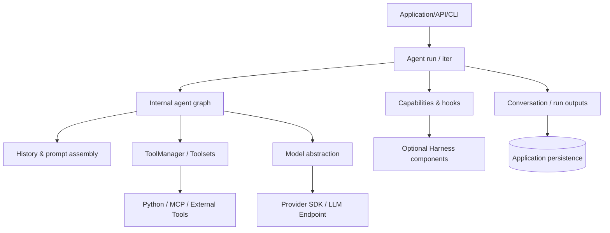
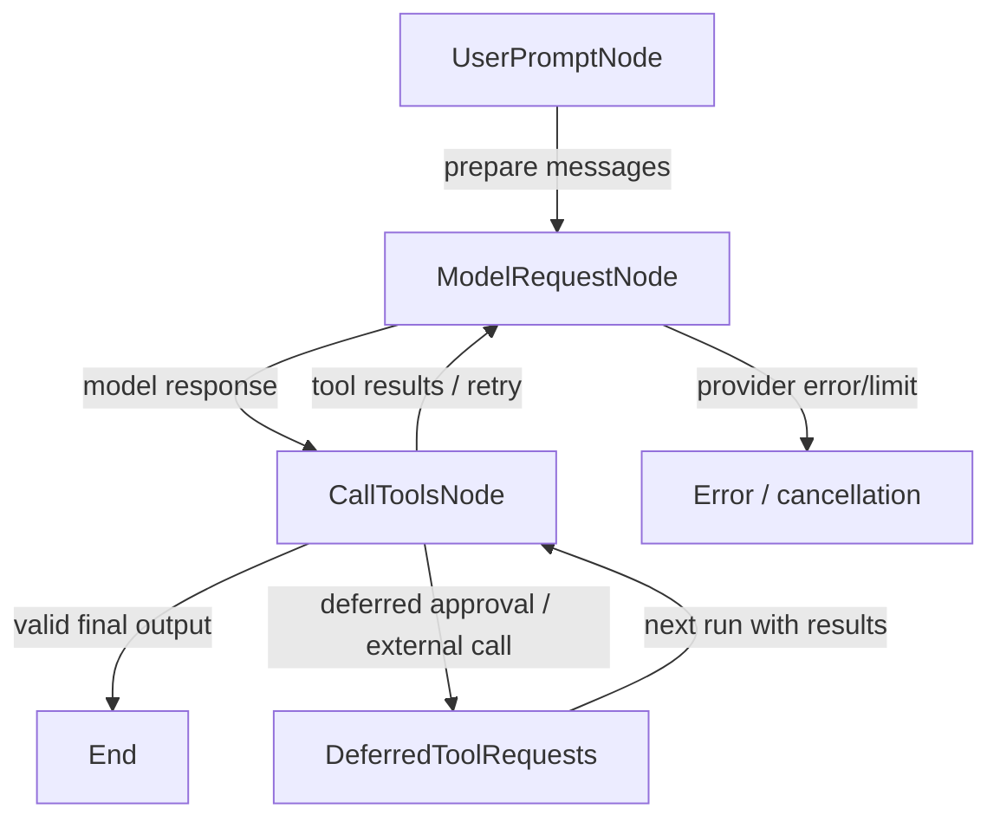
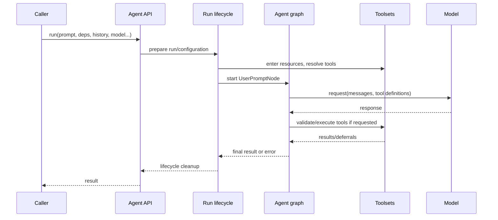
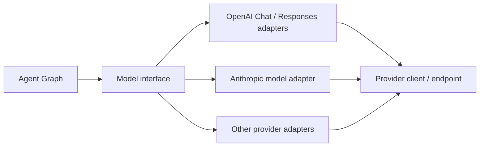
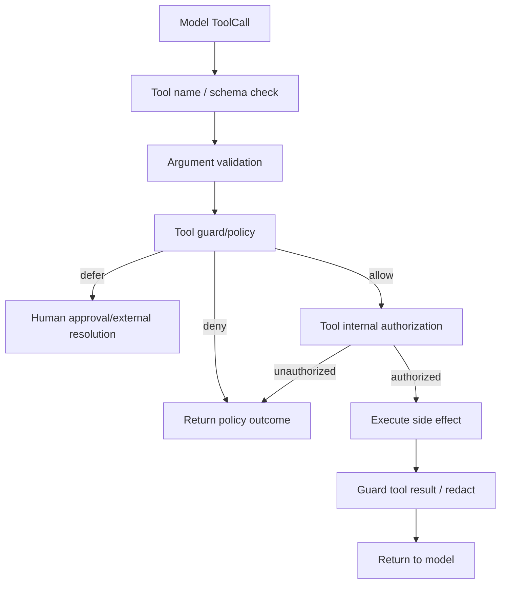
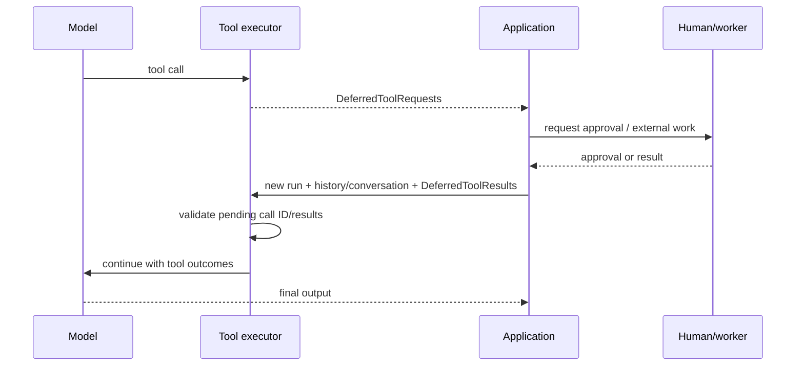
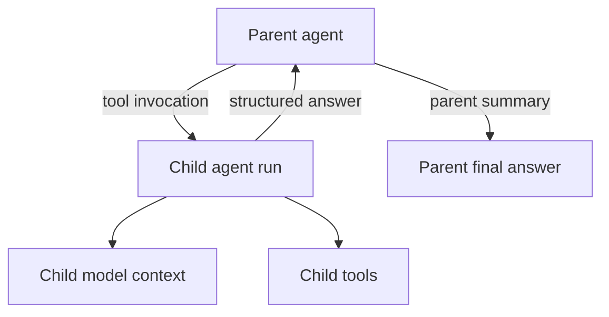

# PydanticAI — 2차 심층 학습 및 내부 소스코드 분석

> **학습 목적:** PydanticAI를 *어떻게 쓰는지*보다, 내부에서 Agent Loop를 *어떻게 구현하고*, 호출·검증·상태·병렬·승인·메모리를 *왜 그런 방식으로 제어하는지* 이해한다. 향후 자체 Agent Framework/Harness의 구조를 설계하거나 다른 프레임워크와 비교할 수 있는 수준을 목표로 한다.
>
> **범위:** 2026-10-31 기준으로 확인 가능한 **PydanticAI Python Core v2.61.0** (Git tag [`v2.61.0`](https://github.com/pydantic/pydantic-ai/tree/v2.61.0), 발표일 2026-10-23). `pydantic-ai-harness`는 별도 패키지로, 해당 시점의 공식 문서에서 확인 가능한 기능을 소개하되 **Core와 같은 버전이라고 가정하지 않는다.**
>
> **제외:** 반도체 Agent 데모 제작 및 실행, 실제 서버 배포, 성능 벤치마크. 코드 예시는 학습용이며 실행 검증을 했다고 주장하지 않는다.
>
> **근거 기호:** `[SRC]` 고정 버전 공개 소스 직접 확인 · `[DOC]` 공식 기술 문서 · `[INF]` 소스/문서 기반 설계적 해석 · `[UNV]` 별도 실행·검증 필요.

---

## 목차

1. 학습 목표와 설계 질문
2. 기술의 정체성과 계층 분리
3. 패키지·모듈 지도 및 소스 추적법
4. Agent 실행을 하나의 상태기계로 이해하기
5. `Agent.run()`·`Agent.iter()` 및 실행 준비 과정
6. Graph의 State/Deps/Node와 종료 조건
7. Prompt Assembly 및 최종 모델 요청
8. Model·Provider·Model Profile 추상화
9. Tool 정의와 JSON Schema 변환
10. ToolManager의 검증·실행·Retry
11. Tool 병렬 실행, 장벽, 순서와 취소
12. Structured Output 및 EndStrategy 상세
13. Retry의 계층과 실제 네트워크 호출 증폭
14. Dependencies와 RunContext의 데이터 흐름
15. Guardrails·Capabilities·Hooks: 실행 개입 지점
16. Human-in-the-loop·Deferred Tool·복원
17. Message History·State·Persistence·Memory
18. Context 최적화·Compaction·Caching
19. Skills·MCP·Toolsets·외부 확장
20. Multi-Agent·Graph·오케스트레이션
21. Streaming·Serving·동시 요청·취소
22. 보안 경계 및 신뢰 모델
23. 장애 시나리오와 재현성 설계
24. 핵심 코드 추적 워크북
25. 다른 Agent Framework와 설계 비교
26. 발표용 정리와 학습 점검 질문
27. 공식 출처·코드 인덱스

---

# 1. 학습 목표와 설계 질문

PydanticAI를 분석할 때는 다음 질문에 답할 수 있어야 한다.

- 누가 Agent Loop의 다음 단계를 결정하는가? 단순한 `while` 루프인가, Graph Node 기반 상태 전이인가?
- 모델 응답에 Tool 호출과 최종 Output이 동시에 있으면 무엇이 실행되는가? 어느 시점에 중단하는가?
- Python 함수의 시그니처가 실제 모델용 JSON Schema와 Runtime 검증 로직으로 어떻게 연결되는가?
- 여러 Tool은 어떤 실행기로 동시에 실행하며, `sequential=True`는 어떤 순서를 보장하는가?
- JSON 문법 오류, 인자 타입 오류, 비즈니스 검증 실패, 모델 API 오류, 네트워크 오류는 같은 Retry인가?
- Guardrails는 프롬프트 수준 지침인가, 도구 실행 직전의 코드 정책인가, 또는 격리된 보안 경계인가?
- 승인 대기 상태를 어떻게 표현하고, 다음 프로세스나 다음 Run에서 무엇을 복원하는가?
- Session/Conversation History, Agent State, 장기 Memory는 서로 어떻게 다른가?
- Core, 별도 Harness, Provider SDK와 외부 저장소는 각각 어떤 책임을 갖는가?
- 프레임워크가 *타입 안정성*을 제공해도 실제 계산의 *의미적 정확성*이 보장되지 않는 이유는 무엇인가?

## 1.1 학습 깊이와 산출물

| 깊이 | 목표 | 이 문서의 대응 |
|---|---|---|
| L1 개념 | Agent·Tool·Graph·Schema의 역할을 설명 | 2–3장 |
| L2 실행 | 단계·분기·종료·재시도 흐름 설명 | 4–16장 |
| L3 코드 | 고정 버전의 파일·객체·함수와 연결 | 3–14, 24장 |
| L4 설계 | 대안, 이득, 비용, 실패모드 비교 | 17–25장 |

**작성 원칙:** API 이름을 나열하는 문서가 아니라, *입력 → 실행 코드 → 상태 변경 → 결과/오류 → 다음 실행*을 추적하는 문서로 읽는다.

# 2. 기술의 정체성과 계층 분리

## 2.1 SDK와 Framework 중 무엇에 가까운가?

PydanticAI는 Python 라이브러리 형태로 설치하는 **Agent 개발 프레임워크**이다. 따라서 '설치 형식'은 SDK/라이브러리이며, '역할'은 Agent 실행 구조, Tool, Model, 검증, Message, 이벤트 및 확장 지점을 제공하는 Framework다. SDK·라이브러리·프레임워크는 서로 배타적인 범주가 아니다.

- **Pydantic:** Python 값과 스키마를 정의·검증하는 기반 라이브러리.
- **PydanticAI Core:** Agent 실행, Graph, Model abstraction, Tool, Output validation, Toolsets, Capabilities 등의 프레임워크 본체.
- **`pydantic_graph`:** PydanticAI가 내부에서 사용하는 Graph 실행 추상화 및 독립적인 그래프/워크플로 설계 도구. 내부 Agent Graph와 사용자가 직접 만드는 Graph를 구별한다.
- **PydanticAI Harness:** `pydantic-ai-harness` 별도 패키지가 제공하는 Skills, Memory, Compaction, Guardrails, Coder/Researcher와 같은 조합 가능한 기능 묶음.
- **Provider SDK/API:** 실제 모델에 요청하고 토큰을 생성하는 외부 시스템. PydanticAI는 모델 자체가 아니다.
- **Logfire/Evals:** 별도의 관찰 및 평가 생태계. 설치만으로 모든 관찰·평가가 자동 완성되는 것은 아니다.

`[DOC]` [공식 Harness 개요](https://pydantic.dev/docs/ai/harness/), [공식 Capabilities 분류](https://pydantic.dev/docs/ai/capabilities/overview/).

## 2.2 왜 PydanticAI인가: 설계 철학

1. Python 함수·타입·Pydantic Model을 Tool 및 Output 경계에 그대로 활용한다.
2. Agent의 실행 상태를 Graph Node로 조직하고, 각 단계의 이벤트·히스토리를 노출한다.
3. 모델·Tool·검증·Capabilities·저장소를 바꿔 끼울 수 있도록 인터페이스를 분리한다.
4. 필수 Core와 무거운 Harness 기능을 패키지 차원에서 분리한다.

`[INF]` 이는 단순한 코딩 편의성 외에도 **명시적 데이터 계약과 인터페이스 경계**를 중시한 설계라고 볼 수 있다. 다만 입력 Schema 검증 ≠ 권한 인증 ≠ 비즈니스 사실 검증이다.

## 2.3 비교를 위한 책임 레이어



**주의:** 도표는 소유권/의존성의 교육용 단순화이며, 런타임의 모든 함수 호출을 그대로 표현한 것은 아니다.

---

# 3. 패키지·모듈 지도 및 소스 추적법

## 3.1 고정 버전 핵심 소스

| 책임 | 실제 저장소 경로 (v2.61.0 기준) | 확인할 대상 |
|---|---|---|
| Agent facade | `pydantic_ai_slim/pydantic_ai/agent/__init__.py` | `Agent`, 실행 준비, Lifecycle, `iter` |
| Agent 공개 추상화 | `pydantic_ai_slim/pydantic_ai/agent/abstract.py` | run API 계약 |
| Agent Graph | `pydantic_ai_slim/pydantic_ai/_agent_graph.py` | `UserPromptNode`, `ModelRequestNode`, `CallToolsNode`, `EndStrategy` |
| Tool manager | `pydantic_ai_slim/pydantic_ai/tool_manager.py` | `ToolManager`, 검증, 실행, Retry |
| Tool execution | `pydantic_ai_slim/pydantic_ai/_tool_execution.py` | `process_tool_calls`, 병렬 구간·Barrier |
| Tool public API | `pydantic_ai_slim/pydantic_ai/tools.py` | `RunContext`, ToolDefinition, deferred types |
| Toolset API | `pydantic_ai_slim/pydantic_ai/toolsets/` | Function/MCP/Wrapper/Prepared Toolset |
| Output | `pydantic_ai_slim/pydantic_ai/_output.py`, `output.py` | schema, validation, processor, output modes |
| Messages | `pydantic_ai_slim/pydantic_ai/messages.py` | ModelRequest/Response, ToolCall, Return, Retry |
| Model abstraction | `pydantic_ai_slim/pydantic_ai/models/` | Model requests, streaming, provider adapters |
| Capabilities | `pydantic_ai_slim/pydantic_ai/capabilities/` | hooks, wrappers, per-run capability |
| Prompt/history | `pydantic_ai_slim/pydantic_ai/_system_prompt.py`, `_history_processor.py` | prompt 조합/과거 기록 변환 |
| Usage | `pydantic_ai_slim/pydantic_ai/usage.py` | requests, tokens, limit |
| Tests | `tests/` | 경계 조건, Mock Model, 승인·Tool 실패 테스트 |

원본 참조: [tag v2.61.0](https://github.com/pydantic/pydantic-ai/tree/v2.61.0), [개발용 구조 가이드](https://github.com/pydantic/pydantic-ai/blob/v2.61.0/agent_docs/pydantic-ai-slim.md) (해당 경로 존재 여부는 고정 버전 링크에서 재확인).

## 3.2 구현을 읽는 순서

**추천 추적 순서**

1. `Agent` 외부 API → 실행 준비·리소스 진입.
2. `_agent_graph.py` → Node와 State, 모델 요청.
3. `tool_manager.py` → 해당 Step에서 노출되는 Tool 및 호출 검증.
4. `_tool_execution.py` → Output Tool / Function Tool 분류, 병렬화 및 Deferred 처리.
5. `_output.py` → 최종 Output 처리.
6. `messages.py` → 결과가 어떤 메시지로 기록되는가.
7. `capabilities/` → 기본 흐름에 어느 Hook이 끼어드는가.

함수 이름이 같아도 공개 API와 내부 구현의 책임이 다르다. 특히 *모델에 Tool을 노출하는 것*과 *외부 함수를 실제로 실행하는 것*을 혼동하지 말자.

## 3.3 소스에서 사실을 검증하는 방법

- **호출자:** 이 함수를 누가, 어느 조건에서 부르는가?
- **입력:** `RunContext`, Graph State, ModelMessage, ToolDefinition의 어느 필드를 읽는가?
- **부작용:** 데이터베이스 변경, 파일 변경, 네트워크 요청, Tool 실행 등 되돌리기 어려운 작업이 있는가?
- **상태:** `run_step`, `output_retries_used`, `messages`, Tool 성공·실패 플래그가 갱신되는가?
- **오류:** 사용자에게 반환되는 예외, 모델에 피드백되는 오류, 별도 Retry가 있는가?
- **경계:** Python Core가 보장하는 것과 Provider·외부 저장소에 맡기는 것은 무엇인가?

---

# 4. Agent 실행을 하나의 상태기계로 이해하기

## 4.1 가장 중요한 내부 Node

`[SRC]` v2.61.0의 `_agent_graph.py`는 `UserPromptNode`, `ModelRequestNode`, `CallToolsNode`를 주요 Node로 노출한다. 일반적인 요청은 아래처럼 진행한다.



단, 최종 출력의 종류에 따라 Tool 없이 종료하기도 하고, 후속 Run이 이력을 복원할 때 일부 Node를 건너뛰기도 한다. 이는 '모든 실행이 언제나 세 Node를 한 번씩 통과한다'는 뜻이 아니다.

## 4.2 Graph 사용과 공개 Graph Workflow는 다르다

**내부 Agent Graph**는 표준 모델 요청·Tool·Output 처리를 위한 엔진이다. **사용자 정의 Pydantic Graph**는 조건 분기·워크플로를 선언하는 별도 작성법이다. Agent가 Graph로 구현되어 있다고 해서 Agent 자체가 자동으로 비즈니스 단계(검색 → 검토 → 승인)를 명시적 Workflow로 실행한다는 뜻은 아니다.

## 4.3 실행의 불변식

이 코드를 분석할 때 다음 성질이 유지되는지 확인하자.

- 모델이 Tool을 호출했다면 ToolCall ID와 결과 메시지의 대응이 맞아야 한다.
- 검증에서 거부된 Tool은 정상 비즈니스 실행으로 취급하면 안 된다.
- Output이 성공해도 같은 응답의 다른 Tool들이 이미 실행되었는지는 `EndStrategy`에 달려 있다.
- 사용량 한계는 비용·토큰·요청 횟수에 따라 다른 계층에서 적용될 수 있다.
- Deferred 상태의 요청은 과거 이력만 대충 재전송해서 안전하게 복원할 수 있다고 가정하지 않는다.

`[SRC]` [Graph source](https://github.com/pydantic/pydantic-ai/blob/v2.61.0/pydantic_ai_slim/pydantic_ai/_agent_graph.py), [Tool execution](https://github.com/pydantic/pydantic-ai/blob/v2.61.0/pydantic_ai_slim/pydantic_ai/_tool_execution.py).


# 5. `Agent.run()`·`Agent.iter()` 및 실행 준비 과정

## 5.1 사용자 API와 실제 엔진을 구분한다

세 가지 API가 비슷해 보여도 호출자가 받는 제어 수준은 다르다.

| API | 사용자 관점 | 내부적으로 검토할 사항 |
|---|---|---|
| `agent.run(prompt)` | 최종 결과를 비동기로 기다림 | 전체 Graph와 lifecycle 종료까지 책임 |
| `agent.run_sync(prompt)` | 동기 호출 래퍼 | 기존 이벤트 루프 내부에서 사용 제약, 동시성 특성 |
| `agent.iter(prompt)` | Graph Node 진행 과정 관찰·제어 | Node별 실행과 스트리밍 소비·종료 조건 |
| `agent.run_stream()` | 스트리밍 결과 | 출력 유효화 시점, 종료와 스트림 정리 |
| `agent.run_stream_events()` | 이벤트 흐름 | Tool 이벤트, Model delta와 최종결과 차이 |

`[SRC]` `Agent.iter()`는 Agent Graph의 외부 Facade 역할을 수행하며, 실행 전 준비 로직과 리소스 진입·정리를 별도 경계로 둔다. 자세한 진입점은 [Agent source](https://github.com/pydantic/pydantic-ai/blob/v2.61.0/pydantic_ai_slim/pydantic_ai/agent/__init__.py).

## 5.2 실행 준비의 개념적 경로



실제 실행 과정은 Capabilities와 회복 경로에 의해 추가로 감싸질 수 있다. 위 그림의 `prepare`/`lifecycle`은 코드 구조를 이해시키기 위한 단계 구분이다.

## 5.3 Lifecycle에서 분석할 항목

`[SRC]` `agent/__init__.py`에서 `_run_lifecycle_hooks`와 내부의 per-run capability 실행을 볼 수 있다. 전후 Hook은 모델 요청 앞뒤에만 있는 것이 아니라 **전체 Run의 시작·성공·실패**를 감싸는 영역이 있다.

- `before_run`이 실패하면 모델 요청 전에 종료되는가?
- 성공한 Run의 결과를 `after_run`에서 수정할 수 있는가?
- 에러 때도 리소스가 정리되는가? 부분적으로 완료된 외부 Tool 작업까지 취소되는가?
- 리소스를 획득한 Context와 해제하는 Context의 일관성을 어떻게 맞추는가?
- 동일 Agent 객체에 여러 Run이 동시에 들어올 때 Run별 리소스가 격리되는가?

**설계적 시사점:** Runner의 책임은 단순 반복뿐 아니라 리소스 생명주기, Hook, Usage, 결과화, Stream 정리까지 포함한다. Core를 직접 만들려면 이 계층을 초기에 분리하는 편이 이후 기능 확장에 유리하다.

# 6. Graph의 State/Deps/Node와 종료 조건

## 6.1 State, Deps, Context는 다른 개념

- **Graph State:** 반복 과정에서 변경되는 런타임 상태(모델 요청 횟수, 출력 Retry 사용량, 관련 Message 기록).
- **Graph Deps:** Node가 실행에 필요한 모델, ToolManager, Output Schema, Usage Limits 등 실행 서비스.
- **RunContext:** Tool/Hook/Prompt 함수에 전달되는 현재 실행 정보와 사용자가 주입한 Dependencies의 View.
- **App Dependencies:** DB Client, 인증 Context 등 실제 애플리케이션 자원(호출자가 구성).

비슷한 이름이라도 State는 *변하는 데이터*, Deps는 *협업하는 서비스*, Context는 *현재 코드의 인터페이스*에 가깝다.

## 6.2 각 Node의 책임

**UserPromptNode** — 신규 사용자 입력, Message History, Instructions, System Prompts, Deferred Tool Results를 조합한다. 과거 실행이 Pending Tool Call로 끝났다면 Tool 실행으로 바로 재진입할 수 있다.

**ModelRequestNode** — 현재 Message와 ToolDefinition을 준비하고 모델에 요청한다. Usage/Deadline 검사, 모델 선택·변경, Capabilities가 개입할 수 있는 지점을 분석한다.

**CallToolsNode** — ModelResponse를 해석하고 Function/Output/Unknown Tool을 분류하며, 검증·실행·Retry·Output 처리를 한 뒤 종료 또는 다음 모델 요청을 결정한다.

`[SRC]` Node 선언: [`_agent_graph.py`](https://github.com/pydantic/pydantic-ai/blob/v2.61.0/pydantic_ai_slim/pydantic_ai/_agent_graph.py).

## 6.3 종료는 단순 '텍스트가 나왔는가?'가 아니다

모델이 텍스트를 반환해도 다음 상황을 구별해야 한다.

1. 순수 문자열 최종 답변으로 인정 가능한 경우.
2. Structured Output Schema를 충족해 결과로 인정되는 경우.
3. 모델이 Function Tool도 요청해 아직 추가 실행이 필요한 경우.
4. 모델이 Output Tool을 호출했지만 인자 검증 또는 Output Validator가 실패한 경우.
5. 승인·외부 실행을 기다리는 Deferred Tool이 있는 경우.
6. Usage/Deadline/Retry 제한이 초과된 경우.

특히 2–4의 충돌을 해결하는 것이 `EndStrategy`의 역할이다. 뒤의 12장에서 상세 분석한다.

## 6.4 종료와 중단의 의미 구분

| 결과 | 의미 | 후속 책임 |
|---|---|---|
| 정상 완료 | Output Schema/Validator를 통과한 Final Result | 호출자에게 반환 |
| 오류 종료 | 모델·검증·제한·사용자 코드 오류 | 오류 기록·재시도 여부 판단 |
| Deferred | 승인 또는 외부 결과 대기 | 대기 요청 보존, 검증된 결과로 후속 Run |
| Cancelled | 호출자 취소·Deadline 등 | 진행 중 Tool/외부 자원 정리 확인 |
| Suspended provider response | 제공자 모델의 비동기·중간 상태 | 제공자 Resume 조건과 메시지 꼬리 복원 확인 |

모든 상태를 '종료'라고만 부르면 정확히 한 번 실행, 비용 계상, 재개 설계를 잘못하기 쉽다.

# 7. Prompt Assembly 및 최종 모델 요청

## 7.1 최종 입력은 단순 `system + user`가 아니다

모델이 실제로 받는 입력은 다음 요소들로 구성될 수 있다.

```text
ModelRequest ≈
  retained conversation messages
  + current user prompt
  + static/dynamic system prompts and instructions
  + capability/toolset-provided instructions
  + provider/model-specific formatted content

request parameters ≈
  available function tools + output schema/tool settings
  + model settings + provider settings
```

이 식은 개념도다. **모든 요소가 하나의 시스템 프롬프트 문자열로 합쳐진다는 뜻이 아니다.** Provider API의 메시지 배열, Tool Schema, 별도 JSON Schema 파라미터로 나뉠 수 있다.

## 7.2 모델 호출 직전 살펴봐야 할 순서

1. 호출자가 Message History나 Conversation을 전달했는가?
2. 이전 요청의 Pending Tool/부분 응답을 수리해야 하는가?
3. 동적 Instructions/System Prompt를 재평가하는가?
4. History Processor 또는 Capability가 기록을 줄이거나 수정하는가?
5. 현재 Run Step에 맞춰 Toolset을 다시 Resolve하는가?
6. 사용할 Model과 Provider가 결정되는가?
7. Output Schema가 Native/Prompted/Tool Output 방식 중 무엇으로 전달되는가?
8. 실제 Provider SDK의 요청 형식으로 변환하는가?

`[SRC]` `_agent_graph.py`의 `UserPromptNode.run`, `_reevaluate_dynamic_prompts`, `resolve_conversation`, `ModelRequestNode` 관련 코드를 추적한다.

## 7.3 Instructions vs System Prompt

- **Instructions:** Agent가 수행할 역할, 동작, 현재 Task 지시 등을 코드/런타임에서 관리하는 기능.
- **System Prompt:** 메시지 히스토리의 System Prompt Part 형태로 구성·재평가되는 지시.
- **Tool Description:** Tool 선택을 위해 모델에 노출되는 별도 스키마 설명.
- **Retrieved Documents:** Tool 결과 또는 사용자가 제공한 Context로 들어오는 *데이터*.

동일한 '텍스트 입력'처럼 보이더라도 **신뢰 등급과 변경 주기**가 다르므로 Cache, Injection 방어, Trace, 권한 설계에서 구별해야 한다.

## 7.4 Cache가 깨지는 원리 — PydanticAI에서도 중요

Provider의 Prefix Cache는 '요청 전체를 전송하지 않는다'는 기능이 아니라 **일정한 이전 입력 Prefix에 대한 계산을 재사용하는 최적화**다. 그러므로 모든 요청에 같은 텍스트를 보내도 Prefix가 변경되면 캐시 재사용이 줄어들 수 있다.

예: `[고정 지시 3K] + [Tool Schema 8K] + [대화 기록]`과 `[고정 지시 3K] + [변경된 동적 시간] + [Tool Schema 8K]`는 고정 부분이 같아도 변경 지점 이후의 Prefix 재사용 조건이 달라질 수 있다.

**검토 항목:** Tool 정의 정렬, 동적 Instructions 삽입 위치, History Processor의 출력, Tool Search로 활성 도구가 변경되는 시점, Provider별 Cache 정책. *PydanticAI가 항상 Cache Hit을 보장하는 것은 아니다.*

# 8. Model·Provider·Model Profile 추상화

## 8.1 계층을 이해하기



**Model**은 메시지/Tool/출력 요청을 해당 모델 API 형식으로 변환하고, **Provider**는 인증·Base URL·HTTP Client 등 요청 접속 기능을 구성한다. **Model Profile**은 모델별 지원 능력과 특수 처리의 정보를 담아 Tool/Schema/설정 정책에 영향을 줄 수 있다.

## 8.2 로컬 LLM·사내 Gateway와의 관계

PydanticAI를 사용한다고 반드시 특정 상용 모델 API만 호출해야 하는 것은 아니다. 공식 지원 Provider와 OpenAI-compatible 서버, Ollama 등에 연결하는 구성이 가능하다. 다만 연결 가능성 ≠ Tool Calling/JSON Schema/Streaming의 동작 완전 호환이다.

실제로 점검할 것:

- 서버가 Function Tool Schema와 결과 형식을 이해하는가?
- Structured Output이 Native로 지원되는가, Prompted 또는 Tool 방식이 필요한가?
- Tool Call ID, 여러 Function Call, Streaming delta가 정상적으로 매핑되는가?
- 시스템 Prompt, 토큰 사용량, Usage Reporting, Timeout 기능이 정확한가?
- 모델의 실제 능력에 대한 Profile 선언이 과장되지 않았는가?

공식 참고: [Models and Providers](https://pydantic.dev/docs/ai/models/overview/), [Ollama](https://pydantic.dev/docs/ai/models/ollama/), [OpenAI models](https://pydantic.dev/docs/ai/models/openai/).

## 8.3 Provider Failover와 Agent Retry는 다르다

- Transport 재시도: 네트워크 재접속·HTTP 요청 재시도.
- Model Provider 실패 전환: 다른 모델로 동일 요청 시도.
- Agent Graph Retry: Tool/Output 검증 실패에 따른 모델에게 수정 요청.

세 레이어를 구별하지 않으면 API 호출 횟수·비용·부작용을 과소평가하게 된다.

---

# 9. Tool 정의와 JSON Schema 변환

## 9.1 Python 함수는 곧바로 모델이 실행하는 코드가 아니다

Tool 등록 후 일반적으로 다음 절차를 거친다.

```text
Python function + type annotations + documentation
  → Tool definition & argument schema
  → Toolset / ToolManager
  → Model request includes tool schema
  → Model chooses name + JSON arguments
  → Runtime resolves/validates arguments
  → Python function actually executes
  → ToolReturn message
  → Model sees result in next request
```

**Tool의 정의와 실제 실행 간에는 별도의 신뢰 경계가 있다.** 함수가 존재한다는 이유로 모델이 임의 파라미터를 넣어 직접 실행할 권한을 가져서는 안 된다.

## 9.2 예시 — 단순화된 사용 코드

아래는 핵심 구조를 보여주는 *사용자 코드 예시*로, 실 실행 검증을 수행하지 않았다.

```python
from pydantic import BaseModel, Field
from pydantic_ai import Agent, RunContext

class ToolDeps(BaseModel):
    tenant_id: str

agent = Agent('openai:example-model', deps_type=ToolDeps)

@agent.tool
async def get_temperature(ctx: RunContext[ToolDeps], wafer_id: str) -> float:
    """Read the most recent temperature for a wafer ID."""
    # 설명용 값: 실제 프로젝트에서는 승인된 read-only 데이터 소스를 조회
    return 27.1
```

모델이 Tool을 호출할 때 Python 쪽은 `wafer_id` 타입, Tool 존재 여부, 실행 Context를 확인할 수 있다. 그러나 `tenant_id`가 진짜 인증된 값인지, 해당 `wafer_id`에 접근 권한이 있는지는 **애플리케이션에서 직접 보장**해야 한다.

## 9.3 Tool Schema의 한계

| 단계 | 프레임워크 보장 가능 범위 | 보장되지 않는 것 |
|---|---|---|
| JSON Schema 작성 | 인자 구조/타입의 형식화 | Tool의 업무 의미까지 완벽 전달 |
| Validation | 타입·필수 필드·제약 검사 | 권한, 데이터 진실성, 호출 목적의 적법성 |
| Tool 실행 | 등록한 함수 호출 및 예외 관리 | DB 트랜잭션의 완전성, 외부 API 멱등성 |
| Result 반환 | 메시지 변환 및 모델 제공 | 모델이 결과를 올바르게 해석하는지 |

## 9.4 Toolset은 Registry 이상의 추상화

`FunctionToolset`은 Python 함수를 묶는다. `AbstractToolset`은 Tool 열거와 호출 처리의 계약을 제공하며, Toolset Wrapper는 Tool 이름 변경·필터링·실행 중간 개입 등의 기능을 구성할 수 있다. MCP Toolset도 같은 경계로 모델에 Tools를 제공한다.

Toolset이 Capabilities에 의해 활성화되거나 Tool Search에 의해 일부 Tool만 노출된다면, **등록된 모든 Tool이 매번 같은 이름으로 모델에 노출된다고 가정하지 말 것.**

참고: [Toolsets](https://pydantic.dev/docs/ai/tools-toolsets/toolsets/), [Tools Advanced](https://pydantic.dev/docs/ai/tools-toolsets/tools-advanced/), [ToolManager source](https://github.com/pydantic/pydantic-ai/blob/v2.61.0/pydantic_ai_slim/pydantic_ai/tool_manager.py).


# 10. ToolManager의 검증·실행·Retry

## 10.1 핵심 클래스 역할

`[SRC]` `tool_manager.py`의 `ToolManager`는 실행 Step의 ToolDefinition을 캐시하고, 호출에 대한 검증·실행·Retry를 담당한다. 도구의 전체 라이프사이클을 `Agent` 클래스에 몰아넣지 않고 분리한 이유를 살펴보자.

- `toolset`: Tool들이 실제로 존재하는 곳.
- `tools`: 현재 Step에서 Resolve된 도구 이름 → Tool 정보 사전.
- `root_capability`: Tool 정의·검증·실행에 개입할 Hook 경계.
- `failed_tools` / `succeeded_tools`: 현재 호출 결과를 모니터링하는 상태.
- `default_max_retries`: Tool 오류를 모델에게 되돌릴 때의 Retry 한도.
- `availability_refused`: 비활성 Tool의 거부를 일반 인자 오류와 구분하는 상태.
- `resolved_capability_ids`: Step 도중 활성 Capability가 달라지는 상황의 캐시 무효화 키.

마지막 두 항목은 특히 중요하다. ToolManager의 캐시가 단순히 `step`만 키로 사용된다면, 같은 Step에서 Capability의 활성화 상태가 바뀌어 **새로운 필터/정책을 적용하지 않은 ToolDefinition이 재사용될 위험**이 있다. 실제 소스는 이 문제를 경계하는 코멘트를 포함한다. `[SRC]` [ToolManager implementation](https://github.com/pydantic/pydantic-ai/blob/v2.61.0/pydantic_ai_slim/pydantic_ai/tool_manager.py).

## 10.2 Tool 실행 파이프라인: '검증 전 승인'은 위험하다

일반적인 흐름을 의사코드로 정리하면:

```python
# [PSEUDO] v2.61.0 구조를 학습 목적으로 단순화한 흐름
async def execute_one(model_tool_call, tool_manager, context):
    definition = tool_manager.resolve(model_tool_call.name)
    if definition is None:
        return feedback_to_model('unknown tool')

    validated = await tool_manager.validate_tool_call(model_tool_call)
    if validated.needs_approval:
        return defer_for_approval(validated)

    await run_before_execute_hooks(validated)
    result = await definition.toolset.call_tool(validated.args, context)
    result = await run_after_execute_hooks(result)
    return to_model_tool_return(result)
```

실제 엔진은 Output Tool, Deferred Results, Capabilities, Batch 처리를 포함하므로 더 복잡하다. 핵심 원리는 **이름 확인 → 인자 검증 → 승인/외부 실행 판단 → 실제 호출 → 결과 반환**의 경계를 명확히 하는 것.

## 10.3 검증 실패 후의 모델 Feedback

모델이 `get_temperature(wafer_id=123)`를 요청했지만 인자는 문자열이어야 한다고 가정하자.

1. Tool arg 스키마 검증에 실패한다.
2. 오류를 모델이 이해할 수 있는 형태로 되돌릴 수 있다.
3. 모델이 Tool을 다시 호출하도록 Agent Loop가 계속될 수 있다.
4. Retry 상한을 넘으면 결국 오류로 끝난다.

이 실패를 네트워크 요청 실패와 같은 Retry로 취급하면 안 된다. 유효하지 않은 인자 문제를 HTTP 재전송으로 해결할 수 없기 때문이다.

## 10.4 `ModelRetry`의 의미

Tool 함수 내부의 `ModelRetry`는 단순한 Python 재실행 명령이 아니다. **모델에 수정 피드백을 보내 새로운 답변/ToolCall을 생성하게 하는 제어 흐름**이다. 따라서 해당 Tool 함수는 *즉시 자동 재실행*된다고 가정하면 안 된다.

비교:

- `ValueError`: 일반적인 사용자 코드 예외; 프레임워크의 설정과 예외처리 경로에 따라 Run 실패 가능.
- `ModelRetry`: 모델에게 입력·호출을 다시 생각하도록 요청하는 신호.
- `ApprovalRequired`: Tool 결과를 내기 전에 승인 절차가 필요함.
- `CallDeferred`: 외부에서 실행할 Tool 호출을 유예함.

## 10.5 ToolResult의 유형을 구분

| Tool 처리 | 사용자에게 중요한 의미 |
|---|---|
| 정상 ToolReturn | 결과가 메시지로 저장되고 모델이 이용 가능 |
| Retry feedback | 모델이 고쳐야 할 오류를 전달 |
| Deferred request | 이후 승인/외부 결과가 있어야 진행 |
| Unknown tool | 모델이 노출되지 않은 Tool 이름을 생성 |
| Cancelled/failed execution | 부작용 발생 여부를 별도 확인해야 함 |

**설계 질문:** Tool 실행 전·후 Hook이 *어떤 종류의 실패를 차단*할 수 있는가? 이미 실행된 외부 요청은 취소 요청만으로 복구 가능한가?

---

# 11. Tool 병렬 실행, 장벽, 순서와 취소

## 11.1 '모델이 여러 Tool을 요청'과 '실제 병렬 실행'은 별개

모델 응답에 두 개 이상의 ToolCallPart가 포함될 수 있다. 그러나 Runtime이 다음을 결정한다.

- 동시에 시작해도 되는지
- 어디서 순차 실행해야 하는지
- 결과를 어떤 순서로 기록할지
- 실패가 나면 나머지 Task를 어떻게 처리할지

`[DOC]` PydanticAI는 기본적으로 `asyncio.create_task`로 여러 Tool 실행을 동시에 스케줄하며, `sequential=True`가 있으면 앞뒤 실행을 분리하는 **장벽(Barrier)** 으로 사용한다. 동기 함수는 Worker Thread로 오프로딩할 수 있다. [Advanced Tool Features](https://pydantic.dev/docs/ai/tools-toolsets/tools-advanced/).

## 11.2 실제 Barrier 분할 코드의 의미

`[SRC]` `_tool_execution.py`의 `_segment_by_barriers`가 순서를 유지하면서 다음과 같은 세그먼트를 만든다.

```text
Model emitted:
  A(read), B(read), C(write: sequential), D(read), E(read), F(sequential)

Execution segments:
  [A, B] → [C] → [D, E] → [F]

[A,B] concurrent
[C] alone
[D,E] concurrent
[F] alone
```

장벽은 단순한 Lock과 다르다. Lock은 공유 자원의 동시 접근만 제어하지만, 여기서는 **요청 순서 자체를 일련의 실행 구간으로 분할**한다.

```python
# [PSEUDO] Barrier partition 논리의 축약
segments = []
current_parallel = []
for call in model_emission_order:
    if call.sequential:
        if current_parallel:
            segments.append(current_parallel)
            current_parallel = []
        segments.append([call])
    else:
        current_parallel.append(call)
if current_parallel:
    segments.append(current_parallel)
```

실제 함수·입력·출력은 [소스 `_segment_by_barriers`](https://github.com/pydantic/pydantic-ai/blob/v2.61.0/pydantic_ai_slim/pydantic_ai/_tool_execution.py)에서 확인 가능하다.

## 11.3 실행 순서와 결과 순서

병렬 Task는 스케줄한 순서대로 **완료되지 않는다**. `A`가 먼저 요청됐어도 `B`가 먼저 끝날 수 있다. 따라서 다음을 구분해야 한다.

1. **Emission order:** 모델이 Tool Call을 생성한 순서.
2. **Start order:** Runtime이 Task를 만든 순서.
3. **Completion order:** 네트워크·디스크 등 실제 작업 완료 순서.
4. **History assembly order:** Tool 결과를 모델 히스토리에 넣는 순서.

`[SRC]` v2.61.0 `_tool_execution.py`의 ToolAvailabilityDelta 중복 제거 코멘트는 완료 시점의 경쟁에 의존하지 않고 **모델 호출의 인덱스 순서**로 선택해야 결정적 결과를 얻는다고 명시한다. 이는 병렬성에서 '실행은 병렬, 기록은 결정적' 패턴의 예시다.

## 11.4 `async`와 Thread가 같은 것은 아니다

- 비동기 I/O Tool: 이벤트 루프에서 기다리는 동안 다른 Task가 진행.
- 동기 Tool: 별도 Thread에서 실행돼 다른 Task를 방해하지 않게 할 수 있음.
- CPU 집중 Tool: Python Thread가 CPU 작업의 실질적인 병렬 속도 향상을 항상 보장하지 않음. 별도 Process/외부 Worker가 필요할 수 있음.
- 외부 REST Tool: 요청이 취소되어도 원격 서버에서 이미 수행했을 가능성이 있음.

`[DOC]` 동기 Tool에 있는 `contextvars`의 쓰기 변경이 밖으로 전달되지 않는 제약에 주의해야 한다. [Advanced Tool Features](https://pydantic.dev/docs/ai/tools-toolsets/tools-advanced/).

## 11.5 취소의 진짜 의미

취소에는 최소 세 단계가 있다.

1. Python Task 취소 신호 수신.
2. 로컬 Tool/HTTP Client가 취소를 처리.
3. 원격 시스템이 실제 비즈니스 작업을 중단.

**보장 범위는 1→3으로 자동 전파되지 않는다.** 따라서 중요한 작업에는 Timeout, Idempotency Key, 중복 요청 탐지, 작업 상태 조회, 보상 트랜잭션이 필요하다.

## 11.6 도구를 모두 `sequential=True`로 만들면 안전할까?

아니다. 동시 실행이 사라질 뿐 다음 문제는 여전히 남는다.

- 두 Run이 동일한 Tool을 동시에 호출할 수 있음.
- 외부 DB가 트랜잭션 격리를 보장하지 않을 수 있음.
- 재시도로 이미 처리한 작업이 중복 수행될 수 있음.
- Tool 함수 자체가 잘못된 권한 범위를 사용할 수 있음.

**설계 결론:** 병렬 제어는 *한 Run의 Call Batch* 경계에서 작동하는 부분과 *전체 시스템의 리소스 동기화*를 분리해야 한다.

---

# 12. Structured Output 및 EndStrategy 상세

## 12.1 PydanticAI가 특히 강한 이유

자유 텍스트 결과뿐 아니라 Python 타입/Pydantic Model로 Output을 선언하고 실행 중 검증할 수 있다. 그러나 이것은 기본적으로 **출력 형식과 선언된 제약을 검증**하는 능력이다.

`[DOC]` [Output](https://pydantic.dev/docs/ai/core-concepts/output/), `[SRC]` [`_output.py`](https://github.com/pydantic/pydantic-ai/blob/v2.61.0/pydantic_ai_slim/pydantic_ai/_output.py).

## 12.2 Output을 만드는 여러 경로

- `ToolOutput`: 모델이 최종 값 전달용 출력 Tool을 호출하는 방식.
- `NativeOutput`: 지원 제공자의 구조화 출력 기능으로 Schema를 전달.
- `PromptedOutput`: 프롬프트에 Schema/형식을 안내한 뒤 텍스트를 파싱.
- `TextOutput`: 자유 텍스트 또는 가공된 텍스트를 반환하는 방식.

기술적 의미:

| 방식 | 장점 | 주의점 |
|---|---|---|
| Output Tool | Function Tool 호출 메커니즘 활용 | 모델·Provider가 Tool Call을 잘 지원해야 함 |
| Native | Provider가 구조화 출력 형식을 지원 | 특정 Provider/Model 기능에 의존 |
| Prompted | 모델 API 기능이 제한돼도 시도 가능 | JSON 파싱·형식 실패 대응 필요 |
| Text | 가장 범용적 | 구조화 스키마 검증 범위 제한 |

## 12.3 제일 중요한 `EndStrategy` — v2.61.0 정확한 의미

`[SRC]` `_agent_graph.py`에 `EndStrategy = Literal['early', 'graceful', 'exhaustive']`가 정의되어 있으며 **기본값은 `graceful`**이라고 설명한다.

| 전략 | 최종 Output과 Function Tool이 함께 나올 때 | 핵심 설계 목적 |
|---|---|---|
| `early` | 유효한 최종 구조화 Output 우선. Function Tool을 건너뛸 수 있음 | 불필요한 부작용과 추가 Tool 실행 방지 |
| `graceful` (기본) | 모델이 낸 순서를 존중. Output Tool 전에 나온 Function Tool은 실행; 첫 유효 Output 우선 | 출력 이전 작업의 순서·부작용 존중 |
| `exhaustive` | 가능한 Tool들을 전부 실행(기본 병렬; barrier 사용 가능), 출력은 모델 방출 순서의 유효한 것을 선택 | 요청된 Tool들을 최대한 빠짐없이 실행 |

**세부 주의:**

- `early`에서도 **일반 자유 텍스트**는 무조건 Function Tool을 건너뛰고 바로 종료하는 신호가 아니다. 구조화 Output과 구별된다.
- `graceful`에서 앞선 Tool이 `ModelRetry`를 발생시키면 이미 나온 Output을 채택하지 않고 모델 수정 요청이 우선할 수 있다.
- `exhaustive`에서는 Output이 유효해도 다른 Tool을 계속 실행하므로 Side Effect 위험을 검토해야 한다.
- 일부 Streaming 경로에서는 이미 소비자에게 Commit된 Final Output을 이후의 Retry 신호가 되돌릴 수 없는 상황을 별도 코드로 다룬다.

`[SRC]` [EndStrategy source](https://github.com/pydantic/pydantic-ai/blob/v2.61.0/pydantic_ai_slim/pydantic_ai/_agent_graph.py), [`process_tool_calls` and related executor](https://github.com/pydantic/pydantic-ai/blob/v2.61.0/pydantic_ai_slim/pydantic_ai/_tool_execution.py).

## 12.4 실제 판단 사고 실험

모델 응답이 다음 순서로 왔다고 가정한다.

```text
1. write_log("analysis started")      # function tool
2. submit_final_report({...})         # output tool
3. publish_result("external")        # function tool
```

- `early`: 유효한 Output을 바로 선택하면 Function Tool이 실행되지 않을 수 있다.
- `graceful`: Output 전에 있는 `write_log`는 실행되지만, 이후 `publish_result`는 실행되지 않을 수 있다.
- `exhaustive`: `write_log`와 `publish_result` 모두 실행될 수 있다.

**주의:** 이는 정책 비교를 위한 예제다. 실제 실행 세부 분기는 Validator 성공/실패, Retry, Deferred Tool, Sequential Barrier와 Streaming 조건에 따라 달라진다.

## 12.5 Output Validator의 정확성과 한계

```python
from pydantic import BaseModel, Field

class AnalysisResult(BaseModel):
    count: int = Field(ge=0)
    mean: float
    unit: str
```

Pydantic 검증으로 가능한 것은 `count`가 음수가 아닌지, `mean`이 숫자인지, 필수 필드가 있는지 같은 조건이다. 다음 사실은 단순 타입 선언으로 검증할 수 없다.

- 데이터베이스의 행 개수를 실제로 세었는가?
- `mean`이 올바른 열에서 계산되었는가?
- 단위가 원본 데이터와 일치하는가?
- 통계적으로 의미 있는 분석인가?

이러한 내용은 데이터 출처 증명, 외부 계산값 재검산, 업무 규칙, 테스트, 평가가 필요하다.

---

# 13. Retry의 계층과 실제 네트워크 호출 증폭

## 13.1 Retry를 하나로 묶으면 위험하다

| Retry 계층 | 무엇을 해결? | 누가 제어? |
|---|---|---|
| Schema/Output Retry | 최종 결과 형식 또는 Validator 오류 | Agent Graph/Output |
| Tool Retry | 잘못된 Tool 인자·Tool 재시도 신호 | ToolManager/Agent Loop |
| Provider Model Fallback | 모델별 가용성/오류 | Model abstraction/config |
| Provider SDK Retry | HTTP 429/5xx 등의 요청 실패 | SDK 설정 |
| Transport Retry | 연결 재시도/하위 HTTP 동작 | 네트워크 클라이언트 |
| App Retry | 전체 Agent Run을 다시 실행 | 호출자/API/Worker |

`[DOC]` 공식 [Retries](https://pydantic.dev/docs/ai/core-concepts/retries/)는 위 계층이 중첩될 수 있으며, 한 레이어의 요청 한도가 전체 Wire-level 요청 상한과 같지 않음을 설명한다.

## 13.2 요청 증폭의 이해

예를 들어 Agent Output 수정을 위해 최대 3회 모델 요청하고, 제공자 SDK에서 같은 요청을 최대 3회, HTTP Transport에서 최대 2회 전송한다고 가정하자.

```text
최대 wire request (개념 예시) = 3 × 3 × 2 = 18
```

Fallback 모델을 추가한다면 더 커질 수 있다. 단, 실제 요청 수는 어느 단계에서 실패했는지, 스트리밍, 중단 시점, 재시도 가능한 오류인지에 따라 달라진다.

## 13.3 모델 요청 횟수와 비용 계상

UsageLimits의 `request_limit`와 Provider 하위 Retry 횟수는 같은 지표가 아니다. 토큰이 실제로 생성되고 Provider가 보고한 사용량은 비용에 반영될 수 있지만, 네트워크 차원에서 실패한 모든 호출을 Core가 완전히 계상한다는 보장은 없다.

분석·운영 시 별도 추적:

- Agent 논리 Step 수
- 모델 최종 응답 수
- 실제 HTTP 전송 수
- Token Input/Output, Cache Read/Write
- Tool 호출 횟수 및 외부 부작용 발생 수
- 전체 Run 재시도 횟수

## 13.4 재시도와 멱등성

중요한 비즈니스 작업은 'AI가 두 번 실행해도 문제가 없다'고 가정하지 말아야 한다.

- 동일 작업 ID를 재사용해 중복을 감지.
- DB Insert는 Unique Constraint, UPSERT/Transaction으로 보호.
- 외부 API는 Idempotency Key 사용 가능성 확인.
- 승인 재개 시 같은 ToolCall ID의 중복 실행 여부 확인.
- 재실행 전 원격 상태 조회 또는 보상 로직 준비.

PydanticAI가 Tool을 다시 시도하는 기능을 제공해도 DB의 정확히 한 번 처리(Exactly Once)를 자동 제공하는 것은 아니다.


# 14. Dependencies와 RunContext의 데이터 흐름

## 14.1 왜 의존성 주입이 중요한가

Agent의 Tools가 데이터베이스·파일·사내 인증·고객별 설정에 접근할 때, 모든 값을 Global 변수에서 찾으면 테스트와 동시 요청 격리가 어려워진다. PydanticAI는 `deps_type`과 `RunContext`를 사용해 **실행 단위의 자원·상태·식별자**를 전달할 수 있게 한다.

```text
Caller-created authenticated dependency bundle
  → Agent.run(..., deps=...)
  → run context
  → instructions/tool/capability callback
  → authorized resources
```

중요한 점은 `deps`가 자동으로 안전한 값이 되는 것은 아니라는 사실이다. API 서버에서 Client가 제출한 `tenant_id`를 검증 없이 deps에 넣으면 Runtime은 그 잘못된 값을 그대로 전달한다.

## 14.2 의존성과 Message History의 차이

- `deps`: Python 객체로 Tool/Hook이 사용하는 내부 자원.
- Message History: 모델이 보는 과거 요청·응답 콘텐츠.
- Tool Result: 데이터 접근 결과를 모델에게 제공하는 콘텐츠.

**보안상 원칙:** DB 연결 문자열, 인증 토큰, 비밀 키 같은 정보를 `RunContext.deps`에 두는 것은 유용하지만, Tool 결과나 로그에 노출하지 않도록 별도 정책이 필요하다.

## 14.3 동시 요청 시 주의

여러 `Agent.run()`이 같은 Agent 인스턴스에서 실행될 수 있다고 해서, `deps` 내부의 객체가 자동으로 격리되는 것은 아니다. 공유 DB Client는 적절히 사용해도 되지만, 요청별 Mutable User State를 Global이나 Singleton 필드에 두면 교차 오염이 생길 수 있다.

**검토:** 호출 컨텍스트의 생명주기, Connection Pool, Transaction Scope, ContextVar 전파, Sync Tool Thread 경계.

공식 참고: [Dependencies](https://pydantic.dev/docs/ai/core-concepts/dependencies/), [`RunContext` API](https://pydantic.dev/docs/ai/api/pydantic-ai/tools/).

# 15. Guardrails·Capabilities·Hooks: 실행 개입 지점

## 15.1 Guardrail의 세 가지 의미

일반적으로 'Guardrail'이라고 부르는 구현은 기능적으로 다르다.

1. **Model Instruction:** 위험 작업을 하지 말라는 지시. 모델이 따라주기를 기대하지만 강제 경계는 아니다.
2. **Runtime Validation:** 모델의 입력·출력·ToolCall을 실제 코드가 검증·수정·거부. 강제력이 더 강하다.
3. **Sandbox/Authorization:** 프로세스·파일·DB 접근 자체를 정책적으로 제한. 보안 경계의 핵심이다.

PydanticAI의 **Pydantic Validator**는 주로 2의 일부이며, 별도 **Harness Guardrails**는 입력/출력/Tool 단계의 정책 훅을 제공한다. 3은 운영 환경과 Tool 자체의 접근 제어가 담당한다.

## 15.2 Core Capability와 별도 Harness의 책임

`[DOC]` Core는 다양한 Capability Hook을 제공한다. Harness 패키지는 InputGuardrail, OutputGuardrail, ToolGuardrail, Memory, Skills, Context Management 등의 기능을 Capabilities 방식으로 추가한다. 두 패키지를 동일한 설치물로 간주하면 안 된다.

| 개입 지점 | 가능한 역할 | 주의 |
|---|---|---|
| Run 시작 전 | 입력 정책, 설정, Usage 제한 | 차단에 실패하면 이후 Tool이 실행 가능 |
| Model 요청 준비 | History 변경, Tool 노출 필터, 모델 선택 | 이미 노출한 Tool에 뒤늦게 정책 적용 주의 |
| Tool 인자 검증 전후 | 타입·권한·승인 판단 | 인자 타입 유효 ≠ 실행 허용 |
| Tool 실행 직전 | 부작용 방지, 승인·정책 체크 | 중요한 정책은 Tool 자체에서도 다시 검사 |
| Tool 실행 후 | 결과 필터링·PII/Secret 제거 | 이미 발생한 부작용은 되돌리지 못함 |
| Final Output 전 | 출력 스키마, 보안·정확성 검사 | 모델 내부 사고·외부 사실까지 자동 보장하지 않음 |

`[DOC]` [Capabilities](https://pydantic.dev/docs/ai/capabilities/overview/), [Harness Guardrails](https://pydantic.dev/docs/ai/harness/guardrails/).

## 15.3 Tool Guardrail의 실질적인 실행 흐름



이는 표준 Hook 구현의 책임 구분을 보여주는 교육용 구조다. 실제 Guardrail의 호출 순서와 정책 결과는 해당 Harness 패키지 버전의 소스 및 설정을 별도로 검증해야 한다.

## 15.4 Capabilities의 중요한 설계 이점

- Agent 본체를 상속·수정하지 않고 행동을 추가할 수 있다.
- 서로 다른 Run에서 사용할 Capability를 조합할 수 있다.
- Tool·Instructions·Model Settings·Event Hook을 하나의 컴포넌트로 묶을 수 있다.
- Guardrail, Memory, Skills, Workspace 등을 서로 교체할 수 있다.

그러나 복잡성이 증가한다.

- Hook 실행 순서가 결과에 영향을 줄 수 있다.
- 여러 Capability가 동일 Message/Tool을 수정하면 충돌 가능.
- 비동기 Hook이 Blocking I/O를 하면 전체 Loop 지연.
- Capability 활성/비활성에 따라 Tool 캐시의 재해석이 필요.
- 변경된 Tool 설명·스키마가 프롬프트 캐시에 영향을 줄 수 있다.

`[SRC]` ToolManager가 `resolved_capability_ids`를 별도로 추적하는 이유도 이러한 동적 적용 경계와 관련 있다.

## 15.5 Input Guardrail의 동기적 차단을 어떻게 설계할까?

민감한 Tool이 있는 환경에서는 아래를 명시해야 한다.

1. 인증되지 않은 요청을 모델 호출 전에 차단.
2. 정형 입력의 필수 검증을 Tool 실행 전에 완료.
3. Tool 함수 내부에서 인가 확인(다른 경로에서 Tool이 호출될 수 있음).
4. 결과 검증은 실행 후 추가 보호층으로만 간주.
5. Guardrail 예외를 삼켜 정상 결과로 만드는 예외 처리에 주의.

**설계 분석:** 사전 Input Guardrail만 있다고 외부 권한 경계가 만들어지는 것은 아니다. Runtime의 훅 경로를 벗어난 호출 또는 서버의 승인된 것처럼 보이는 클라이언트 입력은 Tool에서 최종적으로 검증해야 한다.

# 16. Human-in-the-loop·Deferred Tool·복원

## 16.1 `Deferred`를 정확히 이해하자

PydanticAI의 Deferred Tool은 다음 두 경우를 처리한다.

- **승인 필요:** 특정 모델 ToolCall을 사람이 검토해야 한다.
- **외부 실행:** 결과가 나중에 도착하거나 별도 Worker/Frontend가 실행한다.

이는 단순히 `await`로 오래 기다리는 것이 아니라, 필요하면 **현재 Run을 끝내고 외부 결과를 수집한 후 후속 Run으로 이어가는 프로토콜**이다.

## 16.2 Core에서 제공하는 흐름



`[DOC]` [Deferred Tools](https://pydantic.dev/docs/ai/tools-toolsets/deferred-tools/).

## 16.3 Inline 해결과 Stop-the-world를 구분

| 방식 | 실행 방식 | 적합한 상황 |
|---|---|---|
| Inline `HandleDeferredToolCalls` | 같은 Run 안에서 Handler가 승인/외부 결과를 즉시 제공 | 프로그램 내 정책 판정, 빠른 외부 결과 |
| Return `DeferredToolRequests` | Run 종료 후 Caller가 보관·승인·재시작 | 사람의 응답을 몇 분/며칠 기다림, 다른 Worker 실행 |

두 방식은 조합 가능하다. 일부 요청은 Inline으로 처리하고, 나머지만 외부로 넘길 수 있다. 이는 복잡한 업무 환경에서 유용한 구조다.

## 16.4 재개 시 무엇을 보존해야 하는가?

단순하게 Prompt만 재전송하면 승인 대기 상태가 복원되지 않는다. 공식 문서는 **Conversation에 Deferred Request의 상태·메타데이터를 함께 보존**하도록 설명한다.

- 기존 메시지 히스토리
- 미해결 ToolCall ID
- 승인 요청인지 외부 호출인지 구분
- Deferred Tool 요청과 Metadata
- 후속 결과 매핑
- `conversation_id` (연속되는 대화를 식별)
- 새로운 `run_id` (후속 실행은 별개의 Run)

이 구분이 없는 시스템은 재시작 시 원래 Tool의 인자·승인 내역을 잘못 엮을 위험이 있다.

## 16.5 중요한 보안 문서 경고

`[DOC]` 공식 Deferred Tools 문서는 **클라이언트 제출 승인 정보만으로 Authorization을 보장하지 않는다**고 명시한다. 예컨대 클라이언트가 이미 승인한 것처럼 조작한 Message History를 보낼 수 있다면 Approval 기능만으로 민감 작업을 지키지 못한다.

따라서 서버가 다음을 소유해야 한다.

1. 인증된 사용자/테넌트 식별.
2. 승인 요청 원본 및 Call ID의 서버 저장.
3. 승인된 주체·범위·시간·대상 검증.
4. Tool 내부 재검증.
5. 감사 로그와 재시도·중복 방지.

이 경계는 PydanticAI의 한계인 동시에, **모든 Agent Framework에 공통으로 필요한 애플리케이션 보안 원칙**이다.

## 16.6 Python 프로세스가 죽으면 알아서 복구되나?

Deferred Tool/Conversation 구조와 내구성 있는 Workflow 엔진은 다른 층위다.

- Conversation을 외부 DB에 저장하지 않았다면 재시작 후 복원할 데이터가 사라질 수 있다.
- Task Queue나 Durable Execution Backend가 없으면 진행 중 Background Job을 추적할 수 없다.
- PydanticAI 생태계는 Temporal, DBOS 등 Durable Execution 연동을 제공하지만, 설치 자체가 자동적인 영속 복구를 의미하지 않는다.

공식 참고: [Persistence](https://pydantic.dev/docs/ai/production/persistence/), [Durable Execution](https://pydantic.dev/docs/ai/durable-execution/).

---

# 17. Message History·State·Persistence·Memory

## 17.1 메모리는 한 종류가 아니다

| 개념 | 무엇을 저장하는가? | 기본 유지 범위 | 누가 관리하는가? |
|---|---|---|---|
| Graph State | 현재 Agent Run의 실행 진행 상태 | Run | Core Graph |
| Message History | ModelRequest/Response, Tool Call/Return | 호출자 전달·반환 기준 대화 | Core + 앱 |
| Conversation | 히스토리와 Deferred 등 연결 상태 | 외부에 저장 가능 | Core 표현 + 앱 저장 |
| Long-term Memory | 요약된 사실, 사용자 지식, 회수 가능한 노트 | 여러 세션 | Harness/외부 저장소 |
| RAG Corpus | 전문 문서·검색용 인덱스 | 프로젝트/서비스 | 외부 검색 계층 |
| Evaluation Trace | 실행 기록, 메트릭 | 정책에 따라 보관 | Observability 시스템 |

**핵심:** Conversation History = 자동 장기 메모리가 아니다.

## 17.2 실제 메시지 단위 분석

PydanticAI에서는 단순 문자열 배열이 아니라 ModelRequest와 ModelResponse가 여러 Part를 가진다.

```text
ModelRequest
  ├─ SystemPromptPart
  ├─ UserPromptPart
  ├─ ToolReturnPart
  └─ Retry/feedback parts

ModelResponse
  ├─ TextPart
  └─ ToolCallPart
```

v2의 메시지 타입과 Outcome 처리 등은 변경될 수 있으므로, 문서에 낡은 `RetryPromptPart` 예제를 무조건 복사하지 말고 해당 버전의 Message/Tool 처리 함수를 확인해야 한다. v2.60.0 릴리스는 일부 Retry 메시지 타입의 대체 방향을 공개했다.

`[SRC]` [Messages](https://github.com/pydantic/pydantic-ai/blob/v2.61.0/pydantic_ai_slim/pydantic_ai/messages.py), [Release v2.61.0](https://github.com/pydantic/pydantic-ai/releases/tag/v2.61.0).

## 17.3 History Processor와 Context가 다른 이유

History Processor는 **모델에 전달하는 기록을 변화시키는 함수**에 가깝다. 영구 메모리 자체를 보장하는 모듈은 아니다. 예컨대 오래된 메시지 1,000개 중 100개만 남기는 정책을 구현할 수 있지만, 버린 기록을 다시 검색하려면 저장소가 필요하다.

- Raw History = 모든 이벤트의 사실 기록 (서비스 정책상 보관할 수 있음)
- Model Context = 이번 호출에 선택된 일부 메시지
- Summary = 기록 일부를 압축해 만든 2차 표현
- Memory = 이후에도 다시 참고할 수 있도록 저장한 중요 지식

이 네 가지를 구분하는 설계가 추후 학습의 핵심이다.

## 17.4 Harness Memory의 특징

`[DOC]` Harness는 네임스페이스 기반의 지속 저장 노트와 검색 기능을 제공하며, Memory Store로 메모리·파일·Postgres 등을 지원한다. 별도 Conversation Search는 저장된 이력을 대상으로 BM25 검색을 제공할 수 있다. 이는 Core의 기본 Agent Loop 안에 Vector DB가 항상 내장되어 있다는 의미가 아니다.

학습할 구현 질문:

- 메모리는 어느 Hook/Tool을 통해 저장되는가?
- 누가 메모리를 쓰라고 결정하는가? 모델/코드/사용자 중 누구인가?
- 메모리 데이터의 신뢰 등급과 수정 권한은 무엇인가?
- Prompt에 얼마나 주입하고, 어느 조건에서 검색하는가?
- 오래된 내용의 갱신·중복 정리·삭제는 어떻게 처리하는가?

참고: [Harness](https://pydantic.dev/docs/ai/harness/), [Capabilities overview](https://pydantic.dev/docs/ai/capabilities/overview/).

---

# 18. Context 최적화·Compaction·Caching

## 18.1 Prefix Caching과 Compaction은 서로 다른 기능

**Prefix Caching:** 동일하거나 호환되는 입력 접두부를 제공자에서 재사용하는 최적화. 목적은 비용/지연시간 감소.

**Compaction:** 컨텍스트 윈도우 제한에 맞추기 위해 오래된 메시지나 결과를 요약·제거·변환. 목적은 입력 크기 제어.

Compaction이 기존 앞부분을 수정하면 모델이 보는 Prefix가 바뀌어 캐시 재사용이 줄어들 수 있다. 반대로 모델이 지원하는 Provider-native Compaction과 캐시 정책은 구체적인 API가 다를 수 있으므로 실제 토큰 사용량으로 확인해야 한다.

## 18.2 Harness Compaction의 실제 성격

`[DOC]` 공식 Harness Compaction은 Tool 결과 삭제, 슬라이딩 윈도우, 요약, Tiered 등 여러 전략을 제공한다. 일부 전략은 LLM 호출 없이 메시지 편집만 수행하지만 Summarizing/Relevance와 일부 Tiered 단계는 별도 모델 비용이 들 수 있다. 또한 ToolCall/ToolReturn의 쌍을 보존하는 정책이 중요하다.

일부 전략은 모델 요청 직전에 History를 변경하고, 변경 사항이 이후 Run History에도 지속될 수 있다. 따라서 '원본은 항상 그대로 두고 요청 직전에만 임시 Summary를 만든다'고 가정하지 말아야 한다.

`[DOC]` [Compaction](https://pydantic.dev/docs/ai/harness/compaction/).

## 18.3 Tool 결과가 Context를 폭발시키는 문제

예: 데이터베이스에서 200만 행을 전부 Tool 결과로 텍스트 변환한다고 가정하면, Tool 호출 자체는 성공해도 모델 Context에 담을 수 없다. 해결책은 다음처럼 분리된다.

- Tool에서 aggregation/limit 등으로 결과량 제한.
- 큰 결과는 파일·객체 저장소에 저장하고 요약/참조만 반환.
- 특정 부분만 다시 조회할 수 있도록 파일 검색·SQL Tool 구성.
- Tool Output Limit/Spill Capability 활용.
- Code Mode로 중간 계산 결과를 컨텍스트에 모두 넣지 않는 설계.

**설계 판단:** LLM의 Context에 큰 데이터 전체를 넣는 것을 기본으로 삼지 않는 편이 좋다.

## 18.4 Core와 Harness의 기능 위치

- 모델이 지원하는 Native Compaction/Tool 기능은 Core 어댑터·Capability에서 다룰 수 있다.
- 모델 독립형 History 요약·Tool Output Limit·Cache Bust 모니터링은 Harness Capability로 제공될 수 있다.
- Provider Prompt Cache의 실제 Hit/Write 계상은 Provider API와 모델 설정에 따라 달라진다.

이 때문에 **메모리 관리 기능이 있다**는 한 문장으로 PydanticAI를 평가하면 구현 차이를 놓친다.

---

# 19. Skills·MCP·Toolsets·외부 확장

## 19.1 네 가지 개념을 구분

| 개념 | 본질 | 실행 주체 |
|---|---|---|
| Tool | 모델이 호출하는 개별 작업 인터페이스 | Python Runtime/외부 서비스 |
| Toolset | Tool의 발견·노출·호출을 묶는 단위 | Core Toolset |
| MCP | Tool·Resource 등을 외부 서버와 교환하는 프로토콜 | MCP 클라이언트 + 서버 |
| Skills | 특정 작업에 필요한 절차·지침·참고자료를 필요 시 제공 | Harness / Context 구성 |

따라서 Skill은 반드시 Tool이어야 하는 것이 아니고, MCP는 반드시 Skill 배포 방식이 아니다.

## 19.2 MCP 실행 흐름

```text
Agent -> Toolset(MCP client) -> MCP server tool discovery
      -> model sees allowed tool definitions
      -> model chooses MCP tool
      -> ToolManager validates/dispatches
      -> remote MCP server executes
      -> result goes back into model message
```

MCP에서 도구 이름이나 스키마가 달라져도 본체 코드 수정 없이 확장 가능하다는 장점이 있지만, 원격 서버는 별도의 권한·네트워크·비밀정보·버전 관리 경계가 된다.

## 19.3 Skills의 점진적 로딩

`[DOC]` Harness Skills는 먼저 Skill 이름과 설명을 알려주고, 필요한 경우 `load_capability` 등의 Tool을 이용해 지침 본문을 로딩하도록 지원한다. 무조건 모든 `SKILL.md`를 매번 System Prompt에 합치지 않는 구조다.

개념적인 과정을 구분한다.

1. **Discovery:** Skill의 메타데이터 수집.
2. **Selection:** 모델 또는 호스트 정책이 사용할 Skill 결정.
3. **Loading:** 지침 본문 및 Resource 로딩.
4. **Execution:** 모델이 별도 Tool이나 API를 호출하며 절차 수행.
5. **Validation:** 출력·근거·결과를 별도 정책으로 검증.

`[DOC]` [Skills](https://pydantic.dev/docs/ai/harness/skills/).

## 19.4 Skill 자동 생성은 무엇을 의미하는가?

PydanticAI Harness 문서에는 Agent가 Capability를 작성·검증·저장하고 이후 Run에서 로딩하도록 하는 Self-extension 기능도 소개한다. 하지만 '생성 완료'가 곧 '안전하고 유용함'을 뜻하지 않는다.

생성형 Skill·Capability는 다음을 평가해야 한다.

- 신규 기능의 필요성: 기존 Tool/Instruction으로 해결 가능한가?
- 내용의 정확성과 소스 근거.
- 실행 가능 명령·파일 접근 권한.
- 승인된 저장소 이외의 Scope로 퍼지지 않는지.
- 변경 전후 평가 테스트와 롤백.

특히 분석 결과나 법적·안전상 중요한 판단을 내리는 시스템에서는 **자체 작성한 규칙을 검증 없이 영속화**하면 오류가 다음 실행에 재사용되는 위험이 있다.

---

# 20. Multi-Agent·Graph·오케스트레이션

## 20.1 Multi-Agent는 'Tool 병렬'과 다르다

- **병렬 Tool:** 하나의 모델 응답에서 여러 Tool을 동시에 실행. 각각 독립 LLM Loop는 없음.
- **Agent as Tool / Delegation:** 부모 Agent가 다른 Agent를 Tool처럼 호출. 자식은 자신의 LLM Loop를 가질 수 있음.
- **Workflow/Graph:** 명시된 Node/Edge로 작업 순서를 제어.
- **Background Agent:** 별도 작업 수명·완료·회수 흐름을 가짐.

## 20.2 부모·자식 컨텍스트는 어떻게 다른가?



부모가 가진 모든 Message/권한/Memory가 자동으로 자식에게 넘어간다고 가정하지 말아야 한다. 어떤 Dependencies를 넘길지, 자식 결과를 어떻게 요약할지, 자식도 Tool Side Effect를 실행할 수 있는지 개발자가 정해야 한다.

## 20.3 비동기 Subagent가 실제로 만드는 문제

- Child가 실패하면 Parent를 멈출 것인지?
- Child별 토큰·시간·Tool 횟수 상한을 어떻게 정할 것인지?
- 자식의 Cancellation이 하위 외부 작업을 종료하는지?
- Child Result가 변경된 최신 데이터인지?
- 여러 자식의 출력 Schema가 서로 충돌하면 누가 Arbitration을 할지?
- Child의 Approval Request를 Parent 또는 사용자에게 어떻게 전달할지?

이는 단순히 `asyncio.gather()`를 호출하는 것만으로 해결되지 않는다.

## 20.4 Pydantic Graph와 Agent Loop의 구분

- 내부 Agent Graph: 모델 호출과 Tool 결과의 반복 처리 엔진.
- Pydantic Graph: 개발자가 도메인 Workflow를 직접 선언할 수 있는 별도 구조.
- PydanticAI Multi-Agent 패턴: Agent를 Tool이나 함수 호출로 조합하는 방식.
- Harness Coder/Researcher: 특정 용도에 맞춰 Capabilities와 위임을 패키징한 Higher-level 시스템.

공식 참고: [Multi-Agent Patterns](https://pydantic.dev/docs/ai/core-concepts/multi-agent/), [Pydantic Graph](https://pydantic.dev/docs/graph/), [Harness](https://pydantic.dev/docs/ai/harness/).

---

# 21. Streaming·Serving·동시 요청·취소

## 21.1 PydanticAI는 기본적으로 API 서버 그 자체가 아니다

PydanticAI는 Python Agent Runtime을 제공하며, 어떤 프로토콜로 클라이언트에 Serving할지는 애플리케이션·UI Adapter·서빙 환경의 선택이다. 예를 들면:

- FastAPI/Starlette HTTP Endpoint
- SSE/WebSocket 또는 Streaming Response
- CLI 실행
- 채팅 UI Adapter / AG-UI / Vercel AI Adapter
- 별도 Queue + Worker를 통한 장기 작업

**중요:** SDK가 스트리밍을 지원한다는 사실과 서버가 작업 상태를 내구성 있게 관리한다는 사실은 별개다.

## 21.2 동시 요청 아키텍처의 책임

```text
Client
  -> authenticated API + rate limit
  -> request/session router
  -> Agent.run() per request
  -> provider/model + tools
  -> state persistence + traces
  -> response/stream
```

장기 작업은 다음처럼 분리할 수 있다.

```text
Client -> API -> Job Queue -> Worker -> Agent Run
                         |                |
                         +-> Job DB <-----+
Client <- status/events <- Job DB/stream
```

두 그림은 Framework 설계 비교를 위한 아키텍처 예시이며, PydanticAI의 기본 설치만으로 모든 컴포넌트를 제공한다는 의미가 아니다.

## 21.3 Stream End ≠ 모든 부작용 종료

Streaming에서 다음 상태는 서로 다르다.

- 출력 토큰이 더 이상 도착하지 않음.
- 모델의 응답이 끝남.
- Tool 실행 Task가 모두 완료됨.
- Harness After-run Hook/리소스 정리가 끝남.
- DB에 최종 State가 Commit됨.
- Client 연결이 종료됨.

소스의 event stream drain, cancellation, lifecycle 정리 코드를 함께 읽어야 올바른 완료 기준을 정의할 수 있다.

## 21.4 서비스 운영 시 반드시 구분할 ID

- `user_id` / `tenant_id`: 접근 권한 주체.
- `conversation_id`: 여러 Run을 잇는 대화 단위.
- `run_id`: 하나의 Agent 실행 단위.
- `tool_call_id`: 특정 모델 Tool 요청 식별.
- `job_id`: API/Worker의 외부 작업 식별.
- `trace_id`: Observability 상관관계 식별.

이 ID를 하나로 혼용하면 승인/재시도/감사 로그가 꼬이기 쉽다.

# 22. 보안 경계 및 신뢰 모델

## 22.1 Pydantic Validation은 보안 정책 전체가 아니다

PydanticAI가 Tool 인자를 검증해도 다음 위험은 남는다.

- 사용자가 다른 사용자 데이터를 조회하도록 Prompt를 조작.
- 악성 문서가 Tool Result 안에서 모델에게 지시를 시도.
- MCP 서버가 민감한 데이터를 다른 Endpoint로 전송.
- 외부 Tool이 파일 시스템/DB에 과도한 권한을 가짐.
- Client가 위조한 Message History/Approval을 제출.
- 로그·Tracing에 비밀정보가 기록.

## 22.2 권장 방어 계층

| 계층 | 기본 원칙 | 실패 시 결과 |
|---|---|---|
| 인증·인가 | API에서 주체 식별, Tool 내부 세밀한 권한 확인 | 교차 테넌트/권한 상승 |
| Schema validation | 정형 입력·출력 검증 | 잘못된 타입/형식 |
| Prompt injection 방어 | 외부 문서는 명령이 아닌 데이터로 처리 | 의도하지 않은 Tool 행동 |
| Execution isolation | 읽기 전용 자원, 최소 권한, sandbox | 직접적인 시스템 훼손 |
| Approval | 민감한 행위의 최종 사용자 확인 | 권한 없는 모델 동작 |
| Auditing | ToolCall ID, 승인자, 결과, 비밀정보 마스킹 | 사후 원인 추적 실패 |
| Durable operations | 멱등성, 재시도·복원 | 중복 실행/데이터 불일치 |

## 22.3 가장 실수하기 쉬운 부분

**Guardrail이 통과했다 → Tool을 실행해도 된다**는 결론은 조건부다. LLM이 통과시킨 Guardrail만을 권한 검증의 유일한 근거로 삼으면 안 된다. 운영체제·DB·네트워크 수준의 보안 경계를 적용해야 한다.

**Output Validator가 통과했다 → 답변이 사실이다**도 틀린 결론이다. Validator는 확인 가능한 계약을 만족시켰을 뿐이다.

**MCP 서버를 연결했다 → 안전하게 격리되었다**도 아니다. MCP는 프로토콜이지 독립 Sandbox를 뜻하지 않는다.

**Context를 압축했다 → 옛 정보가 완전히 삭제되었다**도 아니다. 원본 History/Trace/외부 메모리에 여전히 남을 수 있다.

---

# 23. 장애 시나리오와 재현성 설계

다음은 실행 실험이 아니라 소스·문서를 읽으며 검증할 **실패 시나리오 카드**이다.

| # | 실패 상황 | 코드 분석 포인트 | 관찰/조치 |
|---|---|---|---|
| F01 | 모델이 존재하지 않는 Tool 호출 | ToolManager lookup, unknown tool 처리 | Retry/feedback 타입 |
| F02 | Tool 인자 JSON이 유효하지 않음 | Validation, ToolReturn retry | 재시도 상한 |
| F03 | Tool 인자 타입은 맞지만 권한 없음 | Runtime auth/guard | 실행 전 차단 |
| F04 | Tool 중 하나가 ModelRetry | retry-wins 상태, Output 억제 | 다른 Tool Side Effect 여부 |
| F05 | 여러 Tool 중 하나가 느림 | asyncio task/batch | Deadline, cancellation |
| F06 | `sequential=True` Tool 앞에 실패 | Barrier segments | 뒤 Tool 실행 여부 |
| F07 | Tool 결과가 너무 큼 | Context/Tool Output Limits | Spill/summary |
| F08 | Native Structured Output 미지원 모델 | Profile/output mode | Prompted/Tool fallback |
| F09 | Output Schema는 통과하지만 수치 오류 | 외부 검증 결여 | 계산 재검산 |
| F10 | Output Validator 무한 반복 시도 | output retries limits | 최종 예외 |
| F11 | Provider 429 + SDK retry | retry stack | 요청 수 증폭 |
| F12 | API 취소 후 외부 DB 작업 계속됨 | cancellation boundary | idempotency/audit |
| F13 | 승인 대기 상태를 Message만 저장 | Deferred conversation persistence | 복원 실패 가능 |
| F14 | 조작된 Client 승인 결과 | trust boundary | Server-side auth 필요 |
| F15 | 동일 Agent에 동시 Run | deps isolation | cross-request 상태 누출 |
| F16 | Toolset 활성화 중 Capability 변경 | resolved capability cache key | 정책 재적용 |
| F17 | 요약 후 ToolCall/ToolReturn 쌍 깨짐 | compaction/history | provider rejection |
| F18 | Prefix Cache Bust | dynamic prompt/tool definitions | 토큰 비용 증가 |
| F19 | MCP 원격 서버 지연/실패 | remote toolset | timeout/backoff |
| F20 | Child Agent 결과 상충 | orchestration arbitration | 근거·Confidence 표시 |
| F21 | Tool 실행 뒤 Worker Crash | checkpoint + external effects | 중복 방지 |
| F22 | `RunContext.deps`에 비밀이 섞여 출력 | serialization/logging | redaction |
| F23 | Stream 소비 중 취소 | stream drain/cleanup | Task 누수 방지 |
| F24 | Tool Search 중 중복 도구 발견 | tool availability delta/history | 결정적 기록 |

## 23.1 재현성의 네 가지 층

1. **Source reproducibility:** `v2.61.0`과 의존 패키지 버전 Lock.
2. **Input reproducibility:** Prompt·Message History·Tool Schema·모델 설정 스냅샷.
3. **Data reproducibility:** Tool 조회 시점·데이터 버전·Query·권한 범위.
4. **Execution reproducibility:** Tool 실행 순서·Model 출력·랜덤성·에러·Retry를 포함한 Trace.

단순히 Model의 Temperature를 0으로 설정한다고 전체 Agent의 결과가 결정적으로 고정되지는 않는다.

---

# 24. 핵심 코드 추적 워크북

이 장이 2차 심층 자료의 실질적인 핵심이다. 공식 GitHub에서 고정 태그의 해당 파일을 열고 **호출자 → 조건문 → 상태 → 결과**를 다음 순서로 따라가면 된다. 특정 코드를 통째로 복사하기보다, 각 함수의 계약과 분기가 어떻게 연결되는지에 주목한다.

## W1. `Agent.run()` → Graph 진입

**시작 파일:** [`agent/__init__.py`](https://github.com/pydantic/pydantic-ai/blob/v2.61.0/pydantic_ai_slim/pydantic_ai/agent/__init__.py)

| 순서 | 살펴볼 대상 | 확인할 질문 |
|---|---|---|
| 1 | `Agent`의 Run/Iter 진입 | 어떤 인자를 외부에서 Override할 수 있는가? |
| 2 | `_prepare_run` 성격의 실행 준비 코드 | Model, Toolset, Output, Capability는 어떤 우선순위로 결정되는가? |
| 3 | 실행 리소스 진입 | Toolset/Model Client의 정리 책임은 누구에게 있는가? |
| 4 | `_run_lifecycle_hooks` | Before/After/Error Hook의 진입·종료 타이밍 |
| 5 | 내부 Agent Graph 실행 | State/Deps/Node를 어떻게 만들고 실행하는가? |
| 6 | `AgentRunResult` | 최종 Output과 Message/Usage를 어디서 확정하는가? |

**직접 답할 질문:** 같은 `Agent` 객체를 병렬로 두 번 실행했을 때 무엇이 공유되고 무엇이 분리되는가?

## W2. Graph의 초기 메시지 로딩과 Prompt 재평가

**파일:** [`_agent_graph.py`](https://github.com/pydantic/pydantic-ai/blob/v2.61.0/pydantic_ai_slim/pydantic_ai/_agent_graph.py)

**추적 요소:**

- `UserPromptNode.run`
- `resolve_conversation` / 관련 History 경로
- `_reevaluate_dynamic_prompts`
- `ModelRequestNode`
- `CallToolsNode`

**관찰 순서:**

1. 새 대화일 때 Message는 어디서 시작하는가?
2. 기존 Conversation이 넘어왔으면 원본을 변형하는가, 복제하는가?
3. 과거 종료되지 않은 ToolCall이 있다면 왜 Model Request를 건너뛰는가?
4. 동적 Prompt/Instructions가 어느 단계에서 변경되는가?
5. Model 응답을 받은 뒤 Graph Node가 어떤 다음 Node를 돌려주는가?
6. 그래프가 최종 종료되는 조건은 무엇인가?

**발표 가치:** ‘PydanticAI의 Agent Loop는 **Node와 상태 기반으로 구현되어 있다**’는 설명을 실제 메서드 세 개와 함께 제시할 수 있다.

## W3. ToolDefinition → ToolManager → 검증

**파일:** [`tools.py`](https://github.com/pydantic/pydantic-ai/blob/v2.61.0/pydantic_ai_slim/pydantic_ai/tools.py) 및 [`tool_manager.py`](https://github.com/pydantic/pydantic-ai/blob/v2.61.0/pydantic_ai_slim/pydantic_ai/tool_manager.py)

```text
Tool registration
 → Toolset resolves definitions
 → ToolManager caches definitions for run step
 → model requests tool_name + args + call_id
 → ToolManager validates call
 → capability/approval/defer decision
 → actual tool invocation
 → tool return / retry feedback
```

**중요 체크:**

- Tool이 현재 Step에 노출되지 않았을 때 어떻게 처리하는가?
- 이름은 있는데 인자가 틀리면 어디에서 피드백을 생성하는가?
- `ToolManager.tools`, `failed_tools`, `succeeded_tools`는 어떤 범위의 상태인가?
- Capability의 활성화가 달라지면 Cached ToolDefinitions를 어떻게 갱신하는가?
- ApprovalRequired나 CallDeferred를 인자가 검증되기 전에 발생시켜도 되는가? v2.61.0은 검증 전 부적절한 유예 시도를 경계하는 코드가 있다.

**발표 가치:** `ToolManager`는 단순 함수 사전이 아니라 *도구 정의 캐시 + 검증 + 정책 적용 + 실행·Retry 통합 지점*이라는 것.

## W4. Function/Output Tool 분류와 EndStrategy

**시작 파일:** [`_tool_execution.py`](https://github.com/pydantic/pydantic-ai/blob/v2.61.0/pydantic_ai_slim/pydantic_ai/_tool_execution.py)

**핵심 함수/자료 구조:**

- `process_tool_calls`
- `_segment_by_barriers`
- Tool Call Executor의 Tool Kind 분류 상태
- Output Result와 Retry 우선순위 상태

**질문:**

1. Function Tool과 Output Tool을 어떤 필드로 구분하는가?
2. 모델이 호출한 순서를 어디에 보존하는가?
3. 이미 선택된 Output을 나중에 발생한 Retry 때문에 취소할 수 있는가?
4. Output이 이미 Stream으로 확정된 경우 왜 일반 비스트리밍과 다른가?
5. Output Retry Count를 병렬 Task들에서 즉시 갱신하면 어떤 경쟁 상태가 생기는가?
6. 알 수 없는 Tool 이름을 Function Tool과 같은 방식으로 처리할 수 있는가?

`[SRC]` 실제 Executor는 성공 결과가 외부에서 확정되었는지, Function Tool Retry가 우선인지, Output Retry Count를 언제 반영할지를 별도 필드로 관리한다. **동시성 + Output 확정 + Retry** 세 조건의 조합이 생각보다 복잡한 이유다.

## W5. 병렬 Tool의 실행·기록·중복 방지

**파일:** [`_tool_execution.py`](https://github.com/pydantic/pydantic-ai/blob/v2.61.0/pydantic_ai_slim/pydantic_ai/_tool_execution.py)

**검증 대상:** `_segment_by_barriers`, 함수 호출 스케줄링, 결과 메시지 조립, `ToolAvailabilityDeltaPart` 중복 제거.

```text
Model call order:      A --- B --- C(barrier) --- D --- E
Runtime partition:     [A,B] → [C] → [D,E]
Completion order:      B, A, C, E, D      (가능한 예)
Message assembly:      정책에 의해 결정적 순서 유지 여부 확인
```

**질문:** Tool 작업이 비결정적으로 끝나더라도, 왜 Tool에 새로 공개된 Tool 이름 등은 완료 시간 순서가 아니라 모델이 호출한 인덱스 순서로 정리하는가?

## W6. Output Schema → 최종 결과

**파일:** [`output.py`](https://github.com/pydantic/pydantic-ai/blob/v2.61.0/pydantic_ai_slim/pydantic_ai/output.py), [`_output.py`](https://github.com/pydantic/pydantic-ai/blob/v2.61.0/pydantic_ai_slim/pydantic_ai/_output.py)

- Python 타입을 어떤 Output Schema로 변환하는가?
- Native/Prompted/Tool 방식별 요청 인코딩은 무엇이 다른가?
- Validator 실패가 Tool 재호출과 어떤 관계인가?
- 결과 여러 개가 동시에 유효하면 어느 것을 우선하는가?
- Structured Output과 검증 실패 피드백이 Message History에 어떻게 남는가?

**발표 가치:** PydanticAI의 장점은 단지 `BaseModel`을 넘기는 API가 아니라, 이 타입을 **요청·파싱·재시도·결과화**까지 연결하는 엔진에 있다.

## W7. Approval/Deferred Resume

**파일:** [`tools.py`](https://github.com/pydantic/pydantic-ai/blob/v2.61.0/pydantic_ai_slim/pydantic_ai/tools.py), [`_agent_graph.py`](https://github.com/pydantic/pydantic-ai/blob/v2.61.0/pydantic_ai_slim/pydantic_ai/_agent_graph.py), [`_tool_execution.py`](https://github.com/pydantic/pydantic-ai/blob/v2.61.0/pydantic_ai_slim/pydantic_ai/_tool_execution.py)

**확인할 점:**

1. 어떤 조건에서 `DeferredToolRequests`를 만든다?
2. 후속 Run은 어떻게 Pending ToolCall을 찾는가?
3. 결과가 이미 포함된 ToolCall을 중복 실행하지 않도록 어떻게 구분하는가?
4. Approval 결과의 ToolCall ID와 원본 요청이 맞는지 어떻게 확인하는가?
5. `ToolApproved(override_args=...)`가 있으면 다시 Validation하는가?
6. 승인 결과가 없는 일부 Tool은 어떻게 처리되는가?

**중요:** 내부 처리 방식이 아무리 정교해도, API 클라이언트가 제출한 승인·이력의 서버 측 신뢰성 검증을 생략해서는 안 된다.

## W8. Capability Lifecycle + Tool 노출 정책

**파일:** [`capabilities/`](https://github.com/pydantic/pydantic-ai/tree/v2.61.0/pydantic_ai_slim/pydantic_ai/capabilities), [`agent/__init__.py`](https://github.com/pydantic/pydantic-ai/blob/v2.61.0/pydantic_ai_slim/pydantic_ai/agent/__init__.py)

- Run 시작/종료 Hook은 어디서 호출하는가?
- Model Request 직전 Tool을 필터링하는 Capability는 어떤 데이터에 접근하는가?
- Tool Call 직전·후처리 Hook에 전달되는 인자는 무엇인가?
- Streaming Hook은 단순한 후처리와 어떻게 다른가?
- Toolset·Capability가 같은 Tool Definition을 동시에 바꾸는 경우 적용 우선순위는 무엇인가?

**이 장의 학습 목표:** Agent의 확장 지점을 구현하려면 **Loop 내부 조건문을 늘리는 방식과 정형 Hook/Wrapper를 제공하는 방식**의 Trade-off를 이해해야 한다.

## W9. 실제로 코드를 읽을 때 작성할 표

아래 형식을 각 함수별로 채워 보자.

| 함수/메서드 | 누가 호출? | 입력 | 변경 State | 나갈 수 있는 분기 | 부작용 | 근거 링크 |
|---|---|---|---|---|---|---|
| `UserPromptNode.run` | Graph Runner | messages/history | history | ModelRequest/CallTools | prompt 구성 | `_agent_graph.py` |
| `process_tool_calls` | CallToolsNode | tool_calls, strategy | final/retry/deferrals | continue/end/defer | 실제 Tool 호출 가능 | `_tool_execution.py` |
| `ToolManager.validate_tool_call` | Tool Executor | tool call | retry/approval metadata | valid/feedback/defer | Validation | `tool_manager.py` |
| `_segment_by_barriers` | Tool Executor | Tool index list | 없음 | segments | 없음 | `_tool_execution.py` |

이 표는 출발점이다. 실제 버전의 반환값·State 세부 사항을 소스에서 확인해 완성해야 한다.

---

# 25. 다른 Agent Framework와 설계 비교

여기서는 사용자 조사 중인 다른 프레임워크와 비교할 때 **확인해야 할 차이**를 정리한다. 특정 버전/설정에 따른 차이가 크므로 절대 순위표로 해석하지 않는다.

## 25.1 Hermes Agent vs PydanticAI

| 문제 | Hermes Agent | PydanticAI | 관찰할 Trade-off |
|---|---|---|---|
| 기본 정체성 | 완성형 자율 Agent 런타임 | 개발자가 Agent를 만드는 프레임워크 | 즉시 사용 vs 자체 설계 |
| 기본 Tool 환경 | 폭넓은 Built-in Tool/Skills 중심 | Function/Toolset/Capability 중심 | 바로 활용 vs 도메인 특화 |
| Memory | 내장 파일 메모리·세션 검색 | Core History + 별도 Harness Memory | 기본 제공 범위·교체성 |
| 실행 루프 | Hermes 전용 Loop와 관리 경로 | 내부 Graph Node와 Typed Output | Tool 중심 Harness vs 검증 중심 Framework |
| Skill 자동화 | 자율 Skills 생성·수정 경로 | Harness Skills/Capability 확장 | 자율 변화의 이점·검증 비용 |
| 도구 통제 | Tool Registry/Approval/Sandbox 정책 | Toolsets, Validators, Approval, Guardrails | 권한 강제 위치 |

**심층 비교 질문:** Hermes의 기능을 PydanticAI로 재현한다면 어떤 Capabilities·Memory Store·Gateway를 직접 조합해야 하는가? 또 그 구성은 Tool 검증을 더 명시적으로 만들지만 설계·운영 복잡도를 얼마나 증가시키는가?

## 25.2 OpenAI Agents SDK vs PydanticAI

| 문제 | OpenAI Agents SDK | PydanticAI | 분석할 차이 |
|---|---|---|---|
| 실행 모델 | Runner의 응답 분기 중심 | Graph Node/State 중심 | 단순함 vs 확장 구조 |
| Tool 정의 | Function Tool/다양한 Tool 타입 | 타입·JSON Schema 중심 Toolset | 검증·개발 인터페이스 |
| 최종 Output | Agent Output 타입과 검증 | 여러 Output 모드와 EndStrategy | Tool/Output 동시 처리 정책 |
| 멀티에이전트 | Handoff, Agent as Tool | Agent 합성/Graph/Harness delegate | 제어권 이전 방식 |
| 세션 | Sessions·RunState 기능 | Message History·Conversation·Deferred | 상태/복원 경계 |
| Guardrails | 입력·출력·일부 Tool Guardrail | Core 검증 + Harness Guardrail/Capability | 실행 전 차단·적용 대상 |
| 모델 | OpenAI 외 모델도 Adapter로 연결 가능 | 다수 Model/Provider 추상화 | 모델 교체의 범위와 실제 호환성 |

**중요:** 둘 모두 다른 모델을 연결할 수 있다는 뜻이 '모든 모델에서 Tools/Structured Output이 동일하게 동작한다'는 뜻은 아니다.

## 25.3 Google ADK와 비교

Google ADK는 Event/Session/State에 무게를 두고, 명시적 Sequential/Parallel/Loop Agent 및 Graph Workflow를 제공한다. PydanticAI는 자체 Agent Loop를 Graph로 구성하지만 이는 ADK의 사용자 정의 워크플로 기능과 1:1로 동일한 개념이 아니다.

**비교 질문:** 상태 전이의 관찰·재생·관리, Workflow 선언성, Event 기록, Checkpoint 경계를 어디에 두는가?

## 25.4 Microsoft Agent Framework와 비교

Microsoft는 Agent Pipeline/Middleware와 Executor/Edge/Superstep Workflow를 구분한다. PydanticAI는 Toolset/Capabilities와 내부 Agent Graph·별도 Pydantic Graph를 이용한다.

**비교 질문:** 복잡한 조직 업무를 구현할 때 명시적 Workflow의 장점과 Typed Agent Loop의 간결함 사이에 어떤 Trade-off가 있는가?

## 25.5 Claude Agent SDK·Claude Code와 비교

Claude Code 및 SDK는 자율 실행형 Harness·CLI Runtime의 행동과 권한·Tool 실행을 중심으로 분석한다. PydanticAI는 Python의 Agent 개발 코드와 검증/Tools 경계를 직접 열어 두는 접근이다.

**비교 질문:** 자율 실행 시스템의 이미 갖춰진 기능을 활용할 것인가, 아니면 실행 정책을 Python 코드로 더 많이 통제할 것인가? 공개 코드를 확인할 수 있는 범위는 어떻게 다른가?

## 25.6 프레임워크 기술 평가에 필요한 8가지 독립 축

| 평가 축 | 반드시 질문할 것 |
|---|---|
| Core 완성도 | 정상·오류·복구 실행을 얼마나 일관되게 처리하는가? |
| Execution control | 멈춤·재시도·승인·취소 정책을 어디서 강제하는가? |
| Type/data contract | 검증 실패가 어떻게 모델·사용자에게 전달되는가? |
| Memory/context | History 저장과 검색·압축의 범위가 무엇인가? |
| Parallelism | Tool/Agent/Worker 동시성과 자원 격리 |
| Integrations | MCP/Provider/내부 시스템과의 연결 용이성 |
| Security | ACL, sandbox, credential, audit, Prompt injection 방어 |
| Operability | Tracing, Token Cost, Version Pinning, Migration, Durable State |

동일한 프레임워크도 기본 설치와 Harness 추가 설치, 특정 Provider 지원 여부에 따라 평가 결과가 달라진다.

---

# 26. 발표용 정리와 학습 점검 질문

## 26.1 추천 기술 발표 흐름 — 14장

| 발표 페이지 | 핵심 전달 내용 | 보여주면 좋은 자료 |
|---|---|---|
| 1 | 이번 연구는 Framework 사용법이 아니라 내부 구현 비교다 | 목표/범위 |
| 2 | PydanticAI의 계층: Core/Graph/Harness/Provider | 전체 구조도 |
| 3 | Agent Loop의 Node 전이 | `UserPrompt → ModelRequest → CallTools` 도식 |
| 4 | 호출자의 `run()`부터 Final까지의 책임 | Run Lifecycle 그림 |
| 5 | Tool 정의가 검증 가능한 함수 호출이 되는 과정 | Tool Schema/Manager 파이프라인 |
| 6 | Tool 병렬과 Barrier | `[A,B]→[C]→[D,E]` 예시 |
| 7 | EndStrategy는 Tool 부작용을 바꾼다 | Early/Graceful/Exhaustive 비교표 |
| 8 | Structured Output과 사실 정확성의 경계 | Schema vs 의미 검증 |
| 9 | Retry는 여러 레이어에서 증폭된다 | Retry stack 및 수학 예시 |
| 10 | Approval과 Deferred의 상태를 어떻게 보존하나 | 후속 Run 시퀀스 |
| 11 | Memory/History/Compaction은 서로 다르다 | 데이터 생명주기 그림 |
| 12 | Core와 Harness의 확장 구조 | Capability 삽입 지점 |
| 13 | Guardrails와 실제 보안 경계 | Tool 권한 체크 흐름 |
| 14 | Hermes·OpenAI SDK와 비교한 설계 선택 | Trade-off 결론 |

발표에서는 각 페이지에 코드 전체를 보여주지 말고 **핵심 코드 경로·조건문·State 변화를 1개씩 강조**한다. `EndStrategy`, Tool Barrier, Deferred Resume는 발표에서 가장 차별화된 설계 주제가 될 수 있다.

## 26.2 코드 분석 시 구분할 표현

- `[SRC]` **직접 확인:** 고정 버전의 공개 코드에서 분기·필드·호출 관계를 확인함.
- `[DOC]` **문서 설명:** 공식 기술 문서가 기능과 계약을 설명함.
- `[INF]` **설계 판단:** 코드/문서의 구조를 바탕으로 장단점을 해석함.
- `[UNV]` **미검증:** 실제 서버/모델/동시 부하에서 측정하지 않음.

예: 'Parallel tools are scheduled concurrently'는 공식 문서와 소스의 근거를 제시할 수 있지만, '이 프레임워크가 다른 프레임워크보다 2배 빠르다'는 벤치마크 없이 말하면 안 된다.

## 26.3 복습 질문 — 개념·실행·소스·설계

### 개념 (Q01–Q10)

1. PydanticAI Core와 Harness의 패키지 경계는?
2. Python의 라이브러리/SKD 설치형이면서 Framework로 볼 수 있는 이유는?
3. 내부 Agent Graph와 사용자 정의 Pydantic Graph는 무엇이 다른가?
4. `RunContext.deps`와 Message History가 다른 이유는?
5. Tool, Toolset, MCP, Skill의 책임 차이는?
6. Schema Validation과 의미 정확성이 다른 이유는?
7. Model과 Provider가 다른 이유는?
8. Session/Conversation/Memory/State가 각각 의미하는 것은?
9. `ToolOutput`, `NativeOutput`, `PromptedOutput` 차이는?
10. Compaction이 Prefix Caching에 불리할 수 있는 이유는?

### 동작 원리 (Q11–Q20)

11. `UserPromptNode`의 결과가 `CallToolsNode`로 바로 갈 수 있는 상황은?
12. `early`에서 Function Tool 실행을 건너뛰는 조건은?
13. `graceful`에서 출력 전에 나온 Function Tool은 어떻게 처리되는가?
14. `exhaustive`가 비즈니스 Side Effect 측면에서 주의가 필요한 이유는?
15. 여러 Tool에 `sequential=True`가 섞였을 때 실행 구간을 나누는 법은?
16. `ModelRetry`와 Provider 429 재시도는 어떻게 다른가?
17. Tool Validation 실패는 어떤 경로로 모델 수정 요청이 되는가?
18. 승인 대기 후 새로운 Run으로 이어질 때 무엇을 보존하는가?
19. `run_stream()`의 종료와 외부 Tool의 부작용 완료가 다를 수 있는 이유는?
20. ToolManager가 Capability 활성 집합을 Cache Key에 반영하는 이유는?

### 코드·아키텍처 (Q21–Q30)

21. `_agent_graph.py`의 주요 Node와 그 책임을 소스에서 설명할 수 있는가?
22. `process_tool_calls`의 입력 인자와 출력 Event의 역할은?
23. `_segment_by_barriers`의 시간 복잡도와 상태를 설명할 수 있는가?
24. ToolCall ID와 ToolResult ID는 왜 대응되어야 하는가?
25. 출력 Retry Count를 병렬 Task들이 즉시 변경하면 어떤 문제가 생기는가?
26. Input Guardrail의 검증 위치가 Tool Side Effect에 미치는 영향은?
27. Deferred Results에서 조작된 승인 입력의 위험을 어떻게 차단할까?
28. Model Request/Response 기록과 외부 저장소를 어떻게 연결할까?
29. 원격 MCP 서버를 안전하게 실행하려면 어떤 권한 경계가 필요한가?
30. Agent를 웹 서버로 Serving할 때 어떤 상태를 서버가 소유해야 할까?

### 설계 판단 (Q31–Q40)

31. 모든 Tool을 순차 실행하지 않고 일부만 Barrier로 만드는 이유는?
32. Tool 정의 Cache를 공격자가 악용할 수 있는 경로를 어떻게 막을까?
33. 온전히 Graph 기반 Agent Loop로 구현할 때의 장점과 비용은?
34. Output Schema만으로 통계 분석의 진실성을 보장할 수 없는 이유는?
35. Prompt Cache가 잘 되도록 Context를 설계할 때 바꾸지 말아야 할 것은?
36. 장기 메모리를 Core에 모두 내장하는 것과 Harness로 분리하는 것 중 무엇이 유리한가?
37. 재시도 계층이 많을수록 비용 상한을 어떻게 설계해야 할까?
38. 여러 Agent가 같은 DB를 수정한다면 어디서 최종 충돌을 제어할까?
39. Hermes 대비 PydanticAI에서 직접 구현해야 하는 Harness 구성요소는?
40. OpenAI Agents SDK 대비 PydanticAI의 Graph·타입·Toolset 설계가 적합한 문제는?

## 26.4 이 자료를 학습했다고 판단하는 기준

- [ ] `Agent.run` 시작부터 종료까지 주요 모듈을 단계별로 설명한다.
- [ ] `ToolManager`, `_tool_execution`, `_output`이 서로 무엇을 나누어 맡는지 설명한다.
- [ ] `EndStrategy` 셋의 Side Effect 차이를 예제로 설명한다.
- [ ] 병렬 Tool과 Subagent 병렬화를 구별한다.
- [ ] Schema/Output Validator/Guardrail/Authorization의 책임을 구분한다.
- [ ] `DeferredToolRequests` 후속 Run 재개의 데이터 계약을 설명한다.
- [ ] History·Context·Compaction·Memory·RAG의 저장/검색 경계를 그릴 수 있다.
- [ ] 고정 버전 코드의 `SRC` 사실과 설계 추론 `INF`를 혼동하지 않는다.
- [ ] Hermes 및 OpenAI Agents SDK와 최소 5개 항목의 구조적 Trade-off를 비교할 수 있다.

---

# 27. 공식 출처·코드 인덱스

## 27.1 조사 시점과 버전

- **조사 기준 날짜:** 2026-10-31.
- **Core Git Tag:** `v2.61.0` (2026-10-23 릴리스). [공식 릴리스](https://github.com/pydantic/pydantic-ai/releases/tag/v2.61.0).
- **분석 주 언어:** Python. TypeScript SDK/다른 언어 포팅과 동작이 1:1 동일하다고 가정하지 않는다.
- **Harness:** `pydantic-ai-harness` 독립 패키지. 본 문서는 공식 Capability/Harness 문서상의 기능을 다루며, Core `v2.61.0`과 동일한 패키지 버전이라고 주장하지 않는다.

## 27.2 Core 공개 소스코드 (모두 버전 고정 링크)

1. [Agent public facade — `agent/__init__.py`](https://github.com/pydantic/pydantic-ai/blob/v2.61.0/pydantic_ai_slim/pydantic_ai/agent/__init__.py)
2. [AbstractAgent — `agent/abstract.py`](https://github.com/pydantic/pydantic-ai/blob/v2.61.0/pydantic_ai_slim/pydantic_ai/agent/abstract.py)
3. [Internal Agent Graph — `_agent_graph.py`](https://github.com/pydantic/pydantic-ai/blob/v2.61.0/pydantic_ai_slim/pydantic_ai/_agent_graph.py)
4. [ToolManager — `tool_manager.py`](https://github.com/pydantic/pydantic-ai/blob/v2.61.0/pydantic_ai_slim/pydantic_ai/tool_manager.py)
5. [Tool executor — `_tool_execution.py`](https://github.com/pydantic/pydantic-ai/blob/v2.61.0/pydantic_ai_slim/pydantic_ai/_tool_execution.py)
6. [Tool API — `tools.py`](https://github.com/pydantic/pydantic-ai/blob/v2.61.0/pydantic_ai_slim/pydantic_ai/tools.py)
7. [Toolsets source](https://github.com/pydantic/pydantic-ai/tree/v2.61.0/pydantic_ai_slim/pydantic_ai/toolsets)
8. [Output implementation — `_output.py`](https://github.com/pydantic/pydantic-ai/blob/v2.61.0/pydantic_ai_slim/pydantic_ai/_output.py)
9. [Output API — `output.py`](https://github.com/pydantic/pydantic-ai/blob/v2.61.0/pydantic_ai_slim/pydantic_ai/output.py)
10. [Message types — `messages.py`](https://github.com/pydantic/pydantic-ai/blob/v2.61.0/pydantic_ai_slim/pydantic_ai/messages.py)
11. [Model integrations — `models/`](https://github.com/pydantic/pydantic-ai/tree/v2.61.0/pydantic_ai_slim/pydantic_ai/models)
12. [Capabilities — `capabilities/`](https://github.com/pydantic/pydantic-ai/tree/v2.61.0/pydantic_ai_slim/pydantic_ai/capabilities)
13. [History processing — `_history_processor.py`](https://github.com/pydantic/pydantic-ai/blob/v2.61.0/pydantic_ai_slim/pydantic_ai/_history_processor.py)
14. [System prompt implementation — `_system_prompt.py`](https://github.com/pydantic/pydantic-ai/blob/v2.61.0/pydantic_ai_slim/pydantic_ai/_system_prompt.py)
15. [Usage limits — `usage.py`](https://github.com/pydantic/pydantic-ai/blob/v2.61.0/pydantic_ai_slim/pydantic_ai/usage.py)
16. [Repository Tests](https://github.com/pydantic/pydantic-ai/tree/v2.61.0/tests)

## 27.3 공식 문서: 핵심 개념

17. [PydanticAI Agents](https://pydantic.dev/docs/ai/core-concepts/agent/)
18. [Dependencies](https://pydantic.dev/docs/ai/core-concepts/dependencies/)
19. [Output](https://pydantic.dev/docs/ai/core-concepts/output/)
20. [Message History](https://pydantic.dev/docs/ai/core-concepts/message-history/)
21. [Retries](https://pydantic.dev/docs/ai/core-concepts/retries/)
22. [Multi-Agent Patterns](https://pydantic.dev/docs/ai/core-concepts/multi-agent/)
23. [Models and Providers](https://pydantic.dev/docs/ai/models/overview/)
24. [Advanced Tool Features](https://pydantic.dev/docs/ai/tools-toolsets/tools-advanced/)
25. [Toolsets](https://pydantic.dev/docs/ai/tools-toolsets/toolsets/)
26. [Deferred Tools](https://pydantic.dev/docs/ai/tools-toolsets/deferred-tools/)
27. [Capabilities Overview](https://pydantic.dev/docs/ai/capabilities/overview/)
28. [Usage API / ToolDefinition](https://pydantic.dev/docs/ai/api/pydantic-ai/tools/)
29. [Production Observability](https://pydantic.dev/docs/ai/production/observability/)
30. [Pydantic Graph](https://pydantic.dev/docs/graph/)

## 27.4 공식 문서: Harness 및 장기 실행

31. [PydanticAI Harness](https://pydantic.dev/docs/ai/harness/)
32. [Harness Guardrails](https://pydantic.dev/docs/ai/harness/guardrails/)
33. [Harness Skills](https://pydantic.dev/docs/ai/harness/skills/)
34. [Harness Compaction](https://pydantic.dev/docs/ai/harness/compaction/)
35. [Durable Execution](https://pydantic.dev/docs/ai/durable-execution/)
36. [Persistence](https://pydantic.dev/docs/ai/production/persistence/)
37. [Core Release history](https://github.com/pydantic/pydantic-ai/releases)

> **출처의 한계:** 공식 문서 URL은 제품 업데이트에 따라 최신 버전 내용으로 바뀔 수 있다. 코드 수준 사실은 고정 태그 `v2.61.0` 링크를 우선하고, Harness/API 변화는 릴리스 노트와 실제 설치 버전에서 추가 확인해야 한다. 일부 공식 문서의 경로는 이동·리디렉션될 수 있다.
>
> **실행 검증 한계:** 이 문서는 공개된 공식 웹 소스와 문서를 분석하여 작성한 **정적 코드 학습 자료**다. 전체 저장소를 로컬에 내려받아 테스트를 실행하거나, 여러 Provider에서 Tool·Streaming·Approval을 실측 검증한 결과는 포함하지 않는다.

---

# 최종 요약: PydanticAI의 진짜 설계적 특징

1. **Agent Loop가 Typed Graph Node로 구성된다.** 사용자 입력, 모델 요청, Tool/Output 처리의 상태 전이를 코드로 추적할 수 있다.
2. **Tool Manager와 Tool Executor의 역할이 분리돼 있다.** Tool 등록과 모델 노출, 인자 검증, 승인, 실제 동시 실행은 같은 작업이 아니다.
3. **`EndStrategy`는 실제 부작용 실행 정책이다.** `early`, `graceful`, `exhaustive`의 선택은 Tool이 실행될지와 언제 결과를 확정할지를 바꾼다.
4. **Pydantic Output은 강력하지만 사실 검증의 전부가 아니다.** 타입·구조 오류는 줄일 수 있으나 도메인 데이터의 수학적·물리적 정확성은 별도 검증해야 한다.
5. **Approval/Deferred는 후속 Run을 위한 상태 프로토콜이다.** 대기·복원·권한 인증·외부 작업 멱등성을 함께 설계해야 한다.
6. **Core와 Harness는 별개이며 결합 가능하다.** Skills, Memory, Compaction, Guardrails 같은 고차 기능을 Capability 기반으로 붙일 수 있지만, 확장성이 커질수록 Hook 순서·상태·권한의 복잡성도 커진다.
7. **이 프레임워크는 Agent의 비즈니스 안전성·내구성을 전부 자동 제공하지 않는다.** 실제 서비스 설계에서는 인증·DB 정책·작업 큐·Observability·Idempotency·운영 기준이 계속 중요하다.

> **한 문장 결론:** PydanticAI는 '타입 안전한 Agent 사용 API'에서 끝나는 도구가 아니라, **모델 요청·Tool 실행·출력 검증·Run Lifecycle을 명확한 Python 추상화와 Graph 상태 전이로 구성한 프레임워크**로 보는 것이 맞다. 이 구조를 이해하면 다른 Agent Framework의 설계 선택을 비교하는 기준점으로 활용할 수 있다.
