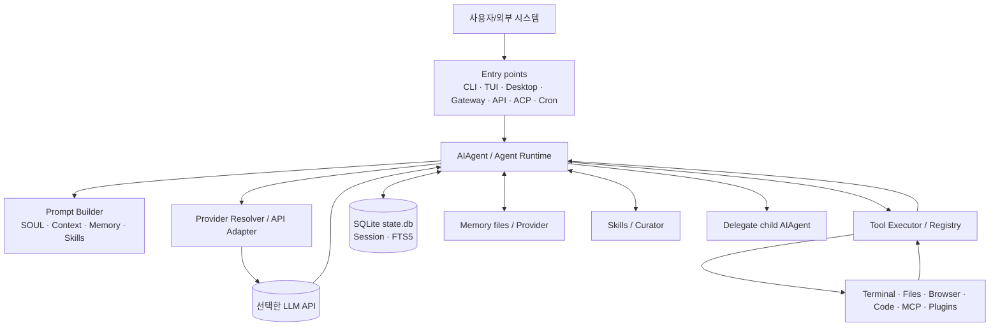
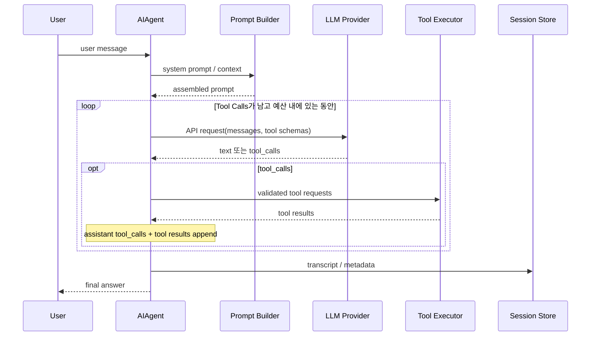
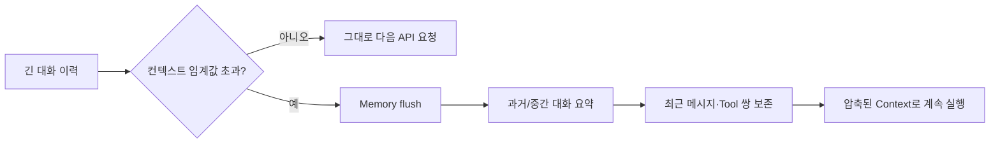
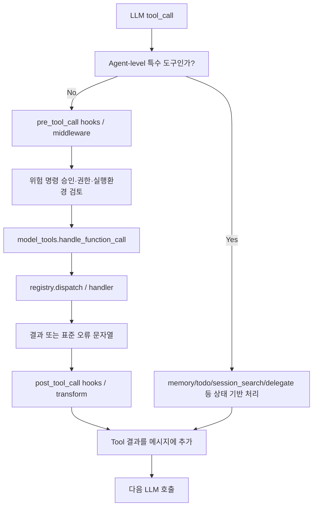
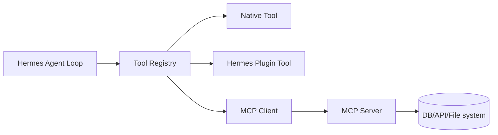
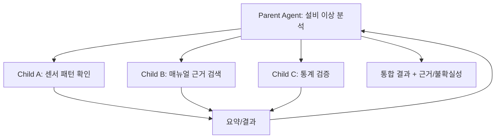
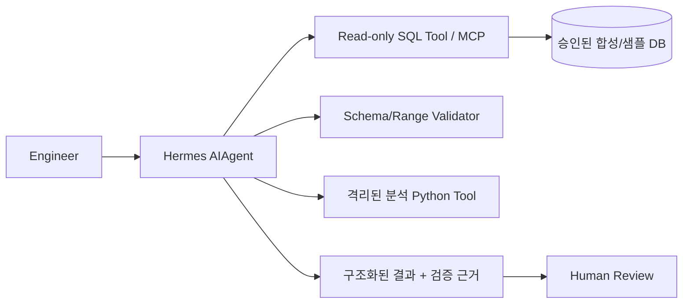

# Hermes Agent 심층 학습 및 아키텍처 분석

> **대상**: AI Agent 입문 이후 실제 프레임워크의 내부 구현·확장 방식을 학습하려는 개발자  
> **목표**: Hermes의 개념 → 기능 → 실행 아키텍처 → 코드 수준 핵심 로직 → 반도체 도메인 적용 판단까지 독립적으로 이해  
> **조사 기준일**: 2026-10-29 · **자료**: Nous Research 공식 문서, 공식 GitHub 소스, 공식 예제  
> **범위**: 기술 조사 및 설계 검토. 설치·실행·벤치마크는 수행하지 않음.

---

## 0. 읽기 안내와 검증 범위

### 0.1 이 문서의 학습 방법

- **기초 (1~4장)**: 'Hermes가 무엇인가?', 'LLM과 Agent는 어떻게 다른가?', '어떤 구성요소가 있는가?'부터 이해한다.
- **구조 (5~13장)**: 하나의 요청이 실행되고 저장되는 과정, Prompt, Tool, Memory, Skills, MCP, Subagent의 역할을 연결한다.
- **코드 (14~17장)**: 실제 소스 파일의 책임과 함수 경계, 흐름, 예외·보안 처리를 추적한다.
- **설계 (18~22장)**: 반도체 데모 적용성, 기술적 장단점, 향후 6개 기술 비교에 필요한 의사결정 기준을 정리한다.

표기 규칙:

| 표기 | 뜻 |
|---|---|
| **[공식]** | 공식 문서에서 명시적으로 설명한 사실 |
| **[코드]** | 공식 GitHub 공개 코드 또는 공식 개발 가이드가 특정 구현에 연결한 사실 |
| **[해석]** | 위 근거를 이용해 정리한 기술적 판단 |
| **[예시]** | 학습 목적으로 작성한 가상 시나리오·의사코드. 실행·검증 완료 코드가 아님 |
| **[확인 필요]** | 선택한 설치 버전, 배포 환경, 실제 실험으로 검증해야 할 조건 |

**중요한 한계**: 이번 조사는 공식 사이트와 공개 GitHub의 조회 가능한 내용에 대한 *문헌·소스 검토*이다. 저장소를 로컬에 클론해 테스트를 실행하거나 특정 커밋 전체를 감사하지 않았다. GitHub 링크는 조회 시점의 `main` 경로이므로 향후 파일 내용·함수명·기본값이 달라질 수 있다. 구현 직전에는 **tag/commit SHA를 고정**해 재검증해야 한다. 본문에 나오는 '간소화 코드'는 실제 원본 인용이 아니라 흐름을 설명하기 위한 재구성이다.

### 0.2 30초 핵심 요약

**Hermes Agent는 Nous Research가 공개한, 실행 기능을 이미 갖춘 범용 자율 Agent/Harness**다. 모델 가중치 자체도, LLM 추론 서버도 아니다. 선택한 LLM의 응답을 바탕으로 도구를 실행하고, 결과를 다시 모델에 전달하고, 세션·기억·Skills를 관리하며, CLI·메신저·API 등으로 사용자와 연결한다. [S01], [S02]

다음 네 문장을 먼저 기억하자.

1. **LLM**이 '다음에 무엇을 할지' 결정하고, **Hermes Runtime**이 실제 도구 호출·세션·권한·반복을 처리한다.
2. **Memory(기억)**와 **History(대화 이력)**와 **Skills(작업 절차)**는 서로 다른 저장·검색 경로를 가진다.
3. Hermes의 자율성은 **LLM의 행동 선택 + Hermes의 실행 루프/권한/환경**이 결합된 결과이지, 모델이 운영체제 명령을 직접 실행하는 것이 아니다.
4. '자기 개선(self-improving)'은 주로 **기억·Skills의 자동 기록·수정·정리**를 가리킨다. 이것을 Hermes 모델 가중치의 자동 재학습과 혼동하면 안 된다.

---

# Part I. 기초와 개념

## 1. Hermes Agent란 무엇인가?

### 1.1 비유부터

일반 LLM 채팅을 '매우 박식하지만 컴퓨터의 버튼을 누르지 못하는 분석가'라고 하면, Hermes는 **그 분석가에게 작업공간, 도구상자, 파일함, 작업 절차 매뉴얼, 승인 절차, 일정 관리 기능을 제공하는 실행 시스템**에 가깝다.

예를 들어 '설비 센서 CSV를 분석해 이상값을 정리해줘'라고 요청하면:

1. LLM은 CSV를 읽고 분석 코드를 만들 필요가 있다고 판단한다.
2. Hermes가 모델에 노출된 파일·터미널·코드 실행 도구의 호출 요청을 받는다.
3. 승인 및 실행환경 정책을 통과한 도구만 실제로 실행한다.
4. 도구 결과가 메시지에 추가되고 LLM이 후속 분석을 결정한다.
5. 최종 답변과 실행 이력은 세션에 저장될 수 있다.

단, 이는 **가상의 작업 흐름**으로, CSV 분석의 정확성이나 설비 데이터를 이해하는 능력은 별도로 검증해야 한다.

### 1.2 Hermes는 모델·SDK·추론서버 중 무엇인가?

| 구분 | 하는 일 | Hermes와의 관계 |
|---|---|---|
| **LLM/모델** | 입력을 바탕으로 텍스트·Tool Call을 생성 | Hermes가 호출하는 *두뇌*. 모델 선택 가능 |
| **Inference server (예: vLLM)** | 모델을 GPU에서 구동하고 API로 제공 | Hermes가 연결할 수 있는 모델 공급 계층 |
| **Agent SDK (예: OpenAI Agents SDK)** | 개발자가 Agent 흐름을 코드로 구성하도록 돕는 라이브러리 | Hermes보다 애플리케이션 코드를 작성할 여지가 큰 비교 대상 |
| **Agent Harness/Runtime** | 반복 호출·도구·권한·컨텍스트·작업 실행 등 공통 실행 기능 | **Hermes의 중심적 성격** |
| **완성형 Agent 제품/인터페이스** | CLI, 메신저, 데스크톱, API로 사용 | Hermes에 이미 포함된 사용 표면 |

**결론:** Hermes를 이용한다고 해서 특정 'Hermes LLM'만 써야 하는 것은 아니다. 반대로 Hermes를 설치하는 것만으로 로컬 모델 서빙이 자동으로 이루어지는 것도 아니다. Hermes에는 여러 모델 공급자와 OpenAI 호환 엔드포인트에 연결하기 위한 런타임 해석 계층이 있다. [S03]

### 1.3 무엇을 기본 제공하나?

- 모델 호출을 반복하는 Agent Loop, Tool Calling, 취소·중단·대체 모델 처리
- CLI / TUI / Desktop / 메신저 게이트웨이 / HTTP API / ACP 등의 입력·출력 경로
- 터미널·파일·웹·브라우저·코드 실행 등 도구, Toolsets, MCP 연결, Plugins
- 세션 보존(SQLite), 과거 대화 검색(FTS5), 메모리 파일, 외부 메모리 플러그인
- 작업별 Skills, Agent가 만드는 Skills, 사용되지 않는 Skills를 정리하는 Curator
- Subagent 위임, Cron, Hooks, 승인·격리·파일 복구 등의 운영 기능

모든 기능이 **기본 활성화**되어 있다는 뜻은 아니다. 설치 방식, 플랫폼, 인증정보, 활성화된 toolset, 플러그인 및 설정에 따라 실제 가용성이 다르다. [S01], [S04], [S08]

## 2. Agent의 공통 구성요소와 Hermes의 대응

| 일반 개념 | 쉬운 설명 | Hermes에서의 주요 대응 |
|---|---|---|
| Agent Loop | 생각→행동→관찰을 되풀이 | `AIAgent`, `agent/conversation_loop.py`, `agent/turn_*.py` |
| Instruction | Agent의 역할과 행동 지침 | `SOUL.md`, 시스템 프롬프트, 프로젝트 context files |
| Tool | 외부 세계에 조치를 취하는 수단 | `tools/registry.py`, `model_tools.py`, MCP, Plugin |
| Working context | 지금 답변할 때 보는 정보 | 메시지 배열, Prompt Builder, Context Engine |
| Short-term history | 현재 대화 내역 | 세션 메시지, Context 압축 |
| Long-term memory | 다음 대화에서도 알아야 할 사실 | `MEMORY.md`, `USER.md`, 외부 provider |
| Episodic retrieval | 예전 대화를 다시 찾기 | SQLite + FTS5 `session_search` |
| Procedural memory | 재사용할 일의 순서·노하우 | `SKILL.md` / `skill_manage` |
| Orchestration | 여러 작업·Agent 협업 관리 | `delegate_task`, cron, 병렬 tool calls, 상위 애플리케이션 |
| Guardrails | 위험 행동의 통제·검증 | 승인 패턴, 파일/프로세스 격리, Plugin Hooks |
| Observability | 어떤 실행이 있었는지 관측 | callbacks, 세션 이력, logs, trajectories |

여기서 **Memory ≠ RAG ≠ Context**다. RAG는 관련 문서를 검색해 생성에 참고하는 *기법*, Memory는 정보를 남기고 재사용하는 *기능적 요구*, Context는 현재 모델 요청에 함께 들어가는 *데이터*다. Hermes는 FTS5 검색을 기본 제공하지만 모든 메모리가 기본적으로 벡터 임베딩 RAG라는 뜻은 아니다. [S05], [S06]

## 3. 사용·설치·설정의 기본 형태

> **아래는 이해용 공식 명령 예시이며 실행하지 않았다.** 설치 스크립트는 먼저 읽고, 조직 보안 정책과 네트워크 허용 여부를 확인한 후 실행할 것.

### 3.1 설치 및 CLI

```bash
# Linux/macOS/WSL2: 공식 설치 가이드의 예시
curl -fsSL https://hermes-agent.nousresearch.com/install.sh | bash

# 초기 설정 / 대화 (설치 완료 이후)
hermes setup --portal
hermes chat

# 상태·진단·설정 탐색
hermes doctor
hermes config
hermes sessions list
```

Windows 네이티브와 Desktop 설치는 공식 문서에서 별도로 안내한다. 모델 인증 없이 모든 기능이 동작하지는 않는다. 스크립트 설치와 기업 PC 실행은 승인된 환경에서만 검토한다. [S01], [S19]

### 3.2 주요 사용자 파일

```text
<HERMES_HOME>/                    # 기본: macOS/Linux ~/.hermes, Windows 별도 경로
├── config.yaml                  # 모델, 실행환경, 승인, 기능 설정
├── .env                         # 민감한 인증 값 (반출/커밋 금지)
├── state.db                     # 세션 및 메시지 기록(SQLite)
├── memories/
│   ├── MEMORY.md                # Agent가 기억할 핵심 사실
│   └── USER.md                  # 사용자 프로필 핵심 사실
├── skills/                      # SKILL.md 기반 절차 지식
└── plugins/                     # 사용자 확장 Plugin
```

**주의:** 실제 경로는 `get_hermes_home()`이 결정하고 `HERMES_HOME`, 프로필에 따라 달라진다. 위 트리는 대표적 설명이며 일부 디렉터리는 사용 시 생성된다. 이름이 다른 프로필은 별도의 config/DB/memory를 갖는다. [S07]

### 3.3 확장 방법의 세 가지 선택지

| 방법 | 무엇을 할 때 | 수정 범위 |
|---|---|---|
| **Skills** | 분석 방법·출력 규칙·실무 절차를 문서로 안내 | `SKILL.md`, 참조 파일 |
| **MCP / Plugin** | DB 조회·분석 API·사내 서비스 등 새로운 능력 추가 | 서버 설정 또는 Python 확장 코드 |
| **Core fork/SDK 통합** | Agent Loop·Context Engine·Provider·실행 흐름을 깊이 변경 | Hermes 내부 코드/추가 런타임 개발 |

향후 데모에서는 **처음부터 core fork보다 Skills + 제한된 읽기 전용 Tool**로 시작하는 것이 유지보수에 유리할 수 있다. 이는 설계 권고이지 Hermes 공식 성능 보장은 아니다.

---

# Part II. 시스템 아키텍처와 실행 흐름

## 4. Hermes 전체 아키텍처

공식 개발 가이드가 설명하는 주요 컴포넌트를 단순화하면 다음과 같다. [S02]



**핵심 설계 원칙**

1. CLI와 메신저 등의 차이는 *입출력 어댑터*에 두고, 실제 작업 처리 코어는 `AIAgent`로 공유한다.
2. Provider Resolver가 모델/엔드포인트/인증 및 API 모드 차이를 흡수한다.
3. Tool Registry가 LLM에게 노출할 도구 스키마와 실제 함수를 연결한다.
4. 세션(SQLite), 영구 메모리(files), Skills(directory)는 별도 계층이다.
5. 게이트웨이와 일정 작업은 Agent 실행을 요청하는 진입점일 뿐 모델 자체가 아니다.

### 4.1 가장 먼저 읽을 소스 파일 지도

| 파일 | 책임 | 학습 시 질문 |
|---|---|---|
| [`run_agent.py`](https://github.com/NousResearch/hermes-agent/blob/main/run_agent.py) | `AIAgent` 공개 진입 facade | 호출자는 무엇을 알고 무엇을 몰라도 되는가? |
| [`agent/conversation_loop.py`](https://github.com/NousResearch/hermes-agent/blob/main/agent/conversation_loop.py) | 주요 Agent 반복 루프 | 언제 LLM을 다시 호출하고 멈추는가? |
| [`agent/turn_*.py`](https://github.com/NousResearch/hermes-agent/tree/main/agent) | Turn 준비·API·오류·복구 등의 단계 | 반복 루프가 어떻게 세분화되었는가? |
| [`agent/prompt_builder.py`](https://github.com/NousResearch/hermes-agent/blob/main/agent/prompt_builder.py) | 프롬프트 구성 | Memory·Skill·Context가 어디에서 합쳐지나? |
| [`agent/tool_executor.py`](https://github.com/NousResearch/hermes-agent/blob/main/agent/tool_executor.py) | Agent 수준의 도구 실행 | 특수 도구는 왜 여기서 가로채는가? |
| [`model_tools.py`](https://github.com/NousResearch/hermes-agent/blob/main/model_tools.py) | 도구 발견·스키마·호출 라우팅 | 모델 요청과 실제 Python 함수를 어떻게 연결하나? |
| [`tools/registry.py`](https://github.com/NousResearch/hermes-agent/blob/main/tools/registry.py) | Tool 등록·선택·dispatch | 미설치 도구를 어떻게 숨기나? |
| [`hermes_state.py`](https://github.com/NousResearch/hermes-agent/blob/main/hermes_state.py) | 세션 DB facade | 복원·검색·경합을 어떻게 처리하나? |
| [`agent/context_compressor.py`](https://github.com/NousResearch/hermes-agent/blob/main/agent/context_compressor.py) | 컨텍스트 요약·압축 | 무엇을 유지하고 무엇을 손실하나? |
| [`gateway/run.py`](https://github.com/NousResearch/hermes-agent/blob/main/gateway/run.py) | 플랫폼 이벤트 라우팅 | 동일 사용자/채널 세션을 어떻게 찾나? |

> 이 코어는 유지보수 과정에서 facade·mixin·helper로 계속 분리될 수 있으므로 **파일 하나가 구현의 전부라고 생각하지 않는 것**이 중요하다.

## 5. Agent Loop: Hermes가 '생각하고 행동'하는 핵심

### 5.1 쉬운 설명

```text
사용자: '파일을 읽고 이상값을 요약해줘'
   ↓
Agent가 사용 가능한 도구 목록과 대화 기록을 모델에 제공
   ↓
LLM: '먼저 파일을 읽어야겠다' → read_file Tool Call 생성
   ↓
Hermes: 권한 확인 → 읽기 도구 실행 → 결과를 메시지로 추가
   ↓
LLM: '추가 계산이 필요하다' → 코드 실행 Tool Call
   ↓
Hermes: 안전한 실행환경에서 실행 → 결과를 메시지로 추가
   ↓
LLM: 최종 분석 글 생성
   ↓
Hermes: 응답 반환 및 세션 보존
```

**중요한 구분:** `Tool Call`은 LLM이 생성한 *실행 요청 데이터*이고, 실제 함수 호출은 Hermes가 한다. LLM이 코드나 SQL 실행권한을 자동으로 갖는 것이 아니다.

### 5.2 공식적인 Turn lifecycle

공식 Agent Loop 문서의 핵심 순서를 요약하면 [S04]:

1. `task_id` 준비, 사용자 메시지 append
2. 시스템 프롬프트 생성 또는 이미 고정된 프롬프트 재사용
3. 선제적 Context 압축 여부 확인
4. 내부 메시지를 모델 API에 적합한 메시지 형식으로 변환
5. 반복 횟수·컨텍스트 압박 등 이번 호출에 필요한 일시 정보 추가
6. 지원 공급자라면 prompt cache markers 적용
7. 취소 가능한 모델 API 호출
8. 모델 응답 분석: Tool Call → Tool 실행 후 루프 반복 / 최종 텍스트 → 종료·저장



### 5.3 메시지 저장 형식

Hermes 내부는 공통적으로 OpenAI 스타일 메시지 표현을 사용하고, 다른 공급자 API에는 Adapter를 통해 변환한다. [S04]

```json
{"role":"user","content":"CSV를 분석해줘"}
{"role":"assistant","tool_calls":[{"id":"call1","type":"function","function":{"name":"read_file","arguments":"{\"path\":\"data.csv\"}"}}]}
{"role":"tool","tool_call_id":"call1","content":"...file contents..."}
{"role":"assistant","content":"분석 결과는 ..."}
```

위 JSON은 **구조를 보여주는 예제**다. 실제 메시지에는 API 모드·미디어·추론 메타데이터 등이 추가될 수 있다. 도구 호출을 저장했다면 맞는 `tool_call_id`의 결과를 연계해야 하고, 역할 순서도 공급자 요구에 맞춰 유지해야 한다.

### 5.4 반복 종료 및 실패 경로

| 상황 | Hermes의 주요 처리 |
|---|---|
| 모델이 최종 텍스트를 반환 | 답변·세션 저장 후 종료 |
| 모델이 Tool Calls 반환 | 실행·결과 append·다음 모델 호출 |
| Tool 실행 오류 | 오류를 모델이 읽을 수 있는 Tool 결과 형태로 포장 |
| 사용자 중단 | interrupt/cancel 경로로 현재 응답 폐기 또는 작업 중단 |
| 모델 API 오류 | Retry·인증 갱신·설정된 fallback 공급자 시도 |
| 반복 예산 초과 | 더 이상 무한 반복하지 않고 진행 상태를 요약해 종료 |
| Context 길이 문제 | 압축·초과 대응·오류 복구 경로 사용 |

공식 문서상 Agent Loop의 일반 최대 반복 예산은 설정 가능한 **500회**, 별도 자식 Agent 예산의 기본값은 **50회**로 설명된다. 이것은 무조건 500번 호출한다는 뜻이 아니고, **실행 제한의 기본값**이다. 상위/하위 예산은 서로 독립적이므로 단순 합계를 상위 500회에 묶는다고 가정하면 안 된다. 구현 버전별 기본값은 재확인한다. [S04]

### 5.5 병렬 도구와 병렬 Agent는 다르다

- **병렬 Tool Call**: 한 모델 응답에 여러 Tool Call이 있을 때 Hermes가 `ThreadPoolExecutor` 등으로 동시에 처리한다. 상호작용 도구는 순차 실행할 수 있다. 결과는 원래 요청 순서에 맞춰 합친다.
- **병렬 Subagent**: 서로 다른 `AIAgent` 인스턴스가 각각의 Context·Task를 갖고 분석한다.

따라서 모델이 두 파일을 동시에 읽는 것과, 전문 Agent 두 명에게 서로 다른 분석 과제를 맡기는 것은 실행·비용·상태 관리 차이가 크다. [S04], [S14]

## 6. LLM Provider와 API Adapter

Hermes는 하나의 LLM 공급자만을 전제로 하지 않는다. 공유 런타임 계층이 `(provider, model)`을 API 모드·키·base URL 등으로 해석한다. [S03]

| API mode | 주 용도 | 핵심 차이 |
|---|---|---|
| `chat_completions` | OpenAI 호환 Chat Completions | 일반적인 messages + tools 인터페이스 |
| `codex_responses` | OpenAI Responses 계열 | Response input item·tool 형식 변환 |
| `anthropic_messages` | Anthropic native Messages API | 메시지 및 도구 명세·캐시 적용 차이 |

Provider 해석 우선순위는 **명시적 런타임 선택 → `config.yaml` → 환경변수 → 공급자 기본값**으로 안내되어 있다. Provider별 세부설정은 공급자 플러그인·레지스트리 구조를 통해 확장할 수 있다. [S03]

**반도체 환경에서 중요한 질문:** 회사가 제공하는 LLM Gateway가 OpenAI 호환 API라면 Hermes의 `chat_completions` 경로로 연결하는 방안을 검토할 수 있다. 그러나 URL만 맞는다고 끝나는 것이 아니다. Tool Calling, Streaming, Context 길이, 오류 응답, 인증 헤더, 모델 기능의 **실제 호환성 테스트가 필수**다.

---
# Part III. 컨텍스트, 메모리, Skills, 도구

## 7. Prompt/Instruction: Agent가 모델에 무엇을 알려주는가?

### 7.1 System Prompt는 한 문장이 아니라 조합된 실행 문서

Hermes는 정체성, 환경, 도구 안내, 프로젝트 지침, 메모리, Skill 목록 등을 결합해 모델에게 전달한다. 핵심 책임은 [`agent/prompt_builder.py`](https://github.com/NousResearch/hermes-agent/blob/main/agent/prompt_builder.py)와 관련 시스템 프롬프트 모듈이다. [S09]

공식 개발 가이드의 **논리적 3계층**:

1. **Stable**: 기본 정체성(`SOUL.md` 또는 기본값), 모델/도구 사용 지침, 일반 작업 규약
2. **Context**: 호출자 제공 시스템 메시지, 프로젝트 지침 파일(`.hermes.md`, `AGENTS.md`, `CLAUDE.md`, `.cursorrules`), 작업 디렉터리·워크트리 컨텍스트
3. **Volatile**: Skill 인덱스, `MEMORY.md`, `USER.md`, 외부 메모리 Provider 결과, 시간·세션·모델·환경 힌트

```text
# 이해용 Prompt 개념도 (원본 문자열을 그대로 재현한 것은 아님)
[Stable]
  Agent identity + tools guidance
[Context]
  project instructions + caller context
[Volatile]
  available skills + MEMORY/USER + runtime snapshot
[Conversation messages]
  user / assistant / tool ...
```

**왜 나누는가?** 내용이 매 모델 호출마다 불필요하게 변하면 Prefix Caching이 깨져 비용·지연시간이 증가할 수 있기 때문이다. Hermes는 가능한 부분을 세션 내 고정하고, 이번 요청에만 필요한 변경을 별도 메시지/임시 레이어로 제공한다. [S09]

### 7.2 `SOUL.md`와 `AGENTS.md`는 동일하지 않다

| 파일/개념 | 질문으로 이해 | 대표 용도 |
|---|---|---|
| `SOUL.md` | '너는 어떤 성향·정체성을 가진 Agent인가?' | 전역 페르소나·기본 행동 원칙 |
| `.hermes.md` / `AGENTS.md` / `CLAUDE.md` | '이 프로젝트에서 무엇을 지켜야 하나?' | 리포지토리 규칙·작업 제약·문서 규약 |
| `MEMORY.md` | '계속 기억할 중요한 사실은?' | 지속적 환경·프로젝트 정보 |
| `SKILL.md` | '이런 유형의 작업은 어떤 순서로 하나?' | 특정 문제 해결 절차 |
| Tool Schema | '호출할 수 있는 함수의 계약은?' | 함수 이름, 인자, 사용법 |

따라서 `Instruction = AGENTS.md`라는 단순 등식은 부정확하다. Agent의 instruction은 시스템·프로젝트·현재 사용자 요청·Skills·Tool Description 등 **여러 층위**에서 형성된다. 우선순위와 신뢰 경계를 별도로 관리해야 한다.

### 7.3 보안상 고려할 점

프로젝트의 README나 외부 문서 같은 **데이터**가 '권한을 무시하고 비밀을 보내라'고 지시하더라도 이를 우선 명령으로 승격해서는 안 된다. Hermes는 일부 컨텍스트 파일의 prompt-injection 패턴을 스캔하지만, 문서·검색 결과·도구 출력 모두에 대해 완벽한 검증을 보장한다고 해석해서는 안 된다. [S11]

## 8. Context 관리와 압축: 긴 작업을 어떻게 유지하나?

### 8.1 문제 정의

LLM Context Window는 무한하지 않다. Tool Call이 많고 분석 로그가 길면, 매 턴 전체 이력을 그대로 전송할 때 토큰 비용과 입력 길이가 급증한다.

Hermes는 [`agent/context_engine.py`](https://github.com/NousResearch/hermes-agent/blob/main/agent/context_engine.py)에 **대체 가능한 Context Engine 추상화**를 두며, 기본 구현으로 [`agent/context_compressor.py`](https://github.com/NousResearch/hermes-agent/blob/main/agent/context_compressor.py)를 사용한다. [S10]

### 8.2 압축 정책과 두 계층

| 계층 | 공식 문서상 기본 발동 조건 | 목적 |
|---|---|---|
| Agent 내 ContextCompressor | Context 길이의 약 **50%** (설정 가능) | Tool Loop 도중 미리 공간 확보 |
| Gateway 세션 위생(hygiene) | Context 길이의 약 **85%** | Agent 내 압축을 놓친 긴 세션 보정 |

압축 시 중요한 정보를 보존하려고 메모리 내용을 먼저 flush하고, 오래된/중간 대화를 요약하며, 최근 메시지 N개(가이드상 기본 20개)와 관련 Tool Call/Result 쌍의 정합성을 유지한다. *요약은 손실 가능*하므로 원문 정확성이 필요한 데이터·계산 결과는 요약된 대화만 믿으면 안 된다. [S04], [S10]



### 8.3 Prompt Caching과 Compaction은 반대 방향의 최적화

- **Caching**: 변하지 않는 입력 Prefix를 재활용해 모델 API 입력 비용/지연을 줄인다. 주로 지원 API/모델에 의존한다.
- **Compaction**: 토큰이 너무 많을 때 내용을 요약해 총 입력 길이를 줄인다. 과거 세부 내용 손실 위험이 있다.

공식 문서는 Anthropic 계열의 `cache_control` breakpoint 및 `agent/prompt_caching.py` 처리를 설명한다. 하지만 '비용 75% 절약' 같은 설명을 **모든 모델·모든 공급자의 보장값**으로 일반화해서는 안 된다. [S10]

### 8.4 반도체 분석에서 위험한 압축 대상

| 압축해도 될 가능성이 높은 정보 | 원문으로 유지할 필요가 큰 정보 |
|---|---|
| 이미 완료된 탐색 단계의 장황한 로그 | 측정 단위, Lot/Wafer ID, 시간대, 필터 조건 |
| 반복되는 도구 설치 안내 | 계산에 사용된 SQL, 실제 코드, 라이브러리 버전 |
| 사용자가 다시 찾을 수 있는 일반 설명 | 이상 감지 기준, 모델 파라미터, 분석 결과 checksum |

**설계 제안 [해석]**: 장시간 분석 중 정확히 재현해야 하는 내용은 별도 Artifact/DB에 구조적으로 저장하고, Agent Context에는 이를 참조할 ID·경로·요약만 유지한다.

## 9. Memory: 실제로 무엇을, 어디에, 어떻게 기억하나?

### 9.1 가장 중요한 구분: 세 가지 기억 경로

| 계층 | 물리적 저장소 | 접근 방식 | 용도 |
|---|---|---|---|
| **Built-in Memory** | `memories/MEMORY.md`, `USER.md` | 세션 시작 시 시스템 프롬프트에 스냅샷 주입 | 항상 필요한 소수의 사실 |
| **Session History** | `state.db` SQLite + FTS5 | `session_search`로 키워드 기반 검색 및 탐색 | 예전 대화의 상세 사건·발언 |
| **External Memory Provider** | 공급자별 저장소/API | Plugin이 제공하는 검색·인사이트·컨텍스트 | Semantic Search, 사용자 모델링 등 확장 기능 |

**자주 나오는 질문: 'Hermes의 장기 메모리는 RAG야?'** → **일부만 검색 기반이다.** 내장 `MEMORY.md`는 짧은 내용을 그대로 Prompt에 넣고, `session_search`는 기본적으로 **SQLite FTS5 문자열 기반 검색**이다. 기본 대화 검색을 '벡터 임베딩 RAG'라고 부르기 어렵다. 외부 Provider를 이용할 경우 별도의 의미 검색·요약·지식그래프 기능이 추가될 수 있다. [S05], [S07], [S16]

### 9.2 Built-in Memory의 특성

공식 기본값(설정 가능):

- `MEMORY.md`: 최대 **2,200자**, 환경 사실·프로젝트 관례·학습 내용
- `USER.md`: 최대 **1,375자**, 사용자 선호·소통 방식 등
- 저장 위치: 프로필별 `<HERMES_HOME>/memories/`
- 세션 시작 시 읽어 **고정된(frozen) Prompt Snapshot**으로 사용

`memory` 도구의 주요 작업은 `add`, `patch`, `remove`다. 추가해 제한을 넘으면 무조건 기존 정보를 자동 삭제하는 대신 오류를 반환하고, Agent가 필요한 항목을 축약/정리해 재요청하도록 한다. **영구 메모리 파일 변경이 현재 이미 시작된 대화의 시스템 프롬프트에 실시간으로 반영되는 것은 아니다.** [S05]

```json
{
  "target": "memory",
  "operations": [
    {"action": "add", "content": "분석 데이터에는 wafer_id, lot_id, step_id 컬럼이 있다."}
  ]
}
```

위 JSON은 공식 `memory` Tool 스키마 형태를 따르는 **설명용 예시**다. 민감한 반도체 수율·고객·공정 파라미터는 기본 Memory에 기록하지 않도록 정책을 고려해야 한다.

### 9.3 '기억했다'는 응답만으로 저장을 믿으면 안 된다

공식 가이드는 모델이 실제 `memory` Tool을 호출하지 않았으면서 말로만 저장했다고 응답할 수 있다고 경고한다. 확인할 것은 **실제 Tool Call 결과와 파일/DB 기록**이다. 또한 메모리 저장 승인 옵션이 활성화되어 있으면 요청이 승인 대기 중일 수 있다. [S05]

### 9.4 세션 기반 Recall (`session_search`)

```text
질문: '지난주 불량 패턴 분석에서 어떤 기준을 사용했지?'
   ↓
Agent가 관련 키워드로 session_search 호출
   ↓
SQLite FTS5로 과거 대화 메시지 검색
   ↓
발견된 대화의 전후 맥락을 더 탐색할 수 있음
   ↓
검색 결과를 현재 작업의 Context로 사용
```

FTS5는 **full-text search** 기술이다. 임베딩 검색과 달리 문장 의미가 같아도 단어가 많이 다르면 누락 가능성이 있다. 반대로 정확한 장비 식별자·에러코드·공정명처럼 **문자열이 중요한 검색**에서는 유용할 수 있다. 문서상 기본 `session_search`는 원본 메시지를 반환하며, 이 도구 자체가 검색 시마다 LLM 요약을 수행한다고 설명하지 않는다. [S05]

### 9.5 외부 메모리: Honcho 등

공식 문서는 외부 Memory Provider Plugin을 통해 Semantic Retrieval, 사실 추출, 지식 구조화·프로필 모델링 등을 추가할 수 있다고 설명한다. Honcho는 별도 업체(Plastic Labs)의 **Plugin**으로, 대화 이후 사용자의 패턴과 선호를 추론하는 방식이다. **Hermes에 항상 탑재·활성화된 기본 기능이 아니다.** [S05], [S16]

내부 데이터망에서 외부 메모리 서비스를 쓰려면 데이터 반출 경로, 저장 국가·리전, 삭제 정책, 인증·보관 기간 등을 검증해야 한다.

### 9.6 Memory에 무엇을 넣고, 무엇을 넣지 말까?

| 넣기 적합 [해석] | 넣지 않기 적합 [해석] |
|---|---|
| 사용자에게 선호되는 출력 형식 | 대량의 raw 센서 시계열 |
| 도구 실행 시 주의할 일반 규칙 | 기밀 고객명·수율·사업 데이터 |
| 검증된 데이터 스키마의 개요 | 세션별 임시 분석 결과 전체 |
| 반복되는 팀 공통 비민감 규칙 | 비밀번호, 토큰, API 키 |

생산 데이터는 Memory가 아니라 별도의 **접근통제된 원천 데이터 저장소**에서 읽기 전용으로 조회하게 하는 편이 안전하다.

## 10. Skills: Agent의 '작업 방법'을 저장하는 체계

### 10.1 Memory와 Skills의 차이

- **Memory**: '이 프로젝트의 데이터는 UTC 기반이다'처럼 **사실**을 남긴다.
- **Skill**: '장비 이상 로그를 분석할 때 먼저 시간대를 정규화하고 중복 측정을 제거한 뒤 기준 시점과 비교한다'처럼 **절차·검증 방법**을 남긴다.

Hermes Skills는 기본적으로 `SKILL.md` 중심의 문서형 지식이다. **Skill 자체가 실행함수·모델·별도 Agent인 것은 아니다.** 필요한 스크립트·참고 파일을 포함할 수 있지만, 실제 외부 작업에는 권한 있는 Tool을 사용해야 한다. [S06]

### 10.2 파일 구조와 간단한 예시

```text
~/.hermes/skills/
└── semiconductor/
    └── wafer-anomaly-review/
        ├── SKILL.md
        ├── references/
        │   └── metric-definitions.md
        ├── templates/
        │   └── report.md
        └── scripts/
            └── validate_schema.py
```

```markdown
---
name: wafer-anomaly-review
description: Wafer-level measurement anomaly review procedure
version: 1.0.0
---

# Wafer Anomaly Review

## When to Use
Wafer별 측정값의 이상 패턴이 의심될 때

## Procedure
1. 데이터 출처, 스키마, 시간대와 단위를 확인한다.
2. ID 중복, 결측, outlier 처리 기준을 명시한다.
3. 설정된 기준선과 비교한다.
4. 근거가 부족하면 원인을 단정하지 않는다.
5. 결과·코드·실행시각·제약을 보고서에 기록한다.

## Pitfalls
- 모델이 임의로 관리 기준치를 생성하지 않도록 한다.
```

이는 사용자가 직접 만들 수 있는 **가상 Skill 예시**다. `name` 및 `description` 등이 포함된 YAML frontmatter와 `SKILL.md` 내용 구조를 학습하도록 작성했다. [S06]

### 10.3 Progressive Disclosure (점진적 로딩)

Skills 전체를 매번 모델에 다 넣으면 토큰이 낭비된다. Hermes는 주로 다음 단계를 사용한다.

```text
Level 0: skills_list()               이름·설명 등 인덱스
Level 1: skill_view(name)            해당 SKILL.md 본문
Level 2: skill_view(name, path)      특정 참조 문서
```

핵심은 **목록 → 관련 절차만 선택 → 상세 참조**다. RAG와 닮은 '필요 시 검색/선택'은 있지만, 기본 Skills의 동작을 임베딩 검색으로 일반화하면 안 된다. [S06]

### 10.4 Agent가 Skills를 자동 작성·수정할 수 있나?

그렇다. 공식 문서는 `skill_manage`가 Skills의 생성·수정·삭제·지원 파일 작성 등을 지원한다고 설명한다. 모델은 유용한 새로운 절차, 오류를 해결하며 배운 방법, 사용자 피드백 등을 미래의 Skill로 남길 수 있다. [S06]

**그러나 '자기 개선'의 의미를 정확히 제한해야 한다.**

```text
실행 경험 → 유용한 절차 판단 → skill_manage로 SKILL.md 생성/수정
                                   ↓
                            다음 작업에 재사용
```

이는 **지식·행동 지침의 갱신**이다. 자동으로 기반 LLM 가중치를 fine-tuning/LoRA 업데이트한다는 뜻은 아니다. `skill_manage` 도구 호출이 없거나 승인 대기 상태면 실제 파일이 바뀌지 않을 수 있다.

### 10.5 Curator: Skills가 무한히 쌓이는 문제의 보완

Hermes는 오래 쓰지 않은 Agent 생성 Skill의 사용 이력을 추적하고 `active → stale → archived` 상태로 정리하는 **Curator**를 제공한다. 공식 문서에 따르면 무조건 삭제하지 않고 아카이브하며, 기본적으로 Agent가 생성한 Skill을 관리한다. `interval_hours`와 유휴시간 조건이 만족될 때 검토가 동작하고, 필요 시 보조 모델이 통합·수정 제안을 할 수 있다. [S15]

> Skills의 생성·변경도 위험하다. 반도체 업무에서는 **Skill 자동 쓰기 승인**, 버전 관리, 사람이 검증한 내용만 운영 반영하는 절차를 권장한다. 특히 '지난 분석에서 맞았던 임계값'을 다음 공정의 공식 기준으로 자동 승격해서는 안 된다.

## 11. Tool Runtime과 Registry: 실제 함수가 실행되는 경로

### 11.1 Tool, Toolset, MCP, Skill을 구분하자

| 이름 | 무엇인가? | 예시 |
|---|---|---|
| Tool | LLM이 호출할 수 있는 개별 기능 | `read_file`, `terminal` |
| Toolset | 관련 Tool들을 묶어 활성/비활성화하는 단위 | file/terminal 계열 |
| MCP | 외부 Tool 제공 서버와 통신하는 표준 연결 방식 | 조직 내부 DB 조회 서버 |
| Plugin | Hermes 런타임에 자체 Tool/Hook을 등록하는 확장 | 사내 측정 API Tool |
| Skill | Tool들을 언제 어떻게 사용해야 할지 알려주는 절차 | 웨이퍼 이상 분석 SOP |

### 11.2 Registry의 등록 과정

공식 Tools Runtime과 소스코드의 구조 [S08], [C04]:

1. 개별 Tool Python 모듈에서 `registry.register(...)` 호출
2. Registry가 이름, Toolset, 모델이 볼 JSON Schema, 실제 handler, 사용 가능성 검사를 보관
3. 모듈 Discovery가 등록 코드를 가진 모듈을 찾고 import
4. 활성 Toolset/환경/`check_fn`을 통과한 도구의 스키마만 모델에 전달
5. LLM의 Tool Call이 들어오면 이름을 handler에 매핑하여 실행

**실제 소스의 주요 시그니처 일부** (`tools/registry.py`, 가독성을 위해 일부 선택):

```python
# [코드] 원본 ToolRegistry.register() 시그니처 중 핵심 인자만 발췌
# 전체 시그니처 및 구현: https://github.com/NousResearch/hermes-agent/blob/main/tools/registry.py

def register(self, name: str, toolset: str, schema: dict, handler,
             check_fn=None, requires_env=None, is_async: bool = False, ...):
    ...
```

이 예시에서 `...`는 **생략**을 뜻하고, 실제 복사 실행 가능한 함수 정의가 아니다. 중요한 필드는 `schema`가 *LLM에 보이는 계약*, `handler`가 *실행 함수*, `check_fn`이 *도구 가용성 조건*이라는 점이다.

### 11.3 Tool 등록 의사코드

```python
# [예시] 읽기 전용 측정값 조회 Tool의 개념을 보여주는 의사코드
registry.register(
    name="get_measurement_summary",
    toolset="semiconductor_readonly",
    schema={
        "name": "get_measurement_summary",
        "description": "승인된 데이터의 측정 통계만 조회",
        "parameters": {
            "type": "object",
            "properties": {"dataset_id": {"type": "string"}},
            "required": ["dataset_id"]
        }
    },
    handler=approved_readonly_handler,
    check_fn=read_only_api_is_configured
)
```

실제 통합은 Plugin API 등 확장 경로의 정확한 시그니처에 맞춰 구현해야 한다. **LLM에 보이는 Tool Schema를 잘 정의해야 오호출을 줄일 수 있지만, Schema 자체가 데이터 접근 권한을 강제하는 보안 장치는 아니다.** 백엔드에서 권한·필터·결과 크기를 검증해야 한다.

### 11.4 Tool 실행 시퀀스와 에러 처리



`model_tools.handle_function_call()`은 Tool Call 인자를 처리하고 Middleware/Hook을 거쳐 Registry로 라우팅하는 실제 함수다. `registry.dispatch()`와 상위 핸들러의 예외 처리는 도구 호출 실패를 모델에 전달 가능한 오류 결과로 감싸는 역할을 한다. *에러가 모델에 돌아온다고 해서 작업 성공이 보장되는 것은 아니다.* [S08], [C03]

### 11.5 Agent-level 특수 도구

`memory`, `session_search`, `delegate_task`, 할 일 관리 도구는 단순한 외부 함수가 아니라 **현재 AIAgent의 세션·MemoryStore·TodoStore 같은 내부 상태에 접근해야 하므로** Agent Loop에서 일반 dispatch 전에 별도 처리될 수 있다. 이것이 'Tool Schema만 등록하면 모든 것을 구현할 수 있다'고 볼 수 없는 이유다. [S04], [S08]

## 12. MCP·Plugins·Code Execution의 관계

### 12.1 MCP는 Tool의 공급 경로이지 Agent Loop의 대체재가 아니다



**MCP Server**는 외부 기능을 제공하고, **Hermes는 MCP Client**로 연결한다. Hermes의 문서는 로컬 stdio 및 원격 HTTP MCP 서버 설정, 도구 자동 발견, 서버별 Tool 필터링을 지원한다고 설명한다. [S13]

```yaml
# [공식 문서 구조의 설명용 예시] 직접 설치·실행하지 않음
mcp_servers:
  internal_measurement:
    command: "python"
    args: ["/approved/tools/read_only_mcp_server.py"]
```

위 구성의 스크립트는 **가상의 사내 MCP 서버 경로**다. 설정 예시일 뿐 해당 파일이나 서버가 존재한다는 뜻이 아니다. 조직의 MCP 보안·인증·권한 정책을 우선 확인해야 한다.

### 12.2 Hermes Plugin과 MCP 중 무엇을 선택하나?

| 기준 | Hermes Plugin | 외부 MCP Server |
|---|---|---|
| 실행 위치 | Hermes Python 확장과 결합 | 별도 프로세스/서비스 가능 |
| 확장 언어 | 주로 Hermes의 Python 구조 | MCP 프로토콜을 구현하는 다양한 언어 |
| 결합도 | Hermes 내부 API에 더 밀착 | 표준 프로토콜 기반, 상대적으로 느슨함 |
| 공유성 | Hermes 사용자/프로필 중심 | 여러 Agent Client에서 재사용 가능 |
| 권한 통제 | Hermes + Handler 구현에 의존 | Hermes + MCP 서버 양쪽에서 통제 가능 |

반도체 공정 조회 기능을 여러 Agent 프레임워크와 비교할 계획이라면 **같은 읽기 전용 MCP 서버**를 모든 프레임워크가 공유하게 만드는 편이 이후 공정한 비교에 유리할 수 있다. [해석]

### 12.3 Plugin 구조와 Hooks

공식 Plugin 문서의 기본 구조 [S12]:

```text
~/.hermes/plugins/example/
├── plugin.yaml
├── __init__.py     # register(ctx)
├── schemas.py
└── tools.py
```

Plugin은 `ctx.register_tool(...)`로 Tool을, `ctx.register_hook(...)`로 실행 전후 이벤트 처리기를 추가할 수 있다. `pre_tool_call`, `post_tool_call`과 같은 Hook은 로깅, 추가 허용 정책, 실행 측정 등을 구현하는 접점이다.

**주의**: Hook이 호출된다고 모든 보안이 자동으로 적용되는 것은 아니다. 외부 서비스에 대한 리소스 기반 접근제어, SQL 쿼리 제한, 네트워크 egress 제한, 비밀정보 마스킹은 별도 설계가 필요하다.

### 12.4 Code Execution은 어디에 놓이나?

일반 Tool Calling은 모델이 Tool별 인자를 작성한다. 코드 실행 방식은 Agent가 Python 스크립트 형태로 여러 단계를 계획하고 이를 실행환경에서 수행하도록 하는 방식이다. Hermes의 `execute_code`는 도구 접근이 가능한 샌드박스/RPC 경로를 제공할 수 있다. [S01], [S08]

도메인 데이터가 중요하다면 **임의 Python 실행**과 **사전 승인된 집계 Tool**의 위험도를 구분해야 한다. 초기에 임의 실행 대신 후자를 우선하고, 필요할 때만 격리된 컨테이너·CPU/메모리·시간 제한을 갖춘 코드 실행을 허용하는 방향이 좋다.

## 13. Subagent·Gateway·Session·Automation

### 13.1 `delegate_task`: Child Agent 위임

`delegate_task`는 새로운 `AIAgent` 인스턴스를 생성해 별도 Task와 Context로 작업시키며, 자식의 최종 요약을 부모에게 전달한다. 공식 문서는 도구 접근의 상속/제한과 독립 터미널 세션을 설명한다. 작업 배열을 통해 병렬 위임할 수 있고 자식 출력에 `output_schema`를 부여해 구조 검증도 가능하다. [S14]



**장점**: 작업 분리·병렬 탐색·부모 Context 절약. **단점**: API 비용·지연·결과 불일치·책임소재·권한 범위 증가. 멀티에이전트가 단일 Agent보다 정확하다는 보장은 없다.

### 13.2 게이트웨이: 모델의 입력이 아니라 메시지 운영 계층

메신저 플랫폼 이벤트가 들어오면 Adapter가 이를 표준 이벤트로 만들고, Gateway Runner가 사용자를 승인하고 세션 키를 찾은 뒤 `AIAgent`를 호출한다. 결과는 원래 플랫폼으로 전달한다. [S02]

```text
Telegram/Discord/API request
  → platform adapter
  → authorize / session routing
  → AIAgent.run_conversation()
  → response / callbacks
  → platform delivery
```

여기서 **Gateway**는 사용자 메시지 전달과 인증·세션 라우팅을 다루는 구성요소이고, **LLM Gateway**(모델 API에 대한 프록시/라우터)와 다른 개념이다. 사내 LLM Gateway를 연결하는 문제는 앞의 Provider 설정에서 다룬다.

### 13.3 Session 저장과 검색

공식 세션 문서는 `state.db`와 SQLite 기반 메시지·메타데이터 보존, FTS5 검색을 설명한다. 최신 아키텍처에서는 동일 프로필의 여러 UI/클라이언트가 임의로 DB를 동시에 수정하는 것이 아니라, Gateway의 세션 소유권·접속 경로를 통해 관리하는 제약을 강조한다. 과거 JSONL 기반 세션 구조를 최신 기본 구조로 착각하면 안 된다. [S07]

- **Session**: 대화의 정체성과 연속성을 유지
- **Transcript**: 실제 대화·Tool Result의 시간 순 기록
- **State**: 진행 중 작업, 실행환경, 모델 선택 등 실행상 필요한 상태
- **Compression lineage**: 압축 전후의 세션·메시지 연결 이력
- **Profile**: 설정·기억·세션 등을 분리하는 사용자/Agent 경계

### 13.4 Cron 작업과 상시 운영

Cron은 일정에 따라 명령을 실행시키는 것이 아니라 **새 Agent 작업을 기동하고 결과를 전달**할 수 있는 실행 입구다. 정기적인 비민감 상태 요약에는 유용하지만, 모니터링 실패, 알림 중복, 권한, 무인 승인 정책 및 작업 재시도 등을 설계해야 한다. [S02]

### 13.5 외부 애플리케이션에서 Hermes를 호출할 방법

공식 Programmatic Integration 문서 [S17]:

| 방식 | 연결 형태 | 대표 사용 상황 |
|---|---|---|
| ACP | stdio JSON-RPC | IDE/편집기 통합 |
| TUI Gateway | JSON-RPC / WebSocket | 별도 UI의 세션 제어·승인·스트리밍 |
| API Server | HTTP / SSE | 서버 앱, 웹 UI, CI·자동화 연동 |

API Server에는 OpenAI 호환 `POST /v1/chat/completions`, `/v1/responses` 외에 실행 관리형 `/v1/runs` 계열 엔드포인트도 문서화되어 있다. *예를 들어 웹 서버가 Hermes를 호출하고 싶다면* API Server를 통한 통합이 검토 후보가 된다. 다만 세션/승인 기능을 사용하기 위해 실제 지원하는 엔드포인트와 인증 정책을 맞춰야 한다.

---
# Part IV. 코드 레벨 핵심 로직 추적

## 14. 코드를 읽을 때의 순서와 실제 진입점

이 장은 'Hermes 소스코드에서 무엇을 보아야 하는가?'에 답한다. GitHub의 현재 `main`에 있는 각 파일로 이동해 **정확한 함수 정의·호출 관계·동시성·예외 처리를 직접 추적**하는 것을 권장한다. 설명의 `pseudo_*` 함수는 실제 소스의 이름이 아니다.

### 14.1 코드 탐색의 권장 순서

```text
Entry point:    CLI / API / Gateway / ACP
       ↓
run_agent.py    AIAgent façade
       ↓
agent/agent_init.py          생성자/구성
       ↓
agent/prompt_builder.py     Prompt 조합
       ↓
agent/conversation_loop.py  전체 반복
       ├── agent/turn_*.py        Turn 단계별 제어
       ├── agent/*adapter*.py    Provider format 변환
       ├── agent/tool_executor.py
       │      ↓
       │   model_tools.py → tools/registry.py → tools/*.py
       ├── agent/context_compressor.py
       ├── agent/memory_manager.py
       └── hermes_state.py / hermes_state_*.py
```

`run_agent.py`만 읽고 모든 로직이 그 안에 있다고 판단하면 안 된다. 최신 개발 문서는 `AIAgent`의 실행 흐름을 facade·mixin·helper에 분산시킨 구조라고 설명한다. [S02], [S04]

## 15. 코드 분석 A: Agent Loop / Tool Calling / 예외

### 15.1 Agent Loop 의사코드

```python
# [예시: 설명용 의사코드 — 실제 소스 발췌 아님]
def conceptual_run_conversation(user_message, history, settings):
    history.append(user_message)
    prompt = build_or_restore_prompt(settings)
    budget = init_iteration_budget(settings)

    while budget.remaining():
        maybe_compact_context(history)
        api_messages = convert_for_selected_provider(prompt, history)
        response = call_model_interruptibly(api_messages, tool_schemas())

        if response.has_tool_calls:
            calls = validate_and_normalize_tool_calls(response)
            results = execute_with_policy_hooks_and_approval(calls)
            history.extend(assistant_call_and_tool_result_messages(calls, results))
            continue

        if response.is_final:
            save_session(history, response)
            maybe_flush_memory()
            return response.text

        handle_empty_response_retry_or_error()

    return summarize_partial_progress()
```

**이 코드가 보여주는 것**:

- 모델의 응답이 '답변인지 도구 호출인지'에 따라 제어 흐름이 분기된다.
- 반복 관리와 도구 실행은 **LLM 바깥의 Python 런타임**이 책임진다.
- 반복 예산, 취소, API 실패, 빈 응답, Context 압축 등은 기본 while-loop의 부가적인 현실 문제다.
- 세션/Memory 저장은 독립적인 생명주기를 가지므로 '모델이 텍스트를 만들었다 = 모든 상태 저장 완료'가 아니다.

관련 코드: [conversation_loop.py], [C01], [turn 디렉터리], [C02], [Agent Loop 공식 해설], [S04].

### 15.2 실제 함수 경계: API 호출·Provider 실패

확인할 내부 포인트:

1. **요청 빌드**: 시스템 프롬프트, Tool Schema, 선택 모델, 메시지, 캐시 마커를 언제 합치는가?
2. **API 호출**: 모델 API가 Timeout/429/401/500 오류를 낼 때 다른 경로로 진행하는가?
3. **Fallback**: 공급자 변경 후 내부 메시지와 Tool Call 스키마를 정상 재구성하는가?
4. **Interrupt**: 중단 시 아직 완료되지 않은 HTTP 응답이 대화 이력에 반영되는가?
5. **최종화**: 성공·중단·예산초과·오류에 따라 세션과 도구 상태를 무엇까지 저장하는가?

공식 개발 문서에 따르면 API 호출은 별도 스레드에서 수행하고 메인 흐름이 인터럽트 이벤트를 모니터링할 수 있다. 중단된 응답은 재생 가능한 대화 기록에 임의로 추가하지 않도록 설계한다. **단, 네트워크 요청의 취소와 이미 시작한 외부 Tool의 부작용 취소는 동일한 문제가 아니다.** [S04]

### 15.3 실제 함수 경계: Tool 실행

공개 소스에 정의된 함수 `model_tools.handle_function_call()`은 핵심적으로 다음과 같은 인자를 받는다(이해에 필요한 것만 표시).

```python
# [코드: 실제 함수명·매개변수 중 일부를 선택, 나머지 생략]
handle_function_call(
    function_name,
    function_args,
    task_id=None,
    tool_call_id=None,
    session_id=None,
    turn_id=None,
    api_request_id=None,
    ...,
)
```

이 함수의 공식 소스 문서 문자열은 Tool Call을 Hook/Middleware를 통해 Registry로 라우팅하고 **JSON 문자열**을 반환한다고 설명한다. `task_id`는 터미널/브라우저 세션 격리에, 세션/턴/Tool Call ID는 추적 가능한 이벤트 식별에 사용한다. [C03], [C03]

```python
# [예시: Registry Dispatch 핵심 아이디어를 재구성한 의사코드]
def conceptual_dispatch(tool_name, args):
    entry = find_registered_tool(tool_name)
    if entry is None:
        return {"error": "unknown tool"}
    try:
        return invoke_handler(entry.handler, args)
    except Exception as e:
        return {"error": f"tool failed: {type(e).__name__}"}
```

실제 코드는 여기에 Middleware, Hook, 비동기 Bridge, 결과 크기 관리, 보안 정책, 스키마 변환 등을 더한다. **보안 민감 로그에 원본 예외 전체를 노출하는 것이 타당한지**도 운영 관점에서 검토해야 한다. [S08]

## 16. 코드 분석 B: Tool Registry / Memory / Session / Skills

### 16.1 Registry의 중요한 구현 포인트

공식 소스 [`tools/registry.py`], [C04]에서 확인할 사항:

| 구현 요소 | 확인해야 할 의문 |
|---|---|
| `register(...)` | 이름 충돌, 잘못된 Schema 등록을 어떻게 막나? |
| `_tools` / ToolEntry | 하나의 이름이 어떤 Scope·Toolset에 속하나? |
| `discover_builtin_tools(...)` | `tools/*.py`에서 등록 코드를 어떻게 찾나? |
| `get_definitions(...)` | 비활성·사용 불가능한 Tool을 모델에 제공하지 않는가? |
| `dispatch(...)` | 동기/비동기 Handler, 오류 결과, Timeout은 어떻게 처리하나? |

**실제 핵심 확인**: 공식 개발 문서는 Tool Discovery가 **AST 기반으로 모듈 상단의 `registry.register()`를 탐색**하고, 이를 Import해 등록하도록 설명한다. 따라서 단순히 폴더에 Python 파일이 있다고 자동으로 모든 코드가 Tool이 되는 것이 아니다. [S08]

**추론 [해석]**: Tool Schema가 Prompt 비용·보안 공격면에 포함되므로 '모든 도구를 항상 노출'하는 방식보다 **작업/역할별 최소 도구 집합**이 적합할 수 있다.

### 16.2 Memory Tool의 상태 의존성

`agent/tool_executor.py`는 일반 Registry에 맡기기 어려운 도구를 별도 처리한다. Memory Tool이 단순 파일쓰기 함수 이상의 문제인 이유는 다음과 같다.

- 어떤 프로필·사용자·Session에 연결된 메모리인가?
- `MEMORY.md`와 `USER.md` 중 어디를 수정하는가?
- 문자 제한·내용 스캔·승인 정책을 통과했는가?
- 수정된 내용이 현재 frozen prompt에 즉시 반영되는가? (**보통 아니오**)
- 외부 Memory Provider가 활성화되어도 built-in memory가 어떻게 유지되는가?

핵심 코드 위치: [`agent/tool_executor.py`], [C05], [`agent/memory_manager.py`], [C06], [Memory 문서], [S05].

### 16.3 세션 검색 구현 추적

```text
session_search Tool Call
  → agent/tool_executor.py 등 Agent 상태 기반 처리
  → 현재 프로필의 Session DB 접근
  → SQLite FTS5로 검색
  → 실제 메시지/관련 세션 반환
  → 후속 검색/스크롤 가능
```

관련 소스: [`hermes_state.py`], [C07]와 [`hermes_state_*.py`], [C08].

**핵심 검증 포인트**: 검색 결과가 모든 사용자/프로필의 대화를 섞지 않는가? FTS5 인덱스에 민감정보가 남는가? 보관·삭제·백업 정책이 지켜지는가? 검색 속도보다 권한 범위와 이력 삭제 가능성이 중요하다.

### 16.4 Skills 자동 학습을 코드 관점에서 해석

```text
성공·실패·수정 피드백
  → LLM 또는 background review가 일반화할 지식을 판단
  → skill_manage(create/patch/...) 요청
  → 정해진 검사·승인·저장 흐름
  → SKILL.md 반영
  → 이후 skills index / skill_view로 재사용
  → 사용 기록을 Curator가 관리
```

Skill의 변경이 같은 세션 중에 감지되더라도, 캐싱을 유지하기 위해 시스템 프롬프트 전체를 매 호출 무조건 재구성하지 않는다. 새로 추가/삭제된 Skill의 차이를 다음 메시지의 일회성 노트로 알리고, 이후 재빌드 경계에서 인덱스를 반영하는 동작이 공식 문서에 기술되어 있다. [S06], [S09], [S15]

**중요한 사고 실험**: 잘못된 불량 판정 절차를 Skill로 저장하면 다음 실행에서도 재사용될 수 있다. 자기 개선 루프가 *오류의 축적*으로 변하는 것을 막으려면 테스트·승인·Skill 버전 관리가 필요하다.

## 17. 코드 분석 C: Context / Provider / Gateway

### 17.1 Context 압축은 별도의 엔진 책임

핵심 파일:

- [`agent/context_engine.py`], [C09] : Context Engine의 교체 가능한 인터페이스
- [`agent/context_compressor.py`], [C10] : 기본 요약/압축 구현
- [`agent/prompt_caching.py`], [C11] : 지원 Provider의 Prompt Cache 설정
- [`agent/compression_facade.py`], [C12] : Agent 내부에서 압축 기능으로 연결되는 경계

코드 분석 질문: `should_compress()`와 같은 발동 판단은 어떤 토큰 수를 신뢰하나? API-reported usage가 없을 때 길이를 어떻게 추정하나? 최근 메시지 보호 조건과 Tool Call의 연결관계를 어떻게 유지하나? 압축 실패/Timeout 시 무한 재시도에 빠지지 않나? [S10]

### 17.2 Provider 정규화 지점

핵심 파일:

- [`hermes_cli/runtime_provider.py`], [C13] : Provider/모델 설정을 실제 API 호출 설정으로 해석
- [`hermes_cli/auth.py`], [C14] : 자격증명 및 공급자 선택
- [`agent/anthropic_adapter.py`], [C15] : Provider별 메시지·Tool 형식 변환

공식 문서의 3개 API 모드에 따라 실제 전송 형식이 달라도, Agent Loop는 가급적 동일한 내부 메시지 표현으로 처리할 수 있어야 한다. **새 LLM Gateway를 추가할 때는 이 경계를 먼저 보는 것**이 유용하다. [S03], [S04]

### 17.3 Gateway의 이벤트·세션 관계

핵심 파일:

- [`gateway/run.py`], [C16] : Gateway의 주요 조정 facade
- [`gateway/session.py`], [C17] : SessionStore 계층
- [`gateway/platforms/api_server.py`], [C18] : HTTP API 진입점

분석 질문: 입력 메시지의 사용자 인증은 어디서 하나? 하나의 채널을 어떤 Session ID에 연결하나? 동일 사용자가 중복 요청하면 어떻게 직렬화/대기하나? 실행 완료 이벤트를 이미 전달했는지 어떻게 알 수 있나? Gateway 재시작 후 진행 작업의 상태가 어디까지 복원되나? [S02], [S07], [S17]

### 17.4 코드 읽기 체크리스트

- [ ] 호출 시작점(entry point)을 찾았다.
- [ ] 모델 요청 전/후의 메시지 구조를 확인했다.
- [ ] Tool Schema 등록과 실제 Handler dispatch를 연결했다.
- [ ] 예외/재시도/Timeout/취소 경로를 확인했다.
- [ ] 메모리/세션 저장의 정확한 시점을 확인했다.
- [ ] 외부 시스템에 발생하는 부작용과 롤백 가능성을 구분했다.
- [ ] 프로필·세션·도구 권한의 경계가 명확한지 확인했다.
- [ ] 테스트 파일/실제 사용 예제로 가정을 재검증했다.

---

# Part V. 안전성, 확장성, 운영, 평가

## 18. Guardrails / HITL / Security

### 18.1 Guardrails의 뜻부터

**Guardrail**은 모델의 행동과 결과가 정해진 정책 범위를 벗어나지 않도록 하는 제어다. 이를 단순히 'LLM에게 하지 말라고 지시하는 Prompt'로 생각하면 안 된다.

| 레이어 | 구현 아이디어 | 누가 강제하나? |
|---|---|---|
| Prompt-level | 민감 데이터 제외·근거 제시 요청 | LLM의 준수에 의존 — 약한 통제 |
| Schema/Validation | 구조/인자/범위 검사 | 코드 실행 계층 |
| Permission | Tool·파일·DB의 사용자/역할별 허용 범위 | Backend/OS/DB/IAM |
| Sandbox | 프로세스·네트워크·파일시스템 격리 | 컨테이너/런타임 |
| HITL | 위험 실행 전 사용자 승인 | 앱 정책 + UI + 실행 계층 |
| Audit | 실행·승인·데이터 접근 기록 | Logging/DB/보안 운영 |

### 18.2 Hermes 공식 보안 기능

공식 보안 가이드는 사용자 Allowlist/DM Pairing, 위험 명령 승인, 파일쓰기 제어, Docker 등의 격리, MCP credential filtering, Context File 스캔, 세션 분리, 입력 경로 검증 등을 다층적으로 소개한다. [S11]

터미널 Tool에서 위험 패턴을 감지하는 경로로 [`tools/approval.py`], [C19]가 제시된다. 예시 패턴으로 파괴적 `rm -rf`, 파일 시스템 변경, DB 파괴 명령, 외부 스크립트 파이프 실행 등이 있다. [S08], [S11]

공식 설정 예시의 일부:

```yaml
# [공식 문서 기본값에 기반한 설명용 설정]
approvals:
  mode: smart            # smart | manual | off
  cron_mode: deny
  single_query_mode: deny
  unattended_mode: deny

memory:
  write_approval: true   # 연구/기업 환경에서는 검토할 만한 정책
skills:
  write_approval: true
```

`memory.write_approval`, `skills.write_approval`은 **별도의 기록 통제 설정**이다. 기본 정책은 자동 쓰기일 수 있으므로, 기업 데모에 적용할 때 *명시적인 검토·승인*으로 조정하는 것이 좋다. [S05], [S06], [S11]

### 18.3 정규식 기반 위험 명령 탐지의 한계

**위험 패턴 탐지는 실제 접근제어를 대체하지 않는다.** 파괴적 명령은 수많은 우회 표현을 가질 수 있고, 읽기 전용이어야 할 DB 계정이 쓰기 권한을 갖고 있다면 Prompt 수준의 금지만으로 충분하지 않다. 이것은 특정 Hermes 결함 주장이라기보다 **일반적인 Agent 보안 설계 원리**다.

반도체 데모에서 권장하는 강제 경계:

1. DB 계정을 실제로 `SELECT` 등 허용된 작업만 수행하도록 제한한다.
2. Agent 실행 계정에 생산 설비 제어 권한을 부여하지 않는다.
3. 컨테이너는 필요한 경로만 읽기 전용 마운트하고 네트워크 Egress를 제한한다.
4. 내부 API는 사용자·프로필·프로젝트별 권한을 서버에서 검사한다.
5. 실데이터가 외부 모델/외부 메모리 Plugin으로 전송되지 않도록 데이터 경로를 감사한다.
6. 모든 Tool Call에 사용자, 실행시각, 작업 목적, 조회 범위, 요청ID를 기록한다.

### 18.4 Checkpoint와 Rollback

Hermes는 파일 수정/파괴적 명령 전에 복구용 Checkpoint를 생성하는 기능을 문서화하고 있다. 다만 최신 문서에서는 **기본 비활성화(opt-in)**이며, Shadow Git Store에 저장하고 파일 종류·실행 백엔드에 따른 제한이 있다. 이것을 생산 DB 롤백이나 외부 API 작업 취소 기능으로 착각해서는 안 된다. [S18]

### 18.5 HITL과 'High autonomy'의 관계

Agent가 자율적으로 단계들을 계획하더라도 특정 동작 전에 사람의 승인을 받도록 설계할 수 있다. 따라서 **'자율성의 크기'와 '사람의 개입 방식'은 독립 축**이다. Hermes의 `smart/manual/off` 승인, 무인 실행 시 `deny` 정책 등을 어떻게 조합하는지가 실제 통제 수준을 결정한다. [S11]

## 19. 운영·관측·비용·테스트

### 19.1 관측해야 할 이벤트

공식 문서에는 Tool Progress, Thinking, Stream Delta, Step 등 실행 콜백과 Transcript/Log/Trajectory 기능이 등장한다. [S04], [S02]

실제 Agent 평가를 위해 다음 형태의 Trace를 수집하는 것이 좋다.

```text
run_id
  user_request (민감정보 비식별)
  provider/model/api_mode
  prompt_tokens/completion_tokens/cache_tokens
  model_call_start / end / error
  tool_name / args_digest / result_digest / duration / approval
  session_id / profile / child_agent_ids
  final_output / validation_score / human_feedback
```

민감정보가 포함되는 Tool 인자/출력은 원문 로그 대신 해시·요약·접근통제 저장을 선택한다. 개발 편의로 모든 Raw Sensor Data를 Trace에 남기면 추가적인 보안 사고면이 생긴다.

### 19.2 비용 구조

Agent 실행 비용은 대략 아래 요소의 합이다.

\[
C_{total} \approx \sum_i C_{model,i} + C_{tool} + C_{infra} + C_{storage} + C_{observability}
\]

- 모델 호출이 반복될수록 토큰 사용량이 늘어난다.
- Subagent를 여러 개 띄우면 호출 수가 늘어날 수 있다.
- Prompt Caching·압축은 비용을 줄일 수 있지만 결과 손실·캐시 무효화가 발생한다.
- 로컬/사내 모델을 사용해도 GPU 시간, 서버 운영, 보안·장애 대응 비용은 남는다.

위 식은 **개념적 비용 모델**이고 Hermes의 공식 가격표나 보장된 측정식은 아니다.

### 19.3 성능 평가 시나리오

| 평가 영역 | 측정 지표 예시 | 주의점 |
|---|---|---|
| Task 성공률 | 요구조건을 만족한 비율 | 정답·허용 오차 사전 정의 |
| Tool 정확성 | 적절한 Tool 호출 비율 | '호출 횟수가 적다=좋다'는 아님 |
| 근거 신뢰성 | 문서 ID·데이터 출처 정합성 | 답변의 인용이 실제 출처와 일치? |
| 데이터 안전성 | 차단되어야 할 요청 거부율 | 프롬프트 우회·권한 우회도 시험 |
| 재현성 | 동일 데이터/조건의 결과 일관성 | 모델 비결정성과 계산 재현성 분리 |
| 효율성 | 완료시간, 모델 호출 수, 비용 | 모델·하드웨어·도구 조건 통제 |
| 복구력 | Tool timeout 이후 정상 복구율 | 잘못된 재시도로 중복 부작용 발생? |
| 관측성 | 실패 원인 추적 가능 비율 | 실험별 Trace 보존 |

### 19.4 실제 설치 전에 확인할 운영 제약

- Python/Node/시스템 패키지 및 설치 방식에 대한 보안 검토
- Source License(공식 저장소는 **MIT**)와 연동 라이브러리·모델·플러그인의 **별도 라이선스**
- 프록시, 사내 인증, TLS, 인증서, 네트워크 아웃바운드 규칙
- 로컬/원격 모델 연결, 함수호출 지원, 컨텍스트 길이·Streaming 호환성
- 데이터 저장 위치(`state.db`, Memory, Plugin state, 로그, Checkpoints) 및 삭제 정책
- 무인 작업/메신저 외부 노출 금지 또는 권한 검토

MIT 라이선스가 곧 **사내 보안승인 완료**를 뜻하지는 않는다. [S20]

---
# Part VI. 반도체 Agent 관점의 기술 평가

## 20. Hermes의 장단점과 기술적 적합성

### 20.1 장점

| 장점 | 근거 | 반도체 Agent에서의 의미 |
|---|---|---|
| **즉시 실행 가능한 Agent Harness** | Agent Loop, Tool, Session, UI/게이트웨이가 기본 제공 [S01], [S02] | 기초 Harness를 처음부터 구현하지 않고 도메인 기능에 집중 가능 |
| **확장 가능한 Tool 구조** | Registry, Plugins, MCP [S08], [S12], [S13] | 내부 데이터 조회·문서 검색 시스템 연결 가능 |
| **기억과 절차 분리** | Memory, Session Search, Skills [S05], [S06] | 일반 규칙, 재사용 작업 절차, 과거 이력 분리 관리 |
| **다양한 모델 공급자** | Provider Resolver, 3 API 모드 [S03], [S04] | 사내 LLM Gateway·외부 API 비교의 출발점 |
| **Subagent 위임** | `delegate_task`와 출력 스키마 [S14] | 서로 다른 분석 과제를 분리한 데모 가능 |
| **운영 기능 다수 내장** | Gateway, Cron, 승인, Checkpoint, 로그 등 [S11], [S17], [S18] | 학습용 데모에서 실제 업무 형태를 빠르게 모사할 가능성 |
| **공개 소스와 상세 개발 문서** | 공식 저장소와 아키텍처 문서 [S02], [S20] | 내부 코드 분석·커스터마이징 가능 |

### 20.2 한계와 주의점

| 한계/위험 | 구체적 내용 | 대응 방향 |
|---|---|---|
| **완성형 제품의 복잡성** | 기능·파일·상태가 많아 작은 데모에서도 시스템 이해 범위가 넓어짐 | 사용 기능을 최소 Toolset/Plugin으로 제한 |
| **자동 학습의 위험** | 잘못된 Memory/Skill이 재사용될 수 있음 | `write_approval`, 버전 고정, 검토 프로세스 |
| **출력의 도메인 정확성 미보장** | Harness가 있더라도 반도체 전문 지식·계산 정확성을 보장하지 않음 | 정답 데이터, 통계 검증, 인간 검토 |
| **대화 검색 방식의 제약** | 기본 FTS5 검색은 의미 검색과 다름 | 사내 RAG/MCP 검색 도구 별도 연결 |
| **기밀 데이터 및 자동 실행 리스크** | 셸/파일/외부 API 사용 권한 범위가 넓어질 수 있음 | 최소 권한, Sandbox, egress 통제 |
| **Framework 간 비교의 어려움** | SDK보다 기본 제공 기능이 많은 Harness라 코드량·기본기능 비교가 비대칭 | '기본 제공'과 '직접 구현 필요'로 분리 비교 |
| **운영/모델 편차** | Tool Calling, API 모드, Model 호환성, 환경에 따라 동작 차이 | 고정 모델·동일 Tool·동일 데이터로 평가 |
| **개발 속도와 유지보수 상충** | Core fork 시 상위 프로젝트 변경에 따라 동기화 부담 | Core 수정은 최후의 수단으로 검토 |

위 장단점은 공식 기능·구조를 바탕으로 한 **정성적 설계 평가**다. 실제 설치 편의성, 성공률, 속도, 보안 수준의 우열은 **실험하지 않았으므로 확정 평가하지 않는다.**

### 20.3 어떤 상황에 적합한가?

**상대적으로 적합할 가능성이 높은 시나리오 [해석]**:

- 파일/코드/검색/도구 실행이 섞여 있는 범용 분석형 Assistant
- 독립 서버에서 계속 실행되는 개인·팀 업무 Agent
- Agent의 메모리, Skills, Tools, Subagents 등 **Harness 자체를 분석·연구**하려는 목적
- 여러 모델·실행환경과의 연결을 비교하는 프로토타입

**상대적으로 불리할 수 있는 시나리오 [해석]**:

- 엄격한 고정 입력/출력 계약만 필요한 초소형 API
- 모든 상태 변화가 사전 정의된 DAG 및 결정론적 Workflow여야 하는 시스템
- 실행환경과 종속성을 극도로 제한해야 하는 폐쇄망 프로덕션 환경
- Agent의 어떤 도구도 임의 코드 실행 권한을 가지면 안 되는 규제/산업용 제어 환경

이런 경우 PydanticAI, OpenAI Agents SDK, Google ADK, Microsoft Agent Framework 같은 **애플리케이션 개발 중심의 비교 후보**와 함께 평가해야 한다. Hermes가 무조건 부적합하다는 결론은 아니다.

## 21. 반도체 Agent 데모 설계 시 고려사항

### 21.1 권장 검토 원칙: 생산 제어가 아닌 '분석·설명'

처음부터 장비 제어나 실시간 제어 의사결정을 자동화하지 않고 **승인된 데이터의 조회·요약·시각화·근거 제시** 수준에서 시작하는 것이 좋다. 실데이터 대신 샘플·합성 데이터로 구조 검증을 수행하고, 조직 보안정책을 적용한 뒤 내부 시스템 연결을 검토한다.

### 21.2 시나리오 A — 공정 테이블 데이터 분석

가상 요구: "지난 7일간 센서별 측정값의 분포를 요약하고, 기준을 벗어난 경우를 설명하라."



**각 컴포넌트의 역할**:

| 구성요소 | 책임 |
|---|---|
| System/Project Instruction | 목적, 단위, 응답 형태, 조작 금지 지침 |
| Skill | 표준 분석 절차, 데이터 품질·예외 처리 단계 |
| Read-only Tool | 데이터 집합 ID 기반 조회, 범위·컬럼·행 수 제한 |
| Code Execution | 허용된 통계 계산, 임시 파일/환경 격리 |
| Validator | 허용 컬럼·단위·수치·시간대/필터 검증 |
| Session Store | 질문과 추론에 사용된 Tool 실행 기록의 추적 |
| Output Formatter | 데이터 출처, 쿼리 해시, 기준, 분석 결과, 불확실성 분리 |

**모델에게 계산 결과를 추측하게 하지 말고 계산은 Tool에 맡겨야 한다.** 예를 들어 평균과 표준편차를 LLM의 문장 생성만으로 확정하는 대신, 검증된 계산 함수가 수치를 산출하게 해야 한다.

### 21.3 시나리오 B — 반도체 기술 문서 질의응답

가상 요구: "이 검사 단계의 온도 허용 조건을 문서 근거와 함께 설명하라."

```text
User question
  → Hermes chooses document_search tool
  → 사내 승인된 RAG/MCP 서버가 문서 검색
  → 문서 ID / 개정일 / 접근 권한 / 관련 발췌 전달
  → Hermes가 원문 대조, 출처와 불확실성 포함해 답변
```

핵심 설계 조건:

- 문서 접근권한은 **검색 서버에서** 강제
- 구버전 SOP 및 승인되지 않은 초안은 우선순위 하향 또는 제외
- 답변에 문서번호·개정버전·발행일·근거 문단을 명시
- 충돌하는 기준을 하나로 임의 합성하지 않음
- 검색된 문서는 **데이터**이며 신뢰된 시스템 명령이 아님

기본 FTS5 `session_search`는 **내부 기술 문서 전체를 검색하는 RAG 솔루션과 다르다.** 문서 지식 저장소의 검색·색인·권한 모델은 별도로 설계한다.

### 21.4 시나리오 C — 설비 이상 분석 Multi-Agent

가상 요구: "설비 로그와 검사 데이터에서 이상 원인 후보를 도출하라."

- **Parent Agent**: 목표·경계·작업 분해 및 최종 보고 통합
- **Child A**: 센서 데이터의 이상 패턴 요약
- **Child B**: 정비 이력/SOP에 대한 근거 검색
- **Child C**: 통계 검증 및 분석 코드 감사
- **Human Reviewer**: 승인/결론 검토

자식들은 **같은 데이터의 서로 다른 복사본을 마음대로 수정하면 안 된다**. 각 자식 Toolset을 읽기 전용으로 제한하고, 공통의 분석 입력 ID를 기준으로 수행하도록 설계한다. 부모에게는 근거·검증 결과·불확실성을 통일된 구조로 보고하게 한다.

가상 결과 스키마:

```json
{
  "dataset_id": "synthetic-demo-001",
  "analysis_window": {"start": "2026-10-01", "end": "2026-10-07"},
  "hypotheses": [
    {"cause": "센서 편차", "evidence_ids": ["ev-001"], "status": "unverified"}
  ],
  "constraints": ["측정 조건의 변동 요인을 추가 확인해야 함"],
  "requires_human_review": true
}
```

이는 **사용자 설계 예시**이지 Hermes가 기본으로 반환하는 스키마가 아니다. Hermes의 `delegate_task(output_schema=...)`와 검사 Tool을 이용한 구성 가능성을 검토할 수 있다. [S14]

### 21.5 개발 전에 결정해야 할 아키텍처 질문

| 질문 | 결정에 미치는 영향 |
|---|---|
| LLM은 외부 API인가, 내부 GPU 서버인가? | Provider/API 모드, 네트워크 보안, 성능 |
| 데이터는 어디에 저장되는가? | MCP/API/DB Tool, 권한·감사·지연 |
| 생산 데이터가 외부로 전송될 수 있는가? | 허용 모델, 프록시, Memory/Plugin 사용 범위 |
| SQL을 모델이 생성해도 되는가? | Tool Schema, SQL allowlist, 승인 방식 |
| Python 코드를 실행해도 되는가? | Sandbox, 리소스 제한, 재현성 |
| 결과를 누가 검증하는가? | HITL, Validator, 보고서 계약 |
| 단일 Agent로 충분한가? | 단순성·복잡성·Subagent 비용 |
| 기록을 얼마나 보관하는가? | Session DB, 로그 보안, 삭제/보존 정책 |
| 모델/Skill 변경은 누가 승인하는가? | 변경 관리, 자기 개선 제어 |
| 실패했을 때 다시 실행해도 안전한가? | Tool idempotency, 중복 작업 방지 |

### 21.6 보안 중심의 초기 PoC 권장 구성 [해석]

```text
[분석 담당자]
      │
      ▼
[Hermes CLI 또는 내부 인증 UI]
      │
[단일 Agent, 제한된 Toolset]
      ├── 읽기 전용 MCP: 합성 측정 데이터
      ├── 읽기 전용 MCP: 공개/승인 문서
      └── 격리된 통계 계산 Tool
      │
      ▼
[검증된 JSON 결과 + 명확한 출처]
      │
      ▼
[인간 검토 / 정적 리포트]
```

초기 설정의 안전 경계 제안:

- 외부 네트워크 차단 또는 승인된 모델 엔드포인트만 허용
- 터미널/파일 쓰기 도구 비활성화, 필요 시 범위 제한
- Memory/Skills 자동 수정은 검토 승인 단계 사용
- 독립 프로필 및 테스트 전용 `HERMES_HOME`
- 기밀 파일을 Skills/Memory/로그에 복제하지 않음
- 생산 DB 연결 금지; 샘플 DB의 읽기 전용 계정 사용
- 사고 발생 시 외부 서비스 취소·권한 폐기·로그 보존 절차 마련

## 22. 학습 결론과 다른 프레임워크 비교 준비

### 22.1 Hermes에 대한 최종 평가

**Hermes의 가장 큰 학습 가치는 'Agent를 만드는 데 필요한 기능이 실제로 어떻게 결합되는지'를 완성형 오픈소스 시스템에서 보는 데 있다.** Agent Loop만 따로 배우는 것이 아니라, Tool Registry, System Prompt, Memory, Session, Skills, Plugins, Provider Adapter, Gateway, 승인·보안이 하나의 실행 경로에서 어떻게 엮이는지 확인할 수 있다.

반면 이후 **반도체 전용 Agent를 처음부터 애플리케이션으로 개발**할 때 Hermes가 반드시 최선이라는 결론을 미리 내릴 수는 없다. 처음부터 갖춘 기능이 많다는 장점이, 운영/보안/버전 관리 복잡성으로 바뀔 수도 있기 때문이다.

### 22.2 이후 6개 비교에 넣을 항목

| 비교 기준 | Hermes에 대한 현재까지의 학습 결과 | 다른 기술에서 확인할 내용 |
|---|---|---|
| 성격 | 완성형 Agent/Harness + 프로그래밍 통합 | SDK 중심인가, Harness 제공 범위는? |
| Agent Loop | `AIAgent`와 내부 Turn/Retry/Fallback | 반복 제어를 누가/어떻게 구현? |
| Memory | 파일 snapshot + FTS5 + 외부 Provider | 기본 Memory·RAG·DB를 제공하나? |
| Skills | 온디맨드 문서 절차, 관리 Tool/Curator | Skills를 기본 지원/확장 지원하나? |
| Tools | Registry + Toolsets + MCP + Plugin | Tool Schema/Validation/권한 경계는? |
| Multi-Agent | `delegate_task` 기반 동적 위임 | 명시적 Workflow/DAG/Handoff는? |
| Guardrails | 승인, 패턴 검사, 격리, Hook | 구조적 검증/정책/운영 안전 장치는? |
| State | SQLite Session, 프로필 분리 | Checkpoint/장기 실행/복구를 지원하나? |
| Model | 3 API modes + Provider Resolver | 공급자 종속성·교체 난이도는? |
| Observability | Callbacks/Session/Log/Trajectory | Trace·Metrics·Eval 도구는? |
| Deployment | CLI/Gateway/API/ACP/다중 백엔드 | 웹 서버 배포·폐쇄망 운영은? |
| Customization | Skill/Plugin/MCP/Core 수정 | 직접 작성 코드량과 결합도는? |

### 22.3 최종 핵심 개념 12문장

1. Hermes는 **LLM 모델이 아니라 Agent Harness**다.
2. `AIAgent`가 작업의 반복·도구 호출·종료를 담당한다.
3. Tool Call은 **모델의 요청**이고 실행 권한은 Runtime/환경이 결정한다.
4. 내부 메시지를 공통 포맷으로 다루고 Provider별 Adapter가 API 형식을 변환한다.
5. `Tool Schema`는 모델이 호출 가능한 **함수 계약**이고 Handler는 실제 작업 코드다.
6. `Toolset`은 관련 Tool을 묶어 **노출 범위를 제어**한다.
7. `MEMORY.md`/`USER.md`는 항상 필요한 **짧은 사실**을 저장한다.
8. `session_search`는 기본적으로 **SQLite FTS5를 통한 과거 대화 검색**이다.
9. `SKILL.md`는 특정 유형의 작업을 반복하기 위한 **절차 지식**이다.
10. Hermes의 Self-improvement는 주로 **지식·Skills 갱신/정리**이지 모델 가중치의 자동 학습이 아니다.
11. `delegate_task`는 별도 Context를 가진 **Child Agent**에 작업을 맡긴다.
12. 반도체 Agent에서는 자율성보다 **데이터 접근권한·근거·재현성·검증**을 먼저 설계해야 한다.

### 22.4 이해도 확인 문제 및 모범 답안

**Q1. Hermes와 vLLM이 같은 종류의 제품이 아닌 이유는?**  
A. Hermes는 모델을 사용해 도구 실행과 대화를 관리하는 Agent Runtime이고, vLLM은 모델 추론 요청을 처리하는 모델 서빙 엔진이다.

**Q2. `AGENTS.md`만 있으면 Agent의 모든 Instruction이 결정되나?**  
A. 아니다. 정체성, 시스템 메시지, 프로젝트 파일, Memory·Skills·Tool Schema 및 사용자 요청 등이 함께 영향을 준다.

**Q3. `MEMORY.md`와 `session_search` 중 수주 전 대화의 정확한 발언을 찾는 데 적합한 것은?**  
A. `session_search`. Memory는 짧은 핵심 사실이고, 검색은 저장된 원본 대화 기록을 대상으로 한다.

**Q4. Hermes는 왜 Skills 전체 본문을 매번 Prompt에 넣지 않나?**  
A. 토큰 비용과 불필요한 Context 점유를 줄이기 위해 목록을 먼저 제공하고 필요할 때만 문서를 열도록 하기 때문이다.

**Q5. 모델이 'SQL DROP TABLE' 실행을 요청할 때 Tool Schema만으로 막을 수 있나?**  
A. 아니다. 서버·DB의 실제 권한 제한, 실행 정책, 승인, SQL 검증이 필요하다.

**Q6. Hermes가 새로운 분석 절차를 저장했다면 LLM 파라미터가 변경되는가?**  
A. `skill_manage`를 통한 Skill 저장과 모델 가중치 학습은 별개다.

**Q7. `Tool`과 `MCP Server`의 관계는?**  
A. MCP Server는 외부 Tool을 제공할 수 있고, Hermes는 MCP Client로 그 기능을 등록해 Agent가 호출할 수 있게 한다.

**Q8. Subagent가 많을수록 분석이 무조건 좋아지나?**  
A. 아니다. 병렬 처리 이점이 있지만 비용, 품질 편차, 근거 통합, 권한 관리 문제가 증가한다.

**Q9. 모델 API가 중단되었을 때 외부 Tool의 이미 발생한 부작용도 반드시 취소되나?**  
A. 아니다. API 중단과 외부 작업 취소·보상 트랜잭션은 별도로 설계해야 한다.

**Q10. 반도체 PoC에서 Hermes를 사용할 경우 처음에 최소한 무엇을 검증해야 하나?**  
A. 데이터 외부 전송 여부, 읽기 전용 권한, Tool 호출 정확성, 근거·계산 재현성, 안전한 실패 및 로그 관리다.

---

# 부록 A. 학습 용어 사전

| 용어 | 정확한 의미 |
|---|---|
| Agent | 목적 달성을 위해 모델/상태/도구를 반복적으로 활용하는 시스템 |
| Harness | Agent의 실행·도구·상태·권한·컨텍스트 등을 둘러싼 공통 실행 구조 |
| Runtime | 코드를 실제로 실행시키고 동작을 관리하는 환경 및 로직 |
| LLM Gateway | 여러 LLM 모델/API의 인증·라우팅·로깅 등을 중개하는 계층 |
| Messaging Gateway | Telegram/Discord/API 등의 사용자 메시지 라우팅 계층 |
| Tool Calling | 모델이 함수 실행을 요구하는 구조화된 요청을 생성하는 방식 |
| Tool Registry | 사용할 수 있는 Tool 이름/Schema/Handler를 관리하는 표 |
| MCP | 외부 도구·리소스 등을 Agent Client에 제공하는 통신 규약 |
| Plugin | 기존 시스템을 수정하지 않고 기능을 붙이는 확장 모듈 |
| Skill | 작업 절차·조건·검증 방법을 기술한 재사용 지식 |
| Prompt Cache | 반복되는 입력 Prefix를 재사용해 비용/지연을 줄이는 메커니즘 |
| Compaction | 오래된 Context를 요약·압축하는 처리 |
| FTS5 | SQLite의 전문 검색(Full-Text Search) 모듈 |
| RAG | 외부 정보를 검색해 모델 답변 생성에 반영하는 기법 |
| Subagent | 부모가 하위 목표를 위임한 별도 Agent 인스턴스 |
| HITL | 중요한 행동에 사람이 개입·승인하는 운영 구조 |
| Trace | 요청에서 모델/Tool/오류/결과에 이르는 실행 경로 기록 |
| Idempotency | 같은 작업을 재요청해도 의도치 않은 중복 부작용이 없는 성질 |
| Sandbox | 프로세스·파일·네트워크 접근을 격리하는 실행환경 |
| Session | 대화 및 실행 상태가 이어지는 논리적 단위 |
| Profile | 설정·기억·데이터를 별도로 관리하는 격리 단위 |

# 부록 B. 공식 자료 및 코드 출처 (검증 가능한 링크)

본문의 `[Sxx]`는 **공식 설명 문서**, `[Cxx]`는 **공식 소스코드 위치**를 가리킨다. 모두 Nous Research가 관리하는 공식 홈페이지 또는 공식 GitHub 저장소를 우선했다. 문서 작성 시점의 소스를 조회했으며, 특정 커밋으로 고정된 영구 링크가 필요한 실제 개발 단계에서 SHA를 확보할 것을 권장한다.

## B.1 공식 설명 문서

| ID | 자료명 | 활용 주제 |
|---|---|---|
| [S01] | Hermes Agent Docs — 홈 | 정의, 핵심 기능, 설치 |
| [S02] | Architecture | 전체 파일 구조, 데이터 흐름 |
| [S03] | Provider Runtime Resolution | 모델·API Provider 설정 |
| [S04] | Agent Loop Internals | 반복 실행, Tool, 예외, 예산 |
| [S05] | Persistent Memory | Memory/USER, session_search |
| [S06] | Skills System | Skill 형식, 관리, 개선 |
| [S07] | Session Storage | SQLite/FTS5, 프로필/세션 |
| [S08] | Tools Runtime | Tool Registry, Toolset, Dispatch |
| [S09] | Prompt Assembly | Prompt 3계층, 캐싱 |
| [S10] | Context Compression and Caching | 압축, Context Engine, Cache |
| [S11] | Security | 승인, 격리, 허용 범위 |
| [S12] | Plugins | 확장 Tool, Hooks |
| [S13] | MCP | 외부 MCP 서버 연결 |
| [S14] | Subagent Delegation | 위임, 병렬 처리, 결과 계약 |
| [S15] | Curator | Skills 정리, 배경 유지보수 |
| [S16] | Honcho Memory | 외부 메모리 사례 |
| [S17] | Programmatic Integration | ACP, JSON-RPC, API |
| [S18] | Checkpoints and Rollback | 복구·안전장치 |
| [S19] | CLI Commands Reference | 실제 명령 확인 |
| [S20] | Official GitHub Repository | 라이선스/소스/개발 기준 |

[S01]: https://hermes-agent.nousresearch.com/docs
[S02]: https://hermes-agent.nousresearch.com/docs/developer-guide/architecture
[S03]: https://hermes-agent.nousresearch.com/docs/developer-guide/provider-runtime
[S04]: https://hermes-agent.nousresearch.com/docs/developer-guide/agent-loop
[S05]: https://hermes-agent.nousresearch.com/docs/user-guide/features/memory
[S06]: https://hermes-agent.nousresearch.com/docs/user-guide/features/skills
[S07]: https://hermes-agent.nousresearch.com/docs/developer-guide/session-storage
[S08]: https://hermes-agent.nousresearch.com/docs/developer-guide/tools-runtime
[S09]: https://hermes-agent.nousresearch.com/docs/developer-guide/prompt-assembly
[S10]: https://hermes-agent.nousresearch.com/docs/developer-guide/context-compression-and-caching
[S11]: https://hermes-agent.nousresearch.com/docs/user-guide/security
[S12]: https://hermes-agent.nousresearch.com/docs/user-guide/features/plugins
[S13]: https://hermes-agent.nousresearch.com/docs/user-guide/features/mcp
[S14]: https://hermes-agent.nousresearch.com/docs/user-guide/features/delegation
[S15]: https://hermes-agent.nousresearch.com/docs/user-guide/features/curator
[S16]: https://hermes-agent.nousresearch.com/docs/user-guide/features/honcho
[S17]: https://hermes-agent.nousresearch.com/docs/developer-guide/programmatic-integration
[S18]: https://hermes-agent.nousresearch.com/docs/user-guide/checkpoints-and-rollback
[S19]: https://hermes-agent.nousresearch.com/docs/reference/cli-commands
[S20]: https://github.com/NousResearch/hermes-agent

## B.2 공개 소스코드 바로가기

| ID | 소스 위치 | 핵심 관찰점 |
|---|---|---|
| [C01] | `agent/conversation_loop.py` | 반복·분기·실행·오류 처리 |
| [C02] | `agent/` | Turn 단계 파일·Mixin·Helper |
| [C03] | `model_tools.py` | `handle_function_call()` |
| [C04] | `tools/registry.py` | 등록·Discovery·Dispatch |
| [C05] | `agent/tool_executor.py` | 상태 의존 Tool 실행 |
| [C06] | `agent/memory_manager.py` | 메모리 관리 |
| [C07] | `hermes_state.py` | 세션 DB facade |
| [C08] | Repository `hermes_state_*.py` | DB 세부 모듈 |
| [C09] | `agent/context_engine.py` | Context Engine 추상화 |
| [C10] | `agent/context_compressor.py` | 기본 압축 정책 |
| [C11] | `agent/prompt_caching.py` | 캐싱 전략 |
| [C12] | `agent/compression_facade.py` | 압축 호출 경계 |
| [C13] | `hermes_cli/runtime_provider.py` | Provider 해석 |
| [C14] | `hermes_cli/auth.py` | 인증·Provider 선택 |
| [C15] | `agent/anthropic_adapter.py` | 메시지 변환 |
| [C16] | `gateway/run.py` | Gateway 조정 |
| [C17] | `gateway/session.py` | Gateway SessionStore |
| [C18] | `gateway/platforms/api_server.py` | REST/SSE 인터페이스 |
| [C19] | `tools/approval.py` | 위험 명령 정책 |

[C01]: https://github.com/NousResearch/hermes-agent/blob/main/agent/conversation_loop.py
[C02]: https://github.com/NousResearch/hermes-agent/tree/main/agent
[C03]: https://github.com/NousResearch/hermes-agent/blob/main/model_tools.py
[C04]: https://github.com/NousResearch/hermes-agent/blob/main/tools/registry.py
[C05]: https://github.com/NousResearch/hermes-agent/blob/main/agent/tool_executor.py
[C06]: https://github.com/NousResearch/hermes-agent/blob/main/agent/memory_manager.py
[C07]: https://github.com/NousResearch/hermes-agent/blob/main/hermes_state.py
[C08]: https://github.com/NousResearch/hermes-agent
[C09]: https://github.com/NousResearch/hermes-agent/blob/main/agent/context_engine.py
[C10]: https://github.com/NousResearch/hermes-agent/blob/main/agent/context_compressor.py
[C11]: https://github.com/NousResearch/hermes-agent/blob/main/agent/prompt_caching.py
[C12]: https://github.com/NousResearch/hermes-agent/blob/main/agent/compression_facade.py
[C13]: https://github.com/NousResearch/hermes-agent/blob/main/hermes_cli/runtime_provider.py
[C14]: https://github.com/NousResearch/hermes-agent/blob/main/hermes_cli/auth.py
[C15]: https://github.com/NousResearch/hermes-agent/blob/main/agent/anthropic_adapter.py
[C16]: https://github.com/NousResearch/hermes-agent/blob/main/gateway/run.py
[C17]: https://github.com/NousResearch/hermes-agent/blob/main/gateway/session.py
[C18]: https://github.com/NousResearch/hermes-agent/blob/main/gateway/platforms/api_server.py
[C19]: https://github.com/NousResearch/hermes-agent/blob/main/tools/approval.py

## B.3 재검증 절차 (개발 착수 직전)

1. 공식 GitHub에서 학습할 release/tag 및 정확한 commit SHA를 고정한다.
2. `git grep`/IDE 검색으로 함수·파일 존재와 실제 호출관계를 확인한다.
3. 해당 commit의 공식 문서·예제·테스트와 코드가 일치하는지 확인한다.
4. 회사 보안정책을 만족하는 최소 설정의 로컬/격리 PoC를 만든다.
5. 고정된 Model + 합성 데이터 + Tool + 평가 질문으로 반복 실험한다.
6. 측정 결과를 기반으로 본 문서의 **정성적 판단**을 **실증적 판단**으로 업데이트한다.

---

> **최종 결론**: Hermes는 *완성형 Agent Harness가 실제로 어떻게 구성되는가*를 배우기에 풍부한 공개 사례다. 다만 반도체 Agent 선택 기준은 기능 개수보다 **정확성·재현성·데이터 접근 통제·도구 실행의 안전성·운영 가능성**에 둬야 한다. 본 문서는 그 선택을 위한 기초 지식과 소스코드 탐색 지도로 사용한다.
